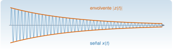

{.portada fig-alt="Una oscilación que decae, dibujada en azul, con su envolvente superior e inferior dibujadas en naranja como una curva exponencial decreciente"}

Una oscilación que decae tiene dos cosas que interesan: **cuánto oscila** (la amplitud, que va bajando) y **cuán deprisa** (la frecuencia, que en un oscilador lineal es constante). La transformada de Hilbert permite separarlas en cada instante: da la **envolvente** y la **fase instantánea** de una señal. En vibraciones sirve, sobre todo, para estimar el amortiguamiento de un modo a partir de su respuesta libre y para ver si la frecuencia depende de la amplitud (no linealidad). Pero tiene una condición de uso estricta —la señal debe ser de banda estrecha— y su incumplimiento es la fuente habitual de resultados absurdos.

::: {.callout-note}
## Cómo se lee esta página
**Tiempo orientativo:** unas 3 horas. **Nivel:** intermedio. Tres capas: **intuición** (laboratorio con dos componentes), **fundamento** (señal analítica y sus propiedades) y **aplicación** (amortiguamiento del primer modo del edificio).
:::

```{julia}
#| include: false
using Resonancia, LinearAlgebra, Statistics, Printf, Markdown
include("../../../recursos/r1-datos/_tema.jl")
```

## Objetivos y prerrequisitos

**Objetivos.** Al terminar esta página sabrás:

- definir la señal analítica y calcularla con la FFT (`hilbert_analitica`);
- obtener la envolvente, la fase y la frecuencia instantáneas de una señal y saber cuándo tienen sentido;
- estimar la frecuencia y el amortiguamiento de un modo a partir de su respuesta libre;
- reconocer los fallos habituales: señales multicomponente, bordes y ruido.

**Prerrequisitos.** [M2.5](../fourier/index.qmd) (DFT y fuga) y [M2.4](../laplace/index.qmd) (respuesta de un oscilador).

## Teoría breve

### M2.8.1 Señal analítica {#m2-8-1}

::: {.callout-note .historia icon=false title="Un poco de historia: de un problema de Riemann a la señal analítica"}
Según el resumen histórico de la Wikipedia en inglés, la transformada surgió en 1905 del trabajo de David Hilbert sobre un problema planteado por Riemann acerca de funciones analíticas (hoy llamado problema de Riemann–Hilbert); Hilbert la estudió sobre todo para funciones en la circunferencia, Schur extendió sus resultados al caso integral y Marcel Riesz mostró en 1928 que está acotada en los espacios $L^p$ con $1<p<\infty$. La interpretación como «señal analítica» para el procesado de señales **no** aparece en esa sección y no se atribuye aquí. Es una fuente enciclopédica: las atribuciones deben contrastarse con los originales.

<span class="fuentes-caja">Fuente: [Wikipedia, «Hilbert transform», sección «History»](https://en.wikipedia.org/wiki/Hilbert_transform). Consultado el 25-10-2026.</span>
:::

::: {#def-analitica}
**Señal analítica.** Para una señal real $x(t)$, $z(t)=x(t)+\mathrm j\,\mathcal H\{x\}(t)$, donde $\mathcal H\{x\}$ es la **transformada de Hilbert** de $x$: la señal que se obtiene desfasando $-90^\circ$ todas las componentes de frecuencia positiva (y $+90^\circ$ las de frecuencia negativa). Equivalentemente, $Z(f)=2X(f)$ para $f>0$, $Z(0)=X(0)$ y $Z(f)=0$ para $f<0$.
:::

La definición en frecuencia es la que se calcula: se hace la FFT, se anulan las frecuencias negativas, se duplican las positivas y se invierte (`hilbert_analitica`). Para $x(t)=\cos(2\pi f_0t)$ resulta $\mathcal H\{x\}=\sin(2\pi f_0t)$ y $z(t)=e^{\mathrm j2\pi f_0t}$, que gira a velocidad constante con módulo 1.

Si se escribe $z(t)=A(t)\,e^{\mathrm j\phi(t)}$, se definen

$$
A(t)=\lvert z(t)\rvert\;\text{(envolvente)},\qquad
\phi(t)=\arg z(t)\;\text{(fase instantánea)},\qquad
f_{\mathrm i}(t)=\frac{1}{2\pi}\frac{\mathrm d\phi}{\mathrm dt}\;\text{(frecuencia instantánea)}.
$$ {#eq-instantaneas}

### M2.8.2 Cuándo tienen sentido {#m2-8-2}

Las magnitudes de la @eq-instantaneas siempre se pueden calcular, pero solo son **interpretables** si la señal es de **banda estrecha**: si $x(t)=a(t)\cos\phi(t)$ con $a(t)$ que varía despacio frente a $\cos\phi(t)$ (condición de Bedrosian, de forma aproximada: el espectro de $a$ y el de $\cos\phi$ no se solapan), entonces $A(t)\approx a(t)$ y $f_{\mathrm i}$ es la frecuencia de la portadora. Para una suma de dos sinusoides de frecuencias próximas, $A(t)$ oscila (batido) y $f_{\mathrm i}(t)$ puede salirse de la banda e incluso hacerse negativa: es un resultado matemáticamente correcto y físicamente engañoso.

::: {.callout-warning}
## Una señal, un modo
Una respuesta de una estructura con varios modos no es de banda estrecha. **Antes de aplicar Hilbert hay que aislar un modo con un filtro paso banda** estrecho. Con el modo aislado, la envolvente de una respuesta libre es $A(t)=A_0e^{-\zeta\omega_nt}$, de modo que $\ln A(t)$ es una **recta de pendiente $-\zeta\omega_n$**, y de ella sale $\zeta$.
:::

### M2.8.3 Efectos de borde y ruido

La FFT supone un registro periódico: al principio y al final, la señal analítica sufre un efecto de borde (como la fuga de [M2.5](../fourier/index.qmd)). Por eso las estimaciones se hacen **sin los extremos**. Y con ruido, la fase instantánea es muy ruidosa donde la envolvente es pequeña (un ruido pequeño puede dar un giro completo de fase si la amplitud tiende a cero), de modo que hay que ajustar solo mientras la señal sobresale claramente del ruido.

## Aplicación: amortiguamiento del primer modo del edificio

Se simula la respuesta libre del edificio de tres plantas a un impulso en la cubierta ([M2.6](../espacio-estados/index.qmd)); se aísla el primer modo con una máscara espectral entre $0{,}8$ y $1{,}5$ Hz, y se calcula la señal analítica.

```{julia}
#| label: ej-hilbert-edificio
function respuesta_libre(N, dt)
    M, C, K = edificio_tres_plantas()
    A, B = espacio_estados(M, C, K, [0.0, 0.0, 1.0])
    Ad, Bd = discretizar_zoh(A, B, dt)
    Mi = inv(M)
    x = zeros(6)
    a = zeros(N)
    for k in 1:N
        u = k == 1 ? 1.0e6 : 0.0
        acc = Mi * ([0.0, 0.0, u] - C * x[4:6] - K * x[1:3])
        a[k] = acc[3]
        x = Ad * x + Bd * [u]
    end
    return a
end
N, dt = 4096, 0.01
a = respuesta_libre(N, dt)
t = (0:N-1) .* dt
fr = [(k <= N ÷ 2 ? k : k - N) / (N * dt) for k in 0:N-1]
modo1 = real(ifft_radix2(fft_radix2(a) .* (0.8 .< abs.(fr) .< 1.5)))
z1 = hilbert_analitica(modo1)
env1, ph1 = abs.(z1), fase_instantanea(z1)
ajuste = 300:2500                                           # sin los bordes
pendiente = ([ones(length(ajuste)) t[ajuste]] \ log.(env1[ajuste]))[2]
f_inst = diff(ph1[ajuste]) ./ (2π * dt)
M0, _, K0 = edificio_tres_plantas()
ω1 = 2π * modos_propios(K0, M0)[1][1]
zeta_est = -pendiente / ω1
(zeta_estimada = zeta_est, frecuencia_media = mean(f_inst), desviacion = std(f_inst))
```

La pendiente de $\ln A(t)$ da $\zeta=$ `{julia} coma(100 * zeta_est; d=3)` % (verdadero: $1{,}000\,\%$) y la frecuencia instantánea media es `{julia} coma(mean(f_inst); d=4)` Hz (verdadero: $1{,}1048$ Hz), con una desviación de `{julia} coma(std(f_inst); d=4)` Hz que es, básicamente, el efecto del filtrado y del redondeo.

```{julia}
#| label: fig-envolvente
#| fig-cap: "Respuesta libre de la cubierta tras aislar el primer modo (banda 0,8–1,5 Hz). Arriba, la señal y su envolvente (naranja). Abajo, el logaritmo de la envolvente con el ajuste lineal (negro) en el tramo sin bordes; su pendiente es $-\\zeta\\omega_n$."
#| fig-alt: "Arriba, una oscilación que decae con la envolvente superpuesta. Abajo, el logaritmo de la envolvente, casi una recta decreciente, con la recta de ajuste superpuesta."
fig = Figure(size=(780, 520))
ax1 = Axis(fig[1, 1]; xlabel="t (s)", ylabel="a (m/s²)", limits=(0, 40, nothing, nothing))
lines!(ax1, t, modo1; color=AZUL, linewidth=1)
lines!(ax1, t, env1; color=NARANJA, linewidth=2)
ax2 = Axis(fig[2, 1]; xlabel="t (s)", ylabel="ln A", limits=(0, 40, nothing, nothing))
lines!(ax2, t, log.(env1); color=NARANJA, linewidth=1.8)
ajus = ([ones(length(ajuste)) t[ajuste]] \ log.(env1[ajuste]))
lines!(ax2, t[ajuste], ajus[1] .+ ajus[2] .* t[ajuste]; color=TINTA, linewidth=2, linestyle=:dash)
fig
```

**Qué falla si no se filtra.** Con la respuesta completa (tres modos), la «frecuencia instantánea» oscila entre valores como `{julia} coma(minimum(diff(fase_instantanea(hilbert_analitica(a))[300:2500]) ./ (2π * dt)); d=0)` Hz y `{julia} coma(maximum(diff(fase_instantanea(hilbert_analitica(a))[300:2500]) ./ (2π * dt)); d=0)` Hz: es el batido de tres componentes, no la frecuencia de nada.

## Laboratorio: banda estrecha y batidos {#lab-hilbert}

```{ojs}
//| echo: false
import {hilbert} from "../../../recursos/js/matematicas.js"
```

**Simulación 1. Envolvente y frecuencia instantánea.** La señal es una oscilación de $10$ Hz que decae, más una segunda sinusoide de frecuencia y amplitud ajustables ($f_{\mathrm s}=100$ Hz, $N=1024$). Con la amplitud de la segunda en 0 se cumple la condición de banda estrecha; al subirla, la envolvente deja de ser la del primer modo.

```{ojs}
//| echo: false
viewof alfa = Inputs.range([0.1, 1.5], {value: 0.5, step: 0.05, label: "decaimiento α (1/s)"})
viewof a2 = Inputs.range([0, 1], {value: 0, step: 0.02, label: "amplitud de la 2.ª componente"})
viewof f2 = Inputs.range([10.2, 16], {value: 12, step: 0.1, label: "f₂ (Hz)"})
```

```{ojs}
//| echo: false
hil = {
  const N = 1024, fs = 100, t = Array.from({length: N}, (_, n) => n / fs);
  const x = t.map(tt => Math.exp(-alfa * tt) * Math.cos(2 * Math.PI * 10 * tt) + a2 * Math.exp(-alfa * tt) * Math.cos(2 * Math.PI * f2 * tt));
  const z = hilbert(x);
  const env = z.re.map((r, i) => Math.hypot(r, z.im[i]));
  let ph = z.re.map((r, i) => Math.atan2(z.im[i], r));
  for (let k = 1; k < N; k++) { const d = ph[k] - ph[k - 1]; ph[k] -= 2 * Math.PI * Math.round(d / (2 * Math.PI)); }
  const fi = ph.slice(1).map((p, k) => (p - ph[k]) * fs / (2 * Math.PI));
  return {t, x, env, fi, fs};
}
```

```{ojs}
//| echo: false
{
  const p = (xs, ys) => xs.map((x, i) => ({t: x, v: ys[i]}));
  const a = Plot.plot({width: 720, height: 230, marginLeft: 50, x: {label: "t (s)", domain: [0, 6]}, y: {label: "señal"},
    marks: [Plot.ruleY([0]), Plot.line(p(hil.t, hil.x), {x: "t", y: "v", stroke: "#1B6CA8"}), Plot.line(p(hil.t, hil.env), {x: "t", y: "v", stroke: "#D95F02", strokeWidth: 2}), Plot.line(p(hil.t, hil.env.map(v => -v)), {x: "t", y: "v", stroke: "#D95F02", strokeWidth: 2})]});
  const b = Plot.plot({width: 720, height: 200, marginLeft: 50, x: {label: "t (s)", domain: [0, 6]}, y: {label: "f instantánea (Hz)", domain: [0, 25], grid: true},
    marks: [Plot.ruleY([10], {stroke: "#9CA3AF", strokeDasharray: "4,4"}), Plot.line(p(hil.t.slice(1), hil.fi), {x: "t", y: "v", stroke: "#2A9D8F"})]});
  return html`${a}${b}`;
}
```

### Hipótesis y límites de la simulación 1 {#limites-sim1}

- **Señal:** dos componentes con el mismo decaimiento, sin ruido. Los efectos de borde se ven en los primeros y últimos instantes.
- **Qué se observa:** con $a_2=0$, la envolvente es $e^{-\alpha t}$ y la frecuencia instantánea vale $10$ Hz (la línea punteada); con $a_2>0$ y $f_2$ próxima, la envolvente oscila con la frecuencia de batido $\lvert f_2-10\rvert$ y la frecuencia instantánea oscila alrededor de 10 Hz, y con $f_2$ lejana, sus oscilaciones son muy rápidas.
- **Qué no se puede concluir:** que la frecuencia instantánea de una señal multicomponente sea «la frecuencia» de algo. Hay que separar primero las componentes.

## Práctica guiada

::: {.callout-note}
## Práctica guiada

1. Simula la respuesta libre del edificio (`espacio_estados` y `discretizar_zoh`) a 100 Hz durante 41 s.
2. Aísla el primer modo con un filtro paso banda ideal en la FFT (0,8–1,5 Hz).
3. Calcula la señal analítica y ajusta una recta a $\ln A(t)$ en el tramo central; deduce $\zeta$.
4. Repite sin filtrar y comprueba que la frecuencia instantánea carece de sentido.

::: {.panel-tabset}
## Julia

```julia
using Resonancia
z = hilbert_analitica(modo1)               # modo1: respuesta del modo aislado, N potencia de 2
env, fase = abs.(z), fase_instantanea(z)
tramo = 300:2500
pendiente = ([ones(length(tramo)) t[tramo]] \ log.(env[tramo]))[2]
zeta = -pendiente / (2π * f1)               # f1: frecuencia del modo (Hz)
```

## Python

```python
import numpy as np
import matrices as mx      # mse/m02-matematicas/python/matrices.py (probado con pytest)

z = mx.hilbert_analitica(modo1)
env, fase = np.abs(z), np.unwrap(np.angle(z))
tramo = slice(300, 2500)
pendiente = np.polyfit(t[tramo], np.log(env[tramo]), 1)[0]
zeta = -pendiente / (2 * np.pi * f1)
```
:::

El código Python **no se ejecuta en la web**: `hilbert_analitica` está probada con `pytest` frente a Julia y a `scipy.signal.hilbert` en [`python/matrices.py`](https://github.com/me1catrr/resonancia/blob/main/mse/m02-matematicas/python/matrices.py).
:::

## «Pídeselo a Claude» {#pideselo}

::: {.callout-tip}
## Prompt
«Con Julia y `Resonancia`: simula la respuesta libre del edificio de tres plantas con `edificio_tres_plantas`, `espacio_estados` y `discretizar_zoh` a 100 Hz durante 41 s con un impulso en la cubierta. Aísla el primer modo con un filtro paso banda, calcula la envolvente con `hilbert_analitica` y estima ζ ajustando una recta a ln A(t) en un tramo sin bordes. Repite añadiendo ruido blanco de σ = 1 % del máximo y dime cómo cambia la estimación.»

**Verifica.** (a) Que aísla un modo antes de calcular la envolvente. (b) Que ajusta el tramo central y no los bordes. (c) Que $\zeta=-\text{pendiente}/\omega_n$ y que el resultado ronda el $1\,\%$ sin ruido. (d) Que con ruido restringe el ajuste a donde la envolvente supera el ruido. (e) Que da el sesgo y la dispersión, no una sola cifra.
:::

## Ejercicios

::: {.ejercicio tipo="vf" id="m2-8-multi" respuesta="falso"}
La frecuencia instantánea de la señal analítica de un registro con tres modos es la frecuencia del modo dominante.

::: {.solucion}
**Falso.** Con varios componentes la señal no es de banda estrecha; la frecuencia instantánea oscila por el batido y puede salirse del rango de los modos.
:::
:::

::: {.ejercicio tipo="numerico" id="m2-8-zeta" respuesta="0.01" tol="1%"}
Una respuesta libre de un modo de $f=2$ Hz tiene una envolvente que cae de $1$ a $0{,}3$ en $9{,}6$ s. ¿Cuánto vale $\zeta$?

::: {.pista}
$\ln(0{,}3)=-1{,}204$; pendiente $=-1{,}204/9{,}6$; $\omega_n=2\pi\cdot2$.
:::

::: {.solucion}
Pendiente $=-0{,}1254$ s$^{-1}=-\zeta\omega_n$, luego $\zeta=0{,}1254/12{,}566=0{,}00998\approx1\,\%$.
:::
:::

::: {.ejercicio tipo="numerico" id="m2-8-hilbert-coseno" respuesta="1" tol="1%"}
La señal analítica de $x(t)=\cos(2\pi f_0t)$ es $e^{\mathrm j2\pi f_0t}$. ¿Cuánto vale su envolvente?

::: {.solucion}
$\lvert z\rvert=1$: es constante y igual a la amplitud.
:::
:::

::: {.ejercicio tipo="abierta" id="m2-8-hilbert-ruido"}
Estimas el amortiguamiento de un modo con la envolvente de Hilbert, pero la recta de $\ln A$ se dobla hacia arriba al final del registro. ¿Qué ha pasado y qué haces?

::: {.rubrica}
- Reconozco que al decaer la señal, el ruido domina y la envolvente deja de decaer (suelo de ruido).
- Propongo ajustar solo el tramo donde la señal supera claramente el ruido.
- Menciono los bordes de la FFT u otras causas (otro modo, no linealidad) como comprobaciones.
:::

::: {.solucion}
La envolvente se aplana porque el ruido sustituye a la señal. Se ajusta solo el tramo con señal por encima del ruido (por ejemplo, hasta que la envolvente baja a 3–5 veces la desviación del ruido) y se comprueba que el resultado no depende mucho del tramo elegido.
:::
:::

## La doy por superada si…

- [ ] Calculo la señal analítica con la FFT y obtengo envolvente, fase y frecuencia instantáneas.
- [ ] Sé que solo tienen sentido para señales de banda estrecha y aíslo un modo antes.
- [ ] Estimo $\zeta$ con la pendiente de $\ln A(t)$ y descarto bordes y suelo de ruido.
- [ ] Reconozco un batido de dos componentes en la envolvente.

## Qué no dice esta página

- No se demuestra la condición de Bedrosian ni se trata el valor principal de Cauchy de la definición integral de la transformada.
- El filtro paso banda es una máscara ideal en frecuencia; en la práctica se usan filtros FIR/IIR de fase cero (M3), con sus propios efectos de borde.
- El método de la envolvente es uno entre varios para estimar $\zeta$; su incertidumbre con ruido real no se ha estudiado con simulaciones de Monte Carlo.
- La interpretación de la frecuencia instantánea en sistemas no lineales (curvas de «esqueleto») no se desarrolla.
- La historia procede de una fuente enciclopédica y no cubre la señal analítica de procesado de señales.
