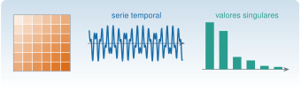
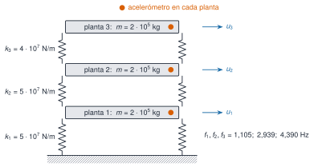

{.portada fig-alt="Una matriz de Hankel con las antidiagonales del mismo color, una señal con dos frecuencias y las barras de sus valores singulares, de mayor a menor"}

```{julia}
#| include: false
using Resonancia, LinearAlgebra, Statistics, DelimitedFiles, Printf, Markdown
include("../../recursos/r1-datos/_tema.jl")
RUTA = "../../datos/sinteticos/edificio-3-plantas/"
M3, C3, K3 = edificio_tres_plantas()
f3, Phi3 = modos_propios(K3, M3)
_, _, K3C = edificio_tres_plantas(escenario=:C)
f3C, Phi3C = modos_propios(K3C, M3)
A3, _ = espacio_estados(M3, C3, K3, [0.0, 0.0, 1.0])
fp, zp = polos_modales(A3)
f_anti = modos_propios(K3[1:2, 1:2], M3[1:2, 1:2])[1]
hz(v; d=3) = join(coma.(v; d=d), "; ")
```

Una sola pregunta guía esta sesión: **¿qué frecuencias y amortiguamientos tiene un edificio y cómo se reconocen en un registro de aceleración?** Para contestarla hacen falta tres herramientas matemáticas: los **valores propios**, que dan los modos a partir del modelo; los **polos** de la función de transferencia, que dicen cómo responde la estructura a una excitación; y la **transformada discreta de Fourier**, que lleva un registro muestreado al dominio de la frecuencia. La clase recorre las tres sobre el mismo edificio y termina con sus datos.

::: {.callout-note}
## El material completo está en matematicado
Esta página es la versión condensada para una clase. La teoría desarrollada, con demostraciones, once laboratorios, más de 60 ejercicios y temas que aquí solo se nombran (SVD, espacio de estados, transformada Z, Hilbert, procesos estocásticos y correlación), está en **[matematicado](https://me1catrr.github.io/matematicado/)**, el sitio de autoformación en matemáticas aplicadas a vibraciones que nace de esta sesión. Cada bloque termina con una caja «Para profundizar» que apunta a las secciones concretas.
:::

## Objetivos y prerrequisitos

**Objetivos.** Al terminar la sesión sabrás:

- plantear el cálculo de los modos de una estructura como un problema de valores propios generalizado y comparar dos conjuntos de modos con el MAC;
- leer la frecuencia y el amortiguamiento de un modo en un polo, y explicar por qué dos sensores ven los mismos picos y valles distintos;
- elegir la duración de un registro para resolver un pico y reconocer el aliasing y la fuga espectral;
- identificar los modos del edificio en la densidad espectral de un registro y compararlos con la verdad conocida.

**Prerrequisitos.** [J1 · Julia esencial](../../julia/j1-esencial/index.qmd), [J2.5 · Distribuciones y Monte Carlo](../../julia/j2-datos/j2-5-montecarlo/index.qmd), [J3.3 · Álgebra lineal numérica](../../julia/j3-computacion/j3-3-algebra-numerica/index.qmd), [C4 · Primeros pasos con Claude Code](../../claude/c4-claude-code/index.qmd) y el oscilador de un grado de libertad de [M5](../m05-vibraciones-i/index.qmd), aunque se recuerda lo necesario.

**Plan de la clase.**

::: {.indice-unidades}

| Bloque | Tiempo | Contenido |
|--------|--------|-----------|
| 0 · Un edificio de respuesta conocida | 10 min | El modelo, sus tres escenarios y por qué es sintético |
| [M2.1 · Modos](#m2-1) | 60 min | Problema de valores propios, ortogonalidad, normalización y MAC (Simulación 1) |
| *Pausa* | 10 min | |
| [M2.2 · Polos y FRF](#m2-2) | 50 min | Polos y amortiguamiento, función de transferencia, antirresonancias (Simulación 2) |
| *Pausa* | 10 min | |
| [M2.3 · Muestreo, DFT y fuga](#m2-3) | 60 min | Aliasing, resolución, fuga y ventanas (Simulación 3) |
| [M2.4 · El edificio en frecuencia](#m2-4) | 40 min | Densidad espectral del registro, práctica guiada, «Pídeselo a Claude» y mapa de lo que queda |

:::

**Total: 4 h**: 1 h 30 min de exposición, 2 h 10 min de práctica y laboratorios y 20 min de pausas.

Sesión anterior: [M1 · Caso real I](../m01-caso-real-i/index.qmd). Sesión siguiente: [M3 · Procesamiento de señales I](../m03-senales-i/index.qmd).

## Teoría breve

### Bloque 0 · Un edificio de respuesta conocida

{#fig-edificio fig-alt="Un edificio de tres plantas, cada una con un acelerómetro, unido al suelo por pilares; a la derecha, el modelo de tres masas unidas por tres muelles." width="70%"}

El banco de pruebas de toda la sesión es un **edificio de cortante** (*shear building*) de tres plantas: masas de $2\cdot10^5$ kg en cada planta, rigideces de entrepiso de $5\cdot10^7$, $5\cdot10^7$ y $4\cdot10^7$ N/m y un amortiguamiento de en torno al 1 %. Tiene tres registros de aceleración, de 600 s a 100 Hz, en `datos/sinteticos/edificio-3-plantas/`: el escenario **A** de referencia, el **B**, con las tres rigideces un 1 % menores (como haría la temperatura), y el **C**, con un 10 % menos de rigidez en el entrepiso 2 (un daño localizado).

Que sea **sintético** es su virtud: se conoce la respuesta correcta y cada método se puede validar contra ella. También es su límite, porque que un método funcione aquí no demuestra que funcione en una estructura real. El caso completo, con la dispersión de las estimaciones, está en [matematicado · E](https://me1catrr.github.io/matematicado/caso/edificio/index.html).

### M2.1 Modos: del modelo al problema de valores propios {#m2-1}

**El modelo.** Con un grado de libertad por planta, el equilibrio dinámico es

$$
\mathbf M\ddot{\mathbf u}+\mathbf C\dot{\mathbf u}+\mathbf K\mathbf u=\mathbf f(t),
$$ {#eq-movimiento}

con $\mathbf M$ diagonal y $\mathbf K$ tridiagonal. Las dos son **simétricas y definidas positivas**: $\mathbf v^{\mathsf T}\mathbf M\mathbf v$ es el doble de la energía cinética y $\mathbf v^{\mathsf T}\mathbf K\mathbf v$ el doble de la energía elástica, positivas para cualquier movimiento no nulo.

**Los modos.** Sin amortiguamiento ni fuerza, se buscan movimientos en los que todas las plantas oscilan con la misma frecuencia, $\mathbf u=\boldsymbol\varphi\,e^{\mathrm i\omega t}$. Sustituyendo en la @eq-movimiento:

$$
\left(\mathbf K-\omega^2\mathbf M\right)\boldsymbol\varphi=\mathbf 0 .
$$ {#eq-generalizado}

Es un **problema de valores propios generalizado**: $\lambda=\omega^2$ son los valores propios y $\boldsymbol\varphi$ las **formas modales**. Que $\mathbf M$ y $\mathbf K$ sean simétricas y definidas positivas garantiza tres cosas: los $\omega_j^2$ son reales y positivos, las formas modales son reales y son **ortogonales respecto de $\mathbf M$ y de $\mathbf K$**.

::: {.callout-tip .idea-clave title="Idea clave"}
Con las formas normalizadas a masa unidad, $\boldsymbol\Phi^{\mathsf T}\mathbf M\boldsymbol\Phi=\mathbf I$ y $\boldsymbol\Phi^{\mathsf T}\mathbf K\boldsymbol\Phi=\operatorname{diag}(\omega_j^2)$. El cambio $\mathbf u=\boldsymbol\Phi\mathbf q$ convierte el sistema acoplado en tres osciladores independientes de un grado de libertad. Por eso se habla de «los modos» de una estructura: cada uno vibra por su cuenta.
:::

Para el edificio, `modos_propios(K, M)` da $f=$ `{julia} hz(f3)` Hz, y comprueba que $\lVert\boldsymbol\Phi^{\mathsf T}\mathbf M\boldsymbol\Phi-\mathbf I\rVert$ es del orden de $10^{-15}$.

**Comparar formas: el MAC.** Para saber si dos vectores $\mathbf a$ y $\mathbf b$ describen la misma forma modal (de un modelo y de un ensayo, o antes y después de un cambio) se usa el criterio de semejanza modal (*modal assurance criterion*):

$$
\mathrm{MAC}(\mathbf a,\mathbf b)=\frac{\lvert\mathbf a^{\mathsf T}\mathbf b\rvert^2}{(\mathbf a^{\mathsf T}\mathbf a)(\mathbf b^{\mathsf T}\mathbf b)}\in[0,1].
$$

Vale 1 si las formas son proporcionales y 0 si son ortogonales. Entre los escenarios A y C, las frecuencias bajan un `{julia} hz(100 .* abs.(f3C ./ f3 .- 1); d=1)` %, pero los MAC siguen siendo `{julia} hz([mac(Phi3[:, j], Phi3C[:, j]) for j in 1:3]; d=4)`. **Las frecuencias son mucho más sensibles al daño que las formas.**

#### Simulación 1 · Modos del edificio {#lab-modos}

::: {.laboratorio .solo-pantalla}

```{ojs}
//| echo: false
import {edificioCortante, modosPropios, mac, fft, ventana, anchoBandaRuido, rng, normal} from "../../recursos/js/matematicas.js"
```

Modifica la rigidez de cada entrepiso y la masa de la cubierta. El gráfico compara las formas modales de referencia (gris) con las modificadas (azul); la tabla da las frecuencias y el MAC.

```{ojs}
//| echo: false
viewof dk1 = Inputs.range([-30, 30], {value: 0, step: 1, label: "Δk₁ (% de 5·10⁷ N/m)"})
viewof dk2 = Inputs.range([-30, 30], {value: -10, step: 1, label: "Δk₂ (% de 5·10⁷ N/m)"})
viewof dk3 = Inputs.range([-30, 30], {value: 0, step: 1, label: "Δk₃ (% de 4·10⁷ N/m)"})
viewof dmasa = Inputs.range([-30, 30], {value: 0, step: 1, label: "Δm₃ (% de 2·10⁵ kg)"})
```

```{ojs}
//| echo: false
modelo = {
  const m0 = [2e5, 2e5, 2e5], k0 = [5e7, 5e7, 4e7];
  const m1 = [2e5, 2e5, 2e5 * (1 + dmasa / 100)];
  const k1 = [k0[0] * (1 + dk1 / 100), k0[1] * (1 + dk2 / 100), k0[2] * (1 + dk3 / 100)];
  const a = edificioCortante(m0, k0), b = edificioCortante(m1, k1);
  const A = modosPropios(a.K, a.M), B = modosPropios(b.K, b.M);
  const col = (X, j) => { const v = X.Phi.map((f) => f[j]); const mx = v.reduce((s, x) => Math.abs(x) > Math.abs(s) ? x : s, 0); return v.map((x) => x / mx); };
  const signo = (j) => Math.sign(col(A, j).reduce((s, x, i) => s + x * col(B, j)[i], 0)) || 1;
  return {A, B, col, signo};
}
```

```{ojs}
//| echo: false
Plot.plot({
  width: 700, height: 260, marginLeft: 50,
  fx: {label: null, tickFormat: d => `Modo ${d + 1}`},
  x: {domain: [-1.3, 1.3], label: "desplazamiento relativo", ticks: 5},
  y: {domain: [0, 3.2], label: "planta", ticks: [0, 1, 2, 3]},
  marks: [
    Plot.ruleX([0], {stroke: "#6B7280", strokeDasharray: "4,4"}),
    ...[0, 1, 2].flatMap(j => {
      const ref = [0, ...modelo.col(modelo.A, j)].map((x, i) => ({x, y: i, j}));
      const mod = [0, ...modelo.col(modelo.B, j).map(x => x * modelo.signo(j))].map((x, i) => ({x, y: i, j}));
      return [
        Plot.line(ref, {fx: "j", x: "x", y: "y", stroke: "#9CA3AF", strokeWidth: 2}),
        Plot.line(mod, {fx: "j", x: "x", y: "y", stroke: "#1B6CA8", strokeWidth: 2.5}),
        Plot.dot(mod, {fx: "j", x: "x", y: "y", fill: "#1B6CA8", r: 4})
      ];
    })
  ]
})
```

```{ojs}
//| echo: false
html`<table class="table" style="max-width:560px"><thead><tr><th>Modo</th><th>f referencia (Hz)</th><th>f modificado (Hz)</th><th>Δf/f</th><th>MAC</th></tr></thead><tbody>${
[0, 1, 2].map((j) => {
  const fa = modelo.A.f[j], fb = modelo.B.f[j];
  const a = modelo.A.Phi.map((f) => f[j]), b = modelo.B.Phi.map((f) => f[j]);
  const fmt = (x, d) => x.toFixed(d).replace(".", ",");
  return `<tr><td>${j + 1}</td><td>${fmt(fa, 3)}</td><td>${fmt(fb, 3)}</td><td>${fmt(100 * (fb / fa - 1), 2)} %</td><td>${fmt(mac(a, b), 4)}</td></tr>`;
}).join("")}</tbody></table>`
```

:::

::: {.solo-impresion}

```{julia}
#| label: fig-modos-estatica
#| fig-cap: "Versión estática de la Simulación 1: formas modales del edificio de referencia (gris) y con un 10 % menos de rigidez en el entrepiso 2 (azul), normalizadas a desplazamiento máximo unidad."
#| fig-alt: "Tres gráficas, una por modo, con la planta en el eje vertical y el desplazamiento relativo en el horizontal. El modo 1 no cambia de signo, el 2 cambia una vez y el 3 dos veces. Las formas gris y azul casi coinciden."
norm_max(v) = v ./ v[argmax(abs.(v))]
fig = Figure(size=(780, 300))
for j in 1:3
    ax = Axis(fig[1, j]; title="Modo $j", xlabel="desplazamiento relativo", ylabel=j == 1 ? "planta" : "", limits=(-1.3, 1.3, 0, 3.2))
    vlines!(ax, [0]; color=GRIS, linestyle=:dash)
    a, b = norm_max(Phi3[:, j]), norm_max(Phi3C[:, j])
    lines!(ax, [0; a], 0:3; color=(GRIS, 0.7), linewidth=2.5)
    scatterlines!(ax, [0; b], 0:3; color=AZUL, linewidth=2)
end
fig
```

:::

**Qué se ve y qué no.** Las frecuencias se mueven bastante más que las formas, y no todas por igual: depende de cuánto se deforma cada modo en el entrepiso cambiado. Lo que la simulación no dice es si ese cambio se detectaría con sensores reales, ruido y temperatura; eso exige estimar la incertidumbre (M12). Los modos se calculan en el navegador con el método de Jacobi, contrastado con Julia.

::: {.ejercicio tipo="numerico" id="m2-clase-1gdl" respuesta="2.516" tol="1%" unidad="Hz"}
Una sola planta de $m=2\cdot10^5$ kg sobre un entrepiso de $k=5\cdot10^7$ N/m. ¿Cuál es su frecuencia natural en Hz?

::: {.pista}
Es el problema de valores propios con matrices de $1\times1$: $\omega^2=k/m$ y $f=\omega/2\pi$.
:::

::: {.solucion}
$\omega=\sqrt{5\cdot10^7/2\cdot10^5}=\sqrt{250}\approx15{,}81$ rad/s, así que $f\approx2{,}516$ Hz. Al añadir plantas, la frecuencia fundamental baja (1,105 Hz con tres) porque la estructura es más alta y más flexible.
:::
:::

::: {.ejercicio tipo="vf" id="m2-clase-misma-bajada" respuesta="falso"}
Si el entrepiso 2 pierde un 10 % de rigidez, las tres frecuencias del edificio bajan en el mismo porcentaje.

::: {.solucion}
Falso. En el escenario C bajan un 1,8 %, un 0,2 % y un 3,1 %. Cada modo pierde frecuencia en proporción a la energía de deformación que almacena en ese entrepiso, y el modo 2 casi no lo deforma.
:::
:::

::: {.callout-note .caso-real icon=false title="Para profundizar en matematicado"}
- Por qué la simetría y la definición positiva garantizan modos reales y ortogonales: [A1.2 · Matrices fundamentales](https://me1catrr.github.io/matematicado/algebra/matrices/a1-2.html). El MAC y otras matrices útiles: [A1.7](https://me1catrr.github.io/matematicado/algebra/matrices/a1-7.html).
- El problema de valores propios completo, con el cociente de Rayleigh y la sensibilidad de frecuencias y formas a un cambio de rigidez: [A2 · Valores propios](https://me1catrr.github.io/matematicado/algebra/valores-propios/index.html).
- Cuántas componentes independientes hay en los registros de varios sensores: [A3 · SVD](https://me1catrr.github.io/matematicado/algebra/svd/index.html).
:::

### M2.2 Polos y función de transferencia {#m2-2}

**De la ecuación a la función de transferencia.** Con condiciones iniciales nulas, la transformada de Laplace convierte la @eq-movimiento en una ecuación algebraica, $\left(\mathbf Ms^2+\mathbf Cs+\mathbf K\right)\mathbf U(s)=\mathbf F(s)$. Su inversa es la **matriz de transferencia** $\mathbf H(s)=\left(\mathbf Ms^2+\mathbf Cs+\mathbf K\right)^{-1}$: el elemento $H_{ij}$ dice cómo responde la planta $i$ a una fuerza en la planta $j$. Evaluada en $s=\mathrm i\omega$ es la **función de respuesta en frecuencia** (FRF).

**Los polos.** Son los valores de $s$ que anulan $\det(\mathbf Ms^2+\mathbf Cs+\mathbf K)$, y vienen en pares conjugados, uno por modo:

$$
s_k=-\zeta_k\omega_k\pm\mathrm i\,\omega_k\sqrt{1-\zeta_k^2},\qquad \omega_k=\lvert s_k\rvert,\qquad \zeta_k=-\frac{\operatorname{Re}s_k}{\lvert s_k\rvert}.
$$ {#eq-polo}

La parte real mide lo deprisa que se apaga el modo y la imaginaria es la frecuencia amortiguada. **Un polo es un modo**: frecuencia y amortiguamiento juntos en un número complejo. Sin amortiguamiento, los polos son $\pm\mathrm i\omega_k$, con los $\omega_k^2$ de la @eq-generalizado. Con amortiguamiento, son los valores propios de la matriz de estado $6\times6$ del edificio, que `polos_modales` calcula: $f=$ `{julia} hz(fp)` Hz y $\zeta=$ `{julia} hz(100 .* zp; d=2)` %.

**Polos y ceros.** Con los modos normalizados a masa unidad y amortiguamiento modal,

$$
H_{ij}(\mathrm i\omega)=\sum_{k=1}^{3}\frac{\varphi_{ik}\,\varphi_{jk}}{\omega_k^2-\omega^2+2\mathrm i\,\zeta_k\omega_k\omega}.
$$

Los denominadores, es decir, los polos, son **los mismos para cualquier par** $(i,j)$. Los numeradores no, y de ellos dependen los **ceros**: las frecuencias en las que, con fuerza en $j$, la planta $i$ no se mueve. En una FRF puntual ($i=j$) aparece una **antirresonancia** entre cada dos resonancias. En $H_{33}$ están en `{julia} hz(f_anti)` Hz, que son las frecuencias del edificio con la cubierta bloqueada.

#### Simulación 2 · FRF del edificio {#lab-frf}

::: {.laboratorio .solo-pantalla}

Elige la planta donde se excita, la planta donde se mide y el amortiguamiento modal. Se dibujan el módulo de la receptancia $H_{ij}(\mathrm i\omega)$ en dB (referencia: 1 m/N) y su fase. Las líneas grises marcan las frecuencias naturales.

```{ojs}
//| echo: false
viewof entrada = Inputs.radio([1, 2, 3], {value: 3, label: "planta de excitación j"})
viewof salida = Inputs.radio([1, 2, 3], {value: 3, label: "planta del sensor i"})
viewof zeta_lab = Inputs.range([0.002, 0.05], {value: 0.01, step: 0.002, transform: Math.log, label: "ζ (adimensional)"})
```

```{ojs}
//| echo: false
frf = {
  const e = edificioCortante([2e5, 2e5, 2e5], [5e7, 5e7, 4e7]);
  const m = modosPropios(e.K, e.M);
  const i = salida - 1, j = entrada - 1;
  const puntos = [];
  for (let f = 0.5; f <= 5.5001; f += 0.005) {
    const w = 2 * Math.PI * f;
    let re = 0, im = 0;
    for (let k = 0; k < 3; k++) {
      const wk = 2 * Math.PI * m.f[k], r = m.Phi[i][k] * m.Phi[j][k];
      const a = wk * wk - w * w, b = 2 * zeta_lab * wk * w, d = a * a + b * b;
      re += r * a / d; im += -r * b / d;
    }
    puntos.push({f, db: 20 * Math.log10(Math.hypot(re, im)), fase: Math.atan2(im, re) * 180 / Math.PI});
  }
  return {puntos, fn: m.f};
}
```

```{ojs}
//| echo: false
{
  const marcas = frf.fn.map(f => Plot.ruleX([f], {stroke: "#9CA3AF", strokeDasharray: "4,4"}));
  const a = Plot.plot({width: 700, height: 240, marginLeft: 55, x: {label: "f (Hz)"}, y: {label: "|H| (dB re 1 m/N)", grid: true},
    marks: [...marcas, Plot.line(frf.puntos, {x: "f", y: "db", stroke: "#1B6CA8", strokeWidth: 2})]});
  const b = Plot.plot({width: 700, height: 200, marginLeft: 55, x: {label: "f (Hz)"}, y: {label: "fase (°)", domain: [-185, 185], ticks: [-180, -90, 0, 90, 180], grid: true},
    marks: [...marcas, Plot.line(frf.puntos, {x: "f", y: "fase", stroke: "#D95F02", strokeWidth: 2})]});
  return html`${a}${b}`;
}
```

:::

::: {.solo-impresion}

```{julia}
#| label: fig-frf-estatica
#| fig-cap: "Versión estática de la Simulación 2: receptancias puntual $H_{33}$ (azul) y cruzada $H_{13}$ (naranja) del edificio con ζ = 1 %. Los picos están en las mismas frecuencias; solo la puntual tiene antirresonancias profundas."
#| fig-alt: "Dos curvas en decibelios entre 0,5 y 5,5 hercios con tres picos en las mismas frecuencias. La curva azul tiene dos valles profundos entre los picos; la naranja, valles poco marcados."
function receptancia(i, j, f; ζ=0.01)
    w = 2π * f
    sum(Phi3[i, k] * Phi3[j, k] / ((2π * f3[k])^2 - w^2 + 2im * ζ * 2π * f3[k] * w) for k in 1:3)
end
ff = range(0.5, 5.5; length=2001)
fig = Figure(size=(780, 320))
ax = Axis(fig[1, 1]; xlabel="f (Hz)", ylabel="|H| (dB re 1 m/N)")
vlines!(ax, f3; color=GRIS, linestyle=:dash)
lines!(ax, ff, [20log10(abs(receptancia(3, 3, f))) for f in ff]; color=AZUL, linewidth=2, label="H₃₃ (puntual)")
lines!(ax, ff, [20log10(abs(receptancia(1, 3, f))) for f in ff]; color=NARANJA, linewidth=2, label="H₁₃ (cruzada)")
axislegend(ax; position=:rt)
fig
```

:::

**Qué se ve y qué no.** Con $i=j$, entre cada dos picos aparece un valle profundo con un salto de fase de $+180^\circ$. Con $i\neq j$, los valles pueden desaparecer. Lo que no se puede concluir es que los valles sean propiedades de la estructura: dependen de dónde se excita y dónde se mide. **Los polos se identifican; los ceros, no.**

::: {.ejercicio tipo="numerico" id="m2-clase-zeta-polo" respuesta="0.0499" tol="1%"}
Un modo tiene el polo $s=-0{,}5+10\,\mathrm i$ rad/s. ¿Cuánto vale su amortiguamiento $\zeta$ (en tanto por uno)?

::: {.solucion}
Por la @eq-polo, $\zeta=0{,}5/\lvert s\rvert=0{,}5/\sqrt{0{,}25+100}\approx0{,}0499$, casi un 5 %. Su frecuencia natural es $\lvert s\rvert/2\pi\approx1{,}594$ Hz.
:::
:::

::: {.ejercicio tipo="opcion" id="m2-clase-dos-sensores" respuesta="b"}
Dos acelerómetros del mismo edificio, en plantas distintas, registran la misma excitación. ¿Qué cabe esperar de sus FRF?

::: {.opciones}
- Las mismas resonancias y las mismas antirresonancias.
- Las mismas resonancias y antirresonancias distintas.
- Resonancias distintas, porque cada sensor ve modos distintos.
:::

::: {.retro}
- No: las antirresonancias son ceros, y los ceros dependen del par sensor–excitación.
- Correcto: los polos son de la estructura y los ceros dependen de dónde se mide.
- No: un sensor puede no ver un modo si está en un nodo de su forma modal, pero la frecuencia del polo es la misma para todos.
:::
:::

::: {.callout-note .caso-real icon=false title="Para profundizar en matematicado"}
- La transformada de Laplace, la matriz de transferencia, los polos y su relación con los valores propios, ceros y antirresonancias, y la respuesta impulsional: [S1 · Laplace y función de transferencia](https://me1catrr.github.io/matematicado/sistemas/laplace/index.html).
- La matriz de estado, qué ve cada sensor (observabilidad) y cómo simular la respuesta sin error de discretización: [S2 · Espacio de estados](https://me1catrr.github.io/matematicado/sistemas/espacio-estados/index.html).
:::

### M2.3 Muestreo, DFT y fuga espectral {#m2-3}

**Muestrear.** Un acelerómetro digital toma una muestra cada $\Delta t=1/f_{\mathrm s}$. Un polo $s$ del sistema continuo pasa a ser un polo $z=e^{s\Delta t}$ del sistema muestreado: el amortiguamiento queda en el módulo $\lvert z\rvert=e^{-\zeta\omega\Delta t}$ y la frecuencia en el ángulo $\omega_{\mathrm d}\Delta t$. Como el ángulo solo se conoce salvo múltiplos de $2\pi$, **dos frecuencias que difieren en un múltiplo de $f_{\mathrm s}$ dan las mismas muestras**. Es el **aliasing**: cualquier componente por encima de la frecuencia de Nyquist, $f_{\mathrm s}/2$, se pliega sobre la banda $[0,f_{\mathrm s}/2]$ y aparece donde no está. Por eso se filtra *antes* de muestrear.

**La DFT.** Para $N$ muestras $x_n$, la transformada discreta de Fourier es

$$
X_k=\sum_{n=0}^{N-1}x_n\,e^{-\mathrm i2\pi kn/N},\qquad f_k=k\,\frac{f_{\mathrm s}}{N},\qquad \Delta f=\frac{f_{\mathrm s}}{N}=\frac{1}{T}.
$$

La **resolución** $\Delta f$ depende solo de la duración $T$ del registro, no de la frecuencia de muestreo. Un modo de frecuencia $f$ y amortiguamiento $\zeta$ tiene un pico de anchura $2\zeta f$ a $-3$ dB: para verlo con su anchura real hace falta $\Delta f<2\zeta f$. En el primer modo del edificio (1,105 Hz, 1 %), esa anchura es de 0,022 Hz, así que se necesitan **segmentos de al menos 45 s**.

**La fuga.** Un registro finito es la señal multiplicada por una ventana rectangular, y su DFT es el espectro verdadero convolucionado con el de la ventana. Si la frecuencia cae justo en un *bin*, no se nota. Si cae entre dos, la energía **fuga** hacia los vecinos, el pico baja y aparecen lóbulos laterales. Las **ventanas** (Hann, flat-top…) reducen esa fuga a cambio de ensanchar el pico. Rellenar con ceros interpola el espectro, pero **no** mejora la resolución.

#### Simulación 3 · Fuga, ventanas y relleno de ceros {#lab-fuga}

::: {.laboratorio .solo-pantalla}

Un registro de $N=128$ muestras con una sinusoide de amplitud 1, cuya frecuencia se da en *bins* (si no es entera, cae entre dos). Elige la ventana, el relleno de ceros y el ruido, y compara la amplitud estimada con la real.

```{ojs}
//| echo: false
viewof fbin = Inputs.range([8, 24], {value: 12.5, step: 0.05, label: "frecuencia (bins)"})
viewof vent = Inputs.select(["rectangular", "hann", "hamming", "blackman", "flattop"], {value: "rectangular", label: "ventana"})
viewof relleno = Inputs.select([1, 2, 4, 8], {value: 1, label: "relleno de ceros (×N)"})
viewof ruidoF = Inputs.range([0, 0.5], {value: 0, step: 0.01, label: "ruido σ (amplitud 1)"})
```

```{ojs}
//| echo: false
espec = {
  const N = 128, w = ventana(vent, N), g = rng(5);
  const x = Array.from({length: N}, (_, n) => (Math.cos(2 * Math.PI * fbin * n / N) + ruidoF * normal(g)) * w[n]);
  const M = N * relleno, z = x.concat(new Array(M - N).fill(0));
  const X = fft(z), suma = w.reduce((a, v) => a + v, 0);
  const amp = Array.from({length: M / 2 + 1}, (_, k) => ({f: k / relleno, a: 2 * Math.hypot(X.re[k], X.im[k]) / suma}));
  const pico = amp.reduce((m, p) => p.a > m.a ? p : m, amp[0]);
  return {amp, pico, enbw: anchoBandaRuido(w)};
}
```

```{ojs}
//| echo: false
Plot.plot({
  width: 720, height: 320, marginLeft: 55, x: {label: "bin de la DFT original", domain: [0, 40]},
  y: {label: "amplitud (dB, 0 dB = 1)", domain: [-100, 6], grid: true},
  marks: [
    Plot.ruleX([fbin], {stroke: "#9CA3AF", strokeDasharray: "4,4"}),
    Plot.line(espec.amp, {x: "f", y: d => 20 * Math.log10(Math.max(d.a, 1e-6)), stroke: "#1B6CA8", strokeWidth: 2}),
    Plot.dot([espec.pico], {x: "f", y: d => 20 * Math.log10(d.a), fill: "#D95F02", r: 4})
  ]
})
```

```{ojs}
//| echo: false
md`**Pico:** bin **${espec.pico.f.toFixed(2).replace(".", ",")}** (real: ${fbin.toFixed(2).replace(".", ",")}), amplitud estimada **${espec.pico.a.toFixed(3).replace(".", ",")}** (real: 1). ENBW de la ventana: **${espec.enbw.toFixed(2).replace(".", ",")} bins**.`
```

:::

::: {.solo-impresion}

```{julia}
#| label: fig-fuga-estatica
#| fig-cap: "Versión estática de la Simulación 3: DFT de 128 muestras de una sinusoide de amplitud 1. Con 12 bins exactos y ventana rectangular no hay fuga (gris); con 12,5 bins la rectangular fuga y subestima la amplitud (azul), y la de Hann concentra la energía a cambio de un pico más ancho (naranja)."
#| fig-alt: "Tres espectros en decibelios. El gris es una sola raya a 0 decibelios en el bin 12. El azul tiene el pico por debajo de 0 decibelios y unos lóbulos laterales que decaen despacio. El naranja tiene el pico cerca de 0 decibelios y lóbulos que caen mucho más deprisa."
function amplitud_dft(fbin, nombre; N=128, relleno=8)
    w = ventana(nombre, N)
    x = [cos(2π * fbin * n / N) * w[n+1] for n in 0:N-1]
    X = fft_radix2(complex.([x; zeros(N * (relleno - 1))]))
    k = 0:(N*relleno÷2)
    return k ./ relleno, 2 .* abs.(X[k .+ 1]) ./ sum(w)
end
fig = Figure(size=(780, 320))
ax = Axis(fig[1, 1]; xlabel="bin de la DFT original", ylabel="amplitud (dB, 0 dB = 1)", limits=(0, 40, -100, 6))
for (fb, nom, col, et) in ((12.0, :rectangular, GRIS, "12 bins, rectangular"), (12.5, :rectangular, AZUL, "12,5 bins, rectangular"), (12.5, :hann, NARANJA, "12,5 bins, Hann"))
    k, a = amplitud_dft(fb, nom)
    lines!(ax, k, 20 .* log10.(max.(a, 1e-6)); color=col, linewidth=2, label=et)
end
axislegend(ax; position=:rt)
fig
```

:::

**Qué se ve y qué no.** Con la rectangular y 12,5 bins, la amplitud sale un 36 % baja y la fuga se extiende lejos del pico. Con 12,0 bins la estimación es exacta. Rellenar con ceros suaviza el pico, pero no lo estrecha, y flat-top acierta la amplitud en cualquier frecuencia a costa de un pico muy ancho. No existe una ventana «mejor»: depende de si interesa la amplitud, la resolución o el rechazo de la fuga.

::: {.ejercicio tipo="numerico" id="m2-clase-alias" respuesta="30" tol="1%" unidad="Hz"}
Una vibración de 70 Hz se muestrea a 100 Hz sin filtro antialiasing. ¿A qué frecuencia aparece en el espectro?

::: {.solucion}
La frecuencia de Nyquist es de 50 Hz y 70 Hz se pliega a $\lvert70-100\rvert=30$ Hz: las muestras de una sinusoide de 70 Hz y las de una de 30 Hz son idénticas.
:::
:::

::: {.ejercicio tipo="numerico" id="m2-clase-duracion" respuesta="45.26" tol="1%" unidad="s"}
¿Qué duración mínima debe tener cada segmento para que la resolución $\Delta f$ sea menor que la anchura a $-3$ dB del primer modo del edificio ($f=1{,}105$ Hz, $\zeta=1\,\%$)?

::: {.solucion}
La anchura es $2\zeta f=0{,}0221$ Hz, y $T>1/0{,}0221\approx45{,}3$ s. Con los segmentos de 5,12 s de la Figura del bloque siguiente ($\Delta f\approx0{,}2$ Hz), el pico sale nueve veces más ancho de lo que es.
:::
:::

::: {.ejercicio tipo="vf" id="m2-clase-relleno" respuesta="falso"}
Rellenar con ceros un registro hasta multiplicar por 8 su longitud permite separar dos modos que estaban demasiado juntos para resolverse.

::: {.solucion}
Falso. El relleno interpola el mismo espectro con más puntos, pero la anchura del lóbulo principal la fija la duración real $T$ del registro. Para separar dos modos hay que medir durante más tiempo.
:::
:::

::: {.callout-note .caso-real icon=false title="Para profundizar en matematicado"}
- La transformada Z, la correspondencia entre los planos $s$ y $z$, el aliasing y la identificación con modelos autorregresivos: [S3 · Transformada Z](https://me1catrr.github.io/matematicado/sistemas/transformada-z/index.html) (el aliasing, en [S3.2](https://me1catrr.github.io/matematicado/sistemas/transformada-z/s3-2.html)).
- Series, transformada y DFT; resolución; fuga y ventanas; escalado de espectros de amplitud y de densidad espectral: [F1 · Fourier](https://me1catrr.github.io/matematicado/senales/fourier/index.html) (la DFT y la fuga, en [F1.3](https://me1catrr.github.io/matematicado/senales/fourier/f1-3.html) y [F1.4](https://me1catrr.github.io/matematicado/senales/fourier/f1-4.html)).
- Por qué la DFT diagonaliza las matrices circulantes: [A1.6](https://me1catrr.github.io/matematicado/algebra/matrices/a1-6.html).
:::

### M2.4 El edificio en frecuencia y mapa de matematicado {#m2-4}

Todo junto, sobre el registro de la cubierta del escenario A. Su densidad espectral de potencia (PSD), estimada con el método de Welch (que promedia periodogramas de segmentos con ventana de Hann), se compara con las frecuencias verdaderas:

```{julia}
#| label: fig-psd-edificio
#| fig-cap: "PSD de la aceleración de la cubierta (escenario A, 600 s a 100 Hz) por el método de Welch con segmentos de 512 muestras (5,12 s, Δf ≈ 0,2 Hz) y de 8192 (82 s, Δf ≈ 0,012 Hz). Las líneas grises son las frecuencias verdaderas."
#| fig-alt: "Dos curvas de densidad espectral en escala logarítmica entre 0,3 y 6 hercios, con tres picos junto a tres líneas verticales grises en 1,1, 2,9 y 4,4 hercios. La curva de segmentos cortos es suave, con picos anchos y bajos; la de segmentos largos tiene picos estrechos y altos y es más irregular."
D = readdlm(RUTA * "escenario_A.csv", ';', skipstart=1)
xr = D[:, 4] .- mean(D[:, 4])
fig = Figure(size=(780, 360))
ax = Axis(fig[1, 1]; xlabel="f (Hz)", ylabel="PSD (m/s²)²/Hz", yscale=log10, limits=(0.3, 6, nothing, nothing))
vlines!(ax, f3; color=GRIS, linestyle=:dash)
for (ns, c) in ((512, NARANJA), (8192, AZUL))
    f, P = psd_welch(xr, 100.0; nseg=ns)
    lines!(ax, f, P; color=c, linewidth=1.6, label="nseg = $ns (Δf = $(coma(100 / ns; d=3)) Hz)")
end
axislegend(ax; position=:rt)
fig
```

Lo que se lee en la @fig-psd-edificio reúne los tres bloques:

- **Los picos están en los polos** (M2.2): tres resonancias junto a las frecuencias de la @eq-generalizado, que el sensor de la cubierta ve todas porque no está en un nodo de ninguna forma modal (M2.1).
- **La resolución manda** (M2.3): con segmentos de 5 s los picos se ensanchan y su altura baja; con segmentos de 82 s se ven estrechos, a cambio de una curva más irregular porque se promedian menos segmentos. Es el compromiso entre resolución y varianza.
- **Las alturas no son las formas modales**: dependen de dónde está el sensor y de cómo se excita la estructura. Para obtener las formas hacen falta varios sensores y un método de identificación (M7).

**Lo que no se ha visto hoy.** Cada herramienta de matematicado responde a una pregunta:

::: {.indice-unidades}

| Herramienta | Pregunta a la que responde | En matematicado |
|-------------|----------------------------|-----------------|
| Toeplitz y Hankel | ¿Qué matrices se construyen a partir de un registro y de qué parten ERA y SSI? | [A1.4–A1.5](https://me1catrr.github.io/matematicado/algebra/matrices/a1-4.html) |
| SVD | ¿Cuántas componentes independientes hay en los registros de varios sensores? | [A3](https://me1catrr.github.io/matematicado/algebra/svd/index.html) |
| Espacio de estados | ¿Qué ve cada sensor y cómo se simula la respuesta sin error de discretización? | [S2](https://me1catrr.github.io/matematicado/sistemas/espacio-estados/index.html) |
| Transformada Z y AR | ¿Se pueden leer los polos en un modelo ajustado a las muestras? | [S3](https://me1catrr.github.io/matematicado/sistemas/transformada-z/index.html) |
| Hilbert | ¿Se puede leer el amortiguamiento en la envolvente de una respuesta libre? | [F2](https://me1catrr.github.io/matematicado/senales/hilbert/index.html) |
| Procesos estocásticos | ¿Cuándo basta un registro para conocer la estadística de una vibración ambiental? | [P1](https://me1catrr.github.io/matematicado/probabilidad/estocasticos/index.html) |
| Correlación | ¿Cómo se identifican los modos sin medir la excitación? | [P2](https://me1catrr.github.io/matematicado/probabilidad/correlacion/index.html) |

:::

## Práctica guiada

Reproduce en tu equipo los números de la clase: modos, polos y picos de la PSD del escenario A, comparados con la verdad.

::: {.panel-tabset}
## Julia

```julia
using Resonancia, LinearAlgebra, DelimitedFiles, Statistics
M, C, K = edificio_tres_plantas()                 # escenario A
f, Phi = modos_propios(K, M)                      # M2.1: f ≈ 1,105; 2,939; 4,390 Hz
@assert Phi' * M * Phi ≈ I                        # normalización a masa unidad
A, _ = espacio_estados(M, C, K, [0.0, 0.0, 1.0])
fp, zeta = polos_modales(A)                       # M2.2: los mismos f y ζ ≈ 1 %
_, _, Kc = edificio_tres_plantas(escenario=:C)
fc, Phic = modos_propios(Kc, M)
100 .* (fc ./ f .- 1), [mac(Phi[:, j], Phic[:, j]) for j in 1:3]

D = readdlm("datos/sinteticos/edificio-3-plantas/escenario_A.csv", ';', skipstart=1)
x = D[:, 4] .- mean(D[:, 4])                      # cubierta, sin la media
fw, P = psd_welch(x, 100.0; nseg=8192)            # M2.3: Δf = 100/8192 ≈ 0,012 Hz
picos = buscar_picos(fw, P; fmin=0.5, fmax=5.5, n=3, separacion=0.5)
sort(fw[picos])                                   # ≈ 1,111; 2,942; 4,395 Hz: compáralos con f
```

## Python

```python
import numpy as np
from scipy import linalg, signal
import matrices as mx      # mse/m02-matematicas/python/matrices.py (probado con pytest)

M, C, K = mx.edificio_tres_plantas("A", amortiguado=True)
w2, Phi = linalg.eigh(K, M)                       # Phi.T @ M @ Phi = I
f = np.sqrt(w2) / (2 * np.pi)
A, _ = mx.espacio_estados(M, C, K, [0.0, 0.0, 1.0])
fp, zeta = mx.polos_modales(A)
Mc, Kc = mx.edificio_tres_plantas("C")
fc = np.sqrt(linalg.eigh(Kc, Mc, eigvals_only=True)) / (2 * np.pi)
100 * (fc / f - 1)

D = np.loadtxt("datos/sinteticos/edificio-3-plantas/escenario_A.csv", delimiter=";", skiprows=1)
x = D[:, 3] - D[:, 3].mean()
fw, P = signal.welch(x, fs=100.0, window="hann", nperseg=8192, noverlap=4096)
banda = (fw > 0.5) & (fw < 5.5)
picos, _ = signal.find_peaks(P[banda], distance=40)
fw[banda][picos[np.argsort(P[banda][picos])[-3:]]]
```
:::

El código Python **no se ejecuta en la web**: las funciones de `matrices.py` tienen su versión probada en [`python/`](https://github.com/me1catrr/resonancia/blob/main/mse/m02-matematicas/python/matrices.py), contrastada con Julia mediante `referencia/matrices.json`.

## «Pídeselo a Claude» {#pideselo}

::: {.callout-tip}
## Prompt
«Con Julia y el paquete `Resonancia` del proyecto: lee `datos/sinteticos/edificio-3-plantas/escenario_A.csv` y `escenario_C.csv` (aceleraciones de tres plantas a 100 Hz, `;` como separador). Para la cubierta de cada escenario, estima la PSD por Welch con segmentos de 512, 2048 y 8192 muestras y localiza los tres picos. Compara las frecuencias de los picos con las que da `modos_propios` para cada escenario y dime, para cada duración de segmento, si el desplazamiento del primer modo entre A y C es mayor que la resolución $\Delta f$. Escribe el código en un fichero y ejecútalo; no me des números que no salgan de él.»

**Verifica.** (a) Que usa `psd_welch`, `modos_propios` y `edificio_tres_plantas` del paquete, no versiones propias. (b) Que $\Delta f=100/n_{\mathrm{seg}}$ y que lo compara con $\lvert f_1^C-f_1^A\rvert\approx0{,}02$ Hz: con 512 muestras ($\Delta f\approx0{,}2$ Hz) el cambio no se resuelve. (c) Que las frecuencias verdaderas de C son `{julia} hz(f3C)` Hz. (d) Que no confunde «el pico se movió» con «el daño es detectable»: con un único registro no hay estimación de la dispersión. Si lo afirma, pídele que lo justifique con bloques independientes, como en [matematicado · E](https://me1catrr.github.io/matematicado/caso/edificio/index.html).
:::

## Ejercicios

Los ejercicios de cada bloque están intercalados arriba. Este los integra; en [matematicado](https://me1catrr.github.io/matematicado/) hay más de 60, por tema.

::: {.ejercicio tipo="abierta" id="m2-clase-integrador"}
El escenario C del edificio tiene un 10 % menos de rigidez en el entrepiso 2. Explica, con lo visto en los cuatro bloques, (1) qué cambia en los modos y en los polos, (2) qué cambia en la FRF puntual de la cubierta, y (3) cuánto tiempo de registro necesitarías para ver en la PSD el cambio del primer modo.

::: {.rubrica}
- Digo que bajan las tres frecuencias, cada una en distinta proporción (1,8 %, 0,2 % y 3,1 %), y que las formas apenas cambian (MAC > 0,999).
- Relaciono la bajada de frecuencias con el desplazamiento de los polos y explico que el amortiguamiento cambia poco.
- Explico que en $H_{33}$ se desplazan los picos y también las antirresonancias, porque el entrepiso 2 forma parte de la estructura con la cubierta bloqueada.
- Calculo que el cambio del primer modo es de unos 0,02 Hz y que hace falta $\Delta f$ menor que eso, es decir, segmentos de más de 50 s, además de varios segmentos para estimar la dispersión.
:::

::: {.solucion}
(1) Las frecuencias pasan de `{julia} hz(f3)` Hz a `{julia} hz(f3C)` Hz; los MAC entre las formas de A y C superan 0,999. Los polos se desplazan con las frecuencias y el amortiguamiento apenas cambia. (2) En la FRF puntual de la cubierta se desplazan los picos y las antirresonancias, porque estas son las frecuencias del edificio con la cubierta bloqueada, que también contiene el entrepiso 2. (3) El primer modo baja unos `{julia} coma(f3[1] - f3C[1]; d=3)` Hz: hace falta $\Delta f$ claramente menor, segmentos de bastante más de 50 s, y varios segmentos para saber si el desplazamiento supera la dispersión del estimador.
:::
:::

## La doy por superada si…

- [ ] Planteo el cálculo de los modos de un edificio como un problema de valores propios generalizado y explico qué garantizan la simetría y la definición positiva de $\mathbf M$ y $\mathbf K$.
- [ ] Calculo $f$ y $\zeta$ a partir de un polo y explico por qué los polos son los mismos para cualquier sensor y los ceros no.
- [ ] Elijo la duración de un registro para resolver un pico de amortiguamiento conocido y predigo dónde aparece una componente con aliasing.
- [ ] Reconozco la fuga en un espectro y sé qué cambian una ventana y el relleno de ceros.
- [ ] Identifico los modos del edificio en su PSD y sé en qué página de [matematicado](https://me1catrr.github.io/matematicado/) seguir para cada herramienta que no se ha visto en clase.
