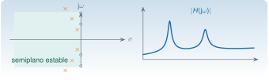

{.portada fig-alt="El plano complejo s con seis polos en el semiplano izquierdo y cuatro ceros sobre el eje imaginario, junto a la curva del módulo de una función de respuesta en frecuencia con dos resonancias"}

La transformada de Laplace convierte una ecuación diferencial en una ecuación algebraica. Lo que sale de ahí, la **función de transferencia**, resume cómo un sistema lineal responde a cualquier entrada, y tiene dos tipos de números que lo caracterizan: los **polos**, que son propiedades del sistema (frecuencias y amortiguamientos de los modos), y los **ceros**, que dependen de dónde se excita y dónde se mide. En identificación modal, los polos son lo que se quiere estimar, y los ceros explican por qué dos sensores del mismo edificio ven la misma estructura con formas tan distintas.

El sistema de un grado de libertad (polos, residuos, respuesta impulsional) está desarrollado en [M5](../../m05-vibraciones-i/index.qmd#m5-6). Esta página aporta lo que falta para varios grados de libertad: la matriz de transferencia, el efecto de los sensores y la conexión con la identificación.

::: {.callout-note}
## Cómo se lee esta página
**Tiempo orientativo:** unas 3 horas. **Nivel:** intermedio. Tres capas: **intuición** (mapa de polos y ceros, simulación), **fundamento** (definición, propiedades y teoremas) y **aplicación** (el edificio de tres plantas, [caso transversal](../edificio/index.qmd)).
:::

```{julia}
#| include: false
using Resonancia, LinearAlgebra, Statistics, Printf, Markdown
include("../../../recursos/r1-datos/_tema.jl")
M3, C3, K3 = edificio_tres_plantas()
f3, Phi3 = modos_propios(K3, M3)
zeta3 = diag(Phi3' * C3 * Phi3) ./ (2 .* 2π .* f3)       # amortiguamiento modal exacto
Hrec(ω) = inv(K3 - ω^2 * M3 + im * ω * C3)               # receptancia: desplazamientos / fuerzas
```

## Objetivos y prerrequisitos

**Objetivos.** Al terminar esta página sabrás:

- definir la transformada de Laplace y usar sus propiedades (linealidad, derivación, convolución, teorema del valor final) para resolver ecuaciones diferenciales lineales;
- obtener la función de transferencia de un sistema de varios grados de libertad y su descomposición en modos;
- relacionar los polos con los valores propios de la matriz de estado y con las frecuencias y los amortiguamientos modales;
- relacionar los ceros con la elección de entrada y salida, y explicar las antirresonancias;
- distinguir la función de transferencia $H(s)$ de la respuesta en frecuencia $H(\mathrm j\omega)$ y explicar por qué esta es la que se mide;
- decidir con los polos si un sistema es estable.

**Prerrequisitos.** [M2.2](../valores-propios/index.qmd) (modos) y [M5](../../m05-vibraciones-i/index.qmd) (oscilador de un grado de libertad); [J3.6](../../../julia/j3-computacion/j3-6-edos/index.qmd) para las ecuaciones diferenciales.

## Teoría breve

### M2.4.1 La transformada de Laplace {#m2-4-1}

::: {.callout-note .historia icon=false title="Un poco de historia: de las integrales de Euler al cálculo operacional"}
Según el resumen histórico de la Wikipedia en inglés, Euler examinó integrales relacionadas con la transformada a partir de 1744; Laplace usó una transformada similar en probabilidad (escribió sobre funciones generatrices en 1814) y la aplicó a ecuaciones en diferencias desde 1785; Cauchy desarrolló un cálculo operacional hacia 1821, y Heaviside la popularizó hacia el cambio de siglo. Es una fuente enciclopédica, y no se ha contrastado con los originales: las fechas deben tomarse como orientativas.

<span class="fuentes-caja">Fuente: [Wikipedia, «Laplace transform», sección «History»](https://en.wikipedia.org/wiki/Laplace_transform). Consultado el 25-10-2026.</span>
:::

::: {#def-laplace}
**Transformada de Laplace.** Para una señal $x(t)$ con $x(t)=0$ si $t<0$, $X(s)=\mathcal L[x](s)=\displaystyle\int_{0}^{\infty}x(t)\,e^{-st}\,\mathrm dt$, con $s=\sigma+\mathrm j\omega$ complejo, para los $s$ en los que la integral converge (**región de convergencia**).
:::

La transformada «pesa» la señal con una exponencial $e^{-st}$: la parte real $\sigma$ amortigua las señales que crecen, y la imaginaria $\omega$ las proyecta sobre oscilaciones de frecuencia $\omega$. La transformada de Fourier (M2.5) es el caso $\sigma=0$ (cuando existe).

| Señal $x(t)$, $t\ge0$ | $X(s)$ |
|:--|:--|
| $\delta(t)$ (impulso) | $1$ |
| $1$ (escalón) | $1/s$ |
| $e^{-at}$ | $1/(s+a)$ |
| $\sin\omega t$ | $\omega/(s^2+\omega^2)$ |
| $e^{-\sigma_0 t}\sin\omega_dt$ | $\omega_d/((s+\sigma_0)^2+\omega_d^2)$ |

: Pares de transformadas de uso frecuente. {#tbl-pares}

Propiedades (con condiciones iniciales nulas): **linealidad**; **derivación**, $\mathcal L[\dot x]=sX(s)-x(0)$ y $\mathcal L[\ddot x]=s^2X(s)-sx(0)-\dot x(0)$; **convolución**, $\mathcal L[x*h]=X(s)H(s)$; y **valor final**, si todos los polos de $sX(s)$ están en el semiplano izquierdo, $\lim_{t\to\infty}x(t)=\lim_{s\to0}sX(s)$.

::: {.callout-note .demostracion collapse="true" title="Demostración de la derivación y de la convolución"}
**Derivación.** Integrando por partes, $\int_0^\infty\dot x\,e^{-st}\mathrm dt=\big[x\,e^{-st}\big]_0^\infty+s\int_0^\infty x\,e^{-st}\mathrm dt=-x(0)+sX(s)$ (el término en $\infty$ se anula en la región de convergencia). Aplicando la fórmula dos veces se obtiene la de $\ddot x$.

**Convolución.** $\mathcal L[x*h]=\int_0^\infty\!\!\int_0^t x(\tau)h(t-\tau)\,\mathrm d\tau\,e^{-st}\mathrm dt$. Cambiando el orden de integración y poniendo $u=t-\tau$, queda $\int_0^\infty x(\tau)e^{-s\tau}\mathrm d\tau\int_0^\infty h(u)e^{-su}\mathrm du=X(s)H(s)$. $\square$
:::

### M2.4.2 Función de transferencia {#m2-4-2}

Para $\mathbf M\ddot{\mathbf u}+\mathbf C\dot{\mathbf u}+\mathbf K\mathbf u=\mathbf B\,\mathbf f(t)$ con condiciones iniciales nulas, la transformada es $(s^2\mathbf M+s\mathbf C+\mathbf K)\mathbf U(s)=\mathbf B\mathbf F(s)$. Si se mide una combinación lineal de desplazamientos, $\mathbf y=\mathbf L\mathbf u$, la **matriz de transferencia** es

$$
\mathbf H(s)=\mathbf L\,(s^2\mathbf M+s\mathbf C+\mathbf K)^{-1}\mathbf B.
$$ {#eq-transferencia}

Sus elementos son cocientes de polinomios en $s$: $H_{ij}(s)=N_{ij}(s)/D(s)$. Las raíces del **denominador común** $D(s)=\det(s^2\mathbf M+s\mathbf C+\mathbf K)$ son los **polos**; las raíces del numerador de cada elemento, los **ceros**.

**Descomposición modal.** Con amortiguamiento proporcional y los modos $\boldsymbol\varphi_k$ normalizados a masa unidad (M2.2), cada elemento de la receptancia es una suma de $n$ osciladores:

$$
H_{ij}(s)=\sum_{k=1}^{n}\frac{\varphi_{ik}\,\varphi_{jk}}{s^2+2\zeta_k\omega_k s+\omega_k^2},
\qquad \zeta_k=\frac{\boldsymbol\varphi_k^{\mathsf T}\mathbf C\boldsymbol\varphi_k}{2\omega_k}.
$$ {#eq-modal}

Es la fórmula que une toda la unidad: los **polos** $s_k=-\zeta_k\omega_k\pm\mathrm j\omega_k\sqrt{1-\zeta_k^2}$ dependen solo de la estructura; la forma modal solo entra como el **residuo** $\varphi_{ik}\varphi_{jk}$ de cada polo, que depende de dónde se excita ($j$) y de dónde se mide ($i$). De ahí sale que, midiendo con sensores en distintos puntos, **las frecuencias son las mismas y las formas se obtienen de los residuos**.

```{julia}
#| label: ej-suma-modal
ω_prueba = 2π * 2.0
Hm = sum(Phi3[:, k] * Phi3[:, k]' / ((2π * f3[k])^2 - ω_prueba^2 + 2im * zeta3[k] * 2π * f3[k] * ω_prueba) for k in 1:3)
err_modal = maximum(abs.(Hm - Hrec(ω_prueba))) / maximum(abs.(Hrec(ω_prueba)))
```

La suma modal reproduce la inversión directa de $\mathbf K-\omega^2\mathbf M+\mathrm j\omega\mathbf C$ en $f=2$ Hz con un error relativo de `{julia} @sprintf("%.0e", err_modal)` (redondeo): la @eq-modal es una identidad exacta cuando el amortiguamiento es proporcional.

### M2.4.3 Polos, estabilidad y valores propios {#m2-4-3}

Con la forma de estado $\dot{\mathbf x}=\mathbf A\mathbf x+\mathbf B\mathbf u$ ([espacio de estados](../espacio-estados/index.qmd)), los polos de $\mathbf H(s)$ son valores propios de $\mathbf A$. Un sistema lineal e invariante es **asintóticamente estable** si todos los polos están en el semiplano izquierdo abierto, $\operatorname{Re}(s_k)<0$: las respuestas libres decaen. Un polo en el eje imaginario (sin amortiguamiento) da oscilaciones que no decaen, y un polo con parte real positiva, una respuesta que crece. Una estructura real tiene siempre amortiguamiento positivo, así que si un procedimiento de identificación devuelve polos en el semiplano derecho, lo que se ha identificado no es una estructura estable: es un **polo espurio** o un error.

Que *todos* los valores propios de $\mathbf A$ sean polos de un $H_{ij}(s)$ concreto no está garantizado: si la entrada no excita un modo o la salida no lo observa, ese polo se cancela con un cero. Es el problema de **controlabilidad y observabilidad**, que se desarrolla en la página de [espacio de estados](../espacio-estados/index.qmd).

### M2.4.4 Ceros y antirresonancias {#m2-4-4}

Los ceros de $H_{ij}(s)$ son las frecuencias a las que, con entrada en $j$, la salida en $i$ se anula. Hay un hecho clásico, comprobable con el edificio: **la receptancia en un punto** ($i=j$, sensor y excitación en el mismo grado de libertad) tiene un cero entre cada dos polos consecutivos, y esos ceros (sin amortiguamiento) son las frecuencias naturales de la estructura *con ese grado de libertad bloqueado*. Los ceros de $H_{ij}$ con $i\ne j$ son otros y dependen del par. En una cadena tridiagonal como el edificio de cortante, el elemento $(i,j)$ de la inversa se calcula con los menores principales de los extremos; cuando sensor y fuerza están en **los dos extremos** (plantas 1 y 3), el numerador es una constante y $H_{13}$ **no tiene ceros finitos**: solo tiene valles poco profundos entre resonancias, como cualquier función con picos próximos.

```{julia}
#| label: ej-ceros
f_anti = modos_propios(K3[1:2, 1:2], M3[1:2, 1:2])[1]          # planta 3 bloqueada
fs = range(0.5, 5.5; length=200_001)
mag33 = [abs(Hrec(2π * x)[3, 3]) for x in fs]
i_min = [k for k in 2:length(fs)-1 if mag33[k] < mag33[k-1] && mag33[k] < mag33[k+1]]
(frecuencias_con_planta_3_bloqueada = f_anti, minimos_de_la_FRF_H33 = fs[i_min])
```

Con la planta 3 bloqueada, el edificio tiene frecuencias de `{julia} join(coma.(f_anti; d=3), " y ")` Hz; la FRF puntual en la cubierta tiene mínimos en `{julia} join(coma.(fs[i_min]; d=3), " y ")` Hz. La primera coincide dentro del $0{,}1\,\%$; la segunda se aparta un $0{,}5\,\%$ porque el amortiguamiento y la cercanía del tercer polo desplazan el mínimo de módulo (con amortiguamiento, el cero exacto sale del eje imaginario).

```{julia}
#| label: tbl-valles
#| tbl-cap: "Valles de la receptancia $H_{ij}$ entre 0,5 y 5,5 Hz: frecuencia y profundidad respecto del menor de los dos picos vecinos (dB). Un valle muy profundo indica un cero cerca del eje imaginario."
modulo(i, j) = [abs(Hrec(2π * x)[i, j]) for x in fs]
function valles(i, j)
    v = modulo(i, j)
    m = [k for k in 2:length(v)-1 if v[k] < v[k-1] && v[k] < v[k+1]]
    p = [k for k in 2:length(v)-1 if v[k] > v[k-1] && v[k] > v[k+1]]
    [(fs[k], 20log10(v[k] / min(maximum(v[q] for q in p if fs[q] < fs[k]), maximum(v[q] for q in p if fs[q] > fs[k])))) for k in m]
end
sub = Dict(1 => "₁", 2 => "₂", 3 => "₃")
filas = String[]
for (i, j) in [(1, 1), (2, 2), (3, 3), (1, 2), (2, 3), (1, 3)]
    vs = valles(i, j)
    push!(filas, "| H" * sub[i] * sub[j] * " | " * join(["$(coma(f; d=2)) Hz: $(coma(d; d=1)) dB" for (f, d) in vs], " · ") * " |")
end
Markdown.parse("| Elemento | Valles (frecuencia y profundidad) |\n|:--|:--|\n" * join(filas, "\n"))
```

Los valles de las FRF puntuales ($H_{11}$, $H_{22}$) son entre 39 y 56 dB más bajos que los picos vecinos; los de la no puntual de los extremos ($H_{13}$), solo 12–23 dB. $H_{12}$ tiene un cero cerca del eje a 2,25 Hz (la frecuencia $\sqrt{k_3/m}/2\pi$) y un valle profundo allí. La segunda antirresonancia de $H_{33}$ es poco profunda (13 dB) porque su cero queda muy cerca del tercer polo (4,29 Hz frente a 4,39 Hz). La profundidad **no** es una propiedad de la estructura: depende del par entrada–salida.

```{julia}
#| label: fig-polos-ceros
#| fig-cap: "Plano $s$ de la receptancia puntual en la cubierta, $H_{33}$. Los polos (cruces) están en el semiplano izquierdo, muy cerca del eje imaginario porque $\\zeta\\approx1\\,\\%$; los ceros (círculos), sin amortiguamiento, estarían exactamente sobre el eje imaginario, en las frecuencias del edificio con la planta 3 bloqueada. Se alternan: un cero entre cada dos polos. La escala horizontal es mucho más fina que la vertical para que se vea la parte real."
#| fig-alt: "Plano complejo con tres pares de polos conjugados en el semiplano izquierdo, cerca del eje imaginario, y dos pares de ceros sobre el eje imaginario situados entre los polos, de modo que se alternan polos y ceros al subir por el eje."
A3, _ = espacio_estados(M3, C3, K3, [0.0, 0.0, 1.0])
s_polos = filter(p -> imag(p) > 0, eigvals(A3))
ωz = 2π .* f_anti
fig = Figure(size=(560, 420))
ax = Axis(fig[1, 1]; xlabel="parte real, σ (rad/s)", ylabel="parte imaginaria, ω (rad/s)", limits=(-1.0, 0.4, -32, 32))
vlines!(ax, [0.0]; color=GRIS)
scatter!(ax, vcat(real.(s_polos), real.(s_polos)), vcat(imag.(s_polos), -imag.(s_polos)); marker=:xcross, color=NARANJA, markersize=16, label="polos")
scatter!(ax, zeros(4), vcat(ωz, -ωz); marker=:circle, color=:white, markersize=11, strokewidth=2, strokecolor=AZUL, label="ceros (sin amortiguamiento)")
axislegend(ax; position=:rb)
fig
```

::: {.callout-warning}
## Polos y ceros no se leen igual en una medida

Los polos que se identifican de un registro de aceleraciones son **los mismos** con cualquier sensor. Los ceros no: cambian con la posición del sensor y de la excitación, y por eso las antirresonancias **no** son propiedades de la estructura sino del experimento. Un sensor colocado en un nodo de un modo (residuo nulo) no ve ese polo; y un par polo–cero muy próximo (que casi se cancelan) lleva un residuo pequeño y es difícil de identificar.
:::

### M2.4.5 Respuesta en frecuencia y respuesta impulsional {#m2-4-5}

Sobre el eje imaginario, $\mathbf H(\mathrm j\omega)$ es la **respuesta en frecuencia** (FRF): la amplitud y la fase con que el sistema transforma una excitación armónica de frecuencia $\omega$ en régimen estacionario. La respuesta impulsional $\mathbf h(t)=\mathcal L^{-1}[\mathbf H(s)]$ se obtiene por fracciones simples: cada par de polos aporta un término $\frac{\varphi_{ik}\varphi_{jk}}{\omega_{dk}}e^{-\zeta_k\omega_kt}\sin\omega_{dk}t$. Ambas contienen la misma información; la FRF es la que se mide con excitación controlada, y la respuesta impulsional (o sus covarianzas) es la que alimenta a ERA y a SSI ([M2.1.5](../matrices/index.qmd#m2-1-5)).

La conexión con la medición ambiental es que, si no se conoce la fuerza, no se puede calcular $\mathbf H(\mathrm j\omega)$ como cociente salida/entrada. Lo que sí se tiene es la **densidad espectral** de las salidas, $\mathbf S_{yy}(\omega)=\mathbf H(\mathrm j\omega)\,\mathbf S_{ff}\,\mathbf H(\mathrm j\omega)^{\mathsf H}$, y si la entrada es ruido blanco ($\mathbf S_{ff}$ constante), la forma de $\mathbf S_{yy}$ la fija $\mathbf H$ (M2.5 y M7). Es la base de FDD.

## Laboratorio: ceros y antirresonancias en un edificio {#lab-frf}

```{ojs}
//| echo: false
import {edificioCortante, modosPropios} from "../../../recursos/js/matematicas.js"
```

**Simulación 1. FRF de un edificio de tres plantas.** Elige la planta donde se excita y la planta donde se mide, y el amortiguamiento modal (el mismo para los tres modos). Se dibuja el módulo de la receptancia $H_{ij}(\mathrm j\omega)$ en decibelios (con $1$ m/N de referencia) y su fase, con la frecuencia natural de cada modo marcada (línea vertical gris).

```{ojs}
//| echo: false
viewof entrada = Inputs.radio([1, 2, 3], {value: 3, label: "planta de excitación j"})
viewof salida = Inputs.radio([1, 2, 3], {value: 3, label: "planta del sensor i"})
viewof zeta_lab = Inputs.range([0.002, 0.05], {value: 0.01, step: 0.002, transform: Math.log, label: "ζ (adimensional)"})
```

```{ojs}
//| echo: false
frf = {
  const e = edificioCortante([2e5, 2e5, 2e5], [5e7, 5e7, 4e7]);
  const m = modosPropios(e.K, e.M);
  const i = salida - 1, j = entrada - 1;
  const puntos = [];
  for (let f = 0.5; f <= 5.5001; f += 0.005) {
    const w = 2 * Math.PI * f;
    let re = 0, im = 0;
    for (let k = 0; k < 3; k++) {
      const wk = 2 * Math.PI * m.f[k], r = m.Phi[i][k] * m.Phi[j][k];
      const a = wk * wk - w * w, b = 2 * zeta_lab * wk * w, d = a * a + b * b;
      re += r * a / d; im += -r * b / d;
    }
    puntos.push({f, db: 20 * Math.log10(Math.hypot(re, im)), fase: Math.atan2(im, re) * 180 / Math.PI});
  }
  return {puntos, fn: m.f};
}
```

```{ojs}
//| echo: false
{
  const marcas = frf.fn.map(f => Plot.ruleX([f], {stroke: "#9CA3AF", strokeDasharray: "4,4"}));
  const a = Plot.plot({width: 700, height: 240, marginLeft: 55, x: {label: "f (Hz)"}, y: {label: "|H| (dB re 1 m/N)", grid: true},
    marks: [...marcas, Plot.line(frf.puntos, {x: "f", y: "db", stroke: "#1B6CA8", strokeWidth: 2})]});
  const b = Plot.plot({width: 700, height: 200, marginLeft: 55, x: {label: "f (Hz)"}, y: {label: "fase (°)", domain: [-185, 185], ticks: [-180, -90, 0, 90, 180], grid: true},
    marks: [...marcas, Plot.line(frf.puntos, {x: "f", y: "fase", stroke: "#D95F02", strokeWidth: 2})]});
  return html`${a}${b}`;
}
```

### Hipótesis y límites de la simulación 1 {#limites-sim1}

- **Modelo:** edificio de cortante de tres plantas con amortiguamiento modal uniforme $\zeta$ (la página usa $\zeta\approx1\,\%$ con Rayleigh, algo distinta en el tercer modo); sin dinámica de sensores ni de la cimentación.
- **Qué se ve:** con $i=j$ aparecen **antirresonancias**: valles profundos entre resonancias, con un salto de fase de $+180^\circ$. Con $i\ne j$ depende del par: $H_{12}$ tiene un cero a 2,25 Hz, y $H_{13}$ no tiene ceros y solo muestra valles poco profundos y una fase que baja (véase la @tbl-valles).
- **Lo que no muestra:** la FRF de **aceleración** (la que miden los acelerómetros) es $-\omega^2H(\mathrm j\omega)$; cambia la pendiente pero no las posiciones de los polos.
- **Qué no se puede concluir:** que los valles a las frecuencias de las antirresonancias identifiquen propiedades de la estructura: dependen del sensor y de la excitación.

**Para explorar.** (1) Con $i=j=3$ cuenta las antirresonancias y compáralas con las frecuencias de la estructura con la planta 3 bloqueada (cálculo de la sección M2.4.4). (2) Con $i=1$, $j=3$ observa que los valles son mucho menos profundos y la fase no sube. (3) Sube $\zeta$ al 5 %: ¿qué pasa con la profundidad de las antirresonancias?

## Práctica guiada

::: {.callout-note}
## Práctica guiada

1. Calcula con Julia los polos del edificio como valores propios de $\mathbf A$ (`espacio_estados`) y con `polos_modales`; comprueba que dan las mismas frecuencias y los amortiguamientos del 1 %.
2. Calcula la receptancia $H_{33}(\mathrm j\omega)$ por inversión directa y por suma modal, y comprueba que coinciden.
3. Localiza sus mínimos y compara con las frecuencias del edificio con la planta 3 bloqueada.
4. Repite con $H_{13}$ y mide la profundidad de los valles (cociente entre el módulo en el mínimo y en la resonancia anterior).

::: {.panel-tabset}
## Julia

```julia
using Resonancia, LinearAlgebra
M, C, K = edificio_tres_plantas()
A, B = espacio_estados(M, C, K, [0.0, 0.0, 1.0])
f, zeta = polos_modales(A)                      # polos de la planta 3
H(ω) = inv(K - ω^2 * M + im * ω * C)
f_anti = modos_propios(K[1:2, 1:2], M[1:2, 1:2])[1]   # planta 3 bloqueada
```

## Python

```python
import numpy as np
from scipy import linalg
import matrices as mx      # mse/m02-matematicas/python/matrices.py (probado con pytest)

M, K = mx.edificio_tres_plantas("A")
H = lambda w, C: np.linalg.inv(K - w**2 * M + 1j * w * C)   # C: matriz de amortiguamiento
f_anti = np.sqrt(linalg.eigh(K[:2, :2], M[:2, :2], eigvals_only=True)) / (2 * np.pi)
```
:::

El código Python **no se ejecuta en la web**: su versión probada está en [`python/matrices.py`](https://github.com/me1catrr/resonancia/blob/main/mse/m02-matematicas/python/matrices.py).
:::

## «Pídeselo a Claude» {#pideselo}

::: {.callout-tip}
## Prompt
«Con Julia y el paquete `Resonancia`: para el edificio de tres plantas (`edificio_tres_plantas`), calcula la receptancia $H_{ij}(\mathrm j\omega)$ por inversión directa para $i,j\in\{1,2,3\}$, dibuja el módulo de las nueve en dB entre 0,5 y 5,5 Hz y dime en cuáles hay antirresonancias profundas. Verifica con la suma modal. No generalices más allá de este edificio.»

**Verifica.** (a) Que construye $\mathbf K-\omega^2\mathbf M+\mathrm j\omega\mathbf C$ y la invierte, en vez de dividir elemento a elemento. (b) Que la matriz es simétrica ($H_{ij}=H_{ji}$, reciprocidad). (c) Que la suma modal coincide con la inversión (error $\sim10^{-15}$). (d) Que cuantifica la profundidad de los valles en lugar de dar un «sí/no» (en este edificio hay valles profundos fuera de la diagonal, como $H_{12}$). (e) Que no atribuye las antirresonancias a «daño» ni a propiedades de la estructura.
:::

## Ejercicios

::: {.ejercicio tipo="vf" id="m2-4-polos-A" respuesta="falso"}
Todos los valores propios de la matriz de estado $\mathbf A$ son polos de **cualquier** función de transferencia $H_{ij}(s)$ del sistema.

::: {.solucion}
**Falso.** Si el modo no es controlable desde la entrada $j$ o no es observable desde la salida $i$, su polo se cancela con un cero y no aparece en $H_{ij}$. Un sensor en un nodo de un modo no lo ve.
:::
:::

::: {.ejercicio tipo="numerico" id="m2-4-zeta" respuesta="0.196" tol="1%"}
Un sistema tiene $H(s)=1/(s^2+2s+26)$. ¿Cuánto vale su amortiguamiento relativo $\zeta$?

::: {.pista}
Compara con $s^2+2\zeta\omega_ns+\omega_n^2$.
:::

::: {.solucion}
$\omega_n^2=26$ ($\omega_n=5{,}099$ rad/s) y $2\zeta\omega_n=2$, luego $\zeta=1/\sqrt{26}=0{,}196$. Los polos son $-1\pm5\mathrm j$.
:::
:::

::: {.ejercicio tipo="numerico" id="m2-4-valor-final" respuesta="0.02" tol="1%" unidad="m"}
Un oscilador con $m=2$ kg, $c=3$ N·s/m y $k=50$ N/m recibe un escalón de fuerza de 1 N. ¿A qué valor tiende el desplazamiento?

::: {.pista}
Teorema del valor final con $X(s)=H(s)/s$.
:::

::: {.solucion}
$x(\infty)=\lim_{s\to0}sH(s)/s=H(0)=1/k=0{,}02$ m. Los polos son estables ($c>0$), así que el teorema es aplicable.
:::
:::

::: {.ejercicio tipo="numerico" id="m2-4-antirresonancia" respuesta="2.381" tol="1%" unidad="Hz"}
En el edificio de tres plantas, ¿en qué frecuencia (la primera) tiene un mínimo profundo la FRF puntual de la cubierta $H_{33}$?

::: {.pista}
Es una frecuencia natural del edificio con la planta 3 bloqueada: elimina la fila y la columna 3 de $\mathbf K$ y $\mathbf M$.
:::

::: {.solucion}
Con la planta 3 bloqueada quedan dos plantas, con frecuencias de 2,381 Hz y 4,289 Hz; el primer valle de $H_{33}$ está en 2,381 Hz.
:::
:::

::: {.ejercicio tipo="opcion" id="m2-4-sensor" respuesta="c"}
Dos sensores colocados en plantas distintas del mismo edificio identifican las frecuencias naturales. ¿Qué es cierto?

::: {.opciones}
- Las frecuencias coinciden y las antirresonancias también.
- Las frecuencias son distintas porque cada sensor ve una parte diferente.
- Las frecuencias (polos) coinciden; las antirresonancias (ceros) dependen del sensor y de la excitación.
- Las frecuencias coinciden solo si los dos sensores están en la misma planta.
:::

::: {.solucion}
La **c**. Los polos son propiedades del sistema; los ceros dependen de la entrada y de la salida (@eq-transferencia).
:::
:::

::: {.ejercicio tipo="abierta" id="m2-4-espurio"}
Un procedimiento de identificación devuelve un polo con parte real positiva para un puente en servicio. ¿Qué puede significar? ¿Qué harías?

::: {.rubrica}
- Digo que un sistema físico con amortiguamiento positivo no tiene polos en el semiplano derecho, así que no es un modo del puente.
- Menciono causas posibles: orden del modelo demasiado alto, ruido, no estacionariedad, errores de procesado.
- Propongo acciones: bajar el orden, comprobar con un diagrama de estabilización, repetir con otros datos, descartar el polo.
:::

::: {.solucion}
Es un polo **espurio** (o un artefacto numérico): una estructura estable y amortiguada no puede tenerlo. Se descarta, y conviene revisar el orden del modelo, la calidad de los datos y los parámetros del algoritmo (M7).
:::
:::

## La doy por superada si…

- [ ] Enuncio la transformada de Laplace y aplico la derivación, la convolución y el valor final.
- [ ] Construyo la matriz de transferencia de un sistema de varios grados de libertad y la descompongo en modos.
- [ ] Relaciono los polos con los valores propios de $\mathbf A$ y con $f$ y $\zeta$ de cada modo.
- [ ] Distingo polos (propiedades de la estructura) de ceros (propiedades del experimento).
- [ ] Explico por qué aparecen antirresonancias en la FRF puntual y no en las no puntuales de una cadena.
- [ ] Explico por qué un polo con parte real positiva es espurio en una estructura.

## Qué no dice esta página

- No se estudia la región de convergencia en detalle ni la transformada inversa por integral de Bromwich; se usan fracciones simples y tablas.
- La ausencia de ceros de $H_{13}$ es propia de una cadena tridiagonal con sensor y fuerza en los extremos; no se generaliza a otra topología ni a otros pares.
- La relación entre ceros y antirresonancias supone amortiguamiento despreciable; con amortiguamiento los ceros salen del eje imaginario.
- La reciprocidad $H_{ij}=H_{ji}$ vale para sistemas lineales y reciprocos (sin giroscópicos ni no linealidades).
- La fecha de las aportaciones históricas procede de una fuente enciclopédica y debe contrastarse antes de citarse en un trabajo formal.
