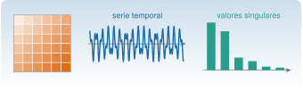
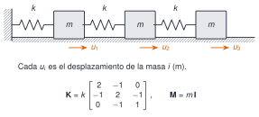

{.portada fig-alt="Una matriz de Hankel con las antidiagonales del mismo color, una señal con dos frecuencias y las barras de sus valores singulares, de mayor a menor"}

Una matriz con **estructura** es una matriz cuyas entradas no son independientes: están repetidas, son nulas casi todas, o siguen una regla. Esa estructura se paga y se cobra tres veces. Se **cobra** en memoria y en tiempo de cálculo, en propiedades que se pueden demostrar, y en algoritmos más rápidos y más estables. Se **paga** cuando la estructura se pierde: un ruido que rompe un rango, un redondeo que hace perder una simetría.

En vibraciones y análisis de señales aparecen siempre las mismas cuatro familias, y esta página las recorre una a una:

- las matrices de **masa y rigidez** de una estructura: simétricas, definidas positivas, dispersas y de banda;
- las matrices de **Toeplitz**, que son las covarianzas de una señal estacionaria;
- las matrices de **Hankel**, que son las que se construyen al desplazar una señal en el tiempo y de las que parten ERA y SSI;
- las matrices **circulantes**, que la transformada discreta de Fourier diagonaliza.

::: {.callout-note}
## Cómo se lee esta página
**Tiempo orientativo:** unas 4 horas, con los cuatro laboratorios y los ejercicios. **Nivel:** intermedio. En cada apartado hay tres capas: la **intuición** (figuras y laboratorios), el **fundamento** (definiciones, teoremas y demostraciones plegables) y la **aplicación** (ejemplos con registros reales o con modelos de estructuras). Las simulaciones se rotulan «Simulación n» y los resultados de Julia se calculan al compilar la página.
:::

```{julia}
#| include: false
using Resonancia, LinearAlgebra, SparseArrays, Statistics, Random, Markdown
include("../../../recursos/r1-datos/_tema.jl")
TORROJA = "../../../datos/reales-publicables/torroja-puente/2018-06-22-vibracion-ambiental/crudos/"
```

## Objetivos y prerrequisitos

**Objetivos.** Al terminar esta página sabrás:

- calcular normas y números de condición y explicar por qué un sistema lineal puede perder cifras decimales;
- reconocer una matriz simétrica, ortogonal, definida positiva, proyector, de Gram o de covarianza y decir qué significa físicamente;
- construir las matrices de masa y rigidez de una cadena de masas y muelles, representarlas como dispersas y estimar lo que se ahorra;
- construir matrices de Toeplitz, resolver las ecuaciones de Yule–Walker y predecir una señal;
- construir matrices de Hankel, interpretar sus valores singulares y reconstruir una señal con SSA;
- distinguir las cuatro matrices de Hankel que aparecen en identificación (trayectoria, parámetros de Markov, covarianzas y datos);
- calcular una convolución circular con la FFT y saber cuándo coincide con la lineal;
- comparar dos formas modales con el criterio MAC.

**Prerrequisitos.** [J1](../../../julia/j1-esencial/index.qmd), [J2.5](../../../julia/j2-datos/j2-5-montecarlo/index.qmd) y [J3.3](../../../julia/j3-computacion/j3-3-algebra-numerica/index.qmd): Julia básico, simulación con semilla y álgebra lineal numérica. Para los ejemplos de vibraciones, las ideas de masa, rigidez y frecuencia natural de [M5](../../m05-vibraciones-i/index.qmd).

**Reparto con otras unidades.** Aquí se explica el *concepto* y se implementan los ejemplos; la teoría de la FFT, la DFT práctica y el método de Welch están en M3.5–M3.6, y los algoritmos de identificación completos (ERA, FDD, SSI) en M7.5–M7.9. Esta página prepara la matemática de esos métodos y los enlaza.

## Teoría breve

### M2.1.1 Fundamentos de álgebra matricial {#m2-1-1}

::: {.callout-note .historia icon=false title="Un poco de historia: de las formas cuadráticas a las descomposiciones"}
Muchas de las descomposiciones matriciales de hoy nacieron antes de que se usaran matrices: se formularon con determinantes, sistemas de ecuaciones y formas cuadráticas. G. W. Stewart cuenta que Gauss describió su algoritmo de eliminación en 1823 como una reducción de una forma cuadrática; que Cauchy (1829) estableció propiedades de los valores propios de un sistema simétrico; que Jacobi (1846) dio su algoritmo para diagonalizar una matriz simétrica, y que la descomposición en valores singulares, en 1873, «se ve como una más de una larga serie de resultados sobre formas canónicas». Beltrami, Jordan y Sylvester llegaron a ella desde el álgebra lineal; Schmidt y Weyl, desde las ecuaciones integrales [@stewart1993].

<span class="fuentes-caja">Fuente: informe técnico de Stewart (U. de Maryland, TR-92-31), pp. 1–2 y 11–14, versión previa del artículo citado. Consultado el 25-10-2026.</span>
:::

Una matriz $\mathbf A\in\mathbb R^{m\times n}$ es la forma de escribir una **aplicación lineal** $T:\mathbb R^n\to\mathbb R^m$ cuando se han elegido una base en cada espacio. El producto de matrices es la **composición** de aplicaciones, y por eso no es conmutativo: aplicar primero $\mathbf B$ y después $\mathbf A$ no es lo mismo que al revés. Si se cambia la base del espacio de partida con una matriz invertible $\mathbf P$ (las coordenadas nuevas $\mathbf x'$ cumplen $\mathbf x=\mathbf P\mathbf x'$) y la del espacio de llegada con $\mathbf Q$, la matriz de la misma aplicación pasa a ser $\mathbf A'=\mathbf Q^{-1}\mathbf A\mathbf P$.

**Rango, núcleo e imagen.** El **núcleo** $\ker\mathbf A=\{\mathbf x:\mathbf A\mathbf x=\mathbf 0\}$ y la **imagen** $\operatorname{im}\mathbf A$ (el espacio generado por las columnas) cumplen $\operatorname{rango}(\mathbf A)+\dim\ker\mathbf A=n$. En una estructura, el núcleo de la matriz de rigidez son los movimientos que no deforman nada (movimientos de sólido rígido).

**Adjunta.** La adjunta $\mathbf A^*$ es la que cumple $\langle\mathbf A\mathbf x,\mathbf y\rangle=\langle\mathbf x,\mathbf A^*\mathbf y\rangle$: es la traspuesta $\mathbf A^{\mathsf T}$ en el caso real y la traspuesta conjugada $\mathbf A^{\mathsf H}$ en el complejo.

::: {#exm-cambio-base}
**Cambio de base.** El vector $\mathbf x=(3,\,1)$ en la base canónica, expresado en la base formada por $(1,1)$ y $(1,-1)$, es $\mathbf x'=\mathbf P^{-1}\mathbf x=(2,\,1)$ con $\mathbf P=\begin{bmatrix}1&1\\1&-1\end{bmatrix}$, porque $2\,(1,1)+1\,(1,-1)=(3,1)$. Es el mismo vector con otras coordenadas: lo que cambia es la descripción, no la cantidad física.
:::

#### Normas {#normas}

Una **norma** $\lVert\cdot\rVert$ mide el «tamaño» de un vector o de una matriz y cumple tres propiedades: es positiva salvo en cero, es homogénea ($\lVert\alpha\mathbf x\rVert=\lvert\alpha\rvert\lVert\mathbf x\rVert$) y cumple la desigualdad triangular. Para vectores, $\lVert\mathbf x\rVert_p=(\sum\lvert x_i\rvert^p)^{1/p}$. Para matrices se usan las normas **inducidas**, $\lVert\mathbf A\rVert=\max_{\mathbf x\neq\mathbf 0}\lVert\mathbf A\mathbf x\rVert/\lVert\mathbf x\rVert$, que dan la máxima amplificación que produce $\mathbf A$:

| Norma | Fórmula | Se calcula |
|---|---|---|
| $\lVert\mathbf A\rVert_1$ | máxima suma de columnas, $\max_j\sum_i\lvert a_{ij}\rvert$ | directamente |
| $\lVert\mathbf A\rVert_\infty$ | máxima suma de filas, $\max_i\sum_j\lvert a_{ij}\rvert$ | directamente |
| $\lVert\mathbf A\rVert_2$ | mayor valor singular $\sigma_{\max}$ | con la SVD |
| $\lVert\mathbf A\rVert_F$ | $\sqrt{\sum_{ij}a_{ij}^2}=\sqrt{\sum_k\sigma_k^2}$ | directamente (no es inducida) |

Entre ellas, $\lVert\mathbf A\rVert_2\le\lVert\mathbf A\rVert_F\le\sqrt{r}\,\lVert\mathbf A\rVert_2$, con $r$ el rango.

![Una matriz transforma la circunferencia unidad en una elipse. Los ejes de la elipse son los vectores $\sigma_i\mathbf u_i$ y proceden de las direcciones $\mathbf v_i$ de la circunferencia: es la descomposición en valores singulares, $\mathbf A=\mathbf U\boldsymbol\Sigma\mathbf V^{\mathsf T}$. Matriz del ejemplo: $\mathbf A=\left[\begin{smallmatrix}1{,}2&0{,}9\\-0{,}3&0{,}8\end{smallmatrix}\right]$, con $\sigma_1=1{,}527$ y $\sigma_2=0{,}806$.](fig/transformacion.svg){#fig-elipse fig-alt="A la izquierda, una circunferencia unidad con dos vectores perpendiculares v1 y v2. A la derecha, la elipse en que se transforma, con sus dos semiejes sigma1 u1 y sigma2 u2, también perpendiculares"}

La @fig-elipse es la imagen que hay que retener: $\lVert\mathbf A\rVert_2=\sigma_1$ es el semieje mayor de la elipse (lo máximo que estira $\mathbf A$) y $\sigma_2$ es el menor. Si $\sigma_2$ fuese cero, la elipse se aplastaría en un segmento y la matriz no tendría inversa.

#### Inversa, pseudoinversa y mínimos cuadrados

Si $\mathbf A$ es cuadrada e invertible, $\mathbf A\mathbf x=\mathbf b$ tiene la solución única $\mathbf x=\mathbf A^{-1}\mathbf b$. Cuando hay más ecuaciones que incógnitas (más medidas que parámetros), lo habitual es buscar la solución de **mínimos cuadrados**, la que minimiza $\lVert\mathbf A\mathbf x-\mathbf b\rVert_2$. La **pseudoinversa** $\mathbf A^+=\mathbf V\boldsymbol\Sigma^+\mathbf U^{\mathsf T}$ (que se construye con la SVD, invirtiendo solo los valores singulares no nulos) da, con $\mathbf x=\mathbf A^+\mathbf b$, la solución de mínimos cuadrados de menor norma. Las **ecuaciones normales** $\mathbf A^{\mathsf T}\mathbf A\mathbf x=\mathbf A^{\mathsf T}\mathbf b$ dan la misma solución, pero elevan al cuadrado el condicionamiento, como se ve a continuación.

#### Condicionamiento

El **número de condición** de una matriz invertible es $\kappa(\mathbf A)=\lVert\mathbf A\rVert\,\lVert\mathbf A^{-1}\rVert$. En norma 2 vale

$$
\kappa_2(\mathbf A)=\frac{\sigma_{\max}}{\sigma_{\min}} .
$$ {#eq-cond}

::: {#thm-perturbacion}
## Sensibilidad de un sistema lineal
Sea $\mathbf A$ invertible y sean $\mathbf x$ y $\mathbf x+\delta\mathbf x$ las soluciones de $\mathbf A\mathbf x=\mathbf b$ y $\mathbf A(\mathbf x+\delta\mathbf x)=\mathbf b+\delta\mathbf b$. Entonces
$$
\frac{\lVert\delta\mathbf x\rVert}{\lVert\mathbf x\rVert}\;\le\;\kappa(\mathbf A)\,\frac{\lVert\delta\mathbf b\rVert}{\lVert\mathbf b\rVert}.
$$
Hay vectores $\mathbf b$ y $\delta\mathbf b$ para los que se da la igualdad: la cota no se puede mejorar en general.
:::

::: {.callout-note .demostracion collapse="true" title="Demostración"}
Restando las dos ecuaciones, $\mathbf A\,\delta\mathbf x=\delta\mathbf b$, es decir, $\delta\mathbf x=\mathbf A^{-1}\delta\mathbf b$ y, por tanto, $\lVert\delta\mathbf x\rVert\le\lVert\mathbf A^{-1}\rVert\lVert\delta\mathbf b\rVert$. Por otro lado, $\mathbf b=\mathbf A\mathbf x$ da $\lVert\mathbf b\rVert\le\lVert\mathbf A\rVert\lVert\mathbf x\rVert$, es decir, $1/\lVert\mathbf x\rVert\le\lVert\mathbf A\rVert/\lVert\mathbf b\rVert$. Multiplicando las dos desigualdades se obtiene el resultado. La igualdad se alcanza tomando $\mathbf b$ en la dirección del vector singular $\mathbf u_1$ (que da la solución más pequeña, $\lVert\mathbf x\rVert=\lVert\mathbf b\rVert/\sigma_{\max}$) y $\delta\mathbf b$ en la de $\mathbf u_n$ (que da la perturbación más amplificada, $\lVert\delta\mathbf x\rVert=\lVert\delta\mathbf b\rVert/\sigma_{\min}$). $\square$
:::

La regla práctica que de aquí sale: **se pierden unas $\log_{10}\kappa(\mathbf A)$ cifras decimales** en la solución, porque los errores de redondeo en los datos y en las operaciones (del orden de $\varepsilon\approx2{,}2\cdot10^{-16}$ en doble precisión) se amplifican hasta $\kappa\,\varepsilon$. Y como $\kappa_2(\mathbf A^{\mathsf T}\mathbf A)=\kappa_2(\mathbf A)^2$, resolver mínimos cuadrados con las ecuaciones normales pierde el doble de cifras que con una factorización QR o con la SVD, que es lo que hace `A \ b` en Julia para matrices rectangulares.

{#fig-cond fig-alt="Dos gráficas con dos rectas cada una. En la primera las rectas se cortan formando un ángulo grande y la perturbación de una de ellas desplaza poco el punto de corte. En la segunda las rectas son casi paralelas y la misma perturbación desplaza mucho el punto de corte."}

::: {.callout-warning}
## El número de condición no depende del algoritmo
$\kappa(\mathbf A)$ es una propiedad del **problema**, no del método. Un buen algoritmo (por ejemplo, la eliminación con pivoteo parcial o la QR) no empeora lo que ya hay, pero tampoco lo puede arreglar: si el problema está mal condicionado, ningún método preciso va a dar una solución estable frente a perturbaciones de los datos [@golub2013].
:::

::: {#exm-hilbert}
**Matrices de Hilbert.** La matriz de Hilbert $H_{ij}=1/(i+j-1)$ es simétrica y definida positiva, pero se condiciona muy mal. Resolviendo $\mathbf H\mathbf x=\mathbf H\mathbf 1$ (la solución exacta es el vector de unos) se ve cómo el error crece con $\kappa$.
:::

```{julia}
#| output: asis
hilbert(n) = [1 / (i + j - 1) for i in 1:n, j in 1:n]
filas = map(2:8) do n
    A = hilbert(n)
    x = ones(n)
    err = norm(A \ (A * x) - x) / norm(x)
    "| $n | $(replace(@sprintf("%.2e", cond(A)), "." => ",")) | $(replace(@sprintf("%.1e", err), "." => ",")) | $(replace(@sprintf("%.1e", cond(A) * eps()), "." => ",")) |"
end
println("| n | κ₂(H) | error relativo | κ₂·ε |\n|---|---|---|---|\n" * join(filas, "\n"))
```

: Condicionamiento y error al resolver $\mathbf H\mathbf x=\mathbf H\mathbf 1$ con la eliminación gaussiana de Julia. $\varepsilon$ es la precisión de la máquina ($2{,}2\cdot10^{-16}$). {#tbl-hilbert}

El error real queda por debajo de la cota $\kappa\varepsilon$ en todos los casos (es una cota, no una predicción) y crece al mismo ritmo que $\kappa$: para $n=8$, $\kappa\approx1{,}5\cdot10^{10}$ y solo quedan unas seis cifras correctas de las dieciséis.

#### Laboratorio: condicionamiento de un sistema $2\times 2$ {#lab-cond}

```{ojs}
//| echo: false
import {resolver, cond2, norma2Vec} from "../../../recursos/js/matematicas.js"
```

**Simulación 1. Condicionamiento.** El sistema es $\mathbf A\mathbf x=\mathbf b$ con $\mathbf A=\begin{bmatrix}1&1\\1&1+\varepsilon\end{bmatrix}$ y $\mathbf b=(2,\;2+\varepsilon)^{\mathsf T}$, cuya solución es siempre $(1,1)$. Modifica $\varepsilon$ (cuanto menor, más paralelas son las rectas) y la perturbación $\delta$ del segundo término independiente, y compara el error real con la cota del @thm-perturbacion.

```{ojs}
//| echo: false
viewof eps = Inputs.range([0.001, 1], {value: 0.1, transform: Math.log, label: "ε (adimensional)", step: 0.001})
viewof delta = Inputs.range([0, 0.2], {value: 0.05, step: 0.005, label: "δ (perturbación de b₂, adimensional)"})
```

```{ojs}
//| echo: false
sistema = {
  const A = [[1, 1], [1, 1 + eps]];
  const b = [2, 2 + eps];
  const x = resolver(A, b);
  const bp = [b[0], b[1] + delta];
  const xp = resolver(A, bp);
  const dx = [xp[0] - x[0], xp[1] - x[1]];
  const k = cond2(A);
  const errRel = norma2Vec(dx) / norma2Vec(x);
  const dbRel = norma2Vec([0, delta]) / norma2Vec(b);
  return {A, b, x, xp, k, errRel, cota: k * dbRel, dbRel};
}
```

```{ojs}
//| echo: false
Plot.plot({
  width: 560, height: 360, aspectRatio: 1, grid: true,
  x: {domain: [0, 2], label: "x"}, y: {domain: [0, 2.5], label: "y"},
  marks: [
    Plot.line([[0, 2], [2, 0]], {stroke: "#1B6CA8", strokeWidth: 2}),
    Plot.line(d3.range(0, 2.01, 0.05).map(x => [x, (2 + eps - x) / (1 + eps)]), {stroke: "#D95F02", strokeWidth: 2}),
    Plot.line(d3.range(0, 2.01, 0.05).map(x => [x, (2 + eps + delta - x) / (1 + eps)]), {stroke: "#D95F02", strokeDasharray: "5,4"}),
    Plot.dot([[1, 1]], {fill: "#1F2937", r: 5}),
    Plot.dot([sistema.xp], {fill: "#D95F02", r: 5})
  ]
})
```

```{ojs}
//| echo: false
md`**κ₂(A) = ${sistema.k.toFixed(1)}**. Error relativo real en la solución: **${sistema.errRel.toExponential(2)}**. Cota κ·‖δb‖/‖b‖: **${sistema.cota.toExponential(2)}**. ${sistema.errRel <= sistema.cota * (1 + 1e-9) ? "✓ La cota se cumple." : "✗ La cota NO se cumple (no debería ocurrir)."}`
```

::: {.callout-note}
## Hipótesis y límites de la simulación 1
Solo perturba el término independiente (no la matriz). Con $\delta=0$ la solución exacta vuelve a ser $(1,1)$. Cuando $\varepsilon$ es muy pequeña, la matriz está cerca de ser singular y el sistema es casi indeterminado: un cambio mínimo en $\mathbf b$ mueve la solución por toda la recta. Con $\delta$ pequeña, el error real queda **por debajo** de la cota, y llega a ella solo si la perturbación apunta en la dirección más desfavorable.
:::

::: {.ejercicio tipo="numerico" id="m2-1-1-cond" respuesta="42.1" tol="2%"}
Calcula el número de condición $\kappa_2$ de $\mathbf A=\begin{bmatrix}1&1\\1&1{,}1\end{bmatrix}$ (se obtiene también moviendo el deslizador de la simulación 1 hasta $\varepsilon=0{,}1$).

::: {.solucion}
Los valores singulares son $\sigma_1\approx2{,}0512$ y $\sigma_2\approx0{,}0487$, y $\kappa_2=\sigma_1/\sigma_2\approx42{,}1$ (se comprueba con `cond([1 1; 1 1.1])` en Julia).
:::
:::

::: {.ejercicio tipo="vf" id="m2-1-1-normales" respuesta="verdadero"}
Para una matriz $\mathbf A$ de rango completo por columnas, $\kappa_2(\mathbf A^{\mathsf T}\mathbf A)=\kappa_2(\mathbf A)^2$.

::: {.solucion}
Verdadero. Los valores singulares de $\mathbf A^{\mathsf T}\mathbf A$ son los cuadrados de los de $\mathbf A$, así que $\sigma_{\max}^2/\sigma_{\min}^2=\kappa_2(\mathbf A)^2$. Por eso las ecuaciones normales pierden el doble de cifras que la QR o la SVD.
:::
:::

#### Dos aplicaciones: estimar fuerzas y resolver un problema inverso {#inversos}

::: {#exm-fuerzas}
**Estimación de fuerzas a partir de desplazamientos medidos.** En una cadena de $n=10$ masas y muelles ($m=1$, $k=1$, en unidades normalizadas) la fuerza que hay que aplicar para producir un desplazamiento $\mathbf u$ es $\mathbf f=\mathbf K\mathbf u$. Si $\mathbf u$ se mide con un ruido relativo del $1\,\%$, ¿cuánto error se comete en la fuerza? El teorema anterior, aplicado a $\mathbf f=\mathbf K\mathbf u$, acota la amplificación por $\kappa(\mathbf K)$.
:::

```{julia}
n = 10
_, Ks = cadena_masas_muelles(n)
Kd = Matrix(Ks)
E = eigen(Symmetric(Kd))
κK = cond(Kd)
u = E.vectors[:, 1]                               # desplazamiento = primer modo (norma 1)
f = Kd * u
ε = 0.01
relerr(δ) = norm(Kd * (u + δ) - f) / norm(f)
rng = Xoshiro(2026)
ruido = [(v = randn(rng, n); ε * v / norm(v)) for _ in 1:2000]       # 2000 ruidos aleatorios de norma ε
amp_alea = [relerr(δ) / ε for δ in ruido]
amp_peor = relerr(ε * E.vectors[:, end]) / ε                         # ruido en la dirección del modo más alto
nothing
```

La cota es $\kappa(\mathbf K)=$ `{julia} coma(κK; d=0)`. Con un ruido aleatorio, el error en la fuerza se amplifica de media `{julia} coma(mean(amp_alea); d=0)` veces (máximo de los 2000 ensayos: `{julia} coma(maximum(amp_alea); d=0)`); con el ruido en la dirección del modo más alto, `{julia} coma(amp_peor; d=0)` veces: **se alcanza justo la cota**. Es lo que ocurre al derivar una señal medida: los componentes de alta frecuencia del ruido pesan mucho más en las fuerzas que en los desplazamientos, mientras la señal útil (aquí, el primer modo) casi no genera fuerzas.

::: {#exm-inverso}
**Un problema inverso: deshacer un suavizado.** Una señal $\mathbf x$ se mide a través de un instrumento que la suaviza con un núcleo gaussiano: $\mathbf y=\mathbf H\mathbf x+\text{ruido}$, con $\mathbf H$ una matriz de Toeplitz simétrica ($H_{ij}=h_{|i-j|}$, con $h_k\propto e^{-k^2/8}$). Recuperar $\mathbf x$ exige invertir $\mathbf H$, que está extremadamente mal condicionada.
:::

```{julia}
n = 64
σb = 2.0
h = [exp(-0.5 * (k / σb)^2) for k in 0:n-1]
h ./= (h[1] + 2 * sum(h[2:end]))                     # núcleo normalizado
H = toeplitz(h)
bump(c, w) = [exp(-0.5 * ((i - c) / w)^2) for i in 1:n]
xverd = bump(20, 3.0) .+ 0.7 .* bump(44, 4.0)
σn = 1e-3
y = H * xverd + σn * randn(Xoshiro(7), n)
F = svd(H)
x_ingenuo = H \ y
coef = F.U' * y                                      # coeficientes de y en la base U
r_picard = findlast(i -> abs(coef[i]) > 3 * σn, 1:n)
errores_r = map(1:30) do r
    xr = F.V[:, 1:r] * (coef[1:r] ./ F.S[1:r])
    norm(xr - xverd) / norm(xverd)
end
r_opt = argmin(errores_r)
x_tsvd = F.V[:, 1:r_opt] * (coef[1:r_opt] ./ F.S[1:r_opt])
nothing
```

```{julia}
#| label: fig-inverso
#| fig-cap: "Problema inverso del suavizado gaussiano. Izquierda: los valores singulares de $\\mathbf H$ caen hasta $10^{-8}$, y los coeficientes $\\lvert\\mathbf u_i^{\\mathsf T}\\mathbf y\\rvert$ de los datos dejan de decrecer al llegar al nivel de ruido ($10^{-3}$, línea discontinua). Derecha: truncar la SVD en el rango adecuado recupera la señal (la inversión directa no se dibuja: da valores de hasta $10^{5}$ veces la escala de la figura)."
#| fig-alt: "Dos gráficas. A la izquierda, en escala logarítmica, los valores singulares de la matriz bajan de uno a diez a la menos ocho, y los coeficientes de los datos bajan hasta un suelo horizontal cerca de diez a la menos tres. A la derecha, la señal verdadera con dos montículos y la reconstrucción por SVD truncada, que la reproduce."
fig = Figure(size=(860, 380))
ax1 = Axis(fig[1, 1]; yscale=log10, xlabel="índice i", ylabel="valor", title="valores singulares y coeficientes", titlealign=:left, titlesize=13)
scatter!(ax1, 1:n, F.S; color=AZUL, label="σᵢ", markersize=7)
scatter!(ax1, 1:n, abs.(coef) .+ 1e-16; color=NARANJA, label="|uᵢᵀy|", markersize=7, marker=:utriangle)
hlines!(ax1, [σn]; color=GRIS, linestyle=:dash)
ylims!(ax1, 1e-10, 3)
axislegend(ax1; position=:lb, framevisible=false)
ax2 = Axis(fig[1, 2]; xlabel="posición", ylabel="x", title="reconstrucción", titlealign=:left, titlesize=13)
lines!(ax2, 1:n, xverd; color=TINTA, linewidth=2.2, label="verdadera")
lines!(ax2, 1:n, x_tsvd; color=VERDE, linewidth=2, label="SVD truncada (r = $r_opt)")
ylims!(ax2, -1.5, 3)
axislegend(ax2; position=:lt, framevisible=false)
fig
```

La inversión directa da un error relativo de `{julia} coma(norm(x_ingenuo - xverd) / norm(xverd); d=0)` (¡`{julia} Int(round(log10(norm(x_ingenuo - xverd) / norm(xverd))))` órdenes de magnitud por encima de la señal!), porque divide por valores singulares de hasta `{julia} replace(@sprintf("%.0e", F.S[end]), "." => ",")` los coeficientes de ruido. Truncar la SVD en $r=$ `{julia} r_opt` componentes (aquí se elige el $r$ que minimiza el error, conociendo la solución verdadera; en la práctica se usa el punto donde los coeficientes llegan al nivel de ruido, que da $r\approx$ `{julia} r_picard`) deja un error relativo de `{julia} coma(100 * errores_r[r_opt]; d=1)` %. Esto es **regularizar**: se renuncia a las componentes que el ruido domina.

::: {.callout-warning}
## Lo que no se puede recuperar
Si la señal verdadera tuviese picos finos (por ejemplo, impulsos de una muestra de ancho), la regularización no los recuperaría: la información sobre ellos está en las componentes de valor singular muy pequeño, que el ruido ha borrado. El suavizado es una pérdida de información que ninguna matemática repone.
:::

::: {.ejercicio tipo="abierta" id="m2-1-1-inverso"}
Una colega propone estimar las cargas que actúan sobre un puente invirtiendo directamente la matriz que relaciona cargas y desplazamientos medidos. Explica en tres frases qué comprobarías antes de fiarte del resultado.

::: {.rubrica}
- Calculo el número de condición de la matriz y estimo cuántas cifras se pierden.
- Compruebo el efecto del ruido de medida: lo simulo y miro cuánto se amplifica en las cargas.
- Menciono la regularización (SVD truncada o similar) como forma de limitar la amplificación, y que descarta información.
:::

::: {.solucion}
Calcularía $\kappa_2$ y los valores singulares de la matriz; simularía desplazamientos con ruido del tamaño real de los sensores y vería la dispersión de las cargas estimadas; y, si la amplificación es grande, truncaría la SVD en el rango donde los coeficientes de los datos superan el nivel de ruido, aceptando que las cargas de variación rápida no se podrán estimar.
:::
:::

### M2.1.2 Matrices fundamentales {#m2-1-2}

Estas son las familias que se usan sin parar. Cada una lleva asociada una propiedad que se puede comprobar numéricamente y un significado físico.

| Matriz | Definición | Qué garantiza | Dónde aparece |
|---|---|---|---|
| Diagonal | $a_{ij}=0$ si $i\ne j$ | valores propios = diagonal | masas concentradas; $\boldsymbol\Sigma$ de la SVD |
| Triangular | ceros por encima (o por debajo) de la diagonal | se resuelve por sustitución | factorizaciones LU y Cholesky |
| Simétrica / antisimétrica | $\mathbf A=\mathbf A^{\mathsf T}$ / $\mathbf A=-\mathbf A^{\mathsf T}$ | simétrica: valores propios reales y vectores ortogonales | $\mathbf M$, $\mathbf K$, covarianzas |
| Hermítica / antihermítica | $\mathbf A=\mathbf A^{\mathsf H}$ / $\mathbf A=-\mathbf A^{\mathsf H}$ | igual, en complejo | matrices espectrales cruzadas |
| Ortogonal / unitaria | $\mathbf Q^{\mathsf T}\mathbf Q=\mathbf I$ / $\mathbf U^{\mathsf H}\mathbf U=\mathbf I$ | conserva normas y ángulos; $\kappa_2=1$ | modos normalizados; DFT$/\sqrt N$ |
| Idempotente | $\mathbf P^2=\mathbf P$ | valores propios 0 o 1 | proyecciones |
| Proyector ortogonal | idempotente y simétrica | proyecta sobre un subespacio sin deformarlo | mínimos cuadrados |
| Semidefinida positiva | $\mathbf x^{\mathsf T}\mathbf A\mathbf x\ge0$ | valores propios $\ge0$ | energía; covarianzas; Gram |
| Definida positiva | $\mathbf x^{\mathsf T}\mathbf A\mathbf x>0$ si $\mathbf x\ne\mathbf 0$ | valores propios $>0$; admite Cholesky | $\mathbf M$ siempre; $\mathbf K$ con apoyos |
| Gram | $\mathbf G=\mathbf A^{\mathsf T}\mathbf A$ | semidefinida; mismo rango que $\mathbf A$ | ecuaciones normales; MAC |
| Covarianza | $\mathbf C=\mathbb E[(\mathbf x-\boldsymbol\mu)(\mathbf x-\boldsymbol\mu)^{\mathsf T}]$ | simétrica y semidefinida | PCA; matrices de correlación |

: Matrices fundamentales. {#tbl-fundamentales}

**Teorema espectral.** Una matriz real simétrica $\mathbf A$ se puede escribir como $\mathbf A=\mathbf Q\boldsymbol\Lambda\mathbf Q^{\mathsf T}$, con $\mathbf Q$ ortogonal y $\boldsymbol\Lambda$ diagonal real. Es la base del análisis modal (M2.2): para $\mathbf K\boldsymbol\phi=\omega^2\mathbf M\boldsymbol\phi$ con $\mathbf M$ y $\mathbf K$ simétricas y $\mathbf M$ definida positiva, hay $n$ frecuencias $\omega_i^2$ reales y modos $\boldsymbol\phi_i$ ortogonales respecto de $\mathbf M$ y de $\mathbf K$.

**Energía.** La energía cinética de un sistema es $T=\tfrac12\dot{\mathbf u}^{\mathsf T}\mathbf M\dot{\mathbf u}$ y la de deformación $U=\tfrac12\mathbf u^{\mathsf T}\mathbf K\mathbf u$. Que $\mathbf M$ sea **definida positiva** significa que cualquier movimiento tiene energía cinética positiva (la masa nunca es cero ni negativa). Que $\mathbf K$ sea **semidefinida positiva** significa que ningún movimiento libera energía; será **definida** solo si no hay movimientos de sólido rígido.

::: {.callout-warning}
## Hipótesis que hay que comprobar
**$\mathbf K$ puede ser solo semidefinida.** Una estructura sin apoyos (un avión en vuelo, una cadena de masas libre en los dos extremos) tiene movimientos de sólido rígido que no deforman ningún muelle: están en el núcleo de $\mathbf K$, que es singular y no admite Cholesky. **Una covarianza muestral puede ser singular.** La covarianza de $n$ variables estimada con $N$ muestras tiene rango como mucho $N-1$: si $N\le n$, no es invertible.
:::

```{julia}
function cadena_libre(n)                          # n masas, muelles k = 1 entre vecinas, sin apoyos
    K = zeros(n, n)
    for i in 1:n-1
        K[i, i] += 1; K[i+1, i+1] += 1; K[i, i+1] -= 1; K[i+1, i] -= 1
    end
    K
end
Klibre = cadena_libre(5)
_, Kanc = cadena_masas_muelles(5)
Kanc = Matrix(Kanc)                               # la misma cadena anclada a una pared
λlibre = eigvals(Symmetric(Klibre))
rng = Xoshiro(11)
X = randn(rng, 6, 4)                              # 4 muestras de 6 variables
Ccov = cov(X; dims=2)                             # covarianza 6×6 con solo 4 muestras
info = (
    rango_libre = rank(Klibre), menor_libre = minimum(λlibre),
    chol_libre = isposdef(Klibre), chol_anclada = isposdef(Kanc),
    rango_cov = rank(Ccov),
)
nothing
```

Para la cadena libre de 5 masas, el menor valor propio de $\mathbf K$ es `{julia} replace(@sprintf("%.1e", abs(info.menor_libre)), "." => ",")` (cero salvo redondeo), su rango es `{julia} info.rango_libre` (una menos que el orden) y no es definida positiva (`isposdef` da `{julia} info.chol_libre`); al anclar un extremo a una pared deja de haber movimientos de sólido rígido y `isposdef` da `{julia} info.chol_anclada`. La covarianza de 6 variables con solo 4 muestras tiene rango `{julia} info.rango_cov`, que es $N-1=3$.

**Proyectores.** Si $\mathbf A$ tiene rango completo por columnas, $\mathbf P=\mathbf A(\mathbf A^{\mathsf T}\mathbf A)^{-1}\mathbf A^{\mathsf T}$ es el proyector ortogonal sobre la imagen de $\mathbf A$: cumple $\mathbf P^2=\mathbf P=\mathbf P^{\mathsf T}$. El residuo de mínimos cuadrados es $\mathbf b-\mathbf P\mathbf b=(\mathbf I-\mathbf P)\mathbf b$, ortogonal a la imagen. Un idempotente no simétrico es un proyector **oblicuo**: proyecta, pero no a lo largo de la dirección perpendicular. Aparecen en los métodos de subespacios (M7.8).

::: {.ejercicio tipo="vf" id="m2-1-2-rigidez" respuesta="falso"}
La matriz de rigidez de una estructura sin ningún apoyo es definida positiva.

::: {.solucion}
Falso. Los movimientos de sólido rígido (traslaciones y giros) están en el núcleo de $\mathbf K$: la hacen singular y, como mucho, semidefinida positiva. Hace falta fijar la estructura (o eliminar esos modos) para que sea definida positiva.
:::
:::

::: {.ejercicio tipo="numerico" id="m2-1-2-rango-cov" respuesta="3"}
Se estima la covarianza de $n=6$ variables con $N=4$ muestras. ¿Cuál es el rango máximo de la matriz de covarianza muestral?

::: {.solucion}
$N-1=3$: las $N$ muestras centradas son linealmente dependientes (suman cero), así que generan un subespacio de dimensión como mucho $N-1$.
:::
:::

### M2.1.3 Matrices dispersas, de banda y por bloques {#m2-1-3}

En una estructura discretizada, cada grado de libertad solo interactúa con los vecinos: la mayoría de las entradas de $\mathbf K$ y $\mathbf M$ son cero. Una matriz **dispersa** (*sparse*) es la que tiene muy pocas entradas no nulas; es de **banda** si todas están a distancia $\le b$ de la diagonal ($b$ es el semiancho de banda); es **tridiagonal** si $b=1$; y es **por bloques** si se puede particionar en submatrices.

{#fig-cadena fig-alt="Tres masas iguales en fila, unidas entre sí y a una pared por cuatro muelles, con los desplazamientos u1, u2 y u3 marcados por flechas, y debajo la matriz de rigidez tridiagonal con 2, 2 y 1 en la diagonal y menos 1 en las codiagonales"}

Para $n$ masas $m$ unidas por muelles $k$, con la primera anclada y la última libre, $\mathbf M=m\mathbf I$ y

$$
\mathbf K=k\begin{bmatrix}2&-1&&\\-1&2&-1&\\&\ddots&\ddots&\ddots\\&&-1&1\end{bmatrix}.
$$ {#eq-cadena}

Tiene $3n-2$ entradas no nulas de $n^2$. Julia almacena las matrices dispersas por **columnas comprimidas** (CSC, *compressed sparse column*): en lugar de $n^2$ números guarda tres vectores, `colptr`, `rowval` y `nzval`. Python, con SciPy, admite CSC y también CSR (la misma idea, por filas).

```{julia}
_, K4 = cadena_masas_muelles(4)
(colptr = K4.colptr, rowval = K4.rowval, nzval = K4.nzval)
```

`nzval` guarda los números no nulos columna a columna, `rowval` su fila y `colptr[j]` indica dónde empieza la columna $j$ dentro de los otros dos.

```{julia}
#| label: fig-patrones
#| fig-cap: "Patrón de elementos no nulos de la matriz de rigidez de la cadena de $n=10$ masas (izquierda) y de una malla bidimensional de $5\\times5$ nodos (derecha, 25 grados de libertad): es tridiagonal **por bloques**, con bloques de $5\\times5$ que también son tridiagonales."
#| fig-alt: "Dos cuadrículas con las celdas no nulas en color. La primera, de diez por diez, tiene tres diagonales alrededor de la diagonal principal. La segunda, de veinticinco por veinticinco, tiene una banda ancha de cinco bloques y, dentro de ella, diagonales que se repiten cada cinco celdas."
function patron(K)
    P = Matrix(K) .!= 0
    P
end
_, K10 = cadena_masas_muelles(10)
K1d = Matrix(spdiagm(-1 => fill(-1.0, 4), 0 => fill(2.0, 5), 1 => fill(-1.0, 4)))
Kmalla = kron(I(5), K1d) + kron(K1d, I(5))                                  # malla 5×5: 25 grados de libertad
fig = Figure(size=(860, 400))
for (j, (K, titulo)) in enumerate(((Matrix(K10), "cadena (n = 10): tridiagonal"), (Kmalla, "malla 5×5: tridiagonal por bloques")))
    ax = Axis(fig[1, j]; title=titulo, titlealign=:left, titlesize=13, yreversed=true, aspect=DataAspect(), xlabel="columna", ylabel="fila")
    heatmap!(ax, 1:size(K, 2), 1:size(K, 1), Float64.(patron(K))'; colormap=[:white, AZUL], colorrange=(0, 1))
end
fig
```

**¿Qué se ahorra?** Almacenamiento: de $8n^2$ bytes (densa, `Float64`) a unos $16\cdot(3n-2)+8(n+1)$ (CSC). Tiempo: resolver un sistema tridiagonal cuesta $O(n)$ operaciones; una factorización densa, $O(n^3)$. La tabla compara memoria y tiempos de resolver $\mathbf K\mathbf x=\mathbf f$ en un ordenador concreto.

```{julia}
#| output: asis
function bench(n)
    _, Ks = cadena_masas_muelles(n)
    Kd = Matrix(Ks); b = ones(n)
    Ks \ b; Kd \ b                                        # calentamiento (compilación)
    ts = minimum(@elapsed(Ks \ b) for _ in 1:7)
    td = minimum(@elapsed(Kd \ b) for _ in 1:7)
    (n=n, nnz=nnz(Ks), mem_d=sizeof(Kd), mem_s=Base.summarysize(Ks), ts=ts, td=td)
end
res = [bench(n) for n in (2, 3, 10, 100, 1000, 2000)]
fmt_b(b) = b < 1e3 ? "$(b) B" : b < 1e6 ? "$(coma(b / 1e3; d=1)) kB" : "$(coma(b / 1e6; d=1)) MB"
fmt_t(t) = t < 1e-3 ? "$(coma(t * 1e6; d=1)) µs" : "$(coma(t * 1e3; d=2)) ms"
println("| n | no nulos | densa | dispersa | resolver (densa) | resolver (dispersa) |\n|---|---|---|---|---|---|\n" *
    join(["| $(r.n) | $(r.nnz) | $(fmt_b(r.mem_d)) | $(fmt_b(r.mem_s)) | $(fmt_t(r.td)) | $(fmt_t(r.ts)) |" for r in res], "\n"))
```

: Cadena de masas y muelles: memoria de la matriz de rigidez y tiempo de resolver un sistema con ella, en forma densa y dispersa. Mínimo de 7 ejecuciones en el ordenador que compila esta página. {#tbl-dispersas}

::: {.callout-warning}
## No generalices un único experimento
Los tiempos de la @tbl-dispersas dependen del procesador, de la versión de Julia y de las bibliotecas (cada vez que se compila la página pueden cambiar). Para $n=2$ o $3$ la forma dispersa no ahorra nada, porque la matriz es minúscula y el coste fijo de la estructura domina. Lo que sí es general es la **tendencia**: la memoria densa crece como $n^2$ y la dispersa como $n$; y el coste de resolver, como $n^3$ (densa) frente a un coste casi lineal en $n$ (tridiagonal o de banda). Para otras estructuras (mallas bidimensionales, por ejemplo) el ahorro es menor y depende de cómo se numeren los nodos.
:::

**Factorizaciones adecuadas.** Para una matriz simétrica definida positiva, como la de rigidez de una estructura anclada, se usa la factorización de **Cholesky** $\mathbf K=\mathbf L\mathbf L^{\mathsf T}$, que ocupa la mitad de memoria y no necesita pivotear. Si $\mathbf K$ es de banda con semiancho $b$, $\mathbf L$ también lo es, y el coste baja de $O(n^3)$ a $O(nb^2)$. Un orden de numeración de nodos que reduzca la banda es parte del diseño de un modelo de elementos finitos [@golub2013].

::: {.ejercicio tipo="numerico" id="m2-1-3-nnz" respuesta="298"}
¿Cuántos elementos no nulos tiene la matriz de rigidez de una cadena de $n=100$ masas ($\mathbf K$ de la @eq-cadena)?

::: {.solucion}
$3n-2=298$: $n$ en la diagonal y $n-1$ en cada una de las dos codiagonales. Se comprueba con `nnz(cadena_masas_muelles(100)[2])`.
:::
:::

::: {.ejercicio tipo="opcion" id="m2-1-3-dispersa" respuesta="c"}
Una matriz de rigidez de una estructura con $n=50\,000$ grados de libertad, ¿cómo conviene almacenarla?

::: {.opciones}
- Como matriz densa, porque siempre es más rápida.
- Como matriz densa, pero en simple precisión.
- Como matriz dispersa (simétrica), porque la mayoría de las entradas son cero.
- No se puede almacenar: es demasiado grande.
:::

::: {.solucion}
La **c**. Una matriz densa de $50\,000^2$ elementos `Float64` ocuparía unos $20$ GB, mientras que la dispersa de una estructura con conectividad local tiene del orden de $n$ elementos no nulos por fila y cabe en unas decenas de megabytes.
:::
:::

### M2.1.4 Matrices de Toeplitz {#m2-1-4}

::: {.callout-note .historia icon=false title="Un poco de historia: de las formas bilineales a las series temporales"}
El nombre procede de Otto Toeplitz, que publicó en 1911 un trabajo sobre formas cuadráticas y bilineales de infinitas variables [@toeplitz1911]. El resultado más famoso sobre estas matrices es el teorema de Szegő sobre el comportamiento asintótico de sus valores propios, que enlaza la matriz con una serie de Fourier. Robert M. Gray, en su repaso para ingenieros, explica por qué interesan en procesamiento de señal: la covarianza de un proceso débilmente estacionario es una matriz de Toeplitz, y un filtro causal e invariante en el tiempo actúa mediante una Toeplitz triangular; las circulantes surgen al trabajar con la transformada discreta de Fourier [@gray2006].

<span class="fuentes-caja">Fuente: Gray (2006), cap. 1, pp. 1–5. No se han consultado trabajos originales de Toeplitz ni de Szegő. Consultado el 25-10-2026.</span>
:::

Una matriz de **Toeplitz** es la que tiene las diagonales constantes:

$$
T_{ij}=t_{i-j},\qquad
\mathbf T=\begin{bmatrix}t_0&t_{-1}&t_{-2}&t_{-3}\\t_1&t_0&t_{-1}&t_{-2}\\t_2&t_1&t_0&t_{-1}\\t_3&t_2&t_1&t_0\end{bmatrix}.
$$ {#eq-toeplitz}

Hay $2n-1$ números libres, no $n^2$. Es **simétrica** si $t_{-k}=t_k$ y **hermítica** si $t_{-k}=\overline{t_k}$.

{#fig-patrones-estructuras fig-alt="Cuatro cuadrículas de seis por seis. La tridiagonal tiene color solo en la diagonal principal y las dos adyacentes. En la de Toeplitz, las celdas de cada diagonal tienen el mismo tono. En la de Hankel, las celdas de cada antidiagonal tienen el mismo tono. En la circulante, el patrón de diagonales se repite de forma cíclica."}

**Relación con la convolución.** Si un filtro causal tiene respuesta impulsional $h_0,h_1,\dots$, su salida a una entrada $\mathbf x$ es $y_k=\sum_{i\le k}h_{k-i}x_i$: es el producto $\mathbf y=\mathbf T\mathbf x$ con $\mathbf T$ la Toeplitz triangular inferior de primera columna $\mathbf h$.

**Relación con la autocorrelación.** Si $x_t$ es un proceso débilmente estacionario de media cero, su autocovarianza solo depende del retardo, $r_k=\mathbb E[x_{t+k}x_t]$ con $r_{-k}=r_k$, y la matriz de covarianzas de $(x_1,\dots,x_n)$ es la Toeplitz simétrica $\mathbf T_n=[r_{|i-j|}]$. Es **semidefinida positiva**: $\mathbf a^{\mathsf T}\mathbf T_n\mathbf a=\operatorname{var}(\sum a_ix_i)\ge0$. Dicho al revés, solo si todas las matrices $\mathbf T_n$ formadas con una secuencia $r_k$ son semidefinidas positivas puede ser $r_k$ una autocorrelación.

#### Modelos autorregresivos y Yule–Walker

Un modelo **autorregresivo** de orden $p$, AR($p$), supone que cada muestra depende linealmente de las $p$ anteriores y de una innovación $e_t$ de ruido blanco (media cero y varianza $\sigma^2$):

$$
x_t=\sum_{j=1}^p\phi_j\,x_{t-j}+e_t .
$$ {#eq-ar}

Multiplicando por $x_{t-k}$ y tomando esperanzas, para $k\ge1$ resulta $r_k=\sum_j\phi_jr_{k-j}$, que escrito para $k=1,\dots,p$ es un sistema con una matriz de Toeplitz: las **ecuaciones de Yule–Walker**

$$
\underbrace{\begin{bmatrix}r_0&r_1&\cdots&r_{p-1}\\r_1&r_0&\cdots&r_{p-2}\\\vdots&&\ddots&\vdots\\r_{p-1}&r_{p-2}&\cdots&r_0\end{bmatrix}}_{\mathbf T_p}\begin{bmatrix}\phi_1\\\phi_2\\\vdots\\\phi_p\end{bmatrix}=\begin{bmatrix}r_1\\r_2\\\vdots\\r_p\end{bmatrix},\qquad \sigma^2=r_0-\sum_{j=1}^p\phi_jr_j .
$$ {#eq-yw}

::: {.callout-note .demostracion collapse="true" title="Demostración de la segunda ecuación (varianza de la innovación)"}
Multiplicando (@eq-ar) por $x_t$ y tomando esperanzas: $r_0=\sum_j\phi_jr_j+\mathbb E[e_tx_t]$. Como $e_t$ no está correlada con las muestras pasadas, $\mathbb E[e_tx_t]=\mathbb E[e_t^2]=\sigma^2$, y se obtiene $\sigma^2=r_0-\sum_j\phi_jr_j$. $\square$
:::

Con las autocorrelaciones estimadas $\hat r_k$ se obtienen los coeficientes del modelo, y con ellos la **predicción lineal** a un paso, $\hat x_t=\sum_j\phi_jx_{t-j}$. Cuanto más «predecible» sea la señal, menor es el error. Yule (1927) y Walker (1931) estudiaron la periodicidad de series perturbadas y dieron nombre a estas ecuaciones [@yule1927; @walker1931].

**Algoritmos estructurados.** Como $\mathbf T_p$ es Toeplitz, hay una recursión (**Levinson–Durbin**) que resuelve (@eq-yw) con $O(p^2)$ operaciones en lugar de $O(p^3)$, y calcula de paso los **coeficientes de reflexión** $\kappa_k$, que cumplen $\lvert\kappa_k\rvert<1$ si $\mathbf T_p$ es definida positiva. Es útil para órdenes grandes, pero tiene una **limitación numérica**: con matrices mal condicionadas pierde precisión, y un $\hat r_k$ calculado con ruido puede no ser una autocorrelación válida; conviene entonces regularizar o usar la autocorrelación sesgada (dividir por $N$ y no por $N-k$), que garantiza matrices semidefinidas positivas [@golub2013].

::: {#exm-toeplitz-manual}
**Una Toeplitz de dimensión 4.** Con $t_0=3$, $t_{\pm1}=2$, $t_{\pm2}=1$, $t_{\pm3}=0$ se obtiene la Toeplitz simétrica del código siguiente. Es de banda ($b=2$) y, por ser diagonalmente dominante, definida positiva.
:::

```{julia}
T4 = toeplitz([3, 2, 1, 0])
(T4, isposdef(Symmetric(float.(T4))))
```

::: {#exm-ar1}
**Un proceso AR(1).** Con $\phi$ y varianza de innovación $\sigma^2$, $r_k=\sigma^2\phi^{k}/(1-\phi^2)$: la autocorrelación decae geométricamente. La persistencia temporal ($\phi$ cercano a 1) se refleja en el condicionamiento de su matriz de Toeplitz.
:::

```{julia}
#| output: asis
filas = map((0.2, 0.9, 0.99)) do ρ
    r = [ρ^k for k in 0:29]
    T = toeplitz(r)
    λ = eigvals(Symmetric(T))
    "| $(coma(ρ)) | $(coma(minimum(λ); d=3)) | $(coma(maximum(λ); d=2)) | $(coma(cond(T); d=0)) |"
end
println("| ρ = φ | λ mín | λ máx | κ₂ |\n|---|---|---|---|\n" * join(filas, "\n"))
```

: Matriz de Toeplitz $30\times30$ de un AR(1) normalizado ($r_k=\phi^k$). {#tbl-ar1}

Cuando $\phi\to1$ la señal cambia muy despacio, las muestras vecinas son casi iguales y la matriz tiende a ser singular: el condicionamiento crece rápido.

::: {#exm-toeplitz-torroja}
**Aceleración de un puente real.** Se estima la autocorrelación de la aceleración vertical de la estación GS1 del puente de Torroja (medida 1, 100 Hz; véase [R1](../../../recursos/r1-datos/torroja/index.qmd) y [@pachon2018]), hasta un retardo de 0,5 s. La matriz de Toeplitz resultante y el modelo AR de la señal se calculan a continuación.
:::

```{julia}
t, a, fs, = leer_torroja(TORROJA * "s1_medida01.txt")
x = a[:, 3] .* 1e3                               # mg
r = autocorrelacion(x, 200)
Tt = toeplitz(r[1:51])
λT = eigvals(Symmetric(Tt))
ordenes = [1, 2, 4, 8, 16, 32]
razon = map(ordenes) do p
    phi, _ = yule_walker(r, p)
    pred = [sum(phi[j] * (x[s-j] - mean(x)) for j in 1:p) + mean(x) for s in p+1:length(x)]
    sqrt(mean((x[p+1:end] .- pred) .^ 2)) / std(x)
end
nothing
```

```{julia}
#| label: fig-torroja-toeplitz
#| fig-cap: "Aceleración vertical de la estación GS1 (puente de Torroja, medida 1). Izquierda: autocorrelación muestral hasta 2 s. Derecha: error de predicción a un paso del modelo AR($p$) de Yule–Walker, relativo a la desviación típica de la señal."
#| fig-alt: "A la izquierda, la autocorrelación de la señal oscilando y decayendo despacio con el retardo desde uno hasta valores cercanos a cero a los dos segundos. A la derecha, el error relativo de predicción descendiendo desde cerca de 0,8 con orden 1 hasta 0,37 con orden 32."
fig = Figure(size=(860, 360))
ax1 = Axis(fig[1, 1]; xlabel="retardo (s)", ylabel="r_k / r_0", title="autocorrelación", titlealign=:left, titlesize=13)
lines!(ax1, (0:200) ./ fs, r ./ r[1]; color=AZUL)
hlines!(ax1, [0]; color=GRIS, linewidth=0.8)
ax2 = Axis(fig[1, 2]; xlabel="orden p del modelo AR", ylabel="RMS(error) / σ", title="predicción a un paso", titlealign=:left, titlesize=13, xscale=log2, xticks=ordenes)
scatterlines!(ax2, ordenes, razon; color=NARANJA, markersize=9)
ylims!(ax2, 0, 1)
fig
```

La matriz de Toeplitz $51\times51$ tiene todos sus valores propios positivos (el menor es `{julia} replace(@sprintf("%.1e", minimum(λT)), "." => ",")`), como debe ser en una autocorrelación sesgada, aunque está mal condicionada ($\kappa_2=$ `{julia} replace(@sprintf("%.1e", cond(Tt)), "." => ",")`): la señal tiene unos pocos picos espectrales dominantes (los modos del puente) y muy poca energía en el resto. Por eso un modelo AR de orden 32 deja un error de predicción de `{julia} coma(100 * razon[end]; d=0)` % de la desviación típica de la señal, frente al `{julia} coma(100 * razon[1]; d=0)` % del orden 1. Es una predicción **dentro de la muestra** (los coeficientes se estiman con los mismos datos), así que mide el ajuste del modelo, no su capacidad de predecir datos nuevos.

#### Laboratorio: Toeplitz, AR y predicción {#lab-toeplitz}

```{ojs}
//| echo: false
import {simulaAR, autocorrelacion, toeplitz, autoSimetrica, yuleWalker, rng, normal} from "../../../recursos/js/matematicas.js"
```

**Simulación 2. Un proceso AR(2) oscilante.** La señal tiene una frecuencia propia $f_0$ y una persistencia (el módulo $r$ de los polos): $x_t=2r\cos(2\pi f_0/f_s)\,x_{t-1}-r^2x_{t-2}+e_t$, con $f_s=100$ Hz. Se observa con un ruido blanco de medida de desviación $\sigma_{\text{med}}$. Mira cómo cambian la autocorrelación, los valores propios y el condicionamiento de la Toeplitz, y cómo el ruido de medida **sesga** la estimación de Yule–Walker.

```{ojs}
//| echo: false
viewof ar_r = Inputs.range([0.5, 0.99], {value: 0.95, step: 0.005, label: "persistencia r (adimensional)"})
viewof ar_f0 = Inputs.range([0.5, 30], {value: 8, step: 0.5, label: "frecuencia f₀ (Hz)"})
viewof ar_N = Inputs.range([200, 4000], {value: 1500, step: 100, label: "longitud N (muestras)"})
viewof ar_ruido = Inputs.range([0, 2], {value: 0.3, step: 0.05, label: "ruido de medida σ_med (unidades de x)"})
viewof ar_p = Inputs.range([1, 8], {value: 2, step: 1, label: "orden p del modelo ajustado"})
viewof ar_sem = Inputs.range([1, 50], {value: 3, step: 1, label: "semilla"})
```

```{ojs}
//| echo: false
ar = {
  const fs = 100, th = 2 * Math.PI * ar_f0 / fs;
  const phi = [2 * ar_r * Math.cos(th), -ar_r * ar_r];
  const x = simulaAR(phi, 1, ar_N, ar_sem);
  const u = rng(1000 + ar_sem);
  const y = x.map(v => v + ar_ruido * normal(u));
  const kmax = 40;
  const r = autocorrelacion(y, kmax);
  // autocorrelación teórica del AR(2) (sin ruido), por la recursión de Yule–Walker
  const rho = [1, phi[0] / (1 - phi[1])];
  for (let k = 2; k <= kmax; k++) rho.push(phi[0] * rho[k - 1] + phi[1] * rho[k - 2]);
  const r0x = (1 - phi[1]) / ((1 + phi[1]) * ((1 - phi[1]) ** 2 - phi[0] ** 2));      // varianza del AR(2) con innovación unidad
  const teor = rho.map((v, k) => v * r0x + (k === 0 ? ar_ruido ** 2 : 0));
  const m = 14;
  const T = toeplitz(r.slice(0, m));
  const {valores} = autoSimetrica(T);
  const yw = yuleWalker(r, ar_p);
  // predicción a un paso con los coeficientes estimados
  const media = y.reduce((s, v) => s + v, 0) / y.length;
  const pred = y.map((_, t) => t < ar_p ? null : yw.phi.reduce((s, ph, j) => s + ph * (y[t - 1 - j] - media), media));
  const err = y.slice(ar_p).map((v, i) => v - pred[i + ar_p]);
  const rmsErr = Math.sqrt(err.reduce((s, e) => s + e * e, 0) / err.length);
  const sdY = Math.sqrt(r[0]);
  return {fs, phi, y, r, teor, T, valores, yw, pred, rmsErr, sdY, kappa: valores[0] / valores[valores.length - 1], m};
}
```

```{ojs}
//| echo: false
html`<div style="display:flex;flex-wrap:wrap;gap:1rem">
${Plot.plot({width: 520, height: 260, marginLeft: 50, x: {label: "t (s)"}, y: {label: "x"},
  marks: [Plot.line(ar.y.slice(0, 300).map((v, i) => [i / ar.fs, v]), {stroke: "#1B6CA8"}),
          Plot.line(ar.pred.slice(0, 300).map((v, i) => [i / ar.fs, v]).filter(d => d[1] !== null), {stroke: "#D95F02", strokeDasharray: "4,3"})],
  caption: "Señal observada (azul) y predicción a un paso (naranja, discontinua), primeros 3 s."})}
${Plot.plot({width: 520, height: 260, marginLeft: 50, x: {label: "retardo k"}, y: {label: "r_k"},
  marks: [Plot.ruleY([0]), Plot.line(ar.teor.map((v, k) => [k, v]), {stroke: "#1F2937"}),
          Plot.dot(ar.r.map((v, k) => [k, v]), {fill: "#D95F02", r: 3})],
  caption: "Autocorrelación teórica sin ruido de medida más σ² en r₀ (línea) y estimada (puntos)."})}
${Plot.plot({width: 320, height: 300, marginLeft: 40, padding: 0, x: {label: "columna"}, y: {label: "fila", reverse: true}, color: {scheme: "RdBu", domain: [-ar.r[0], ar.r[0]]},
  marks: [Plot.cell(ar.T.flatMap((f, i) => f.map((v, j) => ({i, j, v}))), {x: "j", y: "i", fill: "v"})],
  caption: "Toeplitz (14×14) de la autocorrelación estimada."})}
${Plot.plot({width: 320, height: 300, marginLeft: 50, y: {type: "log", label: "valor propio"}, x: {label: "índice"},
  marks: [Plot.dot(ar.valores.slice().reverse().map((v, i) => [i + 1, Math.max(v, 1e-12)]), {fill: "#6F42C1", r: 4})],
  caption: "Valores propios de la Toeplitz."})}
</div>`
```

```{ojs}
//| echo: false
md`**${ar.valores[0] > 0 ? "κ₂(Toeplitz) = " + (1 / ar.kappa).toExponential(1) : "Toeplitz no definida positiva (el menor valor propio es ≤ 0 por redondeo)"}**. Coeficientes teóricos del AR(2): φ = (${ar.phi.map(v => v.toFixed(3)).join(", ")}). Estimados con Yule–Walker de orden ${ar_p}: φ̂ = (${ar.yw.phi.map(v => v.toFixed(3)).join(", ")}). **Error de predicción** RMS = ${ar.rmsErr.toFixed(3)}, desviación típica de la señal = ${ar.sdY.toFixed(3)} (cociente ${(ar.rmsErr / ar.sdY).toFixed(2)}).`
```

::: {.callout-note}
## Hipótesis y límites de la simulación 2
El modelo supone un AR(2) estacionario con innovación gaussiana; la señal real de una estructura es más rica. Con $\sigma_{\text{med}}=0$ y $p=2$, Yule–Walker recupera los coeficientes teóricos con un error que baja con $N$. Con ruido de medida, los coeficientes estimados quedan **sesgados** (el ruido infla $r_0$ pero no $r_k$): el modelo AR(2) deja de ser el verdadero, y subir $p$ lo compensa en parte. La predicción se evalúa sobre los mismos datos con que se estiman los coeficientes.
:::

::: {.ejercicio tipo="numerico" id="m2-1-4-ar1" respuesta="0.9375" tol="1%"}
Un proceso AR(1) tiene $\phi=0{,}6$ y varianza de innovación $\sigma^2=1$. Calcula su autocorrelación en el retardo 1, $r_1$.

::: {.solucion}
$r_0=\sigma^2/(1-\phi^2)=1/0{,}64=1{,}5625$ y $r_1=\phi\,r_0=0{,}6\cdot1{,}5625=0{,}9375$ (Yule–Walker con $p=1$: $\phi=r_1/r_0$).
:::
:::

::: {.ejercicio tipo="vf" id="m2-1-4-semidef" respuesta="verdadero"}
La matriz de Toeplitz construida con la autocorrelación muestral sesgada (dividiendo por $N$) de una señal es siempre simétrica y semidefinida positiva.

::: {.solucion}
Verdadero. Con la media restada y la señal prolongada con ceros, $\mathbf T_n=\tfrac1N\mathbf X^{\mathsf T}\mathbf X$, con $\mathbf X$ la matriz rectangular de datos desplazados: es una matriz de Gram, simétrica y semidefinida positiva (pueden aparecer valores propios ligeramente negativos solo por redondeo). Con el divisor $N-k$ esta garantía se pierde.
:::
:::

### M2.1.5 Matrices de Hankel {#m2-1-5}

::: {.callout-note .historia icon=false title="Un poco de historia: de la dinámica no lineal a la identificación modal"}
La idea de colocar ventanas consecutivas de una serie temporal como columnas de una matriz y descomponerla con la SVD se usó en dinámica no lineal en los años ochenta para extraer información cualitativa de datos experimentales [@broomhead1986]; se desarrolló después como *análisis de espectro singular* (SSA) [@golyandina2013]. En ingeniería estructural, el *algoritmo de realización de autosistemas* (ERA) de Juang y Pappa (1985) construye una matriz de Hankel con la respuesta impulsional del sistema para obtener frecuencias y amortiguamientos [@juang1985]; los métodos de subespacios, como el SSI con sensores de referencia [@peeters1999], trabajan con matrices de Hankel por bloques. Son familias emparentadas por el uso de una matriz con la misma forma, pero con contenido distinto: un error frecuente es tratarlas como una sola.

<span class="fuentes-caja">Fuentes: títulos y datos bibliográficos de los trabajos citados, cotejados con Crossref (25-10-2026); no se han leído los artículos completos.</span>
:::

Una matriz de **Hankel** es la que tiene las **antidiagonales** constantes: $H_{ij}=h_{i+j}$. En esta página los índices empiezan en 1 y se escribe $H_{ij}=h_{i+j-1}$ cuando importa dónde empieza la secuencia:

$$
\mathbf H=\begin{bmatrix}h_1&h_2&h_3&h_4\\h_2&h_3&h_4&h_5\\h_3&h_4&h_5&h_6\\h_4&h_5&h_6&h_7\end{bmatrix}.
$$ {#eq-hankel}

Una Hankel es una Toeplitz con las filas en orden inverso: $\mathbf H=\mathbf J\mathbf T$ con $\mathbf J$ la permutación que invierte el orden. Pero la propiedad que la hace útil es otra: **el rango de una matriz de Hankel mide la complejidad de la secuencia**.

#### Matriz de trayectoria y rango

Dada una serie $x_1,\dots,x_N$ y una ventana $L$, la **matriz de trayectoria** (*embedding*) es la matriz $L\times K$, con $K=N-L+1$, de columnas las ventanas $(x_j,\dots,x_{j+L-1})^{\mathsf T}$: $H_{ij}=x_{i+j-1}$. Es de Hankel.

::: {#thm-rango-hankel}
## Rango y recurrencias lineales
Si la serie cumple una recurrencia lineal de orden mínimo $d$, es decir, $x_{t+d}=\sum_{j=1}^{d}c_j\,x_{t+d-j}$ para todo $t$, entonces la matriz de trayectoria con $L,K\ge d$ tiene rango exactamente $d$.
:::

Una sinusoide $x_t=A\cos(\omega t+\varphi)$ cumple $x_{t+1}=2\cos\omega\;x_t-x_{t-1}$, es una recurrencia de orden 2 y por tanto su matriz de trayectoria tiene **rango 2**. Una suma de $p$ sinusoides de frecuencias distintas tiene **rango $2p$**; y una sinusoide amortiguada, también rango 2. Con ruido, el rango numérico es completo, pero los valores singulares se separan: unos pocos grandes (la señal) y un «suelo» de valores pequeños (el ruido).

#### SSA: separar señal y ruido

El **análisis de espectro singular** reconstruye una señal con pocos componentes: (1) se construye la matriz de trayectoria, (2) se calcula su SVD, (3) se conserva el rango $r$ elegido y (4) se vuelve a una serie **promediando cada antidiagonal** (la matriz de rango $r$ ya no es de Hankel; el promedio es la proyección sobre las matrices de Hankel). La aproximación de rango $r$ de (3) es la mejor posible en norma de Frobenius y en norma 2 (teorema de Eckart–Young, M2.3 [@eckart1936; @schmidt1907]); el promediado de (4) no es óptimo, pero es el estándar.

```{julia}
fs_s = 100.0
tt = (0:199) ./ fs_s
x_1 = sin.(2π * 5 .* tt)                          # una sinusoide de 5 Hz
x_2 = x_1 .+ 0.5 .* sin.(2π * 12 .* tt)           # dos sinusoides (5 y 12 Hz)
x_ruido = x_2 .+ 0.2 .* randn(Xoshiro(3), 200)    # con ruido (σ = 0,2)
sv(x) = svd(hankel_trayectoria(x, 40)).S
S1, S2, S3 = sv(x_1), sv(x_2), sv(x_ruido)
rec, _ = ssa(x_ruido, 40, 4)
err_ruido = sqrt(mean((x_ruido .- x_2) .^ 2))
err_rec = sqrt(mean((rec .- x_2) .^ 2))
nothing
```

```{julia}
#| label: fig-hankel-sv
#| fig-cap: "Valores singulares de la matriz de trayectoria ($L=40$, $N=200$): una sinusoide (rango 2), dos sinusoides (rango 4) y dos sinusoides con ruido blanco de desviación 0,2 (cuatro valores grandes y un suelo de ruido)."
#| fig-alt: "Tres series de puntos en escala logarítmica con los primeros diez valores singulares. La de una sinusoide tiene dos valores altos y el resto prácticamente cero. La de dos sinusoides tiene cuatro altos. La ruidosa tiene cuatro altos y un suelo horizontal cercano a 3,5."
fig = Figure(size=(860, 360))
ax = Axis(fig[1, 1]; yscale=log10, xlabel="índice", ylabel="valor singular", xticks=1:10)
for (S, etiqueta, c, m) in ((S1, "1 sinusoide", AZUL, :circle), (S2, "2 sinusoides", VERDE, :rect), (S3, "2 sinusoides + ruido", NARANJA, :utriangle))
    scatterlines!(ax, 1:10, max.(S[1:10], 1e-14); label=etiqueta, color=c, marker=m, markersize=9)
end
ylims!(ax, 1e-14, 1e2)
axislegend(ax; position=:rt, framevisible=false)
fig
```

Con $N=200$ y $L=40$: una sinusoide da dos valores singulares de `{julia} coma(S1[1]; d=1)` y `{julia} coma(S1[2]; d=1)` y el tercero es `{julia} replace(@sprintf("%.0e", S1[3]), "." => ",")` (cero numérico); dos sinusoides dan cuatro; con ruido hay cuatro valores grandes (`{julia} coma(S3[4]; d=1)` el cuarto) y un suelo de `{julia} coma(S3[5]; d=1)` en adelante. Reconstruir con $r=4$ baja el error cuadrático medio respecto de la señal limpia de `{julia} coma(err_ruido; d=3)` a `{julia} coma(err_rec; d=3)`.

::: {.callout-warning}
## Los valores singulares no son modos físicos
Una sinusoide da **dos** valores singulares iguales, no uno; una sinusoide amortiguada también. Dos frecuencias muy próximas, o una ventana $L$ demasiado corta para resolverlas, se mezclan en un solo par. Y un valor singular grande indica una componente energética, no necesariamente un modo estructural: puede ser una armónica de excitación o una interferencia. Los valores singulares dicen cuántas componentes hay, pero no qué son.
:::

#### El subespacio dominante {#subespacio}

Las columnas de la matriz de trayectoria de una sinusoide son combinaciones de dos vectores: por eso los dos primeros vectores singulares izquierdos generan el mismo plano. Se ve en la @fig-hankel-vec: son una senoide y una cosenoide de la misma frecuencia desfasadas un cuarto de periodo. Ese plano es el **subespacio de señal** del sistema.

```{julia}
#| label: fig-hankel-vec
#| fig-cap: "Los dos primeros vectores singulares izquierdos de la matriz de trayectoria de una sinusoide de 5 Hz ($L=40$): una senoide y una cosenoide de la misma frecuencia."
#| fig-alt: "Dos curvas sinusoidales de 40 puntos, una de ellas desfasada un cuarto de periodo respecto de la otra, con unas dos periodos de 5 hercios sobre la ventana de 0,4 segundos."
Fv = svd(hankel_trayectoria(x_1, 40))
fig = Figure(size=(860, 300))
ax = Axis(fig[1, 1]; xlabel="muestra dentro de la ventana", ylabel="vector singular")
lines!(ax, 1:40, Fv.U[:, 1]; color=AZUL, label="u₁")
lines!(ax, 1:40, Fv.U[:, 2]; color=NARANJA, label="u₂")
axislegend(ax; position=:rt, framevisible=false)
fig
```

#### Cuatro matrices de Hankel que no son lo mismo {#cuatro-hankel}

| Matriz | Se construye con | Factorización | Para qué se usa |
|---|---|---|---|
| **Trayectoria** (SSA) | ventanas de una sola serie $x_t$ | $L\times K$, rango = nº de componentes | filtrar, separar tendencias y oscilaciones |
| **Parámetros de Markov** (ERA) | respuesta impulsional $h_k=\mathbf C\mathbf A^{k-1}\mathbf B$ | $\mathbf H_0=\mathcal O\,\mathcal C$, rango = orden $n$ | realización mínima: $\mathbf A$, $\mathbf B$, $\mathbf C$ |
| **Covarianzas** (SSI-COV) | covarianzas de salida $\mathbf R_k=\mathbf C\mathbf A^{k-1}\mathbf G$ | $\mathbf H=\mathcal O\,\boldsymbol\Gamma$, rango = $n$ | identificación con excitación ambiental no medida |
| **Datos** (SSI-DATA) | bloques de **datos** pasados y futuros, sin estimar covarianzas | proyección de futuros sobre pasados, luego SVD | identificación a partir de los datos crudos |

: Las cuatro matrices de Hankel de identificación. En las tres últimas, las entradas pueden ser bloques (si hay varios sensores). {#tbl-cuatro-hankel}

Las tres primeras filas comparten la mecánica algebraica: una matriz de Hankel que se factoriza como $\mathcal O\,\mathcal C$ o $\mathcal O\,\boldsymbol\Gamma$ (matriz de **observabilidad** por una de controlabilidad generalizada). Para $\mathbf H_0=\mathbf U\boldsymbol\Sigma\mathbf V^{\mathsf T}$ de rango $n$, se toma $\mathcal O=\mathbf U\boldsymbol\Sigma^{1/2}$ y $\mathcal C=\boldsymbol\Sigma^{1/2}\mathbf V^{\mathsf T}$; el desplazamiento $\mathbf H_1$ (la misma Hankel adelantada una muestra) cumple $\mathbf H_1=\mathcal O\,\mathbf A\,\mathcal C$, y de ahí sale

$$
\widehat{\mathbf A}=\boldsymbol\Sigma^{-1/2}\mathbf U^{\mathsf T}\,\mathbf H_1\,\mathbf V\,\boldsymbol\Sigma^{-1/2}.
$$ {#eq-era}

Los **autovalores** de $\widehat{\mathbf A}$ son los polos discretos $z_i=e^{s_i\Delta t}$, de los que se obtienen las frecuencias y los amortiguamientos (M2.7). La diferencia entre ERA y SSI-COV es **qué datos** se ponen en la Hankel y cómo se estiman; SSI-DATA trabaja directamente con los datos, con proyecciones, y no pasa por covarianzas. Los algoritmos completos son el tema de M7.5–M7.9.

::: {#exm-era}
**Realización a partir de la respuesta impulsional.** Dos osciladores desacoplados (2 Hz con $\zeta=0{,}02$ y 5 Hz con $\zeta=0{,}05$) producen una respuesta impulsional de la que ERA recupera exactamente las frecuencias y los amortiguamientos, como muestra el código con la función `era` del paquete `Resonancia`. Con ruido, la estimación empeora, y depende del orden $n$ elegido.
:::

```{julia}
dt = 0.01
osc(f, z) = (ω = 2π * f; [0.0 1.0; -ω^2 -2z * ω])
Ac = [osc(2.0, 0.02) zeros(2, 2); zeros(2, 2) osc(5.0, 0.05)]
Bc = [0.0, 1.0, 0.0, 1.0]
Cc = [1.0 0.0 1.0 0.0]
Ad = exp(Ac * dt)
Bd = Ac \ ((Ad - I) * Bc)
hk = [(Cc * Ad^(k - 1) * Bd)[1] for k in 1:80]
f_exacta, z_exacta = era(hk, 4, dt)
# con ruido blanco de 1 % de la amplitud máxima
rng = Xoshiro(5)
hruido = hk .+ 0.01 * maximum(abs, hk) .* randn(rng, length(hk))
f_ruido, z_ruido = era(hruido, 4, dt)
nothing
```

Sin ruido: $f=$ `{julia} join(coma.(f_exacta; d=6), " Hz y ")` Hz y $\zeta=$ `{julia} join(coma.(z_exacta; d=6), " y ")`. Con ruido del $1\,\%$ de la amplitud: $f=$ `{julia} join(coma.(f_ruido; d=3), " Hz y ")` Hz y $\zeta=$ `{julia} join(coma.(z_ruido; d=3), " y ")`. La frecuencia se estima con mucha más precisión que el amortiguamiento, que es la pauta habitual en identificación modal.

::: {#exm-ssi-cov}
**La misma Hankel con covarianzas.** Si el oscilador de 2 Hz se excita con ruido blanco (que es la hipótesis habitual en identificación con excitación ambiental), no hay respuesta impulsional medida, pero sí se pueden calcular las covarianzas de salida $\Lambda_k=\mathbb E[y_{t+k}y_t]$, y estas cumplen $\Lambda_k=\mathbf C\mathbf A^{k-1}\mathbf G$ con $\mathbf G=\mathbf A\boldsymbol\Sigma\mathbf C^{\mathsf T}$ y $\boldsymbol\Sigma$ la covarianza de los estados: tienen **la misma forma** que los parámetros de Markov.
:::

```{julia}
ω1 = 2π * 2.0; ζ1 = 0.02
A1 = [0 1; -ω1^2 -2ζ1 * ω1]
Ad1 = exp(A1 * dt)
Bd1 = A1 \ ((Ad1 - I) * [0.0, 1.0])
Σ1 = reshape((I - kron(Ad1, Ad1)) \ vec(Bd1 * Bd1'), 2, 2)       # covarianza de los estados (ecuación de Lyapunov)
C1 = [1.0 0.0]
G1 = Ad1 * Σ1 * C1'
Λ = [(C1 * Ad1^(k - 1) * G1)[1] for k in 1:60]
f_cov, z_cov = era(Λ, 2, dt)
nothing
```

Aplicando el mismo algoritmo a las covarianzas $\Lambda_k$ se recupera $f=$ `{julia} coma(f_cov[1]; d=6)` Hz y $\zeta=$ `{julia} coma(z_cov[1]; d=6)`: la excitación blanca desaparece de las ecuaciones porque solo afecta a $\boldsymbol\Sigma$. Es la idea de SSI-COV; con datos reales, las $\Lambda_k$ se **estiman** con una duración finita, y el error de estimación es lo que limita la precisión (M7.8).

#### Laboratorio: Hankel, SSA y rango {#lab-hankel}

```{ojs}
//| echo: false
import {ssa, svd, hankelTrayectoria} from "../../../recursos/js/matematicas.js"
```

**Simulación 3. SSA.** La señal es la suma de dos sinusoides de frecuencias $f_1$ y $f_2$ más ruido blanco, muestreada a 100 Hz. Prueba a poner $f_2$ muy cerca de $f_1$, a acortar la ventana $L$ y a subir el ruido: observa cómo se pierde la separación de los valores singulares y cuándo la reconstrucción deja de ser buena.

```{ojs}
//| echo: false
viewof h_f1 = Inputs.range([1, 20], {value: 5, step: 0.5, label: "f₁ (Hz)"})
viewof h_f2 = Inputs.range([1, 30], {value: 12, step: 0.5, label: "f₂ (Hz)"})
viewof h_a2 = Inputs.range([0, 1.5], {value: 0.5, step: 0.05, label: "amplitud de f₂ (relativa a f₁)"})
viewof h_ruido = Inputs.range([0, 1.5], {value: 0.2, step: 0.05, label: "ruido σ (unidades de la amplitud de f₁)"})
viewof h_N = Inputs.range([64, 400], {value: 200, step: 8, label: "muestras N"})
viewof h_L = Inputs.range([8, 60], {value: 40, step: 2, label: "ventana L"})
viewof h_r = Inputs.range([1, 10], {value: 4, step: 1, label: "rango retenido r"})
```

```{ojs}
//| echo: false
hk = {
  const fs = 100, u = rng(77);
  const limpia = Array.from({length: h_N}, (_, t) => Math.sin(2 * Math.PI * h_f1 * t / fs) + h_a2 * Math.sin(2 * Math.PI * h_f2 * t / fs));
  const x = limpia.map(v => v + h_ruido * normal(u));
  const L = Math.min(h_L, h_N - 1);
  const {reconstruccion, valoresSingulares} = ssa(x, L, Math.min(h_r, L));
  const H = hankelTrayectoria(x, L);
  const err = Math.sqrt(reconstruccion.reduce((s, v, i) => s + (v - limpia[i]) ** 2, 0) / h_N);
  const errRuido = Math.sqrt(x.reduce((s, v, i) => s + (v - limpia[i]) ** 2, 0) / h_N);
  return {fs, limpia, x, reconstruccion, S: valoresSingulares, H, L, err, errRuido};
}
```

```{ojs}
//| echo: false
html`<div style="display:flex;flex-wrap:wrap;gap:1rem">
${Plot.plot({width: 520, height: 260, marginLeft: 50, x: {label: "t (s)"}, y: {label: "x"},
  marks: [Plot.line(hk.x.map((v, i) => [i / hk.fs, v]), {stroke: "#9CA3AF"}),
          Plot.line(hk.limpia.map((v, i) => [i / hk.fs, v]), {stroke: "#1F2937"}),
          Plot.line(hk.reconstruccion.map((v, i) => [i / hk.fs, v]), {stroke: "#D95F02", strokeWidth: 1.8})],
  caption: "Gris: señal con ruido. Negro: señal limpia. Naranja: reconstrucción SSA."})}
${Plot.plot({width: 420, height: 260, marginLeft: 50, y: {type: "log", label: "valor singular"}, x: {label: "índice"},
  marks: [Plot.dot(hk.S.slice(0, 20).map((v, i) => [i + 1, Math.max(v, 1e-12)]), {fill: (d, i) => i < h_r ? "#D95F02" : "#6B7280", r: 4})],
  caption: "Valores singulares (naranja: los r retenidos)."})}
${Plot.plot({width: 360, height: 300, marginLeft: 40, padding: 0, x: {label: "columna"}, y: {label: "fila", reverse: true}, color: {scheme: "RdBu", domain: [-2.5, 2.5]},
  marks: [Plot.cell(hk.H.slice(0, 40).flatMap((f, i) => f.slice(0, 40).map((v, j) => ({i, j, v}))), {x: "j", y: "i", fill: "v"})],
  caption: "Matriz de trayectoria (esquina de hasta 40×40)."})}
</div>`
```

```{ojs}
//| echo: false
md`**Error RMS** de la reconstrucción respecto de la señal limpia: **${hk.err.toFixed(3)}**; el del ruido sin tratar: **${hk.errRuido.toFixed(3)}** (${hk.errRuido > 0 ? (hk.err / hk.errRuido).toFixed(2) : "–"} del original). Con ${h_a2 > 0 && Math.abs(h_f1 - h_f2) > 0.5 ? "dos" : "una"} sinusoide(s) distinta(s) cabe esperar rango ${h_a2 > 0 && Math.abs(h_f1 - h_f2) > 0.5 ? 4 : 2}.`
```

::: {.callout-note}
## Hipótesis y límites de la simulación 3
Las sinusoides son estacionarias y el ruido, blanco: es el caso más favorable para SSA. Si $f_2$ está dentro de $f_s/L\approx$ (en Hz) de $f_1$, la ventana no resuelve las dos frecuencias y aparecen mezcladas; con ruido alto los valores singulares de señal se hunden en el suelo. La reconstrucción incluye el efecto de borde: las primeras y últimas muestras se promedian con menos términos y salen peores.
:::

::: {.ejercicio tipo="programacion" id="m2-1-5-trayectoria" respuesta="4"}
Construye la matriz de trayectoria de $\mathbf x=(1,2,3,4,5,6)$ con ventana $L=3$ (usa `hankel_trayectoria(x, 3)`) y escribe el elemento de la fila 2 y columna 3.

::: {.solucion}
$H_{ij}=x_{i+j-1}$, así que $H_{2,3}=x_4=4$. La matriz completa es `[1 2 3 4; 2 3 4 5; 3 4 5 6]`.
:::
:::

::: {.ejercicio tipo="numerico" id="m2-1-5-rango" respuesta="4"}
La señal $x_t=\sin(2\pi\,5t)+0{,}5\sin(2\pi\,12t)$ se muestrea sin ruido y se forma su matriz de trayectoria con $L$ y $K$ de al menos 6. ¿Cuál es su rango?

::: {.solucion}
Dos sinusoides de frecuencias distintas: $2\times2=4$ (cada sinusoide cumple una recurrencia de orden 2, y las dos se suman). La figura de valores singulares lo muestra con cuatro valores grandes.
:::
:::

::: {.ejercicio tipo="vf" id="m2-1-5-modos" respuesta="falso"}
Cada valor singular grande de la matriz de trayectoria de una aceleración medida en una estructura corresponde a un modo de vibración.

::: {.solucion}
Falso. Un modo (una sinusoide, amortiguada o no) da **dos** valores singulares; y valores singulares grandes pueden deberse a armónicos de la excitación o a interferencias. Los valores singulares indican cuántas componentes hay, no cuáles son físicas.
:::
:::

### M2.1.6 Matrices circulantes {#m2-1-6}

Una matriz **circulante** es una Toeplitz en la que cada fila es la anterior desplazada cíclicamente una posición a la derecha: queda determinada por una sola fila (o columna). Para una primera columna $\mathbf c=(c_0,\dots,c_{n-1})$, $C_{ij}=c_{(i-j)\bmod n}$. Se puede escribir como un polinomio en la permutación cíclica $\mathbf P$ (que desplaza un vector una posición): $\mathbf C=\sum_k c_k\mathbf P^k$, y por eso **todas las circulantes conmutan** entre sí: el producto y la inversa de circulantes son circulantes.

**Convolución circular.** El producto $\mathbf C\mathbf x$ es la convolución circular $(\mathbf c\circledast\mathbf x)_m=\sum_jc_j\,x_{(m-j)\bmod n}$: los índices se «dan la vuelta» al llegar al borde.

::: {#thm-circulantes}
## Diagonalización con la DFT
Sea $\omega=e^{2\pi i/n}$ y $\mathbf w_k=(1,\omega^k,\omega^{2k},\dots,\omega^{(n-1)k})^{\mathsf T}/\sqrt n$. Entonces $\mathbf w_k$ es un vector propio de toda circulante $\mathbf C$ de primera columna $\mathbf c$, con valor propio $\lambda_k=\sum_{j}c_j\,e^{-2\pi i\,jk/n}$, que es la **DFT de $\mathbf c$**. En forma matricial, $\mathbf C=\mathbf F^{\mathsf H}\boldsymbol\Lambda\mathbf F$ con $\mathbf F$ la matriz unitaria de la DFT.
:::

::: {.callout-note .demostracion collapse="true" title="Demostración"}
La componente $m$ de $\mathbf C\mathbf w_k$ es $\sum_jc_j\,w_k[(m-j)\bmod n]=\frac{1}{\sqrt n}\sum_jc_j\,\omega^{k(m-j)}=\omega^{km}\frac{1}{\sqrt n}\sum_jc_j\,\omega^{-kj}=\lambda_k\,w_k[m]$. $\square$
:::

Consecuencia: **la convolución circular se vuelve un producto** en el dominio de la frecuencia, $\mathbf c\circledast\mathbf x=\mathrm{IFFT}\big(\mathrm{FFT}(\mathbf c)\cdot\mathrm{FFT}(\mathbf x)\big)$, y calcularla pasa de $O(n^2)$ (producto matriz-vector) a $O(n\log n)$ con la FFT. Los valores propios de una circulante son la DFT de su primera columna, y se puede comprobar numéricamente (el código lo hace con `fft_radix2`).

```{julia}
c4 = [1.0, 2.0, 3.0, 4.0]
C4 = circulante(c4)
λ_num = eigvals(C4)
λ_fft = fft_radix2(c4)
x4 = [1.0, 0.0, -1.0, 2.0]
(C4, sort(abs.(λ_num)) ≈ sort(abs.(λ_fft)), conv_circular(c4, x4) ≈ C4 * x4, conv_circular_fft(c4, x4) ≈ C4 * x4)
```

**Lineal frente a circular.** La convolución lineal de una señal de $N$ muestras con un filtro de $M$ tiene $N+M-1$ muestras; la circular tiene $n$ y «envuelve» los extremos. Las dos coinciden **si se rellena con ceros** (*zero-padding*) hasta $n\ge N+M-1$. Sin relleno, las últimas muestras del resultado lineal se suman sobre las primeras (efecto de *aliasing* temporal).

```{julia}
xs = [1.0, 2.0, 3.0]
hf = [1.0, -1.0]
lineal = [sum(xs[j] * hf[k-j+1] for j in max(1, k - 1):min(3, k)) for k in 1:4]             # N+M-1 = 4
circ_sin = conv_circular(xs, vcat(hf, 0.0))                                                  # n = 3: se envuelve
circ_con = conv_circular(vcat(xs, 0.0), vcat(hf, 0.0, 0.0))                                  # n = 4: con ceros
(lineal = lineal, circular_n3 = circ_sin, circular_n4 = circ_con)
```

Aquí $N+M-1=4$: con $n=3$ la última componente del resultado lineal ($-3$) se suma a la primera, y con $n=4$ los dos resultados coinciden.

::: {#exm-filtrado}
**Filtrado de una aceleración.** Un promedio móvil de 8 puntos (un filtro paso bajo) aplicado a 4096 muestras de la aceleración de GS1 se calcula con la FFT rellenando hasta 8192 ($\ge 4096+8-1$). El resultado coincide con la convolución directa hasta el redondeo.
:::

```{julia}
xr = a[1:4096, 3] .* 1e3
hmov = fill(1 / 8, 8)
nfft = 8192
Xp = vcat(xr, zeros(nfft - length(xr)))
Hp = vcat(hmov, zeros(nfft - length(hmov)))
yfft = conv_circular_fft(Xp, Hp)[1:length(xr)+length(hmov)-1]
ydir = [sum(hmov[j] * xr[k-j+1] for j in max(1, k - length(xr) + 1):min(length(hmov), k)) for k in 1:length(xr)+length(hmov)-1]
err_fft = maximum(abs, yfft .- ydir)
nothing
```

La diferencia máxima entre la convolución por FFT y la directa es de `{julia} replace(@sprintf("%.1e", err_fft), "." => ",")` mg, del orden del redondeo.

#### Laboratorio: convolución circular {#lab-circ}

```{ojs}
//| echo: false
import {circulante, convCircular, convCircularFFT, fft, matVec} from "../../../recursos/js/matematicas.js"
```

**Simulación 4. Circulantes y convolución.** Elige el tamaño $n$, una señal (el impulso y el pulso están al final del registro, donde la convolución circular «envuelve») y un filtro. La simulación calcula la convolución **lineal**, la **circular** y, si activas el relleno, la circular con ceros hasta la potencia de 2 que haga falta.

```{ojs}
//| echo: false
viewof c_n = Inputs.select([8, 16, 32, 64], {value: 16, label: "n (muestras de la señal)"})
viewof c_senal = Inputs.select(["impulso", "sinusoide", "pulso rectangular"], {value: "pulso rectangular", label: "señal"})
viewof c_filtro = Inputs.select(["media móvil de 3", "diferencia", "retardo de 2"], {value: "media móvil de 3", label: "filtro"})
viewof c_pad = Inputs.toggle({label: "relleno de ceros (zero-padding)", value: false})
```

```{ojs}
//| echo: false
conv = {
  const n = c_n;
  const a = Array.from({length: n}, (_, t) => c_senal === "impulso" ? (t === n - 2 ? 1 : 0) : c_senal === "sinusoide" ? Math.sin(2 * Math.PI * 2 * t / n) : (t >= n - 6 ? 1 : 0));
  const h = c_filtro === "media móvil de 3" ? [1/3, 1/3, 1/3] : c_filtro === "diferencia" ? [1, -1] : [0, 0, 1];
  const lineal = Array.from({length: n + h.length - 1}, (_, k) => h.reduce((s, hj, j) => s + (k - j >= 0 && k - j < n ? hj * a[k - j] : 0), 0));
  let m = n;
  if (c_pad) { m = 1; while (m < n + h.length - 1) m <<= 1; }
  const ap = a.concat(new Array(m - n).fill(0)), hp = h.concat(new Array(m - h.length).fill(0));
  const circ = convCircular(ap, hp), circFFT = convCircularFFT(ap, hp);
  const dif = circ.map((v, k) => Math.abs(v - circFFT[k]));
  const difLin = lineal.map((v, k) => Math.abs(v - (k < m ? circ[k] : 0))).reduce((mx, v) => Math.max(mx, v), 0);
  const Fh = fft(hp);
  const espectro = Fh.re.map((r, k) => Math.hypot(r, Fh.im[k]));
  return {a, h, lineal, circ, circFFT, m, dif: Math.max(...dif), difLin, espectro, C: m <= 16 ? circulante(hp) : null};
}
```

```{ojs}
//| echo: false
html`<div style="display:flex;flex-wrap:wrap;gap:1rem">
${Plot.plot({width: 520, height: 260, marginLeft: 50, x: {label: "índice"}, y: {label: "valor"},
  marks: [Plot.ruleY([0]),
    Plot.line(conv.lineal.map((v, k) => [k, v]), {stroke: "#1B6CA8", strokeWidth: 2}),
    Plot.dot(conv.circ.map((v, k) => [k, v]), {fill: "#D95F02", r: 4})],
  caption: `Azul: convolución lineal (${conv.lineal.length} muestras). Naranja: circular de tamaño ${conv.m}.`})}
${Plot.plot({width: 360, height: 260, marginLeft: 50, x: {label: "k"}, y: {label: "|H_k|"},
  marks: [Plot.ruleY([0]), Plot.barY(conv.espectro.slice(0, conv.m / 2 + 1).map((v, k) => ({k, v})), {x: "k", y: "v", fill: "#6F42C1"})],
  caption: "Módulo de la DFT del filtro: son los valores propios de la circulante."})}
${conv.C ? Plot.plot({width: 340, height: 300, marginLeft: 40, padding: 0, x: {label: "columna"}, y: {label: "fila", reverse: true}, color: {scheme: "RdBu", domain: [-1, 1]},
  marks: [Plot.cell(conv.C.flatMap((f, i) => f.map((v, j) => ({i, j, v}))), {x: "j", y: "i", fill: "v"})],
  caption: "Circulante del filtro (solo si el tamaño es ≤ 16)."}) : html`<p style="max-width:340px"><em>La matriz circulante solo se dibuja para tamaño ≤ 16.</em></p>`}
</div>`
```

```{ojs}
//| echo: false
md`Diferencia máxima entre la circular directa y la hecha por FFT: **${conv.dif.toExponential(1)}** (redondeo). Diferencia máxima entre la circular de tamaño ${conv.m} y la lineal: **${conv.difLin.toExponential(1)}** ${conv.difLin < 1e-12 ? "→ **coinciden** (basta el relleno de ceros)." : "→ **no coinciden**: las últimas muestras se han envuelto sobre las primeras."}`
```

::: {.callout-note}
## Hipótesis y límites de la simulación 4
La longitud de la FFT es una potencia de 2, que es lo que implementa `matematicas.js`. La circular y la lineal solo coinciden si el tamaño de la circular es al menos $N+M-1$; sin relleno, el desfase entre las dos mide el *aliasing* temporal. Los filtros son FIR (de longitud finita), no IIR.
:::

::: {.ejercicio tipo="numerico" id="m2-1-6-lambda0" respuesta="10"}
La primera columna de una circulante $4\times4$ es $\mathbf c=(1,2,3,4)$. ¿Cuánto vale el valor propio asociado al vector de unos, $\lambda_0$?

::: {.solucion}
$\lambda_0=\sum_jc_j=1+2+3+4=10$ (es la componente continua de la DFT de $\mathbf c$): cada fila suma lo mismo, así que $\mathbf C\mathbf 1=10\cdot\mathbf 1$.
:::
:::

::: {.ejercicio tipo="vf" id="m2-1-6-lineal" respuesta="falso"}
La convolución circular de dos vectores de longitud $N$ es siempre igual a su convolución lineal.

::: {.solucion}
Falso. La lineal tiene $2N-1$ muestras y la circular, $N$: solo coinciden si se rellena con ceros hasta una longitud $\ge 2N-1$ (en general, $N_1+N_2-1$).
:::
:::

### M2.1.7 Otras matrices con aplicación dinámica {#m2-1-7}

**Vandermonde.** $V_{ij}=x_i^{\,j-1}$: aparece al interpolar con polinomios y, con los puntos $x_i=\omega^{i}$ (raíces de la unidad), es la matriz de la DFT. Con puntos reales equiespaciados se condiciona **exponencialmente mal**.

```{julia}
#| output: asis
filas = map((4, 8, 12, 16)) do n
    "| $n | $(replace(@sprintf("%.1e", cond(vandermonde(collect(range(0, 1; length=n))))), "." => ",")) |"
end
println("| n | κ₂(V) con n puntos equiespaciados en [0, 1] |\n|---|---|\n" * join(filas, "\n"))
```

: Condicionamiento de la matriz de Vandermonde. {#tbl-vandermonde}

**Gram, proyección y covarianza.** Ya vistas: las tres comparten la forma $\mathbf A^{\mathsf T}\mathbf A$ o $\mathbf A\mathbf A^{\mathsf T}$. La **matriz de correlación cruzada** entre dos señales $\mathbf x,\mathbf y$ es $R_{xy}(k)=\mathbb E[x_{t+k}y_t]$; y la **matriz espectral cruzada** $\mathbf S_{yy}(\omega)$ de $m$ sensores, la transformada de Fourier de sus correlaciones, es hermítica y semidefinida positiva en cada frecuencia (M2.5 y M7.7: es la matriz a la que se aplica la SVD en el método FDD).

**Matrices de observabilidad y controlabilidad.** Para un sistema $\dot{\mathbf x}=\mathbf A\mathbf x+\mathbf B\mathbf u$, $\mathbf y=\mathbf C\mathbf x$ de orden $n$, la matriz de **observabilidad** $\mathcal O=[\mathbf C;\,\mathbf C\mathbf A;\,\dots;\,\mathbf C\mathbf A^{n-1}]$ tiene rango $n$ si y solo si se puede reconstruir el estado a partir de la salida; y la de **controlabilidad** $\mathcal C=[\mathbf B\;\mathbf A\mathbf B\;\cdots\;\mathbf A^{n-1}\mathbf B]$, rango $n$ si y solo si se puede llevar el estado a cualquier punto con la entrada. Ambas son una pista práctica de **dónde poner los sensores**.

::: {#exm-observabilidad}
**Un sensor en el nodo de un modo.** Una cadena de tres masas simétrica (empotrada en los dos extremos, $k=m=1$) tiene un modo antisimétrico cuyo desplazamiento en la masa central es cero. Un sensor de desplazamiento **en la masa central** no puede ver ese modo: la matriz de observabilidad tiene rango 4 en lugar de 6 (el sistema tiene seis estados y tres modos con dos estados cada uno). Con el sensor en la primera masa, el rango es 6.
:::

```{julia}
Kf = [2.0 -1.0 0.0; -1.0 2.0 -1.0; 0.0 -1.0 2.0]
Aobs = [zeros(3, 3) I(3); -Kf zeros(3, 3)]
rango_centro = rank(matriz_observabilidad(Aobs, [0.0 1.0 0.0 0.0 0.0 0.0]))
rango_extremo = rank(matriz_observabilidad(Aobs, [1.0 0.0 0.0 0.0 0.0 0.0]))
(rango_centro, rango_extremo)
```

**Matriz de transición de estados.** La solución de $\dot{\mathbf x}=\mathbf A\mathbf x$ es $\mathbf x(t)=e^{\mathbf A\Delta t}\mathbf x(0)$, y $\mathbf A_d=e^{\mathbf A\Delta t}$ es la matriz de transición: es la que se estima en identificación (ERA y SSI, @eq-era) y sus autovalores son los polos discretos (M2.6 y M2.7).

**Matriz MAC.** El criterio de seguridad modal (*modal assurance criterion*) compara dos formas modales $\boldsymbol\phi$ y $\boldsymbol\psi$:

$$
\mathrm{MAC}(\boldsymbol\phi,\boldsymbol\psi)=\frac{\lvert\boldsymbol\phi^{\mathsf T}\boldsymbol\psi\rvert^2}{(\boldsymbol\phi^{\mathsf T}\boldsymbol\phi)(\boldsymbol\psi^{\mathsf T}\boldsymbol\psi)}\in[0,1].
$$ {#eq-mac}

Vale 1 si los vectores son proporcionales y 0 si son ortogonales, y **no depende de la escala** de cada modo, que en identificación experimental no está determinada. Se calcula entre todos los pares de dos conjuntos de modos: la **matriz MAC** de un conjunto consigo mismo es la identidad si los modos son ortogonales.

```{julia}
Me, K0 = edificio_cortante([1.0, 1.0, 1.0], [1.0, 1.0, 1.0])
_, K1 = edificio_cortante([1.0, 1.0, 1.0], [1.0, 0.9, 1.0])      # el segundo entrepiso, un 10 % menos rígido
f0, P0 = modos_propios(K0, Me)
f1, P1 = modos_propios(K1, Me)
MACm = matriz_mac(P0, P1)
nothing
```

Con un edificio de cortante de tres plantas de masas y rigideces iguales, y el segundo entrepiso un $10\,\%$ menos rígido, las frecuencias bajan `{julia} coma(100 * (1 - f1[1] / f0[1]); d=1)` %, `{julia} coma(100 * (1 - f1[2] / f0[2]); d=1)` % y `{julia} coma(100 * (1 - f1[3] / f0[3]); d=1)` % pero la diagonal de la matriz MAC sigue siendo `{julia} join(coma.(diag(MACm); d=4), "; ")`: **las formas modales son mucho menos sensibles que las frecuencias a un cambio local de rigidez**. Es un resultado a recordar cuando se estudie la detección de daño (M0.3, M12.6).

::: {.ejercicio tipo="numerico" id="m2-1-7-mac" respuesta="0.914" tol="1%"}
Calcula el MAC entre $\boldsymbol\phi=(1,2,3)$ y $\boldsymbol\psi=(1,\,2{,}5,\,2)$.

::: {.solucion}
$\boldsymbol\phi^{\mathsf T}\boldsymbol\psi=1+5+6=12$, $\boldsymbol\phi^{\mathsf T}\boldsymbol\phi=14$ y $\boldsymbol\psi^{\mathsf T}\boldsymbol\psi=1+6{,}25+4=11{,}25$. $\mathrm{MAC}=12^2/(14\cdot11{,}25)=144/157{,}5=0{,}914$.
:::
:::

::: {.ejercicio tipo="opcion" id="m2-1-7-sensor" respuesta="b"}
Con un solo sensor de desplazamiento en el punto medio de una viga simétrica biapoyada, ¿qué modos no se pueden observar?

::: {.opciones}
- Ninguno: todos los modos tienen movimiento en el centro.
- Los antisimétricos, que tienen un nodo en el punto medio.
- Los simétricos, que tienen un nodo en el punto medio.
- Todos los de frecuencia alta.
:::

::: {.solucion}
La **b**. Los modos antisimétricos (el segundo, el cuarto, etc.) tienen un nodo en el centro: el sensor mide cero para esos modos, y el sistema no es observable con él. Es una restricción de **colocación de sensores**, no del modelo.
:::
:::

## Práctica guiada

Un ejemplo que une varias piezas con los datos de Torroja: la autocorrelación de un registro real, su Toeplitz, un modelo AR y la matriz de trayectoria de la misma señal.

1. Lee la medida 1 de la estación GS1 con `leer_torroja` y quédate con el eje vertical.
2. Calcula la autocorrelación hasta el retardo 100 con `autocorrelacion` y construye la matriz de Toeplitz $101\times101$ con `toeplitz`. Calcula su número de condición y sus valores propios.
3. Ajusta un AR($p$) con `yule_walker` para $p=8$ y para $p=32$ y calcula el error de predicción.
4. Construye la matriz de trayectoria de las 600 primeras muestras con $L=100$ (`hankel_trayectoria`) y calcula sus valores singulares con `svd`.
5. Compara cuántos valores singulares superan el 1 % del mayor con el número de picos de la PSD de [R1](../../../recursos/r1-datos/torroja/index.qmd).

```{julia}
x_pg = a[:, 3] .* 1e3
r_pg = autocorrelacion(x_pg, 100)
T_pg = toeplitz(r_pg)
Sp = svd(hankel_trayectoria(x_pg[1:600], 100)).S
n_sing = count(>(0.01 * Sp[1]), Sp)
(cond_T = cond(T_pg), min_eig = minimum(eigvals(Symmetric(T_pg))), valores_singulares_sobre_1pct = n_sing)
```

La Toeplitz de 101×101 tiene $\kappa_2=$ `{julia} replace(@sprintf("%.1e", cond(T_pg)), "." => ",")` y `{julia} n_sing` valores singulares de la matriz de trayectoria superan el 1 % del mayor: **mucho menos que 100**, porque la señal real está dominada por unas pocas componentes (cada modo es un par de valores singulares). Es, de forma cuantitativa, la idea que sostiene a ERA y SSI.

::: {.panel-tabset}
## Julia

```julia
using Resonancia, LinearAlgebra
t, a, fs, = leer_torroja("s1_medida01.txt")
x = a[:, 3] .* 1e3
r = autocorrelacion(x, 100)
phi, sigma2 = yule_walker(r, 8)
S = svd(hankel_trayectoria(x[1:600], 100)).S
```

## Python

```python
import numpy as np
import matrices as mx      # mse/m02-matematicas/python/matrices.py (probado con pytest)

x = np.loadtxt("s1_medida01.txt", skiprows=4, usecols=3) * 1e3   # eje Z, mg
r = mx.autocorrelacion(x, 100)
phi, sigma2 = mx.yule_walker(r, 8)
S = np.linalg.svd(mx.hankel_trayectoria(x[:600], 100), compute_uv=False)
```
:::

El código de la pestaña Python **no se ejecuta en la web**: su versión probada está en [`python/matrices.py`](https://github.com/me1catrr/resonancia/blob/main/mse/m02-matematicas/python/matrices.py), con pruebas de `pytest` que la comparan con Julia mediante los datos comunes de `referencia/matrices.json`.

## «Pídeselo a Claude» {#pideselo}

::: {.callout-tip}
## Prompt
«Tengo un fichero de aceleraciones a 100 Hz (`s1_medida01.txt`, cuatro líneas de cabecera y luego hora y tres ejes). Con Julia y el paquete `Resonancia` del proyecto: (1) lee el eje vertical; (2) construye la matriz de trayectoria con ventana L=100 y calcula sus valores singulares; (3) reconstruye la señal con SSA para r = 2, 4, 6 y 10; (4) dime cuántos componentes crees que hay y por qué. No inventes valores: si algo no sale, dilo.»

**Verifica.** (a) Que usa `hankel_trayectoria`, `ssa` y `svd` del paquete, no código copiado. (b) Que la matriz tiene $L\times(N-L+1)$ elementos y que `promedio_antidiagonal` de la matriz de trayectoria devuelve la señal original. (c) Que el error de reconstrucción baja al subir $r$ y se estabiliza donde acaban los valores singulares de señal. (d) Que su respuesta distingue **componentes** de **modos físicos** (cada modo da dos valores singulares). (e) Que no afirma como resultado ningún valor que no haya calculado.
:::

## Ejercicios

Los ejercicios cortos están intercalados en cada apartado. Estos tres integran varios.

::: {.ejercicio tipo="abierta" id="m2-1-estructura"}
Una amiga mide una aceleración durante 10 minutos y propone calcular la matriz de covarianza de las $N$ muestras ($N=60\,000$) y su inversa para «blanquear» la señal. Explica por qué eso es una mala idea y cómo usarías la estructura de la matriz.

::: {.rubrica}
- Señalo el tamaño ($60\,000^2$ elementos) y el coste ($O(N^3)$ de invertir, $O(N^2)$ de guardar).
- Reconozco que la covarianza de una señal estacionaria es de Toeplitz y que solo hacen falta $N$ números ($r_k$).
- Propongo un método estructurado (Levinson–Durbin, filtro AR o FFT) en lugar de la matriz completa.
- Menciono el mal condicionamiento de la Toeplitz de una señal con picos espectrales.
:::

::: {.solucion}
La covarianza de una señal estacionaria es de Toeplitz: basta la autocorrelación $r_0,\dots,r_{N-1}$ (60 000 números en vez de 3 600 millones). Blanquear equivale a filtrar con el AR$(p)$ ajustado por Yule–Walker: se resuelve con Levinson–Durbin en $O(p^2)$ y se aplica con una convolución (rápida con la FFT). Además, la inversa explícita estaría mal condicionada si la señal tiene picos espectrales marcados.
:::
:::

::: {.ejercicio tipo="opcion" id="m2-1-que-matriz" respuesta="a"}
Quieres identificar los polos de un sistema a partir de su respuesta impulsional medida. ¿Qué matriz construyes primero?

::: {.opciones}
- Una matriz de Hankel con los valores de la respuesta impulsional (ERA).
- La matriz de Vandermonde de los instantes de medida.
- Una matriz circulante con la respuesta impulsional.
- La matriz de Gram de los modos.
:::

::: {.solucion}
La **a**. La matriz de Hankel de los parámetros de Markov se factoriza como observabilidad por controlabilidad, y su SVD y el desplazamiento de una muestra dan $\widehat{\mathbf A}$ (@eq-era), cuyos autovalores son los polos.
:::
:::

::: {.ejercicio tipo="numerico" id="m2-1-pierdes-cifras" respuesta="8" tol="10%"}
Resuelves un sistema con una matriz de $\kappa_2=10^{8}$ en doble precisión ($\varepsilon\approx10^{-16}$). ¿Cuántas cifras decimales significativas esperas conservar en la solución, como mucho?

::: {.solucion}
$16-\log_{10}\kappa=16-8=8$ cifras (la cota $\kappa\varepsilon\approx10^{-8}$ de error relativo). Es una cota superior: el error real puede ser menor.
:::
:::

## La doy por superada si… {#superada}

- [ ] Sé calcular las normas 1, $\infty$, 2 y de Frobenius y explico qué mide cada una.
- [ ] Interpreto un número de condición: cuántas cifras pierdo y por qué no es culpa del algoritmo.
- [ ] Reconozco cuándo una matriz es semidefinida y no definida positiva (movimientos de sólido rígido, covarianza con pocas muestras).
- [ ] Construyo las matrices $\mathbf M$ y $\mathbf K$ de una cadena de masas y muelles y estimo el ahorro de memoria y tiempo de usar matrices dispersas.
- [ ] Construyo una Toeplitz a partir de una autocorrelación, escribo las ecuaciones de Yule–Walker y ajusto un AR($p$).
- [ ] Construyo una matriz de trayectoria, explico por qué una sinusoide da rango 2 y reconstruyo una señal con SSA.
- [ ] Distingo la Hankel de trayectoria, la de parámetros de Markov, la de covarianzas y la de datos.
- [ ] Calculo una convolución circular con la FFT y sé cuándo coincide con la lineal.
- [ ] Comparo dos formas modales con el MAC y sé que las formas son menos sensibles que las frecuencias.

## Qué no dice esta página

- Los algoritmos de identificación (FDD, SSI, ERA completos, diagramas de estabilización) se desarrollan en M7.5–M7.9, con incertidumbre y validación; aquí solo se prepara la matemática y se muestra el caso ideal.
- Los tiempos de la @tbl-dispersas son de un ordenador y una versión concretos; las tendencias son las generales.
- La estimación de Yule–Walker de la sección de Torroja es dentro de la muestra; no se ha hecho validación cruzada.
- Las implementaciones en JavaScript (SVD y autovalores por el método de Jacobi) son válidas para matrices pequeñas; no sustituyen a LAPACK.
- Las cápsulas históricas se apoyan en las fuentes citadas; donde no se ha leído el original se dice.

