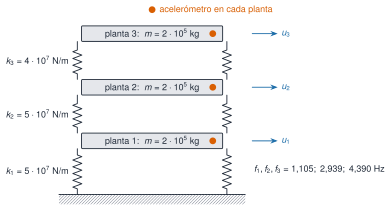

## Una pregunta para toda la sesión

**¿Qué frecuencias y amortiguamientos tiene un edificio y cómo se reconocen en un registro de aceleración?**

Tres herramientas:

- **valores propios**: del modelo a los modos
- **polos**: cómo responde la estructura
- **DFT**: del registro muestreado a la frecuencia

## Plan

| Bloque | Tiempo |
|---|---|
| 0 · Un edificio de respuesta conocida | 10 min |
| M2.1 · Modos | 60 min |
| *Pausa* | 10 min |
| M2.2 · Polos y FRF | 50 min |
| *Pausa* | 10 min |
| M2.3 · Muestreo, DFT y fuga | 60 min |
| M2.4 · El edificio en frecuencia | 40 min |

# 0 · Un edificio de respuesta conocida

## El banco de pruebas

{width="55%" fig-alt="Edificio de tres plantas con un acelerómetro por planta y su modelo de tres masas y tres muelles"}

- masas de $2\cdot10^5$ kg; rigideces de $5\cdot10^7$, $5\cdot10^7$ y $4\cdot10^7$ N/m; $\zeta\approx1\,\%$
- 600 s a 100 Hz, tres escenarios: **A** referencia, **B** −1 % de rigidez en todo, **C** −10 % en el entrepiso 2

## Sintético: virtud y límite

- **Virtud**: se conoce la respuesta correcta y se puede validar cada método
- **Límite**: que funcione aquí no demuestra que funcione en una estructura real

# M2.1 · Modos {#m2-1}

## Del modelo al problema de valores propios

$$\mathbf M\ddot{\mathbf u}+\mathbf C\dot{\mathbf u}+\mathbf K\mathbf u=\mathbf f(t)$$

Sin amortiguamiento ni fuerza, con $\mathbf u=\boldsymbol\varphi\,e^{\mathrm i\omega t}$:

$$\left(\mathbf K-\omega^2\mathbf M\right)\boldsymbol\varphi=\mathbf 0$$

Problema de valores propios **generalizado**: $\lambda=\omega^2$ y las formas modales $\boldsymbol\varphi$.

## Por qué los modos son reales y ortogonales

$\mathbf M$ y $\mathbf K$ son **simétricas y definidas positivas** (energías cinética y elástica > 0), así que:

- los $\omega_j^2$ son reales y positivos
- las formas son reales
- son ortogonales respecto de $\mathbf M$ y de $\mathbf K$

## La idea clave: desacoplar

Normalizadas a masa unidad:

$$\boldsymbol\Phi^{\mathsf T}\mathbf M\boldsymbol\Phi=\mathbf I,\qquad \boldsymbol\Phi^{\mathsf T}\mathbf K\boldsymbol\Phi=\operatorname{diag}(\omega_j^2)$$

Con $\mathbf u=\boldsymbol\Phi\mathbf q$, **tres osciladores independientes**.

Edificio A: $f=1{,}105$; $2{,}939$; $4{,}390$ Hz.

## Comparar formas: el MAC

$$\mathrm{MAC}(\mathbf a,\mathbf b)=\frac{\lvert\mathbf a^{\mathsf T}\mathbf b\rvert^2}{(\mathbf a^{\mathsf T}\mathbf a)(\mathbf b^{\mathsf T}\mathbf b)}\in[0,1]$$

De A a C: las frecuencias bajan un 1,8 %, un 0,2 % y un 3,1 %, y el MAC > 0,999.

**Las frecuencias son mucho más sensibles al daño que las formas.**

## Simulación 1 · Modos del edificio

[Abrir la simulación en la página](index.qmd#lab-modos)

- Con $\Delta k_2=-10\,\%$: ¿qué modo apenas se mueve? ¿Por qué?
- Sube la masa de la cubierta: ¿qué frecuencia baja más?

# M2.2 · Polos y FRF {#m2-2}

## La función de transferencia

$$\mathbf H(s)=\left(\mathbf Ms^2+\mathbf Cs+\mathbf K\right)^{-1}$$

- $H_{ij}$: respuesta de la planta $i$ a una fuerza en $j$
- en $s=\mathrm i\omega$: la **FRF**

## Un polo es un modo

$$s_k=-\zeta_k\omega_k\pm\mathrm i\,\omega_k\sqrt{1-\zeta_k^2}$$

$$\omega_k=\lvert s_k\rvert,\qquad \zeta_k=-\frac{\operatorname{Re}s_k}{\lvert s_k\rvert}$$

- parte real: lo deprisa que se apaga
- parte imaginaria: la frecuencia amortiguada
- sin amortiguamiento, $\pm\mathrm i\omega_k$: los valores propios de M2.1

## Polos y ceros

$$H_{ij}(\mathrm i\omega)=\sum_{k}\frac{\varphi_{ik}\,\varphi_{jk}}{\omega_k^2-\omega^2+2\mathrm i\,\zeta_k\omega_k\omega}$$

- **denominadores** (polos): los mismos para cualquier $(i,j)$
- **numeradores**: dependen de $(i,j)$ y fijan los **ceros**
- FRF puntual: una **antirresonancia** entre cada dos resonancias

## Simulación 2 · FRF del edificio

[Abrir la simulación en la página](index.qmd#lab-frf)

- $i=j=3$: cuenta las antirresonancias (2,381 y 4,289 Hz = cubierta bloqueada)
- $i=1$, $j=3$: ¿qué pasa con los valles?
- **Los polos se identifican; los ceros, no.**

# M2.3 · Muestreo, DFT y fuga {#m2-3}

## Muestrear y el aliasing

$$z=e^{s\Delta t}:\quad \lvert z\rvert=e^{-\zeta\omega\Delta t},\quad \arg z=\omega_{\mathrm d}\Delta t$$

- el ángulo solo se conoce salvo múltiplos de $2\pi$
- frecuencias que difieren en $k f_{\mathrm s}$ dan **las mismas muestras**
- Nyquist $f_{\mathrm s}/2$: 70 Hz muestreados a 100 Hz aparecen en **30 Hz**
- se filtra **antes** de muestrear

## La DFT y la resolución

$$X_k=\sum_{n=0}^{N-1}x_n\,e^{-\mathrm i2\pi kn/N},\qquad \Delta f=\frac{f_{\mathrm s}}{N}=\frac{1}{T}$$

- $\Delta f$ depende de la **duración**, no de $f_{\mathrm s}$
- pico de un modo: anchura $2\zeta f$ a −3 dB
- primer modo del edificio: 0,022 Hz → **segmentos de al menos 45 s**

## La fuga

- registro finito = señal × ventana rectangular
- frecuencia entre *bins* → la energía **fuga**, el pico baja
- ventanas: menos fuga, pico más ancho
- relleno de ceros: interpola, **no** resuelve

## Simulación 3 · Fuga y ventanas

[Abrir la simulación en la página](index.qmd#lab-fuga)

- 12,0 frente a 12,5 bins con la rectangular: ¿cuánto baja el pico?
- Hann y flat-top: ¿qué se gana y qué se pierde?
- Relleno ×8: ¿se estrecha el pico?

# M2.4 · El edificio en frecuencia {#m2-4}

## La PSD del escenario A

Welch con segmentos de 5 s y de 82 s (figura en la página):

- **los picos están en los polos**: la cubierta ve los tres modos
- **la resolución manda**: resolución frente a varianza
- **las alturas no son las formas**: hacen falta varios sensores (M7)

## Práctica guiada y «Pídeselo a Claude»

1. Modos, polos y picos de la PSD del escenario A (Julia o Python)
2. Con Claude: ¿el desplazamiento del primer modo entre A y C supera $\Delta f$?
3. **Verifica**: funciones del paquete, $\Delta f=100/n_{\mathrm{seg}}$, y que no confunda «se movió» con «es detectable»

## Lo que no se ha visto hoy

| Herramienta | Pregunta |
|---|---|
| Toeplitz y Hankel | ¿De qué matrices parten ERA y SSI? |
| SVD | ¿Cuántas componentes independientes hay? |
| Espacio de estados | ¿Qué ve cada sensor? |
| Transformada Z | ¿Polos de un modelo AR? |
| Hilbert | ¿Amortiguamiento de la envolvente? |
| Estocásticos y correlación | ¿Modos sin medir la excitación? |
