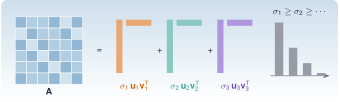

{.portada fig-alt="Una matriz de seis por seis escrita como suma de tres capas de rango uno, cada una con su valor singular, junto a las barras de los valores singulares ordenadas de mayor a menor"}

Si hubiera que quedarse con una sola herramienta de álgebra lineal para trabajar con datos, sería esta. La **descomposición en valores singulares** (SVD, *singular value decomposition*) existe para *cualquier* matriz, rectangular o no, y dice con exactitud qué hace la matriz como aplicación, cuánta información tiene, cuál es su mejor versión más sencilla y cómo invertirla cuando no se puede. En monitorización estructural es la que ordena los datos (qué componentes dominan), la que decide cuántos modos hay (rango numérico) y la que está dentro de los algoritmos de identificación como ERA y SSI.

En [M2.1](../matrices/index.qmd) ya apareció la SVD en dos sitios (la geometría de un sistema mal condicionado y la regularización de un problema inverso). Aquí se estudia por sí misma.

::: {.callout-note}
## Cómo se lee esta página
**Tiempo orientativo:** unas 3 horas, con la simulación y los ejercicios. **Nivel:** intermedio. Tres capas: **intuición** (figuras y simulación), **fundamento** (teoremas y demostraciones plegables) y **aplicación** (el edificio de tres plantas del [caso transversal](../edificio/index.qmd)).
:::

```{julia}
#| include: false
using Resonancia, LinearAlgebra, Statistics, Random, DelimitedFiles, Printf, Markdown
include("../../../recursos/r1-datos/_tema.jl")
```

## Objetivos y prerrequisitos

**Objetivos.** Al terminar esta página sabrás:

- enunciar la SVD, calcularla con `svd` y relacionarla con los valores propios de $\mathbf A^{\mathsf T}\mathbf A$;
- interpretar los valores singulares como las longitudes de los semiejes de la imagen de la esfera unidad, y la norma 2 y el número de condición en esos términos;
- enunciar y aplicar el teorema de Eckart–Young–Mirsky y medir cuánta «energía» captura una aproximación de rango $r$;
- calcular la pseudoinversa y la solución de mínima norma de un problema de mínimos cuadrados, también con rango deficiente;
- decidir el rango numérico con un umbral razonado, incluida la cota de ruido de una matriz aleatoria;
- aplicar la SVD a registros de varios sensores (POD, *proper orthogonal decomposition*) y comparar sus componentes con los modos físicos.

**Prerrequisitos.** [M2.1](../matrices/index.qmd) (normas y condicionamiento) y [M2.2](../valores-propios/index.qmd) (valores propios y modos).

## Teoría breve

### M2.3.1 Definición y geometría {#m2-3-1}

::: {#thm-svd}
**SVD.** Toda matriz real $\mathbf A\in\mathbb R^{m\times n}$ se escribe como $\mathbf A=\mathbf U\boldsymbol\Sigma\mathbf V^{\mathsf T}$, con $\mathbf U\in\mathbb R^{m\times m}$ y $\mathbf V\in\mathbb R^{n\times n}$ ortogonales y $\boldsymbol\Sigma$ «diagonal» con $\sigma_1\ge\sigma_2\ge\dots\ge\sigma_p\ge0$, $p=\min(m,n)$. Los $\sigma_i$ son únicos y se llaman **valores singulares**; las columnas $\mathbf u_i$ y $\mathbf v_i$, **vectores singulares** por la izquierda y por la derecha.
:::

::: {.callout-note .demostracion collapse="true" title="Demostración (esquema)"}
$\mathbf A^{\mathsf T}\mathbf A$ es simétrica y semidefinida positiva, así que, por el teorema espectral de [M2.2](../valores-propios/index.qmd#m2-2-1), existe una base ortonormal $\mathbf v_i$ con $\mathbf A^{\mathsf T}\mathbf A\mathbf v_i=\lambda_i\mathbf v_i$ y $\lambda_i\ge0$. Se define $\sigma_i=\sqrt{\lambda_i}$ y, para $\sigma_i>0$, $\mathbf u_i=\mathbf A\mathbf v_i/\sigma_i$. Estos $\mathbf u_i$ son ortonormales porque $\mathbf u_i^{\mathsf T}\mathbf u_j=\mathbf v_i^{\mathsf T}\mathbf A^{\mathsf T}\mathbf A\mathbf v_j/(\sigma_i\sigma_j)=\lambda_j\delta_{ij}/(\sigma_i\sigma_j)=\delta_{ij}$. Se completan hasta una base de $\mathbb R^m$ y queda $\mathbf A\mathbf V=\mathbf U\boldsymbol\Sigma$. $\square$
:::

Tres lecturas de lo mismo:

1. **Geometría.** La imagen de la esfera unidad por $\mathbf A$ es un elipsoide de semiejes $\sigma_i\mathbf u_i$. $\mathbf A$ gira ($\mathbf V^{\mathsf T}$), estira ($\boldsymbol\Sigma$) y vuelve a girar ($\mathbf U$). De aquí salen $\lVert\mathbf A\rVert_2=\sigma_1$, $\lVert\mathbf A\rVert_F^2=\sum\sigma_i^2$ y $\kappa_2(\mathbf A)=\sigma_1/\sigma_n$ para una matriz cuadrada invertible.
2. **Suma de capas.** $\mathbf A=\sum_{i=1}^{r}\sigma_i\,\mathbf u_i\mathbf v_i^{\mathsf T}$: una suma de matrices de rango 1 ordenadas por importancia, con $r=\operatorname{rango}(\mathbf A)$ el número de $\sigma_i>0$.
3. **Subespacios.** $\mathbf u_1,\dots,\mathbf u_r$ generan la imagen; $\mathbf v_{r+1},\dots,\mathbf v_n$ generan el núcleo. Es la forma numérica de decir qué parte de un vector $\mathbf A$ ve y qué parte ignora.

La SVD no es lo mismo que la diagonalización: los vectores $\mathbf u_i$ y $\mathbf v_i$ son distintos, existen siempre y son ortonormales. Para una matriz simétrica definida positiva coinciden con los vectores propios y los $\sigma_i$ con los valores propios; con signos negativos, $\sigma_i=\lvert\lambda_i\rvert$.

### M2.3.2 La mejor aproximación de rango $r$ {#m2-3-2}

::: {#thm-eym}
**Eckart–Young–Mirsky.** Sea $\mathbf A_r=\sum_{i=1}^{r}\sigma_i\mathbf u_i\mathbf v_i^{\mathsf T}$. Entre todas las matrices $\mathbf B$ de rango a lo sumo $r$,
$$
\lVert\mathbf A-\mathbf A_r\rVert_2=\sigma_{r+1}\le\lVert\mathbf A-\mathbf B\rVert_2,
\qquad
\lVert\mathbf A-\mathbf A_r\rVert_F=\Big(\sum_{i>r}\sigma_i^2\Big)^{1/2}\le\lVert\mathbf A-\mathbf B\rVert_F.
$$
:::

::: {.callout-note .demostracion collapse="true" title="Demostración de la norma 2"}
$\mathbf A-\mathbf A_r=\sum_{i>r}\sigma_i\mathbf u_i\mathbf v_i^{\mathsf T}$ tiene mayor valor singular $\sigma_{r+1}$. Para otra $\mathbf B$ de rango $\le r$, su núcleo tiene dimensión $\ge n-r$, y corta al subespacio $\operatorname{gen}\{\mathbf v_1,\dots,\mathbf v_{r+1}\}$ (dimensión $r+1$) en algún vector unitario $\mathbf z$. Entonces $\mathbf B\mathbf z=\mathbf 0$ y $\lVert(\mathbf A-\mathbf B)\mathbf z\rVert=\lVert\mathbf A\mathbf z\rVert\ge\sigma_{r+1}$, porque $\mathbf z$ es combinación de los $r+1$ primeros $\mathbf v_i$. Por tanto $\lVert\mathbf A-\mathbf B\rVert_2\ge\sigma_{r+1}$. $\square$
:::

Es la justificación de «quedarse con lo importante»: ninguna matriz de rango $r$ se parece más a $\mathbf A$ que la truncada, y el error es exactamente el primer valor singular descartado. En datos, la **fracción de energía** retenida es $\sum_{i\le r}\sigma_i^2/\sum_i\sigma_i^2$, que es el número que suele darse al hablar de «el 99 % de la varianza».

Hay una advertencia importante: el teorema habla de aproximación, no de causas. Los $\sigma_i$ grandes indican componentes de gran amplitud, **no necesariamente mecanismos físicos distintos**; cuántos $\sigma_i$ corresponden a un modo, o a ruido, es otra cuestión (M2.3.4 y M2.3.5).

### M2.3.3 Pseudoinversa y mínimos cuadrados {#m2-3-3}

::: {#def-pseudoinversa}
**Pseudoinversa de Moore–Penrose.** Si $\mathbf A=\mathbf U\boldsymbol\Sigma\mathbf V^{\mathsf T}$ tiene rango $r$, $\mathbf A^{+}=\mathbf V\boldsymbol\Sigma^{+}\mathbf U^{\mathsf T}$, donde $\boldsymbol\Sigma^{+}$ invierte los $r$ valores singulares no nulos y deja los demás en cero.
:::

$\mathbf x^{+}=\mathbf A^{+}\mathbf b$ es la solución de **mínima norma** entre las que minimizan $\lVert\mathbf A\mathbf x-\mathbf b\rVert_2$. Con rango completo por columnas es la solución habitual de mínimos cuadrados; con rango deficiente hay infinitas soluciones y la pseudoinversa elige la más corta (sin componente en el núcleo). Y si se anulan también los $\sigma_i$ pequeños, se obtiene la solución **regularizada** (SVD truncada) de [M2.1](../matrices/index.qmd#m2-1-1).

```{julia}
#| label: ej-pinv
A_rd = [1.0 2; 2 4; 3 6]          # rango 1: la segunda columna es el doble de la primera
b_rd = [1.0, 2, 2]
x_pinv = pseudoinversa_svd(A_rd) * b_rd
x_bs = A_rd \ b_rd                 # `\` también da la de mínima norma para rango deficiente
(rango = rango_numerico(A_rd), x_minima_norma = x_pinv, mismo_que_barra = x_pinv ≈ x_bs, residuo = norm(A_rd * x_pinv - b_rd))
```

La solución de mínima norma es $\mathbf x^{+}=($`{julia} coma(x_pinv[1]; d=4)`$,\;$`{julia} coma(x_pinv[2]; d=4)`$)$ y cualquier otra que minimice el residuo, como $(11/70+2t,\;11/35-t)$, tiene mayor norma.

### M2.3.4 Rango numérico {#m2-3-4}

Con aritmética de precisión finita y datos con ruido, el rango «matemático» no existe: una matriz casi nunca tiene valores singulares exactamente nulos. El **rango numérico** es el número de valores singulares por encima de un umbral, y el umbral hay que justificarlo.

- **Por redondeo:** $\tau=\max(m,n)\,\varepsilon\,\sigma_1$, es lo que usa por defecto `rango_numerico` y `rank`.
- **Por ruido:** si los datos son $\mathbf X=\mathbf X_0+\mathbf E$ y los elementos de $\mathbf E$ son independientes con desviación típica $s$, el mayor valor singular de $\mathbf E$ es, para matrices grandes, $\approx s(\sqrt m+\sqrt n)$. Un valor singular de $\mathbf X$ por debajo de ese nivel no se puede distinguir de ruido.
- **Por salto:** un cambio brusco entre $\sigma_k$ y $\sigma_{k+1}$ indica el rango, pero solo si existe: en datos reales el espectro suele decaer sin saltos, y entonces el rango es una **decisión** y no un hecho.

```{julia}
#| label: ej-ruido
Random.seed!(1)
s_ruido = 0.5
E = s_ruido .* randn(2000, 50)
(medido = opnorm(E), teoria = s_ruido * (sqrt(2000) + sqrt(50)))
```

Para una matriz de $2000\times50$ con ruido de desviación $0{,}5$, el mayor valor singular medido es `{julia} coma(opnorm(E); d=2)` y la regla $s(\sqrt m+\sqrt n)$ da `{julia} coma(s_ruido * (sqrt(2000) + sqrt(50)); d=2)`.

### M2.3.5 La SVD de registros de varios sensores (POD) {#m2-3-5}

Si se apilan los registros de $m$ sensores en una matriz $\mathbf X\in\mathbb R^{N\times m}$ (una fila por instante, una columna por sensor), la SVD $\mathbf X=\mathbf U\boldsymbol\Sigma\mathbf V^{\mathsf T}$ descompone el movimiento en **formas espaciales** $\mathbf v_i$ (columnas de $\mathbf V$) que se mueven con **historias temporales** $\mathbf u_i$ de amplitud $\sigma_i/\sqrt N$. Es la descomposición ortogonal propia (*proper orthogonal decomposition*, POD), o análisis de componentes principales (PCA) si se centra en la media.

¿Son esas formas espaciales los modos de vibración? **A veces.** Para un sistema con masa uniforme ($\mathbf M=m\mathbf I$), amortiguamiento proporcional y fuerzas aleatorias independientes de igual intensidad en cada grado de libertad, las coordenadas modales son estadísticamente independientes y la matriz de covarianza se diagonaliza con los modos: la POD recupera entonces las formas modales. Fuera de esas hipótesis (masas distintas, excitación correlacionada o con pocos puntos de aplicación, amortiguamiento no proporcional) no tiene por qué ocurrir, y la POD solo da componentes que explican varianza.

El edificio del caso transversal cumple las hipótesis (tres masas iguales, fuerzas independientes y amortiguamiento de Rayleigh). Con el escenario A de `datos/sinteticos/edificio-3-plantas/`:

```{julia}
#| label: ej-pod
D = readdlm("../../../datos/sinteticos/edificio-3-plantas/escenario_A.csv", ';', skipstart=1)[:, 2:4]
Xc = D .- mean(D, dims=1)
Fx = svd(Xc)
M3, C3, K3 = edificio_tres_plantas()
f3, Phi3 = modos_propios(K3, M3)
Mmac = matriz_mac(Fx.V, Phi3)                      # filas: componentes POD; columnas: modos
asignacion = [argmax(Mmac[i, :]) for i in 1:3]
(valores_singulares = Fx.S, modo_mas_parecido = asignacion, MAC = [Mmac[i, asignacion[i]] for i in 1:3])
```

```{julia}
#| label: fig-pod
#| fig-cap: "Descomposición en valores singulares de las aceleraciones del escenario A (tres sensores, 10 minutos a 100 Hz). Izquierda: los valores singulares, con el modo físico asociado a cada componente. Derecha: MAC entre cada componente de la POD (fila) y cada modo calculado con el modelo (columna). El orden de las componentes lo fija la energía de la aceleración, no la frecuencia, por eso no coincide con el orden de los modos."
#| fig-alt: "A la izquierda, tres barras de valores singulares del mismo orden de magnitud. A la derecha, una matriz de tres por tres con valores cercanos a uno en una posición por fila y columna y cercanos a cero en las demás, que muestra que cada componente se corresponde con un modo distinto."
fig = Figure(size=(820, 330))
ax1 = Axis(fig[1, 1]; title="Valores singulares", xlabel="componente", ylabel="σ (m/s²)", xticks=1:3, limits=(0.4, 3.6, 0, nothing))
barplot!(ax1, 1:3, Fx.S; color=AZUL)
for i in 1:3
    text!(ax1, i, Fx.S[i]; text="modo $(asignacion[i])", align=(:center, :bottom), fontsize=12, color=TINTA)
end
ax2 = Axis(fig[1, 2]; title="MAC (componente POD, modo)", xlabel="modo del modelo", ylabel="componente POD", xticks=1:3, yticks=1:3, yreversed=true)
hm = heatmap!(ax2, 1:3, 1:3, permutedims(Mmac); colormap=[:white, AZUL], colorrange=(0, 1))
for i in 1:3, j in 1:3
    text!(ax2, j, i; text=coma(Mmac[i, j]; d=3), align=(:center, :center), fontsize=12, color=Mmac[i, j] > 0.5 ? :white : TINTA)
end
fig
```

Cada componente de la POD coincide con un modo (MAC $\ge$ `{julia} coma(minimum(Mmac[i, asignacion[i]] for i in 1:3); d=3)`), pero el orden por energía **no** es el orden por frecuencia, y la historia temporal de cada componente es la aceleración modal. Con solo dos sensores (plantas 1 y 3) el rango de los datos es 2: la POD no puede distinguir tres modos con dos canales. Es el límite de **observabilidad** que se discute en [la representación en espacio de estados](../espacio-estados/index.qmd).

## Laboratorio: aproximación de rango y ruido {#lab-svd}

```{ojs}
//| echo: false
import {svd, aproxRango, rng, normal, norma2, normaFro} from "../../../recursos/js/matematicas.js"
```

**Simulación 1. Aproximación de rango $r$ de una matriz con ruido.** La matriz es una «película» de 40 instantes por 12 sensores, que combina tres formas espaciales con tres frecuencias diferentes y se contamina con ruido blanco de desviación $s$ (semilla fija). Elige el rango $r$ y el nivel de ruido: se muestran los valores singulares frente al nivel de ruido esperado $s(\sqrt m+\sqrt n)$, la matriz reconstruida y el error, que se compara con el valor singular $\sigma_{r+1}$ del teorema de Eckart–Young–Mirsky.

```{ojs}
//| echo: false
viewof r = Inputs.range([0, 12], {value: 3, step: 1, label: "rango r"})
viewof ruido = Inputs.range([0, 1.5], {value: 0.3, step: 0.05, label: "ruido s (misma unidad que la señal)"})
```

```{ojs}
//| echo: false
datos = {
  const T = 40, S = 12;
  const g = rng(11);
  const limpia = Array.from({length: T}, (_, t) =>
    Array.from({length: S}, (_, x) =>
      3.0 * Math.sin(2 * Math.PI * 0.05 * t) * Math.sin(Math.PI * (x + 1) / 13)
      + 2.0 * Math.sin(2 * Math.PI * 0.13 * t + 0.7) * Math.sin(2 * Math.PI * (x + 1) / 13)
      + 1.2 * Math.sin(2 * Math.PI * 0.27 * t + 1.9) * Math.sin(3 * Math.PI * (x + 1) / 13)));
  const z = Array.from({length: T}, () => Array.from({length: S}, () => normal(g)));
  return {T, S, limpia, z};
}
```

```{ojs}
//| echo: false
resultado = {
  const X = datos.limpia.map((f, t) => f.map((v, x) => v + ruido * datos.z[t][x]));
  const {S: sv} = svd(X);
  const Xr = r === 0 ? X.map(f => f.map(() => 0)) : aproxRango(X, r);
  const resta = X.map((f, t) => f.map((v, x) => v - Xr[t][x]));
  const e2 = norma2(resta), eF = normaFro(resta);
  const eLimpia = normaFro(datos.limpia.map((f, t) => f.map((v, x) => v - Xr[t][x])));
  const eRuido = normaFro(datos.limpia.map((f, t) => f.map((v, x) => v - X[t][x])));
  return {X, sv, Xr, e2, eF, eLimpia, eRuido,
    siguiente: r < sv.length ? sv[r] : 0,
    colaF: Math.sqrt(sv.slice(r).reduce((s, v) => s + v * v, 0)),
    nivel: ruido * (Math.sqrt(datos.T) + Math.sqrt(datos.S)),
    energia: sv.slice(0, r).reduce((s, v) => s + v * v, 0) / sv.reduce((s, v) => s + v * v, 0)};
}
```

```{ojs}
//| echo: false
Plot.plot({
  width: 700, height: 250, marginLeft: 50, x: {label: "componente i", tickFormat: "d", ticks: 12}, y: {label: "σᵢ", grid: true},
  marks: [
    Plot.barY(resultado.sv.map((v, i) => ({i: i + 1, v})), {x: "i", y: "v", fill: d => d.i <= r ? "#1B6CA8" : "#9CA3AF"}),
    Plot.ruleY([resultado.nivel], {stroke: "#D95F02", strokeWidth: 2, strokeDasharray: "6,4"}),
    Plot.text([{x: 12, y: resultado.nivel, t: "s(√m+√n)"}], {x: "x", y: "y", text: "t", dy: -8, textAnchor: "end", fill: "#D95F02"})
  ]
})
```

```{ojs}
//| echo: false
{
  const celda = (M, titulo) => Plot.plot({
    width: 220, height: 280, marginLeft: 36, caption: titulo,
    x: {label: "sensor", ticks: [], axis: null}, y: {label: "instante", reverse: true, ticks: []},
    color: {scheme: "RdBu", domain: [-6, 6], reverse: true},
    marks: [Plot.cell(M.flatMap((f, t) => f.map((v, x) => ({t, x, v}))), {x: "x", y: "t", fill: "v"})]
  });
  return html`<div style="display:flex; gap:12px; flex-wrap:wrap">${celda(datos.limpia, "Señal sin ruido")}${celda(resultado.X, "Con ruido")}${celda(resultado.Xr, "Aproximación de rango " + r)}</div>`;
}
```

```{ojs}
//| echo: false
md`**Resultados.** Energía retenida: **${(100 * resultado.energia).toFixed(1).replace(".", ",")} %**. Error en norma 2: **${resultado.e2.toFixed(3).replace(".", ",")}**, y σ<sub>r+1</sub> = **${resultado.siguiente.toFixed(3).replace(".", ",")}** ${Math.abs(resultado.e2 - resultado.siguiente) < 1e-6 * Math.max(1, resultado.siguiente) ? "✓ (coinciden, teorema de Eckart–Young–Mirsky)" : "✗"}. Error en Frobenius: **${resultado.eF.toFixed(3).replace(".", ",")}** (cola de los σ: **${resultado.colaF.toFixed(3).replace(".", ",")}**). Distancia de la aproximación a la señal **sin ruido**: **${resultado.eLimpia.toFixed(3).replace(".", ",")}**; la de la señal ruidosa: **${resultado.eRuido.toFixed(3).replace(".", ",")}**.`
```

### Hipótesis y límites de la simulación 1 {#limites-sim1}

- **Datos:** la señal limpia tiene rango 3 exacto (tres componentes, cada una el producto de una historia temporal sinusoidal por una forma espacial); el ruido es gaussiano, blanco y de la misma desviación en todos los sensores. En datos reales el ruido puede estar correlacionado y el espectro de $\sigma_i$ no tiene un salto tan limpio.
- **Resultado a observar:** con $r$ igual al número de componentes de señal, la aproximación está **más cerca de la señal limpia que la propia señal ruidosa**: eliminar los $\sigma_i$ de ruido filtra. Con $r$ demasiado grande se reincorpora ruido; con $r$ pequeño se pierde señal.
- **Nivel de ruido teórico:** la línea naranja es una cota aproximada del mayor valor singular del ruido, no una frontera exacta.
- **Cálculo:** SVD de Hestenes (Jacobi unilateral) en JavaScript, válida para matrices pequeñas y contrastada con Julia en las pruebas del proyecto.
- **Qué no se puede concluir:** que $r$ óptimo sea el «número de modos». Aquí vale 3 porque la señal se construyó así; una onda viajera, por ejemplo, necesitaría rango 2 por componente.

## Práctica guiada

::: {.callout-note}
## Práctica guiada

1. Lee `escenario_A.csv` y apila las tres aceleraciones en una matriz $N\times3$.
2. Calcula la SVD de la matriz centrada. ¿Cuántos valores singulares son claramente distintos de cero?
3. Compara las formas $\mathbf v_i$ con los modos del modelo mediante `matriz_mac`.
4. Quédate solo con los canales de las plantas 1 y 3 y repite la SVD. ¿Qué rango obtienes y por qué?

::: {.panel-tabset}
## Julia

```julia
using Resonancia, LinearAlgebra, DelimitedFiles, Statistics
D = readdlm("escenario_A.csv", ';', skipstart=1)[:, 2:4]
F = svd(D .- mean(D, dims=1))
M, C, K = edificio_tres_plantas()
_, Phi = modos_propios(K, M)
matriz_mac(F.V, Phi)
svdvals(D[:, [1, 3]])           # solo plantas 1 y 3
```

## Python

```python
import numpy as np
from scipy import linalg
import matrices as mx      # mse/m02-matematicas/python/matrices.py (probado con pytest)

D = np.loadtxt("escenario_A.csv", delimiter=";", skiprows=1)[:, 1:4]
U, S, Vt = np.linalg.svd(D - D.mean(axis=0), full_matrices=False)
M, K = mx.edificio_tres_plantas("A")
_, Phi = linalg.eigh(K, M)
mac = (Vt @ Phi) ** 2 / (np.sum(Vt**2, axis=1)[:, None] * np.sum(Phi**2, axis=0)[None, :])
np.linalg.svd(D[:, [0, 2]], compute_uv=False)
```
:::

El código Python **no se ejecuta en la web**: su versión probada está en [`python/matrices.py`](https://github.com/me1catrr/resonancia/blob/main/mse/m02-matematicas/python/matrices.py), contrastada con Julia mediante `referencia/matrices.json`.
:::

## «Pídeselo a Claude» {#pideselo}

::: {.callout-tip}
## Prompt
«Tengo `escenario_A.csv`, `escenario_B.csv` y `escenario_C.csv` (aceleraciones de tres plantas a 100 Hz, `;` como separador). Con Julia y el paquete `Resonancia`: (1) calcula la SVD de las aceleraciones centradas de cada escenario; (2) calcula el MAC entre los vectores singulares de A y los de B, y entre A y C; (3) dime si la POD permite distinguir el escenario C del B y por qué. No des conclusiones que no salgan de los números.»

**Verifica.** (a) Que centra los datos y que cada matriz es $N\times3$, no $3\times N$. (b) Que los vectores singulares se comparan con `matriz_mac` y que empareja por mayor MAC, no por orden. (c) Que advierte de que el signo y el orden de los vectores singulares son arbitrarios. (d) Que no concluye «daño» solo por una diferencia de MAC sin comparar con la variabilidad entre registros sin daño (se hace en el caso transversal). (e) Que ejecuta el código y da los números, no solo la interpretación.
:::

## Ejercicios

::: {.ejercicio tipo="vf" id="m2-3-norma2" respuesta="falso"}
La norma 2 de una matriz es el mayor valor absoluto de sus elementos.

::: {.solucion}
**Falso.** La norma 2 es el mayor valor singular, $\sigma_1$. El mayor elemento en valor absoluto es una cota inferior de $\sigma_1$, pero no tiene por qué coincidir (por ejemplo, para la matriz de unos $2\times2$, $\sigma_1=2$ y el mayor elemento vale 1).
:::
:::

::: {.ejercicio tipo="numerico" id="m2-3-sigma1" respuesta="6.325" tol="0.5%"}
Calcula $\lVert\mathbf A\rVert_2$ para $\mathbf A=\begin{bmatrix}4&0\\3&-5\end{bmatrix}$.

::: {.pista}
$\sigma_1^2$ es el mayor valor propio de $\mathbf A^{\mathsf T}\mathbf A=\begin{bmatrix}25&-15\\-15&25\end{bmatrix}$.
:::

::: {.solucion}
Los valores propios de $\mathbf A^{\mathsf T}\mathbf A$ son $40$ y $10$, así que $\sigma_1=\sqrt{40}=6{,}325$ y $\sigma_2=\sqrt{10}=3{,}162$ (y $\kappa_2=2$).
:::
:::

::: {.ejercicio tipo="numerico" id="m2-3-eym" respuesta="3.162" tol="0.5%"}
¿Cuánto vale el error en norma 2 de la mejor aproximación de rango 1 de la matriz $\mathbf A$ del ejercicio anterior?

::: {.solucion}
Por el @thm-eym, $\lVert\mathbf A-\mathbf A_1\rVert_2=\sigma_2=\sqrt{10}=3{,}162$.
:::
:::

::: {.ejercicio tipo="numerico" id="m2-3-pinv" respuesta="0.1571" tol="1%"}
Calcula la primera componente de la solución de mínima norma de mínimos cuadrados $\min\lVert\mathbf A\mathbf x-\mathbf b\rVert$ con $\mathbf A=\begin{bmatrix}1&2\\2&4\\3&6\end{bmatrix}$ y $\mathbf b=(1,2,2)^{\mathsf T}$.

::: {.pista}
Las columnas de $\mathbf A$ son proporcionales: $\mathbf A=\mathbf a\,(1,2)$ con $\mathbf a=(1,2,3)^{\mathsf T}$. Proyecta $\mathbf b$ sobre $\mathbf a$.
:::

::: {.solucion}
$\mathbf a^{\mathsf T}\mathbf b/\mathbf a^{\mathsf T}\mathbf a=11/14$ es el valor de $x_1+2x_2$ que minimiza el residuo; entre todos los pares, el de menor norma es proporcional a $(1,2)$: $\mathbf x^{+}=\tfrac{11}{14}\cdot\tfrac{(1,2)}{5}=(0{,}1571;\,0{,}3143)$.
:::
:::

::: {.ejercicio tipo="opcion" id="m2-3-umbral" respuesta="b"}
Una matriz de $400\times25$ de aceleraciones tiene ruido blanco de desviación $0{,}01$ en cada elemento. ¿Por debajo de qué valor singular de la matriz no se puede distinguir señal de ruido?

::: {.opciones}
- Por debajo de $0{,}01$, la desviación típica del ruido.
- Por debajo de, aproximadamente, $0{,}01\,(\sqrt{400}+\sqrt{25})=0{,}25$.
- Por debajo de $\varepsilon\,\sigma_1$, el épsilon de la máquina.
- No hay forma de saberlo sin conocer los modos.
:::

::: {.solucion}
La **b**: el mayor valor singular de una matriz de ruido $m\times n$ es $\approx s(\sqrt m+\sqrt n)$. El umbral por redondeo (opción c) sirve para datos sin ruido, y la desviación del ruido (a) no tiene en cuenta que se suman $m\cdot n$ elementos.
:::
:::

::: {.ejercicio tipo="abierta" id="m2-3-pod-modos"}
Un compañero afirma: «la primera componente de la POD de mis aceleraciones es el primer modo de vibración». ¿Qué le responderías? Cita al menos tres condiciones que se necesitan para que sea cierto.

::: {.rubrica}
- Digo que las componentes POD se ordenan por energía, no por frecuencia, y que en aceleraciones los modos de más frecuencia pesan más.
- Cito condiciones: masas iguales (o ponderar por la masa), excitación no correlacionada y de intensidad uniforme, amortiguamiento proporcional y suficientes sensores.
- Propongo comprobarlo con un modelo (MAC con modos calculados) o con la identificación modal, no solo con la POD.
:::

::: {.solucion}
No se puede afirmar en general. Para que las componentes POD sean los modos hacen falta masas iguales (o una ponderación por la masa), fuerzas independientes con la misma intensidad en todos los grados de libertad, amortiguamiento proporcional y tantos sensores como modos. Además, la POD ordena por energía de la señal medida (en aceleraciones, el modo de mayor frecuencia puede ser el dominante), no por frecuencia. En el edificio del caso transversal se cumplen las hipótesis y aun así la componente de mayor energía **no** es el primer modo.
:::
:::

## La doy por superada si…

- [ ] Enuncio la SVD y la relaciono con los valores propios de $\mathbf A^{\mathsf T}\mathbf A$ y $\mathbf A\mathbf A^{\mathsf T}$.
- [ ] Interpreto los valores singulares como semiejes del elipsoide imagen y deduzco $\lVert\mathbf A\rVert_2$ y $\kappa_2$.
- [ ] Aplico el teorema de Eckart–Young–Mirsky y calculo la energía retenida.
- [ ] Calculo la pseudoinversa y la solución de mínima norma, también con rango deficiente.
- [ ] Justifico un umbral de rango numérico y explico por qué en datos reales es una decisión.
- [ ] Aplico la SVD a varios sensores y explico cuándo sus componentes se parecen a los modos y cuándo no.

## Qué no dice esta página

- No se detallan los algoritmos de cálculo de la SVD (bidiagonalización y QR implícito, o Jacobi unilateral); se usa `svd` de Julia y la implementación de Jacobi para matrices pequeñas en JavaScript.
- La cota $s(\sqrt m+\sqrt n)$ es un resultado asintótico para ruido gaussiano independiente; con ruido coloreado, el umbral cambia.
- La POD de datos reales con masas distintas, excitación no uniforme o pocos sensores no coincide con los modos; para eso están los métodos de identificación (M7).
- El caso complejo (SVD de matrices espectrales para FDD) se trata en la parte de identificación modal.
