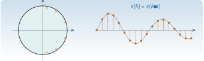

{.portada fig-alt="Un círculo unidad con tres pares de polos conjugados cerca de la circunferencia, junto a una señal oscilatoria amortiguada con sus muestras marcadas como puntos"}

Los sensores no dan señales continuas: dan **muestras** cada $\Delta t$. La transformada Z es a las señales discretas lo que la de Laplace a las continuas: convierte ecuaciones en diferencias en álgebra, y hace que la estabilidad, la frecuencia y el amortiguamiento se lean en el **plano $z$**, con una geometría muy distinta a la del plano $s$: el semiplano estable se convierte en el interior de un círculo, y las frecuencias, en ángulos. Esta página explica esa correspondencia, sus trampas (el *aliasing* y la ambigüedad del logaritmo) y la usa para extraer frecuencias y amortiguamientos de un modelo ajustado a datos.

::: {.callout-note}
## Cómo se lee esta página
**Tiempo orientativo:** unas 3 horas. **Nivel:** intermedio. Tres capas: **intuición** (figuras y simulación), **fundamento** (definición, correspondencia $z=e^{s\Delta t}$) y **aplicación** (identificar los polos de un edificio con un modelo autorregresivo, y ver lo que sale mal).
:::

```{julia}
#| include: false
using Resonancia, LinearAlgebra, Statistics, DelimitedFiles, Printf, Markdown
include("../../../recursos/r1-datos/_tema.jl")
M3, C3, K3 = edificio_tres_plantas()
f3, Phi3 = modos_propios(K3, M3)
zeta3 = diag(Phi3' * C3 * Phi3) ./ (2 .* 2π .* f3)
```

## Objetivos y prerrequisitos

**Objetivos.** Al terminar esta página sabrás:

- definir la transformada Z y escribir la función de transferencia de un sistema descrito por una ecuación en diferencias;
- usar la correspondencia $z=e^{s\Delta t}$ para pasar de polos continuos a discretos y al revés, y obtener $f$ y $\zeta$ de un polo discreto;
- explicar el *aliasing* en el plano $z$ y por qué el logaritmo es multivaluado;
- reconocer los polos de un modelo AR en el plano $z$ y estimar con ellos frecuencias y amortiguamientos de un registro;
- reconocer los **polos espurios** y las limitaciones de ese método (orden, ruido, sesgo en el amortiguamiento).

**Prerrequisitos.** [M2.4](../laplace/index.qmd) (Laplace), [M2.6](../espacio-estados/index.qmd) (discretización exacta) y [M2.1.4](../matrices/index.qmd#m2-1-4) (Toeplitz y Yule–Walker).

## Teoría breve

### M2.7.1 La transformada Z {#m2-7-1}

::: {.callout-note .historia icon=false title="Un poco de historia: de las funciones generatrices a los sistemas muestreados"}
Según el resumen histórico de la Wikipedia en inglés, la idea de fondo se atribuye a de Moivre (1730, en probabilidad) y Laplace la conocía; Hurewicz y otros la reintrodujeron en 1947 para los sistemas de control con datos muestreados (radar), y Ragazzini y Zadeh, en el grupo de control de la Universidad de Columbia, le dieron el nombre de «transformada z» en 1952. Es una fuente enciclopédica no contrastada con los originales: las atribuciones deben tomarse como orientativas.

<span class="fuentes-caja">Fuente: [Wikipedia, «Z-transform», sección «History»](https://en.wikipedia.org/wiki/Z-transform). Consultado el 25-10-2026.</span>
:::

::: {#def-z}
**Transformada Z.** Para una secuencia $x[k]$, $k\ge0$, $X(z)=\mathcal Z[x](z)=\displaystyle\sum_{k=0}^{\infty}x[k]\,z^{-k}$, con $z\in\mathbb C$ en la región donde la serie converge.
:::

La propiedad más útil es el **desplazamiento**: retrasar la secuencia una muestra, $x[k-1]$, equivale a multiplicar por $z^{-1}$ (con condiciones iniciales nulas). Por eso una ecuación en diferencias

$$
y[k]+a_1y[k-1]+\dots+a_py[k-p]=b_0u[k]+b_1u[k-1]+\dots+b_qu[k-q]
$$

se convierte en $A(z)Y(z)=B(z)U(z)$, con **función de transferencia discreta** $H(z)=B(z)/A(z)$. Sus **polos** son las raíces de $A(z)$; el sistema es **estable** si todas están dentro del círculo unidad, $\lvert z_k\rvert<1$. Si no hay numerador ($B(z)=b_0$), el modelo es **autorregresivo** (AR): todo polos.

### M2.7.2 Del plano $s$ al plano $z$ {#m2-7-2}

Si una señal continua $x(t)=e^{st}$ se muestrea cada $\Delta t$, se obtiene $x[k]=e^{sk\Delta t}=(e^{s\Delta t})^k$: la secuencia de potencias de $z=e^{s\Delta t}$. Por eso un polo continuo $s$ da un polo discreto

$$
z=e^{s\Delta t},\qquad s=\frac{\ln z}{\Delta t}.
$$ {#eq-z}

{#fig-plano-z fig-alt="A la izquierda el plano s con una banda horizontal sombreada en el semiplano izquierdo, un rayo de amortiguamiento constante y una recta horizontal de frecuencia constante. A la derecha el plano z con el círculo unidad sombreado, una espiral de amortiguamiento constante y un radio de frecuencia constante. Una flecha etiquetada z igual a e elevado a s por delta t une los dos planos."}

Tres consecuencias:

1. **Estabilidad:** $\lvert z\rvert=e^{\sigma\Delta t}<1$ si y solo si $\sigma<0$.
2. **Frecuencia y amortiguamiento.** Para $s=-\zeta\omega_n+\mathrm j\omega_n\sqrt{1-\zeta^2}$ se cumple $\lvert\ln z\rvert=\omega_n\Delta t$, y por tanto
$$
f=\frac{\lvert\ln z\rvert}{2\pi\Delta t},\qquad \zeta=-\frac{\ln\lvert z\rvert}{\lvert\ln z\rvert}.
$$ {#eq-fz}
3. **Aliasing y logaritmo multivaluado.** $e^{(s+\mathrm j2\pi m/\Delta t)\Delta t}=e^{s\Delta t}$ para todo entero $m$: **infinitos polos continuos dan el mismo polo discreto**. Solo se pueden distinguir frecuencias de $0$ a $f_{\mathrm s}/2$, con $f_{\mathrm s}=1/\Delta t$ (frecuencia de Nyquist), y una señal de frecuencia $f>f_{\mathrm s}/2$ aparece como si tuviera la frecuencia $\lvert f-m f_{\mathrm s}\rvert$ más próxima a cero. Es la razón de que se **filtre antes de muestrear** (M3 y M8).

::: {.callout-warning}
## La relación $z=e^{s\Delta t}$ es exacta; la de Euler no
Si se aproxima $e^{s\Delta t}\approx1+s\Delta t$ (Euler explícito, [M2.6.3](../espacio-estados/index.qmd#m2-6-3)), un polo estable puede dar un $\lvert z\rvert>1$. La correspondencia de la @eq-z es la de la **discretización exacta**, y es la que debe usarse para convertir polos identificados en $f$ y $\zeta$.
:::

```{julia}
#| label: ej-z
s_ej = -0.5 + 10.0im                          # polo continuo (rad/s)
dt_ej = 0.01
z_ej = exp(s_ej * dt_ej)
(z = z_ej, módulo = abs(z_ej), ángulo_rad = angle(z_ej), f_recuperada = abs(log(z_ej)) / (2π * dt_ej),
 zeta_recuperada = -log(abs(z_ej)) / abs(log(z_ej)))
```

Para $s=-0{,}5+10\mathrm j$ rad/s y $\Delta t=0{,}01$ s se obtiene $z=$ `{julia} coma(abs(z_ej); d=5)` $\angle$ `{julia} coma(angle(z_ej); d=4)` rad. Y, a la inversa, la @eq-fz devuelve $f=$ `{julia} coma(abs(log(z_ej)) / (2π * dt_ej); d=4)` Hz y $\zeta=$ `{julia} coma(-log(abs(z_ej)) / abs(log(z_ej)); d=4)`, los valores de partida: $f=\lvert s\rvert/2\pi$ y $\zeta=-\sigma/\lvert s\rvert\approx0{,}0499$.

### M2.7.3 Modelos AR y sus polos {#m2-7-3}

Un modelo AR($p$), $x[k]=\sum_{j=1}^p\phi_jx[k-j]+e[k]$ con $e[k]$ ruido blanco, tiene función de transferencia $1/(1-\sum\phi_jz^{-j})$. Sus **polos** son las raíces de $z^p-\phi_1z^{p-1}-\dots-\phi_p$, es decir, los valores propios de su **matriz compañera**; los coeficientes salen de las ecuaciones de Yule–Walker ([M2.1.4](../matrices/index.qmd#m2-1-4)) y, con la @eq-fz, cada pareja de polos conjugados da una frecuencia y un amortiguamiento. Es el método de identificación más sencillo que existe, y sirve para ver sus límites.

Una estructura excitada por ruido blanco no tiene respuesta exactamente AR: su aceleración tiene también **ceros** (M2.4), y la señal medida lleva ruido. Veamos qué pasa con el registro de aceleración de la cubierta del escenario A (`datos/sinteticos/edificio-3-plantas/`), cuyos polos verdaderos se conocen: $f=$ `{julia} join(coma.(f3; d=3), ", ")` Hz y $\zeta=$ `{julia} join(coma.(100 .* zeta3; d=2), ", ")` %.

```{julia}
#| label: ej-ar
D = readdlm("../../../datos/sinteticos/edificio-3-plantas/escenario_A.csv", ';', skipstart=1)
x = D[:, 4] .- mean(D[:, 4])                       # aceleración de la cubierta a 100 Hz
dt = 0.01
function ajusta_ar(x, p, dt)
    r = autocorrelacion(x, p)
    phi, _ = yule_walker(r, p)
    polos_ar(phi, dt)
end
bloque(x, q) = [mean(@view x[i:i+q-1]) for i in 1:q:length(x)-q+1]    # promedio de bloques: filtro paso bajo muy simple
resultados = [(; q, p, fz = ajusta_ar(bloque(x, q), p, dt * q)) for (q, p) in [(1, 6), (1, 12), (8, 6), (8, 8)]]
nothing
```

```{julia}
#| label: tbl-ar-edificio
#| tbl-cap: "Polos estimados con un modelo AR de Yule–Walker ajustado a la aceleración de la cubierta (escenario A, 600 s). Los valores verdaderos son 1,105; 2,939 y 4,390 Hz, con $\\zeta$ de 1,00 %, 1,00 % y 1,27 %. Con 100 Hz el ajuste falla; al reducir el muestreo con un promedio de bloques, el orden 8 recupera las tres frecuencias y añade dos polos espurios."
filas = String[]
for r in resultados
    push!(filas, "| " * (r.q == 1 ? "100" : coma(100 / r.q; d=1)) * " | $(r.p) | " * join(coma.(r.fz[1]; d=3), "; ") * " | " * join(coma.(100 .* r.fz[2]; d=1), "; ") * " |")
end
Markdown.parse("| Muestreo (Hz) | Orden p | Frecuencias (Hz) | Amortiguamientos (%) |\n|--:|--:|:--|:--|\n" * join(filas, "\n"))
```

Lo que enseña la @tbl-ar-edificio:

- **Con la frecuencia de muestreo original (100 Hz) el método falla**, aunque la señal sea buena: tres modos por debajo de 5 Hz a 100 Hz de muestreo dejan los polos muy cerca de $z=1$, y la matriz de Toeplitz queda mal condicionada. Un modelo AR gasta su orden en lo que ve de más alta frecuencia.
- **Reduciendo el muestreo** (decimando por 8 con un promedio de bloques, que es un filtro paso bajo muy simple) y con orden 8, **las tres frecuencias salen con errores de $1{,}3\,\%$, $0{,}2\,\%$ y $0{,}1\,\%$**: el análisis AR es útil con la banda de interés bien resuelta.
- **El amortiguamiento sale mal**: el tercer modo sale con $\zeta\approx3{,}6\,\%$ cuando el valor verdadero es $1{,}27\,\%$. Es una pauta general: los métodos paramétricos estiman bien las frecuencias y peor los amortiguamientos, y Yule–Walker en particular tiende a **sobrestimarlos** en señales poco amortiguadas.
- **Aparecen polos espurios** (6,3 y 6,7 Hz, con $\zeta$ de $13$ y $37\,\%$): el orden elegido es mayor que el de la señal. Son fuertemente amortiguados, lo que los delata, pero para decidirlo con criterio se necesitan los diagramas de estabilización de M7.

```{julia}
#| label: fig-polos-z
#| fig-cap: "Polos del plano $z$. Los círculos azules son los polos reales del edificio (discretización exacta a 12,5 Hz); las cruces naranjas, los estimados por el modelo AR de orden 8 ajustado a la aceleración de la cubierta. Las frecuencias coinciden bien; el tercer par está más hacia el interior del círculo (más amortiguamiento) que el real, y hay dos polos espurios más cerca del origen."
#| fig-alt: "Círculo unidad con tres pares de círculos azules cerca de la circunferencia, en ángulos pequeños, y cruces naranjas que coinciden con ellos en el ángulo pero con módulo algo menor en el último par, más dos pares de cruces cerca del origen."
q, p = 8, 8
xd = bloque(x, q)
phi8, _ = yule_walker(autocorrelacion(xd, p), p)
Cm = zeros(p, p); Cm[1, :] = phi8; for i in 2:p; Cm[i, i-1] = 1; end
z_est = eigvals(Cm)
A3, _ = espacio_estados(M3, C3, K3, [0.0, 0.0, 1.0])
z_real = filter(w -> imag(w) > 0, exp.(eigvals(A3) .* (dt * q)))
fig = Figure(size=(560, 520))
ax = Axis(fig[1, 1]; xlabel="Re z", ylabel="Im z", aspect=DataAspect(), limits=(-1.1, 1.1, -1.1, 1.1))
lines!(ax, cos.(range(0, 2π; length=200)), sin.(range(0, 2π; length=200)); color=GRIS)
scatter!(ax, vcat(real.(z_real), real.(z_real)), vcat(imag.(z_real), -imag.(z_real)); color=:white, strokecolor=AZUL, strokewidth=2, markersize=14, label="polos reales")
scatter!(ax, real.(z_est), imag.(z_est); marker=:xcross, color=NARANJA, markersize=14, label="AR(8) estimado")
axislegend(ax; position=:lb)
fig
```

## Laboratorio: muestreo y plano $z$ {#lab-z}

**Simulación 1. Un polo en los planos $s$ y $z$.** Elige la frecuencia y el amortiguamiento de un oscilador y la frecuencia de muestreo. A la izquierda se ve el polo en el plano $z$ (con el círculo unidad, el radio de $f$ constante y la espiral de $\zeta$ constante); a la derecha, la señal continua y sus muestras. Si $f>f_{\mathrm s}/2$, la señal muestreada parece de otra frecuencia (*aliasing*), y el polo discreto que se obtiene es el de esa frecuencia aparente.

```{ojs}
//| echo: false
viewof f_lab = Inputs.range([0.2, 30], {value: 4, step: 0.1, label: "f (Hz)"})
viewof z_lab = Inputs.range([0.002, 0.3], {value: 0.03, step: 0.002, transform: Math.log, label: "ζ (adimensional)"})
viewof fs_lab = Inputs.range([5, 100], {value: 20, step: 1, label: "frecuencia de muestreo fₛ (Hz)"})
```

```{ojs}
//| echo: false
polo = {
  const dt = 1 / fs_lab, w = 2 * Math.PI * f_lab;
  const sre = -z_lab * w, sim = w * Math.sqrt(1 - z_lab ** 2);
  const mod = Math.exp(sre * dt), ang = sim * dt;                   // z = e^{s Δt}
  const angPlegado = ((ang + Math.PI) % (2 * Math.PI) + 2 * Math.PI) % (2 * Math.PI) - Math.PI;
  const fAparente = Math.abs(angPlegado) / (2 * Math.PI * dt);
  return {dt, w, mod, ang, angPlegado, fAparente, aliasing: f_lab > fs_lab / 2};
}
```

```{ojs}
//| echo: false
{
  const th = d3.range(0, 2 * Math.PI + 0.02, 0.02);
  const esp = d3.range(0, Math.PI + 0.01, 0.01).map(t => [Math.exp(-z_lab / Math.sqrt(1 - z_lab ** 2) * t) * Math.cos(t), Math.exp(-z_lab / Math.sqrt(1 - z_lab ** 2) * t) * Math.sin(t)]);
  const zr = polo.mod * Math.cos(polo.angPlegado), zi = polo.mod * Math.sin(polo.angPlegado);
  const planoZ = Plot.plot({
    width: 360, height: 360, aspectRatio: 1, grid: true, marginLeft: 40,
    x: {domain: [-1.15, 1.15], label: "Re z"}, y: {domain: [-1.15, 1.15], label: "Im z"},
    marks: [
      Plot.line(th.map(t => [Math.cos(t), Math.sin(t)]), {stroke: "#6B7280"}),
      Plot.line(esp, {stroke: "#D95F02", strokeDasharray: "4,3"}),
      Plot.line(esp.map(([a, b]) => [a, -b]), {stroke: "#D95F02", strokeDasharray: "4,3"}),
      Plot.line([[0, 0], [Math.cos(polo.angPlegado), Math.sin(polo.angPlegado)]], {stroke: "#1B6CA8", strokeDasharray: "4,3"}),
      Plot.dot([[zr, zi], [zr, -zi]], {fill: "#1B6CA8", r: 6})
    ]
  });
  // señal continua y muestras
  const T = 4 / Math.max(0.5, Math.min(f_lab, 3)) ;
  const t = d3.range(0, T, T / 600);
  const x = (tt) => Math.exp(-z_lab * polo.w * tt) * Math.cos(polo.w * Math.sqrt(1 - z_lab ** 2) * tt);
  const ks = d3.range(0, Math.floor(T / polo.dt) + 1).map(k => ({t: k * polo.dt, x: x(k * polo.dt)}));
  const serie = Plot.plot({
    width: 520, height: 280, marginLeft: 45, x: {label: "t (s)"}, y: {label: "x(t)", domain: [-1.1, 1.1]},
    marks: [Plot.ruleY([0]), Plot.line(t.map(tt => ({t: tt, x: x(tt)})), {x: "t", y: "x", stroke: "#9CA3AF"}),
      Plot.ruleX(ks, {x: "t", y1: 0, y2: "x", stroke: "#D95F02"}), Plot.dot(ks, {x: "t", y: "x", fill: "#D95F02", r: 3})]
  });
  return html`<div style="display:flex; gap:16px; flex-wrap:wrap">${planoZ}${serie}</div>`;
}
```

```{ojs}
//| echo: false
md`**Polo discreto** z = ${polo.mod.toFixed(5).replace(".", ",")} ∠ ${polo.angPlegado.toFixed(4).replace(".", ",")} rad. Frecuencia de Nyquist: **${(fs_lab / 2).toFixed(1).replace(".", ",")} Hz**. ${polo.aliasing ? "⚠️ **Aliasing**: la frecuencia real (" + f_lab.toFixed(1).replace(".", ",") + " Hz) supera la de Nyquist y las muestras se comportan como las de **" + polo.fAparente.toFixed(2).replace(".", ",") + " Hz**." : "Sin aliasing: la frecuencia recuperada con ln z es **" + polo.fAparente.toFixed(2).replace(".", ",") + " Hz**."}`
```

### Hipótesis y límites de la simulación 1 {#limites-sim1}

- **Señal:** una única respuesta libre amortiguada $e^{-\zeta\omega t}\cos\omega_{\mathrm d}t$, sin ruido y sin filtro antialiasing. En un sistema real, el filtro antes del muestreo evita el aliasing; aquí se muestra cómo ocurre cuando no existe.
- **Plano $z$:** se dibuja el polo con el argumento plegado a $(-\pi,\pi]$, es decir, el que se obtendría de las muestras. El rayo de frecuencia constante y la espiral de $\zeta$ constante son los de la figura de la teoría.
- **El amortiguamiento no cambia por el aliasing:** el módulo $\lvert z\rvert=e^{-\zeta\omega\Delta t}$ se conserva, pero al leer $\zeta$ con la @eq-fz y la frecuencia aparente, sale un valor distinto (más alto), porque se divide por una $\lvert\ln z\rvert$ menor.
- **Qué no se puede concluir:** que un registro muestreado a una frecuencia baja es «fiel»; a partir de las muestras no se puede saber si hubo aliasing, y solo el diseño previo (filtro y $f_{\mathrm s}$) lo evita.

**Para explorar.** (1) Con $f=4$ Hz y $f_{\mathrm s}=20$ Hz, mueve $\zeta$ y observa cómo el polo recorre la espiral. (2) Sube $f$ por encima de 10 Hz y observa el polo aparente. (3) Con $f_{\mathrm s}=20$ Hz, ¿qué frecuencias distintas dan exactamente el mismo polo discreto que 3 Hz?

## Práctica guiada

::: {.callout-note}
## Práctica guiada

1. Lee `escenario_A.csv` y toma la aceleración de la cubierta (columna 4).
2. Reduce el muestreo de 100 a 12,5 Hz promediando bloques de 8 muestras.
3. Ajusta un AR(8) con `autocorrelacion`, `yule_walker` y `polos_ar`. Compara las frecuencias con las del modelo.
4. Repite con el escenario C (daño en el entrepiso 2) y mira cómo cambian las frecuencias estimadas.

::: {.panel-tabset}
## Julia

```julia
using Resonancia, DelimitedFiles, Statistics
D = readdlm("escenario_A.csv", ';', skipstart=1)
x = D[:, 4] .- mean(D[:, 4])
xd = [mean(@view x[i:i+7]) for i in 1:8:length(x)-7]
phi, sigma2 = yule_walker(autocorrelacion(xd, 8), 8)
f, zeta = polos_ar(phi, 0.08)
```

## Python

```python
import numpy as np
import matrices as mx      # mse/m02-matematicas/python/matrices.py (probado con pytest)

D = np.loadtxt("escenario_A.csv", delimiter=";", skiprows=1)
x = D[:, 3] - D[:, 3].mean()
xd = x[: len(x) // 8 * 8].reshape(-1, 8).mean(axis=1)
r = mx.autocorrelacion(xd, 8)
phi, sigma2 = mx.yule_walker(r, 8)
f, zeta = mx.polos_ar(phi, 0.08)
```
:::

El código Python **no se ejecuta en la web**: `polos_ar` está probada con `pytest` frente a Julia en [`python/matrices.py`](https://github.com/me1catrr/resonancia/blob/main/mse/m02-matematicas/python/matrices.py).
:::

## «Pídeselo a Claude» {#pideselo}

::: {.callout-tip}
## Prompt
«Con Julia y el paquete `Resonancia`: toma `escenario_A.csv` y `escenario_C.csv` (aceleraciones de un edificio de tres plantas a 100 Hz), decima por 8 con un promedio de bloques, ajusta un AR(8) con Yule–Walker y calcula frecuencias y amortiguamientos de los polos con `polos_ar`. Dime si los cambios de frecuencia entre A y C se pueden distinguir de la dispersión del método, haciendo el ajuste en varios tramos de 60 s de cada registro.»

**Verifica.** (a) Que decima (o dice por qué no) antes de ajustar el modelo. (b) Que usa `polos_ar` y compara con las frecuencias reales del edificio, que están en la ficha de datos. (c) Que no confunde polos espurios con modos y que filtra por amortiguamiento razonable. (d) Que da la **dispersión** de la frecuencia entre tramos antes de hablar de cambio. (e) Que no atribuye el cambio de amortiguamiento a daño: el amortiguamiento sale con mucha más incertidumbre.
:::

## Ejercicios

::: {.ejercicio tipo="vf" id="m2-7-estable-z" respuesta="verdadero"}
Un sistema discreto lineal es estable si y solo si todos sus polos están dentro del círculo unidad.

::: {.solucion}
**Verdadero**: $\lvert z_k\rvert<1$ equivale a $\operatorname{Re}(s_k)<0$ por la correspondencia $z=e^{s\Delta t}$ (@eq-z).
:::
:::

::: {.ejercicio tipo="numerico" id="m2-7-modulo" respuesta="0.99501" tol="0.1%"}
Un polo continuo $s=-0{,}5+10\,\mathrm j$ rad/s se muestrea con $\Delta t=0{,}01$ s. ¿Cuánto vale el módulo del polo discreto?

::: {.solucion}
$\lvert z\rvert=e^{\sigma\Delta t}=e^{-0{,}5\cdot0{,}01}=e^{-0{,}005}=0{,}99501$ (y el ángulo es $\omega\Delta t=0{,}1$ rad).
:::
:::

::: {.ejercicio tipo="numerico" id="m2-7-zeta" respuesta="0.3314" tol="1%"}
Un modelo ajustado a datos muestreados cada $\Delta t=0{,}1$ s tiene un polo en $z=0{,}9\,e^{\mathrm j\,0{,}3}$. ¿Cuánto vale el amortiguamiento relativo $\zeta$?

::: {.pista}
Usa la @eq-fz: $\zeta=-\ln\lvert z\rvert/\lvert\ln z\rvert$ con $\ln z=\ln0{,}9+0{,}3\,\mathrm j$.
:::

::: {.solucion}
$\ln z=-0{,}10536+0{,}3\,\mathrm j$, $\lvert\ln z\rvert=0{,}31796$, así que $\zeta=0{,}10536/0{,}31796=0{,}3314$ y $f=0{,}31796/(2\pi\cdot0{,}1)=0{,}506$ Hz.
:::
:::

::: {.ejercicio tipo="numerico" id="m2-7-alias" respuesta="3" tol="1%" unidad="Hz"}
Una vibración de 7 Hz se muestrea a 10 Hz sin filtro antialiasing. ¿A qué frecuencia aparente se ve?

::: {.solucion}
$\lvert7-10\rvert=3$ Hz: la frecuencia de Nyquist es 5 Hz y 7 Hz se pliega hacia abajo.
:::
:::

::: {.ejercicio tipo="abierta" id="m2-7-ar-falla"}
Ajustas un AR(6) a una aceleración de un puente muestreada a 200 Hz, cuyos modos de interés están entre 1 y 6 Hz, y los resultados no tienen sentido. Propón dos cambios que probarías y explica por qué.

::: {.rubrica}
- Propongo reducir la frecuencia de muestreo (decimación con filtro antialiasing) para concentrar el orden del modelo en la banda de interés.
- Propongo aumentar el orden y distinguir polos físicos de espurios (amortiguamiento, estabilidad al cambiar el orden).
- Menciono el mal condicionamiento de la matriz de Toeplitz con polos próximos a $z=1$ o la conveniencia de métodos mejores (ERA, SSI, FDD).
:::

::: {.solucion}
Decimar (con un filtro paso bajo que evite el aliasing) a unos 20–25 Hz, de modo que los polos se separen de $z=1$ y la matriz de Toeplitz esté mejor condicionada, y subir el orden mirando qué polos se mantienen al cambiarlo. Y valorar métodos de identificación más robustos (M7).
:::
:::

## La doy por superada si…

- [ ] Escribo la función de transferencia discreta de una ecuación en diferencias y reconozco sus polos.
- [ ] Paso de polos continuos a discretos con $z=e^{s\Delta t}$ y al revés con $\ln z/\Delta t$.
- [ ] Obtengo $f$ y $\zeta$ de un polo discreto.
- [ ] Explico el aliasing y por qué el logaritmo complejo es multivaluado.
- [ ] Ajusto un AR con Yule–Walker, calculo sus polos e interpreto cuáles son modos y cuáles espurios.
- [ ] Sé que el amortiguamiento estimado es mucho menos fiable que la frecuencia.

## Qué no dice esta página

- El método AR de Yule–Walker se usa aquí como **ejemplo didáctico**, no como método de identificación recomendado; ERA, SSI y FDD (M7) están pensados para esto.
- Se usa un promedio de bloques como filtro de decimación; un diseño correcto del filtro antialiasing (FIR/IIR) es tema de M3 y M8.
- La tabla de resultados es de un registro y una semilla; no se ha hecho un estudio de dispersión entre registros (se propone en «Pídeselo a Claude»).
- No se desarrolla la región de convergencia de la transformada Z ni las propiedades de la transformada inversa; se usan fracciones simples en la práctica.
- Las atribuciones históricas proceden de una fuente enciclopédica y deben contrastarse antes de citarlas en un trabajo formal.
