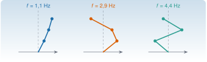

{.portada fig-alt="Tres formas modales de un edificio de tres plantas, dibujadas como líneas quebradas sobre un eje vertical, junto a las frecuencias naturales 1,1 Hz, 2,9 Hz y 4,4 Hz"}

Un **modo de vibración** es una forma de moverse que se conserva: todos los puntos de la estructura oscilan a la vez, con la misma frecuencia, y la forma no cambia con el tiempo. Matemáticamente, un modo es un **vector propio** y su frecuencia sale de un **valor propio**. Casi todo lo que se hace después en monitorización (identificar, comparar estados, detectar daño) trabaja con esas dos cantidades. Esta página explica de dónde salen, qué propiedades tienen y qué pasa con ellas cuando la estructura cambia.

::: {.callout-note}
## Cómo se lee esta página
**Tiempo orientativo:** unas 3 horas, con la simulación y los ejercicios. **Nivel:** intermedio. Hay tres capas: **intuición** (figuras y simulación), **fundamento** (definiciones, teoremas y demostraciones plegables) y **aplicación** (el edificio de cortante de tres plantas que se usará en todo el módulo, definido en [el caso transversal](../edificio/index.qmd)).
:::

```{julia}
#| include: false
using Resonancia, LinearAlgebra, Statistics, Printf
include("../../../recursos/r1-datos/_tema.jl")
M3, C3, K3 = edificio_tres_plantas()
f3, Phi3 = modos_propios(K3, M3)
_, _, K3C = edificio_tres_plantas(escenario=:C)
f3C, Phi3C = modos_propios(K3C, M3)
```

## Objetivos y prerrequisitos

**Objetivos.** Al terminar esta página sabrás:

- plantear el problema de valores propios estándar y el generalizado $\mathbf K\boldsymbol\varphi=\omega^2\mathbf M\boldsymbol\varphi$, y explicar por qué el segundo es el de las estructuras;
- demostrar que, con $\mathbf K$ y $\mathbf M$ simétricas y $\mathbf M$ definida positiva, las frecuencias son reales y los modos son ortogonales respecto de $\mathbf M$ y de $\mathbf K$;
- normalizar los modos a masa unidad y usarlos para desacoplar las ecuaciones del movimiento;
- calcular el cociente de Rayleigh y saber qué acota;
- predecir, a primer orden, cuánto cambian las frecuencias cuando cambia la rigidez de un entrepiso, y comparar con el cálculo exacto;
- explicar por qué los modos son *menos sensibles* que las frecuencias a un daño local, y por qué las matrices no simétricas se comportan mucho peor.

**Prerrequisitos.** [M2.1 Matrices estructuradas](../matrices/index.qmd), para la simetría, la definición positiva y el MAC, y [M5](../../m05-vibraciones-i/index.qmd) para el sistema de un grado de libertad. Julia básico ([J1](../../../julia/j1-esencial/index.qmd)) y álgebra lineal numérica ([J3.3](../../../julia/j3-computacion/j3-3-algebra-numerica/index.qmd)).

## Teoría breve

### M2.2.1 El problema estándar {#m2-2-1}

::: {.callout-note .historia icon=false title="Un poco de historia: los valores propios antes de las matrices"}
Los valores propios nacieron de las ecuaciones de las pequeñas oscilaciones y de las formas cuadráticas, no del álgebra matricial. G. W. Stewart recoge que Cauchy (1829) estableció propiedades de los valores propios de los sistemas simétricos, y que Jacobi (1846) dio un método para diagonalizar una matriz simétrica mediante giros sucesivos [@stewart1993]. Ese método de Jacobi es el que se usa, para matrices pequeñas, en las simulaciones de este módulo.

<span class="fuentes-caja">Fuente: informe técnico de Stewart (U. de Maryland, TR-92-31), pp. 1–2, versión previa del artículo citado. Consultado el 25-10-2026.</span>
:::

::: {#def-propio}
**Valor y vector propio.** Un número $\lambda\in\mathbb C$ es un **valor propio** (*eigenvalue*) de la matriz cuadrada $\mathbf A$ si existe un vector $\mathbf v\neq\mathbf 0$, el **vector propio** (*eigenvector*), con $\mathbf A\mathbf v=\lambda\mathbf v$. Los valores propios son las raíces del polinomio característico $\det(\mathbf A-\lambda\mathbf I)=0$.
:::

Un vector propio es una dirección que la aplicación $\mathbf A$ no gira: solo la estira o la encoge por un factor $\lambda$. Por eso sirven para *desacoplar*: si el estado se escribe en la base de vectores propios, cada componente evoluciona por separado. En la práctica no se calculan buscando raíces de un polinomio (el problema de hallar raíces de polinomios de grado alto está mal condicionado), sino con algoritmos iterativos como el QR; en Julia, `eigen` y `eigvals`.

::: {#thm-espectral}
**Teorema espectral (caso real simétrico).** Si $\mathbf A\in\mathbb R^{n\times n}$ es simétrica, todos sus valores propios son reales y existe una base ortonormal de vectores propios: $\mathbf A=\mathbf Q\boldsymbol\Lambda\mathbf Q^{\mathsf T}$ con $\mathbf Q^{\mathsf T}\mathbf Q=\mathbf I$ y $\boldsymbol\Lambda$ diagonal.
:::

::: {.callout-note .demostracion collapse="true" title="Demostración de las dos primeras afirmaciones"}
**Valores propios reales.** Sea $\mathbf A\mathbf v=\lambda\mathbf v$ con $\mathbf v\in\mathbb C^n$. Entonces $\mathbf v^{\mathsf H}\mathbf A\mathbf v=\lambda\,\mathbf v^{\mathsf H}\mathbf v$. Como $\mathbf A$ es real y simétrica, $\mathbf A=\mathbf A^{\mathsf H}$ y el número $\mathbf v^{\mathsf H}\mathbf A\mathbf v$ coincide con su conjugado, así que es real; como $\mathbf v^{\mathsf H}\mathbf v>0$, $\lambda$ es real.

**Ortogonalidad.** Si $\mathbf A\mathbf v_1=\lambda_1\mathbf v_1$ y $\mathbf A\mathbf v_2=\lambda_2\mathbf v_2$ con $\lambda_1\neq\lambda_2$, entonces $\lambda_1\mathbf v_1^{\mathsf T}\mathbf v_2=(\mathbf A\mathbf v_1)^{\mathsf T}\mathbf v_2=\mathbf v_1^{\mathsf T}\mathbf A\mathbf v_2=\lambda_2\mathbf v_1^{\mathsf T}\mathbf v_2$, de donde $(\lambda_1-\lambda_2)\mathbf v_1^{\mathsf T}\mathbf v_2=0$ y $\mathbf v_1^{\mathsf T}\mathbf v_2=0$. Si un valor propio está repetido se eligen vectores ortonormales dentro de su subespacio. La existencia de la base completa se obtiene por inducción: se toma un vector propio, se pasa al complemento ortogonal (invariante por $\mathbf A$) y se repite. $\square$
:::

Las matrices que **no** son simétricas pueden tener valores propios complejos, vectores propios no ortogonales e incluso no tener base completa de vectores propios (matrices *defectuosas*). Sus valores propios son, además, mucho más sensibles a las perturbaciones (véase el recuadro de la sección M2.2.4).

### M2.2.2 El problema generalizado de una estructura {#m2-2-2}

Para una estructura sin amortiguamiento, $\mathbf M\ddot{\mathbf u}+\mathbf K\mathbf u=\mathbf 0$. Se busca una solución en la que todos los puntos oscilan a la vez, $\mathbf u(t)=\boldsymbol\varphi\cos(\omega t-\theta)$; al sustituir, aparece

$$
\mathbf K\boldsymbol\varphi=\omega^2\,\mathbf M\boldsymbol\varphi.
$$ {#eq-generalizado}

Es un problema **generalizado** porque la masa aparece en el segundo miembro. Si $\mathbf M$ es diagonal y positiva, se reduce al estándar con $\widetilde{\mathbf K}=\mathbf M^{-1/2}\mathbf K\mathbf M^{-1/2}$ y $\widetilde{\boldsymbol\varphi}=\mathbf M^{1/2}\boldsymbol\varphi$; para una $\mathbf M$ simétrica definida positiva general se usa la factorización de Cholesky, $\mathbf M=\mathbf L\mathbf L^{\mathsf T}$, con $\widetilde{\mathbf K}=\mathbf L^{-1}\mathbf K\mathbf L^{-\mathsf T}$. La matriz $\widetilde{\mathbf K}$ es simétrica, de modo que el @thm-espectral se aplica a ella.

::: {#thm-modos}
**Propiedades de los modos.** Sean $\mathbf K$ simétrica semidefinida positiva y $\mathbf M$ simétrica definida positiva. Entonces los valores propios $\lambda_j=\omega_j^2$ son reales y no negativos, y los modos se pueden elegir **normalizados a masa unidad**:
$$
\boldsymbol\varphi_i^{\mathsf T}\mathbf M\boldsymbol\varphi_j=\delta_{ij},\qquad
\boldsymbol\varphi_i^{\mathsf T}\mathbf K\boldsymbol\varphi_j=\omega_j^2\,\delta_{ij}.
$$
En forma matricial, $\boldsymbol\Phi^{\mathsf T}\mathbf M\boldsymbol\Phi=\mathbf I$ y $\boldsymbol\Phi^{\mathsf T}\mathbf K\boldsymbol\Phi=\boldsymbol\Omega^2$.
:::

::: {.callout-note .demostracion collapse="true" title="Demostración"}
Con $\widetilde{\boldsymbol\varphi}_j$ ortonormales para $\widetilde{\mathbf K}$ (@thm-espectral) se tiene $\boldsymbol\varphi_j=\mathbf L^{-\mathsf T}\widetilde{\boldsymbol\varphi}_j$ y
$\boldsymbol\varphi_i^{\mathsf T}\mathbf M\boldsymbol\varphi_j=\widetilde{\boldsymbol\varphi}_i^{\mathsf T}\mathbf L^{-1}\mathbf L\mathbf L^{\mathsf T}\mathbf L^{-\mathsf T}\widetilde{\boldsymbol\varphi}_j=\delta_{ij}$. La segunda relación sale de multiplicar @eq-generalizado por $\boldsymbol\varphi_i^{\mathsf T}$. Los valores propios son no negativos porque $\lambda_j=\boldsymbol\varphi_j^{\mathsf T}\mathbf K\boldsymbol\varphi_j\ge0$. $\square$
:::

Dos consecuencias prácticas:

1. **Desacoplamiento.** Con el cambio $\mathbf u=\boldsymbol\Phi\mathbf q$, las ecuaciones $\mathbf M\ddot{\mathbf u}+\mathbf K\mathbf u=\mathbf f$ se convierten en $\ddot q_j+\omega_j^2q_j=\boldsymbol\varphi_j^{\mathsf T}\mathbf f$: $n$ osciladores independientes de un grado de libertad. Con amortiguamiento proporcional ($\mathbf C=\alpha\mathbf M+\beta\mathbf K$) también se desacopla, con $\zeta_j=\alpha/(2\omega_j)+\beta\omega_j/2$. Es la base del análisis modal ([M6](../../m06-vibraciones-ii/index.qmd)).
2. **Modos de sólido rígido.** Si la estructura no está anclada, $\mathbf K$ es semidefinida y tiene valores propios nulos: son los movimientos que no deforman nada (la traslación y el giro de la estructura entera). No son vibraciones; se reconocen por $\omega=0$.

### Cociente de Rayleigh

::: {#def-rayleigh}
**Cociente de Rayleigh.** Para $\mathbf x\neq\mathbf 0$, $R(\mathbf x)=\dfrac{\mathbf x^{\mathsf T}\mathbf K\mathbf x}{\mathbf x^{\mathsf T}\mathbf M\mathbf x}$ (energía de deformación entre energía cinética, salvo constantes).
:::

Vale $\omega_j^2$ cuando $\mathbf x=\boldsymbol\varphi_j$, está siempre entre $\omega_1^2$ y $\omega_n^2$, y es **estacionario** en cada modo: un error de primer orden en la forma produce un error de segundo orden en la frecuencia. Por eso, con una forma aproximada razonable (la deformada estática, por ejemplo) se obtiene una buena estimación de la frecuencia fundamental, y es el fundamento de los métodos de Rayleigh–Ritz.

## El edificio de tres plantas

El caso transversal del módulo es un **edificio de cortante** (*shear building*): las plantas son masas rígidas y los entrepisos, muelles laterales. Sus valores son $m=2\cdot10^5$ kg por planta y rigideces de entrepiso $5\cdot10^7$, $5\cdot10^7$ y $4\cdot10^7$ N/m (de abajo arriba). Con `modos_propios` del paquete `Resonancia`:

```{julia}
#| label: tbl-modos-edificio
#| tbl-cap: "Frecuencias y formas modales del edificio de tres plantas (normalizadas con máximo en valor absoluto igual a 1)."
using Markdown
forma(j) = Phi3[:, j] ./ Phi3[argmax(abs.(Phi3[:, j])), j]
filas = ["| $j | $(coma(f3[j]; d=3)) | $(coma(forma(j)[1]; d=3)) | $(coma(forma(j)[2]; d=3)) | $(coma(forma(j)[3]; d=3)) |" for j in 1:3]
Markdown.parse("| Modo | f (Hz) | planta 1 | planta 2 | planta 3 |\n|:--:|--:|--:|--:|--:|\n" * join(filas, "\n"))
```

```{julia}
#| label: fig-modos-edificio
#| fig-cap: "Formas modales del edificio de tres plantas. El primer modo mueve todas las plantas en el mismo sentido; el segundo cambia de signo una vez, y el tercero dos veces: el modo $j$ tiene $j-1$ cambios de signo. Los círculos son las plantas; la línea vertical, la posición de reposo."
#| fig-alt: "Tres paneles con las formas modales del edificio. En cada uno, una línea quebrada une el suelo con las tres plantas. El primer modo no cruza el eje, el segundo lo cruza una vez, el tercero dos veces."
fig = Figure(size=(780, 330))
for j in 1:3
    ax = Axis(fig[1, j]; title="Modo $j: $(coma(f3[j]; d=2)) Hz", xlabel="desplazamiento relativo", ylabel=j == 1 ? "planta" : "",
              yticks=0:3, limits=(-1.25, 1.25, -0.1, 3.2))
    vlines!(ax, [0.0]; color=GRIS, linestyle=:dash)
    lines!(ax, [0.0; forma(j)], 0:3; color=AZUL, linewidth=2.5)
    scatter!(ax, [0.0; forma(j)], 0:3; color=AZUL, markersize=11)
end
fig
```

La frecuencia $f_j=\omega_j/2\pi$ sube con el número de cambios de signo de la forma, algo general en estructuras de cadena. La normalización a masa unidad hace que los modos tengan unidades de kg$^{-1/2}$; para dibujarlos se reescalan, y lo que importa es la *forma*.

### Un cálculo comprobable

El cociente de Rayleigh para la forma aproximada $\mathbf x=(1,2,3)^{\mathsf T}$ vale $R=$ `{julia} coma(cociente_rayleigh(K3, M3, [1.0, 2, 3]); d=1)` rad²/s², es decir, $f=$ `{julia} coma(sqrt(cociente_rayleigh(K3, M3, [1.0, 2, 3])) / 2π; d=3)` Hz, algo por encima del primer modo ($f_1=$ `{julia} coma(f3[1]; d=3)` Hz), como debe ser: el cociente de Rayleigh nunca baja de $\omega_1^2$. Y la comprobación de la ortogonalidad: $\lVert\boldsymbol\Phi^{\mathsf T}\mathbf M\boldsymbol\Phi-\mathbf I\rVert=$ `{julia} @sprintf("%.1e", norm(Phi3' * M3 * Phi3 - I))`.

## Sensibilidad: qué pasa cuando cambia la rigidez

Un daño local suele reducir la rigidez de un elemento. ¿Cuánto cambian las frecuencias y los modos? Para una perturbación pequeña $\Delta\mathbf K$ de la rigidez, la teoría de perturbaciones da, a primer orden,

$$
\Delta\lambda_j\approx\boldsymbol\varphi_j^{\mathsf T}\,\Delta\mathbf K\,\boldsymbol\varphi_j,\qquad \frac{\Delta f_j}{f_j}\approx\frac{\Delta\lambda_j}{2\lambda_j}.
$$ {#eq-perturbacion}

::: {.callout-note .demostracion collapse="true" title="Demostración (con modos normalizados a masa unidad)"}
Derivando $(\mathbf K+\epsilon\Delta\mathbf K)(\boldsymbol\varphi+\epsilon\boldsymbol\varphi')=(\lambda+\epsilon\lambda')\mathbf M(\boldsymbol\varphi+\epsilon\boldsymbol\varphi')$ respecto de $\epsilon$ en $\epsilon=0$ se obtiene $\Delta\mathbf K\boldsymbol\varphi+\mathbf K\boldsymbol\varphi'=\lambda'\mathbf M\boldsymbol\varphi+\lambda\mathbf M\boldsymbol\varphi'$. Multiplicando por $\boldsymbol\varphi^{\mathsf T}$ y usando $\boldsymbol\varphi^{\mathsf T}\mathbf K=\lambda\boldsymbol\varphi^{\mathsf T}\mathbf M$, los términos con $\boldsymbol\varphi'$ se cancelan y queda $\boldsymbol\varphi^{\mathsf T}\Delta\mathbf K\boldsymbol\varphi=\lambda'\,\boldsymbol\varphi^{\mathsf T}\mathbf M\boldsymbol\varphi=\lambda'$. $\square$
:::

La @eq-perturbacion dice que el cambio de $\lambda_j$ es la energía de deformación del modo $j$ *en la parte de la estructura que se ha modificado*. Si el entrepiso 2 pierde un $10\,\%$ de rigidez, $\Delta\mathbf K=-0{,}1\,k_2\,\mathbf e\mathbf e^{\mathsf T}$ con $\mathbf e=(1,-1,0)^{\mathsf T}$, y el cambio de cada frecuencia es proporcional al cuadrado de la **deriva** $\varphi_{1j}-\varphi_{2j}$ de ese modo entre las plantas 1 y 2.

```{julia}
#| label: tbl-sensibilidad
#| tbl-cap: "Efecto de una pérdida del 10 % de rigidez en el entrepiso 2 (escenario C). Variación relativa de la frecuencia: predicción lineal (@eq-perturbacion) y cálculo exacto; MAC entre la forma del estado de referencia y la del dañado."
k2 = 5.0e7
dK = -0.1 * k2 * [1 -1 0; -1 1 0; 0 0 0.0]
dl = [Phi3[:, j]' * dK * Phi3[:, j] for j in 1:3]
lin = dl ./ (2π .* f3) .^ 2 ./ 2
exa = f3C ./ f3 .- 1
macs = [mac(Phi3[:, j], Phi3C[:, j]) for j in 1:3]
pct(x) = coma(100x; d=2) * " %"
filas = ["| $j | $(pct(lin[j])) | $(pct(exa[j])) | $(coma(macs[j]; d=4)) |" for j in 1:3]
Markdown.parse("| Modo | Δf/f lineal | Δf/f exacto | MAC |\n|:--:|--:|--:|--:|\n" * join(filas, "\n"))
```

Tres observaciones, comprobables en la @tbl-sensibilidad:

- La aproximación lineal acierta el signo y el orden de magnitud, con error de décimas de punto porcentual para un cambio del $10\,\%$; empeora si el cambio crece.
- **No todos los modos «ven» el daño por igual.** El tercer modo tiene mucha deriva entre las plantas 1 y 2 y baja más de un $3\,\%$; el segundo, que apenas se deforma ahí, baja unas décimas. Elegir qué modos se vigilan es decidir qué daños se pueden ver.
- **Las formas cambian mucho menos que las frecuencias**: con MAC $\ge0{,}999$, dos formas medidas con ruido se parecen *más* que el cambio que se quiere detectar. Es lo que se retoma en la comparación de estados de M12.

::: {.callout-warning}
## Matrices que no son simétricas

Si $\mathbf A$ no es simétrica, los valores propios pueden ser *mucho* más sensibles. Ejemplo: $\mathbf A=\begin{bmatrix}1&1000\\0&1\end{bmatrix}$ tiene el valor propio $1$ doble. Con un cambio de $10^{-6}$ en el elemento $(2,1)$, los valores propios pasan a $1\pm\sqrt{1000\cdot10^{-6}}\approx1\pm0{,}0316$: la perturbación se multiplica por unos $3\cdot10^{4}$. Para una matriz simétrica, el desplazamiento nunca supera la norma de la perturbación (teorema de Weyl). En la forma de estado de una estructura con amortiguamiento no proporcional, $\mathbf A$ no es simétrica, y por eso conviene calcular los polos con algoritmos estables y no fiarse de pequeñas diferencias entre ellos.
:::

## Laboratorio: modos de un edificio de tres plantas {#lab-modos}

```{ojs}
//| echo: false
import {edificioCortante, modosPropios, mac} from "../../../recursos/js/matematicas.js"
```

**Simulación 1. Modos de un edificio de tres plantas.** Modifica la rigidez de cada entrepiso (como porcentaje del valor de referencia) y la masa de la cubierta. El gráfico compara las formas modales del estado de referencia (línea gris) con las del modificado (línea de color); la tabla da las frecuencias, el MAC y la predicción lineal de @eq-perturbacion.

```{ojs}
//| echo: false
viewof dk1 = Inputs.range([-30, 30], {value: 0, step: 1, label: "Δk₁ (% de 5·10⁷ N/m)"})
viewof dk2 = Inputs.range([-30, 30], {value: -10, step: 1, label: "Δk₂ (% de 5·10⁷ N/m)"})
viewof dk3 = Inputs.range([-30, 30], {value: 0, step: 1, label: "Δk₃ (% de 4·10⁷ N/m)"})
viewof dmasa = Inputs.range([-30, 30], {value: 0, step: 1, label: "Δm₃ (% de 2·10⁵ kg)"})
```

```{ojs}
//| echo: false
modelo = {
  const m0 = [2e5, 2e5, 2e5], k0 = [5e7, 5e7, 4e7];
  const m1 = [2e5, 2e5, 2e5 * (1 + dmasa / 100)];
  const k1 = [k0[0] * (1 + dk1 / 100), k0[1] * (1 + dk2 / 100), k0[2] * (1 + dk3 / 100)];
  const a = edificioCortante(m0, k0), b = edificioCortante(m1, k1);
  const A = modosPropios(a.K, a.M), B = modosPropios(b.K, b.M);
  // predicción lineal: Δλ_j = φᵀ (ΔK − λ ΔM) φ con los modos del estado de referencia
  const dK = b.K.map((f, i) => f.map((v, j) => v - a.K[i][j]));
  const dM = b.M.map((f, i) => f.map((v, j) => v - a.M[i][j]));
  const lin = [0, 1, 2].map((j) => {
    const p = A.Phi.map((f) => f[j]), lam = (2 * Math.PI * A.f[j]) ** 2;
    const q = (X) => p.reduce((s, pi, i) => s + pi * p.reduce((t, pk, k) => t + X[i][k] * pk, 0), 0);
    return (q(dK) - lam * q(dM)) / lam / 2;
  });
  const col = (X, j) => { const v = X.Phi.map((f) => f[j]); const mx = v.reduce((s, x) => Math.abs(x) > Math.abs(s) ? x : s, 0); return v.map((x) => x / mx); };
  return {A, B, lin, col};
}
```

```{ojs}
//| echo: false
Plot.plot({
  width: 700, height: 260, marginLeft: 50,
  fx: {label: null, tickFormat: d => `Modo ${d + 1}`},
  x: {domain: [-1.3, 1.3], label: "desplazamiento relativo", ticks: 5},
  y: {domain: [0, 3.2], label: "planta", ticks: [0, 1, 2, 3]},
  marks: [
    Plot.ruleX([0], {stroke: "#6B7280", strokeDasharray: "4,4"}),
    ...[0, 1, 2].flatMap(j => [
      Plot.line([0, ...modelo.col(modelo.A, j)].map((x, i) => ({x, y: i, j})), {fx: "j", x: "x", y: "y", stroke: "#9CA3AF", strokeWidth: 2}),
      Plot.line([0, ...modelo.col(modelo.B, j).map((x) => x * Math.sign(modelo.col(modelo.A, j).reduce((s, a, i) => s + a * modelo.col(modelo.B, j)[i], 0) || 1))].map((x, i) => ({x, y: i, j})), {fx: "j", x: "x", y: "y", stroke: "#1B6CA8", strokeWidth: 2.5}),
      Plot.dot([0, ...modelo.col(modelo.B, j).map((x) => x * Math.sign(modelo.col(modelo.A, j).reduce((s, a, i) => s + a * modelo.col(modelo.B, j)[i], 0) || 1))].map((x, i) => ({x, y: i, j})), {fx: "j", x: "x", y: "y", fill: "#1B6CA8", r: 4})
    ])
  ]
})
```

```{ojs}
//| echo: false
html`<table class="table" style="max-width:640px"><thead><tr><th>Modo</th><th>f referencia (Hz)</th><th>f modificado (Hz)</th><th>Δf/f exacto</th><th>Δf/f lineal</th><th>MAC</th></tr></thead><tbody>${
[0, 1, 2].map((j) => {
  const fa = modelo.A.f[j], fb = modelo.B.f[j];
  const a = modelo.A.Phi.map((f) => f[j]), b = modelo.B.Phi.map((f) => f[j]);
  const fmt = (x, d) => x.toFixed(d).replace(".", ",");
  return `<tr><td>${j + 1}</td><td>${fmt(fa, 3)}</td><td>${fmt(fb, 3)}</td><td>${fmt(100 * (fb / fa - 1), 2)} %</td><td>${fmt(100 * modelo.lin[j], 2)} %</td><td>${fmt(mac(a, b), 4)}</td></tr>`;
}).join("")}</tbody></table>`
```

### Hipótesis y límites de la simulación 1 {#limites-sim1}

- **Modelo:** edificio de cortante de tres plantas (masas concentradas, plantas rígidas, entrepisos sin masa); no incluye la cimentación ni el suelo.
- **Sin amortiguamiento:** las frecuencias son las no amortiguadas; el amortiguamiento de un 1 % las cambia en menos de una parte por diez mil.
- **Cálculo:** los modos se obtienen con el método de Jacobi implementado en `recursos/js/matematicas.js` y contrastado con Julia; es válido para matrices pequeñas.
- **Predicción lineal:** es la @eq-perturbacion, buena para cambios de unos pocos por cien y que empeora al crecer el cambio. Compárala con el cálculo exacto.
- **Qué se puede concluir y qué no:** muestra *cómo se mueven* las frecuencias y las formas en un modelo ideal. No dice cuánto de este cambio sería detectable con sensores reales, ruido y variaciones de temperatura: eso se estudia con los escenarios B y C en [el caso transversal](../edificio/index.qmd).

**Para explorar.** (1) Con $\Delta k_2=-10\,\%$ y el resto en cero, comprueba que se reproduce la @tbl-sensibilidad. (2) Cambia solo $\Delta k_3$ y observa qué modos se mueven; ¿es el mismo conjunto que con $\Delta k_1$? (3) Sube la masa de la cubierta: ¿qué frecuencia baja más?

## Práctica guiada

::: {.callout-note}
## Práctica guiada

1. Construye $\mathbf M$ y $\mathbf K$ del edificio con `edificio_cortante` y calcula frecuencias y modos con `modos_propios`.
2. Comprueba $\boldsymbol\Phi^{\mathsf T}\mathbf M\boldsymbol\Phi=\mathbf I$ y $\boldsymbol\Phi^{\mathsf T}\mathbf K\boldsymbol\Phi=\boldsymbol\Omega^2$.
3. Reduce a 90 % la rigidez del entrepiso 2 y compara la variación de cada frecuencia con la predicción de @eq-perturbacion.
4. Calcula el MAC entre los modos de los dos estados con `matriz_mac`.

::: {.panel-tabset}
## Julia

```julia
using Resonancia, LinearAlgebra
M, K = edificio_cortante(fill(2e5, 3), [5e7, 5e7, 4e7])
f, Phi = modos_propios(K, M)
@assert Phi' * M * Phi ≈ I
_, Kd = edificio_cortante(fill(2e5, 3), [5e7, 4.5e7, 4e7])
fd, Phid = modos_propios(Kd, M)
fd ./ f .- 1                    # variación relativa de las frecuencias
matriz_mac(Phi, Phid)           # diagonal ≈ 1
```

## Python

```python
import numpy as np
from scipy import linalg
import matrices as mx      # mse/m02-matematicas/python/matrices.py (probado con pytest)

M, K = mx.edificio_tres_plantas("A")
w2, Phi = linalg.eigh(K, M)           # normaliza a masa unidad: Phi.T @ M @ Phi = I
f = np.sqrt(w2) / (2 * np.pi)
Md, Kd = mx.edificio_tres_plantas("C")
fd = np.sqrt(linalg.eigh(Kd, Md, eigvals_only=True)) / (2 * np.pi)
fd / f - 1
```
:::

El código Python **no se ejecuta en la web**: su versión probada está en [`python/matrices.py`](https://github.com/me1catrr/resonancia/blob/main/mse/m02-matematicas/python/matrices.py), contrastada con Julia mediante `referencia/matrices.json`.
:::

## «Pídeselo a Claude» {#pideselo}

::: {.callout-tip}
## Prompt
«Con Julia y el paquete `Resonancia` del proyecto: construye las matrices de un edificio de cortante de cuatro plantas (masas de 2·10⁵ kg y rigideces de entrepiso de 6·10⁷, 5·10⁷, 5·10⁷ y 4·10⁷ N/m), calcula sus frecuencias y modos, y estima con la teoría de perturbaciones de primer orden cuánto baja cada frecuencia si el entrepiso 3 pierde el 15 % de su rigidez. Compara con el cálculo exacto y dime en qué modo se nota más. Comprueba la normalización a masa unidad.»

**Verifica.** (a) Que usa `edificio_cortante` y `modos_propios`, no una función propia. (b) Que $\boldsymbol\Phi^{\mathsf T}\mathbf M\boldsymbol\Phi$ es la identidad (error del orden de $10^{-15}$). (c) Que la fórmula de perturbación es $\boldsymbol\varphi^{\mathsf T}\Delta\mathbf K\boldsymbol\varphi$ con modos a masa unidad y que $\Delta f/f=\Delta\lambda/(2\lambda)$. (d) Que el modo más afectado es el que más se deforma en el entrepiso 3. (e) Que no inventa valores: pídele el código y ejecútalo.
:::

## Ejercicios

::: {.ejercicio tipo="vf" id="m2-2-simetrica-compleja" respuesta="falso"}
Una matriz real **simétrica** puede tener valores propios complejos no reales.

::: {.solucion}
**Falso.** Por el @thm-espectral, los valores propios de una matriz real simétrica son siempre reales. Las matrices que sí pueden tenerlos complejos son las no simétricas, como una rotación.
:::
:::

::: {.ejercicio tipo="numerico" id="m2-2-frecuencia" respuesta="1.105" tol="1%" unidad="Hz"}
¿Cuál es la frecuencia natural del primer modo del edificio de tres plantas (masas $2\cdot10^5$ kg; rigideces $5\cdot10^7$, $5\cdot10^7$ y $4\cdot10^7$ N/m)?

::: {.pista}
Calcula `modos_propios(K, M)` con las matrices de `edificio_cortante` y toma el primer elemento de `f`.
:::

::: {.solucion}
$f_1=1{,}105$ Hz (los otros dos son 2,939 Hz y 4,390 Hz).
:::
:::

::: {.ejercicio tipo="numerico" id="m2-2-rayleigh" respuesta="1.125" tol="1%" unidad="Hz"}
Estima la frecuencia fundamental del mismo edificio con el cociente de Rayleigh y la forma aproximada $\mathbf x=(1,\,2,\,3)^{\mathsf T}$. Da el resultado en Hz, $f=\sqrt{R}/2\pi$.

::: {.solucion}
$R=\mathbf x^{\mathsf T}\mathbf K\mathbf x/\mathbf x^{\mathsf T}\mathbf M\mathbf x=50$ rad²/s², de donde $f=1{,}125$ Hz: un $1{,}9\,\%$ por encima del valor exacto, como corresponde a un cociente que nunca queda por debajo de $\omega_1^2$.
:::
:::

::: {.ejercicio tipo="opcion" id="m2-2-sensible" respuesta="c"}
Si el entrepiso 2 pierde rigidez, ¿qué modo del edificio de tres plantas cambia más su frecuencia, y por qué?

::: {.opciones}
- El primero, porque es el más lento.
- El segundo, porque es el que cambia de signo en la planta 2.
- El tercero, porque es el modo con mayor deriva entre las plantas 1 y 2.
- Todos igual, porque la rigidez es una propiedad global.
:::

::: {.solucion}
La **c**. Por @eq-perturbacion, el cambio de $\lambda_j$ es proporcional a la energía de deformación del modo en el entrepiso modificado, es decir, a $(\varphi_{1j}-\varphi_{2j})^2$. Para el tercer modo este valor es unas treinta veces el de los otros dos.
:::
:::

::: {.ejercicio tipo="abierta" id="m2-2-solido-rigido"}
Una pasarela flotante está apoyada en el agua y no está anclada. ¿Qué esperas del problema de valores propios de su matriz de rigidez? ¿Cómo lo trataría un programa que calcula modos?

::: {.rubrica}
- Digo que $\mathbf K$ es semidefinida positiva y tiene valores propios nulos.
- Relaciono el valor propio nulo con un movimiento de sólido rígido (traslación o giro) que no deforma la estructura.
- Distingo esos modos de las vibraciones y propongo ignorarlos, anclar la estructura o contar cuántos hay.
:::

::: {.solucion}
$\mathbf K$ es singular: sus valores propios nulos corresponden a movimientos de sólido rígido y no son vibraciones. Un programa los detecta por $\omega\approx0$ (con tolerancia, por el redondeo), los separa de los modos flexibles y, si hace falta invertir $\mathbf K$, usa una pseudoinversa o ancla la estructura.
:::
:::

::: {.ejercicio tipo="numerico" id="m2-2-no-simetrica" respuesta="0.0316" tol="2%"}
Sea $\mathbf A=\begin{bmatrix}1&1000\\0&1\end{bmatrix}$ y $\mathbf A_\epsilon$ la misma matriz con $10^{-6}$ en la posición $(2,1)$. ¿Cuánto se separa de 1 cada uno de sus valores propios? (valor absoluto de la diferencia).

::: {.solucion}
$\lambda=1\pm\sqrt{1000\cdot10^{-6}}=1\pm0{,}0316$: un desplazamiento unas $3\cdot10^{4}$ veces mayor que la perturbación.
:::
:::

## La doy por superada si…

- [ ] Distingo el problema estándar del generalizado y sé reducir el segundo al primero.
- [ ] Demuestro que, para $\mathbf K$ y $\mathbf M$ simétricas y $\mathbf M>0$, las frecuencias son reales y los modos ortogonales respecto de $\mathbf M$ y $\mathbf K$.
- [ ] Normalizo los modos a masa unidad y desacoplo las ecuaciones con $\mathbf u=\boldsymbol\Phi\mathbf q$.
- [ ] Calculo e interpreto el cociente de Rayleigh y sé qué acota.
- [ ] Predigo a primer orden el cambio de una frecuencia por un cambio de rigidez y explico por qué unos modos son más sensibles que otros.
- [ ] Explico por qué las formas modales cambian menos que las frecuencias, y qué implica para detectar daño.
- [ ] Sé por qué los valores propios de una matriz no simétrica merecen más cautela.

## Qué no dice esta página

- Solo se trata el edificio de cortante de masas concentradas. En estructuras reales (puentes, edificios con flexión de vigas y suelo) las frecuencias dependen de más parámetros y los modelos de elementos finitos se calibran con datos.
- La perturbación de primer orden es una aproximación; no se estudia aquí el caso de valores propios repetidos o muy próximos, donde la teoría es más delicada.
- No se discuten los modos complejos del amortiguamiento no proporcional; se retoman en [la representación en espacio de estados](../espacio-estados/index.qmd).
- La comparación de estados con el MAC en presencia de ruido y de variaciones ambientales se hace en M12 y en el caso transversal.
