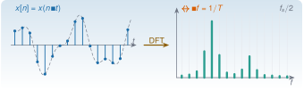
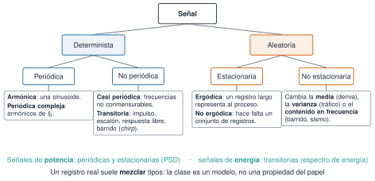
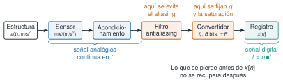
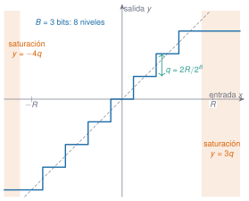
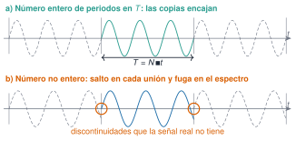

{.portada fig-alt="A la izquierda, una señal continua con sus muestras marcadas como puntos sobre varillas; una flecha rotulada DFT lleva a la derecha, donde un espectro de barras se dibuja sobre una rejilla de bins separados Δf = 1/T hasta fs/2"}

```{ojs}
//| echo: false
import {descriptores, cuantizar, frecuenciaAparente, dft, periodograma, espectroAmplitud, welch, potenciaBandas, psdNormalizada, anpsd, colorear, dB, coma, histograma, rng, normal} from "../../recursos/js/senales.js"
```

```{julia}
#| include: false
using Resonancia, Statistics, Random, Printf, Markdown
include("../../recursos/_tema.jl")
const G0 = 9.80665   # gravedad estándar: 1 g = 9,80665 m/s² (hipótesis declarada para convertir los datos)
TORROJA = "../../datos/reales-publicables/torroja-puente/2018-06-22-vibracion-ambiental/"
PALMA = "../../datos/reales-publicables/palma-del-rio-puente/2020-07-17-vibracion-operacional/"
```

## Objetivos y prerrequisitos

**Objetivos.** Al terminar la sesión sabrás:

- **clasificar y describir** un registro: identificarlo (estructura, sensor, canal, unidades, $f_{\mathrm s}$, duración); situarlo en la clasificación de señales (armónica, periódica, casi periódica, transitoria, aleatoria estacionaria o no); reconocer el ruido que contiene (por su espectro, su distribución y su origen, incluido el eléctrico); y resumirlo con media, varianza, desviación típica, RMS total y fluctuante, picos, factor de cresta, asimetría y curtosis, sabiendo qué significa físicamente cada uno;
- **justificar una adquisición**: elegir $f_{\mathrm s}$, duración, rango y número de bits para una banda de interés, y reconocer el aliasing y la saturación como errores que **no se corrigen después**;
- **interpretar un espectro**: leer amplitud y fase en la DFT, relacionar duración, bins y resolución, reconocer la fuga y saber qué hace (y qué no hace) el relleno con ceros;
- **estimar y representar la PSD** con el periodograma y con el método de Welch, con sus unidades, su referencia en dB y su comprobación por Parseval;
- **interpretar con prudencia**: un pico no es automáticamente un modo ni un daño, y la estacionariedad se juzga, no se demuestra con un número.

**Prerrequisitos.** Conviene repasar antes la clase [M2](../m02-matematicas/index.qmd).

**Temas de la unidad**

- **M3.1** Clasificación de señales: deterministas y aleatorias, estacionarias y no estacionarias
- **M3.2** Descriptores temporales: media, RMS, pico, factor de cresta, curtosis
- **M3.3** Muestreo y cuantificación: resolución del convertidor y rango dinámico
- **M3.4** Teorema de Nyquist-Shannon, aliasing y filtros antialiasing
- **M3.5** DFT y FFT: resolución en frecuencia y fuga espectral
- **M3.6** Densidad espectral de potencia: periodograma, método de Welch, escalado y unidades

### Ruta de la sesión (240 min)

La ruta [obligatoria]{.ruta-obligatoria} cabe en las cuatro horas e incluye explicación, problemas e interacción. Lo marcado como [ampliación]{.ruta-ampliacion} queda fuera del horario: para quien termine antes o para el trabajo autónomo. Cada simulador se usa en clase solo en lo que pide su pregunta; el resto de sus controles son para explorar después.

::: {.indice-unidades .indice-detalle}

| Tiempo | Bloque | Actividad | Duración |
|---|---|---|---|
| 0:00 | [Reto inicial](#reto) | Registro real del puente de Torroja y 3 preguntas diagnósticas [obligatoria]{.ruta-obligatoria} | 10 min |
| 0:10 | [M3.1 Clasificación](#m3-1) y [ruido](#m3-1-ruido) | Taxonomía de señales; Simulaciones 1–3 (galería de señales, clasificador de intervalos, colores del ruido) [obligatoria]{.ruta-obligatoria}; detalle del ruido eléctrico [ampliación]{.ruta-ampliacion} | 30 min |
| 0:40 | [M3.2 Descriptores](#m3-2) | Lectura geométrica de los momentos, ejemplo resuelto, Simulaciones 4 y 5 (momentos a la vista; mismo RMS, distinta señal) [obligatoria]{.ruta-obligatoria} | 30 min |
| 1:10 | [M3.3 Muestreo y cuantificación](#m3-3) | Problema de rango y bits, Simulación 6 (convertidor ideal) [obligatoria]{.ruta-obligatoria} | 25 min |
| 1:35 | [M3.4 Nyquist y aliasing](#m3-4) | Frecuencia aparente a mano, Simulación 7 (aliasing) [obligatoria]{.ruta-obligatoria} | 25 min |
| 2:00 | Descanso | [descanso]{.ruta-descanso} | 15 min |
| 2:15 | [M3.5 DFT y FFT](#m3-5) | DFT a mano antes del código, Simulaciones 8 y 9 (repetición periódica; dos tonos) [obligatoria]{.ruta-obligatoria} | 35 min |
| 2:50 | [M3.6 PSD y Welch](#m3-6) | RMS a partir de la PSD, Simulaciones 10 y 11 (Welch; varias representaciones) [obligatoria]{.ruta-obligatoria} | 35 min |
| 3:25 | [Caso integrado](#caso) | Palma del Río: del registro a una interpretación prudente, con rúbrica [obligatoria]{.ruta-obligatoria} | 25 min |
| 3:50 | [Test de salida](#test-salida) | 5 preguntas y discusión [obligatoria]{.ruta-obligatoria} | 10 min |
| — | [Problemas numéricos](#problemas) | Cinco problemas con solución desplegable [ampliación]{.ruta-ampliacion} | 45 min |
| — | [ANPSD](#anpsd) y [variante Torroja](#caso) | Promedio de PSD normalizadas; el caso con el otro puente [ampliación]{.ruta-ampliacion} | 40 min |
| — | [Actividad de la LAV](#lav) | Línea Madrid–Sevilla: elegir la adquisición y analizar el paso de un tren (escenario sintético) [ampliación]{.ruta-ampliacion} | 35 min |
| — | [«Pídeselo a Claude»](#pideselo) | Repetir el caso con Claude Code y verificarlo [ampliación]{.ruta-ampliacion} | 30 min |

:::

**Total de la sesión: 4 h** (225 min de trabajo y 15 de descanso). Son tiempos orientativos de la autoría de esta página, no datos oficiales de la asignatura.

::: {.callout-note title="Notación, unidades y convenciones de esta sesión"}
| Símbolo | Significado | Unidad |
|---|---|---|
| $x(t)$, $x[n]=x(n\,\Delta t)$ | señal continua y su versión muestreada | la del sensor (aquí, m/s² o g) |
| $f_{\mathrm s}=1/\Delta t$ | frecuencia de muestreo | Hz |
| $N$, $T=N\,\Delta t$ | número de muestras y duración del registro | –, s |
| $f_{\mathrm N}=f_{\mathrm s}/2$ | frecuencia de Nyquist | Hz |
| $\Delta f=f_{\mathrm s}/N=1/T$ | separación entre bins de la DFT | Hz |
| $X[k]$ | DFT, $X[k]=\sum_{n=0}^{N-1}x[n]\,e^{-i2\pi kn/N}$ | la de $x$ |
| $\mu$, $\sigma^2$ | media y varianza (con divisor $N$) | u, u² |
| $B$, $\pm R$, $q=2R/2^B$ | bits, rango de entrada y paso del convertidor | –, u, u |
| $P[k]$ o $G_{xx}(f)$ | PSD unilateral | u²/Hz |
| $\zeta$ | razón de amortiguamiento | – |

**Unilateral.** Todos los espectros de esta página son **unilaterales** (de $0$ a $f_{\mathrm s}/2$): la potencia de las frecuencias negativas se suma a las positivas multiplicando por 2 todos los bins **salvo DC y Nyquist**, que no tienen pareja. **dB.** Siempre con referencia explícita: $10\log_{10}(P/P_{\mathrm{ref}})$ para potencias y PSD, $20\log_{10}(A/A_{\mathrm{ref}})$ para amplitudes. **Datos.** Para pasar de g a m/s² se usa la gravedad estándar, $1\ \mathrm g=9{,}80665\ \mathrm{m/s^2}$: es una hipótesis, porque las fichas de los ensayos dicen «g» sin más.
:::

::: {.callout-note collapse="true" title="Fuentes, datos, código y qué queda pendiente"}
**Datos reales.** Dos registros de [Recursos](../../recursos/index.qmd), sin duplicar sus fichas:

- **Puente de Eduardo Torroja**, vibración ambiental del 22-06-2018 [@pachon2018; @torroja2018datos]: cinco estaciones triaxiales, $f_{\mathrm s}=100$ Hz, aceleración en g, CC BY 4.0. Para los simuladores se usa un extracto (canal vertical de las cinco estaciones, primeros 300 s de la medida 1), generado por `scripts/m03/preparar_extractos.jl` y descrito en `campana.meta.toml`. Las marcas de tiempo de las cinco estaciones coinciden muestra a muestra; **la ficha no dice cómo se sincronizaron los relojes**, así que no se usan relaciones de fase entre estaciones. Ficha completa: [R2 · Torroja](../../recursos/r2-torroja/index.qmd).
- **Puente de Palma del Río**, vibración operacional del 17-07-2020 [@infantes2022]: un acelerómetro sísmico, $f_{\mathrm s}=512$ Hz, aceleración en g, CC BY 4.0. Ficha: [R1 · Palma del Río](../../recursos/r1-palma-del-rio/index.qmd).

**Lo que no se sabe de estos registros.** Ninguna de las dos fichas da la sensibilidad ni el rango del sensor, la resolución del convertidor ni el filtro antialiasing. Por eso M3.3 usa un convertidor **ideal y sintético**, y en los datos reales no se puede afirmar nada sobre su cuantificación ni sobre su protección frente al aliasing.

**Señales sintéticas.** Las Simulaciones 1–10 usan señales generadas con semilla fija y rotuladas como tales: sinusoides, dos tonos, ruido, offset, impactos y la respuesta de dos osciladores a ruido. Sirven para aislar un fenómeno con la respuesta conocida; **no son medidas**. Igual de sintético es el escenario de la [actividad de la línea Madrid–Sevilla](#lav), que solo toma del libro [@puentesferroviarios] la longitud, los vanos y el esquema de cinco viaductos.

**Código.** Las funciones están en `Resonancia.jl` 0.8.0 (`descriptores_temporales`, `cuantizar`, `frecuencia_aparente`, `dft`, `periodograma`, `espectro_amplitud`, `psd_welch`, `potencia_bandas`, `psd_normalizada`, `anpsd`, y `aceleracion_1gdl` en la actividad de la LAV). Las Simulaciones usan `recursos/js/senales.js` y la pestaña Python, `mse/m03-senales-i/python/senales.py`. Las tres versiones se contrastan con los mismos datos de referencia (`referencia/senales.json`, generado por `scripts/m03/generar_referencia.jl`) y Python, además, con SciPy.

**Referencia pedagógica.** De la serie *Modal Space* de Peter Avitabile se toma el enfoque de partir de una pregunta experimental. Se han usado tres columnas: sobre la fuga y las ventanas [@avitabile1999ventanas], sobre los pasos de una adquisición [@avitabile2002adquisicion] y sobre el rango del digitalizador [@avitabile2004rango]. Las explicaciones y las figuras de esta página son propias.

**Pendiente.** Comprobar la página en un teléfono real (solo se ha probado con Chromium a 390 px). Leer la tesis de Felber, origen del ANPSD (véase [M3.6](#anpsd)), que no ha sido accesible.
:::

::: {.callout-note title="Qué queda para M4"}
M3 explica la fuga **solo** con el truncamiento y la ventana rectangular, y usa en Welch una ventana de Hann y un solape del 50 % **fijos**. En [M4](../m04-senales-ii/index.qmd) se estudian: la comparación de ventanas y la elección del solape; los filtros FIR e IIR y el filtrado de fase cero; la limpieza y el remuestreo; la integración de aceleración a velocidad y desplazamiento; la relación señal-ruido y el ruido propio del sensor; los espectros cruzados, la coherencia y las FRF $H_1$ y $H_2$; y el análisis tiempo-frecuencia (espectrograma y *wavelets*). La adquisición con un microcontrolador (ESP32) está en [M8](../m08-adquisicion/index.qmd).
:::

## Teoría breve

### Reto inicial: ¿a qué frecuencias vibra este puente? {#reto}

::: {.callout-note .reto icon=false title="Reto: cinco minutos con un registro real"}
La @fig-reto es la aceleración vertical medida en el tablero del puente de Eduardo Torroja una mañana de junio de 2018. Es un ensayo de vibración **ambiental**: no se excita el puente, se mide su respuesta a lo que haya (viento, entorno y, en esta medida, que se hizo sin cortar carriles según las notas de campo, el posible tráfico). Antes de calcular nada, contesta en tu cuaderno:

1. ¿Es una señal periódica, aleatoria o transitoria? ¿Parece la misma al principio y al final?
2. ¿Cuál es aproximadamente su valor eficaz? ¿Y su pico?
3. ¿Se puede leer en esta figura a qué frecuencias vibra el puente?

Pista: fíjate en las ráfagas de hacia 135 y 175 s. ¿Qué podría producirlas en un puente medido sin cortar carriles?

Al final de [M3.6](#m3-6) volverás a esta señal con su espectro.
:::

```{julia}
#| label: fig-reto
#| fig-cap: "Puente de Eduardo Torroja, 22-06-2018, medida 1: aceleración vertical (canal Z0HNZ) de la estación GS4 durante los primeros 300 s. Dato real, sin filtrar; solo se ha convertido de g a m/s² y se ha restado la media. Datos: @torroja2018datos."
#| fig-alt: "Señal temporal de aceleración de 300 segundos con un fondo de amplitud pequeña, de unas milésimas de metro por segundo al cuadrado, y varias ráfagas; las dos mayores, hacia los 135 y los 175 segundos, llegan a unos 0,2 a 0,35 metros por segundo al cuadrado."
t4, a4, fs4, est4, ini4 = leer_torroja(TORROJA * "crudos/s4_medida01.txt")
n300 = round(Int, 300fs4)
z4 = (a4[1:n300, 3] .- mean(a4[1:n300, 3])) .* G0
fig = Figure(size=(860, 300))
ax = Axis(fig[1, 1]; xlabel="tiempo (s)", ylabel="aceleración (m/s²)")
lines!(ax, t4[1:n300], z4; color=AZUL, linewidth=0.6)
xlims!(ax, 0, 300)
fig
```

Tres preguntas diagnósticas, para saber de dónde partes. No cuentan: equivocarse aquí es útil.

::: {.ejercicio tipo="vf" id="m3-diag-fs" respuesta="falso"}
Si duplico la frecuencia de muestreo y mantengo la misma duración del registro, los picos del espectro quedan el doble de finos (mejor resolución en frecuencia).

::: {.solucion}
Falso. La separación entre bins es $\Delta f=f_{\mathrm s}/N=1/T$: si se duplica $f_{\mathrm s}$ con $T$ fijo, también se duplica $N$ y $\Delta f$ no cambia. Lo único que gana es la banda observable, hasta $f_{\mathrm s}/2$. Lo verás en [M3.5](#m3-5).
:::
:::

::: {.ejercicio tipo="opcion" id="m3-diag-rms" respuesta="c"}
Dos registros tienen el mismo valor eficaz (RMS). ¿Qué puedes afirmar?

::: {.opciones}
- Que tienen el mismo pico.
- Que son la misma señal, quizá desplazada en el tiempo.
- Que tienen la misma potencia media, y nada más sobre su forma.
- Que, si uno es una sinusoide de amplitud $A$, el otro tiene pico $A$.
:::

::: {.retro}
- El pico puede ser muy distinto: una serie de impactos tiene un pico varias veces mayor que una sinusoide del mismo RMS. Lo medirás con el factor de cresta en M3.2.
- El RMS no conserva la forma de onda: muchísimas señales distintas comparten RMS.
- Correcto: el RMS al cuadrado es la potencia media (el valor cuadrático medio). No dice nada de la forma, del pico ni de cómo se reparte la energía en frecuencia.
- Solo la sinusoide cumple pico $=\sqrt2\cdot$RMS; para otras formas la relación cambia.
:::

::: {.solucion}
La **c**. Véase la Simulación 5 en [M3.2](#m3-2).
:::
:::

::: {.ejercicio tipo="opcion" id="m3-diag-pico" respuesta="b"}
En el espectro de un sensor colocado en un puente aparece un pico claro a 3,26 Hz. ¿Qué conclusión es la más prudente?

::: {.opciones}
- Es el primer modo del puente.
- Es una frecuencia donde la respuesta medida tiene mucha potencia; puede ser un modo, pero hay que comprobarlo.
- Indica que el puente tiene un daño a esa frecuencia.
- Es un error del sensor, porque un puente vibra a una sola frecuencia.
:::

::: {.retro}
- Puede serlo, pero un pico también puede venir de la excitación (tráfico, maquinaria, viento con cierta periodicidad) o de una interferencia eléctrica. Para hablar de modos hacen falta más sensores y un método de identificación (M7).
- Correcto. El espectro dice dónde está la potencia de **esta** respuesta medida en **este** punto. Que sea un modo se confirma con varios sensores, con su forma y su amortiguamiento.
- Un pico no es un daño. El daño se busca como **cambio** respecto de una referencia, y además hay que separar el efecto de la temperatura y del tráfico.
- Una estructura tiene muchos modos; lo raro sería ver uno solo.
:::

::: {.solucion}
La **b**. En la ficha de R2 se compara este tipo de picos con los modos identificados por los autores con varios sensores.
:::
:::

### M3.1 Clasificación de señales: deterministas y aleatorias, estacionarias y no estacionarias {#m3-1}

**Pregunta motivadora.** Un sistema de monitorización calcula cada diez minutos el valor eficaz de un acelerómetro. ¿Tiene sentido comparar el de las 3:00 con el de las 8:00 si a las 8:00 pasan camiones? ¿Y si lo que pasa a las 8:00 es que el cable del sensor recoge la red eléctrica?

**Objetivos observables.** Situar un registro en la clasificación de la @fig-taxonomia y justificarlo; distinguir señales de energía y de potencia y elegir con ello la herramienta espectral; decidir, con la media y el RMS por ventanas, si un registro es aproximadamente estacionario y de qué manera deja de serlo; definir el ruido de un análisis concreto y reconocer sus tipos, incluido el ruido eléctrico, por su forma en el tiempo y en el espectro.

**Física.** La respuesta de una estructura es lo que la excita (viento, tráfico, máquinas, impactos, el suelo) filtrado por sus modos ([M5](../m05-vibraciones-i/index.qmd)), más lo que añade la cadena de medida. Clasificar no es poner etiquetas: **la clase decide qué descriptor y qué espectro tienen sentido**. Una máquina rotativa da una respuesta que se repite (periódica) y se describe con líneas espectrales de amplitud y fase. El viento y el tráfico denso dan una respuesta que no se puede predecir valor a valor (aleatoria) y que se describe estadísticamente, con medias, varianzas y una densidad espectral. Un golpe o el paso de un camión aislado dan una respuesta que empieza y se extingue (transitoria), con energía finita.

{#fig-taxonomia fig-alt="Árbol que divide las señales en deterministas y aleatorias. Las deterministas, en periódicas (armónica y periódica compleja) y no periódicas (casi periódica y transitorias: impulso, escalón, respuesta libre, barrido). Las aleatorias, en estacionarias (ergódicas o no) y no estacionarias (cambia la media, la varianza o el contenido en frecuencia)."}

| Tipo | Qué la define | Ejemplo en estructuras | Espectro | Cómo se describe |
|---|---|---|---|---|
| **Armónica** | $x(t)=A\cos(2\pi f t+\varphi)$ | desequilibrio de una máquina; ensayo con excitador a una frecuencia | una línea | amplitud, frecuencia y fase |
| **Periódica compleja** | $x(t+T_0)=x(t)$: suma de armónicos de $f_0=1/T_0$ | máquina con varios órdenes; paso de álabes | líneas en $f_0, 2f_0, 3f_0\dots$ | espectro de amplitud |
| **Casi periódica** | suma de sinusoides cuyas frecuencias no guardan una razón racional: nunca se repite exactamente | dos máquinas a velocidades independientes; respuesta libre de dos modos sin amortiguar | líneas no armónicas | espectro de amplitud |
| **Impulso** | energía concentrada en un instante muy breve frente a los periodos de interés | golpe de martillo en un ensayo de impacto | continuo y casi plano hasta $\approx1/\text{duración}$ | espectro de energía |
| **Escalón** | cambio brusco y permanente del nivel | carga que se aplica y se queda; salto de un sensor | continuo, decreciente como $1/f$ | media antes y después |
| **Respuesta libre amortiguada** | oscilación que decae como $e^{-\zeta\omega_n t}$ | estructura tras un impacto o tras pasar un vehículo | pico de anchura $\approx2\zeta f_n$ | frecuencia y amortiguamiento ([M5](../m05-vibraciones-i/index.qmd)) |
| **Barrido** (*chirp*) | frecuencia instantánea que varía con el tiempo | ensayo con excitador en barrido; arranque de una máquina | banda cubierta, sin decir cuándo | tiempo-frecuencia ([M4](../m04-senales-ii/index.qmd)) |
| **Aleatoria estacionaria** | sus propiedades estadísticas no cambian con el tiempo | vibración ambiental con viento estable | continuo | media, varianza y PSD ([M3.6](#m3-6)) |
| **Aleatoria no estacionaria** | cambian la media, la varianza o el contenido en frecuencia | tráfico (Palma del Río, [caso](#caso)); deriva térmica; sismo | cambia con el tiempo | por tramos o tiempo-frecuencia |

: Tipos de señal, con un ejemplo y la herramienta que les corresponde. {#tbl-tipos}

**Energía o potencia.** Una señal transitoria tiene **energía** finita, $E=\int x^2\,\mathrm dt$ (o $\sum x[n]^2\Delta t$), y su potencia media tiende a cero si se alarga el registro: describirla con una PSD da un resultado que **depende de la duración elegida**. Una señal periódica o estacionaria tiene **potencia** media finita y energía que crece sin límite con la duración: para ella sí tiene sentido la PSD. Un registro de un impacto se analiza por eso de otra forma que uno de vibración ambiental (espectro de energía, ventanas adaptadas; véase M4).

**Estacionaria, no estacionaria y ergódica.**

::: {#def-estacionaria}
**Señal estacionaria.** Un proceso aleatorio es **estacionario en sentido estricto** si ninguna de sus propiedades estadísticas cambia al desplazar el origen de tiempos, y **en sentido débil** si al menos su media es constante y su autocorrelación solo depende del retardo, no del instante. Es **ergódico** si los promedios temporales de **un** registro suficientemente largo coinciden con los promedios sobre **muchos** registros del mismo proceso (el «conjunto»).
:::

En monitorización casi siempre hay **un único registro** por instante. Por eso se supone ergodicidad: la media y la varianza que se calculan en el tiempo se toman como las del proceso. Lo que sí se puede comprobar es algo más débil: que la media y el RMS calculados en ventanas sucesivas no cambian más de lo que cambiarían por la propia variabilidad de la estimación. Un registro puede dejar de ser estacionario de tres maneras, y cada una tiene su firma (Simulación 1):

- **en media**: la componente continua deriva (temperatura, fluencia, deriva del sensor). La media por ventanas se mueve.
- **en varianza**: la intensidad cambia (tráfico, rachas de viento, horas punta). El RMS por ventanas se mueve, pero la media no.
- **en contenido en frecuencia**: cambia «a qué» vibra (barrido, sismo, cambio de régimen de una máquina). Media y RMS pueden no cambiar, y solo lo delata el espectro calculado por tramos.

**Matemáticas mínimas.** Para ventanas consecutivas de $M$ muestras (duración $T_v=M\,\Delta t$), la media y el RMS de la ventana $j$ son

$$
\mu_j=\frac1M\sum_{n\in j}x[n],\qquad \mathrm{RMS}_j=\sqrt{\frac1M\sum_{n\in j}x[n]^2}\quad(\text{unidades de }x).
$$

Para un ruido estacionario, los $\mathrm{RMS}_j$ fluctúan de una ventana a otra solo por azar, y esa fluctuación **disminuye** al alargar $T_v$. Si los valores derivan o saltan de forma sistemática, el registro no es estacionario a esa escala de tiempo.

**Simulación 1. Galería de señales.** *Señales sintéticas*, una por cada tipo de la @tbl-tipos, de 20 s a 100 Hz. A la izquierda, la señal con su media (verde) y su RMS (naranja) en ventanas de 2 s; a la derecha, el espectro **que corresponde a su clase**: de amplitud para las deterministas, PSD de Welch para las aleatorias.

::: {.ejercicio tipo="encuesta" id="m3-1-prediccion-galeria"}
**Predicción.** ¿Qué tipo de señal crees que tendrá una media y un RMS por ventanas constantes y, aun así, **no** será estacionaria?

::: {.opciones}
- Una armónica.
- Un barrido (*chirp*).
- Un ruido con deriva de la media.
- Un ruido blanco.
:::
:::

::: {.laboratorio .solo-pantalla}

```{ojs}
//| echo: false
s1g_tipos = ["armónica (3 Hz)", "periódica compleja (f₀ = 2 Hz)", "casi periódica (3 y 3·√2 Hz)", "impulso", "escalón", "respuesta libre amortiguada", "barrido de 1 a 20 Hz", "ruido estacionario", "no estacionaria en media (deriva)", "no estacionaria en varianza", "no estacionaria en frecuencia (cambio de modo)"]
viewof s1g = {
  s1g_reinicio;
  return Inputs.form({
    tipo: Inputs.select(s1g_tipos, {value: "armónica (3 Hz)", label: "tipo de señal"}),
    db: Inputs.toggle({label: "espectro en dB", value: false})
  });
}
viewof s1g_reinicio = Inputs.button("Restablecer valores")
```

```{ojs}
//| echo: false
s1g_datos = {
  const fs = 100, N = 20 * fs, u = rng(5), t = Array.from({length: N}, (_, n) => n / fs), tipo = s1g.tipo;
  const ruido = () => normal(u);
  const libre = (s) => (s >= 0 ? Math.exp(-0.03 * 2 * Math.PI * 4 * s) * Math.sin(2 * Math.PI * 4 * s) : 0);
  const gen = {
    "armónica (3 Hz)": (tt) => Math.cos(2 * Math.PI * 3 * tt),
    "periódica compleja (f₀ = 2 Hz)": (tt) => Math.cos(2 * Math.PI * 2 * tt) + 0.5 * Math.cos(2 * Math.PI * 4 * tt + 1) + 0.3 * Math.cos(2 * Math.PI * 6 * tt + 2),
    "casi periódica (3 y 3·√2 Hz)": (tt) => Math.cos(2 * Math.PI * 3 * tt) + 0.8 * Math.cos(2 * Math.PI * 3 * Math.SQRT2 * tt),
    "impulso": (tt) => (Math.abs(tt - 5) < 0.005 ? 1 : 0),
    "escalón": (tt) => (tt >= 8 ? 1 : 0),
    "respuesta libre amortiguada": (tt) => libre(tt - 2),
    "barrido de 1 a 20 Hz": (tt) => Math.sin(2 * Math.PI * (1 * tt + (19 / 40) * tt * tt)),
    "ruido estacionario": () => ruido(),
    "no estacionaria en media (deriva)": (tt) => 0.4 * ruido() + 0.12 * tt,
    "no estacionaria en varianza": (tt) => ruido() * (0.3 + 1.2 * Math.exp(-(((tt - 12) / 2.5) ** 2))),
    "no estacionaria en frecuencia (cambio de modo)": () => 0
  };
  let x = t.map(gen[tipo]);
  if (tipo === "no estacionaria en frecuencia (cambio de modo)") {
    // ruido filtrado por un oscilador de 3 Hz durante 10 s y de 8 Hz después: misma varianza aproximada
    const osc = (f, z) => { const w = 2 * Math.PI * f, r = Math.exp(-z * w / fs); return [2 * r * Math.cos(w * Math.sqrt(1 - z * z) / fs), -r * r]; };
    const [a1, b1] = osc(3, 0.03), [a2, b2] = osc(8, 0.03), y = new Array(N).fill(0);
    for (let n = 2; n < N; n++) { const [a, b] = t[n] < 10 ? [a1, b1] : [a2, b2]; y[n] = a * y[n - 1] + b * y[n - 2] + normal(u); }
    const s1 = descriptores(y.slice(0, N / 2)).rms_fluctuante, s2 = descriptores(y.slice(N / 2)).rms_fluctuante;
    x = y.map((v, n) => (n < N / 2 ? v / s1 : v / s2));
  }
  const aleatoria = tipo.startsWith("ruido") || tipo.startsWith("no estacionaria");
  const esp = aleatoria ? (({f, P}) => ({f, y: P, unidad: "PSD (u²/Hz)"}))(welch(x, fs, {nseg: 256})) : (({f, A}) => ({f, y: A, unidad: "amplitud (u)"}))(espectroAmplitud(x, fs));
  const M = 2 * fs, ventanas = [];
  for (let i = 0; i + M <= N; i += M) { const d = descriptores(x.slice(i, i + M)); ventanas.push({t0: i / fs, t1: (i + M) / fs, media: d.media, rms: d.rms}); }
  const d = descriptores(x), E = x.reduce((s, v) => s + v * v, 0) / fs;
  return {serie: x.map((v, n) => ({t: t[n], x: v})), ventanas, esp, aleatoria, d, E};
}
```

```{ojs}
//| echo: false
{
  const ancho = Math.min(width, 760), dos = ancho > 560, w = dos ? ancho * 0.55 : ancho, w2 = dos ? ancho * 0.42 : ancho;
  const temporal = Plot.plot({width: w, height: 240, marginLeft: 45, ariaLabel: `Simulación 1: ${s1g.tipo}, señal temporal con media y RMS por ventanas`,
    x: {label: "tiempo (s)"}, y: {label: "x (u)", grid: true},
    marks: [Plot.ruleY([0]), Plot.line(s1g_datos.serie, {x: "t", y: "x", stroke: "#1b6ca8", strokeWidth: 0.8}),
      Plot.ruleY(s1g_datos.ventanas, {x1: "t0", x2: "t1", y: "rms", stroke: "#d95f02", strokeWidth: 2.5}),
      Plot.ruleY(s1g_datos.ventanas, {x1: "t0", x2: "t1", y: "media", stroke: "#2a9d8f", strokeWidth: 2.5, strokeDasharray: "5 3"})]});
  const pts = s1g_datos.esp.f.map((f, k) => ({f, y: s1g.db ? 10 * (s1g_datos.aleatoria ? 1 : 2) * Math.log10(Math.max(s1g_datos.esp.y[k], 1e-12)) : s1g_datos.esp.y[k]})).filter((p) => p.f <= 25);
  const espectro = Plot.plot({width: w2, height: 240, marginLeft: 50, ariaLabel: `Simulación 1: espectro de ${s1g.tipo}`,
    x: {label: "frecuencia (Hz)"}, y: {label: s1g.db ? (s1g_datos.aleatoria ? "PSD (dB ref. 1 u²/Hz)" : "amplitud (dB ref. 1 u)") : s1g_datos.esp.unidad, grid: true},
    marks: [Plot.line(pts, {x: "f", y: "y", stroke: s1g_datos.aleatoria ? "#d95f02" : "#2a9d8f", strokeWidth: 1.3})]});
  return html`<div style="display:flex; gap:0.5rem; flex-wrap:wrap">${temporal}${espectro}</div>`;
}
```

```{ojs}
//| echo: false
html`<div class="lectura" role="status" aria-live="polite"><p><b>${s1g.tipo}</b> · ${s1g_datos.aleatoria ? "aleatoria: espectro = PSD de Welch (Hann, L = 256)" : "determinista: espectro = amplitud unilateral (rectangular, registro completo)"} · media ${coma(s1g_datos.d.media, 3)} · RMS ${coma(s1g_datos.d.rms, 3)} · energía Σx²Δt = ${coma(s1g_datos.E, 2)} u²·s · potencia media ${coma(s1g_datos.d.rms ** 2, 4)} u². u: unidades arbitrarias de la señal sintética.</p></div>`
```

:::

::: {.solo-impresion}
```{julia}
#| label: fig-sim1g-estatica
#| fig-cap: "Versión estática de la Simulación 1: seis tipos de señal sintética (20 s a 100 Hz) con su espectro correspondiente: de amplitud para las deterministas y PSD para la aleatoria."
#| fig-alt: "Seis filas de pares de gráficas. Armónica: una línea espectral. Periódica compleja: tres líneas armónicas. Impulso: espectro plano. Respuesta libre: un pico ancho. Barrido: una meseta de 1 a 20 hercios. Ruido: espectro continuo."
fsg = 100.0; tg = (0:2000-1) ./ fsg; rg = Xoshiro(5)
galeria = [("armónica", cos.(2π * 3 .* tg)), ("periódica compleja", cos.(2π * 2 .* tg) .+ 0.5cos.(2π * 4 .* tg .+ 1) .+ 0.3cos.(2π * 6 .* tg .+ 2)),
    ("impulso", Float64.(abs.(tg .- 5) .< 0.005)), ("respuesta libre", [s >= 0 ? exp(-0.03 * 2π * 4s) * sin(2π * 4s) : 0.0 for s in tg .- 2]),
    ("barrido 1–20 Hz", sin.(2π .* (tg .+ (19 / 40) .* tg .^ 2))), ("ruido", randn(rg, length(tg)))]
fig = Figure(size=(860, 900))
for (i, (nom, x)) in enumerate(galeria)
    lines!(Axis(fig[i, 1]; ylabel=nom, ylabelsize=12), tg, x; color=AZUL, linewidth=0.6)
    if nom == "ruido"
        f, P = psd_welch(x, fsg; nseg=256); lines!(Axis(fig[i, 2]), f, P; color=NARANJA)
    else
        f, A, _ = espectro_amplitud(x, fsg); lines!(Axis(fig[i, 2]), f[f .<= 25], A[f .<= 25]; color=VERDE)
    end
end
fig
```
:::

::: {.ejercicio tipo="opcion" id="m3-1-interpretacion-galeria" respuesta="d"}
**Interpretación.** En la Simulación 1, el «barrido» y el «cambio de modo» tienen media y RMS por ventanas prácticamente constantes. ¿Qué indica?

::: {.opciones}
- Que son estacionarias.
- Que la media y el RMS no sirven para nada.
- Que el espectro de todo el registro basta para describirlas.
- Que la media y el RMS solo detectan cambios de nivel y de intensidad; un cambio en el contenido en frecuencia exige mirar el espectro por tramos.
:::

::: {.retro}
- El barrido es determinista y su frecuencia cambia con el tiempo; el «cambio de modo» pasa de 3 a 8 Hz a mitad de registro. Ninguno es estacionario, aunque los dos indicadores no lo vean.
- Sirven para lo que miden: el nivel (media) y la intensidad (RMS). Detectan la deriva y el tráfico.
- El espectro del registro completo mezcla los dos tramos y no dice **cuándo** aparece cada frecuencia (véase el espectrograma en M4.7).
- Correcto. Los descriptores por ventanas son una prueba **necesaria** pero no suficiente de estacionariedad.
:::

::: {.solucion}
La **d**. Por eso la estacionariedad se juzga con varios indicadores y a la escala de tiempo del análisis.
:::
:::

::: {#exm-estacionario}
**Ejemplo resuelto.** Un registro de 10 min se divide en diez ventanas de 60 s. Los RMS son: 3,1; 3,0; 3,2; 2,9; 3,1; 3,0; 7,8; 8,4; 3,1; 3,0 mg. Las ventanas 7 y 8 multiplican el RMS por más de 2,5, mucho más que la dispersión de las otras ocho (entre 2,9 y 3,2 mg). **Conclusión:** el registro completo no es estacionario **en varianza**. Hay un episodio, quizá el paso de vehículos, entre los minutos 6 y 8. Para describir el «fondo» ambiental se usarían las otras ocho ventanas, declarándolo así.
:::

::: {.ejercicio tipo="opcion" id="m3-1-tipo-camion" respuesta="c"}
**Ejercicio breve.** Un acelerómetro registra durante 60 s el paso de **un** camión por un puente, sin más tráfico. ¿Cómo clasificas el registro?

::: {.opciones}
- Periódico: el camión tiene ejes equiespaciados.
- Aleatorio estacionario: la carga del camión es aleatoria.
- Transitorio (de energía finita) sobre un fondo aleatorio: la PSD de los 60 s depende de cuánto «fondo» incluyas.
- Casi periódico.
:::

::: {.retro}
- Los ejes pueden dar componentes repetidas mientras el camión está encima, pero la señal empieza y acaba con su paso: no se repite indefinidamente.
- La intensidad depende de dónde está el camión: cambia con el tiempo.
- Correcto. Al alargar el registro con más fondo, la potencia media del paso «se diluye». Por eso un suceso aislado se describe mejor por su energía o con una ventana centrada en él.
- No hay frecuencias que se mantengan durante todo el registro.
:::
:::

**Simulación 2. Clasificador de intervalos.** *Señal sintética* de 60 s a 50 Hz con cuatro intervalos de 15 s de naturaleza distinta (la semilla fija la realización del ruido). Antes de experimentar, haz tu predicción.

::: {.ejercicio tipo="encuesta" id="m3-1-prediccion" texto="true"}
**Predicción.** Mira solo la señal (sin las curvas de media y RMS): clasifica cada intervalo I1–I4 como periódico, aleatorio estacionario, transitorio o aleatorio no estacionario, y di en cuál esperas que el RMS por ventanas cambie más.
:::

::: {.laboratorio .solo-pantalla}

```{ojs}
//| echo: false
viewof s1 = {
  s1_reinicio;
  return Inputs.form({
    ventana: Inputs.range([0.5, 15], {value: 5, step: 0.5, label: "ventana para media y RMS (s)"}),
    semilla: Inputs.range([1, 20], {value: 1, step: 1, label: "realización del ruido (semilla)"}),
    indicadores: Inputs.toggle({label: "mostrar media y RMS por ventanas", value: true})
  });
}
viewof s1_reinicio = Inputs.button("Restablecer valores")
```

```{ojs}
//| echo: false
s1_datos = {
  const fs = 50, N = 60 * fs, u = rng(s1.semilla), x = new Array(N);
  let e = 0;
  for (let n = 0; n < N; n++) {
    const t = n / fs;
    if (t < 15) x[n] = 0.6 * Math.sin(2 * Math.PI * 1.5 * t) + 0.25 * Math.sin(2 * Math.PI * 4.5 * t + 0.7);
    else if (t < 30) { e = 0.6 * e + 0.32 * normal(u); x[n] = e; }
    else if (t < 45) {
      let y = 0.05 * normal(u);
      for (const t0 of [31, 38.5]) if (t >= t0) { const s = t - t0; y += 1.5 * Math.exp(-0.04 * 2 * Math.PI * 3 * s) * Math.sin(2 * Math.PI * 3 * s); }
      x[n] = y;
    } else { e = 0.6 * e + 0.32 * normal(u); x[n] = e * (1 + 1.5 * (t - 45) / 15); }
  }
  const M = Math.round(s1.ventana * fs), ventanas = [];
  for (let i = 0; i + M <= N; i += M) {
    const s = x.slice(i, i + M), d = descriptores(s);
    ventanas.push({t0: i / fs, t1: (i + M) / fs, media: d.media, rms: d.rms});
  }
  const intervalos = [0, 1, 2, 3].map((j) => {
    const v = ventanas.filter((w) => w.t0 >= 15 * j && w.t1 <= 15 * (j + 1));
    const r = v.map((w) => w.rms);
    return {I: `I${j + 1}`, rms: descriptores(x.slice(15 * j * fs, 15 * (j + 1) * fs)).rms,
            min: r.length ? Math.min(...r) : NaN, max: r.length ? Math.max(...r) : NaN, n: r.length};
  });
  return {serie: x.map((v, n) => ({t: n / fs, x: v})), ventanas, intervalos};
}
```

```{ojs}
//| echo: false
Plot.plot({
  width: Math.min(width, 760), height: 280, marginLeft: 50,
  ariaLabel: "Simulación 2: señal sintética de 60 s con cuatro intervalos y, opcionalmente, su media y su RMS por ventanas",
  x: {label: "tiempo (s)", domain: [0, 60]}, y: {label: "x (m/s²)", grid: true},
  marks: [
    Plot.ruleX([15, 30, 45], {stroke: "#6b7280", strokeDasharray: "4 3"}),
    Plot.text(["I1", "I2", "I3", "I4"], {x: (d, i) => 7.5 + 15 * i, text: (d) => d, frameAnchor: "top", dy: 4, fontWeight: "bold"}),
    Plot.line(s1_datos.serie, {x: "t", y: "x", stroke: "#1b6ca8", strokeWidth: 0.7}),
    ...(s1.indicadores ? [
      Plot.ruleY(s1_datos.ventanas, {x1: "t0", x2: "t1", y: "rms", stroke: "#d95f02", strokeWidth: 2.5}),
      Plot.ruleY(s1_datos.ventanas, {x1: "t0", x2: "t1", y: "media", stroke: "#2a9d8f", strokeWidth: 2.5, strokeDasharray: "5 3"})
    ] : [])
  ]
})
```

```{ojs}
//| echo: false
html`<div class="lectura" role="status" aria-live="polite"><p>${s1.indicadores ? "Naranja continua: RMS por ventana; verde discontinua: media por ventana." : "Indicadores ocultos."} Ventanas de ${coma(s1.ventana, 1)} s.</p>
<table><thead><tr><th>Intervalo</th><th>RMS del intervalo (m/s²)</th><th>RMS por ventana: mín.–máx.</th><th>Ventanas</th></tr></thead><tbody>
${s1_datos.intervalos.map((r) => html`<tr><td>${r.I}</td><td>${coma(r.rms, 3)}</td><td>${r.n ? coma(r.min, 3) + " – " + coma(r.max, 3) : "ventana mayor que el intervalo"}</td><td>${r.n}</td></tr>`)}
</tbody></table></div>`
```

:::

::: {.solo-impresion}
```{julia}
#| label: fig-sim1-estatica
#| fig-cap: "Versión estática de la Simulación 2 (para imprimir): señal sintética con cuatro intervalos (periódico, aleatorio estacionario, transitorio y aleatorio con RMS creciente) y su RMS en ventanas de 5 s."
#| fig-alt: "Señal de 60 segundos dividida en cuatro tramos de 15 segundos: una oscilación regular, un ruido de amplitud constante, dos golpes que decaen y un ruido cuya amplitud crece; encima, escalones del RMS por ventanas de 5 segundos."
rng1 = Xoshiro(1); fs1 = 50; t1 = (0:60fs1-1) ./ fs1; x1 = zeros(length(t1)); e1 = 0.0
for (n, t) in enumerate(t1)
    global e1
    if t < 15
        x1[n] = 0.6sin(2π * 1.5t) + 0.25sin(2π * 4.5t + 0.7)
    elseif t < 30
        e1 = 0.6e1 + 0.32randn(rng1); x1[n] = e1
    elseif t < 45
        x1[n] = 0.05randn(rng1) + sum(t >= t0 ? 1.5exp(-0.04 * 2π * 3 * (t - t0)) * sin(2π * 3 * (t - t0)) : 0.0 for t0 in (31, 38.5))
    else
        e1 = 0.6e1 + 0.32randn(rng1); x1[n] = e1 * (1 + 1.5 * (t - 45) / 15)
    end
end
tv, rv = rms_por_ventana(x1, fs1, 5.0)
fig = Figure(size=(860, 300)); ax = Axis(fig[1, 1]; xlabel="tiempo (s)", ylabel="x (m/s²)")
lines!(ax, t1, x1; color=AZUL, linewidth=0.6); stairs!(ax, vcat(tv .- 2.5, 60), vcat(rv, rv[end]); step=:post, color=NARANJA, linewidth=2)
vlines!(ax, [15, 30, 45]; color=GRIS, linestyle=:dash); fig
```
:::

::: {.ejercicio tipo="opcion" id="m3-1-interpretacion" respuesta="b"}
**Interpretación.** Con ventanas de 1 s, el RMS del intervalo I2 (ruido estacionario por construcción) varía bastante de una ventana a otra; con ventanas de 5 s, mucho menos. ¿Qué significa?

::: {.opciones}
- Que I2 no es estacionario a escala de 1 s.
- Que con ventanas cortas el RMS se estima con pocos datos y fluctúa por azar; esa dispersión no indica no estacionariedad.
- Que la frecuencia de muestreo es demasiado baja.
- Que hay que usar siempre la ventana más larga posible.
:::

::: {.retro}
- El proceso que genera I2 es el mismo en todo el intervalo. Lo que cambia es la **estimación**, no el proceso: confundir ambas cosas es el error más frecuente al juzgar la estacionariedad.
- Correcto. Una estimación con pocos datos es ruidosa. Por eso, antes de declarar un cambio, se compara con la dispersión esperable para esa duración de ventana.
- $f_{\mathrm s}$ no interviene: con 50 Hz se describe bien una señal de esa banda. La dispersión depende del número de ciclos independientes dentro de la ventana.
- Una ventana muy larga promedia y **esconde** los cambios reales, como el de I4 o los impactos de I3. La duración se elige según la escala del cambio que se busca.
:::

::: {.solucion}
La **b**. La estacionariedad es una propiedad del proceso; con un registro solo se puede juzgar, comparando la variación de los indicadores con la que produciría el azar.
:::
:::

#### Ruido: qué es y de qué tipos hay {#m3-1-ruido}

::: {#def-ruido}
**Ruido.** La parte del registro que **no** interesa para la pregunta que se hace y que enmascara la que sí interesa. Es un concepto **relativo**: para el análisis modal operacional (M7) la vibración ambiental del viento y del tráfico es la **señal**, porque de ella salen los modos; para quien quiere medir la respuesta a un ensayo de impacto, esa misma vibración es ruido.
:::

El modelo más usado es el **aditivo**, $x(t)=s(t)+n(t)$: el ruido se suma a la señal y es independiente de ella. Existe también el ruido **multiplicativo**, $x(t)=[1+m(t)]\,s(t)$, cuando lo que fluctúa es la ganancia (la sensibilidad de un sensor que cambia con la temperatura). Los tipos se agrupan con tres criterios, que se combinan:

**Por su espectro** («colores»; los nombres son informales y no todas las disciplinas los usan igual):

| Tipo | PSD | En dB | Dónde aparece |
|---|---|---|---|
| **blanco** | constante | plana | idealización útil: ruido térmico, cuantificación (en su banda) |
| **rosa** | $\propto1/f$ | $-10$ dB/década | ruido de parpadeo de la electrónica a baja frecuencia |
| **marrón** (de *browniano*, no del color) | $\propto1/f^2$ | $-20$ dB/década | deriva acumulada; integral de un ruido blanco (aparece al integrar aceleración, M4.4) |
| **de banda limitada** | constante en una banda | meseta | ruido blanco tras un filtro, por ejemplo el antialiasing |
| **de banda estrecha** | pico estrecho | pico | respuesta de un modo poco amortiguado a ruido: parece una sinusoide de amplitud y fase cambiantes |

**Por su distribución de amplitudes**: **gaussiano**, cuando es la suma de muchas causas pequeñas e independientes; **uniforme**, como el error de cuantificación ([M3.3](#m3-3)); **impulsivo**, con colas pesadas (chispazos, golpes sueltos), que dispara la curtosis ([M3.2](#m3-2)).

**Por su origen**:

- **Mecánico y ambiental**: tráfico, viento, maquinaria, personas, microsismicidad. Llega a la estructura y la estructura lo filtra.
- **Eléctrico**: lo genera el sensor, el cable o la electrónica de acondicionamiento y adquisición (recuadro siguiente).
- **Digital**: cuantificación, componentes plegadas por aliasing, imprecisión del reloj de muestreo, pérdidas o duplicados de datos.

::: {.callout-note title="Ruido eléctrico: qué es y cómo se reconoce"}
Es toda tensión o corriente que no procede de la magnitud medida y aparece en la cadena eléctrica. Los mecanismos principales:

- **Térmico** (de Johnson–Nyquist): la agitación térmica de los portadores de carga en cualquier resistencia produce una tensión aleatoria de valor cuadrático medio $\overline{v^2}=4k_{\mathrm B}TR\,\Delta f$, prácticamente **blanca**. Por ejemplo, $R=1$ MΩ a $T=300$ K en una banda de 1 kHz da $v_{\mathrm{RMS}}=\sqrt{4\cdot1{,}38\cdot10^{-23}\cdot300\cdot10^{6}\cdot10^{3}}\approx4{,}1$ µV. No se puede eliminar, solo reducir (menos resistencia, menos banda, menos temperatura).
- **De disparo** (*shot*): la corriente está hecha de cargas discretas, y su llegada aleatoria da un ruido blanco de valor cuadrático medio $2qI\,\Delta f$ [@schottky1918]. Es importante en uniones semiconductoras.
- **De parpadeo** (*flicker*, $1/f$): ruido rosa de los componentes activos. Domina a **baja frecuencia**, justo donde están los modos de muchas estructuras, y por eso se tiene en cuenta al elegir sensores para puentes y edificios (M8).
- **Interferencia de red**: líneas **deterministas** a 50 Hz (la frecuencia de la red en España) y sus armónicos (100, 150 Hz…), captadas por los cables por acoplamiento eléctrico o magnético. Empeora con los **bucles de masa** (dos puntos de tierra a distinto potencial unidos por el apantallamiento).
- **Interferencia electromagnética** de radiofrecuencia y de electrónica de potencia (convertidores conmutados, variadores de frecuencia).
- **Ruido triboeléctrico**: en sensores piezoeléctricos de alta impedancia, el roce interno de un cable que se mueve genera carga. Los sensores con electrónica integrada (IEPE, [M8.2](../m08-adquisicion/index.qmd)) lo reducen.
- **Diafonía** (*crosstalk*): lo que un canal «filtra» a otro dentro del mismo equipo o del mismo cable.

**Cómo se reconoce en un espectro.** Las líneas estrechas y estables a 50 Hz y sus múltiplos suelen ser de la red. Un suelo plano en todo el espectro es ruido blanco (térmico o de cuantificación). Una subida a muy baja frecuencia es ruido $1/f$ o deriva. **Cuánto** ruido tiene un sensor (su densidad espectral en µg/√Hz) y la relación señal-ruido se tratan en M4.5 y en M8.3.
:::

::: {.callout-note .caso-real icon=false title="Caso real: ¿se ve ruido eléctrico en Torroja y en Palma del Río?"}
Se ha buscado en las PSD de Welch de los registros del curso:

- **Palma del Río.** En los registros de julio (512 Hz) y de octubre (2048 Hz) **no aparecen** líneas claras de red: a 50, 100 y 150 Hz el valor de la PSD es entre 0,6 y 2,1 veces el de su entorno, dentro de la variabilidad del estimador.
- **Torroja.** Muestreado a 100 Hz, no puede ver 50 Hz como línea, porque coincide con la frecuencia de Nyquist. Su PSD cae entre 63 y 79 dB de la banda de 20–30 Hz a la de 48–50 Hz en los tres ejes de GS1. Eso es compatible con un filtro antialiasing del equipo justo por debajo de Nyquist, pero la ficha no lo documenta.

Moraleja: el ruido eléctrico de la Simulación 3 es **sintético**. En los datos del curso no hay evidencia clara de él, y no hay que «verlo» donde no está.
:::

**Simulación 3. Colores del ruido.** *Ruido sintético* de 60 s a 200 Hz, generado con semilla fija a partir de un ruido blanco gaussiano al que se da la forma espectral elegida (`colorear` de `Resonancia`). Opcionalmente se suma una interferencia de red de 50 Hz con sus armónicos 2.º y 3.º.

::: {.ejercicio tipo="encuesta" id="m3-1-prediccion-ruido"}
**Predicción.** En una PSD en escala log-log, ¿qué pendiente esperas para el ruido rosa? ¿Y qué aspecto tendrá en el tiempo, comparado con el blanco?

::: {.opciones}
- Pendiente $-1$ (−10 dB/década); en el tiempo, oscilaciones lentas más marcadas que en el blanco.
- Pendiente $-2$; en el tiempo, igual que el blanco.
- Pendiente 0; en el tiempo, más picudo.
:::
:::

::: {.laboratorio .solo-pantalla}

```{ojs}
//| echo: false
viewof s3r = {
  s3r_reinicio;
  return Inputs.form({
    tipo: Inputs.select(["blanco", "rosa (1/f)", "marrón (1/f²)", "banda limitada (5–20 Hz)", "banda estrecha (modo de 8 Hz, ζ = 1 %)"], {value: "blanco", label: "tipo de ruido"}),
    red: Inputs.toggle({label: "añadir interferencia de red (50, 100 y 150 Hz)", value: false}),
    ared: Inputs.range([0.01, 0.5], {value: 0.1, step: 0.01, label: "amplitud de la componente de 50 Hz (u)"})
  });
}
viewof s3r_reinicio = Inputs.button("Restablecer valores")
```

```{ojs}
//| echo: false
s3r_blanco = { const u = rng(21); return Array.from({length: 12000}, () => normal(u)); }
s3r_datos = {
  const fs = 200, N = s3r_blanco.length, b = s3r_blanco;
  let x;
  if (s3r.tipo === "blanco") x = b.slice();
  else if (s3r.tipo.startsWith("rosa")) x = colorear(b, 1);
  else if (s3r.tipo.startsWith("marrón")) x = colorear(b, 2);
  else if (s3r.tipo.startsWith("banda limitada")) {
    const X = dft(b);
    for (let k = 0; k < N; k++) { const f = Math.min(k, N - k) * fs / N; if (f < 5 || f > 20) { X.re[k] = 0; X.im[k] = 0; } }
    const y = dft(X.re, X.im.map((v) => -v)).re.map((v) => v / N), s = descriptores(y).rms_fluctuante;
    x = y.map((v) => v / s);
  } else {
    const w = 2 * Math.PI * 8, r = Math.exp(-0.01 * w / fs), a1 = 2 * r * Math.cos(w / fs), a2 = -r * r, y = new Array(N).fill(0);
    for (let n = 2; n < N; n++) y[n] = a1 * y[n - 1] + a2 * y[n - 2] + b[n];
    const s = descriptores(y).rms_fluctuante; x = y.map((v) => v / s);
  }
  if (s3r.red) x = x.map((v, n) => v + s3r.ared * (Math.sin(2 * Math.PI * 50 * n / fs) + 0.5 * Math.sin(2 * Math.PI * 100 * n / fs + 0.4) + 0.3 * Math.sin(2 * Math.PI * 150 * n / fs + 1.1)));
  const {f, P} = welch(x, fs, {nseg: 2048});
  const sel = f.map((v, k) => k).filter((k) => f[k] >= 0.5 && f[k] <= 40 && Math.abs(f[k] % 50) > 2);
  const lx = sel.map((k) => Math.log10(f[k])), ly = sel.map((k) => Math.log10(P[k])), n = lx.length;
  const mx = lx.reduce((a, v) => a + v, 0) / n, my = ly.reduce((a, v) => a + v, 0) / n;
  const pend = lx.reduce((a, v, i) => a + (v - mx) * (ly[i] - my), 0) / lx.reduce((a, v) => a + (v - mx) ** 2, 0);
  return {x, f, P, pend, ajuste: {mx, my}, d: descriptores(x)};
}
```

```{ojs}
//| echo: false
{
  const ancho = Math.min(width, 760), fs = 200;
  const serie = s3r_datos.x.slice(0, 5 * fs).map((v, n) => ({t: n / fs, x: v}));
  const f1 = Plot.plot({width: ancho, height: 170, marginLeft: 45, ariaLabel: `Simulación 3: ruido ${s3r.tipo}, primeros 5 s`,
    x: {label: "tiempo (s)"}, y: {label: "x (u)", grid: true}, marks: [Plot.ruleY([0]), Plot.line(serie, {x: "t", y: "x", stroke: "#1b6ca8", strokeWidth: 0.7})]});
  const pts = s3r_datos.f.map((f, k) => ({f, P: s3r_datos.P[k]})).filter((d) => d.f >= 0.2 && d.P > 0);
  const recta = [0.5, 40].map((f) => ({f, P: 10 ** (s3r_datos.ajuste.my + s3r_datos.pend * (Math.log10(f) - s3r_datos.ajuste.mx))}));
  const f2 = Plot.plot({width: ancho, height: 280, marginLeft: 60, ariaLabel: `Simulación 3: PSD en escala log-log del ruido ${s3r.tipo}`,
    x: {label: "frecuencia (Hz)", type: "log", domain: [0.2, 100]}, y: {label: "PSD (u²/Hz)", type: "log", grid: true},
    marks: [Plot.line(pts, {x: "f", y: "P", stroke: "#d95f02", strokeWidth: 1.2}), Plot.line(recta, {x: "f", y: "P", stroke: "#1f2937", strokeDasharray: "6 4"})]});
  return html`${f1}${f2}`;
}
```

```{ojs}
//| echo: false
html`<div class="lectura" role="status" aria-live="polite"><p>Pendiente ajustada entre 0,5 y 40 Hz (sin las líneas de red): <b>${coma(s3r_datos.pend, 2)}</b> (${coma(10 * s3r_datos.pend, 1)} dB/década; blanco 0, rosa −1, marrón −2) · asimetría ${coma(s3r_datos.d.asimetria, 2)} · curtosis ${coma(s3r_datos.d.curtosis, 2)}. PSD de Welch (Hann, solape 50 %, L = 2048). u: unidades arbitrarias, RMS del ruido = 1 u.</p></div>`
```

:::

::: {.solo-impresion}
```{julia}
#| label: fig-sim3r-estatica
#| fig-cap: "Versión estática de la Simulación 3: PSD en escala log-log de ruido blanco, rosa y marrón (RMS 1 u, 60 s a 200 Hz), generados con `colorear` a partir del mismo ruido blanco."
#| fig-alt: "Tres curvas de densidad espectral en escala log-log: la blanca es horizontal, la rosa baja con pendiente menos uno y la marrón con pendiente menos dos."
rb = randn(Xoshiro(21), 12000)
fig = Figure(size=(860, 320)); ax = Axis(fig[1, 1]; xlabel="frecuencia (Hz)", ylabel="PSD (u²/Hz)", xscale=log10, yscale=log10)
for (α, nom, c) in ((0, "blanco", GRIS), (1, "rosa (1/f)", NARANJA), (2, "marrón (1/f²)", AZUL))
    f, P = psd_welch(colorear(rb, α), 200.0; nseg=2048); s = f .>= 0.2
    lines!(ax, f[s], P[s]; color=c, label=nom)
end
axislegend(ax; position=:lb); fig
```
:::

::: {.ejercicio tipo="opcion" id="m3-1-interpretacion-ruido" respuesta="b"}
**Interpretación.** En la PSD de un acelerómetro de un puente aparecen líneas muy estrechas a 50, 100 y 150 Hz, del mismo tamaño de día y de noche. ¿Qué es lo más probable?

::: {.opciones}
- Tres modos de la estructura con frecuencias en relación 1:2:3.
- Interferencia de la red eléctrica captada por la cadena de medida.
- Ruido térmico de la electrónica.
- Ruido rosa.
:::

::: {.retro}
- Los modos de una estructura no suelen estar en múltiplos exactos, y su amplitud cambiaría con la excitación (día y noche). Que coincidan con 50 Hz y sus armónicos es muy sospechoso.
- Correcto. Son líneas deterministas, estables y en múltiplos exactos de 50 Hz. Se confirma comprobando la masa, el apantallamiento y el recorrido de los cables, o midiendo con el sensor desconectado de la estructura.
- El ruido térmico es blanco: un suelo plano, no líneas.
- El ruido rosa es continuo y decrece como $1/f$; no da líneas.
:::

::: {.solucion}
La **b**. Antes de interpretar una línea como un modo, descarta la red, la maquinaria cercana y el aliasing.
:::
:::

::: {.ejercicio tipo="numerico" id="m3-1-termico" respuesta="1.287" tol="1%" unidad="µV"}
**Ejercicio breve.** Calcula el ruido térmico (valor eficaz) de una resistencia de 10 kΩ a 300 K en una banda de 10 kHz ($k_{\mathrm B}=1{,}380649\cdot10^{-23}$ J/K).

::: {.solucion}
$\sqrt{4\cdot1{,}380649\cdot10^{-23}\cdot300\cdot10^{4}\cdot10^{4}}=1{,}29\cdot10^{-6}$ V $=1{,}29$ µV. Con la banda dividida por 100, el ruido se divide por 10: limitar la banda es la defensa más barata contra el ruido blanco.
:::
:::

::: {.callout-note .historia icon=false title="Un poco de historia: Johnson, Nyquist y el ruido de las resistencias"}
En 1927, John B. Johnson, en los laboratorios Bell, midió un ruido en los sistemas de comunicación que procedía de la agitación térmica de los electrones en los conductores, y lo describió en función de la frecuencia. Harry Nyquist, en el mismo laboratorio, lo explicó con la termodinámica y la mecánica estadística. Los dos artículos se publicaron seguidos en el mismo número de *Physical Review*, en julio de 1928 [@johnson1928; @nyquist1928termico]. Es el mismo Nyquist cuyo trabajo sobre telegrafía da nombre a la frecuencia de [M3.4](#m3-4). Según la misma fuente, también en 1927 Frits Zernike había atribuido a un origen térmico las desviaciones aleatorias de los galvanómetros sensibles.

<span class="fuentes-caja">Fuentes: [Wikipedia, «Johnson–Nyquist noise», sección «History»](https://en.wikipedia.org/wiki/Johnson%E2%80%93Nyquist_noise), fuente enciclopédica, consultada el 31-10-2026. Los datos de los dos artículos (revista, volumen, páginas y fecha) están cotejados en Crossref el 31-10-2026; los artículos no se han leído.</span>
:::

::: {.callout-note .caso-real icon=false title="Caso real: el puente del Guadiana, no estacionario a escala de días"}
En el puente atirantado del Guadiana se hicieron 28 ensayos de 21 min a lo largo de dos días, con viento medio de 2, 9 y 14 m/s [@peeters2006guadiana]. Entre unos ensayos y otros cambió el nivel de la vibración y también su «color» (cómo se reparte la excitación en frecuencia), y un modo global de unos 0,8 Hz identificado al principio dejó de identificarse después. Es la no estacionariedad de la sección anterior, pero a escala de días y no de minutos: una PSD de un ensayo describe ese viento, no «el puente».
:::

::: {.callout-warning title="Errores frecuentes"}
- Declarar estacionario un registro porque «su RMS total sale razonable»: el RMS de todo el registro esconde los cambios internos.
- Declararlo no estacionario por la dispersión de ventanas demasiado cortas.
- Dar por estacionario un registro porque su media y su RMS por ventanas no cambian: el contenido en frecuencia puede cambiar (Simulación 1).
- Calcular la PSD de un transitorio aislado y comparar su nivel con el de otro registro de distinta duración.
- Llamar «ruido» a todo lo que no se entiende, o tomar por modos las líneas de 50 Hz y sus armónicos.
- Mezclar en un mismo conjunto de datos situaciones de carga distintas (microtemblores, un vehículo suelto, tráfico intenso): cada una debe formar su propio conjunto, razonablemente estacionario. Una comprobación sencilla es la gaussianidad: por el teorema central del límite, la respuesta de un conjunto estacionario es casi gaussiana (curtosis en exceso cercana a 0, M3.2); si no lo es, hay eventos o armónicos. El grado de estacionariedad también se ve en un gráfico tiempo-frecuencia [@brincker2010cism3, pp. 2–3].
:::

::: {.callout-tip .idea-clave title="Idea clave (conclusión verificable)"}
La clase de una señal decide su descripción: líneas para las periódicas, PSD para las aleatorias estacionarias, energía para los transitorios y análisis por tramos para las no estacionarias. La estacionariedad **se juzga** a una escala de tiempo concreta, y puede romperse en media, en varianza o en frecuencia. El ruido se define respecto de la pregunta. Deberías poder clasificar cada señal de la Simulación 1, señalar en la Simulación 2 que I4 no es estacionario, y reconocer en la Simulación 3 el color de un ruido por su pendiente y la red eléctrica por sus líneas.
:::

### M3.2 Descriptores temporales: media, RMS, pico, factor de cresta, curtosis {#m3-2}

**Pregunta motivadora.** Dos acelerómetros del mismo puente dan el mismo valor eficaz, 0,02 m/s². ¿Están viendo lo mismo?

**Objetivos observables.** Calcular a mano y con código media, varianza, desviación típica, RMS total y fluctuante, pico, pico a pico, factor de cresta, asimetría y curtosis (ordinaria y en exceso), con sus unidades. Señalar cada uno **sobre la señal y sobre su histograma**, y explicar qué significa físicamente. Justificar con un ejemplo por qué el mismo RMS es compatible con señales muy distintas, y decidir qué descriptor responde a cada pregunta de ingeniería.

**Física: qué mide cada descriptor.**

- **Media** $\mu$: el nivel en torno al que oscila la señal, su **componente continua**. En el histograma es su centro de gravedad. En un acelerómetro puede ser un offset del sensor, la gravedad proyectada sobre un eje inclinado o una deriva; en una galga extensométrica, la deformación por la carga permanente.
- **Varianza** $\sigma^2$: la media del cuadrado de la desviación respecto de $\mu$, es decir, la **potencia de la parte fluctuante**. Si $x$ es una velocidad $v$, la energía cinética media de una masa $m$ es $\tfrac12m\,\overline{v^2}=\tfrac12m(\mu_v^2+\sigma_v^2)$: la varianza es la parte de esa energía que corresponde a la vibración.
- **Desviación típica** $\sigma$: la raíz de la varianza, en las unidades de $x$: la **escala** de las oscilaciones o la **anchura** del histograma. Para una gaussiana, el 68 % de las muestras cae en $\mu\pm\sigma$ y el 99,7 % en $\mu\pm3\sigma$.
- **RMS** o **valor eficaz**: el nombre viene de la electricidad. Es la tensión continua que disiparía en una resistencia la **misma potencia media** que la señal ($P=V_{\mathrm{RMS}}^2/R$). Incluye la media; si se quita, coincide con $\sigma$.
- **Pico** y **pico a pico**: los valores extremos. Importan cuando hay un umbral: un tope, una holgura, el rango del sensor ([M3.3](#m3-3)) o el inicio de la plastificación.
- **Factor de cresta**: cuántas veces el pico supera al RMS. Dice si la potencia se reparte por igual en el tiempo (cresta baja) o se concentra en pocos instantes (cresta alta).
- **Asimetría** (*skewness*): el tercer momento normalizado. Es positiva si la señal tiene una cola larga hacia valores altos (impactos que empujan siempre hacia el mismo lado), negativa en el caso contrario, y cero para señales simétricas.
- **Curtosis**: el cuarto momento normalizado. Mide el **peso de los valores extremos**. Como se elevan a la cuarta potencia las desviaciones medidas en $\sigma$, una muestra a $3\sigma$ pesa $3^4=81$ veces más que una a $1\sigma$: unos pocos instantes extremos dominan el resultado.

::: {#def-descriptores}
**Descriptores temporales** de $x[n]$, $n=0,\dots,N-1$ (divisor $N$; unidades $u$ las de $x$):

| Descriptor | Definición | Unidad |
|---|---|---|
| media | $\mu=\frac1N\sum x[n]$ | $u$ |
| varianza | $\sigma^2=\frac1N\sum (x[n]-\mu)^2$ | $u^2$ |
| desviación típica (RMS fluctuante) | $\sigma=\sqrt{\sigma^2}$ | $u$ |
| RMS total | $\mathrm{RMS}=\sqrt{\frac1N\sum x[n]^2}$ | $u$ |
| pico | $\max\lvert x[n]\rvert$ (o $\max\lvert x-\mu\rvert$ para la parte fluctuante) | $u$ |
| pico a pico | $\max x-\min x$ | $u$ |
| factor de cresta | pico / RMS | – |
| asimetría | $\gamma=\dfrac{\frac1N\sum (x-\mu)^3}{\sigma^3}$ | – |
| curtosis | $\kappa=\dfrac{\frac1N\sum (x-\mu)^4}{\sigma^4}$; **exceso** $\kappa-3$ | – |
:::

Con divisor $N$ se obtiene la varianza **de este registro**. Para estimar la del proceso a partir de una muestra pequeña se usa $N-1$ (la «cuasivarianza»). Con miles de muestras la diferencia es despreciable, pero conviene saber cuál usa cada programa: `var` de Julia divide por $N-1$ salvo que se pida otra cosa, y `descriptores_temporales` divide por $N$.

::: {#thm-rms}
**RMS total y fluctuante.** $\mathrm{RMS}^2=\mu^2+\sigma^2$: la potencia media es la de la componente continua más la de la fluctuante.
:::

::: {.callout-note .demostracion collapse="true" title="Demostración"}
$\frac1N\sum x^2=\frac1N\sum\big((x-\mu)+\mu\big)^2=\frac1N\sum(x-\mu)^2+2\mu\frac1N\sum(x-\mu)+\mu^2=\sigma^2+0+\mu^2$, porque la suma de las desviaciones respecto de la media es cero.
:::

```{julia}
#| label: fig-momentos-geometria
#| fig-cap: "Lectura geométrica de los descriptores en una señal sintética (ruido gaussiano de σ = 1 m/s² más un offset de 0,5 m/s², 10 s a 200 Hz). Izquierda: la media (verde), la banda μ ± σ (verde claro, con sus bordes punteados), ±RMS (naranja discontinuo) y el pico (rojo). Derecha: el histograma con la gaussiana N(μ, σ) superpuesta."
#| fig-alt: "A la izquierda, una señal ruidosa con una línea horizontal verde en 0,5, una banda verde clara entre −0,5 y 1,5, dos líneas naranjas discontinuas en más y menos 1,1 y un punto rojo en el valor máximo absoluto. A la derecha, un histograma con forma de campana centrado en 0,5, con una curva gaussiana encima."
xg = 0.5 .+ randn(Xoshiro(3), 2000); tgm = (0:1999) ./ 200; dg = descriptores_temporales(xg)
fig = Figure(size=(860, 320))
ax = Axis(fig[1, 1]; xlabel="tiempo (s)", ylabel="x (m/s²)")
band!(ax, [0, 10], fill(dg.media - dg.rms_fluctuante, 2), fill(dg.media + dg.rms_fluctuante, 2); color=(VERDE, 0.18))
lines!(ax, tgm, xg; color=AZUL, linewidth=0.5); hlines!(ax, [dg.media]; color=VERDE, linewidth=2)
hlines!(ax, [dg.media - dg.rms_fluctuante, dg.media + dg.rms_fluctuante]; color=VERDE, linestyle=:dot, linewidth=2)
hlines!(ax, [-dg.rms, dg.rms]; color=NARANJA, linestyle=:dash, linewidth=1.6)
ip = argmax(abs.(xg)); scatter!(ax, [tgm[ip]], [xg[ip]]; color=:firebrick, markersize=10)
axh = Axis(fig[1, 2]; xlabel="x (m/s²)", ylabel="densidad", title="μ = $(coma(dg.media)) · σ = $(coma(dg.rms_fluctuante)) · RMS = $(coma(dg.rms)) · γ = $(coma(dg.asimetria)) · κ = $(coma(dg.curtosis))", titlesize=11)
hist!(axh, xg; bins=40, normalization=:pdf, color=(AZUL, 0.5))
xs = range(minimum(xg), maximum(xg); length=200); lines!(axh, xs, exp.(-((xs .- dg.media) ./ dg.rms_fluctuante) .^ 2 ./ 2) ./ (dg.rms_fluctuante * sqrt(2π)); color=NARANJA, linewidth=2)
vlines!(axh, [dg.media]; color=VERDE, linewidth=2); colsize!(fig.layout, 2, Relative(0.4)); fig
```

```{julia}
#| label: fig-misma-sigma
#| fig-cap: "Misma desviación típica (σ = 1), distinta forma: histogramas de seis señales sintéticas con su curtosis κ y su asimetría γ. La curtosis ordena las formas de menos a más peso de los extremos. El panel de los impactos tiene su propio eje horizontal para mostrar la cola completa."
#| fig-alt: "Seis histogramas. La onda cuadrada tiene dos barras en los extremos; la sinusoide, forma de U; el ruido uniforme, una meseta; la gaussiana, una campana; el ruido de Laplace, un pico agudo con colas largas; los impactos en un solo sentido, un pico cerca de cero y una cola larga hacia la derecha."
rf = Xoshiro(4); nf = 40_000; tf = (0:nf-1) ./ 1000; uf = rand(rf, nf)
formas = [("onda cuadrada", sign.(sin.(2π * 1.5 .* tf .+ 0.1))), ("sinusoide", sin.(2π * 1.5 .* tf)), ("uniforme", uf .- 0.5),
    ("gaussiana", randn(rf, nf)), ("Laplace", -sign.(uf .- 0.5) .* log.(1 .- 2abs.(uf .- 0.5))),
    ("impactos en un sentido", [exp(-mod(t, 2.0) / 0.05) for t in tf] .+ 0.02randn(rf, nf))]
fig = Figure(size=(860, 420))
for (i, (nom, x)) in enumerate(formas)
    y = (x .- mean(x)) ./ std(x; corrected=false); d = descriptores_temporales(y)
    γ = abs(d.asimetria) < 0.005 ? 0.0 : d.asimetria   # evita «−0,00»
    ax = Axis(fig[(i - 1) ÷ 3 + 1, (i - 1) % 3 + 1]; title="$nom\nκ = $(coma(d.curtosis)) · γ = $(coma(γ))", titlesize=12, yticklabelsvisible=false)
    lim = i == 6 ? (-2, maximum(y)) : (-5, 5)            # los impactos, con su cola completa
    hist!(ax, y; bins=60, normalization=:pdf, color=[AZUL, AZUL, VERDE, VERDE, NARANJA, NARANJA][i]); xlims!(ax, lim...)
end
fig
```

**Valores de referencia** (calculados en Julia con señales largas):

| Forma (σ = 1) | Factor de cresta | Asimetría | Curtosis |
|---|---|---|---|
| onda cuadrada | 1 | 0 | 1 |
| sinusoide recortada al 60 % de su amplitud | 1,17 | 0 | 1,26 |
| sinusoide | $\sqrt2\approx1{,}41$ | 0 | 1,5 |
| onda triangular o ruido uniforme | $\sqrt3\approx1{,}73$ | 0 | 1,8 |
| ruido gaussiano | crece con la duración (≈ 4,6 con 200 000 muestras) | 0 | 3 |
| ruido de Laplace | ≈ 9 con 200 000 muestras | 0 | 6 |
| impactos | grande | ≠ 0 si van en un solo sentido | ≫ 3 |

Hay programas que llaman «curtosis» al exceso ($\kappa-3$): **declara siempre cuál usas**.

::: {#exm-rms-offset}
**Ejemplo resuelto.** $x(t)=0{,}5+2\sin(2\pi\,10\,t)$ m/s², observado durante un número entero de periodos. Entonces:

- $\mu=0{,}5$ m/s², $\sigma=2/\sqrt2=1{,}414$ m/s² y $\mathrm{RMS}=\sqrt{0{,}25+2}=1{,}5$ m/s².
- El pico total es $2{,}5$ m/s² y el pico a pico, $4$ m/s². La cresta total vale $2{,}5/1{,}5=1{,}67$, y la fluctuante, $2/1{,}414=\sqrt2$.
- La asimetría es 0 y la curtosis, $1{,}5$, las de cualquier sinusoide: el offset desplaza el histograma pero no cambia su forma.

Comprobado con `descriptores_temporales` de `Resonancia`.
:::

::: {.ejercicio tipo="numerico" id="m3-2-rms-total" respuesta="0.4123" tol="1%" unidad="m/s²"}
**Ejercicio breve.** Un acelerómetro mal centrado da $x(t)=0{,}3+0{,}4\cos(2\pi\,5\,t)$ m/s². ¿Cuál es su RMS **total**?

::: {.pista}
$\mathrm{RMS}^2=\mu^2+\sigma^2$, y para un coseno de amplitud $A$, $\sigma^2=A^2/2$.
:::

::: {.solucion}
$\sqrt{0{,}3^2+0{,}4^2/2}=\sqrt{0{,}09+0{,}08}=0{,}412$ m/s². El RMS fluctuante sería $0{,}283$ m/s²: el offset «infla» el RMS total un 46 %.
:::
:::

::: {.ejercicio tipo="numerico" id="m3-2-peso-curtosis" respuesta="81" tol="0.5%"}
**Ejercicio breve.** En el cálculo de la curtosis, ¿cuántas veces pesa más una muestra situada a $3\sigma$ de la media que una situada a $1\sigma$? ¿Y en el de la varianza?

::: {.solucion}
En la curtosis, $(3/1)^4=81$ veces; en la varianza, $(3/1)^2=9$ veces. Por eso la curtosis es tan sensible a unos pocos sucesos extremos, y tan útil para detectarlos.
:::
:::

**Simulación 4. Momentos a la vista.** *Señales sintéticas* de 20 s a 200 Hz, todas con desviación típica 1 u más el offset que elijas, salvo el «ruido con deriva»: su ruido tiene σ = 1 u y se le suma una tendencia lineal. Arriba, la señal con los descriptores dibujados encima. En el centro, el histograma con la gaussiana $N(\mu,\sigma)$ de referencia. Abajo, la contribución de cada instante a la curtosis, $((x-\mu)/\sigma)^4$: la curtosis es la **media** de esa curva (línea discontinua).

::: {.ejercicio tipo="encuesta" id="m3-2-prediccion-momentos"}
**Predicción.** Todas tienen $\sigma=1$. Ordena de menor a mayor curtosis: onda cuadrada, ruido gaussiano, ruido de Laplace, impactos. ¿Cuál tendrá la asimetría claramente distinta de cero?

::: {.opciones}
- Cuadrada < gaussiano < Laplace < impactos; asimetría en los impactos en un solo sentido.
- Todas igual, porque tienen la misma σ; ninguna asimétrica.
- Impactos < Laplace < gaussiano < cuadrada; asimetría en la cuadrada.
:::
:::

::: {.laboratorio .solo-pantalla}

```{ojs}
//| echo: false
s4m_tipos = ["onda cuadrada", "sinusoide", "sinusoide recortada (saturación)", "ruido uniforme", "ruido gaussiano", "ruido de Laplace", "impactos (dos sentidos)", "impactos en un solo sentido", "ruido con deriva"]
viewof s4m = {
  s4m_reinicio;
  return Inputs.form({
    tipo: Inputs.select(s4m_tipos, {value: "ruido gaussiano", label: "señal"}),
    offset: Inputs.range([-2, 2], {value: 0, step: 0.1, label: "offset añadido (u)"}),
    bandas: Inputs.toggle({label: "dibujar μ, μ ± σ, ±RMS y pico sobre la señal", value: true})
  });
}
viewof s4m_reinicio = Inputs.button("Restablecer valores")
```

```{ojs}
//| echo: false
s4m_datos = {
  const fs = 200, N = 20 * fs, u = rng(9);
  const imp = (tt, signo) => { const s = tt % 2; return Math.exp(-0.04 * 2 * Math.PI * 10 * s) * (signo ? Math.abs(Math.sin(2 * Math.PI * 10 * s)) : Math.sin(2 * Math.PI * 10 * s)); };
  const gen = {
    "onda cuadrada": (tt) => Math.sign(Math.sin(2 * Math.PI * 1.5 * tt + 0.1)),
    "sinusoide": (tt) => Math.sin(2 * Math.PI * 1.5 * tt),
    "sinusoide recortada (saturación)": (tt) => Math.max(-0.6, Math.min(0.6, Math.sin(2 * Math.PI * 1.5 * tt))),
    "ruido uniforme": () => u() - 0.5,
    "ruido gaussiano": () => normal(u),
    "ruido de Laplace": () => { const v = u() - 0.5; return -Math.sign(v) * Math.log(1 - 2 * Math.abs(v)); },
    "impactos (dos sentidos)": (tt) => imp(tt, false) + 0.02 * normal(u),
    "impactos en un solo sentido": (tt) => imp(tt, true) + 0.02 * normal(u),
    "ruido con deriva": (tt) => normal(u) + 0.25 * tt
  };
  const x0 = Array.from({length: N}, (_, n) => gen[s4m.tipo](n / fs));
  const d0 = descriptores(x0);
  // la deriva se deja dentro de σ a propósito: σ del registro mezcla la vibración y la tendencia
  const esc = s4m.tipo === "ruido con deriva" ? 1 : d0.rms_fluctuante;
  const y = x0.map((v) => (v - d0.media) / esc + s4m.offset), d = descriptores(y);
  const z4 = y.map((v) => ((v - d.media) / d.rms_fluctuante) ** 4), orden = z4.slice().sort((a, b) => b - a);
  const top = orden.slice(0, Math.ceil(0.01 * N)).reduce((a, v) => a + v, 0) / z4.reduce((a, v) => a + v, 0);
  const fuera = y.filter((v) => Math.abs(v - d.media) > 3 * d.rms_fluctuante).length / N;
  const lo = Math.max(Math.min(...y), d.media - 6 * d.rms_fluctuante), hi = Math.min(Math.max(...y), d.media + 6 * d.rms_fluctuante);
  return {fs, y, d, z4, top, fuera, h: histograma(y, 50, lo, hi), lo, hi};
}
```

```{ojs}
//| echo: false
{
  const ancho = Math.min(width, 760), {fs, y, d, z4} = s4m_datos, n10 = 10 * fs;
  const serie = y.slice(0, n10).map((v, n) => ({t: n / fs, x: v}));
  const ip = y.slice(0, n10).reduce((m, v, i, a) => (Math.abs(v) > Math.abs(a[m]) ? i : m), 0);
  const f1 = Plot.plot({width: ancho, height: 220, marginLeft: 45, ariaLabel: `Simulación 4: ${s4m.tipo} con media, banda de una desviación típica, RMS y pico`,
    x: {label: "tiempo (s)"}, y: {label: "x (u)", grid: true},
    marks: [...(s4m.bandas ? [Plot.rectY([{a: 0, b: 10}], {x1: "a", x2: "b", y1: d.media - d.rms_fluctuante, y2: d.media + d.rms_fluctuante, fill: "#2a9d8f", fillOpacity: 0.15})] : []),
      Plot.line(serie, {x: "t", y: "x", stroke: "#1b6ca8", strokeWidth: 0.7}),
      ...(s4m.bandas ? [Plot.ruleY([d.media], {stroke: "#2a9d8f", strokeWidth: 2}), Plot.ruleY([-d.rms, d.rms], {stroke: "#d95f02", strokeDasharray: "6 4", strokeWidth: 1.5}),
        Plot.dot([serie[ip]], {x: "t", y: "x", r: 5, fill: "#b91c1c"})] : [])]});
  const bw = (s4m_datos.hi - s4m_datos.lo) / 50, total = y.length;
  const gauss = Array.from({length: 200}, (_, i) => { const v = s4m_datos.lo + (s4m_datos.hi - s4m_datos.lo) * i / 199; return {v, n: total * bw * Math.exp(-0.5 * ((v - d.media) / d.rms_fluctuante) ** 2) / (d.rms_fluctuante * Math.sqrt(2 * Math.PI))}; });
  const f2 = Plot.plot({width: ancho, height: 200, marginLeft: 45, ariaLabel: `Simulación 4: histograma de ${s4m.tipo} con la gaussiana de igual media y desviación típica`,
    x: {label: "x (u)"}, y: {label: "muestras", grid: true},
    marks: [Plot.rectY(s4m_datos.h, {x1: "x0", x2: "x1", y: "n", fill: "#1b6ca8", fillOpacity: 0.55}),
      Plot.line(gauss, {x: "v", y: "n", stroke: "#d95f02", strokeWidth: 2}),
      Plot.ruleX([d.media], {stroke: "#2a9d8f", strokeWidth: 2}), Plot.ruleX([d.media - d.rms_fluctuante, d.media + d.rms_fluctuante], {stroke: "#2a9d8f", strokeDasharray: "4 3"})]});
  const f3 = Plot.plot({width: ancho, height: 170, marginLeft: 45, ariaLabel: "Simulación 4: contribución de cada instante a la curtosis",
    x: {label: "tiempo (s)"}, y: {label: "((x−μ)/σ)⁴", grid: true},
    marks: [Plot.line(z4.slice(0, n10).map((v, n) => ({t: n / fs, z: v})), {x: "t", y: "z", stroke: "#6f42c1", strokeWidth: 0.8}),
      Plot.ruleY([d.curtosis], {stroke: "#1f2937", strokeDasharray: "6 4"})]});
  return html`${f1}${f2}${f3}`;
}
```

```{ojs}
//| echo: false
html`<div class="lectura" role="status" aria-live="polite"><table><thead><tr><th>μ</th><th>σ</th><th>RMS</th><th>pico</th><th>pico a pico</th><th>cresta (fluct.)</th><th>asimetría</th><th>curtosis</th><th>exceso</th></tr></thead><tbody><tr>
<td>${coma(s4m_datos.d.media, 2)}</td><td>${coma(s4m_datos.d.rms_fluctuante, 2)}</td><td>${coma(s4m_datos.d.rms, 2)}</td><td>${coma(s4m_datos.d.pico, 2)}</td><td>${coma(s4m_datos.d.pico_pico, 2)}</td><td>${coma(s4m_datos.d.cresta_fluctuante, 2)}</td><td>${coma(s4m_datos.d.asimetria, 2)}</td><td>${coma(s4m_datos.d.curtosis, 2)}</td><td>${coma(s4m_datos.d.curtosis_exceso, 2)}</td></tr></tbody></table>
<p>El 1 % de los instantes más extremos aporta el <b>${coma(100 * s4m_datos.top, 0)} %</b> de la curtosis. Fuera de μ ± 3σ queda el ${coma(100 * s4m_datos.fuera, 2)} % de las muestras (en una gaussiana, el 0,27 %). Unidades: u (arbitrarias) en μ, σ, RMS y picos; el resto, adimensional.</p></div>`
```

:::

::: {.solo-impresion}
Al imprimir, la Simulación 4 se sustituye por las figuras [-@fig-momentos-geometria] y [-@fig-misma-sigma], que muestran lo mismo de forma estática.
:::

::: {.ejercicio tipo="opcion" id="m3-2-interpretacion-momentos" respuesta="b"}
**Interpretación.** En la Simulación 4, el «ruido con deriva» tiene una desviación típica mucho mayor que el ruido gaussiano, aunque el ruido que contiene es el mismo. ¿Por qué?

::: {.opciones}
- Porque la deriva aumenta la intensidad de la vibración.
- Porque σ se calcula respecto de una media **única** para todo el registro, y la tendencia lenta cuenta como si fuera fluctuación: el descriptor mezcla vibración y no estacionariedad.
- Por un error de redondeo.
- Porque la curtosis ha cambiado.
:::

::: {.retro}
- La vibración (el ruido) es la misma; lo que cambia es el nivel en torno al que oscila.
- Correcto. Antes de resumir un registro con σ hay que comprobar que es estacionario en media ([M3.1](#m3-1)). Si no lo es, se quita la tendencia (M4.3) o se calcula por ventanas.
- La diferencia es grande y sistemática: no es redondeo.
- La curtosis cambia, pero es una consecuencia, no la causa: el histograma se ensancha y se aplana.
:::

::: {.solucion}
La **b**. Los descriptores suponen que el registro es estacionario a la escala en la que se calculan.
:::
:::

**Simulación 5. Mismo RMS, distinta señal.** Tres *señales sintéticas* de 5 s a 1000 Hz (una sinusoide de 10 Hz, un ruido gaussiano con semilla fija y una serie de impactos que excitan un modo de 40 Hz con $\zeta=3\,\%$), escaladas para que tengan **el mismo RMS fluctuante**.

::: {.ejercicio tipo="encuesta" id="m3-2-prediccion"}
**Predicción.** Con el mismo RMS, ¿cuál tendrá el mayor factor de cresta?

::: {.opciones}
- La sinusoide.
- El ruido gaussiano.
- Los impactos.
- Las tres igual, porque tienen el mismo RMS.
:::
:::

::: {.laboratorio .solo-pantalla}

```{ojs}
//| echo: false
viewof s2 = {
  s2_reinicio;
  return Inputs.form({
    rms: Inputs.range([0.2, 2], {value: 1, step: 0.1, label: "RMS fluctuante común (m/s²)"}),
    offset: Inputs.range([0, 2], {value: 0, step: 0.1, label: "offset añadido (m/s²)"}),
    periodo: Inputs.range([0.25, 2.5], {value: 1, step: 0.25, label: "un impacto cada (s)"})
  });
}
viewof s2_reinicio = Inputs.button("Restablecer valores")
```

```{ojs}
//| echo: false
s2_datos = {
  const fs = 1000, N = 5 * fs, u = rng(7);
  const base = [
    ["sinusoide de 10 Hz", Array.from({length: N}, (_, n) => Math.sin(2 * Math.PI * 10 * n / fs))],
    ["ruido gaussiano", Array.from({length: N}, () => normal(u))],
    ["impactos", Array.from({length: N}, (_, n) => { const s = (n / fs) % s2.periodo; return Math.exp(-0.03 * 2 * Math.PI * 40 * s) * Math.sin(2 * Math.PI * 40 * s); })]
  ];
  return base.map(([nombre, x]) => {
    const d0 = descriptores(x);
    const y = x.map((v) => (v - d0.media) / d0.rms_fluctuante * s2.rms + s2.offset);
    return {nombre, y, d: descriptores(y)};
  });
}
s2_lim = Math.max(...s2_datos.map((s) => s.d.pico)) * 1.05
```

```{ojs}
//| echo: false
html`<div>${s2_datos.map((s, i) => {
  const ancho = Math.min(width, 760);
  const serie = s.y.slice(0, 2000).map((v, n) => ({t: n / 1000, x: v}));
  const h = histograma(s.y, 40, -s2_lim, s2_lim);
  const color = ["#1b6ca8", "#2a9d8f", "#d95f02"][i];
  const temporal = Plot.plot({width: ancho > 560 ? ancho * 0.62 : ancho, height: 150, marginLeft: 48,
    ariaLabel: `Simulación 5: ${s.nombre}, primeros 2 s`, title: s.nombre,
    x: {label: "tiempo (s)"}, y: {label: "x (m/s²)", domain: [-s2_lim, s2_lim], grid: true},
    marks: [Plot.ruleY([0]), Plot.line(serie, {x: "t", y: "x", stroke: color, strokeWidth: 0.8})]});
  const hist = Plot.plot({width: ancho > 560 ? ancho * 0.34 : ancho, height: 150, marginLeft: 48,
    ariaLabel: `Histograma de ${s.nombre}`,
    x: {label: "x (m/s²)", domain: [-s2_lim, s2_lim]}, y: {label: "muestras", grid: true},
    marks: [Plot.rectY(h, {x1: "x0", x2: "x1", y: "n", fill: color, fillOpacity: 0.7}), Plot.ruleY([0])]});
  return html`<div style="display:flex; gap:0.5rem; flex-wrap:wrap; align-items:flex-end">${temporal}${hist}</div>`;
})}</div>`
```

```{ojs}
//| echo: false
html`<div class="lectura" role="status" aria-live="polite"><table><thead><tr><th>Señal</th><th>media</th><th>RMS total</th><th>RMS fluct.</th><th>pico |x|</th><th>cresta (fluct.)</th><th>curtosis</th><th>exceso</th></tr></thead><tbody>
${s2_datos.map((s) => html`<tr><td>${s.nombre}</td><td>${coma(s.d.media, 2)}</td><td>${coma(s.d.rms, 2)}</td><td>${coma(s.d.rms_fluctuante, 2)}</td><td>${coma(s.d.pico, 2)}</td><td>${coma(s.d.cresta_fluctuante, 2)}</td><td>${coma(s.d.curtosis, 2)}</td><td>${coma(s.d.curtosis_exceso, 2)}</td></tr>`)}
</tbody></table><p>Unidades: m/s² salvo cresta y curtosis (adimensionales). Curtosis ordinaria: 3 para una gaussiana.</p></div>`
```

:::

::: {.solo-impresion}
```{julia}
#| label: fig-sim2-estatica
#| fig-cap: "Versión estática de la Simulación 5: sinusoide, ruido gaussiano e impactos (uno por segundo), todas con RMS fluctuante de 1 m/s²; a la derecha, sus histogramas."
#| fig-alt: "Tres filas. La sinusoide tiene un histograma con dos máximos en los extremos; el ruido, una campana; los impactos, un pico muy alto en cero y colas largas hasta valores grandes."
fs2 = 1000; t2 = (0:5fs2-1) ./ fs2
senales2 = [("sinusoide", sin.(2π * 10 .* t2)), ("ruido gaussiano", randn(Xoshiro(7), length(t2))),
    ("impactos", [exp(-0.03 * 2π * 40 * mod(t, 1.0)) * sin(2π * 40 * mod(t, 1.0)) for t in t2])]
fig = Figure(size=(860, 520))
for (i, (nom, x)) in enumerate(senales2)
    y = (x .- mean(x)) ./ std(x; corrected=false)
    d = descriptores_temporales(y)
    ax = Axis(fig[i, 1]; title="$nom · cresta $(coma(d.cresta_fluctuante)) · curtosis $(coma(d.curtosis))", titlealign=:left, titlesize=13, ylabel="m/s²")
    lines!(ax, t2[1:2000], y[1:2000]; color=[AZUL, VERDE, NARANJA][i], linewidth=0.7)
    hist!(Axis(fig[i, 2]), y; bins=40, color=[AZUL, VERDE, NARANJA][i])
end
colsize!(fig.layout, 2, Relative(0.3)); fig
```
:::

::: {.ejercicio tipo="opcion" id="m3-2-interpretacion" respuesta="c"}
**Interpretación.** En un sistema de monitorización, el RMS diario de un sensor no cambia en un mes, pero su curtosis pasa de 3 a 9 en la última semana. ¿Qué es lo más razonable?

::: {.opciones}
- Ignorarlo: el RMS es el indicador de severidad y no ha cambiado.
- Concluir que hay un daño estructural.
- Investigar qué produce sucesos aislados más intensos (impactos, una junta que golpea, un cambio en el tráfico o un fallo del sensor) antes de interpretar.
- Concluir que el sensor ha perdido sensibilidad.
:::

::: {.retro}
- El RMS promedia: unos pocos sucesos intensos apenas lo mueven, pero pueden ser lo importante (fatiga, golpeo). La Simulación 5 lo muestra con tres señales del mismo RMS.
- Un cambio de un descriptor es un **síntoma**, no un diagnóstico: puede venir de la excitación, del ambiente o del propio sistema de medida.
- Correcto. La curtosis detecta colas pesadas, es decir, sucesos aislados. Su causa hay que buscarla antes de hablar de daño.
- Una pérdida de sensibilidad reduciría el RMS y no aumentaría la curtosis.
:::

::: {.solucion}
La **c**. Los descriptores responden a preguntas distintas: el RMS, «cuánta vibración», y la cresta y la curtosis, «de qué tipo».
:::
:::

::: {.callout-note .curiosidad icon=false title="Curiosidad: el mismo RMS, tres comportamientos (simulación)"}
Con la Simulación 5 en sus valores iniciales, la sinusoide nunca pasa de $1{,}41$ m/s², el ruido llega a casi 4 m/s² (cresta 3,9; curtosis 3,0) y los impactos pasan de 5 m/s² (cresta 5,2; curtosis 11), aunque los tres «valen» 1 m/s² de RMS. Si un apoyo golpea por encima de cierto nivel, o la fatiga depende de los ciclos grandes, el RMS no lo verá venir.
:::

::: {.callout-warning title="Errores frecuentes"}
- **Mezclar RMS total y fluctuante.** En este curso hay de los dos: las fichas de R1 y R2 calculan el RMS con `std` (fluctuante), y `rms_por_ventana` y `caracteristicas_evento` de `Resonancia` dan el total. Con aceleraciones de media casi nula apenas cambia, pero con un offset de sensor (como el de algunos canales de Torroja) la diferencia es grande. Di siempre cuál usas.
- **Confundir curtosis y exceso.** `caracteristicas_evento` devuelve el exceso (0 para una gaussiana) y J1.4 calcula la ordinaria (3). `descriptores_temporales` da las dos.
- **Resumir con σ un registro con deriva**: la tendencia se cuela en la «vibración».
- **Comparar picos de registros de distinta duración.** El pico de un ruido crece con la duración: más muestras, más probabilidad de un valor extremo.
- **Mezclar los divisores $N$ y $N-1$** sin decirlo, o comparar descriptores de programas que usan convenios distintos.
:::

::: {.callout-tip .idea-clave title="Idea clave (conclusión verificable)"}
La media es el nivel; σ, la escala de la vibración; el RMS, la potencia total ($\mathrm{RMS}^2=\mu^2+\sigma^2$); la cresta, la asimetría y la curtosis, **cómo** se reparte esa potencia en el tiempo y en el histograma. Deberías poder señalar cada descriptor sobre la señal y el histograma de la Simulación 4. También deberías poder explicar por qué la curtosis de los impactos la dominan unos pocos instantes, y justificar con la Simulación 5 por qué el mismo RMS no garantiza la misma señal.
:::

### M3.3 Muestreo y cuantificación: resolución del convertidor y rango dinámico {#m3-3}

**Pregunta motivadora.** Un acelerómetro de rango $\pm2$ g con convertidor de 16 bits, ¿sirve para medir la vibración ambiental de un puente, que es del orden de 1 mg?

**Objetivos observables.** Situar en la cadena de medida dónde se muestrea y dónde se cuantifica; calcular el paso de cuantificación y el error asociado; distinguir el rango de fondo de escala del rango dinámico; reconocer en una señal la saturación y el uso pobre del rango; elegir rango y bits para una amplitud esperada.

**Física.** Entre la estructura y el registro hay una cadena (@fig-cadena). El **convertidor analógico-digital** (ADC) hace dos cosas distintas: **muestrea** (toma un valor cada $\Delta t=1/f_{\mathrm s}$) y **cuantifica** (redondea ese valor a uno de $2^B$ niveles repartidos en su rango $\pm R$). Elegir el rango es un compromiso: si es demasiado grande para la señal, esta usa pocos niveles y el error de redondeo pesa mucho; si es demasiado pequeño, la señal **satura** y se recorta. Avitabile lo ilustra con un convertidor de pocos bits y dos rangos distintos para la misma sinusoide; también señala que, cuando una componente grande fija el rango, las pequeñas son las que más sufren el error de cuantificación [@avitabile2004rango].

{#fig-cadena fig-alt="Diagrama de bloques: estructura, sensor, acondicionamiento, filtro antialiasing, convertidor y registro, unidos por flechas. Las cajas del filtro y del convertidor están resaltadas con las notas «aquí se evita el aliasing» y «aquí se fijan q y la saturación»."}

{#fig-cuantizacion fig-alt="Gráfica entrada-salida en forma de escalera con ocho peldaños alrededor de la diagonal; a ambos extremos, bandas sombreadas donde la salida se mantiene plana, rotuladas como saturación."}

**Matemáticas.** Para un convertidor ideal bipolar de $B$ bits y rango $\pm R$:

$$
q=\frac{2R}{2^B},\qquad e=y-x\in\left[-\tfrac q2,\tfrac q2\right]\ \text{(sin saturación)},\qquad \sigma_e\approx\frac{q}{\sqrt{12}}.
$$

La aproximación $\sigma_e\approx q/\sqrt{12}$ supone que el error se reparte de manera uniforme, lo que se cumple cuando la señal recorre muchos niveles; falla si la señal es casi constante o del tamaño de pocos pasos. Para una sinusoide que ocupa **todo** el rango, la relación entre su potencia y la del error es

$$
\mathrm{SNR}_q=10\log_{10}\frac{R^2/2}{q^2/12}\approx 6{,}02\,B+1{,}76\ \text{dB}.
$$

Es un **máximo teórico**: una señal que usa una fracción $a/R$ del rango pierde $20\log_{10}(R/a)$ dB, y el ruido del sensor y de la electrónica (M4.5) suele dominar antes.

**Rango y rango dinámico no son lo mismo.** La palabra «rango» se usa para tres cosas distintas (@tbl-rango):

| Término | Qué mide | Expresión | Para $\pm2$ g y 16 bits |
|---|---|---|---|
| **Rango de fondo de escala** | la mayor amplitud que no se recorta | $\pm R$ | $\pm2$ g |
| **Rango dinámico del convertidor** | cociente entre la mayor señal y el suelo de error de cuantificación, en dB (sinusoide de fondo de escala frente a $\sigma_e$, ambos en valor eficaz) | $\approx6{,}02\,B+1{,}76$ dB | $\approx98$ dB |
| **Rango dinámico del sensor o de la cadena** | cociente entre la mayor amplitud y el ruido propio en la banda de interés | $20\log_{10}(R/\sigma_n)$ | depende del sensor (M4.5, [M8.3](../m08-adquisicion/index.qmd)) |

: Tres significados de «rango» al hablar de un convertidor o de un sensor. {#tbl-rango}

El rango dinámico de la cadena completa lo limita el peor eslabón: un convertidor de 24 bits no mejora un sensor cuyo ruido ya ocupa los bits menos significativos. Y el rango dinámico **utilizable** para una señal concreta es menor que el del convertidor, porque la señal no llena el rango (la pérdida de $20\log_{10}(R/a)$ dB de arriba). **Cuidado con las hojas de datos:** algunas llaman «rango dinámico» a lo que aquí es el rango de fondo de escala $\pm R$; comprueba siempre qué definición usan antes de comparar dos equipos.

::: {#exm-cuantificacion}
**Ejemplo resuelto.** Rango $\pm2$ g y 16 bits: $q=4/65\,536$ g $=6{,}1\cdot10^{-5}$ g $=0{,}061$ mg, y $\sigma_e\approx0{,}061/\sqrt{12}=0{,}018$ mg. El RMS vertical de las estaciones de Torroja en la medida 1 está entre 0,44 y 1,64 mg (desviación típica del canal Z en los 10 min). La relación entre la señal y el error de cuantificación sería entonces de solo $20\log_{10}(0{,}44/0{,}018)\approx28$ dB a $20\log_{10}(1{,}64/0{,}018)\approx39$ dB, muy lejos de los 98 dB teóricos de ese convertidor. **Conclusión:** para vibración ambiental conviene un rango más pequeño o más bits. Del convertidor real de Torroja la ficha no dice nada, así que esto es un cálculo de diseño, no una evaluación del ensayo.
:::

::: {.ejercicio tipo="numerico" id="m3-3-paso" respuesta="2.441" tol="1%" unidad="mg"}
**Ejercicio breve.** Un registrador de 12 bits con rango $\pm5$ g. ¿Cuál es su paso de cuantificación en mg?

::: {.solucion}
$q=2\cdot5/2^{12}=10/4096=2{,}44\cdot10^{-3}$ g $=2{,}44$ mg: mayor que toda la vibración ambiental de Torroja. Ese equipo no sirve para ese ensayo.
:::
:::

**Simulación 6. Convertidor ideal.** *Señal sintética*: una sinusoide de 5 Hz más un offset, digitalizada a 1000 Hz por un convertidor ideal.

::: {.ejercicio tipo="encuesta" id="m3-3-prediccion"}
**Predicción.** Con los valores iniciales (6 bits, $\pm2$ g, sinusoide de 0,3 g), ¿qué pasará si bajas el rango a $\pm0{,}25$ g?

::: {.opciones}
- La señal se verá mejor: más niveles útiles y menos error.
- La señal saturará: los picos quedarán recortados.
- No cambia nada: el número de bits es el mismo.
:::
:::

::: {.laboratorio .solo-pantalla}

```{ojs}
//| echo: false
viewof s3 = {
  s3_reinicio;
  return Inputs.form({
    bits: Inputs.range([2, 16], {value: 6, step: 1, label: "bits B"}),
    rango: Inputs.select([0.25, 0.5, 1, 2, 5, 10], {value: 2, label: "rango ±R (g)"}),
    amplitud: Inputs.range([0.01, 3], {value: 0.3, step: 0.01, label: "amplitud de la sinusoide (g)"}),
    offset: Inputs.range([-1, 1], {value: 0, step: 0.05, label: "offset del sensor (g)"}),
    zoom: Inputs.toggle({label: "ajustar el eje vertical a la señal", value: true})
  });
}
viewof s3_reinicio = Inputs.button("Restablecer valores")
```

```{ojs}
//| echo: false
s3_datos = {
  const fs = 1000, N = 400, sen = (t) => s3.amplitud * Math.sin(2 * Math.PI * 5 * t + 0.3) + s3.offset;
  const t = Array.from({length: N}, (_, n) => n / fs), x = t.map(sen);
  const {y, saturada, q} = cuantizar(x, {bits: s3.bits, rango: s3.rango});
  const libres = x.map((_, n) => n).filter((n) => !saturada[n]);
  const errRMS = libres.length ? Math.sqrt(libres.reduce((s, n) => s + (y[n] - x[n]) ** 2, 0) / libres.length) : NaN;
  const niveles = new Set(y.map((v) => Math.round(v / q))).size;
  const sigma = descriptores(x).rms_fluctuante;
  return {q, niveles, sat: 100 * saturada.filter(Boolean).length / N, errRMS, snr: 20 * Math.log10(sigma / errRMS),
    cont: Array.from({length: 2001}, (_, i) => ({t: 0.4 * i / 2000, x: sen(0.4 * i / 2000)})),
    dig: t.map((tt, n) => ({t: tt, y: y[n], e: y[n] - x[n], sat: saturada[n]}))};
}
```

```{ojs}
//| echo: false
{
  const ancho = Math.min(width, 760), R = s3.rango;
  const lim = s3.zoom ? Math.min(R, Math.abs(s3.offset) + s3.amplitud) * 1.25 : R * 1.1;
  const niveles = 2 ** s3.bits <= 64 ? Array.from({length: 2 ** s3.bits}, (_, c) => (c - 2 ** (s3.bits - 1)) * s3_datos.q).filter((v) => Math.abs(v) <= lim) : [];
  const f1 = Plot.plot({width: ancho, height: 260, marginLeft: 55, ariaLabel: "Simulación 6: señal analógica y señal digitalizada",
    x: {label: "tiempo (s)"}, y: {label: "aceleración (g)", domain: [-lim, lim]},
    marks: [Plot.ruleY(niveles, {stroke: "#e5e7eb"}), Plot.ruleY([-R, R], {stroke: "#d95f02", strokeDasharray: "6 4"}),
      Plot.line(s3_datos.cont, {x: "t", y: "x", stroke: "#6b7280", strokeWidth: 1}),
      Plot.line(s3_datos.dig, {x: "t", y: "y", stroke: "#1b6ca8", strokeWidth: 1.6, curve: "step-after"}),
      Plot.dot(s3_datos.dig.filter((d) => d.sat), {x: "t", y: "y", fill: "#d95f02", r: 2.5})]});
  const f2 = Plot.plot({width: ancho, height: 160, marginLeft: 55, ariaLabel: "Simulación 6: error de cuantificación",
    x: {label: "tiempo (s)"}, y: {label: "error y − x (g)", grid: true},
    marks: [Plot.ruleY([-s3_datos.q / 2, s3_datos.q / 2], {stroke: "#2a9d8f", strokeDasharray: "4 3"}),
      Plot.line(s3_datos.dig, {x: "t", y: "e", stroke: "#1f2937", strokeWidth: 0.8})]});
  return html`${f1}${f2}`;
}
```

```{ojs}
//| echo: false
html`<div class="lectura" role="status" aria-live="polite"><p>Gris: señal analógica. Azul: señal digitalizada. Naranja discontinuo: ±R; puntos naranjas: muestras saturadas. Verde discontinuo (abajo): ±q/2.</p>
<ul><li><b>q</b> = ${coma(1000 * s3_datos.q, 3)} mg · niveles disponibles: ${2 ** s3.bits} · niveles usados: ${s3_datos.niveles}</li>
<li>muestras saturadas: <b>${coma(s3_datos.sat, 1)} %</b></li>
<li>RMS del error (sin las saturadas): ${coma(1000 * s3_datos.errRMS, 3)} mg; q/√12 = ${coma(1000 * s3_datos.q / Math.sqrt(12), 3)} mg</li>
<li>señal (RMS fluctuante) / error: ${coma(s3_datos.snr, 1)} dB</li></ul></div>`
```

:::

::: {.solo-impresion}
```{julia}
#| label: fig-sim3-estatica
#| fig-cap: "Versión estática de la Simulación 6: sinusoide de 0,3 g digitalizada con 6 bits y rango ±2 g (pocos niveles útiles) y con rango ±0,25 g (saturación)."
#| fig-alt: "Dos gráficas. En la primera, la señal digitalizada es una escalera muy gruesa alrededor de la sinusoide. En la segunda, la escalera es fina pero los picos quedan recortados en un valor plano."
fig = Figure(size=(860, 360)); t3 = (0:399) ./ 1000; x3 = 0.3 .* sin.(2π * 5 .* t3 .+ 0.3)
for (j, R) in enumerate((2.0, 0.25))
    y3, s3, q3 = cuantizar(x3; bits=6, rango=R)
    ax = Axis(fig[1, j]; title="±$(coma(R)) g · q = $(coma(1000q3; d=1)) mg · saturadas $(count(s3))", titlesize=13, xlabel="tiempo (s)", ylabel="g")
    lines!(ax, t3, x3; color=GRIS); stairs!(ax, t3, y3; step=:post, color=AZUL, linewidth=1.6)
end
fig
```
:::

::: {.ejercicio tipo="opcion" id="m3-3-interpretacion" respuesta="d"}
**Interpretación.** Una señal de 0,3 g de amplitud con un offset de 0,2 g, digitalizada con $\pm0{,}5$ g y 12 bits. ¿Qué pasa?

::: {.opciones}
- Todo bien: la amplitud (0,3 g) es menor que el rango (0,5 g).
- Satura, pero se arregla quitando la media después.
- No satura, pero la resolución es pobre.
- Satura en los picos positivos (0,2 + 0,3 = 0,5 g llega al límite), y quitar la media después no recupera lo recortado.
:::

::: {.retro}
- El convertidor ve la señal **con** su offset: lo que cuenta es $\lvert\mu\rvert+A$, no $A$.
- Restar la media desplaza la señal ya recortada, pero no reconstruye los picos perdidos.
- Con 12 bits y $\pm0{,}5$ g, $q=0{,}24$ mg: la resolución es buena. El problema es otro.
- Correcto. Con 12 bits el último nivel positivo es $0{,}5-q$, y los picos de $0{,}5$ g quedan en él o por encima: saturan. El offset gasta rango; por eso hay que conocerlo antes de elegir $R$.
:::

::: {.solucion}
La **d**. Compruébalo en la Simulación 6 con rango $\pm0{,}5$ g, amplitud 0,3 g y offset 0,2 g.
:::
:::

::: {.callout-note .caso-real icon=false title="Caso real: el viaducto de Sesia, rango para el tren y bits para el ambiente"}
En el viaducto de Sesia, un puente ferroviario mixto de alta velocidad, el equipo de Chellini [@chellini2008] eligió un rango de ±10 V para no saturar con el paso del tren y un convertidor de 24 bits para no perder el ambiente. Con esos datos, $q=20\ \mathrm V/2^{24}=1{,}19$ µV, frente a 305 µV con 16 bits: un paso 256 veces menor, 48 dB. El artículo emula 16 bits redondeando los de 24, para ver qué se pierde. **No consta la sensibilidad del sensor**, así que esa resolución no se puede convertir a g: el cálculo vale para el convertidor, no para la aceleración. Es el mismo compromiso que en la Simulación 6, con un tren de por medio: el rango lo manda el suceso más grande y la resolución, el más pequeño.
:::

::: {.callout-warning title="Errores frecuentes"}
- Elegir «el rango más grande, por si acaso»: la señal ambiental queda en unos pocos niveles.
- No mirar la señal temporal: una saturación breve apenas cambia el RMS, pero recorta los picos y añade armónicos espurios al espectro.
- Atribuir al convertidor todo el ruido de fondo: con 24 bits, el límite suele estar en el sensor y la electrónica (M4.5).
- No comprobar la calidad de los datos antes de procesarlos. Con la lectura tal como sale del convertidor, la saturación se detecta porque el valor coincide con el mínimo o el máximo del convertidor; las caídas y los picos, mirando la señal y calculando la media y la desviación típica móviles sobre ventanas de un tamaño razonable [@brincker2010cism3, p. 1]. Los huecos y los picos espurios se tratan en [M4.3](../m04-senales-ii/index.qmd#m4-3).
:::

::: {.callout-tip .idea-clave title="Idea clave (conclusión verificable)"}
El rango y los bits fijan $q=2R/2^B$; la señal debe ocupar una parte grande del rango **sin** tocar sus extremos, contando su offset. El rango de fondo de escala ($\pm R$) no es el rango dinámico (cociente entre la mayor señal y el suelo de ruido), y el de la cadena lo limita el eslabón más ruidoso. En la Simulación 6 deberías poder encontrar un rango que no sature y que use más de 20 niveles para una sinusoide de 0,3 g con 6 bits.
:::

### M3.4 Teorema de Nyquist-Shannon, aliasing y filtros antialiasing {#m3-4}

**Pregunta motivadora.** Junto a una pasarela gira una máquina a 7020 rpm (117 Hz). El acelerómetro muestrea a 100 Hz y no tiene filtro antialiasing. ¿Qué verás en el espectro?

**Objetivos observables.** Enunciar con palabras propias el teorema de muestreo y sus hipótesis; calcular la frecuencia aparente de una componente por encima de $f_{\mathrm s}/2$; explicar por qué el filtro antialiasing tiene que actuar **antes** de la reducción final de la frecuencia de muestreo (en un convertidor convencional, un filtro analógico delante del convertidor) y por qué, a esa frecuencia, ningún filtro digital posterior puede quitar un alias; elegir $f_{\mathrm s}$ con margen para una banda dada.

**Física.** Muestrear es mirar la señal solo en los instantes $n\,\Delta t$. Dos sinusoides cuyas frecuencias difieren en un múltiplo de $f_{\mathrm s}$ toman **exactamente los mismos valores** en esos instantes: una vez muestreadas, son indistinguibles. Toda componente por encima de $f_{\mathrm s}/2$ se «pliega» sobre la banda $[0,f_{\mathrm s}/2]$ y aparece donde no está. Ese es el **aliasing**. En el plano $z$, lo viste como la correspondencia de muchos a uno $z=e^{s\Delta t}$.

::: {#thm-muestreo}
**Teorema de muestreo** (enunciado con palabras propias). Si una señal no tiene componentes de frecuencia iguales o superiores a $B$, queda determinada por sus muestras tomadas con $f_{\mathrm s}>2B$, y se puede reconstruir a partir de ellas interpolando con funciones $\operatorname{sinc}$.
:::

Las hipótesis importan. (1) «Ninguna componente por encima de $B$» casi nunca se cumple por sí sola: la estructura, el ruido y la electrónica tienen contenido a cualquier frecuencia, y por eso hace falta **forzarla** con un filtro pasa-bajos **antes de la reducción final de la frecuencia de muestreo**. En un convertidor convencional, eso significa un filtro **analógico** delante del convertidor. En los convertidores sobremuestreados (sigma-delta, frecuentes en los acelerómetros MEMS digitales y en las tarjetas de adquisición de 24 bits), el convertidor muestrea internamente a una frecuencia mucho mayor: basta un filtro analógico sencillo, y es un filtro digital de diezmado el que limita la banda antes de entregar la frecuencia $f_{\mathrm s}$ final. La regla es la misma, y para un dispositivo concreto hay que mirar en su hoja de datos cómo se relacionan la frecuencia de salida y el filtro interno. (2) La desigualdad es estricta: a $f_{\mathrm s}=2B$ exactamente, una sinusoide de frecuencia $B$ puede muestrearse siempre en sus ceros. (3) La reconstrucción ideal exige infinitas muestras; con un registro finito es aproximada.

**Matemáticas.** Una sinusoide de frecuencia $f$ muestreada a $f_{\mathrm s}$ aparece en

$$
f_{\mathrm a}=\left\lvert f-f_{\mathrm s}\,\operatorname{round}\!\left(\frac{f}{f_{\mathrm s}}\right)\right\rvert\in\left[0,\tfrac{f_{\mathrm s}}2\right].
$$

En la práctica, el filtro antialiasing no corta en seco: deja una banda de transición. Por eso se muestrea con margen sobre la frecuencia máxima de interés $f_{\max}$, y $f_{\mathrm s}$ se elige según la pendiente del filtro; en analizadores comerciales es habitual algo más de $2{,}5\,f_{\max}$. Si además interesa la **forma de onda** en el tiempo (no solo el espectro), Avitabile recomienda muestrear de 10 a 20 veces más rápido que la frecuencia máxima de interés [@avitabile2002adquisicion].

::: {#exm-alias}
**Ejemplo resuelto.** $f=117$ Hz, $f_{\mathrm s}=100$ Hz: $\operatorname{round}(1{,}17)=1$, luego $f_{\mathrm a}=\lvert117-100\rvert=17$ Hz. El espectro mostrará un pico a 17 Hz, una frecuencia en la que una pasarela puede tener perfectamente un modo. Con $f_{\mathrm s}=250$ Hz ($f_{\mathrm s}/2=125$ Hz) no habría aliasing. Comprobado con `frecuencia_aparente(117, 100)` de `Resonancia`.
:::

::: {.ejercicio tipo="numerico" id="m3-4-alias" respuesta="40" tol="0.5%" unidad="Hz"}
**Ejercicio breve.** Una componente de 260 Hz se muestrea a 100 Hz sin filtro. ¿A qué frecuencia aparece?

::: {.solucion}
$\operatorname{round}(2{,}6)=3$, luego $f_{\mathrm a}=\lvert260-300\rvert=40$ Hz.
:::
:::

**Simulación 7. Aliasing.** *Señal sintética*: una sinusoide de frecuencia $f_0$, sus muestras a $f_{\mathrm s}$ y la sinusoide de menor frecuencia que pasa por esas mismas muestras.

::: {.ejercicio tipo="encuesta" id="m3-4-prediccion"}
**Predicción.** Pon $f_0=117$ Hz y $f_{\mathrm s}=100$ Hz **con la señal original oculta**. Antes de mirar: ¿qué frecuencia «verás» en las muestras?

::: {.opciones}
- 117 Hz.
- 17 Hz.
- 83 Hz.
- Ninguna: con $f_0>f_{\mathrm s}$ las muestras no tienen sentido.
:::
:::

::: {.laboratorio .solo-pantalla}

```{ojs}
//| echo: false
viewof s4 = {
  s4_reinicio;
  return Inputs.form({
    f0: Inputs.range([0.5, 250], {value: 30, step: 0.5, label: "frecuencia real f₀ (Hz)"}),
    fs: Inputs.range([10, 250], {value: 100, step: 1, label: "frecuencia de muestreo fs (Hz)"}),
    original: Inputs.toggle({label: "mostrar la señal original", value: true}),
    aparente: Inputs.toggle({label: "mostrar la sinusoide que «ven» las muestras", value: true})
  });
}
viewof s4_reinicio = Inputs.button("Restablecer valores")
```

```{ojs}
//| echo: false
s4_datos = {
  const T = 0.3, f0 = s4.f0, fs = s4.fs, r = f0 - fs * Math.round(f0 / fs);
  const cont = Array.from({length: 3001}, (_, i) => { const t = T * i / 3000; return {t, x: Math.cos(2 * Math.PI * f0 * t + 0.4), xa: Math.cos(2 * Math.PI * r * t + 0.4)}; });
  const muestras = [];
  for (let n = 0; n / fs <= T; n++) muestras.push({t: n / fs, x: Math.cos(2 * Math.PI * f0 * n / fs + 0.4)});
  return {fa: frecuenciaAparente(f0, fs), cont, muestras};
}
```

```{ojs}
//| echo: false
{
  const ancho = Math.min(width, 760), fmax = Math.max(s4.f0, s4.fs) * 1.15;
  const pliegues = Array.from({length: Math.floor(fmax / (s4.fs / 2)) + 1}, (_, k) => k * s4.fs / 2);
  const f1 = Plot.plot({width: ancho, height: 250, marginLeft: 45, ariaLabel: "Simulación 7: señal, muestras y sinusoide aparente",
    x: {label: "tiempo (s)"}, y: {label: "x", domain: [-1.15, 1.15]},
    marks: [Plot.ruleY([0]),
      ...(s4.original ? [Plot.line(s4_datos.cont, {x: "t", y: "x", stroke: "#9ca3af", strokeWidth: 0.8})] : []),
      ...(s4.aparente ? [Plot.line(s4_datos.cont, {x: "t", y: "xa", stroke: "#d95f02", strokeWidth: 2})] : []),
      Plot.dot(s4_datos.muestras, {x: "t", y: "x", fill: "#1b6ca8", r: 3.5})]});
  const f2 = Plot.plot({width: ancho, height: 110, marginLeft: 45, ariaLabel: "Simulación 7: eje de frecuencias con la banda observable y el plegado",
    x: {label: "frecuencia (Hz)", domain: [0, fmax]}, y: {axis: null, domain: [0, 1]},
    marks: [Plot.rectY([{a: 0, b: s4.fs / 2}], {x1: "a", x2: "b", y: 1, fill: "#2a9d8f", fillOpacity: 0.15}),
      Plot.ruleX(pliegues, {stroke: "#6b7280", strokeDasharray: "3 3"}),
      Plot.dot([{f: s4.f0}], {x: "f", y: 0.6, r: 6, fill: "#1f2937"}), Plot.text([{f: s4.f0}], {x: "f", y: 0.6, dy: -14, text: () => "real"}),
      Plot.dot([{f: s4_datos.fa}], {x: "f", y: 0.3, r: 6, fill: "#d95f02"}), Plot.text([{f: s4_datos.fa}], {x: "f", y: 0.3, dy: 14, text: () => "aparente"})]});
  return html`${f1}${f2}`;
}
```

```{ojs}
//| echo: false
html`<div class="lectura" role="status" aria-live="polite"><p>Nyquist: f<sub>s</sub>/2 = <b>${coma(s4.fs / 2, 1)} Hz</b> (banda sombreada). Frecuencia aparente: <b>${coma(s4_datos.fa, 1)} Hz</b>. ${s4.f0 > s4.fs / 2 ? "Hay aliasing: la componente de " + coma(s4.f0, 1) + " Hz se confunde con una de " + coma(s4_datos.fa, 1) + " Hz." : "Sin aliasing: f₀ está por debajo de fs/2."}</p></div>`
```

:::

::: {.solo-impresion}
```{julia}
#| label: fig-sim4-estatica
#| fig-cap: "Versión estática de la Simulación 7: una sinusoide de 117 Hz (gris) muestreada a 100 Hz; las muestras (azul) coinciden exactamente con una sinusoide de 17 Hz (naranja)."
#| fig-alt: "Una sinusoide gris de oscilación muy rápida y, encima, una sinusoide naranja lenta; los puntos azules de las muestras caen a la vez sobre las dos curvas."
tc = range(0, 0.3; length=3001); tn = 0:1/100:0.3
fig = Figure(size=(860, 280)); ax = Axis(fig[1, 1]; xlabel="tiempo (s)", ylabel="x")
lines!(ax, tc, cos.(2π * 117 .* tc .+ 0.4); color=GRIS, linewidth=0.7)
lines!(ax, tc, cos.(2π * 17 .* tc .+ 0.4); color=NARANJA, linewidth=2)
scatter!(ax, collect(tn), cos.(2π * 117 .* tn .+ 0.4); color=AZUL, markersize=9); fig
```
:::

::: {.ejercicio tipo="opcion" id="m3-4-interpretacion" respuesta="c"}
**Interpretación.** Ya has registrado a 100 Hz, sin filtro antialiasing, y en el espectro hay un pico a 17 Hz. ¿Se puede corregir después?

::: {.opciones}
- Sí: un filtro digital pasa-bajos a 15 Hz elimina el alias y deja la señal correcta.
- Sí: basta con remuestrear el registro a 250 Hz.
- No: las muestras de 117 Hz y de 17 Hz son idénticas, y cualquier tratamiento posterior trata el alias como una componente real de 17 Hz.
- No hace falta: un alias siempre tiene mucha menos amplitud que la componente real.
:::

::: {.retro}
- El filtro digital elimina **todo** lo que hay a 17 Hz, sea real o alias, y además el registro ya no informa de lo que pasaba a 117 Hz. No se recupera la señal correcta.
- Remuestrear interpola las muestras que ya tienes: no puede crear la información de 117 Hz que nunca se midió.
- Correcto. El aliasing **adquirido** es irreversible: se evita con un filtro analógico antes del convertidor, o con más $f_{\mathrm s}$.
- La amplitud del alias es la de la componente original (en la Simulación 7, la misma): no se puede distinguir por su tamaño.
:::

::: {.solucion}
La **c**. Por eso el filtro antialiasing aparece en la @fig-cadena **antes** del convertidor.
:::
:::

::: {.callout-note .historia icon=false title="Un poco de historia: ¿de quién es el teorema de muestreo?"}
No tiene un único autor. Según la cronología de Meijering [@meijering2002]:

- Shannon publicó el enunciado sin demostración en 1948 y con demostración en 1949, en un artículo que al parecer había escrito ya en 1940 [@shannon1949]. Llamó «intervalo de Nyquist» al intervalo crítico $1/2W$, en reconocimiento del trabajo de Nyquist sobre telegrafía [@nyquist1928].
- Antes, E. T. Whittaker había estudiado en 1915 la serie de interpolación «cardinal» [@whittaker1915]; J. M. Whittaker y Ogura dieron las dos partes del teorema en otra forma; y Borel había enunciado la primera parte en 1897.
- Kotelnikov lo presentó a la comunidad rusa de comunicaciones antes que Shannon, en una conferencia de 1933; Raabe lo describió en la literatura alemana, y Someya, en la japonesa, en paralelo a Shannon.
- La atribución a Cauchy (1841) que repiten algunos textos no se sostiene: ese artículo no contiene el enunciado.

Por eso hay nombres compuestos (Whittaker–Kotelnikov–Shannon…) y Meijering propone llamarlo simplemente «teorema de muestreo».

<span class="fuentes-caja">Fuentes: Meijering (2002), versión de autor leída, apartado IV.A, consultada el 31-10-2026. De Whittaker, Nyquist y Shannon solo se han cotejado los datos bibliográficos en Crossref (31-10-2026); sus artículos no se han leído.</span>
:::

::: {.callout-note .curiosidad icon=false title="Curiosidad: la rueda que gira hacia atrás (analogía)"}
En el cine, las ruedas de una diligencia parecen a veces girar despacio o hacia atrás. La cámara toma imágenes a una frecuencia fija: si entre dos fotogramas cada radio avanza casi lo mismo que la separación entre radios, el ojo empareja cada radio con el de al lado y percibe un giro lento o inverso. Es **aliasing temporal**, el mismo fenómeno de la Simulación 7 con «muestras» que son fotogramas.

Es una analogía, no una medida: el efecto que se ve a veces bajo luz continua, sin cámara ni estroboscopio, tiene otra explicación, todavía debatida.

<span class="fuentes-caja">Fuente: [Wikipedia, «Wagon-wheel effect»](https://en.wikipedia.org/wiki/Wagon-wheel_effect), fuente enciclopédica. Consultada el 31-10-2026.</span>
:::

::: {.callout-note .caso-real icon=false title="Caso real: ¿hay aliasing en Torroja y en Palma del Río?"}
Torroja se registró a 100 Hz y Palma del Río a 512 Hz (julio de 2020) y a 2048 Hz (octubre). Con esos valores, la banda observable llega a 50, 256 y 1024 Hz, de sobra para los modos de los dos puentes (por debajo de 10 Hz). Pero **las fichas no documentan el filtro antialiasing**. Hay un indicio en Torroja: su PSD cae entre 63 y 79 dB de la banda de 20–30 Hz a la de 48–50 Hz, en los tres ejes ([M3.1](#m3-1-ruido)). Eso es compatible con un filtro justo por debajo de Nyquist, pero un indicio no es una ficha. Por eso no se puede asegurar que no haya componentes plegadas, por ejemplo de maquinaria o de interferencias eléctricas. Lo prudente es declararlo y no interpretar picos aislados de alta frecuencia sin más información.
:::

::: {.callout-note .caso-real icon=false title="Caso real: el Guadiana, el filtro va antes de reducir fs"}
El puente del Guadiana se registró a 100 Hz, con los modos esperados por debajo de 3 Hz; antes de analizar, los autores aplicaron un filtro paso bajo y diezmaron a 10 Hz [@peeters2006guadiana]. El orden importa: a 10 Hz, la frecuencia de Nyquist pasa a ser 5 Hz, y todo lo que hubiera entre 5 y 50 Hz se plegaría sobre la banda de interés si se tomara una muestra de cada diez **sin** filtrar antes. Es el mismo aliasing de esta sección, aplicado a un registro que ya era digital.
:::

::: {.callout-warning title="Errores frecuentes"}
- Creer que un filtro digital «quita el aliasing». Solo puede quitar lo que hay en la banda, sea real o no.
- Elegir $f_{\mathrm s}=2f_{\max}$ exacto: no deja sitio a la banda de transición del filtro.
- Confundir $f_{\mathrm s}/2$ (límite del espectro) con la frecuencia máxima que se puede **medir bien**, que depende del filtro.
:::

::: {.callout-tip .idea-clave title="Idea clave (conclusión verificable)"}
Lo que está por encima de $f_{\mathrm s}/2$ en la entrada del convertidor aparece plegado en la banda y **no se puede separar después**. Deberías poder calcular a mano $f_{\mathrm a}$ para cualquier par $(f,f_{\mathrm s})$, comprobarlo en la Simulación 7 y explicar por qué el filtro tiene que actuar antes de la reducción final de la frecuencia de muestreo (analógico, en un convertidor convencional).
:::

::: {.callout-note title="Descanso (15 min)"}
[descanso]{.ruta-descanso} Mitad de la sesión. Antes de seguir: ¿sabrías decir qué tres decisiones de adquisición has visto hasta ahora ($f_{\mathrm s}$, rango y bits) y qué error evita cada una?
:::

### M3.5 DFT y FFT: resolución en frecuencia y fuga espectral {#m3-5}

**Pregunta motivadora.** La misma sinusoide de amplitud 1 da a veces un pico estrecho que vale exactamente 1 y otras un pico más bajo y ancho, con «faldas» por todo el espectro. ¿Qué ha cambiado, si la señal es la misma?

**Objetivos observables.** Calcular a mano una DFT pequeña y leer en ella amplitud y fase; relacionar $N$, $f_{\mathrm s}$, $T$ y $\Delta f$; explicar la fuga por el truncamiento del registro; distinguir separación entre bins, resolución efectiva y relleno con ceros.

::: {.callout-note .historia icon=false title="Un poco de historia: Fourier y el problema del calor"}
Fourier trabajó en la propagación del calor desde 1804, en Grenoble, y presentó su memoria al Instituto de París el 21 de diciembre de 1807. Lagrange y Laplace objetaron en 1808 precisamente la idea central para nosotros: desarrollar funciones como series trigonométricas. En 1811 el Instituto convocó un premio sobre la propagación del calor; Fourier lo ganó, aunque el informe del jurado le reprochaba falta de generalidad y de rigor. La *Théorie analytique de la chaleur* se publicó en 1822. La herramienta que hoy usamos para analizar vibraciones nació, por tanto, para resolver un problema de conducción térmica, y le costó años ser aceptada.

<span class="fuentes-caja">Fuente: [MacTutor History of Mathematics, biografía de Joseph Fourier](https://mathshistory.st-andrews.ac.uk/Biographies/Fourier/). Consultada el 31-10-2026.</span>
:::

**Física.** La DFT compara el registro con sinusoides de prueba de frecuencias $f_k=k\,\Delta f$ y dice cuánto se parece a cada una: es una **proyección**. Si el registro contiene un número entero de ciclos de una de ellas, la proyección sobre las demás es nula y toda la señal cae en un bin. Si no, la sinusoide «no cabe» en la rejilla y su potencia se reparte por bins vecinos: la **fuga** (*leakage*). La razón física es que la DFT trata el registro como **un periodo** de una señal periódica. Al repetirlo (@fig-repeticion), aparecen saltos que la señal real no tiene, y un salto necesita muchas frecuencias para describirse [@avitabile1999ventanas]. Cortar el registro equivale a multiplicar la señal por una **ventana rectangular**; en esta sesión la fuga se estudia solo con ella, y las demás ventanas quedan para M4.

{#fig-repeticion fig-alt="Dos filas con una sinusoide repetida tres veces. En la de arriba las copias se unen sin saltos. En la de abajo, círculos naranjas marcan los saltos en las uniones entre copias."}

**Matemáticas.** Con $N$ muestras tomadas a $f_{\mathrm s}$:

$$
X[k]=\sum_{n=0}^{N-1}x[n]\,e^{-i2\pi kn/N},\qquad f_k=k\,\Delta f,\qquad \Delta f=\frac{f_{\mathrm s}}{N}=\frac1T .
$$

- **Proyección.** $X[k]$ es el producto escalar del registro con la sinusoide compleja $e^{i2\pi f_k t}$. La **FFT** (*fast Fourier transform*) es un **algoritmo** que calcula esos mismos $N$ números en $O(N\log N)$ operaciones, en lugar de $O(N^2)$: no es otra transformada.
- **Amplitud y fase.** Para un coseno $a\cos(2\pi f_k t+\varphi)$ con $f_k$ en un bin, $\lvert X[k]\rvert=aN/2$ y $\arg X[k]=\varphi$. El espectro **unilateral** de amplitud es $A_k=c_k\lvert X[k]\rvert/N$, con $c_k=2$ salvo en DC ($k=0$) y en Nyquist ($k=N/2$, si $N$ es par), donde $c_k=1$. El espectro **bilateral** reparte la amplitud $a/2$ entre $+f_k$ y $-f_k$.
- **Lo que fija $\Delta f$.** Solo la duración $T$. Duplicar $f_{\mathrm s}$ con $T$ fijo duplica $N$ y la banda ($f_{\mathrm s}/2$), pero no cambia $\Delta f$.
- **Relleno con ceros** (*zero-padding*): calcular la DFT con $N_{\mathrm{fft}}>N$ añadiendo ceros da bins más juntos ($f_{\mathrm s}/N_{\mathrm{fft}}$) sobre **la misma curva**: interpola el espectro del registro truncado, pero no añade información ni separa lo que el registro no separa.
- **Separación de bins y resolución no son lo mismo.** Para separar dos componentes de frecuencias $f_1$ y $f_2=f_1+\delta$ no basta con que caigan en bins distintos ($T\ge1/\delta$). Aquí se dice que **se separan** cuando el espectro de amplitud (interpolado con relleno ×32) tiene dos máximos con un valle entre ellos al menos 3 dB por debajo del menor. Con ese criterio, ventana rectangular, amplitudes iguales y sin ruido, el resultado depende de la fase relativa: con $T=1/\delta$ solo se separan en algunas fases (el 36 % de las 36 probadas en Julia), con $T\approx1{,}8/\delta$ (redondeado a $2/\delta$) se separan siempre (Simulación 9) y, con ventana de Hann, en el mismo barrido en Julia hacen falta unos $T\approx3/\delta$ (la Simulación 9 usa solo la rectangular). Con otro criterio de separación, o con ruido, los números cambian: lo que importa es **declarar el criterio**. Además, el propio pico de un modo tiene una anchura física del orden de $2\zeta f_n$ ([M5](../m05-vibraciones-i/index.qmd)): dos modos cuyos picos se solapan no se separan bien aunque $T$ sea muy largo.

::: {.ejercicio tipo="numerico" id="m3-5-mano" respuesta="1" tol="abs:0.001" unidad="m/s²"}
**Ejercicio para resolver a mano antes de ejecutar código.** Un acelerómetro muestreado a $f_{\mathrm s}=4$ Hz da $x=[1,\;0,\;-1,\;0]$ m/s². Calcula $X[0],\dots,X[3]$ con la definición; di a qué frecuencia corresponde cada $k$ y cuál es la amplitud unilateral en $f=1$ Hz.

::: {.pista}
Con $N=4$, $e^{-i2\pi kn/4}=(-i)^{kn}$. Para $k=1$: $X[1]=1\cdot1+0+(-1)(-i)^2+0$.
:::

::: {.solucion}
$X=[0,\;2,\;0,\;2]$; frecuencias $f_k=k\,f_{\mathrm s}/N=0,1,2,3$ Hz. El bin $k=3$ (3 Hz) es la imagen de $-1$ Hz: en el espectro unilateral solo se usan $k=0,1,2$ (el 2 es Nyquist). Amplitud en 1 Hz: $A_1=2\lvert X[1]\rvert/N=2\cdot2/4=1$ m/s². Es el coseno $\cos(2\pi\,t)$ muestreado: $x[n]=\cos(\pi n/2)$. La comprobación con código está justo debajo.
:::
:::

```{julia}
#| code-fold: false
# Comprobación del ejercicio a mano con Resonancia (la misma convención que la definición)
x = [1.0, 0.0, -1.0, 0.0]
X = dft(x)                                    # → [0, 2, 0, 2]
f, A, fase = espectro_amplitud(x, 4.0)        # f = [0, 1, 2] Hz
(X = real.(X), f = f, A = A)
```

::: {#exm-duracion}
**Ejemplo resuelto.** Para que los bins disten $0{,}05$ Hz hace falta $T=1/0{,}05=20$ s, sea cual sea $f_{\mathrm s}$: a 100 Hz son $N=2000$ muestras, y a 200 Hz, $N=4000$, con el mismo $\Delta f$. Si la pregunta es **separar** dos modos que distan $0{,}05$ Hz con ventana rectangular, conviene contar con unos $2/0{,}05=40$ s, y más si están amortiguados o hay ruido.
:::

::: {.ejercicio tipo="numerico" id="m3-5-duracion" respuesta="100" tol="0.5%" unidad="s"}
**Ejercicio breve.** ¿Cuánto debe durar un registro para que sus bins disten $0{,}01$ Hz? ¿Cambia la respuesta si $f_{\mathrm s}$ pasa de 50 a 500 Hz?

::: {.solucion}
$T=1/\Delta f=100$ s, con cualquier $f_{\mathrm s}$: a 50 Hz son 5000 muestras y a 500 Hz, 50 000, con la misma $\Delta f$.
:::
:::

::: {.callout-note .historia icon=false title="Un poco de historia: la FFT antes de Cooley y Tukey"}
Gauss usó hacia 1805 una idea equivalente, sin publicarla, y Cooley y Tukey la redescubrieron en 1965 [@cooley1965; @heideman1984]. Entre ambos hubo más contribuciones. Danielson y Lanczos publicaron en 1942 una versión que aplicaron al análisis de la dispersión de rayos X en líquidos [@danielson1942], y Good, en 1958, el algoritmo de «factores primos», para longitudes que se descomponen en factores primos entre sí [@good1958]. Según el resumen de la Wikipedia, la idea de Tukey surgió en una reunión del comité científico asesor del presidente Kennedy, donde se discutía cómo detectar ensayos nucleares soviéticos. En 1967, Cooley, Lewis y Welch (el mismo Welch del método de M3.6) publicaron unas notas históricas sobre el algoritmo [@cooley1967historia]. La lección: es un algoritmo **reinventado varias veces**, no la idea de una sola persona.

<span class="fuentes-caja">Fuentes: [Wikipedia, «Fast Fourier transform», sección «History»](https://en.wikipedia.org/wiki/Fast_Fourier_transform), fuente enciclopédica, consultada el 31-10-2026. De los artículos citados solo se han cotejado los datos bibliográficos en Crossref (31-10-2026); no se han leído.</span>
:::

**Simulación 8. La DFT repite el registro.** *Señal sintética*: un coseno de amplitud 1 y frecuencia $f_0$, muestreado a 32 Hz durante $T$ s. Arriba, el registro (azul) y sus copias (gris), como lo «ve» la DFT. Abajo, su espectro de amplitud unilateral con ventana rectangular.

::: {.ejercicio tipo="encuesta" id="m3-5-prediccion-fuga"}
**Predicción.** Con $f_0=2{,}5$ Hz y $T=2$ s el pico vale exactamente 1. Si subes $f_0$ a $2{,}75$ Hz sin tocar $T$, ¿qué esperas?

::: {.opciones}
- El mismo pico, desplazado a 2,75 Hz.
- Un pico más bajo y repartido entre bins vecinos, con «faldas» a los lados.
- Dos picos, en 2,5 y en 3 Hz, de amplitud 0,5.
:::
:::

::: {.laboratorio .solo-pantalla}

```{ojs}
//| echo: false
viewof s5 = {
  s5_reinicio;
  return Inputs.form({
    f0: Inputs.range([0.5, 6], {value: 2.5, step: 0.05, label: "frecuencia del coseno f₀ (Hz)"}),
    T: Inputs.range([1, 8], {value: 2, step: 0.125, label: "duración del registro T (s)"}),
    escala: Inputs.radio(["lineal", "dB (ref. 1 m/s²)"], {value: "lineal", label: "escala del espectro"})
  });
}
viewof s5_reinicio = Inputs.button("Restablecer valores")
```

```{ojs}
//| echo: false
s5_datos = {
  const fs = 32, N = Math.round(s5.T * fs), x = Array.from({length: N}, (_, n) => Math.cos(2 * Math.PI * s5.f0 * n / fs));
  const {f, A} = espectroAmplitud(x, fs);
  const P = A.map((a, k) => (k === 0 || (N % 2 === 0 && k === A.length - 1) ? a * a : a * a / 2));
  const kmax = A.indexOf(Math.max(...A)), total = P.reduce((s, v) => s + v, 0);
  const fuera = 1 - (P[kmax] + (P[kmax - 1] ?? 0) + (P[kmax + 1] ?? 0)) / total;
  const rep = [];
  for (let c = -1; c <= 1; c++) x.forEach((v, n) => rep.push({t: c * s5.T + n / fs, x: v, copia: c === 0 ? "registro" : "copia"}));
  return {N, f, A, kmax, fuera, rep, df: fs / N};
}
```

```{ojs}
//| echo: false
{
  const ancho = Math.min(width, 760), db = s5.escala !== "lineal";
  const esp = s5_datos.f.map((f, k) => ({f, a: db ? 20 * Math.log10(Math.max(s5_datos.A[k], 1e-6)) : s5_datos.A[k]}));
  const f1 = Plot.plot({width: ancho, height: 200, marginLeft: 45, ariaLabel: "Simulación 8: registro y sus copias periódicas",
    x: {label: "tiempo (s)"}, y: {label: "x (m/s²)", domain: [-1.2, 1.2]},
    marks: [Plot.ruleX([0, s5.T], {stroke: "#d95f02"}),
      Plot.line(s5_datos.rep.filter((d) => d.t < 0), {x: "t", y: "x", stroke: "#9ca3af", curve: "linear"}),
      Plot.line(s5_datos.rep.filter((d) => d.t >= s5.T), {x: "t", y: "x", stroke: "#9ca3af", curve: "linear"}),
      Plot.line(s5_datos.rep.filter((d) => d.copia === "registro"), {x: "t", y: "x", stroke: "#1b6ca8", strokeWidth: 2})]});
  const f2 = Plot.plot({width: ancho, height: 230, marginLeft: 50, ariaLabel: "Simulación 8: espectro de amplitud unilateral",
    x: {label: "frecuencia (Hz)", domain: [0, 8]}, y: {label: db ? "amplitud (dB ref. 1 m/s²)" : "amplitud (m/s²)", domain: db ? [-60, 3] : [0, 1.1], grid: true},
    marks: [Plot.ruleX([s5.f0], {stroke: "#d95f02", strokeDasharray: "4 3"}),
      Plot.ruleX(esp.filter((d) => d.f <= 8), {x: "f", y1: db ? -60 : 0, y2: "a", stroke: "#2a9d8f", strokeWidth: 2}),
      Plot.dot(esp.filter((d) => d.f <= 8), {x: "f", y: "a", fill: "#2a9d8f", r: 2.5})]});
  return html`${f1}${f2}`;
}
```

```{ojs}
//| echo: false
html`<div class="lectura" role="status" aria-live="polite"><p>Ciclos en el registro: f₀·T = <b>${coma(s5.f0 * s5.T, 3)}</b> · N = ${s5_datos.N} · Δf = 1/T = ${coma(s5_datos.df, 3)} Hz · pico: ${coma(s5_datos.A[s5_datos.kmax], 3)} m/s² en ${coma(s5_datos.f[s5_datos.kmax], 3)} Hz (real: 1 m/s² en ${coma(s5.f0, 2)} Hz) · potencia fuera del pico y sus dos vecinos: <b>${coma(100 * s5_datos.fuera, 1)} %</b>. La línea naranja discontinua marca f₀.</p></div>`
```

:::

::: {.solo-impresion}
```{julia}
#| label: fig-sim5-estatica
#| fig-cap: "Versión estática de la Simulación 8: espectro de amplitud de un coseno de amplitud 1 registrado durante 2 s a 32 Hz. Con 2,5 Hz (5 ciclos exactos), un solo bin de amplitud 1; con 2,75 Hz (5,5 ciclos), fuga."
#| fig-alt: "Dos espectros de barras. En el de 2,5 hercios hay una única barra de altura uno. En el de 2,75 hercios hay dos barras principales de altura cercana a 0,64 y muchas barras pequeñas que decrecen a ambos lados."
fig = Figure(size=(860, 280))
for (j, f0) in enumerate((2.5, 2.75))
    f, A, _ = espectro_amplitud(cos.(2π * f0 .* (0:63) ./ 32), 32.0)
    ax = Axis(fig[1, j]; title="f₀ = $(coma(f0)) Hz · $(coma(2f0; d=1)) ciclos", titlesize=13, xlabel="frecuencia (Hz)", ylabel="amplitud (m/s²)")
    stem!(ax, f, A; color=VERDE, stemcolor=VERDE); xlims!(ax, 0, 8); ylims!(ax, 0, 1.1)
end
fig
```
:::

::: {.ejercicio tipo="opcion" id="m3-5-interpretacion-fuga" respuesta="a"}
**Interpretación.** En la Simulación 8, ¿qué cambio hace desaparecer la fuga de un coseno de 2,75 Hz?

::: {.opciones}
- Elegir $T$ para que $f_0\,T$ sea entero (por ejemplo, $T=4$ s).
- Aumentar la frecuencia de muestreo.
- Rellenar con ceros hasta el doble de muestras.
- Ninguno: la fuga es inevitable con una DFT.
:::

::: {.retro}
- Correcto. Con 11 ciclos exactos las copias encajan sin salto y toda la potencia cae en un bin. En un ensayo real casi nunca se controla esto, pero explica qué origina la fuga.
- $f_{\mathrm s}$ no cambia el número de ciclos dentro de $T$: el salto entre copias sigue ahí.
- El relleno con ceros añade muestras nulas: el salto sigue ahí, y además aparecen más bins sobre la misma curva con fuga.
- Hay casos sin fuga (número entero de ciclos), y la fuga se puede **reducir** con ventanas (M4.1), aunque no eliminar en general. No es un defecto de la FFT ni del muestreo: aparece porque la señal se ha medido solo durante un tiempo finito [@bores-ventanas, p. 1].
:::

::: {.solucion}
La **a**. La fuga no es un defecto de la FFT, sino del truncamiento: depende de cómo encaja la señal en la duración $T$.
:::
:::

**Simulación 9. Dos tonos próximos: duración frente a relleno con ceros.** *Señal sintética*: dos cosenos de amplitud 1, en 3,68 Hz y $3{,}68+\delta$ Hz (el valor inicial de $\delta$, 0,12 Hz, es la separación de los modos 2 y 3 de Torroja según R2), muestreados a 20 Hz durante $T$. Ventana rectangular **fija**. Los puntos son los bins sin relleno; la línea, el espectro con relleno.

::: {.ejercicio tipo="encuesta" id="m3-5-prediccion-tonos"}
**Predicción.** Con $T=8{,}33$ s los bins distan $0{,}12$ Hz, justo la separación entre los tonos. ¿Verás dos picos? ¿Y si dejas $T$ y rellenas con ceros ×16?

::: {.opciones}
- Sí a lo primero; con relleno, todavía mejor.
- Depende de la fase relativa de los tonos; el relleno no cambia si se separan o no, solo suaviza la curva.
- No a lo primero; con relleno, sí.
:::
:::

::: {.laboratorio .solo-pantalla}

```{ojs}
//| echo: false
viewof s6 = {
  s6_reinicio;
  return Inputs.form({
    T: Inputs.range([2, 60], {value: 8.33, step: 0.01, label: "duración T (s)"}),
    delta: Inputs.range([0.04, 0.4], {value: 0.12, step: 0.01, label: "separación δ entre tonos (Hz)"}),
    fase: Inputs.range([0, 360], {value: 180, step: 15, label: "fase del segundo tono (°)"}),
    relleno: Inputs.select([1, 2, 4, 8, 16], {value: 1, label: "relleno con ceros (×N)"})
  });
}
viewof s6_reinicio = Inputs.button("Restablecer valores")
```

```{ojs}
//| echo: false
s6_datos = {
  const fs = 20, N = Math.round(s6.T * fs), f1 = 3.68, f2 = f1 + s6.delta, ph = s6.fase * Math.PI / 180;
  const x = Array.from({length: N}, (_, n) => Math.cos(2 * Math.PI * f1 * n / fs) + Math.cos(2 * Math.PI * f2 * n / fs + ph));
  const fino = espectroAmplitud(x, fs, {nfft: N * s6.relleno}), base = espectroAmplitud(x, fs);
  const a = f1 - 0.6 * s6.delta, b = f2 + 0.6 * s6.delta;
  // máximos locales del espectro interpolado (×32) para decidir si hay dos picos separados por un valle de ≥ 3 dB
  const ref = espectroAmplitud(x, fs, {nfft: 32 * N}), idx = ref.f.map((f, k) => k).filter((k) => ref.f[k] >= a && ref.f[k] <= b);
  const v = idx.map((k) => ref.A[k]), picos = v.map((_, i) => i).filter((i) => i > 0 && i < v.length - 1 && v[i] > v[i - 1] && v[i] >= v[i + 1]);
  let dos = false;
  if (picos.length >= 2) {
    const [p, q] = picos.sort((i, j) => v[j] - v[i]).slice(0, 2).sort((i, j) => i - j);
    dos = 20 * Math.log10(Math.min(v[p], v[q]) / Math.min(...v.slice(p, q + 1))) >= 3;
  }
  const sel = (e) => e.f.map((f, k) => ({f, a: e.A[k]})).filter((d) => d.f >= 3 && d.f <= 4.6);
  return {N, fino: sel(fino), base: sel(base), dos, df: fs / N, f1, f2};
}
```

```{ojs}
//| echo: false
Plot.plot({
  width: Math.min(width, 760), height: 280, marginLeft: 50, ariaLabel: "Simulación 9: espectro de dos tonos próximos con y sin relleno con ceros",
  x: {label: "frecuencia (Hz)", domain: [3, 4.6]}, y: {label: "amplitud (m/s²)", grid: true, domain: [0, 2.1]},
  marks: [Plot.ruleX([s6_datos.f1, s6_datos.f2], {stroke: "#d95f02", strokeDasharray: "4 3"}),
    Plot.line(s6_datos.fino, {x: "f", y: "a", stroke: "#1b6ca8", strokeWidth: 1.6}),
    Plot.dot(s6_datos.base, {x: "f", y: "a", fill: "#1f2937", r: 3.5})]
})
```

```{ojs}
//| echo: false
html`<div class="lectura" role="status" aria-live="polite"><p>Δf = 1/T = <b>${coma(s6_datos.df, 3)} Hz</b> · T·δ = <b>${coma(s6.T * s6.delta, 2)}</b> · N = ${s6_datos.N} · ¿se ven dos picos separados por un valle de al menos 3 dB? <b>${s6_datos.dos ? "sí" : "no"}</b> (criterio calculado sobre el espectro interpolado, igual con o sin relleno). Naranja discontinuo: frecuencias reales.</p></div>`
```

:::

::: {.solo-impresion}
```{julia}
#| label: fig-sim6-estatica
#| fig-cap: "Versión estática de la Simulación 9: dos cosenos en 3,68 y 3,80 Hz con fase relativa de 180°. Con T = 8,33 s (bins separados 0,12 Hz) no se distinguen, ni sin relleno ni con relleno ×16; con T = 20 s, sí."
#| fig-alt: "Tres espectros. Los dos primeros, de 8,33 segundos, muestran una sola joroba entre las dos líneas naranjas, el segundo con una curva más suave. El tercero, de 20 segundos, muestra dos picos separados."
fig = Figure(size=(860, 270))
for (j, (T, r)) in enumerate(((8.33, 1), (8.33, 16), (20.0, 1)))
    N = round(Int, 20T); x = [cos(2π * 3.68n / 20) + cos(2π * 3.80n / 20 + π) for n in 0:N-1]
    f, A, _ = espectro_amplitud(x, 20.0; nfft=N * r); fi, Ai, _ = espectro_amplitud(x, 20.0; nfft=32N)
    ax = Axis(fig[1, j]; title="T = $(coma(T)) s · relleno ×$r", titlesize=13, xlabel="frecuencia (Hz)", ylabel="amplitud")
    vlines!(ax, [3.68, 3.80]; color=NARANJA, linestyle=:dash); lines!(ax, f, A; color=AZUL)
    r == 1 && scatter!(ax, f, A; color=TINTA, markersize=6); xlims!(ax, 3, 4.6); ylims!(ax, 0, 2.1)
end
fig
```
:::

::: {.ejercicio tipo="opcion" id="m3-5-interpretacion-tonos" respuesta="b"}
**Interpretación.** En la Simulación 9, con $\delta=0{,}12$ Hz y fase de 180°, ¿qué hace falta para ver siempre dos picos?

::: {.opciones}
- Rellenar con ceros ×16: la curva es más fina y los picos aparecen.
- Alargar el registro: con la ventana rectangular, a partir de $T\approx2/\delta\approx17$ s se separan con cualquier fase.
- Subir la frecuencia de muestreo a 200 Hz.
- Basta $T=1/\delta$: si los tonos caen en bins distintos, se separan.
:::

::: {.retro}
- El relleno dibuja con más detalle la misma curva, y si esa curva tiene una sola joroba, sigue teniéndola. Es el pico «más bonito» que no contiene más información.
- Correcto. Solo la duración estrecha el lóbulo de cada tono. Barriendo 36 fases en Julia con este mismo criterio (valle de 3 dB), con $T=1/\delta$ se separan en el 36 % de los casos, y con $T\ge1{,}8/\delta$ en todos.
- Con $T$ fijo, $\Delta f=1/T$ no cambia: la banda crece, la resolución no.
- Caer en bins distintos no basta: cada tono se reparte por bins vecinos (fuga) y se mezclan. Prueba fases distintas con $T=8{,}33$ s.
:::

::: {.solucion}
La **b**. Separación de bins ($1/T$) y capacidad de resolver dos componentes no son lo mismo; la segunda depende de la duración, de la ventana, de las amplitudes, de la fase y del ruido.
:::
:::

::: {.callout-note .curiosidad icon=false title="Curiosidad: el pico «más bonito» (simulación)"}
Con relleno ×16, el espectro de la Simulación 9 se convierte en una curva suave que parece mucho más «precisa» que los puntos sin relleno. No lo es: todas sus muestras salen de las mismas $N$ muestras medidas. El relleno sí sirve para leer mejor la posición de un pico **aislado**; para separar dos picos próximos, no.
:::

::: {.callout-warning title="Errores frecuentes"}
- Decir que el relleno con ceros «mejora la resolución».
- Aumentar $f_{\mathrm s}$ esperando picos más finos: lo que los afina es $T$.
- Leer el espectro bilateral como unilateral (o al revés) y equivocarse en un factor 2 en amplitud. Duplicar también DC y Nyquist es el error contrario.
- Dar por buena una amplitud con fuga: entre bins puede subestimarse hasta un 36 % con ventana rectangular [@avitabile1999ventanas] (la corrección con ventanas está en M4.1).
:::

::: {.callout-tip .idea-clave title="Idea clave (conclusión verificable)"}
$\Delta f=1/T$ y solo $T$ la fija. La fuga nace al truncar un registro que no contiene un número entero de ciclos. El relleno interpola pero no informa. Deberías poder predecir con la Simulación 8 qué $T$ elimina la fuga de un tono dado, y con la 6, a partir de qué $T$ se separan dos tonos que distan $\delta$.
:::

### M3.6 Densidad espectral de potencia: periodograma, método de Welch, escalado y unidades {#m3-6}

**Pregunta motivadora.** En el espectro de amplitud de un ruido, ¿qué significa «0,0004 m/s² a 3,3 Hz»? Si mides el doble de tiempo, ese número baja. ¿Ha cambiado el puente?

**Objetivos observables.** Explicar por qué una señal aleatoria se describe con una **densidad** espectral; calcular y escalar una PSD unilateral con sus unidades; comprobarla con Parseval; aplicar el método de Welch con sus parámetros declarados; distinguir método de estimación, magnitud representada, normalización y escala; obtener un RMS integrando la PSD.

**Física.** Una sinusoide concentra su potencia en **una** frecuencia: tiene sentido hablar de su amplitud. Un ruido la reparte de forma continua: la potencia en un ancho de banda $\mathrm d f$ es $G(f)\,\mathrm d f$, y lo que es propio de la señal es la **densidad** $G(f)$, en $u^2/\mathrm{Hz}$. Si se calcula el espectro de amplitud de un ruido, cada bin recoge la potencia de un ancho $\Delta f=1/T$. Al alargar el registro los bins se estrechan y su valor baja ($\propto 1/\sqrt T$ en amplitud): el número depende de la medida, no del puente. La PSD, en cambio, no depende de $T$. Hay además una razón matemática: una señal aleatoria estacionaria no tiene energía finita ($\int x^2\,\mathrm dt$ crece con la duración), así que su transformada de Fourier no existe en sentido ordinario y **no se puede hablar de «su espectro»** como de un transitorio. Lo que sí tiene sentido es la PSD, que se define como la transformada de Fourier de su **autocorrelación** (teorema de Wiener–Khinchin); el periodograma y Welch son **estimadores** de esa PSD a partir de un registro finito.

**Matemáticas.** Con una ventana $w[n]$ (rectangular, $w=1$, en el periodograma «crudo»):

$$
P[k]=\frac{c_k\,\lvert X_w[k]\rvert^2}{f_{\mathrm s}\sum_n w[n]^2}\quad\left[\frac{u^2}{\mathrm{Hz}}\right],\qquad X_w=\mathrm{DFT}(x\,w),
$$

con $c_k=2$ salvo en DC y en Nyquist. La normalización por $\sum w^2$ (la **energía de la ventana**) hace que se cumpla Parseval en forma discreta:

$$
\sum_k P[k]\,\Delta f=\frac{\sum_n (x[n]w[n])^2}{\sum_n w[n]^2}\quad\xrightarrow{\;w=1\;}\quad\frac1N\sum_n x[n]^2 .
$$

Y para una banda, el RMS de la señal en esa banda es $\mathrm{RMS}_{[f_a,f_b)}=\sqrt{\sum_{f_a\le f_k<f_b}P[k]\,\Delta f}$.

- **Periodograma.** Es una PSD estimada con un solo registro. Para un ruido, su desviación típica en cada bin es del orden de su propio valor, **por largo que sea el registro**: alargar $T$ da bins más finos, no menos ruidosos.
- **Welch** [@welch1967]. Se divide el registro en $K$ segmentos de $L$ muestras, cada uno con una ventana (aquí, **Hann**) y solapados (aquí, **50 %**); se calcula el periodograma de cada uno y se **promedian**. La varianza baja aproximadamente como $1/K$ a cambio de una separación de bins mayor, $\Delta f=f_{\mathrm s}/L$. Con $T$ fijo y solape del 50 %, $K\approx 2T/(L\,\Delta t)-1$. Por qué Hann y por qué el 50 % se estudia en M4; aquí se fijan para centrarse en $L$.
- **Promediar espectros no es promediar señales.** Welch promedia **potencias** (módulos al cuadrado), que no se anulan entre sí: por eso funciona con señales aleatorias. Promediar las **señales** en el tiempo y calcular después el espectro solo sirve cuando lo que interesa se repite **de forma síncrona** (con un disparo que alinee los registros, como en un ensayo de impacto): lo que no es síncrono, incluido el ruido, tiende a cero al promediar. Con una vibración ambiental sin disparo, el promedio de las señales no da nada útil.
- **Parseval en Welch.** La igualdad es **exacta** para la energía de los segmentos ponderados por la ventana (promediada), y solo **aproximada** frente a la varianza del registro completo, porque la ventana pesa menos los extremos de cada segmento y porque la señal puede no ser estacionaria.

::: {#exm-rms-psd}
**Ejemplo resuelto.** Una aceleración tiene una PSD unilateral plana de $4\cdot10^{-4}$ (m/s²)²/Hz entre 2 y 27 Hz, y nula fuera. Su potencia es $4\cdot10^{-4}\times25=10^{-2}$ (m/s²)² y su RMS, $\sqrt{10^{-2}}=0{,}1$ m/s². Si se representara en dB respecto de 1 (m/s²)²/Hz, el nivel sería $10\log_{10}(4\cdot10^{-4})=-34$ dB.
:::

::: {.ejercicio tipo="numerico" id="m3-6-rms-banda" respuesta="0.0316" tol="1%" unidad="m/s²"}
**Ejercicio breve.** Una PSD de $10^{-4}$ (m/s²)²/Hz plana entre 0 y 10 Hz (y nula fuera). ¿Cuál es el RMS de la señal?

::: {.solucion}
$\sqrt{10^{-4}\cdot10}=\sqrt{10^{-3}}=0{,}0316$ m/s².
:::
:::

::: {.callout-note .historia icon=false title="Un poco de historia: del periodograma a Welch"}
La palabra *periodograma* la propuso Arthur Schuster en 1898, en un trabajo sobre periodicidades ocultas en series meteorológicas [@schuster1898]. El periodograma de una señal aleatoria no mejora con la longitud del registro, y el remedio es promediar o suavizar. Bartlett publicó en 1948 una nota sobre cómo suavizar periodogramas de series con espectro continuo [@bartlett1948], y Blackman y Tukey, en 1958, un tratamiento extenso de la medida de espectros de potencia [@blackman1958]. Con la FFT recién popularizada, Welch publicó en 1967 el método que lleva su nombre: segmentos solapados, cada uno con su ventana, y promedio de los periodogramas «modificados» [@welch1967]. Según la Wikipedia, el método de Welch se basa en el de Bartlett y se diferencia en el solape y en el uso de ventanas.

<span class="fuentes-caja">Fuentes: [Wikipedia, «Periodogram»](https://en.wikipedia.org/wiki/Periodogram) y [«Welch's method»](https://en.wikipedia.org/wiki/Welch%27s_method), fuentes enciclopédicas, consultadas el 31-10-2026. De los artículos citados solo se han cotejado los datos bibliográficos en Crossref (31-10-2026, y `welch1967` el 25-10-2026); no se han leído.</span>
:::

**Simulación 10. Welch, paso a paso.** *Señal sintética*: respuesta de dos osciladores (3,2 Hz con $\zeta=2\,\%$ y 5,1 Hz con $\zeta=1{,}5\,\%$) a ruido blanco, más ruido de medida, a 50 Hz durante 240 s, con semilla fija. Como la señal es sintética, su **PSD teórica** se conoce exactamente. **Ventana de Hann y solape del 50 %, fijos.**

::: {.ejercicio tipo="encuesta" id="m3-6-prediccion-welch"}
**Predicción.** Si pasas de segmentos de 1024 muestras a segmentos de 4096, ¿qué esperas?

::: {.opciones}
- Picos más finos y una curva más ruidosa (menos segmentos que promediar).
- Picos más finos y una curva más suave.
- Nada: la PSD no depende de cómo se divida el registro.
:::
:::

::: {.laboratorio .solo-pantalla}

```{ojs}
//| echo: false
viewof s7 = {
  s7_reinicio;
  return Inputs.form({
    nseg: Inputs.select([128, 256, 512, 1024, 2048, 4096], {value: 1024, label: "longitud del segmento L (muestras)"}),
    segmentos: Inputs.toggle({label: "mostrar el periodograma de cada segmento", value: true}),
    teorica: Inputs.toggle({label: "mostrar la PSD teórica", value: true}),
    completo: Inputs.toggle({label: "mostrar el periodograma del registro completo", value: false})
  });
}
viewof s7_reinicio = Inputs.button("Restablecer valores")
```

```{ojs}
//| echo: false
s7_senal = {
  const fs = 50, N = 240 * fs, u = rng(11), sn = 2e-4, x = new Array(N).fill(0);
  const coef = [{f: 3.2, z: 0.02, c: 1e-4}, {f: 5.1, z: 0.015, c: 6e-5}].map((m) => {
    const wn = 2 * Math.PI * m.f, wd = wn * Math.sqrt(1 - m.z ** 2), r = Math.exp(-m.z * wn / fs);
    return {a1: 2 * r * Math.cos(wd / fs), a2: -r * r, c: m.c};
  });
  for (const k of coef) { let y1 = 0, y2 = 0; for (let n = 0; n < N; n++) { const y = k.a1 * y1 + k.a2 * y2 + normal(u); x[n] += k.c * y; y2 = y1; y1 = y; } }
  for (let n = 0; n < N; n++) x[n] += sn * normal(u);
  const teorica = (f) => {
    const w = 2 * Math.PI * f / fs;
    return coef.reduce((P, k) => { const re = 1 - k.a1 * Math.cos(w) - k.a2 * Math.cos(2 * w), im = k.a1 * Math.sin(w) + k.a2 * Math.sin(2 * w); return P + k.c * k.c * 2 / fs / (re * re + im * im); }, 2 * sn * sn / fs);
  };
  return {fs, x, teorica, varianza: descriptores(x).varianza};
}
s7_welch = welch(s7_senal.x, s7_senal.fs, {nseg: s7.nseg, solape: 0.5})
s7_completo = s7.completo ? periodograma(s7_senal.x, s7_senal.fs) : null
```

```{ojs}
//| echo: false
{
  const ancho = Math.min(width, 760), fs = s7_senal.fs, L = s7.nseg, vista = Math.max(40, 3.5 * L / fs);
  const serie = s7_senal.x.slice(0, Math.round(vista * fs)).map((v, n) => ({t: n / fs, x: v}));
  const amp = Math.max(...serie.map((d) => Math.abs(d.x)));
  const rects = s7_welch.inicios.slice(0, 6).filter((i) => i / fs < vista).map((i, j) => ({t0: i / fs, t1: (i + L) / fs, y0: (j % 2 ? -1.35 : 1.1) * amp, y1: (j % 2 ? -1.1 : 1.35) * amp, j: j + 1}));
  const f1 = Plot.plot({width: ancho, height: 200, marginLeft: 60, ariaLabel: "Simulación 10: señal y primeros segmentos de Welch solapados",
    x: {label: "tiempo (s)", domain: [0, vista]}, y: {label: "a (m/s²)", domain: [-1.4 * amp, 1.4 * amp], tickFormat: "~e"},
    marks: [Plot.line(serie, {x: "t", y: "x", stroke: "#1b6ca8", strokeWidth: 0.6}),
      Plot.rect(rects, {x1: "t0", x2: "t1", y1: "y0", y2: "y1", fill: (d) => (d.j % 2 ? "#d95f02" : "#2a9d8f"), fillOpacity: 0.5}),
      Plot.text(rects, {x: (d) => (d.t0 + d.t1) / 2, y: (d) => (d.y0 + d.y1) / 2, text: (d) => `seg. ${d.j}`, fontSize: 10})]});
  const fsel = (f) => f >= 0.5 && f <= 10;
  const media = s7_welch.f.map((f, k) => ({f, P: s7_welch.P[k]})).filter((d) => fsel(d.f));
  const segs = s7.segmentos ? s7_welch.Pseg.slice(0, 30).flatMap((P, s) => s7_welch.f.map((f, k) => ({f, P: P[k], s})).filter((d) => fsel(d.f))) : [];
  const teo = s7.teorica ? Array.from({length: 600}, (_, i) => { const f = 0.5 + 9.5 * i / 599; return {f, P: s7_senal.teorica(f)}; }) : [];
  const comp = s7_completo ? s7_completo.f.map((f, k) => ({f, P: s7_completo.P[k]})).filter((d) => fsel(d.f)) : [];
  const f2 = Plot.plot({width: ancho, height: 320, marginLeft: 60, ariaLabel: "Simulación 10: periodogramas de los segmentos, su promedio de Welch y la PSD teórica",
    x: {label: "frecuencia (Hz)", domain: [0.5, 10]}, y: {label: "PSD ((m/s²)²/Hz)", type: "log", grid: true},
    marks: [Plot.line(comp, {x: "f", y: "P", stroke: "#c4b5fd", strokeWidth: 0.6}),
      Plot.line(segs, {x: "f", y: "P", z: "s", stroke: "#9ca3af", strokeOpacity: 0.5, strokeWidth: 0.6}),
      Plot.line(media, {x: "f", y: "P", stroke: "#1b6ca8", strokeWidth: 2}),
      Plot.line(teo, {x: "f", y: "P", stroke: "#d95f02", strokeWidth: 1.6, strokeDasharray: "6 4"})]});
  return html`${f1}${f2}`;
}
```

```{ojs}
//| echo: false
{
  const fs = s7_senal.fs, L = s7.nseg, df = fs / L, x = s7_senal.x;
  const h = Array.from({length: L}, (_, n) => 0.5 - 0.5 * Math.cos(2 * Math.PI * n / L)), ew = h.reduce((s, v) => s + v * v, 0);
  const ponderada = s7_welch.inicios.map((i) => { const s = x.slice(i, i + L), m = s.reduce((a, v) => a + v, 0) / L; return s.reduce((a, v, n) => a + ((v - m) * h[n]) ** 2, 0) / ew; });
  const exacta = ponderada.reduce((a, v) => a + v, 0) / ponderada.length, suma = s7_welch.P.reduce((a, v) => a + v, 0) * df;
  return html`<div class="lectura" role="status" aria-live="polite"><p>Segmentos K = <b>${s7_welch.segmentos}</b> · L = ${L} muestras (${coma(L / fs, 2)} s) · Δf = f<sub>s</sub>/L = <b>${coma(df, 4)} Hz</b> · ancho de banda de ruido de Hann ≈ 1,5·Δf = ${coma(1.5 * df, 4)} Hz.</p>
  <p>Parseval: ΣPΔf = ${suma.toExponential(4)} (m/s²)² · media de la energía de los segmentos ponderados = ${exacta.toExponential(4)} (diferencia ${coma(100 * Math.abs(suma / exacta - 1), 6)} %) · varianza del registro completo = ${s7_senal.varianza.toExponential(4)} (diferencia ${coma(100 * Math.abs(suma / s7_senal.varianza - 1), 2)} %).</p>
  <p>Gris: periodogramas de los segmentos (hasta 30). Azul: su promedio (Welch). Naranja discontinuo: PSD teórica. Violeta: periodograma del registro completo.</p></div>`;
}
```

:::

::: {.solo-impresion}
```{julia}
#| label: fig-sim7-estatica
#| fig-cap: "Versión estática de la Simulación 10 con otra realización del ruido: PSD de Welch (Hann, solape 50 %) con segmentos de 256 y de 4096 muestras sobre la misma señal sintética de 240 s a 50 Hz."
#| fig-alt: "Dos curvas de densidad espectral en escala logarítmica con dos picos, cerca de 3,2 y 5,1 hercios. La de segmentos cortos es suave pero con picos anchos y bajos; la de segmentos largos tiene picos más altos y estrechos y una curva más irregular."
rng7 = Xoshiro(11); fs7 = 50.0; N7 = 240 * 50; x7 = zeros(N7)
for (f, z, c) in ((3.2, 0.02, 1e-4), (5.1, 0.015, 6e-5))
    wn = 2π * f; r = exp(-z * wn / fs7); a1 = 2r * cos(wn * sqrt(1 - z^2) / fs7); a2 = -r^2; y1 = y2 = 0.0
    for n in 1:N7
        y = a1 * y1 + a2 * y2 + randn(rng7); x7[n] += c * y; y2, y1 = y1, y
    end
end
x7 .+= 2e-4 .* randn(rng7, N7)
fig = Figure(size=(860, 320)); ax = Axis(fig[1, 1]; xlabel="frecuencia (Hz)", ylabel="PSD ((m/s²)²/Hz)", yscale=log10)
for (L, c) in ((256, VERDE), (4096, AZUL))
    f, P = psd_welch(x7, fs7; nseg=L); sel = 0.5 .<= f .<= 10
    lines!(ax, f[sel], P[sel]; color=c, label="L = $L (Δf = $(coma(fs7 / L; d=3)) Hz)")
end
axislegend(ax; position=:rt); fig
```
:::

::: {.ejercicio tipo="opcion" id="m3-6-interpretacion-welch" respuesta="c"}
**Interpretación.** Con $L=4096$ (unos 82 s por segmento), la curva de Welch se pega a la teórica en los picos, pero es mucho más irregular fuera de ellos que con $L=512$. ¿Por qué?

::: {.opciones}
- Porque la ventana de Hann distorsiona los segmentos largos.
- Porque los segmentos largos tienen aliasing.
- Porque con $T=240$ s solo caben 4 segmentos (solapados), y el promedio de 4 periodogramas sigue siendo ruidoso. Lo que se gana en $\Delta f$ se pierde en varianza.
- Porque la PSD teórica está mal calculada para segmentos largos.
:::

::: {.retro}
- La ventana es la misma con cualquier $L$. Lo que cambia es cuántos segmentos se promedian.
- El muestreo (50 Hz) es el mismo para cualquier $L$: dividir el registro no crea aliasing.
- Correcto. Con duración fija, Welch reparte $T$ entre resolución ($L$ grande) y promedio ($K$ grande): es el compromiso que se decide en cada análisis.
- La teórica no depende de $L$: es la curva exacta de la señal sintética. Precisamente por eso sirve de referencia.
:::

::: {.solucion}
La **c**. Con $T=240$ s y $L=4096$ a 50 Hz, $K=4$; con $L=512$, $K=45$.
:::
:::

**Simulación 11. Una medida, varias representaciones.** Dato **real**: canal vertical de las cinco estaciones de Torroja, 300 s a 100 Hz (extracto de la medida 1), convertido a m/s². Aquí se separan cuatro decisiones que a menudo se confunden: el **método** (periodograma o Welch), la **magnitud** representada, la **normalización** y la **escala**.

| Magnitud | Qué es | Unidad | Depende de $\Delta f$ |
|---|---|---|---|
| amplitud | $A_k$ de pico, unilateral (para componentes sinusoidales) | m/s² | sí, para un ruido |
| potencia por bin | $P[k]\,\Delta f$ | (m/s²)² | sí |
| PSD | $P[k]$, potencia por unidad de frecuencia | (m/s²)²/Hz | no (para banda ancha) |
| ASD (densidad espectral de amplitud) | $\sqrt{P[k]}$ | (m/s²)/√Hz | no |
| potencia relativa por bandas | $\sum_{\text{banda}}P\Delta f/\sum P\Delta f$ | % (adimensional) | apenas |
| NPSD | $P[k]/\sum_{\text{banda}}P$: **fracción de la potencia por bin** | adimensional | sí (suma 1 sea cual sea $\Delta f$) |

Una **PSD relativa por unidad de frecuencia** (normalizada por la **integral**, $P/\sum P\Delta f$, en 1/Hz) sería otra cosa: no depende de $\Delta f$. En dB se usa $10\log_{10}$ para potencias y PSD, y $20\log_{10}$ para amplitudes y ASD; aquí la referencia es 1 en las unidades de la magnitud.

**Cuidado con las siglas y los símbolos.** «ASD» se usa con **dos sentidos**: *amplitude spectral density*, la raíz de la PSD (la de la tabla), y *auto spectral density*, sinónimo de PSD, que es como la llaman algunos textos de análisis modal. Además, algunos textos escriben $S_{xx}$ para la densidad **bilateral** y $G_{xx}$ para la **unilateral** (la de esta página). Antes de comparar dos informes, comprueba el sentido de cada sigla y de cada símbolo. Aquí: PSD $=P[k]=G_{xx}$ unilateral, y ASD $=\sqrt{P[k]}$.

::: {.ejercicio tipo="encuesta" id="m3-6-prediccion-repr"}
**Predicción.** Con Welch y $L=2048$, si cambias la magnitud de «PSD» a «potencia por bin», ¿cambia la forma de la curva? ¿Y su valor numérico al pasar después a $L=4096$?

::: {.opciones}
- Forma igual; el valor de la potencia por bin se reduce a la mitad aproximadamente al duplicar $L$, el de la PSD no.
- Todo cambia: son magnitudes distintas.
- Nada cambia: son la misma magnitud con otro nombre.
:::
:::

::: {.laboratorio .solo-pantalla}

```{ojs}
//| echo: false
viewof s8 = {
  s8_reinicio;
  return Inputs.form({
    estacion: Inputs.select(["GS1", "GS2", "GS3", "GS4", "GS5"], {value: "GS1", label: "estación (canal Z)"}),
    metodo: Inputs.radio(["Welch (Hann, solape 50 %)", "periodograma (300 s, rectangular)"], {value: "Welch (Hann, solape 50 %)", label: "método de estimación"}),
    nseg: Inputs.select([512, 1024, 2048, 4096], {value: 2048, label: "segmento de Welch L (muestras)"}),
    magnitud: Inputs.select(["PSD", "ASD", "potencia por bin", "amplitud", "potencia relativa por bandas"], {value: "PSD", label: "magnitud representada"}),
    normalizacion: Inputs.select(["ninguna", "por el máximo", "NPSD (suma 1 en 1–12 Hz)"], {value: "ninguna", label: "normalización"}),
    escala: Inputs.radio(["lineal", "logarítmica", "dB"], {value: "logarítmica", label: "escala vertical"}),
    modos: Inputs.toggle({label: "marcar los modos EFDD de los autores (R2)", value: false})
  });
}
viewof s8_reinicio = Inputs.button("Restablecer valores")
```

```{ojs}
//| echo: false
s8_csv = FileAttachment("../../datos/reales-publicables/torroja-puente/2018-06-22-vibracion-ambiental/extractos/m01_z_300s_mg.csv").csv({typed: true})
s8_canales = ["GS1", "GS2", "GS3", "GS4", "GS5"].map((e) => ({estacion: e, x: s8_csv.map((r) => r[`${e}_Z_mg`] * 9.80665e-3)}))
s8_banda = [1, 12]
s8_bandas = [[0.5, 3], [3, 4.5], [4.5, 6.5], [6.5, 9], [9, 20]]
s8_datos = {
  const fs = 100, x = s8_canales.find((c) => c.estacion === s8.estacion).x;
  const welchSel = s8.metodo.startsWith("Welch");
  const {f, P} = welchSel ? welch(x, fs, {nseg: s8.nseg, solape: 0.5}) : periodograma(x, fs);
  const df = f[1] - f[0];
  const amp = s8.magnitud === "amplitud" ? espectroAmplitud(x, fs, {quitarMedia: true}) : null;
  let fy = f, y = P, unidad = "(m/s²)²/Hz", potencia = true;
  if (s8.magnitud === "ASD") { y = P.map(Math.sqrt); unidad = "(m/s²)/√Hz"; potencia = false; }
  if (s8.magnitud === "potencia por bin") { y = P.map((p) => p * df); unidad = "(m/s²)²"; }
  if (amp) { fy = amp.f; y = amp.A; unidad = "m/s²"; potencia = false; }
  let nota = amp && welchSel ? "El espectro de amplitud se calcula siempre con el periodograma del registro completo (rectangular): con Welch no se define en esta página." : "";
  if (s8.normalizacion === "por el máximo") { const sel = fy.map((v, k) => (v >= 0.5 && v <= 12 ? y[k] : 0)), m = Math.max(...sel); y = y.map((v) => v / m); unidad = "adimensional (máx. = 1)"; }
  if (s8.normalizacion.startsWith("NPSD")) { const n = psdNormalizada(f, P, s8_banda); fy = n.f; y = n.Pn; unidad = "fracción de potencia por bin"; potencia = true;
    nota += " La NPSD se calcula siempre sobre la PSD, en la banda 1–12 Hz."; }
  const sb = f.map((v, k) => (v >= s8_banda[0] && v <= s8_banda[1] ? P[k] : 0)).reduce((a, v) => a + v, 0) * df;
  return {fy, y, unidad, potencia, nota, df, rmsBanda: Math.sqrt(sb), rms: descriptores(x).rms_fluctuante,
    bandas: potenciaBandas(f, P, s8_bandas).fraccion};
}
```

```{ojs}
//| echo: false
{
  const ancho = Math.min(width, 760), efdd = [3.26, 3.68, 3.80, 5.16, 5.61, 5.72, 7.73, 7.98];
  if (s8.magnitud === "potencia relativa por bandas" && !s8.normalizacion.startsWith("NPSD"))
    return Plot.plot({width: ancho, height: 280, marginLeft: 60, ariaLabel: "Simulación 11: potencia relativa por bandas de frecuencia",
      x: {label: "banda (Hz)", domain: s8_bandas.map((b) => `${coma(b[0], 1)}–${coma(b[1], 1)}`)}, y: {label: "potencia relativa (%)", grid: true},
      marks: [Plot.barY(s8_bandas.map((b, i) => ({b: `${coma(b[0], 1)}–${coma(b[1], 1)}`, p: 100 * s8_datos.bandas[i]})), {x: "b", y: "p", fill: "#2a9d8f"}),
        Plot.text(s8_bandas.map((b, i) => ({b: `${coma(b[0], 1)}–${coma(b[1], 1)}`, p: 100 * s8_datos.bandas[i]})), {x: "b", y: "p", text: (d) => coma(d.p, 1) + " %", dy: -8}),
        Plot.ruleY([0])]});
  const db = s8.escala === "dB", log = s8.escala === "logarítmica";
  const pts = s8_datos.fy.map((f, k) => ({f, y: s8_datos.y[k]})).filter((d) => d.f >= 0.5 && d.f <= 12 && d.y > 0)
    .map((d) => ({f: d.f, y: db ? (s8_datos.potencia ? 10 : 20) * Math.log10(d.y) : d.y}));
  const etiqueta = db ? `${s8_datos.potencia ? "10" : "20"}·log₁₀ (dB ref. 1 ${s8_datos.unidad})` : s8_datos.unidad;
  return Plot.plot({width: ancho, height: 320, marginLeft: 65, ariaLabel: "Simulación 11: espectro de la estación seleccionada de Torroja",
    x: {label: "frecuencia (Hz)", domain: [0.5, 12]}, y: {label: etiqueta, type: log ? "log" : "linear", grid: true},
    marks: [...(s8.modos ? [Plot.ruleX(efdd, {stroke: "#6b7280", strokeDasharray: "4 3"})] : []),
      Plot.line(pts, {x: "f", y: "y", stroke: "#1b6ca8", strokeWidth: 1.3})]});
}
```

```{ojs}
//| echo: false
html`<div class="lectura" role="status" aria-live="polite"><p><b>${s8.estacion}</b> · ${s8.metodo} · Δf = ${coma(s8_datos.df, 4)} Hz · magnitud: ${s8.magnitud} · unidad del eje: ${s8_datos.unidad}${s8.escala === "dB" ? " (en dB, referencia 1 en esa unidad)" : ""}.</p>
<p>RMS en 1–12 Hz a partir de la PSD: √(ΣPΔf) = <b>${(s8_datos.rmsBanda * 1000).toFixed(3).replace(".", ",")} mm/s²</b> · RMS fluctuante del registro (todas las frecuencias): ${(s8_datos.rms * 1000).toFixed(3).replace(".", ",")} mm/s².</p>
${s8_datos.nota ? html`<p>${s8_datos.nota}</p>` : ""}</div>`
```

:::

::: {.solo-impresion}
```{julia}
#| label: fig-sim8-estatica
#| fig-cap: "Versión estática de la Simulación 11: canal Z de la estación GS1 de Torroja (300 s, medida 1). Periodograma del registro completo y PSD de Welch (Hann, solape 50 %, L = 2048), en (m/s²)²/Hz."
#| fig-alt: "Dos curvas de densidad espectral en escala logarítmica entre 0,5 y 12 hercios. El periodograma es muy irregular; la de Welch, más suave, deja ver picos entre 3 y 8 hercios."
ext = [parse.(Float64, split(l, ',')) for l in readlines(TORROJA * "extractos/m01_z_300s_mg.csv")[2:end]]
z1 = [r[2] for r in ext] .* 1e-3 .* G0
fp, Pp = periodograma(z1, 100.0); fw, Pw = psd_welch(z1, 100.0; nseg=2048)
fig = Figure(size=(860, 320)); ax = Axis(fig[1, 1]; xlabel="frecuencia (Hz)", ylabel="PSD ((m/s²)²/Hz)", yscale=log10)
s = 0.5 .<= fp .<= 12; lines!(ax, fp[s], Pp[s]; color=(GRIS, 0.6), linewidth=0.5, label="periodograma (Δf = $(coma(fp[2]; d=4)) Hz)")
s = 0.5 .<= fw .<= 12; lines!(ax, fw[s], Pw[s]; color=AZUL, linewidth=1.6, label="Welch, L = 2048 (Δf = $(coma(fw[2]; d=4)) Hz)")
axislegend(ax; position=:rt); fig
```
:::

::: {.ejercicio tipo="opcion" id="m3-6-interpretacion-repr" respuesta="b"}
**Interpretación.** Comparas dos informes del mismo puente. Uno dice «pico de 0,8 en 3,26 Hz» y el otro «pico de −95 dB en 3,26 Hz». ¿Qué necesitas saber antes de compararlos?

::: {.opciones}
- Nada: el segundo está en dB y el primero no, basta con convertir.
- Qué magnitud es cada uno (amplitud, potencia por bin, PSD o ASD), con qué método y $\Delta f$ se estimó, si está normalizado y, en el de dB, cuál es la referencia y si es $10\log$ o $20\log$.
- Solo la frecuencia de muestreo.
- La ventana: con eso se puede convertir uno en el otro.
:::

::: {.retro}
- Para convertir hay que saber de qué magnitud y de qué referencia se parte: −95 dB respecto de 1 (m/s²)²/Hz y respecto de 1 µg²/Hz son números distintos.
- Correcto. «0,8» sin unidad puede ser un valor normalizado por el máximo, y «−95 dB» sin referencia no es comparable. Método, $\Delta f$, normalización y escala forman parte del resultado.
- $f_{\mathrm s}$ no basta: con la misma $f_{\mathrm s}$ se pueden dar PSD o potencias por bin distintas según $L$.
- La ventana importa (M4), pero no resuelve la ambigüedad de magnitud, normalización y referencia.
:::

::: {.solucion}
La **b**. Una figura espectral sin método, magnitud, unidades, normalización y referencia no se puede interpretar ni comparar.
:::
:::

::: {.callout-note .reto icon=false title="Vuelta al reto inicial"}
En la Simulación 11, elige GS4, Welch y $L=2048$, y marca los modos EFDD de R2. Contesta ahora a la tercera pregunta del reto: ¿a qué frecuencias tiene potencia la respuesta vertical en ese punto? ¿Coinciden todos los picos con los modos identificados por los autores con los cinco sensores? ¿Se separan los modos 2 y 3 (3,68 y 3,80 Hz)? Relaciónalo con la Simulación 9, y recuerda que un sensor solo **no** identifica modos: el análisis completo está en la [ficha de R2](../../recursos/r2-torroja/index.qmd).
:::

::: {.callout-note .curiosidad icon=false title="Otros estimadores: el correlograma"}
Welch no es la única manera de pasar de un registro a un espectro. El **correlograma** parte de la función de autocorrelación del registro, la multiplica por una ventana (a menudo una exponencial decreciente) y le aplica la transformada de Fourier. En el análisis modal operacional (OMA) es una de las formas habituales de preparar los datos antes de identificar modos; se verá con los métodos de identificación de [M7](../m07-identificacion/index.qmd).
:::

#### Ampliación: promedio de PSD normalizadas (ANPSD) {#anpsd}

[ampliación]{.ruta-ampliacion}

**Origen y convención.** Antes de usarla se comprobó si el proyecto, o el material de NeuroMIND accesible desde este equipo, definía el ANPSD (*averaged normalized power spectral density*), y no lo define. La idea se atribuye a Felber [@felber1993], cuya tesis no se ha podido leer. Según una descripción secundaria, cada PSD se divide por la suma de sus valores en todos los bins (NPSD) y después se promedian los canales [@davoodi2023]. Aquí se **adopta y declara** esta convención, con una banda común:

$$
\mathrm{NPSD}_j[k]=\frac{P_j[k]}{\sum_{k'\in\mathcal B}P_j[k']},\qquad \mathrm{ANPSD}[k]=\frac1{J}\sum_{j=1}^{J}\mathrm{NPSD}_j[k],\qquad k\in\mathcal B,
$$

con todas las PSD estimadas con el mismo método y sobre **la misma rejilla** de frecuencias (aquí, Welch con el mismo $L$ y la banda $\mathcal B=[1,12]$ Hz).

- **Unidades.** La NPSD y la ANPSD son **adimensionales**: fracción de la potencia de la banda por bin, y cada una suma 1. Si se normalizara por la integral ($\sum P\,\Delta f$), el resultado tendría unidades de 1/Hz y no dependería de $\Delta f$: es otra convención, y no deben mezclarse.
- **No es el promedio de Welch.** Welch promedia periodogramas **de un mismo canal en el tiempo** para reducir varianza; el ANPSD promedia **canales distintos ya normalizados** para obtener un indicador común de dónde está la potencia. Se pueden combinar (aquí, cada $P_j$ es ya un Welch).
- **Qué se pierde.** Al normalizar desaparece cuánta potencia tiene cada canal. Un canal débil, o casi solo ruido, pesa **lo mismo** que uno fuerte, y si su NPSD es plana, aplana los picos del ANPSD. En el promedio absoluto, en cambio, el canal más fuerte domina.

::: {.laboratorio .solo-pantalla}

```{ojs}
//| echo: false
viewof s8b = Inputs.toggle({label: "añadir un sexto canal sintético de ruido blanco débil (0,02 mm/s² RMS)", value: false})
```

```{ojs}
//| echo: false
s8b_datos = {
  const fs = 100, L = s8.nseg, u = rng(3);
  const canales = s8_canales.map((c) => ({nombre: c.estacion, P: welch(c.x, fs, {nseg: L}).P}));
  const f = welch(s8_canales[0].x, fs, {nseg: L}).f;
  if (s8b) canales.push({nombre: "ruido (sintético)", P: welch(s8_canales[0].x.map(() => 2e-5 * normal(u)), fs, {nseg: L}).P});
  const J = canales.length, media = f.map((_, k) => canales.reduce((s, c) => s + c.P[k], 0) / J);
  const a = anpsd(f, canales.map((c) => c.P), s8_banda), nm = psdNormalizada(f, media, s8_banda);
  const df = f[1] - f[0], potBanda = canales.map((c) => f.reduce((s, v, k) => s + (v >= 1 && v <= 12 ? c.P[k] : 0), 0) * df);
  const total = potBanda.reduce((s, v) => s + v, 0);
  return {f, canales, media, anpsd: a, nmedia: nm, pesos: canales.map((c, i) => ({nombre: c.nombre, absoluto: 100 * potBanda[i] / total, normalizado: 100 / J}))};
}
```

```{ojs}
//| echo: false
{
  const ancho = Math.min(width, 760);
  const lin = s8b_datos.anpsd.f.map((f, k) => ({f, v: s8b_datos.anpsd.A[k], tipo: "ANPSD (media de NPSD)"}))
    .concat(s8b_datos.nmedia.f.map((f, k) => ({f, v: s8b_datos.nmedia.Pn[k], tipo: "NPSD de la media absoluta"})));
  const f1 = Plot.plot({width: ancho, height: 280, marginLeft: 65, ariaLabel: "ANPSD frente a la NPSD del promedio absoluto",
    x: {label: "frecuencia (Hz)", domain: [1, 12]}, y: {label: "fracción de potencia por bin", type: "log", grid: true},
    color: {domain: ["ANPSD (media de NPSD)", "NPSD de la media absoluta"], range: ["#d95f02", "#1b6ca8"], legend: true},
    marks: [Plot.line(lin, {x: "f", y: "v", stroke: "tipo", strokeWidth: 1.4})]});
  const barras = s8b_datos.pesos.flatMap((p) => [{n: p.nombre, tipo: "peso en el promedio absoluto", v: p.absoluto}, {n: p.nombre, tipo: "peso en el ANPSD", v: p.normalizado}]);
  const f2 = Plot.plot({width: ancho, height: 220, marginLeft: 50, ariaLabel: "Peso de cada canal en el promedio absoluto y en el ANPSD",
    y: {label: "peso en la banda 1–12 Hz (%)", grid: true},
    fx: {label: null, domain: s8b_datos.pesos.map((p) => p.nombre)}, x: {axis: null},
    color: {domain: ["peso en el promedio absoluto", "peso en el ANPSD"], range: ["#1b6ca8", "#d95f02"], legend: true},
    marks: [Plot.barY(barras, {fx: "n", x: "tipo", y: "v", fill: "tipo"}), Plot.ruleY([0])]});
  return html`${f1}${f2}`;
}
```

```{ojs}
//| echo: false
html`<div class="lectura" role="status" aria-live="polite"><p>Welch con L = ${s8.nseg} (el mismo de la Simulación 11) en las ${s8b_datos.canales.length} señales, banda 1–12 Hz. Peso del canal más fuerte en el promedio absoluto: <b>${coma(Math.max(...s8b_datos.pesos.map((p) => p.absoluto)), 1)} %</b>; en el ANPSD todos pesan ${coma(100 / s8b_datos.canales.length, 1)} %.</p></div>`
```

:::

::: {.ejercicio tipo="abierta" id="m3-6-anpsd"}
Activa el canal sintético de ruido. ¿Qué le pasa al ANPSD en los picos y en el fondo? ¿Y a la NPSD de la media absoluta? ¿Qué preferirías para localizar frecuencias con cinco sensores de calidad muy distinta, y qué información perderías?

::: {.rubrica}
- Observo que el canal de ruido, con NPSD plana, sube el fondo del ANPSD y rebaja sus picos en la misma proporción que pesa (1/6).
- Observo que la media absoluta apenas cambia, porque el canal de ruido tiene muy poca potencia.
- Explico que el ANPSD equilibra canales con amplitudes distintas pero pierde la información de amplitud, y que conviene excluir o ponderar los canales sin señal.
:::
:::

::: {.callout-warning title="Errores frecuentes"}
- Comparar PSD calculadas con métodos, $L$ o escalados distintos (J3.8 lo muestra con `welch_pgram` y `psd_welch`).
- Escribir «dB» sin referencia, o usar $20\log$ con una PSD.
- Integrar una PSD olvidando $\Delta f$, o duplicar DC y Nyquist al pasar a unilateral.
- Leer la altura de un pico de PSD como «amplitud de un modo»: para un ruido, la altura depende del amortiguamiento y de la excitación, y su área es potencia.
- Llamar «PSD normalizada» a cosas distintas (por el máximo, por la suma o por la integral) sin decir cuál.
:::

::: {.callout-tip .idea-clave title="Idea clave (conclusión verificable)"}
Una figura espectral se define por cuatro elecciones: método (periodograma o Welch, con $L$, ventana y solape), magnitud, normalización y escala con su referencia. Deberías poder obtener un RMS integrando una PSD, comprobar Parseval en la Simulación 10 (exacto para los segmentos ponderados, aproximado para el registro) y explicar en la Simulación 11 por qué la potencia por bin cambia con $L$ y la PSD no.
:::

## Práctica guiada

### Caso integrado: del registro a una interpretación prudente {#caso}

[obligatoria]{.ruta-obligatoria} 25 min. **Registro:** puente de Palma del Río, campaña del 17-07-2020, `set1` (punto 5, dirección transversal según el cuaderno de campo, con tráfico) [@infantes2022]. **Variante** [ampliación]{.ruta-ampliacion}: repite el caso con la estación GS4 de Torroja (medida 1, canal Z), que es vibración ambiental.

El caso debe producir, por este orden: (1) la identificación del registro; (2) la señal temporal; (3) los descriptores; (4) el espectro o la PSD con unidades; (5) la comparación entre dos duraciones y dos segmentaciones; y (6) una interpretación prudente. Antes de ejecutar cada paso, **escribe qué esperas**.

::: {.panel-tabset}
## Julia

**1. Identificación y comprobaciones previas.** Se leen las fichas `.meta.toml` (no se copian a mano) y se comprueba la $f_{\mathrm s}$ con la columna de tiempo.

```{julia}
#| code-fold: false
using TOML
ficha = TOML.parsefile(PALMA * "campana.meta.toml")
puente = TOML.parsefile(PALMA * "../palma.meta.toml")
t, a_g, fs = leer_aceleracion_csv(PALMA * "crudos/set1.csv")   # tiempo (s), aceleración (g), fs (Hz)
x = a_g .* G0                                                     # m/s², con g = 9,80665 m/s² (hipótesis)
(origen = puente["origen"], sensor = puente["sensor"], licencia = ficha["licencia"],
 fs_ficha = ficha["fs"], fs_medida = fs, N = length(x), T_s = length(x) / fs,
 paso_regular = maximum(abs, diff(t) .- 1 / fs) < 1e-6)
```

La ficha y los datos coinciden: 512 Hz, 153 600 muestras, 300 s y un paso regular. **No se sabe**, porque la ficha no lo dice, cuáles eran el rango, la resolución del convertidor ni el filtro antialiasing del equipo.

**2. Señal temporal y RMS por segundo.**

```{julia}
#| label: fig-caso-temporal
#| fig-cap: "Palma del Río, `set1` (17-07-2020, con tráfico): aceleración transversal (arriba) y su RMS en ventanas de 1 s (abajo). Dato real; solo se ha convertido de g a m/s²."
#| fig-alt: "Arriba, una señal de 300 segundos con un fondo bajo y varias ráfagas intensas. Abajo, el RMS por segundo, con valores bajos casi todo el tiempo y varios picos que coinciden con las ráfagas."
tr, r = rms_por_ventana(x .- mean(x), fs, 1.0)
fig = Figure(size=(860, 420))
ax1 = Axis(fig[1, 1]; ylabel="a (m/s²)", xticklabelsvisible=false)
lines!(ax1, t, x; color=AZUL, linewidth=0.4)
ax2 = Axis(fig[2, 1]; ylabel="RMS 1 s (m/s²)", xlabel="tiempo (s)")
lines!(ax2, tr, r; color=NARANJA)
linkxaxes!(ax1, ax2); xlims!(ax2, 0, 300); fig
```

**3. Descriptores.**

```{julia}
#| code-fold: false
d = descriptores_temporales(x)
(media = d.media, rms_total = d.rms, rms_fluctuante = d.rms_fluctuante, pico = d.pico,
 cresta = d.cresta_fluctuante, curtosis = d.curtosis, exceso = d.curtosis_exceso,
 rms_1s_min = minimum(r), rms_1s_max = maximum(r))
```

**4. PSD con unidades: periodograma frente a Welch.**

```{julia}
#| label: fig-caso-psd
#| fig-cap: "PSD de `set1` en (m/s²)²/Hz: periodograma de los 300 s (rectangular, Δf ≈ 0,0033 Hz) y Welch (Hann, solape 50 %, L = 2¹⁴, Δf = 0,031 Hz). Líneas discontinuas: los 13 modos identificados con FDD en el informe del ensayo (tabla de R1)."
#| fig-alt: "Densidad espectral en escala logarítmica entre 0,5 y 10 hercios. El periodograma es una nube muy irregular; la curva de Welch, más suave, tiene varios picos, algunos sobre las líneas discontinuas de los modos y otros entre ellas."
fdd = [1.04, 1.59, 1.93, 2.37, 2.79, 3.59, 5.10, 5.49, 6.02, 6.88, 7.64, 8.04, 8.45]   # R1 · Palma, tabla FDD
fp, Pp = periodograma(x, fs)
fw, Pw = psd_welch(x, fs; nseg=2^14)
fig = Figure(size=(860, 380)); ax = Axis(fig[1, 1]; xlabel="frecuencia (Hz)", ylabel="PSD ((m/s²)²/Hz)", yscale=log10)
vlines!(ax, fdd; color=GRIS, linestyle=:dash, linewidth=0.8)
s = 0.5 .<= fp .<= 10; lines!(ax, fp[s], Pp[s]; color=(GRIS, 0.5), linewidth=0.4, label="periodograma")
s = 0.5 .<= fw .<= 10; lines!(ax, fw[s], Pw[s]; color=AZUL, linewidth=1.8, label="Welch, L = 2¹⁴")
xlims!(ax, 0.5, 10); axislegend(ax; position=:lb); fig
```

**5. Dos duraciones y dos segmentaciones, y Parseval.**

```{julia}
#| code-fold: false
function resumen(xs, L)
    f, P = psd_welch(xs, fs; nseg=L)
    Δf = f[2] - f[1]
    h = ventana(:hann, L)
    ini = 1:L÷2:length(xs)-L+1
    ponderada = mean(sum(abs2, (xs[i:i+L-1] .- mean(xs[i:i+L-1])) .* h) / sum(abs2, h) for i in ini)
    picos = f[buscar_picos(f, P; fmin=0.8, fmax=9, n=8, separacion=0.2)]
    (Δf = Δf, K = length(ini), ΣPΔf = sum(P) * Δf, segmentos_ponderados = ponderada,
     varianza_registro = var(xs; corrected=false), picos = round.(picos; digits=2))
end
n60 = round(Int, 60fs)
[("primer minuto, L = 2¹²", resumen(x[1:n60], 2^12)), ("300 s, L = 2¹²", resumen(x, 2^12)), ("300 s, L = 2¹⁴", resumen(x, 2^14))]
```

```{julia}
#| include: false
c60 = resumen(x[1:n60], 2^12); c300 = resumen(x, 2^12); c14 = resumen(x, 2^14)
```

Lo que dicen los números:

- **Parseval.** En los tres casos, $\sum P\Delta f$ coincide con la energía media de los segmentos ponderados. Con la varianza del registro completo, la coincidencia es solo aproximada: difiere un `{julia} coma(100abs(c14.ΣPΔf / c14.varianza_registro - 1); d=1)` % con $L=2^{14}$, porque los extremos de cada segmento pesan menos y las ráfagas no se reparten por igual entre segmentos.
- **Duración.** El primer minuto tiene una potencia (`{julia} coma(1e3c60.ΣPΔf; d=1)`·10⁻³ (m/s²)²) que es un tercio de la del registro completo (`{julia} coma(1e3c300.ΣPΔf; d=1)`·10⁻³). No es que la PSD «converja»: el registro **no es estacionario**, y cada minuto ve un tráfico distinto. Sus picos tampoco son los mismos.
- **Segmentación.** Con $L=2^{14}$ ($\Delta f\approx0{,}031$ Hz y `{julia} c14.K` segmentos) aparecen picos que con $L=2^{12}$ ($\Delta f=0{,}125$ Hz y `{julia} c300.K` segmentos) quedan fundidos, como el de 1,59 Hz, a cambio de una curva más ruidosa.

## Python

El código Python **no se ejecuta en la web**. Las funciones de `senales` están probadas con `pytest` frente a Julia y SciPy en [`python/senales.py`](https://github.com/me1catrr/resonancia/blob/main/mse/m03-senales-i/python/senales.py). Se ejecuta desde `mse/m03-senales-i/python/`.

```python
import tomllib
import numpy as np
import pandas as pd
import senales as sn                      # mse/m03-senales-i/python/senales.py

RAIZ = "../../../datos/reales-publicables/palma-del-rio-puente/"
ficha = tomllib.load(open(RAIZ + "2020-07-17-vibracion-operacional/campana.meta.toml", "rb"))
datos = pd.read_csv(RAIZ + "2020-07-17-vibracion-operacional/crudos/set1.csv", sep=";")
t = datos["tiempo_s"].to_numpy()
fs = (len(t) - 1) / (t[-1] - t[0])        # 512 Hz, comprobado con la columna de tiempo
x = datos["aceleracion_g"].to_numpy() * 9.80665   # m/s² (hipótesis: g estándar)

d = sn.descriptores_temporales(x)
print(ficha["fs"], fs, len(x) / fs, d["rms_fluctuante"], d["cresta_fluctuante"], d["curtosis"])

fp, Pp = sn.periodograma(x, fs)                    # (m/s²)²/Hz, rectangular
for xs, L in ((x[: int(60 * fs)], 2**12), (x, 2**12), (x, 2**14)):
    f, P = sn.psd_welch(xs, fs, nseg=L)            # Hann, solape 50 %
    print(L, f[1], P.sum() * f[1], xs.var())       # Δf, ΣPΔf y varianza (Parseval aproximado)
```
:::

**6. Interpretación prudente.** Escríbela antes de leer la propuesta.

::: {.ejercicio tipo="abierta" id="m3-caso-interpretacion"}
Con lo anterior, redacta en cinco o seis frases qué puedes afirmar del registro `set1` y qué no. Incluye una decisión de análisis que cambiarías si tuvieras que vigilar este puente cada día.

::: {.rubrica}
- Identifico el registro (puente, fecha, punto, dirección, fs, unidades, licencia) y declaro lo que no se sabe del equipo.
- Uso la cresta, la curtosis y el RMS por segundo para concluir que el registro no es estacionario (ráfagas de tráfico).
- Doy la PSD con método, $L$, ventana, solape, $\Delta f$ y unidades, y compruebo Parseval distinguiendo los segmentos ponderados del registro completo.
- Comparo duraciones y segmentaciones y explico las diferencias (no estacionariedad; resolución frente a varianza).
- Relaciono los picos con los modos FDD de R1 sin afirmar que un pico sea un modo, y menciono alternativas: excitación, dirección del sensor y variabilidad.
:::

::: {.solucion}
**Propuesta.** El registro es la aceleración transversal del punto 5 de Palma del Río (17-07-2020, 512 Hz, 300 s, CC BY 4.0). Del equipo se desconocen el rango, la resolución y el filtro antialiasing. No es estacionario: la cresta (≈13) y la curtosis (≈23) son las de una señal con ráfagas, y el RMS por segundo varía en un factor de más de 40, lo que es compatible con el paso de vehículos. La PSD de Welch (Hann, solape 50 %, $L=2^{14}$, $\Delta f\approx0{,}031$ Hz) cumple Parseval de forma exacta con los segmentos ponderados y aproximada (≈3,5 %) con la varianza del registro. Varios picos están cerca de modos FDD del informe (≈1,59; 2,37; 6,0; 8,45 Hz), pero otros no (≈1,34; 3,2; 4,0; 4,8 Hz): pueden deberse a la excitación del tráfico, a modos que esta dirección y este punto ven de otra forma o a la propia variabilidad de un registro no estacionario. Con un solo sensor y cinco minutos no se puede decir más. Para vigilar el puente a diario separaría los tramos sin tráfico de los tramos con tráfico antes de estimar la PSD y fijaría el método y sus parámetros para todas las fechas.
:::
:::

::: {.callout-note .caso-real icon=false title="Caso real: lo que el tráfico hace a un espectro"}
En `set1`, el primer minuto tiene un tercio de la potencia media de los cinco minutos. Si un sistema de monitorización comparara PSD de un minuto tomadas a horas distintas, vería «cambios» que solo son cambios de tráfico. La ficha de R1 compara los registros con y sin tráfico; para separar el efecto del ambiente y de la operación del de un daño hacen falta las técnicas de normalización de datos de M9–M12.
:::

**Rúbrica breve del caso** (centrada en decisiones y razonamiento, no en el formato de las figuras):

| Criterio | Insuficiente | Suficiente | Excelente |
|---|---|---|---|
| Identificación y supuestos | Sin $f_{\mathrm s}$, unidades o fuente | Ficha completa | Ficha completa más lo que no se sabe y la hipótesis de conversión |
| Estacionariedad | No se discute | Se juzga con el RMS por ventanas | Se juzga y se razona cómo afecta a la PSD y a la comparación de duraciones |
| Estimación espectral | PSD sin método ni unidades | Método, $L$, $\Delta f$ y unidades | Además, Parseval con la distinción entre segmentos y registro, y el compromiso entre resolución y varianza |
| Interpretación | «Los picos son los modos» | Compara con FDD | Compara, propone causas alternativas y dice qué haría falta para confirmar |
| Decisión | Ninguna | Una decisión de análisis | Una decisión justificada para un uso de monitorización |

### Actividad: el paso de un tren por un viaducto de la línea Madrid–Sevilla {#lav}

[ampliación]{.ruta-ampliacion} 35 min. Aplica la sesión entera a un problema de adquisición que se plantea **antes** de tener datos: qué medir, a qué ritmo y durante cuánto tiempo en un viaducto ferroviario.

**Contexto.** La línea de alta velocidad Madrid–Sevilla se trazó de nuevo, con ancho UIC, para descongestionar el paso de Despeñaperros, y está llena de viaductos de hormigón. El capítulo que le dedica el libro *Inventario de puentes ferroviarios de España* [@puentesferroviarios] da 1992 como año de construcción de todas sus obras, que son unas treinta y cuatro. Esta actividad toma cinco de ellas.

| Obra | Longitud (m) | Vanos | Esquema | Luz media (m) |
|---|---:|---:|---|---:|
| Guadalmez | 798 | 30 | isostático | 26,6 |
| Tajo | 694 | 17 | isostático | 40,8 |
| Ciudad Real | 929 | 33 | isostático | 28,2 |
| Guadiana | 292 | 6 | hiperestático | 48,7 |
| Churreletes | 446 | 11 | hiperestático | 40,5 |

: Cinco obras de la línea (longitud, vanos y esquema, del capítulo citado). La **luz media** es un cálculo propio, longitud/vanos, y supone vanos iguales; no es un dato del libro. {#tbl-lav-obras}

::: {.callout-warning title="Todo lo que sigue es un supuesto, no una medida"}
El libro no da registros de vibración de estos viaductos. El escenario es **sintético** y sus valores los fija esta página para razonar, no proceden de la línea:

- un vano de 26,6 m, con un modo de flexión de 4,0 Hz y $\zeta=1{,}5$ %;
- un tren con 11 cargas iguales separadas $d=18$ m, que cruza a velocidad constante $v$ y carga el vano de forma semisinusoidal;
- registro de 120 s a 200 Hz con el paso del tren a los 40 s, ruido ambiental de 1 mg RMS (≈ 0,0098 m/s²) y un pico de 1,5 m/s² en el paso resonante;
- semilla fija 2026. Con otra semilla cambian el ruido y las cifras que dependen de él, no el razonamiento.
:::

**Cinco cuentas a mano, antes del código.** Resuélvelas con la tabla y los supuestos; el código de los pasos 1 y 2 las repite para comprobarlas.

::: {.ejercicio tipo="numerico" id="m3-lav-luz" respuesta="26.6" tol="1%" unidad="m"}
**Luz media.** Con los datos de la @tbl-lav-obras, ¿cuál es la luz media de los vanos del viaducto de Guadalmez?

::: {.solucion}
$798/30=26{,}6$ m, suponiendo vanos iguales. Es un cálculo del lector, no un dato del libro: en una obra real los vanos extremos suelen diferir.
:::
:::

::: {.ejercicio tipo="numerico" id="m3-lav-vres" respuesta="259.2" tol="1%" unidad="km/h"}
**Velocidad resonante.** Con $f_{\mathrm n}=4{,}0$ Hz y cargas separadas 18 m, ¿a qué velocidad (en km/h) coincide la primera frecuencia de excitación con el modo?

::: {.solucion}
$v=f_{\mathrm n}\,d=4{,}0\cdot18=72$ m/s $=259{,}2$ km/h. A 200 km/h la excitación $v/d$ vale 3,09 Hz, por debajo del modo.
:::
:::

::: {.ejercicio tipo="numerico" id="m3-lav-fs" respuesta="40" tol="0.5%" unidad="Hz"}
**Frecuencia de muestreo.** A la velocidad resonante interesa ver hasta el 4.º armónico de la excitación. Con un margen de 2,5 sobre esa frecuencia, ¿qué $f_{\mathrm s}$ mínima eliges?

::: {.solucion}
El 4.º armónico es $4\cdot v/d=16$ Hz y $f_{\mathrm s}=2{,}5\cdot16=40$ Hz. Con 25 Hz, esos 16 Hz aparecerían en $\lvert16-25\rvert=9$ Hz.
:::
:::

::: {.ejercicio tipo="numerico" id="m3-lav-bits" respuesta="12" tol="abs:0.001" unidad="bits"}
**Bits del convertidor.** El ambiente tiene 1 mg RMS y quieres que el error de cuantificación ($\sigma_e=q/\sqrt{12}$) no pase de 0,1 mg. Con un rango de ±0,5 g, ¿cuántos bits hacen falta como mínimo?

::: {.pista}
$q=2R/2^{B}$ con $R=0{,}5$ g. Pasa a mg y busca la menor $B$ entera con $q/\sqrt{12}\le0{,}1$ mg.
:::

::: {.solucion}
Con 12 bits, $q=1\ \mathrm g/4096=0{,}244$ mg y $\sigma_e=0{,}0705$ mg: cumple. Con 11 bits, $q=0{,}488$ mg y $\sigma_e=0{,}141$ mg: no. Hacen falta **12 bits**.
:::
:::

::: {.ejercicio tipo="numerico" id="m3-lav-seg" respuesta="25" tol="1%" unidad="s"}
**Duración del segmento.** El modo (4,0 Hz, $\zeta=1{,}5$ %) tiene una anchura de media potencia $2\zeta f_{\mathrm n}$. Si quieres tres bins dentro de ella, ¿cuánto debe durar cada segmento de Welch?

::: {.solucion}
$2\zeta f_{\mathrm n}=0{,}12$ Hz; $\Delta f=0{,}12/3=0{,}040$ Hz y $T=1/\Delta f=25$ s. Con Hann y solape del 50 %, $K$ segmentos ocupan $25(K+1)/2$ s: un solo paso de tren no da muchos promedios.
:::
:::

::: {.panel-tabset}
## Julia

**1. Frecuencia de excitación y velocidad resonante.** Cada carga que entra en el vano da un impulso; si pasan una cada $d/v$ segundos, la excitación repetida tiene frecuencia $v/d$ y armónicos $k\,v/d$. Hay **resonancia** cuando uno de ellos coincide con el modo; el más intenso es el primero, $v/d=f_{\mathrm n}$.

```{julia}
#| code-fold: false
lav_obras = [("Guadalmez", 798, 30), ("Tajo", 694, 17), ("Ciudad Real", 929, 33), ("Guadiana", 292, 6), ("Churreletes", 446, 11)]
lav_luz(L, n) = L / n                          # luz media (m), con vanos iguales
lav_fn, lav_ζ = 4.0, 0.015                     # modo de flexión: supuestos
lav_d, lav_ncargas = 18.0, 11                  # separación entre cargas (m) y número de cargas: supuestos
lav_L = lav_luz(798, 30)                       # vano del escenario: Guadalmez, 26,6 m
lav_vres = lav_fn * lav_d                      # velocidad resonante (m/s): una carga por periodo del modo
(luces_m = [round(lav_luz(L, n); digits=1) for (_, L, n) in lav_obras],
 v_resonante_ms = lav_vres, v_resonante_kmh = 3.6lav_vres,
 f_excitacion_a_200kmh_Hz = (200 / 3.6) / lav_d)
```

A 200 km/h la excitación está en 3,09 Hz, cerca del modo pero sin coincidir; la resonancia exacta pide `{julia} coma(3.6lav_vres; d=1)` km/h. Con un tren que cruza justo a $v_{\mathrm{res}}$, la respuesta del modo es la máxima que puede dar este escenario.

**2. Elección de la adquisición.** La excitación no es una sinusoide: contiene armónicos de $v/d$, y a la velocidad resonante el cuarto cae en 16 Hz. Si no se quiere ver aliasing (M3.4), hay que decidir hasta qué armónico interesa y dejar margen para el filtro. Con el margen de 2,5 de los problemas de la sesión:

```{julia}
#| code-fold: false
lav_arm4 = 4lav_vres / lav_d                                    # 4.º armónico a la velocidad resonante (Hz)
lav_fs_min = 2.5lav_arm4                                        # fs mínima con margen 2,5
lav_ancho = 2lav_ζ * lav_fn                                     # anchura de media potencia del modo (Hz)
lav_Δf = lav_ancho / 3                                          # 3 bins dentro de esa anchura
(armonico4_Hz = lav_arm4, fs_minima_Hz = lav_fs_min,
 alias_de_16Hz_muestreando_a_25Hz = frecuencia_aparente(16, 25),
 tau_s = 1 / (lav_ζ * 2π * lav_fn), anchura_media_potencia_Hz = lav_ancho,
 Δf_Hz = lav_Δf, duracion_del_segmento_s = 1 / lav_Δf)
```

Con 200 Hz sobra margen para el cuarto armónico (40 Hz bastarían), a costa de más datos. Si se muestreara a 25 Hz, los 16 Hz se verían en 9 Hz, en plena banda de interés y sin forma de distinguirlos de una componente real de 9 Hz. La duración sale de la anchura del pico: un modo con $\zeta=1{,}5$ % tiene una anchura de media potencia de 0,12 Hz, y para que quepan tres bins hace falta $\Delta f=0{,}040$ Hz, es decir, **segmentos de 25 s**. La señal tarda $\tau=1/(\zeta\omega_{\mathrm n})=2{,}65$ s en decaer a $1/\mathrm e$, y un paso del tren dura unos 3 s a la velocidad resonante (de la primera carga a la última: $10\cdot18/72=2{,}5$ s, más lo que tarda cada una en cruzar el vano): del orden de la memoria del modo, de modo que el registro del paso es un transitorio corto sobre el ambiente.

**3. Fabricar la señal.** La respuesta del modo a la carga se calcula con `aceleracion_1gdl` (discretización exacta con retenedor de orden cero; está en `Resonancia`, con su prueba frente a la solución analítica del escalón). Se suma un ambiente que es la respuesta del **mismo modo** a un ruido blanco, escalada a 1 mg RMS.

```{julia}
#| code-fold: false
lav_fs, lav_T = 200.0, 120.0
lav_t = collect(0:1/lav_fs:lav_T-1/lav_fs)
function lav_fuerza(t, v; t0=40.0)             # 11 cargas semisinusoidales; la primera entra a los 40 s
    u = zeros(length(t))
    for k in 0:lav_ncargas-1
        s = t .- (t0 + k * lav_d / v)          # tiempo desde que la carga k entra en el vano
        u .+= ifelse.((s .>= 0) .& (s .<= lav_L / v), sin.(π * v .* s ./ lav_L), 0.0)
    end
    u
end
lav_rng = MersenneTwister(2026)
lav_amb = aceleracion_1gdl(randn(lav_rng, length(lav_t)), lav_fn, lav_ζ, lav_fs)
lav_amb .*= 0.0098 / sqrt(mean(abs2, lav_amb))                 # 1 mg RMS
lav_esc = 1.5 / maximum(abs, aceleracion_1gdl(lav_fuerza(lav_t, lav_vres), lav_fn, lav_ζ, lav_fs))   # pico de 1,5 m/s² a v_res
lav_reg = Dict(k => lav_amb .+ lav_esc .* aceleracion_1gdl(lav_fuerza(lav_t, v), lav_fn, lav_ζ, lav_fs)
               for (k, v) in ("200 km/h" => 200 / 3.6, "resonante" => lav_vres))
lav_x = lav_reg["resonante"]
(muestras = length(lav_x), duracion_s = lav_T, rms_ambiente_mg = 1000std(lav_amb) / G0)
```

```{julia}
#| label: fig-lav-temporal
#| fig-cap: "Escenario sintético de la actividad (no es una medida): aceleración del vano al paso de un tren a la velocidad resonante, 259 km/h (arriba), y su RMS en ventanas de 1 s (abajo). Bandas: ventana de ambiente (5–35 s) y ventana de paso (38–52 s)."
#| fig-alt: "Arriba, una señal de 120 segundos con un fondo muy pequeño y, a partir de los 40 segundos, una oscilación que crece hasta cerca de 1,5 metros por segundo al cuadrado y decae poco después del paso del tren. Abajo, el RMS por segundo es casi nulo antes de los 40 segundos y sube a un máximo cerca de 0,9 metros por segundo al cuadrado tras el paso. Dos bandas marcan las ventanas de ambiente y de paso."
lav_tr, lav_r = rms_por_ventana(lav_x .- mean(lav_x), lav_fs, 1.0)
fig = Figure(size=(860, 420))
ax1 = Axis(fig[1, 1]; ylabel="a (m/s²)", xticklabelsvisible=false)
vspan!(ax1, 5, 35; color=(VERDE, 0.15)); vspan!(ax1, 38, 52; color=(NARANJA, 0.15))
lines!(ax1, lav_t, lav_x; color=AZUL, linewidth=0.5)
ax2 = Axis(fig[2, 1]; ylabel="RMS 1 s (m/s²)", xlabel="tiempo (s)")
vspan!(ax2, 5, 35; color=(VERDE, 0.15)); vspan!(ax2, 38, 52; color=(NARANJA, 0.15))
lines!(ax2, lav_tr, lav_r; color=NARANJA)
linkxaxes!(ax1, ax2); xlims!(ax2, 0, lav_T); fig
```

**4. Descriptores: el registro entero frente a sus tramos.**

```{julia}
#| code-fold: false
lav_desc(x) = (d = descriptores_temporales(x); (rms_fluct = round(d.rms_fluctuante; digits=4), pico = round(d.pico; digits=3),
                                                 cresta = round(d.cresta_fluctuante; digits=1), curtosis = round(d.curtosis; digits=1)))
lav_v(x, a, b) = x[round(Int, a * lav_fs)+1:round(Int, b * lav_fs)]       # tramo de a a b segundos
(a_200_kmh = lav_desc(lav_reg["200 km/h"]), a_la_velocidad_resonante = lav_desc(lav_x),
 ambiente_5_a_35s = lav_desc(lav_v(lav_x, 5, 35)), paso_38_a_52s = lav_desc(lav_v(lav_x, 38, 52)))
```

El registro entero tiene una **cresta** de `{julia} coma(descriptores_temporales(lav_x).cresta_fluctuante; d=1)` y una **curtosis** de `{julia} coma(descriptores_temporales(lav_x).curtosis; d=1)`: es el perfil de una señal con un suceso breve sobre un fondo tranquilo (M3.2), no el de un ruido estacionario. Pero cada tramo por separado tiene una cresta de unos 3 y una curtosis de entre 2,7 y 4,2: **dentro** de cada tramo la señal es razonablemente estacionaria, y lo que no lo es es el registro que los junta. El RMS fluctuante pasa de `{julia} coma(1000descriptores_temporales(lav_v(lav_x, 5, 35)).rms_fluctuante / G0; d=1)` mg en el ambiente a `{julia} coma(1000descriptores_temporales(lav_v(lav_x, 38, 52)).rms_fluctuante / G0; d=0)` mg en el paso.

**5. PSD según la ventana.** Welch con segmentos de 1024 muestras ($\Delta f=0{,}195$ Hz) sobre tres ventanas de tiempo del mismo registro:

```{julia}
#| label: fig-lav-psd
#| fig-cap: "PSD de Welch (Hann, solape 50 %, L = 1024, Δf = 0,195 Hz) del escenario sintético en tres ventanas del mismo registro: ambiente (5–35 s), paso del tren (38–52 s) y registro completo (0–120 s). Línea discontinua: el modo de 4,0 Hz."
#| fig-alt: "Densidad espectral en escala logarítmica entre 1 y 10 hercios con tres curvas con un máximo común cerca de 4 hercios. La del paso del tren está unos cuatro órdenes de magnitud por encima de la del ambiente, y la del registro completo queda entre las dos, más cerca de la del paso."
lav_vent = (("ambiente (5–35 s)", lav_v(lav_x, 5, 35), VERDE), ("paso del tren (38–52 s)", lav_v(lav_x, 38, 52), NARANJA), ("registro completo", lav_x, AZUL))
fig = Figure(size=(860, 360)); ax = Axis(fig[1, 1]; xlabel="frecuencia (Hz)", ylabel="PSD ((m/s²)²/Hz)", yscale=log10)
vlines!(ax, [lav_fn]; color=GRIS, linestyle=:dash, linewidth=0.8)
for (nom, xs, c) in lav_vent
    f, Pw = psd_welch(xs, lav_fs; nseg=1024); s = 1 .<= f .<= 10
    lines!(ax, f[s], Pw[s]; color=c, linewidth=1.8, label=nom)
end
xlims!(ax, 1, 10); axislegend(ax; position=:rt); fig
```

```{julia}
#| code-fold: false
function lav_pico(xs)                                              # máximo de la PSD entre 2 y 8 Hz
    f, Pw = psd_welch(xs, lav_fs; nseg=1024); s = 2 .< f .< 8
    i = argmax(Pw[s]); (f_Hz = round(f[s][i]; digits=2), PSD_pico = Float64(round(Pw[s][i]; sigdigits=2)))
end
Dict(nom => lav_pico(xs) for (nom, xs, _) in lav_vent)
```

El mismo modo, en el **mismo registro**, tiene un pico de PSD que varía en unas `{julia} round(Int, log10(lav_pico(lav_v(lav_x, 38, 52)).PSD_pico / lav_pico(lav_v(lav_x, 5, 35)).PSD_pico))` décadas según qué ventana se mire, y la del registro completo no coincide con ninguna de las dos: es la del paso **diluida** por todo el fondo que se incluye. Es lo que decía el ejercicio del camión de [M3.1](#m3-1): la PSD de un transitorio no es una propiedad del puente, sino del puente, del tren **y de la ventana**. Para comparar un viaducto con otro, o un día con otro, hace falta fijar la ventana (por ejemplo, el paso completo, o la PSD del ambiente en tramos sin tren).

**6. Comprobación de la cuantificación.** Se digitaliza el ambiente con ±0,5 g y 11 y 12 bits y se mide el error:

```{julia}
#| code-fold: false
lav_err(b) = (y = cuantizar(lav_amb; bits=b, rango=0.5G0)[1]; round(1000std(y .- lav_amb) / G0; digits=3))   # error RMS en mg
(error_rms_mg_con_11_bits = lav_err(11), error_rms_mg_con_12_bits = lav_err(12), maximo_exigido_mg = 0.1)
```

## Python

El código Python **no se ejecuta en la web**. Su versión probada vive en `python/senales.py` (funciones `aceleracion_1gdl`, `descriptores_temporales` y `psd_welch`, con su `pytest`). La semilla de NumPy no reproduce la de Julia: el ruido es otro y las cifras que dependen de él cambian algo; las deterministas (velocidad resonante, $f_{\mathrm s}$ mínima, bits) coinciden.

```python
import numpy as np
import senales as sn                         # mse/m03-senales-i/python/senales.py

fn, z, d, ncargas = 4.0, 0.015, 18.0, 11     # supuestos del escenario
L = 798 / 30                                 # luz media del vano (m)
fs, T = 200.0, 120.0
t = np.arange(0, T, 1 / fs)
v_res = fn * d                               # 72 m/s = 259,2 km/h
print(v_res, 3.6 * v_res, 2.5 * 4 * v_res / d, sn.frecuencia_aparente(16, 25))   # y la fs mínima: 40 Hz

def fuerza(t, v, t0=40.0):
    u = np.zeros_like(t)
    for k in range(ncargas):
        s = t - (t0 + k * d / v)
        u += np.where((s >= 0) & (s <= L / v), np.sin(np.pi * v * s / L), 0.0)
    return u

rng = np.random.default_rng(2026)            # otra realización que la de Julia
amb = sn.aceleracion_1gdl(rng.standard_normal(t.size), fn, z, fs)
amb *= 0.0098 / np.sqrt(np.mean(amb**2))     # 1 mg RMS
resp = sn.aceleracion_1gdl(fuerza(t, v_res), fn, z, fs)
x = amb + (1.5 / np.abs(resp).max()) * resp  # pico de 1,5 m/s² a la velocidad resonante

for nombre, (a, b) in {"ambiente": (5, 35), "paso": (38, 52), "todo": (0, T)}.items():
    xs = x[int(a * fs): int(b * fs)]
    f, P = sn.psd_welch(xs, fs, nseg=1024)   # Hann, solape 50 %, Δf ≈ 0,195 Hz
    banda = (f > 2) & (f < 8)
    print(nombre, sn.descriptores_temporales(xs)["rms_fluctuante"], P[banda].max(), f[banda][P[banda].argmax()])
```
:::

**7. Interpretación.** Escríbela antes de leer la propuesta.

::: {.ejercicio tipo="abierta" id="m3-lav-interpretacion"}
Un ingeniero quiere vigilar la frecuencia del modo de un viaducto de esta línea a partir de los pasos de tren. Con lo que has calculado, redacta cinco o seis frases: qué adquisición propones ($f_{\mathrm s}$, rango, bits, duración), qué descriptores y qué PSD calcularías sobre cada paso, y qué no podrías afirmar con un solo registro.

::: {.rubrica}
- Elijo $f_{\mathrm s}$ razonando sobre el armónico más alto de la excitación y el margen del filtro, y sé qué pasa si es demasiado baja (aliasing a una frecuencia aparente dentro de la banda del modo).
- Elijo rango y bits comparando $q/\sqrt{12}$ con el RMS del ambiente, no con el pico del tren.
- Calculo la duración del segmento a partir de la anchura del pico (amortiguamiento), no solo de la banda total.
- Distingo ventana de ambiente, ventana de paso y registro completo, y explico que la PSD del paso depende de la ventana.
- Digo qué no puedo concluir (un modo no es un pico; un solo paso, una sola velocidad, un vano y un sensor) y qué haría falta para confirmarlo.
:::

::: {.solucion}
**Propuesta.** Muestrear a 200 Hz (el cuarto armónico a la velocidad resonante está en 16 Hz; 40 Hz bastarían, pero 200 Hz da holgura al filtro) con un rango de ±0,5 g y 12 bits ($\sigma_e=0{,}07$ mg frente a 1 mg de ambiente; con 11 bits, 0,14 mg). Registrar unos 2 min con el tren en medio, para tener ambiente antes y después. Para cada paso: RMS por segundo, cresta y curtosis del registro entero (para localizarlo) y la PSD de Welch con segmentos de 25 s o más, calculada sobre la ventana del paso y, aparte, sobre el ambiente; nunca la del registro entero, que depende de cuánto fondo se incluya. Con un solo paso a una velocidad no se puede afirmar que el pico sea un modo, ni su frecuencia con una precisión mejor que $\Delta f$; para vigilarla en el tiempo habría que repetir con la misma ventana y los mismos parámetros, y separar el efecto de la temperatura y de la velocidad del tren del de un posible cambio de rigidez (M9–M12).
:::
:::

## «Pídeselo a Claude» {#pideselo}

[ampliación]{.ruta-ampliacion}

::: {.callout-tip}
## Prompt
«Estoy en la sesión S3 del proyecto Resonancia. Con Julia y el paquete `Resonancia` (no uses otros paquetes de espectros), analiza `datos/reales-publicables/palma-del-rio-puente/2020-07-17-vibracion-operacional/crudos/set2.csv`. Empieza leyendo su `campana.meta.toml` y dime fs, unidades, licencia y lo que la ficha **no** documenta. Convierte a m/s² declarando la hipótesis. Calcula media, RMS total y fluctuante, factor de cresta y curtosis (di si es ordinaria o en exceso) y el RMS por ventanas de 1 s. Estima la PSD con `psd_welch` y segmentos de 2¹² y 2¹⁴ muestras: da para cada caso Δf, número de segmentos y unidades, y comprueba Parseval frente a la varianza. Compara los picos con la tabla FDD de `recursos/r1-palma-del-rio/index.qmd` sin afirmar que un pico sea un modo. Termina comparando con `set1` (con tráfico).»

**Verifica.**

- (a) Que las cifras de la ficha (fs = 512 Hz, 153 600 muestras) salen del fichero y no de memoria.
- (b) Que $\Delta f=f_{\mathrm s}/L$ y que el número de segmentos cuadra con el solape del 50 %.
- (c) Que las unidades de la PSD son (m/s²)²/Hz y que, si usa dB, da la referencia.
- (d) Que $\sum P\Delta f\approx$ varianza, y que explica por qué no es exacto.
- (e) Que no confunde un pico con un modo y que comenta que `set2` es el registro sin tráfico, con un RMS unas cinco veces menor.
- (f) Que no ha leído ni mencionado nada de `datos/privados/`.
:::

## Ejercicios

### Test de salida (10 min) {#test-salida}

[obligatoria]{.ruta-obligatoria} Contesta sin mirar las simulaciones; la retroalimentación explica cada opción.

::: {.ejercicio tipo="opcion" id="m3-salida-1" respuesta="c"}
Un registro de 60 s a 200 Hz. Lo vuelves a medir a 400 Hz, también durante 60 s. ¿Qué cambia en su espectro?

::: {.opciones}
- La separación entre bins se reduce a la mitad.
- Nada.
- La banda llega hasta 200 Hz en lugar de 100 Hz, y la separación entre bins sigue siendo 1/60 Hz.
- Desaparece la fuga.
:::

::: {.retro}
- $\Delta f=1/T$: con la misma duración no cambia.
- Sí cambia algo: la frecuencia de Nyquist.
- Correcto: $f_{\mathrm s}/2$ pasa de 100 a 200 Hz y $\Delta f=1/T$ no cambia.
- La fuga depende de cómo encajan las componentes en $T$, no de $f_{\mathrm s}$.
:::
:::

::: {.ejercicio tipo="opcion" id="m3-salida-2" respuesta="b"}
Un acelerómetro de rango $\pm2$ g mide en un puente una aceleración del orden de 1 mg. ¿Cuál es el problema principal?

::: {.opciones}
- Saturación.
- La señal ocupa una fracción mínima del rango y el error de cuantificación pesa mucho.
- Aliasing.
- Ninguno, si el convertidor tiene 12 bits.
:::

::: {.retro}
- Para saturar haría falta superar $\pm2$ g.
- Correcto: con 12 bits, $q\approx1$ mg, del orden de la propia señal; incluso con 16 bits, la relación con el error se queda en unos 30–40 dB (M3.3).
- El aliasing depende de $f_{\mathrm s}$ y del filtro, no del rango.
- Con 12 bits es justo el peor caso: el paso es de unos 0,98 mg.
:::
:::

::: {.ejercicio tipo="opcion" id="m3-salida-3" respuesta="a"}
Tras adquirir a 100 Hz sin filtro antialiasing aparece un pico a 17 Hz que no esperabas. ¿Qué haces?

::: {.opciones}
- Repito la medida con filtro antialiasing analógico o con más $f_{\mathrm s}$, para saber si es real o un alias (por ejemplo, de 117 Hz).
- Le aplico un filtro digital pasa-bajos a 15 Hz y sigo.
- Lo ignoro, porque los alias tienen poca amplitud.
- Rellenar con ceros me dirá si es un alias.
:::

::: {.retro}
- Correcto: con los datos ya adquiridos no se puede distinguir. Hace falta otra medida, o conocer las fuentes cercanas (por ejemplo, una máquina a 7020 rpm).
- El filtro posterior elimina el pico, sea real o no; no responde a la pregunta.
- Un alias conserva la amplitud de la componente original.
- El relleno solo interpola el mismo espectro.
:::
:::

::: {.ejercicio tipo="opcion" id="m3-salida-4" respuesta="d"}
Dos modos distan 0,1 Hz. Usas Welch con ventana de Hann y no los separas. ¿Qué cambio tiene más posibilidades de separarlos?

::: {.opciones}
- Rellenar cada segmento con ceros ×8.
- Subir la frecuencia de muestreo con la misma duración y los mismos segmentos en segundos.
- Usar más segmentos más cortos para reducir el ruido.
- Alargar los segmentos (y el registro, para seguir teniendo varios promedios), hasta unos $3/0{,}1=30$ s por segmento o más.
:::

::: {.retro}
- El relleno no separa lo que la duración de cada segmento no separa.
- $\Delta f$ depende de la duración del segmento en segundos, no de $f_{\mathrm s}$.
- Segmentos más cortos empeoran la resolución.
- Correcto. Con Hann hacen falta del orden de 3 veces $1/\delta$; además, si los picos de los modos son anchos por el amortiguamiento, puede no bastar.
:::
:::

::: {.ejercicio tipo="opcion" id="m3-salida-5" respuesta="b"}
Un informe da «PSD normalizada» sin más detalle. ¿Qué afirmación es correcta?

::: {.opciones}
- Sus unidades son (m/s²)²/Hz.
- Puede ser una normalización por el máximo, por la suma de los bins (fracción por bin, adimensional) o por la integral (1/Hz); sin saber cuál no se puede comparar con otra.
- Conserva la amplitud absoluta de la vibración.
- Es lo mismo que el promedio de Welch.
:::

::: {.retro}
- Al normalizar se pierden esas unidades.
- Correcto: son tres convenciones distintas, y en las tres se pierde la amplitud absoluta.
- Precisamente es lo que se pierde al normalizar (véase el ANPSD).
- Welch promedia periodogramas de un canal en el tiempo; normalizar es otra operación.
:::
:::

**Discusión final (en voz alta).** ¿Qué decisión de adquisición o de análisis de hoy te parece más fácil de hacer mal sin darte cuenta, y cómo lo detectarías en los datos?

### Problemas numéricos {#problemas}

[ampliación]{.ruta-ampliacion} Con solución desplegable. Las cifras están comprobadas en Julia con `Resonancia`.

::: {.ejercicio tipo="numerico" id="m3-prob-diseno" respuesta="210" tol="1%" unidad="s"}
**Elección de $f_{\mathrm s}$ y duración.** Quieres estudiar la banda de 0,5 a 20 Hz de una pasarela con Welch (Hann, solape 50 %), con bins separados $0{,}05$ Hz y al menos 20 promedios. (a) Propón $f_{\mathrm s}$ si el filtro antialiasing necesita un margen de 2,5 veces la frecuencia máxima. (b) ¿Cuánto debe durar el registro, como mínimo?

::: {.pista}
Cada segmento debe durar $1/\Delta f$. Con solape del 50 %, $K$ segmentos ocupan $(K+1)/2$ duraciones de segmento.
:::

::: {.solucion}
(a) $f_{\mathrm s}\ge2{,}5\cdot20=50$ Hz (por ejemplo, 50 o 64 Hz; 100 Hz si el filtro es suave). (b) Segmento de $1/0{,}05=20$ s; con $K=20$ y solape del 50 %, $T=20\cdot(20+1)/2=210$ s, unos 3,5 min. Si, además, quieres separar modos a 0,05 Hz con Hann, el segmento debería acercarse a $3/0{,}05=60$ s y el registro, a unos 10 min.
:::
:::

::: {.ejercicio tipo="numerico" id="m3-prob-cuantificacion" respuesta="0.0176" tol="2%" unidad="mg"}
**Paso de cuantificación y saturación.** Un acelerómetro de $\pm2$ g con un convertidor de 16 bits. (a) Calcula $q$ y el RMS del error de cuantificación en mg. (b) Un golpe produce un pico de 2,5 g: ¿qué pasa y qué ves en el espectro?

::: {.solucion}
(a) $q=4/2^{16}$ g $=0{,}061$ mg y $\sigma_e\approx q/\sqrt{12}=0{,}0176$ mg. (b) Satura: los valores por encima de $2-q/2$ g se recortan. La forma recortada añade armónicos espurios y el pico real queda desconocido. El RMS apenas cambia si el golpe es breve, así que hay que buscar las muestras en el valor extremo.
:::
:::

::: {.ejercicio tipo="numerico" id="m3-prob-alias" respuesta="30" tol="0.5%" unidad="Hz"}
**Frecuencia aparente.** Una componente de 130 Hz se muestrea a 100 Hz sin filtro. ¿A qué frecuencia aparece? ¿Y si $f_{\mathrm s}=300$ Hz?

::: {.solucion}
$\operatorname{round}(1{,}3)=1$, luego $f_{\mathrm a}=\lvert130-100\rvert=30$ Hz. Con 300 Hz, $f_{\mathrm s}/2=150$ Hz $>130$ Hz: aparece en 130 Hz, sin aliasing.
:::
:::

::: {.ejercicio tipo="numerico" id="m3-prob-bins" respuesta="8.33" tol="1%" unidad="s"}
**Duración y separación de bins.** Los modos 2 y 3 de Torroja según R2 están en 3,68 y 3,80 Hz. (a) ¿Qué duración da bins separados exactamente esa distancia? (b) ¿Basta para separarlos?

::: {.solucion}
(a) $T=1/0{,}12=8{,}33$ s. (b) No en general. Con ventana rectangular y dos tonos de igual amplitud sin ruido, a esa duración solo se separan con algunas fases (en el 36 % de las 36 fases probadas en Julia); hace falta $T\approx1{,}8/\delta\approx15$ s para separarlos siempre, y con Hann $T\approx3/\delta=25$ s. En el puente, además, los picos tienen la anchura que les da su amortiguamiento, y en la ficha de R2 el modo 3 no aparece como pico propio en GS1 ni siquiera con segmentos de 41 s.
:::
:::

::: {.ejercicio tipo="numerico" id="m3-prob-rms-psd" respuesta="0.1" tol="1%" unidad="m/s²"}
**RMS a partir de la PSD.** Una PSD unilateral vale $4\cdot10^{-4}$ (m/s²)²/Hz entre 2 y 27 Hz y es nula fuera. (a) RMS. (b) Si la PSD se hubiera dado como **bilateral** con el mismo valor entre −27 y −2 Hz y entre 2 y 27 Hz, ¿cuál sería el RMS?

::: {.solucion}
(a) $\sqrt{4\cdot10^{-4}\cdot25}=0{,}1$ m/s². (b) $\sqrt{2\cdot4\cdot10^{-4}\cdot25}=0{,}141$ m/s²: la bilateral reparte la misma potencia entre frecuencias positivas y negativas. Un mismo número de PSD da potencias distintas según el convenio; por eso hay que declararlo.
:::
:::

## La doy por superada si… {#superada}

- [ ] Identifico un registro con su fuente, sensor, canal, unidades, $f_{\mathrm s}$, duración y licencia, y digo qué **no** sé del equipo.
- [ ] Clasifico tramos de señal y justifico con media y RMS por ventanas si un registro es aproximadamente estacionario a una escala dada.
- [ ] Calculo e interpreto RMS total y fluctuante, pico, factor de cresta y curtosis (ordinaria y exceso), con sus unidades.
- [ ] Elijo $f_{\mathrm s}$, rango y bits para una banda y una amplitud esperadas, y sé que el aliasing y la saturación no se corrigen después.
- [ ] Calculo a mano una DFT pequeña y la escalo a amplitud unilateral con DC y Nyquist bien tratados.
- [ ] Distingo separación de bins, resolución efectiva y relleno con ceros.
- [ ] Estimo una PSD con Welch (con $L$, ventana y solape declarados), doy sus unidades y su referencia en dB, compruebo Parseval y obtengo un RMS por bandas.
- [ ] Interpreto un espectro sin confundir un pico con un modo ni un cambio de descriptor con un daño.
