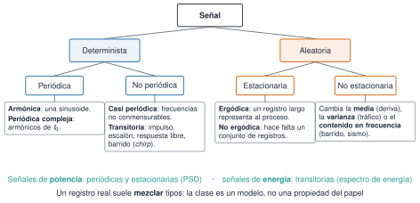
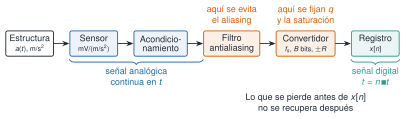
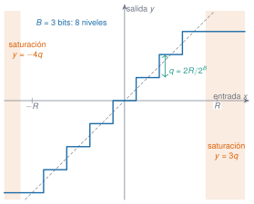
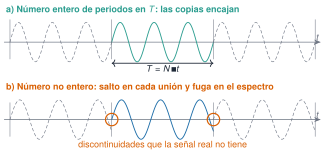

## Objetivos

- Adquirir y **describir** un registro: ficha, clase, descriptores
- Justificar $f_{\mathrm s}$, duración, rango y bits
- Interpretar la DFT: amplitud, fase, bins, fuga, relleno
- Estimar la **PSD** (periodograma, Welch) con unidades y Parseval
- Interpretar con prudencia: un pico no es un modo ni un daño

## Ruta (240 min)

| Tiempo | Bloque | Duración |
|---|---|---|
| 0:00 | Reto Torroja + diagnóstico | 10 min |
| 0:10 | M3.1 Clasificación y ruido | 30 min |
| 0:40 | M3.2 Descriptores | 30 min |
| 1:10 | M3.3 Muestreo y cuantificación | 25 min |
| 1:35 | M3.4 Nyquist y aliasing | 25 min |
| 2:00 | Descanso | 15 min |
| 2:15 | M3.5 DFT y FFT | 35 min |
| 2:50 | M3.6 PSD y Welch | 35 min |
| 3:25 | Caso Palma del Río | 25 min |
| 3:50 | Test de salida | 10 min |

## Reto inicial

- Puente de Eduardo Torroja, 22-06-2018, GS4, canal Z, 300 s a 100 Hz
- ¿Periódica, aleatoria o transitoria?
- ¿RMS y pico?
- ¿Se ven en el tiempo las frecuencias a las que vibra?

**Respuesta al final de M3.6**

## M3.1 Clasificación {#m3-1}

{width="95%" fig-alt="Árbol de clasificación de señales: deterministas (periódicas y no periódicas) y aleatorias (estacionarias y no estacionarias)"}

## La clase decide la herramienta

| Tipo | Espectro | Descripción |
|---|---|---|
| armónica, periódica | líneas | amplitud y fase |
| casi periódica | líneas no armónicas | amplitud |
| transitoria (impulso, escalón, libre, barrido) | continuo | **energía** |
| aleatoria estacionaria | continuo | media, varianza, **PSD** |
| no estacionaria | cambia | por tramos, tiempo-frecuencia |

## Estacionariedad

- Estricta (todo) · débil (media y autocorrelación) · **ergódica** (un registro basta)
- Se rompe en **media** (deriva), en **varianza** (tráfico) o en **frecuencia** (barrido, sismo)
- Media y RMS por ventanas: necesario, **no suficiente**
- Ventana corta: dispersión por azar; larga: esconde cambios

## Ruido

- Lo que **no** interesa en *este* análisis (en OMA, la vibración ambiental es la señal)
- Espectro: blanco · rosa ($1/f$, −10 dB/déc.) · marrón ($1/f^2$, −20 dB/déc.) · banda limitada · banda estrecha
- Distribución: gaussiano · uniforme (cuantificación) · impulsivo
- Origen: mecánico y ambiental · eléctrico · digital

## Ruido eléctrico

- Térmico: $\overline{v^2}=4k_{\mathrm B}TR\,\Delta f$ (1 MΩ, 300 K, 1 kHz → 4,1 µV)
- De disparo ($2qI\Delta f$) · de parpadeo ($1/f$, a baja frecuencia)
- Red: **líneas** a 50, 100, 150 Hz; bucles de masa
- Interferencias electromagnéticas · triboeléctrico (cable piezo) · diafonía
- En los datos del curso no hay líneas de red claras; su SNR y el ruido del sensor se ven en M4.5 y M8.3

## M3.2 Qué mide cada descriptor {#m3-2}

- $\mu$: nivel (componente continua) · $\sigma^2$: potencia de la vibración · $\sigma$: su escala
- RMS: la continua que disipa la misma potencia; $\tfrac12m\overline{v^2}=\tfrac12m(\mu_v^2+\sigma_v^2)$
- Asimetría: cola hacia un lado · curtosis: peso de los extremos ($3\sigma$ pesa **81** veces más que $1\sigma$)

## Misma σ, distinta forma

| Forma | κ |
|---|---|
| cuadrada | 1 |
| sinusoide | 1,5 |
| uniforme, triangular | 1,8 |
| gaussiana | 3 |
| Laplace | 6 |
| impactos | ≫ 3 |

## Fórmulas

| Descriptor | Fórmula | Unidad |
|---|---|---|
| RMS total | $\sqrt{\overline{x^2}}$ | u |
| RMS fluctuante | $\sigma$ | u |
| relación | $\mathrm{RMS}^2=\mu^2+\sigma^2$ | u² |
| cresta | pico / RMS | – |
| curtosis | $\overline{(x-\mu)^4}/\sigma^4$ (exceso: $-3$) | – |

Sinusoide: cresta $\sqrt2$, curtosis 1,5 · gaussiana: curtosis 3

## Mismo RMS, distinta señal

| RMS = 1 m/s² | cresta | curtosis |
|---|---|---|
| sinusoide | 1,41 | 1,5 |
| ruido gaussiano | 3,9 | 3,0 |
| impactos (1/s) | 5,2 | 11 |

**El RMS no ve los picos**

## M3.3 Cadena de medida {#m3-3}

{width="95%" fig-alt="Estructura, sensor, acondicionamiento, filtro antialiasing, convertidor y registro"}

## Cuantificación

$$q=\frac{2R}{2^B},\qquad \sigma_e\approx\frac{q}{\sqrt{12}},\qquad \mathrm{SNR}_q\approx6{,}02B+1{,}76\ \mathrm{dB}$$

- $\pm2$ g, 16 bits: $q=0{,}061$ mg, $\sigma_e=0{,}018$ mg
- Torroja (0,4–1,6 mg RMS): solo 28–39 dB
- El **offset** gasta rango; la **saturación** no se arregla después

## Escalera del convertidor

{width="60%" fig-alt="Característica en escalera de un convertidor de 3 bits con zonas de saturación"}

## M3.4 Aliasing {#m3-4}

$$f_{\mathrm a}=\left\lvert f-f_{\mathrm s}\,\operatorname{round}(f/f_{\mathrm s})\right\rvert$$

- 117 Hz a 100 Hz → **17 Hz**
- Las muestras de 117 y de 17 Hz son **idénticas**
- Filtro antialiasing **analógico**, antes del convertidor
- Margen: $f_{\mathrm s}$ algo más de $2{,}5\,f_{\max}$ según el filtro

## El teorema no es de una sola persona

- Borel (1897), E. T. Whittaker (1915), Ogura, J. M. Whittaker
- Nyquist (1928): el intervalo crítico en telegrafía
- Kotelnikov (1933), Raabe, Someya, Shannon (1948–1949)
- Fuente leída: Meijering (2002)

## M3.5 DFT y FFT {#m3-5}

$$X[k]=\sum_{n}x[n]e^{-i2\pi kn/N},\qquad \Delta f=\frac{f_{\mathrm s}}{N}=\frac1T$$

- DFT = **proyección** sobre sinusoides; FFT = **algoritmo** $O(N\log N)$
- Unilateral: $\times2$ salvo DC y Nyquist
- Más $f_{\mathrm s}$ con la misma $T$: más banda, **no** más resolución

## Fuga

{width="85%" fig-alt="Registro repetido periódicamente con y sin saltos en las uniones"}

## Separar dos tonos

- Bins distintos ($T=1/\delta$) **no** es resolver
- Rectangular, iguales, sin ruido: $T\approx2/\delta$ (36 % de fases con $1/\delta$)
- Hann: $T\approx3/\delta$
- Relleno con ceros: **interpola**, no informa
- Además: anchura física del pico $\approx2\zeta f_n$

## M3.6 PSD {#m3-6}

$$P[k]=\frac{c_k\lvert X_w[k]\rvert^2}{f_{\mathrm s}\sum w^2}\ \left[\tfrac{u^2}{\mathrm{Hz}}\right],\qquad \sum_k P\,\Delta f=\frac{\sum (xw)^2}{\sum w^2}$$

- Ruido: lo propio de la señal es la **densidad**
- Periodograma: varianza que **no** baja con $T$
- RMS en banda: $\sqrt{\sum_{\text{banda}}P\Delta f}$

## Welch

- $K$ segmentos de $L$ muestras · **Hann** · **solape 50 %** (fijos; elección en M4)
- $\Delta f=f_{\mathrm s}/L$ · varianza $\approx1/K$
- $T$ fija: resolución **o** promedio
- Parseval: exacto con los segmentos ponderados, aproximado con el registro

## Una medida, cuatro decisiones

1. **Método**: periodograma o Welch ($L$, ventana, solape)
2. **Magnitud**: amplitud, potencia por bin, PSD, ASD, bandas
3. **Normalización**: ninguna, máximo, suma (NPSD) o integral
4. **Escala**: lineal, log, dB **con referencia** (10 log para potencias, 20 log para amplitudes)

## ANPSD (ampliación)

$$\mathrm{NPSD}_j=\frac{P_j}{\sum_{\mathcal B}P_j},\qquad \mathrm{ANPSD}=\frac1J\sum_j\mathrm{NPSD}_j$$

- Adimensional; misma rejilla y banda
- Pierde la amplitud: los canales débiles o ruidosos pesan igual
- No es el promedio de Welch

## Caso: Palma del Río, set1

- 512 Hz · 300 s · transversal · con tráfico
- Cresta ≈ 13, curtosis ≈ 23, RMS por segundo ×40 → **no estacionario**
- Primer minuto: un tercio de la potencia de los 5 min
- Picos cerca de modos FDD… y otros que no lo están

## Para llevarte

- Lo que se pierde antes del registro digital **no se recupera**
- $\Delta f=1/T$; el relleno no resuelve
- Una figura espectral sin método, magnitud, unidades y referencia **no se puede comparar**
- Un pico **no** es un modo; un cambio de descriptor **no** es un daño
