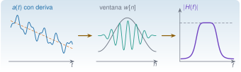
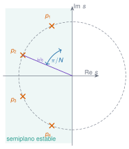
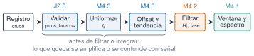

{.portada fig-alt="De izquierda a derecha: un registro con una deriva lenta marcada por una recta discontinua; una ventana en forma de campana que suaviza los extremos de una oscilación; y la curva de ganancia de un filtro pasabanda con una meseta y bordes suaves"}

```{ojs}
//| echo: false
import {descriptores, dft, espectroAmplitud, welch, dB, coma, rng, normal, ventana} from "../../recursos/js/senales.js"
import {anchoBanda3dB, nivelLobuloLateral, perdidaEscalonamiento, anchoBandaRuido, gananciaCoherente, correlacionSolape, varianzaWelch, espectrograma, filtroButterworth, filtroFir, respuestaFrecuencia, retardoGrupo, filtrar, filtrarFaseCero, quitarTendencia, integrarTrapecio, integrarFrecuencia, snrDb, snrBanda, rmsRuidoBanda, espectrosCruzados, estimarFrf, aceleracion1gdl, diezmar} from "../../recursos/js/procesado.js"
```

```{julia}
#| include: false
using Resonancia, Statistics, Random, Printf, Markdown
include("../../recursos/r1-datos/_tema.jl")
const G0 = 9.80665   # gravedad estándar: 1 g = 9,80665 m/s² (hipótesis declarada para convertir los datos)
TORROJA = "../../datos/reales-publicables/torroja-puente/2018-06-22-vibracion-ambiental/"
PALMA = "../../datos/reales-publicables/palma-del-rio-puente/2020-07-17-vibracion-operacional/"
```

## Objetivos y prerrequisitos

**Objetivos.** Al terminar la sesión sabrás:

- **elegir y justificar una ventana** (rectangular, Hann, Hamming, flat-top) según lo que quieras medir, leyendo sus cifras de mérito y sabiendo que la ventana reparte un error, no lo elimina: menos fuga a cambio de menos resolución;
- **diseñar, aplicar y leer un filtro digital** (FIR e IIR): su respuesta en frecuencia, la diferencia entre el filtrado causal y el de fase cero, y por qué un filtro «transforma» la señal y no solo la limpia;
- **preprocesar un registro** (offset, tendencia, remuestreo, huecos y picos espurios) sabiendo qué efecto tiene cada paso sobre el espectro;
- **integrar** aceleración a velocidad y desplazamiento sin que la deriva se coma el resultado, y reconocer qué información se pierde por debajo de la frecuencia de corte;
- **estimar la relación señal-ruido** y distinguir el ruido propio del sensor del ruido de la medida;
- **estimar una función de respuesta en frecuencia** con $H_1$ y $H_2$, interpretar la coherencia y saber cuándo fiarse de cada estimador;
- **mirar el tiempo y la frecuencia a la vez** con el espectrograma, y situar las *wavelets* frente a él.

**Prerrequisitos.** Conviene haber hecho antes [M3](../m03-senales-i/index.qmd): aquí se usan sin repasarlos el aliasing, la DFT, la fuga y la PSD de Welch.

**Temas de la unidad**

- **M4.1** Ventanas: rectangular, Hann, Hamming y flat-top; compromiso entre resolución y fuga
- **M4.2** Filtros FIR e IIR: diseño, respuesta en frecuencia y filtrado de fase cero
- **M4.3** Preprocesado: offset, tendencia, remuestreo, huecos y picos espurios
- **M4.4** Integración de aceleración a velocidad y desplazamiento
- **M4.5** Relación señal-ruido y ruido propio del sensor
- **M4.6** Espectro cruzado, coherencia y estimadores de FRF (H1, H2)
- **M4.7** Análisis tiempo-frecuencia: espectrograma e introducción a wavelets

### Ruta de la sesión (240 min)

La ruta [obligatoria]{.ruta-obligatoria} cabe en las cuatro horas e incluye explicación, problemas e interacción. Lo marcado como [ampliación]{.ruta-ampliacion} queda fuera del horario: para quien termine antes o para el trabajo autónomo. Cada simulador se usa en clase solo en lo que pide su pregunta; el resto de sus controles son para explorar después.

::: {.indice-unidades .indice-detalle}

| Tiempo | Bloque | Actividad | Duración |
|---|---|---|---|
| 0:00 | [Reto inicial](#reto) | Un registro real de Torroja integrado dos veces: ¿por qué el puente «se desplaza» más de un metro? [obligatoria]{.ruta-obligatoria} | 5 min |
| 0:05 | [M4.1 Ventanas](#m4-1) | Cifras de mérito, ejemplo resuelto, Simulaciones 1 y 2 (anatomía de una ventana; un tono débil junto a uno fuerte) [obligatoria]{.ruta-obligatoria}; Welch: ventana y solape, Simulación 3 [ampliación]{.ruta-ampliacion} | 30 min |
| 0:35 | [M4.2 Filtros](#m4-2) | Butterworth y FIR, fase cero y corte efectivo, simulaciones de filtrado [obligatoria]{.ruta-obligatoria} | 40 min |
| 1:15 | [M4.3 Preprocesado](#m4-3) | Offset, tendencia, remuestreo, huecos y picos y su efecto en el espectro [obligatoria]{.ruta-obligatoria} | 25 min |
| 1:40 | Descanso | [descanso]{.ruta-descanso} | 15 min |
| 1:55 | [M4.4 Integración](#m4-4) | Deriva, integración en el tiempo y en frecuencia, vuelta al reto [obligatoria]{.ruta-obligatoria} | 25 min |
| 2:20 | [M4.5 Ruido](#m4-5) | SNR y ruido propio del sensor [obligatoria]{.ruta-obligatoria} | 15 min |
| 2:35 | [M4.6 FRF](#m4-6) | Espectro cruzado, coherencia, $H_1$ y $H_2$ con un edificio de tres plantas [obligatoria]{.ruta-obligatoria} | 40 min |
| 3:15 | [M4.7 Tiempo-frecuencia](#m4-7) | Espectrograma; *wavelets* [ampliación]{.ruta-ampliacion} | 20 min |
| 3:35 | [Caso integrado](#caso) | Un registro real de Palma del Río, del dato crudo a una interpretación prudente [obligatoria]{.ruta-obligatoria} | 15 min |
| 3:50 | [Test de salida](#test-salida) | 5 preguntas y discusión [obligatoria]{.ruta-obligatoria} | 10 min |
| — | [Problemas numéricos](#problemas) | Problemas con solución desplegable [ampliación]{.ruta-ampliacion} | 45 min |
| — | [«Pídeselo a Claude»](#pideselo) | Repetir el caso con Claude Code y verificarlo [ampliación]{.ruta-ampliacion} | 30 min |

:::

**Total de la sesión: 4 h** (225 min de trabajo y 15 de descanso). Son tiempos orientativos de la autoría de esta página, no datos oficiales de la asignatura. La lectura (unos 80 min) sale de contar las palabras de la teoría a 150 por minuto. **Hay más ejercicios y simulaciones de los que caben en la clase** (casi cuarenta ejercicios intercalados y diez simulaciones): la ruta marca lo que se hace con el grupo; las predicciones se contestan en voz alta en uno o dos minutos y el resto es trabajo autónomo.

::: {.callout-note title="Notación, unidades y convenciones de esta sesión"}
| Símbolo | Significado | Unidad |
|---|---|---|
| $x[n]$, $f_{\mathrm s}$, $N$, $T$, $\Delta f=f_{\mathrm s}/N$ | registro, frecuencia de muestreo, número de muestras, duración y separación entre bins (como en M3) | u, Hz, –, s, Hz |
| $w[n]$, $W(\nu)$ | ventana y su transformada, con la frecuencia $\nu$ en **bins** de la DFT | –, – |
| $\mathrm{ENBW}$ | ancho de banda equivalente de ruido, $N\sum w^2/(\sum w)^2$ | bins |
| $L$, $K$, $D$ | longitud del segmento de Welch, número de segmentos y desplazamiento entre ellos | muestras, –, muestras |
| $h[n]$, $H(\mathrm e^{\mathrm i\omega})$ | respuesta impulsional y respuesta en frecuencia de un filtro, con $\omega=2\pi f/f_{\mathrm s}$ | –, – |
| $f_{\mathrm c}$, $n$ | frecuencia de corte (−3 dB) y orden de un filtro | Hz, – |
| $G_{xx}$, $G_{yy}$, $G_{xy}$ | autoespectros y espectro cruzado unilaterales (Welch) | u²/Hz |
| $\gamma^2$, $H_1$, $H_2$ | coherencia y estimadores de la FRF | –, salida/entrada |
| $\mathrm{SNR}$ | relación señal-ruido, $10\log_{10}(P_{\text{señal}}/P_{\text{ruido}})$ | dB |

**Unilateral y dB** como en M3: todos los espectros van de $0$ a $f_{\mathrm s}/2$, con la potencia de las frecuencias negativas sumada a las positivas, y los dB llevan siempre su referencia. **Datos.** Para pasar de g a m/s² se usa la gravedad estándar, $1\ \mathrm g=9{,}80665\ \mathrm{m/s^2}$, que es una hipótesis: las fichas dicen «g» sin más.
:::

::: {.callout-note collapse="true" title="Fuentes, datos, código y qué queda pendiente"}
**Datos reales.** Dos registros del catálogo [R1](../../recursos/index.qmd), sin duplicar sus fichas: el **puente de Eduardo Torroja** (vibración ambiental del 22-06-2018, $f_{\mathrm s}=100$ Hz, aceleración en g, CC BY 4.0) [@pachon2018; @torroja2018datos] para el reto y los ejemplos de preprocesado e integración, y el **puente de Palma del Río** (vibración operacional del 17-07-2020, $f_{\mathrm s}=512$ Hz) [@infantes2022] para el caso integrado. Las fichas no dan la sensibilidad, el rango, la resolución del convertidor ni el filtro antialiasing del equipo.

**Señales sintéticas.** Las simulaciones y los ejemplos que aíslan un fenómeno usan señales generadas con semilla fija y rotuladas como tales. En M4.6 hace falta una **entrada medida** que ningún registro real del curso trae, de modo que se simula un edificio de cortante de tres plantas (`edificio_tres_plantas`) con una excitación conocida y se compara la FRF estimada con la teórica. **No son medidas.**

**Código.** Las funciones están en `Resonancia.jl` 0.10.0 (`perdida_escalonamiento`, `ancho_banda_3db`, `nivel_lobulo_lateral`, `varianza_welch`, `quitar_tendencia`, `interpolar_uniforme`, `integrar_frecuencia`, `snr_db`, `espectros_cruzados`, `estimar_frf`, `espectrograma`, `cwt_morlet`, `filtro_fir`, `filtro_butterworth`, `filtrar`, `filtrar_fase_cero`, `diezmar`…). Las simulaciones usan `recursos/js/procesado.js` y la pestaña Python, `mse/m04-senales-ii/python/procesado.py`. Las tres versiones se contrastan con los mismos datos de referencia (`referencia/procesado.json`, generado por `scripts/m04/generar_referencia.jl`); Python, además, con SciPy, y los filtros de Julia, con DSP.jl en 832 diseños (`scripts/m04/comprobar_filtros_dsp.jl`). El caso integrado de Python (`python/caso.py`) se contrasta con las cifras de Julia sobre los registros reales (`referencia/caso.json`, `scripts/m04/generar_caso.jl`).

**Referencia pedagógica.** El planteamiento del filtrado de fase cero y del orden efectivo (M4.2) y la tabla de valores de referencia del paso alto de Butterworth se adaptan del capítulo «Filtrado» del proyecto NeuroMIND (Castro Triguero, R., y Galvao Carmona, A., IMIBIC · Universidad de Córdoba), cuyas cifras se han comprobado con la implementación de esta unidad. De ese capítulo no se reproduce ningún resultado con datos de participantes: aquí todos los ejemplos usan señales de estructuras.

**Pendiente.** Comprobar la página en un teléfono real (las simulaciones se han verificado con la lógica de sus celdas y con Node, pero no en un navegador). Leer el contenido de las referencias de filtrado (Butterworth, de Cheveigné y Nelken, Widmann et al. y Gustafsson), de las que solo se han comprobado los datos bibliográficos. El capítulo de filtrado de NeuroMIND, que inspira M4.2, queda pendiente de confirmar licencia y coautoría.
:::

::: {.callout-note title="Qué no cubre M4"}
Quedan fuera los filtros adaptativos, la deconvolución, el diezmado y la interpolación polifásicos en profundidad, las ventanas de fuerza y exponencial de los ensayos con martillo y la identificación modal a partir de la FRF, que se desarrolla en [M7](../m07-identificacion/index.qmd). La teoría de la FRF de un oscilador está en [M5](../m05-vibraciones-i/index.qmd).
:::

## Teoría breve

### Reto inicial: ¿se desplaza un metro el puente? {#reto}

::: {.callout-note .reto icon=false title="Reto: cinco minutos con la aceleración de Torroja"}
Tienes la aceleración vertical del tablero del puente de Eduardo Torroja, la misma del reto de M3. Un compañero la integra dos veces con la regla del trapecio, restando antes la media, para obtener el **desplazamiento** y comparar con un modelo. La @fig-reto-m4 muestra lo que obtiene. Antes de seguir, contesta en tu cuaderno:

1. ¿Es verosímil que el tablero de un puente de este tamaño se desplace más de un metro bajo vibración ambiental?
2. Si no lo es, ¿qué crees que ha pasado? ¿Dónde se ha colado un error tan grande si la aceleración solo vale unos 0,02 m/s²?
3. ¿Qué harías con el registro **antes** de integrar?

Al final de [M4.4](#m4-4) volverás a esta señal.
:::

```{julia}
#| label: fig-reto-m4
#| fig-cap: "Torroja, 22-06-2018, medida 1, estación GS4: aceleración vertical (arriba), su integral (velocidad) y la doble integral (desplazamiento) con la regla del trapecio, restando solo la media. Dato real; solo se ha convertido de g a m/s². Datos: @torroja2018datos."
#| fig-alt: "Tres paneles de 300 segundos. Arriba, la aceleración, de unas centésimas de metro por segundo al cuadrado. En medio, la velocidad, con valores de unos milímetros por segundo que se alejan lentamente de cero. Abajo, el desplazamiento, una curva lenta que llega a casi un metro y diecisiete centímetros de amplitud."
t4, a4, fs4, est4, ini4 = leer_torroja(TORROJA * "crudos/s4_medida01.txt")
n300 = round(Int, 300fs4)
z4 = (a4[1:n300, 3] .- mean(a4[1:n300, 3])) .* G0
v4 = integrar_trapecio(z4, fs4)
d4 = integrar_trapecio(v4, fs4)
fig = Figure(size=(860, 520))
for (i, (y, et)) in enumerate(((z4, "a (m/s²)"), (v4 .* 1000, "v (mm/s)"), (d4, "d (m)")))
    ax = Axis(fig[i, 1]; ylabel=et, xlabel=(i == 3 ? "tiempo (s)" : ""), xticklabelsvisible=(i == 3))
    lines!(ax, t4[1:n300], y; color=(AZUL, NARANJA, VIOLETA)[i], linewidth=(i == 1 ? 0.5 : 1.2))
    xlims!(ax, 0, 300)
end
fig
```

La aceleración tiene un RMS de `{julia} coma(std(z4); d=3)` m/s²; sin embargo, la doble integral llega a `{julia} coma(maximum(abs, d4); d=2)` m. No es un desplazamiento del puente: es **la deriva de un integrador**. Cualquier componente de muy baja frecuencia que quede en la aceleración (un offset residual del sensor, un ruido lento, una deriva térmica) se divide por $\omega$ al integrar una vez y por $\omega^2$ al integrar dos: lo que era un susurro se vuelve una rampa y luego una parábola. Quitar solo la media no basta, porque la deriva no es una constante. Esa es la pista de este tema: antes de integrar hay que **preprocesar** ([M4.3](#m4-3)) y la integración hay que **hacerla con cuidado** ([M4.4](#m4-4)). Pero primero necesitamos las herramientas con las que se decide qué frecuencias se miran y cuáles se descartan: ventanas y filtros.

### M4.1 Ventanas: rectangular, Hann, Hamming y flat-top; compromiso entre resolución y fuga {#m4-1}

**Pregunta motivadora.** En M3 la fuga de un tono desapareció cuando la duración del registro contenía un número entero de ciclos. En un ensayo real eso no se controla: el puente vibra a las frecuencias que quiere, y el registro ya está tomado. ¿Se puede reducir la fuga de alguna manera? Y, si se puede, ¿qué se pierde a cambio?

**Objetivos observables.** Explicar cómo una ventana reduce la fuga y por qué ensancha los picos; leer en una tabla las cifras de mérito de una ventana (lóbulo lateral, ancho a −3 dB, ENBW, pérdida por escalonamiento); elegir ventana según el objetivo; convertir el ancho de un pico de bins a hercios; y estimar cuántos segmentos y qué solape conviene en el método de Welch.

**Física.** La DFT trata el registro como **un periodo** de una señal periódica, y la fuga nace del salto que aparece en la unión entre copias cuando el registro no contiene un número entero de ciclos ([M3.5](../m03-senales-i/index.qmd#m3-5)). Una **ventana** es una secuencia $w[n]$ que se multiplica por el registro antes de calcular la DFT y que decrece hacia los extremos: así, lo que se une entre copias vale casi cero y el salto desaparece.

$$x_w[n]=w[n]\,x[n],\qquad X_w[k]=\sum_{n=0}^{N-1}w[n]\,x[n]\,\mathrm e^{-\mathrm i2\pi kn/N}.$$

El precio es que el producto en el tiempo es una **convolución** en la frecuencia: el espectro de la señal ventanada es el espectro «verdadero» emborronado por el de la ventana, $W(\nu)=\sum_n w[n]\,\mathrm e^{-\mathrm i2\pi\nu n/N}$, con $\nu$ en bins. Un tono puro, que sería una raya, sale como una copia de $|W|$ centrada en su frecuencia: un **lóbulo principal** y, a ambos lados, **lóbulos laterales**. Para un tono $a\cos(2\pi\nu_0 n/N)$ lejos de $0$ y de Nyquist, con $\nu_0$ en bins:

$$|X_w[k]|\approx\frac a2\,\bigl|W(k-\nu_0)\bigr|,\qquad A[k]=\frac{2\,|X_w[k]|}{\sum_n w[n]}\approx a\,\frac{|W(k-\nu_0)|}{W(0)}.$$ {#eq-tono-ventana}

Esto explica el compromiso. Un lóbulo principal **estrecho** separa bien dos tonos próximos (resolución). Unos lóbulos laterales **bajos** impiden que un tono fuerte tape a uno débil que esté lejos (poca fuga). La ventana rectangular, la de «no hacer nada», tiene el lóbulo principal más estrecho posible y los laterales más altos; las demás bajan los laterales ensanchando el principal. **No existe una ventana mejor en todo**: elegir una es decidir qué error se tolera.

```{julia}
#| label: fig-ventanas
#| fig-cap: "Cuatro ventanas de N = 64 puntos (arriba) y su respuesta en frecuencia |W(ν)|/W(0) en dB (abajo, con ν en bins de la DFT). La rectangular (gris, discontinua) tiene el lóbulo principal más estrecho pero los laterales más altos; la flat-top (violeta, punteada) tiene los laterales más bajos y el principal más ancho. Calculado con `Resonancia.jl`."
#| fig-alt: "Dos paneles. Arriba, cuatro ventanas: una recta horizontal de valor uno (rectangular) y tres campanas de anchura decreciente (Hann, Hamming y flat-top). Abajo, sus respuestas en decibelios entre cero y ocho bins: la rectangular tiene un lóbulo estrecho y laterales que bajan despacio desde menos trece decibelios; Hann baja desde menos treinta y uno; Hamming desde menos cuarenta y dos con un suelo casi plano; la flat-top tiene un lóbulo muy ancho y laterales por debajo de menos noventa."
let
    N, pad = 64, 16
    fig = Figure(size=(860, 560))
    ax1 = Axis(fig[1, 1]; xlabel="muestra n", ylabel="w[n]")
    ax2 = Axis(fig[2, 1]; xlabel="frecuencia relativa ν (bins)", ylabel="|W(ν)|/W(0) (dB)")
    estilos = [(:rectangular, "rectangular", GRIS, :dash), (:hann, "Hann", AZUL, :solid),
               (:hamming, "Hamming", NARANJA, :dashdot), (:flattop, "flat-top", VIOLETA, :dot)]
    for (s, nombre, col, est) in estilos
        w = ventana(s, N)
        W = abs.(dft(vcat(w, zeros((pad - 1) * N)))) ./ sum(w)
        lines!(ax1, 0:N-1, w; color=col, linestyle=est, linewidth=2, label=nombre)
        lines!(ax2, (0:8pad) ./ pad, 20log10.(max.(W[1:8pad+1], 1e-6)); color=col, linestyle=est, linewidth=2, label=nombre)
    end
    ylims!(ax2, -110, 3); xlims!(ax2, 0, 8)
    axislegend(ax2; position=:rt, framevisible=false)
    fig
end
```

**Las cifras de mérito.** Para comparar ventanas se usan cinco números, que aparecen en la @tbl-ventanas y que se calculan con `Resonancia.jl` sobre la ventana concreta:

- **Lóbulo lateral máximo** (dB respecto del principal): cuánto puede «escaparse» un tono a frecuencias lejanas. Cuanto más negativo, menos fuga.
- **Ancho a −3 dB** (bins): anchura del lóbulo principal a potencia mitad; es la separación aproximada mínima para ver dos tonos de amplitud parecida como picos distintos. En hercios, multiplica por $\Delta f=f_{\mathrm s}/N$.
- **ENBW** (bins): ancho de banda equivalente de ruido, $N\sum w^2/(\sum w)^2$: el ancho de un filtro rectangular ideal que dejaría pasar la misma potencia de ruido blanco. Vale 1 para la rectangular; mayor significa que el ruido de cada bin se «mezcla» con el de más bins vecinos.
- **Pérdida por escalonamiento** (*scalloping loss*, dB): cuánto se subestima la amplitud de un tono que cae justo **a medio bin** de dos bins de la DFT, el peor caso.
- **Ganancia coherente** $\sum w/N$: el factor por el que la ventana reduce la amplitud de un tono centrado en un bin; `espectro_amplitud` lo corrige dividiendo por $\sum w$.

```{julia}
#| label: tbl-ventanas
#| tbl-cap: "Cifras de mérito de cinco ventanas (N = 256, ventanas periódicas). Calculadas con `Resonancia.jl`; con N grande apenas cambian."
#| output: asis
ventanas_tabla = [(:rectangular, "Rectangular"), (:hann, "Hann"), (:hamming, "Hamming"), (:blackman, "Blackman"), (:flattop, "Flat-top")]
println("| Ventana | Lóbulo lateral máx. (dB) | Ancho a −3 dB (bins) | ENBW (bins) | Pérdida por escalonamiento (dB) | Amplitud a medio bin | Ganancia coherente |")
println("|:--|--:|--:|--:|--:|--:|--:|")
for (s, nombre) in ventanas_tabla
    w = ventana(s, 256)
    p = perdida_escalonamiento(w)
    println("| ", nombre, " | ", coma(nivel_lobulo_lateral(w); d=1), " | ", coma(ancho_banda_3db(w); d=2), " | ", coma(ancho_banda_ruido(w); d=2),
            " | ", coma(p; d=2), " | ", coma(10^(-p / 20); d=3), " | ", coma(ganancia_coherente(w); d=3), " |")
end
```

Se lee así. La rectangular tiene el mejor ancho (0,89 bins) y el peor lóbulo lateral (−13,3 dB): una pérdida de amplitud de casi el 36 % a medio bin. Hann y Hamming son los intermedios: Hann baja los laterales a −31,5 dB y Hamming a −42,7 dB, a cambio de un lóbulo principal un 47 % (Hamming) y un 63 % (Hann) más ancho que el de la rectangular. La flat-top lleva el compromiso al extremo contrario: su pérdida por escalonamiento es de solo 0,01 dB (la amplitud de un tono es fiable a cualquier frecuencia), pero su lóbulo principal es más de cuatro veces más ancho que el de la rectangular. Las cifras de Hann y Hamming son las habituales de las tablas de ventanas [@harris1978] y, para el caso de Hamming, coinciden con la fórmula cerrada en el límite de $N$ grande (amplitud a medio bin 0,8174).

::: {.ejercicio tipo="vf" id="m4-1-mejor-resolucion" respuesta="falso"}
**Ejercicio breve.** Una ventana con lóbulos laterales más bajos que otra siempre da mejor resolución en frecuencia.

::: {.solucion}
Falso, es al revés. Bajar los lóbulos laterales se consigue ensanchando el lóbulo principal (compárense la rectangular y la flat-top en la @tbl-ventanas), y un lóbulo principal más ancho **empeora** la resolución. Lo que mejora es el rango dinámico: la capacidad de ver un tono débil junto a uno fuerte.
:::
:::

::: {.ejercicio tipo="numerico" id="m4-1-ancho-hann" respuesta="0.281" tol="1%" unidad="Hz"}
**Ejercicio breve.** Un registro de $N=1024$ muestras a $f_{\mathrm s}=200$ Hz se analiza con ventana de Hann. ¿Cuánto vale, en hercios, el ancho a −3 dB de un pico?

::: {.pista}
Calcula primero $\Delta f=f_{\mathrm s}/N$ y multiplica por el ancho en bins de la @tbl-ventanas (1,44 para Hann).
:::

::: {.solucion}
$\Delta f=200/1024=0{,}1953$ Hz y el ancho a −3 dB de Hann es $1{,}4406$ bins, luego $1{,}4406\cdot0{,}1953=0{,}281$ Hz. Con ventana rectangular sería $0{,}886\cdot0{,}1953=0{,}173$ Hz: el pico de Hann es un 63 % más ancho. Comprobado con `ancho_banda_3db`.
:::
:::

#### Amplitud y potencia: dos normalizaciones

Una ventana cambia el valor de las cosas que se leen en el espectro, y la normalización depende de **qué** se quiere leer. Para la **amplitud de un tono** se divide por $\sum w$ (la ganancia coherente), y así el pico de un tono centrado en un bin vale exactamente su amplitud con cualquier ventana. Para una **PSD** se divide por $\sum w^2$, y así el nivel de un ruido blanco sale bien con cualquier ventana. Pero entonces el pico de PSD de un tono **sí** depende de la ventana, y de una forma exacta. En un bin centrado, $|X_w|=a\sum w/2$ y la PSD unilateral vale $2|X_w|^2/(f_{\mathrm s}\sum w^2)$, de modo que

$$P_{\text{pico}}=\frac{a^2/2}{\mathrm{ENBW}\cdot\Delta f}.$$ {#eq-pico-psd}

El pico de PSD de un tono es **su potencia $a^2/2$ repartida en un ancho $\mathrm{ENBW}\cdot\Delta f$**. Por eso el mismo tono da picos de PSD distintos según la ventana y por eso, para comparar picos, hay que comparar con la misma ventana. Se comprueba:

```{julia}
#| code-fold: false
N, fs, a = 256, 100.0, 1.3
x = a .* cos.(2π * (20 * fs / N) .* (0:N-1) ./ fs)        # tono centrado en el bin 20
[(nombre = v, pico_PSD = maximum(periodograma(x, fs; ventana=v)[2]),
  formula = (a^2 / 2) / (ancho_banda_ruido(ventana(v, N)) * fs / N)) for v in (:rectangular, :hann, :hamming, :flattop)]
```

Las dos columnas coinciden: la @eq-pico-psd es una identidad, no una aproximación, para un tono centrado en un bin.

::: {.callout-note .idea-clave title="Qué lleva cada normalización"}
**Amplitud de un tono → dividir por $\sum w$.** **Nivel de ruido (PSD) → dividir por $\sum w^2$.** Si se mezclan, los picos salen mal por un factor igual a la ganancia coherente o al ENBW.
:::

::: {.ejercicio tipo="numerico" id="m4-1-error-hann" respuesta="15.1" tol="2%" unidad="%"}
**Ejercicio breve.** Un tono de amplitud 1 cae exactamente a medio bin entre dos bins de la DFT y se analiza con ventana de Hann. ¿Qué error relativo comete la lectura de su amplitud en el bin más cercano?

::: {.pista}
Usa la pérdida por escalonamiento de Hann (1,42 dB) y pásala a razón de amplitudes: $10^{-\text{pérdida}/20}$.
:::

::: {.solucion}
$10^{-1{,}424/20}=0{,}849$: el pico se lee como 0,849 en lugar de 1, un error del $15{,}1$ %. Con la rectangular sería del 36,3 %, y con la flat-top, del 0,1 %. Cuando la amplitud importa, hay que usar una ventana con poca pérdida por escalonamiento (flat-top) o interpolar el pico.
:::
:::

#### Simulación 1: anatomía de una ventana

**Simulación 1. Cómo es una ventana por dentro.** *Señal sintética*: no hay señal, se muestra la propia ventana de $N$ puntos (arriba) y su respuesta en frecuencia $|W(\nu)|/W(0)$ en dB (abajo, con $\nu$ en bins). Las líneas marcan el nivel de −3 dB y el mayor lóbulo lateral. A la derecha se leen sus cifras de mérito, calculadas con `procesado.js`.

::: {.ejercicio tipo="encuesta" id="m4-1-prediccion-anatomia"}
**Predicción.** Pasa de la ventana rectangular a la de Hann sin tocar $N$. ¿Qué esperas que le pase al lóbulo principal y a los laterales?

::: {.opciones}
- El principal se estrecha y los laterales suben.
- El principal se ensancha y los laterales bajan.
- Los dos bajan: Hann es «mejor» en todo.
:::
:::

::: {.laboratorio .solo-pantalla}

```{ojs}
//| echo: false
viewof s1 = {
  s1_reinicio;
  return Inputs.form({
    ventana: Inputs.select(["rectangular", "hann", "hamming", "blackman", "flattop"], {value: "hann", label: "ventana"}),
    N: Inputs.range([16, 128], {value: 64, step: 16, label: "número de puntos N"})
  });
}
viewof s1_reinicio = Inputs.button("Restablecer valores")
```

```{ojs}
//| echo: false
s1_datos = {
  const w = ventana(s1.ventana, s1.N), pad = 16, M = s1.N * pad, W0 = w.reduce((a, b) => a + b, 0);
  const X = dft([...w, ...new Array(M - s1.N).fill(0)]);
  const resp = Array.from({length: 8 * pad + 1}, (_, k) => ({nu: k / pad, db: 20 * Math.log10(Math.max(Math.hypot(X.re[k], X.im[k]) / W0, 1e-6))}));
  return {w, resp, bw: anchoBanda3dB(w), lat: nivelLobuloLateral(w), pe: perdidaEscalonamiento(w), enbw: anchoBandaRuido(w), gc: gananciaCoherente(w)};
}
```

```{ojs}
//| echo: false
{
  const ancho = Math.min(width, 760);
  const f1 = Plot.plot({width: ancho, height: 170, marginLeft: 45, ariaLabel: "Simulación 1: ventana en el tiempo",
    x: {label: "muestra n"}, y: {label: "w[n]", domain: [0, 1.05]},
    marks: [Plot.ruleY([0]), Plot.line(s1_datos.w.map((v, n) => ({n, v})), {x: "n", y: "v", stroke: "#1b6ca8", strokeWidth: 2}),
            Plot.dot(s1_datos.w.map((v, n) => ({n, v})), {x: "n", y: "v", fill: "#1b6ca8", r: 2})]});
  const f2 = Plot.plot({width: ancho, height: 260, marginLeft: 50, ariaLabel: "Simulación 1: respuesta en frecuencia de la ventana en dB",
    x: {label: "frecuencia relativa ν (bins)", domain: [0, 8]}, y: {label: "|W(ν)|/W(0) (dB)", domain: [-110, 3], grid: true},
    marks: [Plot.ruleY([-3.0103], {stroke: "#d95f02", strokeDasharray: "4 3"}),
            Plot.ruleY([s1_datos.lat], {stroke: "#6f42c1", strokeDasharray: "2 3"}),
            Plot.ruleX([s1_datos.bw / 2], {stroke: "#d95f02", strokeDasharray: "4 3"}),
            Plot.line(s1_datos.resp, {x: "nu", y: "db", stroke: "#2a9d8f", strokeWidth: 2})]});
  return html`${f1}${f2}`;
}
```

```{ojs}
//| echo: false
html`<div class="lectura" role="status" aria-live="polite"><p><b>${s1.ventana}</b> · N = ${s1.N} · ancho a −3 dB: <b>${coma(s1_datos.bw, 2)}</b> bins (naranja) · lóbulo lateral máx.: <b>${coma(s1_datos.lat, 1)}</b> dB (violeta) · ENBW: ${coma(s1_datos.enbw, 2)} bins · pérdida por escalonamiento: ${coma(s1_datos.pe, 2)} dB (amplitud a medio bin ${coma(10 ** (-s1_datos.pe / 20), 3)}) · ganancia coherente: ${coma(s1_datos.gc, 3)}</p></div>`
```

:::

::: {.solo-impresion}
La @fig-ventanas es la versión estática de esta simulación.
:::

::: {.ejercicio tipo="opcion" id="m4-1-interpretacion-anatomia" respuesta="b"}
**Interpretación.** En la Simulación 1, ¿qué le pasa a las cifras de mérito de una ventana si se aumenta $N$ de 32 a 128 manteniendo la forma?

::: {.opciones}
- Todas mejoran: el lóbulo principal se estrecha y los laterales bajan.
- El ancho, el lóbulo lateral y el ENBW casi no cambian **medidos en bins**; lo que cambia es el tamaño del bin, $\Delta f=f_{\mathrm s}/N$.
- El lóbulo lateral baja 6 dB cada vez que se duplica $N$.
- El ENBW se hace proporcional a $N$.
:::

::: {.retro}
- No: la *forma* de la ventana, escalada a $N$ puntos, da la misma respuesta medida en bins. Con $N$ mayor el bin es más fino, no el pico más estrecho en bins.
- Correcto. Las cifras de mérito en bins son propiedades de la forma, y casi no dependen de $N$ (por eso la @tbl-ventanas vale para cualquier registro largo). Lo que mejora con $N$ es la resolución en hercios, porque $\Delta f=f_{\mathrm s}/N$ se reduce.
- No hay ninguna ley así: el nivel del lóbulo lateral lo fija la forma de la ventana.
- Al revés: el ENBW en bins es casi constante, y en hercios *disminuye* con $N$.
:::

::: {.solucion}
La **b**. Para ganar resolución en hercios hay que alargar el registro (o el segmento de Welch), no cambiar de ventana.
:::
:::

#### Simulación 2: un tono débil junto a uno fuerte

La resolución es solo la mitad del problema. La otra mitad es el **rango dinámico**: ver un tono débil cuando hay uno fuerte cerca, que es lo que pasa en una estructura cuando un modo bajo domina y uno más alto, de menos energía, queda al lado.

**Simulación 2. ¿Se ve el tono débil?** *Señal sintética*: dos cosenos, uno de amplitud 1 en 40,5 Hz (justo a medio bin, el peor caso) y otro de amplitud $10^{R/20}$ en $40{,}5+\delta$ Hz, con $N=256$ muestras a 256 Hz ($\Delta f=1$ Hz). El espectro de amplitud (azul) se compara con el de **solo el tono fuerte** (gris discontinuo): el débil «se ve» si sobresale de la fuga del fuerte. Criterio declarado: el máximo del espectro en un entorno de ±0,5 bins de su frecuencia supera en **3 dB o más** el máximo de la fuga del tono fuerte solo en ese mismo entorno. (Se comparan los máximos, y no punto a punto, porque la fuga de algunas ventanas se anula exactamente a distancias enteras en bins del tono fuerte, y un débil que cayera justo en un nulo parecería visible sin serlo.)

::: {.ejercicio tipo="encuesta" id="m4-1-prediccion-debil"}
**Predicción.** Con $\delta=6$ bins y el débil a −50 dB, ¿con qué ventanas se ve el tono débil?

::: {.opciones}
- Con la rectangular, que es la de mejor resolución.
- Con todas las ventanas menos la rectangular.
- Solo con algunas de las de lóbulos laterales bajos: hay que probarlo, porque no todas bajan la fuga igual de lejos.
- Con ninguna.
:::
:::

::: {.laboratorio .solo-pantalla}

```{ojs}
//| echo: false
viewof s2 = {
  s2_reinicio;
  return Inputs.form({
    ventana: Inputs.select(["rectangular", "hann", "hamming", "blackman", "flattop"], {value: "rectangular", label: "ventana"}),
    delta: Inputs.range([1, 14], {value: 6, step: 0.5, label: "separación δ entre tonos (bins)"}),
    razon: Inputs.range([-100, 0], {value: -50, step: 1, label: "amplitud del tono débil R (dB respecto del fuerte)"})
  });
}
viewof s2_reinicio = Inputs.button("Restablecer valores")
```

```{ojs}
//| echo: false
s2_datos = {
  const N = 256, fs = 256, f1 = 40.5, f2 = f1 + s2.delta, A2 = 10 ** (s2.razon / 20);
  const senal = (a2) => Array.from({length: N}, (_, n) => Math.cos(2 * Math.PI * f1 * n / fs) + a2 * Math.cos(2 * Math.PI * f2 * n / fs + 0.7));
  const con = espectroAmplitud(senal(A2), fs, {ventana: s2.ventana, nfft: 8 * N});
  const sin = espectroAmplitud(senal(0), fs, {ventana: s2.ventana, nfft: 8 * N});
  const db = (v) => 20 * Math.log10(Math.max(v, 1e-9));
  const filas = [];
  con.f.forEach((f, k) => { if (f >= 30 && f <= 70) filas.push({f, con: db(con.A[k]), sin: db(sin.A[k])}); });
  // El tono débil «se ve» si el máximo del espectro en ±0,5 bins de su frecuencia supera en ≥ 3 dB el máximo de la
  // fuga del fuerte solo en ese mismo entorno (comparar el máximo, y no punto a punto, evita que un nulo de la fuga
  // que coincida con f2 haga parecer visible al débil).
  const entorno = filas.filter((d) => Math.abs(d.f - f2) <= 0.5);
  const sobresale = Math.max(...entorno.map((d) => d.con)) - Math.max(...entorno.map((d) => d.sin));
  return {filas, f1, f2, sobresale, visible: sobresale >= 3, A2};
}
```

```{ojs}
//| echo: false
{
  const ancho = Math.min(width, 760);
  return Plot.plot({width: ancho, height: 330, marginLeft: 52, ariaLabel: "Simulación 2: espectro de amplitud de dos tonos en dB",
    x: {label: "frecuencia (Hz)", domain: [30, 70]}, y: {label: "amplitud (dB respecto del tono fuerte)", domain: [-130, 5], grid: true},
    marks: [Plot.ruleX([s2_datos.f1], {stroke: "#9ca3af", strokeDasharray: "3 3"}),
            Plot.ruleX([s2_datos.f2], {stroke: "#d95f02", strokeDasharray: "4 3"}),
            Plot.ruleY([s2.razon], {stroke: "#d95f02", strokeDasharray: "4 3"}),
            Plot.line(s2_datos.filas, {x: "f", y: "sin", stroke: "#6b7280", strokeDasharray: "5 3", strokeWidth: 1.5}),
            Plot.line(s2_datos.filas, {x: "f", y: "con", stroke: "#1b6ca8", strokeWidth: 2})]});
}
```

```{ojs}
//| echo: false
html`<div class="lectura" role="status" aria-live="polite"><p><b>${s2.ventana}</b> · δ = ${coma(s2.delta, 1)} bins · tono débil a ${s2.razon} dB (naranja) · sobresale de la fuga del fuerte en <b>${coma(s2_datos.sobresale, 1)} dB</b> → <b>${s2_datos.visible ? "SE VE (≥ 3 dB)" : "NO SE VE (< 3 dB)"}</b>. Gris discontinuo: espectro con solo el tono fuerte.</p></div>`
```

:::

::: {.solo-impresion}
```{julia}
#| label: fig-sim2-estatica
#| fig-cap: "Versión estática de la Simulación 2: dos tonos separados 6 bins, el débil a −50 dB del fuerte, con ventana rectangular (izquierda) y de Hann (derecha). La línea gris discontinua es el espectro del tono fuerte solo; con la rectangular, el débil queda dentro de su fuga; con Hann, emerge sobre ella."
#| fig-alt: "Dos espectros en decibelios entre 30 y 70 hercios. A la izquierda, con la rectangular, la curva azul del tono débil queda pegada a la curva gris de la fuga del tono fuerte, que decae despacio desde menos treinta dB. A la derecha, con Hann, la fuga cae mucho más rápido y el pequeño pico del tono débil, a menos cincuenta dB, sobresale claramente de ella."
let
    N, fs = 256, 256.0
    t = (0:N-1) ./ fs
    senal(a2) = cos.(2π * 40.5 .* t) .+ a2 .* cos.(2π * 46.5 .* t .+ 0.7)
    fig = Figure(size=(860, 300))
    for (j, v) in enumerate((:rectangular, :hann))
        ax = Axis(fig[1, j]; title=String(v), xlabel="frecuencia (Hz)", ylabel=(j == 1 ? "dB resp. al tono fuerte" : ""))
        f, A, _ = espectro_amplitud(senal(10^(-50 / 20)), fs; ventana=v, nfft=8N)
        _, A0, _ = espectro_amplitud(senal(0.0), fs; ventana=v, nfft=8N)
        lines!(ax, f, 20log10.(max.(A0, 1e-9)); color=GRIS, linestyle=:dash, linewidth=1.5)
        lines!(ax, f, 20log10.(max.(A, 1e-9)); color=AZUL, linewidth=2)
        vlines!(ax, [46.5]; color=NARANJA, linestyle=:dot)
        xlims!(ax, 30, 70); ylims!(ax, -130, 5)
    end
    fig
end
```
:::

::: {.ejercicio tipo="opcion" id="m4-1-interpretacion-debil" respuesta="c"}
**Interpretación.** Con la ventana rectangular, $\delta=6$ bins y el tono débil a −50 dB, el débil no se ve. ¿Qué cambio lo hace visible **sin** alterar el registro?

::: {.opciones}
- Rellenar con ceros: así hay más bins y se ve el pico.
- Subir la frecuencia de muestreo.
- Cambiar a una ventana de lóbulos laterales más bajos, como Hann o Blackman.
- Ninguno: el registro ya está tomado y no se puede mejorar.
:::

::: {.retro}
- El relleno con ceros interpola la curva pero no la cambia: la fuga del fuerte sigue encima del débil.
- La frecuencia de muestreo no cambia el cociente entre el tono débil y la fuga del fuerte en esa frecuencia.
- Correcto. A 6 bins del tono fuerte, la fuga de la rectangular ronda −24 dB, muy por encima del tono débil (−50 dB). Hann la baja a −54 dB y el pico emerge. Esa es la razón de ser de las ventanas.
- Sí se puede: la ventana se aplica **después** de tomar el registro, y es justo lo que arregla este caso.
:::

::: {.solucion}
La **c**. A 6 bins, los niveles de fuga son: rectangular −24 dB, Hamming −43 dB, Hann −54 dB, Blackman −63 dB y flat-top −93 dB. Por eso, con el débil a −50 dB, se ve con Hann, Blackman y flat-top, y **no** con la rectangular ni con Hamming. Dos detalles que enseña la simulación: (1) **Hamming tiene un primer lóbulo lateral más bajo que Hann (−42,7 frente a −31,5 dB), pero sus lóbulos lejanos casi no decaen**, mientras que los de Hann caen rápido; para un tono débil lejano gana Hann, y para uno cercano (δ = 3, R = −30), Hamming. (2) A δ = 4 la flat-top **deja de verlo** (su lóbulo principal ancho lo tapa) y gana Blackman: es el compromiso entre resolución y fuga, visto de cerca. Pruébalo moviendo $\delta$ y $R$.
:::
:::

#### Elegir la ventana según el objetivo

No hay una ventana «correcta»: hay una ventana adecuada para cada pregunta. La @tbl-eleccion resume las decisiones habituales y lo que se paga por cada una.

| Objetivo | Ventana habitual | Por qué | A cambio de |
|:--|:--|:--|:--|
| **Medir la amplitud de un tono** aislado | flat-top | pérdida por escalonamiento de solo 0,01 dB: la amplitud es fiable a cualquier frecuencia | resolución: lóbulo principal de 3,7 bins |
| **Ver modos** en un registro ambiental (PSD de Welch) | Hann con solape del 50–75 % | lóbulos laterales que caen deprisa, ENBW moderado (1,5 bins) | un pico un 63 % más ancho que con la rectangular |
| **Separar dos tonos próximos de amplitud parecida** | rectangular (o Hann con registro más largo) | el lóbulo principal más estrecho; la fuga no es el problema si los dos son fuertes | fuga alta: tapa un tono débil cercano |
| **Detectar un tono débil junto a uno fuerte** | Hann o Blackman (Hamming solo si el débil está muy cerca) | laterales que **decaen deprisa** con la distancia: la fuga del fuerte no tapa al débil | necesita más separación entre tonos |
| **Transitorio que decae dentro del registro** (impacto, respuesta libre) | rectangular (ninguna) | la señal ya vale casi cero en los extremos: no hay salto que suavizar | si no decae del todo, aparece fuga |
: Elección de la ventana según el objetivo. {#tbl-eleccion}

**Con qué criterio se separan dos tonos.** En M3 se vio, con ventana rectangular, amplitudes iguales y sin ruido, que $T\approx1{,}8/\delta$ separa siempre dos tonos separados $\delta$ Hz, y con Hann hacen falta unos $T\approx3/\delta$. Lo que importa es **declarar el criterio**: con otro criterio o con ruido, los números cambian.

::: {.callout-warning title="Errores frecuentes"}
- **Pensar que la ventana «arregla» la señal.** No añade información: reduce un tipo de error (la fuga) y aumenta otro (el ancho de los picos).
- **Comparar amplitudes de picos de distintas ventanas** sin corregir la ganancia coherente: un tono de amplitud 1 se lee como 0,5 con Hann si no se divide por $\sum w$.
- **Aplicar una ventana a un transitorio que ya decae** en el registro: se le quita señal útil, porque la ventana lo anula en los extremos donde justo estaba la cola.
- **Creer que una ventana «mejora la resolución».** Una ventana nunca estrecha un pico; el único modo de ganar resolución es un registro (o segmento) más largo.
:::

#### Ampliación: la ventana, el solape y la varianza en el método de Welch {#m4-1-welch}

[ampliación]{.ruta-ampliacion} En M3 el método de Welch usaba una ventana de Hann y un solape del 50 % **fijos**. Ahora se puede entender por qué. Un periodograma tiene una varianza que no baja aunque el registro sea muy largo: su desviación es del orden de su propio valor (una varianza relativa de 1). Welch la reduce **promediando** $K$ periodogramas de segmentos de $L$ muestras. Si los segmentos fueran independientes, la varianza relativa sería $1/K$. Pero con solape no lo son: dos segmentos consecutivos comparten muestras y sus periodogramas se correlacionan. Para ruido gaussiano y una PSD localmente plana, la varianza relativa de la PSD de Welch respecto de la de un periodograma es

$$\frac{\operatorname{Var}\,\hat P}{P^2}=\frac1K\Bigl[1+2\sum_{j=1}^{K-1}\Bigl(1-\frac jK\Bigr)\rho^2(jD)\Bigr],\qquad \rho(s)=\frac{\sum_n w[n]\,w[n+s]}{\sum_n w^2[n]},$$ {#eq-var-welch}

con $D=L(1-\text{solape})$ el desplazamiento entre segmentos, y $\rho(s)$ la correlación entre las ventanas de dos segmentos desplazados $s$ muestras [@welch1967]. La @tbl-welch la evalúa con `varianza_welch` para un registro de ocho segmentos de longitud.

```{julia}
#| label: tbl-welch
#| tbl-cap: "Varianza relativa de la PSD de Welch según la ventana y el solape, para un registro de 8·L muestras (L = 64). K es el número de segmentos; «desviación» es la raíz de la varianza relativa. Calculado con `varianza_welch`."
#| output: asis
println("| Ventana | Solape | K | Varianza relativa | Desviación relativa |")
println("|:--|--:|--:|--:|--:|")
for (s, nombre) in ((:rectangular, "Rectangular"), (:hann, "Hann"))
    for solape in (0.0, 0.25, 0.5, 0.75, 0.875)
        K, v = varianza_welch(ventana(s, 64), solape, 512)
        println("| ", nombre, " | ", coma(100solape; d=1), " % | ", K, " | ", coma(v; d=4), " | ", coma(100sqrt(v); d=1), " % |")
    end
end
```

Se leen tres cosas. **(1)** Con la ventana rectangular el solape casi no sirve: pasar de 0 a 50 % solo baja la desviación del 35,4 al 31,3 %, porque los segmentos solapados comparten muchas muestras con el mismo peso y están muy correlacionados. **(2)** Con Hann, en cambio, el solape del 50 % baja la desviación al 26,5 %: la ventana pesa poco los extremos, de modo que los segmentos que se solapan comparten sobre todo las muestras que cada uno apenas pondera. **(3)** La ganancia se agota: de 50 a 75 % la mejora es pequeña (del 26,5 al 25,5 %), y de 75 a 87,5 % la varianza no mejora (0,0652 frente a 0,0661) porque los nuevos segmentos casi no aportan información independiente. Por eso la regla práctica es **Hann con solape del 50 al 75 %**. La @eq-var-welch es una aproximación (supone ruido gaussiano y una PSD localmente plana): la Simulación 3 permite compararla con lo que da un registro concreto.

El segundo trueque es entre **resolución y varianza**, y lo fija la longitud del segmento. Para un registro de $T_{\text{reg}}$ segundos, segmentos largos dan una resolución fina ($\Delta f=f_{\mathrm s}/L$) pero pocos segmentos y una PSD ruidosa; segmentos cortos dan una PSD limpia con una resolución gruesa. Ninguna ventana ni solape escapa de ese trueque.

**Simulación 3. Ventana, solape y varianza en Welch.** *Señal sintética*: ruido blanco gaussiano de varianza 1 más una sinusoide de amplitud 2 en 12,5 Hz, muestreados a 100 Hz durante 82 s ($N=8192$), con semilla fija. Se dibuja la PSD de Welch (azul) y el nivel verdadero del ruido, $2\sigma^2/f_{\mathrm s}$ (naranja). A la derecha, la desviación relativa teórica (@eq-var-welch) y la medida en los bins de solo ruido, de 20 a 45 Hz.

::: {.ejercicio tipo="encuesta" id="m4-1-prediccion-welch"}
**Predicción.** Con Hann y segmentos de 256 muestras, pasa el solape de 0 % a 50 % y luego a 87,5 %. ¿Cómo esperas que cambie la «rugosidad» de la PSD?

::: {.opciones}
- Baja mucho en cada paso: más solape siempre es mejor.
- Baja claramente de 0 a 50 % y casi nada de 50 a 87,5 %.
- No cambia: el solape no afecta a la varianza.
:::
:::

::: {.laboratorio .solo-pantalla}

```{ojs}
//| echo: false
viewof s3 = {
  s3_reinicio;
  return Inputs.form({
    ventana: Inputs.select(["rectangular", "hann", "hamming"], {value: "hann", label: "ventana"}),
    nseg: Inputs.select([128, 256, 512, 1024], {value: 256, label: "longitud del segmento L (muestras)"}),
    solape: Inputs.select([0, 0.25, 0.5, 0.75, 0.875], {value: 0.5, format: (v) => `${coma(100 * v, 1)} %`, label: "solape"}),
    semilla: Inputs.range([1, 20], {value: 3, step: 1, label: "semilla del ruido"})
  });
}
viewof s3_reinicio = Inputs.button("Restablecer valores")
```

```{ojs}
//| echo: false
s3_datos = {
  const fs = 100, N = 8192, u = rng(s3.semilla), x = Array.from({length: N}, (_, n) => normal(u) + 2 * Math.sin(2 * Math.PI * 12.5 * n / fs));
  const e = espectrograma(x, fs, {nseg: s3.nseg, solape: s3.solape, ventana: s3.ventana});
  const nf = e.f.length, nt = e.t.length;
  const P = Array.from({length: nf}, (_, k) => e.P[k].reduce((a, b) => a + b, 0) / nt);
  const filas = e.f.map((f, k) => ({f, db: 10 * Math.log10(Math.max(P[k], 1e-12))}));
  const sel = e.f.map((f, k) => k).filter((k) => e.f[k] >= 20 && e.f[k] <= 45);
  const media = sel.reduce((a, k) => a + P[k], 0) / sel.length;
  const desv = Math.sqrt(sel.reduce((a, k) => a + (P[k] - media) ** 2, 0) / sel.length) / media;
  const teo = varianzaWelch(ventana(s3.ventana, s3.nseg), s3.solape, N);
  return {filas, nt, desv, teo, nivel: 10 * Math.log10(2 / fs)};
}
```

```{ojs}
//| echo: false
Plot.plot({width: Math.min(width, 760), height: 320, marginLeft: 52, ariaLabel: "Simulación 3: PSD de Welch en dB",
  x: {label: "frecuencia (Hz)", domain: [0, 50]}, y: {label: "PSD (dB, ref. 1 (u²)/Hz)", domain: [-40, 12], grid: true},
  marks: [Plot.ruleY([s3_datos.nivel], {stroke: "#d95f02", strokeDasharray: "4 3"}),
          Plot.line(s3_datos.filas, {x: "f", y: "db", stroke: "#1b6ca8", strokeWidth: 1.5})]})
```

```{ojs}
//| echo: false
html`<div class="lectura" role="status" aria-live="polite"><p><b>${s3.ventana}</b> · L = ${s3.nseg} · solape ${coma(100 * s3.solape, 1)} % → K = <b>${s3_datos.teo.K}</b> segmentos (medidos: ${s3_datos.nt}) · desviación relativa teórica (ecuación de Welch): <b>${coma(100 * Math.sqrt(s3_datos.teo.varianza), 1)} %</b> · medida en 20–45 Hz: <b>${coma(100 * s3_datos.desv, 1)} %</b> · resolución Δf = ${coma(100 / s3.nseg, 3)} Hz. Naranja: nivel verdadero del ruido.</p></div>`
```

:::

::: {.solo-impresion}
```{julia}
#| label: fig-sim3-estatica
#| fig-cap: "Versión estática de la Simulación 3: PSD de Welch del mismo registro (ruido blanco más una sinusoide de 12,5 Hz, 82 s a 100 Hz) con ventana de Hann y segmentos de 256 muestras, con solape del 0 %, 50 % y 87,5 %. La línea naranja es el nivel verdadero del ruido."
#| fig-alt: "Tres espectros en decibelios entre 0 y 50 hercios. Todos muestran un pico en 12,5 hercios sobre un suelo de ruido cercano a menos diecisiete decibelios. Con solape cero el suelo es muy rugoso; con solape del cincuenta por ciento es bastante más liso; con ochenta y siete y medio por ciento casi igual que con cincuenta."
let
    Random.seed!(3)
    fs, N = 100.0, 8192
    x = randn(N) .+ 2 .* sin.(2π * 12.5 .* (0:N-1) ./ fs)
    fig = Figure(size=(860, 280))
    for (j, solape) in enumerate((0.0, 0.5, 0.875))
        ax = Axis(fig[1, j]; title="solape " * coma(100solape; d=1) * " %", xlabel="frecuencia (Hz)", ylabel=(j == 1 ? "PSD (dB)" : ""))
        f, P = psd_welch(x, fs; nseg=256, solape=solape, ventana=:hann)
        hlines!(ax, [10log10(2 / fs)]; color=NARANJA, linestyle=:dash)
        lines!(ax, f, 10log10.(P); color=AZUL, linewidth=1.2)
        xlims!(ax, 0, 50); ylims!(ax, -40, 12)
    end
    fig
end
```
:::

::: {.ejercicio tipo="numerico" id="m4-1-welch-desviacion" respuesta="26.5" tol="1%" unidad="%"}
**Ejercicio breve.** Se estima la PSD de un registro de $8L$ muestras con Welch, ventana de Hann y solape del 50 %. Según la @eq-var-welch, ¿cuál es la desviación relativa de la estimación?

::: {.pista}
Con 50 % de solape hay $K=15$ segmentos, y solo los contiguos están correlacionados ($\rho=1/6$ para Hann): $\operatorname{Var}=\frac1{15}\bigl[1+2\cdot\tfrac{14}{15}\cdot\tfrac1{36}\bigr]$.
:::

::: {.solucion}
$\frac1{15}\bigl[1+\tfrac{28}{15\cdot36}\bigr]=\frac1{15}\cdot1{,}0519=0{,}0701$, cuya raíz es $0{,}265$: una desviación del $26{,}5$ %. Sin solape sería $1/\sqrt8=35{,}4$ %. Comprobado con `varianza_welch`.
:::
:::

::: {.callout-tip .idea-clave title="Idea clave (conclusión verificable)"}
**Una ventana no crea información: reparte un error entre resolución y fuga.** Se elige según la pregunta (amplitud de un tono, modos en ruido, tono débil junto a uno fuerte), y el solape de Welch rinde con ventanas que pesan poco los extremos (Hann: 50–75 %).
:::

### M4.2 Filtros FIR e IIR: diseño, respuesta en frecuencia y filtrado de fase cero {#m4-2}

**Pregunta motivadora.** En un registro de aceleración de un puente quieres quitar la deriva lenta, el zumbido de la red a 50 Hz y el ruido de alta frecuencia, y quedarte con los modos entre 1 y 10 Hz. Un filtro hace eso. Pero ¿hace **solo** eso? Si después mides una amplitud, una fase o un instante de llegada, ¿cómo sabes que estás midiendo la estructura y no el filtro?

**Objetivos observables.** Distinguir un filtro FIR de uno IIR y saber cuándo conviene cada uno; leer una respuesta en frecuencia (ganancia, corte a −3 dB, pendiente, retardo); diseñar un filtro de Butterworth y uno FIR por ventanas con `Resonancia.jl`; explicar qué hace el filtrado causal a la señal y qué cambia con el de fase cero; y calcular el corte efectivo y la atenuación cuando se filtra hacia delante y hacia atrás.

::: {.callout-note .historia icon=false title="Un poco de historia: Butterworth y el filtro «máximamente plano»"}
En 1930, el ingeniero británico Stephen Butterworth describió en *Experimental Wireless and the Wireless Engineer* (vol. 7, pp. 536–541) un filtro cuya ganancia es lo más plana posible en la banda de paso, sin rizado, y mostró cómo encadenar varias etapas separadas por amplificadores de válvulas para obtener filtros de orden mayor [@butterworth1930]. Según las fuentes consultadas, el diseño tardó más de 30 años en usarse de forma habitual. Su nombre ha pasado a designar una familia de respuestas que hoy se usa en todo tipo de análisis de señales.

<span class="fuentes-caja">Fuente: [Wikipedia, «Butterworth filter»](https://en.wikipedia.org/wiki/Butterworth_filter), fuente enciclopédica; la referencia del artículo (revista, volumen y páginas) coincide con las notas del curso ECE 218C de la UC Santa Bárbara. Consultadas el 01-11-2026. Los datos de afiliación de Butterworth que circulan no se han podido confirmar en fuentes independientes y no se incluyen.</span>
:::

**Física.** Un filtro digital lineal e invariante calcula cada muestra de salida como una combinación de muestras de entrada y, si es recursivo, de salidas anteriores:

$$y[n]=\sum_{k=0}^{M}b_k\,x[n-k]\;-\;\sum_{k=1}^{P}a_k\,y[n-k].$$ {#eq-filtro}

Si todos los $a_k$ son cero, el filtro es de **respuesta impulsional finita** (FIR): $y=h*x$ con $h=b$. Si no, es de **respuesta impulsional infinita** (IIR): la salida realimentada hace que la respuesta a un impulso no se anule nunca (aunque decaiga). La **respuesta en frecuencia** es

$$H(\mathrm e^{\mathrm i\omega})=\frac{\sum_k b_k\,\mathrm e^{-\mathrm i\omega k}}{1+\sum_k a_k\,\mathrm e^{-\mathrm i\omega k}},\qquad\omega=2\pi f/f_{\mathrm s},$$

y se lee con dos números por frecuencia: el **módulo** $|H|$ (cuánto se amplifica o atenúa) y el **argumento** $\varphi$ (cuánto se desplaza). El **retardo de grupo** $\tau=-\mathrm d\varphi/\mathrm d\omega$ dice cuánto se retrasa una pequeña envolvente centrada en cada frecuencia. Una sinusoide pasa por un filtro multiplicada por $|H|$ y desfasada $\varphi$; pero una señal con **varias** frecuencias (un transitorio, un impacto) solo conserva su forma si $\tau$ es el mismo para todas, y en un IIR no lo es. Por eso **un filtro no «limpia» la señal sin más: la transforma**.

| | FIR | IIR (p. ej., Butterworth) |
|:--|:--|:--|
| **Estabilidad** | siempre estable | estable solo si los polos están dentro del círculo unidad |
| **Fase** | puede ser exactamente lineal (retardo constante) | no lineal; el retardo crece hacia el corte |
| **Orden para una pendiente dada** | alto (decenas o cientos de coeficientes) | bajo (2 a 8) |
| **Coste** | mayor | menor |
| **Se diseña** | truncando la respuesta ideal y ventaneando (método de la ventana) | partiendo de un prototipo analógico y pasándolo a digital |
: FIR frente a IIR. {#tbl-fir-iir}

**Los cuatro tipos.** Un filtro **pasabajos** deja pasar lo que está por debajo de la frecuencia de corte $f_{\mathrm c}$; un **pasaaltos**, lo que está por encima; un **pasabanda** deja una banda entre $f_1$ y $f_2$; un **rechazabanda** (o *notch* si es muy estrecho) la elimina. La **frecuencia de corte** es aquella en la que la ganancia cae a $1/\sqrt2$ (−3 dB, la mitad de la potencia). Entre la banda de paso y la de rechazo hay una **banda de transición**: cuanto más estrecha, más caro es el filtro (más orden o más coeficientes).

#### Butterworth: teoría y parámetros

Un filtro de Butterworth de orden $n$ tiene un módulo **máximamente plano** en la banda de paso. En un pasabajos y en un pasaaltos:

$$|H_{\text{LP}}|^2=\frac1{1+(f/f_{\mathrm c})^{2n}},\qquad|H_{\text{HP}}|^2=\frac1{1+(f_{\mathrm c}/f)^{2n}}.$$ {#eq-butterworth}

En $f=f_{\mathrm c}$ valen $1/2$ ($-3{,}01$ dB) para cualquier orden: por eso $f_{\mathrm c}$ **no es una frontera**, sino el punto donde la potencia ha caído a la mitad. Lejos del corte, la pendiente es de $6n$ dB por octava ($20n$ dB por década): subir el orden hace el corte más abrupto, pero también aumenta la oscilación en la respuesta a transitorios y la sensibilidad numérica. Se parte de un prototipo analógico cuyos $n$ polos están **equiespaciados $\pi/n$ sobre un semicírculo** de radio $\omega_{\mathrm c}$ en el semiplano izquierdo, $p_k=\omega_{\mathrm c}\exp\bigl[\mathrm i(\tfrac\pi2+\tfrac{(2k-1)\pi}{2n})\bigr]$ (@fig-polos), y se pasa al plano $z$ con la **transformación bilineal**, $s=2f_{\mathrm s}(1-z^{-1})/(1+z^{-1})$. Esa transformación comprime el eje de frecuencias (la frecuencia analógica es $2f_{\mathrm s}\tan(\pi f/f_{\mathrm s})$), y por eso se **deforma de antemano** la frecuencia de corte (*prewarping*) para que el −3 dB digital caiga justo en $f_{\mathrm c}$.

{#fig-polos fig-alt="Plano complejo con un semicírculo punteado de radio omega c. Cuatro cruces naranjas, p1 a p4, están sobre la mitad izquierda del círculo, separadas por un ángulo de pi entre n, y el semiplano izquierdo aparece sombreado en verde como región estable."}

En la práctica, `Resonancia.jl` guarda el IIR como una **cascada de secciones de segundo orden**, y no como un único cociente de polinomios, por una razón numérica: un paso alto de orden 4 con $f_{\mathrm c}=0{,}5$ Hz a $f_{\mathrm s}=500$ Hz tiene polos extremadamente cerca de $z=1$, y los coeficientes de un polinomio de orden 8 pierden precisión. Con secciones, cada polo se trata por separado.

**Comprobación numérica.** Se ha contrastado `filtro_butterworth` con la función de diseño de DSP.jl, `digitalfilter(..., Butterworth(n))`, en 640 diseños (cuatro tipos, órdenes 1 a 8, cuatro frecuencias de muestreo y cinco bandas); la diferencia máxima en la respuesta compleja es de $1{,}5\cdot10^{-12}$. Los valores de la @tbl-pasoalto coinciden además con los de la tabla de referencia del capítulo «Filtrado» del proyecto NeuroMIND, que se había contrastado con DSP.jl por separado.

```{julia}
#| label: tbl-pasoalto
#| tbl-cap: "Paso alto de Butterworth de orden 4, $f_{\\mathrm c}=0{,}5$ Hz, $f_{\\mathrm s}=500$ Hz: ganancia y fase con una pasada (`filtrar`) y ganancia con dos (`filtrar_fase_cero`, fase nula). Calculado con `Resonancia.jl`."
#| output: asis
hp_ref = filtro_butterworth(4, 0.5, 500.0; tipo=:pasaaltos)
println("| \$f\$ (Hz) | Ganancia, una pasada (dB) | Fase, una pasada (°) | Ganancia, fase cero (dB) |")
println("|--:|--:|--:|--:|")
for f in (0.1, 0.25, 0.5, 1.0, 2.0, 5.0)
    H = respuesta_frecuencia(hp_ref, f, 500.0)
    fase = f == 0.5 ? "±180" : coma(rad2deg(angle(H)); d=1)
    sin_cero_negativo(v) = round(v; digits=2) == 0 ? 0.0 : v   # evita «−0,00»
    println("| ", coma(f; d=2), " | ", coma(sin_cero_negativo(20log10(abs(H))); d=2), " | ", fase, " | ", coma(sin_cero_negativo(40log10(abs(H))); d=2), " |")
end
```

Obsérvese en la tabla la columna de la fase: con **una** pasada, la fase en el corte vale ±180° y, por encima de él, es positiva y decae (78° a 1 Hz, 15° a 5 Hz): el filtro **adelanta** las frecuencias por encima del corte una cantidad que depende de la frecuencia. Con **dos** pasadas (fase cero), la fase neta es nula y la ganancia en dB se duplica.

::: {.ejercicio tipo="numerico" id="m4-2-atenuacion" respuesta="48.2" tol="1%" unidad="dB"}
**Ejercicio breve.** Un Butterworth pasabajos de orden 4 con $f_{\mathrm c}=10$ Hz se aplica con $f_{\mathrm s}=1000$ Hz ($f_{\mathrm c}\ll f_{\mathrm s}$, de modo que vale la @eq-butterworth). ¿Cuántos dB atenúa (valor positivo) una componente de 40 Hz, con una sola pasada?

::: {.pista}
$|H|^2=1/(1+(f/f_{\mathrm c})^{2n})$ con $f/f_{\mathrm c}=4$ y $n=4$; después, $-10\log_{10}|H|^2$.
:::

::: {.solucion}
$|H|^2=1/(1+4^8)=1/65\,537$, luego la atenuación es $10\log_{10}65\,537=48{,}2$ dB. El diseño digital completo da 48,34 dB, una diferencia del 0,3 %. Con fase cero sería el doble, unos 96,7 dB.
:::
:::

#### FIR por ventanas

Un FIR se obtiene truncando la respuesta impulsional **ideal** del filtro (para un pasabajos, una sinc, $h[n]=\tfrac{2f_{\mathrm c}}{f_{\mathrm s}}\operatorname{sinc}(\tfrac{2f_{\mathrm c}}{f_{\mathrm s}}n)$) a un número finito de coeficientes y multiplicándola por una **ventana**, exactamente la misma idea de [M4.1](#m4-1): truncar bruscamente produce un rizado (la fuga, ahora en la respuesta del filtro) y la ventana lo suaviza a cambio de ensanchar la transición. Los otros tres tipos salen del pasabajos: el pasaaltos es $\delta[n]-h_{\text{LP}}[n]$, el pasabanda es $h_{\text{LP}}(f_2)-h_{\text{LP}}(f_1)$, y el rechazabanda, $\delta[n]-$ pasabanda. Con $\text{ntaps}$ coeficientes simétricos, el filtro tiene **fase lineal**: el retardo es **constante** para todas las frecuencias e igual a $(\text{ntaps}-1)/2$ muestras. Para un pasabajos con ventana de Hamming, medido con `Resonancia.jl`, la transición entre −6 y −40 dB ocupa unas $1{,}5\,f_{\mathrm s}/\text{ntaps}$: con 101 coeficientes a 100 Hz y $f_{\mathrm c}=10$ Hz, el filtro cae de −6 a −40 dB entre 10 y 11,5 Hz, y su retardo es de 50 muestras (0,5 s).

Dos precisiones de rigor. **(1)** Los tipos pasaaltos y rechazabanda exigen un número **impar** de coeficientes: un filtro de longitud par no puede dejar pasar la frecuencia de Nyquist. **(2)** `filtro_fir` normaliza la ganancia de la banda de paso a $+1$ (con la amplitud de fase cero, como SciPy), pero **DSP.jl**, con `FIRWindow(...; scale=true)`, divide por la respuesta *compleja*: si el retardo $(\text{ntaps}-1)/2$ es impar, el pasaaltos le sale con la **polaridad invertida**. Se comprobó en 16 de 192 diseños. La magnitud es idéntica, pero la señal filtrada saldría cambiada de signo: conviene saberlo si se mezclan paquetes.

::: {.ejercicio tipo="numerico" id="m4-2-retardo-fir" respuesta="0.25" tol="0.5%" unidad="s"}
**Ejercicio breve.** Un FIR simétrico de 101 coeficientes se aplica a un registro muestreado a 200 Hz. ¿Cuántos segundos retrasa **todas** las frecuencias?

::: {.solucion}
$(101-1)/2=50$ muestras, es decir, $50/200=0{,}25$ s. Como el retardo es el mismo para todas las frecuencias, la forma de onda no se deforma: solo se desplaza. Con `filtrar(h, x; compensar=true)` se adelanta la salida 50 muestras para alinearla con la entrada.
:::
:::

::: {.ejercicio tipo="vf" id="m4-2-fir-fase" respuesta="verdadero"}
**Ejercicio breve.** Un FIR con coeficientes simétricos retrasa todas las frecuencias exactamente lo mismo.

::: {.solucion}
Verdadero: es la propiedad de fase lineal. Un IIR de Butterworth, en cambio, retrasa más las frecuencias cercanas al corte (la @fig-filtro-respuesta lo muestra), y por eso deforma un transitorio.
:::
:::

#### Simulación 4: respuesta en frecuencia de un filtro

**Simulación 4. Cómo responde un filtro.** *Filtro sintético* diseñado con `procesado.js` para $f_{\mathrm s}=100$ Hz. Arriba, la **ganancia** en dB (eje de frecuencias logarítmico); abajo, el **retardo de grupo** en milisegundos. Con «fase cero» marcada se dibuja la respuesta efectiva de `filtrar_fase_cero`: $|H|^2$ (el doble en dB) y retardo nulo. Los sliders de **orden** (Butterworth) y de **coeficientes** (FIR) solo actúan en su familia; $f_2$ solo en los tipos de banda.

::: {.ejercicio tipo="encuesta" id="m4-2-prediccion-filtro"}
**Predicción.** Un Butterworth pasabajos con $f_{\mathrm c}=10$ Hz pasa del orden 2 al 6. ¿Qué le pasa al retardo de grupo cerca del corte?

::: {.opciones}
- Baja: un corte más abrupto «actúa más deprisa».
- Sube: cuanto más selectivo es el filtro, más retrasa las frecuencias cercanas al corte.
- No cambia: el retardo solo depende de $f_{\mathrm c}$.
:::
:::

::: {.laboratorio .solo-pantalla}

```{ojs}
//| echo: false
viewof s4 = {
  s4_reinicio;
  return Inputs.form({
    familia: Inputs.radio(["Butterworth (IIR)", "FIR por ventana (Hamming)"], {value: "Butterworth (IIR)", label: "familia"}),
    tipo: Inputs.select(["pasabajos", "pasaaltos", "pasabanda", "rechazabanda"], {value: "pasabajos", label: "tipo"}),
    orden: Inputs.range([1, 8], {value: 4, step: 1, label: "orden (Butterworth)"}),
    ntaps: Inputs.range([21, 301], {value: 101, step: 20, label: "coeficientes (FIR, impar)"}),
    f1: Inputs.range([1, 40], {value: 10, step: 0.5, label: "frecuencia de corte f₁ (Hz)"}),
    f2: Inputs.range([2, 45], {value: 20, step: 0.5, label: "segunda frecuencia f₂ (Hz, tipos de banda)"}),
    cero: Inputs.toggle({label: "fase cero (filtrar_fase_cero)", value: false})
  });
}
viewof s4_reinicio = Inputs.button("Restablecer valores")
```

```{ojs}
//| echo: false
s4_datos = {
  const fs = 100, banda = s4.tipo === "pasabanda" || s4.tipo === "rechazabanda";
  const f1 = banda ? Math.min(s4.f1, s4.f2 - 1) : s4.f1, fc = banda ? [f1, s4.f2] : f1;
  const fir = s4.familia.startsWith("FIR");
  let nt = s4.ntaps; if (nt % 2 === 0) nt += 1;
  const filtro = fir ? filtroFir(nt, fc, fs, {tipo: s4.tipo, ventana: "hamming"}) : filtroButterworth(s4.orden, fc, fs, {tipo: s4.tipo});
  const f = Array.from({length: 400}, (_, i) => 0.1 * Math.pow(49.9 / 0.1, i / 399));
  const H = respuestaFrecuencia(filtro, f, fs), tau = retardoGrupo(filtro, f, fs);
  const k = s4.cero ? 2 : 1;
  const gan = f.map((v, i) => ({f: v, db: Math.max(-130, k * 10 * Math.log10(Math.max(H.re[i] ** 2 + H.im[i] ** 2, 1e-14)))}));
  const ret = f.map((v, i) => ({f: v, ms: s4.cero ? 0 : (Number.isFinite(tau[i]) ? 1000 * tau[i] : NaN)})).filter((d) => Number.isFinite(d.ms) && Math.abs(d.ms) < 3000);
  const enFc = respuestaFrecuencia(filtro, banda ? f1 : s4.f1, fs);
  return {gan, ret, fir, nt, f1, dBfc: k * 10 * Math.log10(enFc.re[0] ** 2 + enFc.im[0] ** 2), retardoMax: Math.max(0, ...ret.map((d) => d.ms))};
}
```

```{ojs}
//| echo: false
{
  const ancho = Math.min(width, 760);
  const f1 = Plot.plot({width: ancho, height: 260, marginLeft: 52, ariaLabel: "Simulación 4: ganancia del filtro en dB",
    x: {type: "log", label: "frecuencia (Hz)", domain: [0.1, 50]}, y: {label: s4.cero ? "ganancia efectiva |H|² (dB)" : "ganancia |H| (dB)", domain: [-100, 5], grid: true},
    marks: [Plot.ruleY([s4.cero ? -6.02 : -3.01], {stroke: "#d95f02", strokeDasharray: "4 3"}),
            Plot.ruleX([s4_datos.f1], {stroke: "#9ca3af", strokeDasharray: "3 3"}),
            Plot.line(s4_datos.gan, {x: "f", y: "db", stroke: "#1b6ca8", strokeWidth: 2})]});
  const f2 = Plot.plot({width: ancho, height: 190, marginLeft: 52, ariaLabel: "Simulación 4: retardo de grupo en milisegundos",
    x: {type: "log", label: "frecuencia (Hz)", domain: [0.1, 50]}, y: {label: "retardo de grupo (ms)", grid: true, zero: true},
    marks: [Plot.ruleY([0]), Plot.line(s4_datos.ret, {x: "f", y: "ms", stroke: "#6f42c1", strokeWidth: 2})]});
  return html`${f1}${f2}`;
}
```

```{ojs}
//| echo: false
html`<div class="lectura" role="status" aria-live="polite"><p><b>${s4_datos.fir ? `FIR (${s4_datos.nt} coeficientes)` : `Butterworth orden ${s4.orden}`}</b> · ${s4.tipo}${s4.cero ? " · fase cero" : ""} · ganancia en f₁ = ${coma(s4_datos.f1, 1)} Hz: <b>${coma(s4_datos.dBfc, 2)} dB</b> (naranja: ${s4.cero ? "−6,02" : "−3,01"} dB) · retardo máximo: <b>${coma(s4_datos.retardoMax, 0)} ms</b>${s4_datos.fir && !s4.cero ? ` (constante: (${s4_datos.nt}−1)/2 muestras = ${coma(1000 * (s4_datos.nt - 1) / 2 / 100, 0)} ms)` : ""}.</p></div>`
```

:::

::: {.solo-impresion}
```{julia}
#| label: fig-filtro-respuesta
#| fig-cap: "Versión estática de la Simulación 4: pasabajos de $f_{\\mathrm c}=10$ Hz a $f_{\\mathrm s}=100$ Hz. Arriba, la ganancia de un Butterworth de orden 4 (azul), la de su doble pasada (azul discontinuo, el doble en dB) y la de un FIR de 101 coeficientes (naranja). Abajo, el retardo de grupo: el Butterworth retrasa más cerca del corte; el FIR retrasa lo mismo a todas las frecuencias; la fase cero no retrasa."
#| fig-alt: "Dos paneles con frecuencia logarítmica entre 0,1 y 50 hercios. Arriba, la ganancia en decibelios: el Butterworth baja de cero a menos cuarenta y ocho decibelios entre diez y cuarenta hercios; la doble pasada cae el doble; el FIR cae más despacio al principio y llega a menos cincuenta y tantos decibelios con rizado pequeño. Abajo, el retardo: curva creciente del Butterworth hasta unos trescientos milisegundos en el corte, recta horizontal del FIR a quinientos milisegundos y línea nula de la fase cero."
let
    fs = 100.0
    bw = filtro_butterworth(4, 10.0, fs)
    fi = filtro_fir(101, 10.0, fs)
    f = exp.(range(log(0.1), log(49.9); length=400))
    gdB(h) = 20log10.(max.(abs.(respuesta_frecuencia(h, f, fs)), 1e-7))
    fig = Figure(size=(860, 520))
    ax1 = Axis(fig[1, 1]; xscale=log10, xlabel="frecuencia (Hz)", ylabel="ganancia (dB)")
    lines!(ax1, f, gdB(bw); color=AZUL, linewidth=2, label="Butterworth n = 4")
    lines!(ax1, f, 2 .* gdB(bw); color=AZUL, linestyle=:dash, linewidth=2, label="Butterworth n = 4, fase cero")
    lines!(ax1, f, gdB(fi); color=NARANJA, linestyle=:dashdot, linewidth=2, label="FIR de 101 coeficientes")
    ylims!(ax1, -100, 5); xlims!(ax1, 0.1, 50)
    axislegend(ax1; position=:lb, framevisible=false)
    ax2 = Axis(fig[2, 1]; xscale=log10, xlabel="frecuencia (Hz)", ylabel="retardo de grupo (ms)")
    lines!(ax2, f, 1000 .* retardo_grupo(bw, f, fs); color=AZUL, linewidth=2)
    lines!(ax2, f, 1000 .* retardo_grupo(fi, f, fs); color=NARANJA, linestyle=:dashdot, linewidth=2)
    hlines!(ax2, [0]; color=GRIS, linestyle=:dash)
    xlims!(ax2, 0.1, 50); ylims!(ax2, -50, 650)
    fig
end
```
:::

::: {.ejercicio tipo="opcion" id="m4-2-interpretacion-filtro" respuesta="b"}
**Interpretación.** En la Simulación 4, con Butterworth pasabajos y $f_{\mathrm c}=10$ Hz, ¿qué pasa con el retardo de grupo al subir el orden de 2 a 6?

::: {.opciones}
- Baja en toda la banda, porque el corte es más abrupto.
- Aumenta, sobre todo cerca del corte: más selectividad cuesta más retardo, y un retardo que varía con la frecuencia deforma los transitorios.
- No cambia: el retardo solo depende de la frecuencia de corte.
- Se hace constante, como el de un FIR.
:::

::: {.retro}
- No: la selectividad se paga con retardo. Un filtro que discrimina mejor entre frecuencias vecinas tarda más en «decidir».
- Correcto. Un Butterworth de orden mayor tiene un retardo de grupo mayor, con un máximo cerca del corte. Por eso un transitorio filtrado con un IIR selectivo sale deformado, y no solo retrasado.
- Depende también del orden: hay una relación directa entre pendiente de corte y retardo.
- Solo un FIR simétrico tiene retardo constante; un Butterworth nunca.
:::

::: {.solucion}
La **b**. Para analizar fases o instantes de llegada se usa un filtro de fase cero (diferido) o un FIR de fase lineal.
:::
:::

#### Filtrado causal y de fase cero

Con `filtrar` el filtro se aplica **en un solo sentido**, de izquierda a derecha: cada muestra de salida solo usa muestras pasadas y presentes. Es lo único posible en **tiempo real**, pero **retrasa** la señal (el retardo de grupo) y produce un **transitorio** al inicio, porque el estado inicial es nulo. Para análisis **diferido**, con el registro completo disponible, se usa `filtrar_fase_cero`: se filtra hacia delante, se invierte la salida, se vuelve a filtrar y se invierte otra vez. El retardo de la primera pasada se cancela con la segunda, y la respuesta efectiva es

$$H_{\text{ef}}(\mathrm e^{\mathrm i\omega})=H(\mathrm e^{\mathrm i\omega})\,H(\mathrm e^{-\mathrm i\omega})=\bigl|H(\mathrm e^{\mathrm i\omega})\bigr|^2.$$ {#eq-fase-cero}

Tres consecuencias que importan, y que se comprueban en el código y en las pruebas.

1. **La fase neta es nula**: la salida no está retrasada ni deformada en fase.
2. **La atenuación en dB se duplica** y la pendiente asintótica pasa de $6n$ a $12n$ dB por octava. Pero **no** es un Butterworth de orden doble: su módulo es $1/(1+x^{2n})$, no $1/\sqrt{1+x^{4n}}$.
3. **El corte efectivo se desplaza.** En $f_{\mathrm c}$ la ganancia ya no es −3 dB sino **−6,02 dB**, y el punto de −3 dB queda en $x=(\sqrt2-1)^{1/(2n)}$ veces la frecuencia de corte en un pasabajos, y en su inverso en un pasaaltos. Para $n=4$ son $0{,}896\,f_{\mathrm c}$ y $1{,}116\,f_{\mathrm c}$. Si se va a usar fase cero y se quiere el −3 dB en una frecuencia dada, hay que elegir $f_{\mathrm c}$ en consecuencia.

Para reducir los transitorios de los extremos, `filtrar_fase_cero` extiende el registro por **reflexión impar** y parte del **estado estacionario** del filtro [@gustafsson1996]. Esto significa que los primeros y últimos instantes dependen de una elección de diseño: son los menos fiables de la salida.

::: {.ejercicio tipo="numerico" id="m4-2-corte-efectivo" respuesta="1.791" tol="0.5%" unidad="Hz"}
**Ejercicio breve.** Un Butterworth pasabajos de orden 4 con $f_{\mathrm c}=2$ Hz (con $f_{\mathrm c}\ll f_{\mathrm s}$) se aplica con `filtrar_fase_cero`. ¿En qué frecuencia vale la ganancia efectiva −3 dB?

::: {.pista}
La ganancia efectiva es $|H|^2=1/(1+x^{2n})$ con $x=f/f_{\mathrm c}$. Impón que valga $1/\sqrt2$.
:::

::: {.solucion}
$1+x^8=\sqrt2\Rightarrow x^8=\sqrt2-1=0{,}4142\Rightarrow x=0{,}8957$, de modo que $f=0{,}8957\cdot2=1{,}791$ Hz. Con una sola pasada, el −3 dB estaba en 2 Hz: con fase cero baja un 10 %.
:::
:::

::: {#exm-fase-cero}
**Ejemplo resuelto: quitar la deriva sin tocar el modo de 1,1 Hz.** Se quiere eliminar la deriva de un registro muestreado a 100 Hz sin alterar un modo de 1,1 Hz. Se elige un pasaaltos de Butterworth de orden 4 y $f_{\mathrm c}=0{,}3$ Hz con `filtrar_fase_cero`. Entonces: (1) el −3 dB efectivo queda en $1{,}116\cdot0{,}3=0{,}335$ Hz; (2) a 0,1 Hz (deriva) atenúa 76 dB, es decir, la deja en el 0,015 % de su amplitud; (3) a 1,1 Hz la ganancia es $1{,}0000$ (0,00 dB) y la fase, nula, de modo que el modo pasa sin cambio de amplitud ni de fase. Comprobado con `respuesta_frecuencia`.
:::

**Simulación 5. `filtrar` frente a `filtrar_fase_cero`.** *Señal sintética*: la respuesta libre de un modo de 3,3 Hz con amortiguamiento $\zeta=2\,\%$ que empieza en $t=2$ s (naranja discontinua: el modo **sin ruido**, la verdad), más una deriva de 0,1 Hz de amplitud 0,5, un zumbido de 50 Hz de amplitud 0,05 y ruido de desviación 0,03, muestreada a 200 Hz. Se aplica un pasabanda de Butterworth entre $f_1$ y $f_2$. Se compara la salida causal (gris) con la de fase cero (azul). La cifra del retraso es el **retardo de grupo** del filtro a 3,3 Hz, calculado con `retardo_grupo`: lo que se retrasa la envolvente de la oscilación. (No se mide por correlación cruzada: la de una oscilación de banda estrecha solo da el desfase de la portadora módulo un periodo, 303 ms aquí, y puede dar un valor engañosamente pequeño.)

::: {.ejercicio tipo="encuesta" id="m4-2-prediccion-causal"}
**Predicción.** Con un pasabanda de orden 2 entre 2 y 5 Hz, ¿cuánto retrasará aproximadamente la salida causal al modo de 3,3 Hz, y cuánto la de fase cero?

::: {.opciones}
- Nada en ninguna: un filtro solo cambia amplitudes.
- Un retraso del orden de 0,1 s en la causal y cero en la de fase cero.
- El mismo retraso en las dos.
:::
:::

::: {.laboratorio .solo-pantalla}

```{ojs}
//| echo: false
viewof s5 = {
  s5_reinicio;
  return Inputs.form({
    orden: Inputs.range([1, 4], {value: 2, step: 1, label: "orden por borde (pasabanda de orden 2n)"}),
    f1: Inputs.range([0.5, 3], {value: 2, step: 0.25, label: "borde inferior f₁ (Hz)"}),
    f2: Inputs.range([4, 10], {value: 5, step: 0.5, label: "borde superior f₂ (Hz)"})
  });
}
viewof s5_reinicio = Inputs.button("Restablecer valores")
```

```{ojs}
//| echo: false
s5_datos = {
  const fs = 200, N = 2000, u = rng(7), f0 = 3.3, ze = 0.02, w = 2 * Math.PI * f0, wd = w * Math.sqrt(1 - ze * ze);
  const t = Array.from({length: N}, (_, n) => n / fs);
  const modo = t.map((v) => (v < 2 ? 0 : Math.exp(-ze * w * (v - 2)) * Math.sin(wd * (v - 2))));
  const x = t.map((v, n) => modo[n] + 0.5 * Math.sin(2 * Math.PI * 0.1 * v + 0.5) + 0.03 * normal(u) + 0.05 * Math.sin(2 * Math.PI * 50 * v));
  const h = filtroButterworth(s5.orden, [s5.f1, s5.f2], fs, {tipo: "pasabanda"});
  const yc = filtrar(h, x), yz = filtrarFaseCero(h, x);
  const filas = [];
  t.forEach((v, n) => { if (v >= 1 && v <= 8) filas.push({t: v, verdad: modo[n], causal: yc[n], cero: yz[n], crudo: x[n]}); });
  return {filas, tauC: 1000 * retardoGrupo(h, f0, fs)};
}
```

```{ojs}
//| echo: false
{
  const ancho = Math.min(width, 760), d = s5_datos.filas;
  return Plot.plot({width: ancho, height: 340, marginLeft: 48, ariaLabel: "Simulación 5: señal filtrada con y sin retraso",
    x: {label: "tiempo (s)"}, y: {label: "amplitud (u)", domain: [-1.4, 1.4], grid: true},
    marks: [Plot.line(d, {x: "t", y: "crudo", stroke: "#d1d5db", strokeWidth: 0.6}),
            Plot.line(d, {x: "t", y: "verdad", stroke: "#d95f02", strokeDasharray: "5 3", strokeWidth: 1.6}),
            Plot.line(d, {x: "t", y: "causal", stroke: "#6b7280", strokeWidth: 1.8}),
            Plot.line(d, {x: "t", y: "cero", stroke: "#1b6ca8", strokeWidth: 1.8})]});
}
```

```{ojs}
//| echo: false
html`<div class="lectura" role="status" aria-live="polite"><p>Gris claro: registro crudo. Naranja discontinua: el modo sin ruido (la verdad). Gris: salida causal, con un retardo de grupo a 3,3 Hz de <b>${coma(s5_datos.tauC, 0)} ms</b>. Azul: salida de fase cero, retardo <b>0 ms</b> (respuesta simétrica |H|²).</p></div>`
```

:::

::: {.solo-impresion}
```{julia}
#| label: fig-sim5-estatica
#| fig-cap: "Versión estática de la Simulación 5: respuesta libre de un modo de 3,3 Hz y 2 % de amortiguamiento (naranja discontinua, sin ruido) con deriva, zumbido y ruido, filtrada con un pasabanda de Butterworth de 2 a 5 Hz. La salida causal (gris) llega tarde; la de fase cero (azul) coincide con el modo."
#| fig-alt: "Una oscilación amortiguada que empieza a los dos segundos. La curva naranja discontinua es el modo sin ruido. La curva azul de fase cero lo sigue casi superpuesta. La curva gris causal tiene la misma forma pero desplazada hacia la derecha unas décimas de segundo."
let
    Random.seed!(7)
    fs, N = 200.0, 2000
    t = (0:N-1) ./ fs
    ω, ζ = 2π * 3.3, 0.02
    modo = [τ < 2 ? 0.0 : exp(-ζ * ω * (τ - 2)) * sin(ω * sqrt(1 - ζ^2) * (τ - 2)) for τ in t]
    x = modo .+ 0.5 .* sin.(2π * 0.1 .* t .+ 0.5) .+ 0.03 .* randn(N) .+ 0.05 .* sin.(2π * 50 .* t)
    h = filtro_butterworth(2, (2.0, 5.0), fs; tipo=:pasabanda)
    r = (t .>= 1) .& (t .<= 8)
    fig = Figure(size=(860, 320))
    ax = Axis(fig[1, 1]; xlabel="tiempo (s)", ylabel="amplitud (u)")
    lines!(ax, t[r], modo[r]; color=NARANJA, linestyle=:dash, linewidth=1.6, label="modo sin ruido")
    lines!(ax, t[r], filtrar(h, x)[r]; color=GRIS, linewidth=1.8, label="filtrar (causal)")
    lines!(ax, t[r], filtrar_fase_cero(h, x)[r]; color=AZUL, linewidth=1.8, label="filtrar_fase_cero")
    axislegend(ax; position=:rt, framevisible=false)
    fig
end
```
:::

::: {.ejercicio tipo="opcion" id="m4-2-interpretacion-causal" respuesta="c"}
**Interpretación.** En la Simulación 5, ¿cuándo es **correcto** usar la salida causal?

::: {.opciones}
- Siempre que se quiera una señal más limpia.
- Nunca: la de fase cero es mejor en todo.
- Cuando el filtro debe funcionar en tiempo real (solo hay muestras pasadas), asumiendo y corrigiendo el retraso.
- Cuando se quiere medir con precisión el instante de llegada de un impacto.
:::

::: {.retro}
- «Más limpia» no es el criterio: el filtrado causal retrasa y deforma la fase. Para análisis diferido hay una opción mejor.
- La de fase cero necesita el registro completo (usa muestras «futuras»): no sirve en tiempo real ni para un sistema de alarma en línea.
- Correcto. Un sistema de monitorización en línea solo dispone de muestras pasadas: hay que usar un filtro causal y tener en cuenta su retardo de grupo.
- Al contrario: para medir instantes de llegada o fases hay que evitar el retraso variable de un IIR causal; se usa fase cero (diferido) o un FIR de fase lineal con su retardo conocido.
:::

::: {.solucion}
La **c**. En análisis diferido, fase cero; en línea, causal, con retardo conocido.
:::
:::

::: {.callout-warning title="Errores frecuentes"}
- **Creer que $f_{\mathrm c}$ es una frontera.** En $f_{\mathrm c}$ la potencia cae a la mitad; las frecuencias justo por debajo se atenúan solo un poco y las justo por encima no desaparecen.
- **Usar `filtrar_fase_cero` y mantener el corte «de diseño».** El corte efectivo baja (pasabajos) o sube (pasaaltos) un 10 % con orden 4, y en $f_{\mathrm c}$ la atenuación es de 6 dB, no de 3.
- **Filtrar en tiempo real con fase cero.** Usa muestras futuras: solo vale para análisis diferido.
- **Fiarse de los extremos** de un registro filtrado: tienen un transitorio cuyo tamaño depende del relleno elegido.
- **Mezclar paquetes sin comprobar la polaridad** de un FIR pasaaltos (véase arriba).
:::

::: {.callout-note title="Ampliación: una cascada de etapas y el orden de aplicación" collapse="true"}
[ampliación]{.ruta-ampliacion} Los filtros lineales e invariantes **conmutan** en teoría: aplicar un pasaaltos y luego un pasabajos es lo mismo que al revés. En la práctica, con fase cero y un registro finito, el orden solo cambia los **extremos**: con un pasaaltos de 0,5 Hz y un pasabajos de 20 Hz (orden 2, $f_{\mathrm s}=200$ Hz) sobre 10 s de registro, la diferencia entre los dos órdenes es del 0,05 % de la señal en el interior y llega al 1,5 % en los extremos. Lo prudente es **descartar los extremos** de un registro filtrado, o diseñar un único pasabanda.
:::

::: {.callout-tip .idea-clave title="Idea clave (conclusión verificable)"}
**Un filtro mejora la relación señal-ruido, pero también transforma la señal.** Con una pasada retrasa y deforma la fase; con dos (fase cero) deja la fase intacta, duplica la atenuación en dB y desplaza el corte efectivo. Hay que saber qué se ha hecho al registro para atribuir un cambio posterior a la estructura y no al filtro.
:::

### M4.3 Preprocesado: offset, tendencia, remuestreo, huecos y picos espurios {#m4-3}

**Pregunta motivadora.** Un registro real llega con una media distinta de cero, una deriva lenta, algún hueco y, de vez en cuando, un pico que no es de la estructura. ¿Qué hay que arreglar **antes** de calcular un espectro, un filtro o una integral? Y, sobre todo, ¿qué le hace cada arreglo (o cada defecto sin arreglar) al espectro?

**Objetivos observables.** Quitar offset y tendencia sabiendo qué se descarta; elegir entre interpolar, recortar y filtrar; remuestrear sin aliasing ni pérdida de amplitud inadvertida; decidir qué hacer con un hueco y con un pico espurio; y ordenar los pasos del preprocesado justificando por qué el orden importa.

{#fig-cadena fig-alt="Seis cajas en fila unidas por flechas: registro crudo, validar (picos y huecos, J2.3), uniformar la frecuencia de muestreo (M4.3), quitar offset y tendencia (M4.3), filtrar (M4.2) y ventana y espectro (M4.1). Una llave bajo las tres cajas azules indica que antes de filtrar o integrar lo que queda en el registro se amplifica o se confunde con señal."}

La detección de **huecos, tramos planos y valores atípicos** (Hampel, MAD, saltos) es limpieza de datos y queda fuera de esta unidad. Lo que sí se trata es lo propio de **la señal**: qué le hace cada defecto al espectro y cómo se corrigen offset, tendencia y frecuencia de muestreo.

#### Offset y tendencia

Una **media distinta de cero** (offset) es una componente a frecuencia 0. Por sí sola solo afecta al bin de continua, pero se **filtra a los vecinos** a través de la ventana si no se resta (`periodograma(...; quitar_media=false)`), y se hace explosiva al integrar ([M4.4](#m4-4)). Una **tendencia** (una rampa o una deriva lenta) es peor: su espectro cae como $1/f^2$ y tapa las frecuencias bajas, justo donde están los primeros modos de una estructura flexible. `quitar_tendencia(x, grado)` resta el polinomio de grado dado ajustado por mínimos cuadrados (grado 0: la media; 1: una recta; 2: una parábola), con la abscisa normalizada a $[-1,1]$ para que el ajuste esté bien condicionado.

Tres precisiones de rigor. **(1)** El orden con la ventana importa: **se resta antes de ventanear**. Si se resta la media *después* de multiplicar por la ventana, el offset ya ventaneado deja una «campana» de continua que no se anula (un registro constante $\mu$ da $\mu\,(w-\overline w)\neq0$). `periodograma` y `psd_welch` restan la media de cada segmento antes de ventanear. **(2)** Un polinomio **no elimina** una deriva que no sea polinómica (una oscilación lenta, una deriva térmica con curvatura variable): para esa se usa un filtro pasaaltos de fase cero ([M4.2](#m4-2)). **(3)** Un grado alto «se come» señal real: un polinomio flexible puede ajustar, y por tanto restar, una oscilación lenta que sí es de la estructura. Se elige el **grado mínimo** que deja el residuo sin tendencia visible.

::: {.ejercicio tipo="vf" id="m4-3-media-despues" respuesta="falso"}
**Ejercicio breve.** Restar la media del registro **después** de multiplicarlo por la ventana da el mismo espectro que restarla antes.

::: {.solucion}
Falso. Un registro constante $\mu$ restado antes de ventanear da exactamente cero; restado después, queda $\mu\,(w[n]-\overline w)$, una campana que el espectro ve como energía a baja frecuencia. Hay que restar la media (o la tendencia) **antes** de aplicar la ventana.
:::
:::

#### Remuestreo

Hay dos situaciones distintas. **(a) Pasar de instantes irregulares (o con huecos) a una rejilla uniforme**: `interpolar_uniforme(t, x, fs)` interpola linealmente y marca los puntos que caen en un hueco, que son rectas inventadas y no medidas. **(b) Reducir la frecuencia de muestreo de un registro ya uniforme**: `diezmar(x, q)`. En (b) **no basta con quedarse con una de cada $q$ muestras**: las componentes por encima de la nueva frecuencia de Nyquist $f_{\mathrm s}/(2q)$ se pliegan (aliasing, [M3.4](../m03-senales-i/index.qmd#m3-4)). `diezmar` aplica antes un filtro FIR antialiasing de fase cero (Hamming, $20q+1$ coeficientes, corte al 80 % de la nueva Nyquist). Un tono de 40 Hz a 100 Hz de muestreo, diezmado por 4, se elimina con `diezmar` (RMS < 0,01) y, sin filtrar, se pliega a 10 Hz con toda su potencia (RMS 0,707).

La **interpolación lineal tiene un precio en amplitud**. En el punto medio entre dos muestras, interpolar linealmente es promediar las dos vecinas, y para una sinusoide de frecuencia $f$ ese promedio multiplica la amplitud por $\cos(\pi f/f_{\mathrm s})$ (identidad $\tfrac12[\sin a+\sin(a+\theta)]=\cos\tfrac\theta2\sin(a+\tfrac\theta2)$ con $\theta=2\pi f/f_{\mathrm s}$). Es 0,988 a $f_{\mathrm s}/20$, pero 0,707 (una pérdida del 29 %) a $f_{\mathrm s}/4$: las frecuencias altas de un registro remuestreado por interpolación quedan **atenuadas** de forma que depende de dónde caiga cada punto.

::: {.ejercicio tipo="numerico" id="m4-3-interpolacion" respuesta="29.3" tol="2%" unidad="%"}
**Ejercicio breve.** Se remuestrea por interpolación lineal un registro y un punto nuevo cae justo a medio camino entre dos muestras. ¿Qué porcentaje de amplitud pierde una sinusoide de frecuencia $f_{\mathrm s}/4$?

::: {.pista}
El factor es $\cos(\pi f/f_{\mathrm s})$; con $f=f_{\mathrm s}/4$ vale $\cos(\pi/4)$.
:::

::: {.solucion}
$\cos(\pi/4)=0{,}7071$, es decir, se pierde el $1-0{,}7071=29{,}3$ % de la amplitud. Por eso conviene remuestrear con un FIR antialiasing y no por interpolación cuando hay contenido útil cerca de la frecuencia de Nyquist.
:::
:::

#### Huecos y picos espurios

Un **hueco** (el sensor se cae, un paquete se pierde) no se puede rellenar sin consecuencias: una recta entre los bordes es una componente de baja frecuencia inventada, y rellenar con ceros introduce dos escalones que se ven como fuga. Un **pico espurio** (una muestra suelta mal medida) es una señal de duración casi nula, y su espectro es **plano**: toda su potencia se reparte por todas las frecuencias. Para un pico de altura $A$ en un registro de $N$ muestras, el periodograma con ventana rectangular da una PSD blanca de nivel

$$P_{\text{pico}}=\frac{2A^2}{f_{\mathrm s}\,N}\qquad(\text{u}^2/\text{Hz}),$$ {#eq-pico}

que se comprueba al calcular el periodograma de un pico de $A=5$ en $N=4096$ a 100 Hz: $1{,}221\cdot10^{-4}$ por las dos vías. Eleva el **suelo de ruido** de toda la PSD y puede tapar modos débiles. La política que se recomienda, y que la Simulación 6 permite probar: **los picos se detectan** (J2.3) **y se sustituyen por interpolación; los huecos no se rellenan**: se analizan por separado los tramos completos, o en Welch se **excluyen los segmentos que tocan el hueco**. Rellenar es el último recurso y siempre se declara.

#### Simulación 6: qué le hacen los defectos al espectro

**Simulación 6. Defectos de un registro y su corrección.** *Señal sintética*: dos modos (3,3 Hz de amplitud 1 y 5,1 Hz de amplitud 0,5) más ruido de desviación 0,1, a 100 Hz durante 41 s, y los defectos que elijas: un **offset**, una **deriva lineal**, un **pico espurio** de la amplitud indicada y un **hueco** de la duración indicada. Se dibuja la PSD de Welch (Hann, segmentos de 512, solape 50 %) del registro con defectos (azul) y la del registro **limpio** (gris). Con «preprocesar» se resta media y tendencia y se sustituye el pico. El hueco se trata como indiques. Observa que un **offset solo no se nota** en esta PSD: `psd_welch` resta la media de cada segmento antes de ventanear, que es justo lo que hay que hacer (con `quitar_media=false` sí aparecería). La **deriva**, en cambio, sí: Welch resta la media, no la tendencia.

::: {.ejercicio tipo="encuesta" id="m4-3-prediccion-defectos"}
**Predicción.** Con un pico espurio de amplitud 8 y nada más, ¿qué le pasa a la PSD?

::: {.opciones}
- Aparece un pico estrecho en alguna frecuencia.
- Sube el suelo de ruido de **todo** el espectro, por un igual.
- No se nota: es una sola muestra de 4096.
:::
:::

::: {.laboratorio .solo-pantalla}

```{ojs}
//| echo: false
viewof s6 = {
  s6_reinicio;
  return Inputs.form({
    offset: Inputs.range([0, 2], {value: 0, step: 0.05, label: "offset (m/s²)"}),
    deriva: Inputs.range([0, 5], {value: 0, step: 0.1, label: "deriva lineal a lo largo del registro (m/s²)"}),
    pico: Inputs.range([0, 20], {value: 8, step: 0.5, label: "pico espurio (amplitud, m/s²)"}),
    hueco: Inputs.range([0, 8], {value: 0, step: 0.5, label: "hueco (s)"}),
    trata: Inputs.select(["excluir los segmentos que lo tocan", "rellenar con una recta", "rellenar con ceros"], {value: "excluir los segmentos que lo tocan", label: "tratamiento del hueco"}),
    limpiar: Inputs.toggle({label: "preprocesar: quitar media y tendencia y sustituir el pico", value: false})
  });
}
viewof s6_reinicio = Inputs.button("Restablecer valores")
```

```{ojs}
//| echo: false
s6_datos = {
  const fs = 100, N = 4096, L = 512, u = rng(11), ipico = 2500, i0 = 1500;
  const base = Array.from({length: N}, (_, n) => Math.sin(2 * Math.PI * 3.3 * n / fs) + 0.5 * Math.sin(2 * Math.PI * 5.1 * n / fs + 0.8) + 0.1 * normal(u));
  const nh = Math.round(s6.hueco * fs);
  let x = base.map((v, n) => v + s6.offset + s6.deriva * n / (N - 1));
  x[ipico] += s6.pico;
  if (nh > 0) {
    const a = x[i0 - 1], b = x[i0 + nh];
    for (let k = 0; k < nh; k++) x[i0 + k] = s6.trata === "rellenar con una recta" ? a + (b - a) * (k + 1) / (nh + 1) : s6.trata === "rellenar con ceros" ? 0 : x[i0 + k];
  }
  if (s6.limpiar) {
    x[ipico] = (x[ipico - 1] + x[ipico + 1]) / 2;
    x = quitarTendencia(x, 1).y;
  }
  const psd = (y, excluir) => {
    const e = espectrograma(y, fs, {nseg: L, solape: 0.5, ventana: "hann"}), nt = e.t.length;
    const usar = e.t.map((tc, j) => !(excluir && nh > 0 && (j * (L / 2) < i0 + nh) && (j * (L / 2) + L > i0)));
    const P = e.f.map((_, k) => { let s = 0, c = 0; for (let j = 0; j < nt; j++) if (usar[j]) { s += e.P[k][j]; c++; } return s / c; });
    return {f: e.f, P, usados: usar.filter(Boolean).length, total: nt};
  };
  const limpia = psd(base, false), con = psd(x, s6.trata.startsWith("excluir"));
  const dBv = (P) => 10 * Math.log10(Math.max(P, 1e-14));
  const mediana = (v) => { const s = v.slice().sort((a, b) => a - b); return s[Math.floor(s.length / 2)]; };
  const banda = (r, a, b) => r.f.map((f, k) => ({f, k})).filter((d) => d.f >= a && d.f <= b).map((d) => d.k);
  const suelo = (r) => mediana(banda(r, 15, 45).map((k) => dBv(r.P[k])));
  const bajo = (r) => dBv(banda(r, 0, 1).reduce((s, k) => s + r.P[k], 0) / banda(r, 0, 1).length);
  const filas = [];
  limpia.f.forEach((f, k) => { if (f <= 50) { filas.push({f, db: dBv(limpia.P[k]), serie: "limpio"}); filas.push({f, db: dBv(con.P[k]), serie: "con defectos"}); } });
  return {filas, dsuelo: suelo(con) - suelo(limpia), dbajo: bajo(con) - bajo(limpia), usados: con.usados, total: con.total};
}
```

```{ojs}
//| echo: false
Plot.plot({width: Math.min(width, 760), height: 330, marginLeft: 52, ariaLabel: "Simulación 6: PSD de Welch con y sin defectos",
  x: {label: "frecuencia (Hz)", domain: [0, 50]}, y: {label: "PSD (dB, ref. 1 (m/s²)²/Hz)", domain: [-50, 25], grid: true},
  color: {domain: ["limpio", "con defectos"], range: ["#9ca3af", "#1b6ca8"], legend: true},
  marks: [Plot.line(s6_datos.filas.filter((d) => d.serie === "limpio"), {x: "f", y: "db", stroke: "serie", strokeWidth: 1.4}),
          Plot.line(s6_datos.filas.filter((d) => d.serie === "con defectos"), {x: "f", y: "db", stroke: "serie", strokeWidth: 1.8})]})
```

```{ojs}
//| echo: false
html`<div class="lectura" role="status" aria-live="polite"><p>Respecto del registro limpio: suelo de ruido (15–45 Hz) <b>${s6_datos.dsuelo >= 0 ? "+" : ""}${coma(s6_datos.dsuelo, 1)} dB</b> · potencia por debajo de 1 Hz <b>${s6_datos.dbajo >= 0 ? "+" : ""}${coma(s6_datos.dbajo, 1)} dB</b> · segmentos de Welch usados: ${s6_datos.usados} de ${s6_datos.total}.</p></div>`
```

:::

::: {.solo-impresion}
```{julia}
#| label: fig-sim6-estatica
#| fig-cap: "Versión estática de la Simulación 6: PSD de Welch (Hann, segmentos de 512, solape del 50 %) de un registro con dos modos y ruido (gris), con un offset de 0,5, una deriva de 2 y un pico espurio de amplitud 8 (azul), y tras preprocesarlo (naranja). El pico eleva el suelo de ruido en todo el espectro; la deriva, la zona de baja frecuencia."
#| fig-alt: "PSD en decibelios de 0 a 50 hercios. La curva gris limpia tiene dos picos, en 3,3 y 5,1 hercios, sobre un suelo bajo. La curva azul con defectos tiene el suelo más alto en todas las frecuencias y una gran subida por debajo de un hercio. La curva naranja tras preprocesar coincide con la gris."
let
    Random.seed!(11)
    fs, N = 100.0, 4096
    t = (0:N-1) ./ fs
    base = sin.(2π * 3.3 .* t) .+ 0.5 .* sin.(2π * 5.1 .* t .+ 0.8) .+ 0.1 .* randn(N)
    x = base .+ 0.5 .+ 2.0 .* (0:N-1) ./ (N - 1)
    x[2501] += 8
    y = copy(x)
    y[2501] = (y[2500] + y[2502]) / 2
    y, _ = quitar_tendencia(y, 1)
    fig = Figure(size=(860, 320))
    ax = Axis(fig[1, 1]; xlabel="frecuencia (Hz)", ylabel="PSD (dB)")
    for (v, col, est, et) in ((base, GRIS, :solid, "limpio"), (x, AZUL, :solid, "con defectos"), (y, NARANJA, :dash, "preprocesado"))
        f, P = psd_welch(v, fs; nseg=512, solape=0.5, ventana=:hann)
        lines!(ax, f, 10log10.(max.(P, 1e-14)); color=col, linestyle=est, linewidth=1.8, label=et)
    end
    xlims!(ax, 0, 50); ylims!(ax, -50, 25)
    axislegend(ax; position=:rt, framevisible=false)
    fig
end
```
:::

::: {.ejercicio tipo="opcion" id="m4-3-interpretacion-defectos" respuesta="b"}
**Interpretación.** En la Simulación 6, ¿qué le hace **un único pico espurio** a la PSD, y qué lo arregla?

::: {.opciones}
- Añade un pico estrecho en una frecuencia, que se ve y se descarta.
- Eleva el suelo de ruido en **todas** las frecuencias por igual; se arregla detectándolo y sustituyéndolo por interpolación.
- No hace nada, porque Welch promedia muchos segmentos.
- Eleva solo las frecuencias bajas; se arregla con un pasaaltos.
:::

::: {.retro}
- No: una muestra suelta es una señal de duración casi nula, y su espectro es plano, no un pico estrecho.
- Correcto. Un pico de altura $A$ da una PSD blanca de $2A^2/(f_{\mathrm s}N)$ (@eq-pico) que se suma al suelo en todas las frecuencias; promediar segmentos reparte su efecto pero no lo elimina. Hay que detectarlo y sustituirlo.
- Welch promedia, pero el segmento que contiene el pico lo trae entero y su contribución queda en la media, aunque dividida entre $K$.
- Eso es lo que hace una **deriva**, no un pico. Un pasaaltos no arregla el suelo elevado en alta frecuencia.
:::

::: {.solucion}
La **b**. Prueba también la deriva (baja frecuencia) y el hueco rellenado con ceros (fuga en todo el espectro): cada defecto tiene su «huella» distinta en la PSD.
:::
:::

::: {.ejercicio tipo="opcion" id="m4-3-hueco" respuesta="c"}
**Ejercicio breve.** Un registro de 300 s tiene un hueco de 5 s. ¿Qué es lo más prudente para calcular su PSD de Welch?

::: {.opciones}
- Rellenarlo con ceros para conservar la duración.
- Interpolar una recta entre los bordes: es lo menos invasivo.
- Excluir del promedio los segmentos que tocan el hueco y declarar cuántos se han usado.
- Quitar el hueco y pegar los dos trozos.
:::

::: {.retro}
- Los ceros introducen dos escalones: fuga en todo el espectro.
- La recta es una componente de baja frecuencia inventada, y atenúa o distorsiona lo que haya cerca. Solo para huecos muy cortos y declarándolo.
- Correcto. Welch admite promediar solo segmentos completos: se pierde algo de varianza pero no se inventa nada.
- Pegar los trozos crea una discontinuidad en la unión, con la misma fuga que los ceros.
:::

::: {.solucion}
La **c**. En J2.3 se compara con detalle el relleno por interpolación.
:::
:::

::: {.callout-warning title="Errores frecuentes"}
- **Quitar solo la media y creer que se ha quitado la deriva.** Una rampa no es una constante: sigue ahí.
- **Quitar la tendencia con un polinomio de grado alto** y llevarse por delante un modo de baja frecuencia.
- **Remuestrear quedándose con una de cada $q$** sin filtro antialiasing.
- **Rellenar los huecos y olvidarse de declararlo.** Lo rellenado no es medida.
- **Detectar picos por umbral fijo en un registro no estacionario:** usar un criterio robusto (Hampel, MAD) de J2.3.
:::

::: {.callout-tip .idea-clave title="Idea clave (conclusión verificable)"}
**Cada defecto del registro deja su huella en el espectro, y el preprocesado es la forma de que esa huella no se confunda con la estructura.** Un pico espurio eleva el suelo de todo el espectro; una deriva, las bajas frecuencias; un hueco rellenado, la fuga. Se arreglan **antes** de filtrar o integrar, y se declara todo lo que se ha hecho.
:::

### M4.4 Integración de aceleración a velocidad y desplazamiento {#m4-4}

**Pregunta motivadora.** Los acelerómetros son baratos y robustos, y a menudo no hay otra cosa. Pero lo que suele interesar es la **velocidad** (el criterio de molestia y de daño por vibración se suele dar en velocidad) o el **desplazamiento** (la flecha, las deformaciones). ¿Se pueden obtener integrando? El reto ya dio la mala noticia: así, sin más, no.

**Objetivos observables.** Explicar por qué integrar amplifica las bajas frecuencias y qué le hace un offset a la velocidad y al desplazamiento; integrar en el dominio de la frecuencia con una frecuencia de corte; elegir esa frecuencia de corte y comprobar que el resultado es estable; y saber qué desplazamiento **no** se puede recuperar con un acelerómetro.

**Física.** En el dominio de la frecuencia, integrar es dividir por $\mathrm i\omega$: la velocidad es $V(\omega)=A(\omega)/(\mathrm i\omega)$ y el desplazamiento, $D(\omega)=A(\omega)/(-\omega^2)$. Una componente de frecuencia $f$ se multiplica por $1/(2\pi f)$ al integrar una vez y por $1/(2\pi f)^2$ al integrar dos. La amplificación **crece cuando $f$ baja**, y diverge en $f\to0$. Un offset $c$ en la aceleración (un sensor mal centrado, una deriva térmica) es una componente a frecuencia cero: da una **rampa** $c\,t$ en la velocidad y una **parábola** $c\,t^2/2$ en el desplazamiento. Hay una **tercera** fuente de deriva, menos conocida: las **condiciones iniciales**. Al integrar, el trapecio parte de velocidad y desplazamiento nulos, pero una estructura que vibra casi nunca tiene velocidad cero en el instante en que empieza el registro. Para un modo $a=A\sin\omega t$, la velocidad es $(A/\omega)(1-\cos\omega t)$: su **media vale $A/\omega$ y no cero**, y al integrar de nuevo esa media se convierte en una rampa de $A\,t/\omega$. Con $A=0{,}05$ m/s² y 2 Hz, son $0{,}24$ m en un minuto, **sin ningún offset ni ruido**.

::: {#exm-integracion}
**Ejemplo resuelto: un susurro de baja frecuencia pesa más que un modo.** Un modo de 5 Hz con amplitud de aceleración $0{,}05$ m/s² da un desplazamiento de $0{,}05/(2\pi\cdot5)^2=0{,}05$ mm. Una componente lenta de 0,1 Hz y amplitud de aceleración **cincuenta veces menor**, $0{,}001$ m/s² (un ruido del sensor o una deriva), da $0{,}001/(2\pi\cdot0{,}1)^2=2{,}5$ mm: **cincuenta veces mayor que el modo**. Y un offset de $0{,}002$ m/s², invisible en la aceleración, llega a $0{,}002\cdot60^2/2=3{,}6$ m al cabo de un minuto.
:::

::: {.ejercicio tipo="numerico" id="m4-4-offset" respuesta="3.6" tol="0.5%" unidad="m"}
**Ejercicio breve.** Un acelerómetro mal centrado mide un offset de $0{,}002$ m/s² y se integra dos veces, con la regla del trapecio, durante 60 s. ¿Qué desplazamiento espurio aparece, en metros?

::: {.pista}
Un offset constante $c$ da $d(t)=c\,t^2/2$.
:::

::: {.solucion}
$0{,}002\cdot60^2/2=3{,}6$ m, para una aceleración de solo dos milésimas de $\mathrm{m/s^2}$. Por eso quitar el offset es necesario, pero **no suficiente**: lo que queda de lento en el registro sigue amplificándose.
:::
:::

#### Integrar en el tiempo y en la frecuencia

`integrar_trapecio(x, fs)` integra con la regla del trapecio, `v[k] = v[k-1] + (x[k-1] + x[k])/(2 fs)`, y es lo primero que se prueba. Tiene dos defectos: no elimina la deriva, y atenúa un poco las altas frecuencias, con el factor $(\omega\Delta t/2)/\tan(\omega\Delta t/2)$ (0,967, un 3,3 % menos, a $f_{\mathrm s}/10$). La alternativa es `integrar_frecuencia(x, fs; fcorte, orden)`: se calcula la DFT, se divide cada coeficiente por $(\mathrm i\omega)^{\text{orden}}$ **salvo** los de frecuencia menor que `fcorte` y el de continua, que se **anulan**, y se vuelve al tiempo. Es la forma de evitar la deriva: la integral solo se calcula donde es fiable, y lo que hay por debajo se descarta en lugar de amplificarse. Con un seno de frecuencia entera en bins y un offset, devuelve velocidad y desplazamiento **exactos** (error de $10^{-10}$ en las pruebas), y el offset desaparece.

Dos precisiones. **(1)** La integración en frecuencia supone que el registro es **periódico** (el último valor «enlaza» con el primero): para que no genere fuga conviene quitar antes la tendencia ([M4.3](#m4-3)). **(2)** Lo que se pierde, se pierde para siempre: **la parte del desplazamiento por debajo de `fcorte` no se puede recuperar con un acelerómetro**. Un asiento lento de un apoyo, una flecha cuasi-estática, la deformación por temperatura son desplazamientos de frecuencia casi nula que el acelerómetro no ve. Para medirlos se usan otros sensores (inclinómetros, GNSS, LVDT).

#### De vuelta al reto

El reto dio $1{,}17$ m integrando dos veces con el trapecio. La @tbl-integracion compara tres métodos con el mismo registro real de Torroja.

```{julia}
#| label: tbl-integracion
#| tbl-cap: "Torroja, 22-06-2018, GS4 vertical: desplazamiento máximo obtenido con tres métodos de integración doble. Calculado con `Resonancia.jl`."
#| output: asis
v_t = integrar_trapecio(z4, fs4); d_t = integrar_trapecio(v_t, fs4)
v_p, _ = quitar_tendencia(v_t, 1); d_p = integrar_trapecio(v_p, fs4); d_p, _ = quitar_tendencia(d_p, 2)
d_f = integrar_frecuencia(z4, fs4; fcorte=0.5, orden=2)
println("| Método | Desplazamiento máximo |")
println("|:--|--:|")
println("| Trapecio, restando solo la media | ", coma(maximum(abs, d_t); d=2), " m |")
println("| Trapecio, restando una recta a la velocidad y una parábola al desplazamiento | ", coma(maximum(abs, d_p); d=3), " m (", coma(1000maximum(abs, d_p); d=0), " mm) |")
println("| Integración en frecuencia con corte de 0,5 Hz | ", coma(1000maximum(abs, d_f); d=3), " mm |")
```

El resultado es contundente. El trapecio con tendencia polinómica sigue dando una fracción de metro, porque la deriva del integrador **no es polinómica**; la integración en frecuencia con corte de 0,5 Hz da $0{,}068$ mm, tres órdenes de magnitud menos, y es un desplazamiento **verosímil**: un puente de este tipo, bajo vibración ambiental, se mueve decenas de micras. La @fig-reto-resuelto lo muestra.

```{julia}
#| label: fig-reto-resuelto
#| fig-cap: "El reto de Torroja resuelto: la velocidad y el desplazamiento de la @fig-reto-m4 recalculados con `integrar_frecuencia` con corte de 0,5 Hz. La velocidad (arriba) llega a unos 4 mm/s y el desplazamiento (abajo), a 0,07 mm, frente a los 1,17 m del trapecio."
#| fig-alt: "Dos paneles de 300 segundos. Arriba, la velocidad oscila alrededor de cero con amplitud de unos cuatro milímetros por segundo. Abajo, el desplazamiento oscila alrededor de cero con amplitud de unas siete centésimas de milímetro."
v_f = integrar_frecuencia(z4, fs4; fcorte=0.5, orden=1)
fig = Figure(size=(860, 420))
ax1 = Axis(fig[1, 1]; ylabel="v (mm/s)", xticklabelsvisible=false)
lines!(ax1, t4[1:n300], 1000 .* v_f; color=NARANJA, linewidth=0.7)
ax2 = Axis(fig[2, 1]; ylabel="d (mm)", xlabel="tiempo (s)")
lines!(ax2, t4[1:n300], 1000 .* d_f; color=VIOLETA, linewidth=0.7)
linkxaxes!(ax1, ax2); xlims!(ax2, 0, 300)
fig
```

**¿Cuánto depende del corte?** Mucho si el corte es demasiado bajo y casi nada si está en el intervalo razonable (@tbl-fcorte). Esa es la comprobación que debe hacerse siempre: **repetir con varios cortes** y quedarse con un valor en la zona donde el resultado ya no cambia.

```{julia}
#| label: tbl-fcorte
#| tbl-cap: "Torroja: velocidad y desplazamiento máximos según la frecuencia de corte de `integrar_frecuencia`. Por debajo de 0,3 Hz el resultado aún depende del corte; de 0,5 a 2 Hz apenas cambia."
#| output: asis
fp4, P4 = psd_welch(z4, fs4; nseg=4096)
_, frac4 = potencia_bandas(fp4, P4, [(0.0, 2.0), (2.0, 50.0)])
println("| Frecuencia de corte (Hz) | Velocidad máx. (mm/s) | Desplazamiento máx. (mm) |")
println("|--:|--:|--:|")
for fc in (0.1, 0.2, 0.3, 0.5, 1.0, 2.0)
    v = integrar_frecuencia(z4, fs4; fcorte=fc, orden=1); d = integrar_frecuencia(z4, fs4; fcorte=fc, orden=2)
    println("| ", coma(fc; d=1), " | ", coma(1000maximum(abs, v); d=2), " | ", coma(1000maximum(abs, d); d=3), " |")
end
```

En este registro, la fracción de la potencia por debajo de 2 Hz es del `{julia} coma(100 * frac4[1]; d=3)` %: toda la energía útil está por encima, de modo que cualquier corte entre 0,5 y 2 Hz descarta únicamente ruido y deriva. La regla es: **corte por debajo de la frecuencia del modo más bajo de interés** (como orientación, la mitad) **y por encima de la zona de deriva y ruido lento**, y comprobar la estabilidad como en la tabla.

::: {.ejercicio tipo="opcion" id="m4-4-recuperable" respuesta="d"}
**Ejercicio breve.** ¿Cuál de estos desplazamientos **no** se puede obtener integrando la aceleración de un acelerómetro?

::: {.opciones}
- La vibración de un modo de 3 Hz bajo tráfico.
- La vibración de un modo de 0,8 Hz de una pasarela flexible, con corte a 0,3 Hz.
- La respuesta dinámica a un impacto de martillo.
- La flecha lenta del tablero por el cambio de temperatura a lo largo del día.
:::

::: {.retro}
- Sí se puede: está muy por encima de la frecuencia de corte.
- Sí se puede, mientras el corte quede por debajo de 0,8 Hz.
- Sí se puede: son frecuencias de decenas de hercios.
- Correcto. La flecha por temperatura es un desplazamiento casi estático (periodo de horas) que queda por debajo de cualquier frecuencia de corte razonable y que un acelerómetro no ve.
:::

::: {.solucion}
La **d**. Para movimientos cuasi-estáticos se usan inclinómetros, LVDT, GNSS o nivelación; la aceleración solo da la parte dinámica.
:::
:::

#### Simulación 7: deriva y corte

**Simulación 7. Tres formas de integrar dos veces.** *Señal sintética*: un modo de 2 Hz con amplitud de aceleración $0{,}05$ m/s² (desplazamiento verdadero de $0{,}32$ mm, en gris discontinua) más un **offset**, una **componente lenta** de 0,07–0,13 Hz y ruido de desviación 0,001 m/s², durante 60 s a 100 Hz. Se compara: **A**, el trapecio **sin preprocesar** (naranja); **B**, el trapecio quitando la media a la aceleración, una recta a la velocidad y una parábola al desplazamiento (verde); y **C**, la integral **en frecuencia** con el corte que elijas (azul). Se anota el error máximo de cada uno respecto de la verdad.

::: {.ejercicio tipo="encuesta" id="m4-4-prediccion-corte"}
**Predicción.** Con el offset y la componente lenta en 0,002 m/s² y el corte en 0,5 Hz, ¿qué métodos mantienen el error por debajo de 0,1 mm?

::: {.opciones}
- Los tres: el offset es solo una constante.
- B y C: quitar media y tendencia basta.
- Solo C: la deriva lenta no es un polinomio y B no la elimina.
:::
:::

::: {.laboratorio .solo-pantalla}

```{ojs}
//| echo: false
viewof s7 = {
  s7_reinicio;
  return Inputs.form({
    offset: Inputs.range([0, 0.01], {value: 0.002, step: 0.0005, label: "offset (m/s²)"}),
    lento: Inputs.range([0, 0.01], {value: 0.002, step: 0.0005, label: "componente lenta, 0,07–0,13 Hz (m/s²)"}),
    fcorte: Inputs.range([0.05, 3], {value: 0.5, step: 0.05, label: "frecuencia de corte de C (Hz)"})
  });
}
viewof s7_reinicio = Inputs.button("Restablecer valores")
```

```{ojs}
//| echo: false
s7_datos = {
  const fs = 100, N = 6000, u = rng(5), A = 0.05, f0 = 2, w = 2 * Math.PI * f0;
  const t = Array.from({length: N}, (_, n) => n / fs);
  const verdad = t.map((v) => (-A / (w * w)) * Math.sin(w * v));
  const a = t.map((v) => A * Math.sin(w * v) + s7.offset + s7.lento * (Math.sin(2 * Math.PI * 0.07 * v + 1) + 0.6 * Math.sin(2 * Math.PI * 0.13 * v)) + 0.001 * normal(u));
  const dA = integrarTrapecio(integrarTrapecio(a, fs), fs);
  const m = a.reduce((s, v) => s + v, 0) / N;
  const dB = quitarTendencia(integrarTrapecio(quitarTendencia(integrarTrapecio(a.map((v) => v - m), fs), 1).y, fs), 2).y;
  const dC = integrarFrecuencia(a, fs, {fcorte: s7.fcorte, orden: 2});
  const err = (d) => 1000 * Math.max(...d.map((v, i) => Math.abs(v - verdad[i])));
  const filas = [];
  t.forEach((v, i) => { if (i % 5 === 0) filas.push({t: v, verdad: 1000 * verdad[i], A: 1000 * dA[i], B: 1000 * dB[i], C: 1000 * dC[i]}); });
  return {filas, eA: err(dA), eB: err(dB), eC: err(dC), amp: 1000 * A / (w * w)};
}
```

```{ojs}
//| echo: false
Plot.plot({width: Math.min(width, 760), height: 330, marginLeft: 52, ariaLabel: "Simulación 7: desplazamiento verdadero y estimado con tres métodos",
  x: {label: "tiempo (s)"}, y: {label: "desplazamiento (mm)", domain: [-3 * s7_datos.amp, 3 * s7_datos.amp], grid: true},
  marks: [Plot.line(s7_datos.filas, {x: "t", y: "A", stroke: "#d95f02", strokeWidth: 1.3}),
          Plot.line(s7_datos.filas, {x: "t", y: "B", stroke: "#2a9d8f", strokeWidth: 1.4}),
          Plot.line(s7_datos.filas, {x: "t", y: "verdad", stroke: "#6b7280", strokeWidth: 2, strokeDasharray: "5 3"}),
          Plot.line(s7_datos.filas, {x: "t", y: "C", stroke: "#1b6ca8", strokeWidth: 1.6})]})
```

```{ojs}
//| echo: false
html`<div class="lectura" role="status" aria-live="polite"><p>Gris discontinua: verdad (amplitud ${coma(s7_datos.amp, 2)} mm). Error máximo: <b>A</b> (naranja, sin preprocesar; puede salirse del eje) <b>${coma(s7_datos.eA, 1)} mm</b> · <b>B</b> (verde, media y tendencia) <b>${coma(s7_datos.eB, 2)} mm</b> · <b>C</b> (azul, en frecuencia, corte ${coma(s7.fcorte, 2)} Hz) <b>${coma(s7_datos.eC, 3)} mm</b>.</p></div>`
```

:::

::: {.solo-impresion}
```{julia}
#| label: fig-sim7-estatica
#| fig-cap: "Versión estática de la Simulación 7: desplazamiento verdadero de un modo de 2 Hz (gris discontinua) y el estimado con el trapecio sin preprocesar (naranja, fuera de escala), con media y tendencia (verde) y con la integral en frecuencia con corte de 0,5 Hz (azul), con un offset de 0,002 y una componente lenta de 0,002 m/s²."
#| fig-alt: "Curvas de desplazamiento en milímetros durante sesenta segundos. La verdadera y la de la integral en frecuencia son oscilaciones de unas tres décimas de milímetro que casi se superponen. La del trapecio con media y tendencia se aleja con una ondulación lenta de varios milímetros. La del trapecio sin preprocesar sale del eje."
let
    Random.seed!(5)
    fs, N = 100.0, 6000
    t = (0:N-1) ./ fs
    A, w = 0.05, 2π * 2
    verdad = -A / w^2 .* sin.(w .* t)
    a = A .* sin.(w .* t) .+ 0.002 .+ 0.002 .* (sin.(2π * 0.07 .* t .+ 1) .+ 0.6 .* sin.(2π * 0.13 .* t)) .+ 0.001 .* randn(N)
    dA = integrar_trapecio(integrar_trapecio(a, fs), fs)
    vB, _ = quitar_tendencia(integrar_trapecio(a .- mean(a), fs), 1)
    dB, _ = quitar_tendencia(integrar_trapecio(vB, fs), 2)
    dC = integrar_frecuencia(a, fs; fcorte=0.5, orden=2)
    fig = Figure(size=(860, 330))
    ax = Axis(fig[1, 1]; xlabel="tiempo (s)", ylabel="desplazamiento (mm)")
    lines!(ax, t, 1000 .* dA; color=NARANJA, linewidth=1.3, label="A: trapecio sin preprocesar")
    lines!(ax, t, 1000 .* dB; color=VERDE, linestyle=:dashdot, linewidth=1.5, label="B: media y tendencia")
    lines!(ax, t, 1000 .* verdad; color=GRIS, linestyle=:dash, linewidth=2, label="verdad")
    lines!(ax, t, 1000 .* dC; color=AZUL, linewidth=1.5, label="C: en frecuencia, corte 0,5 Hz")
    ylims!(ax, -20, 20)
    axislegend(ax; position=:rt, framevisible=false)
    fig
end
```
:::

::: {.ejercicio tipo="opcion" id="m4-4-interpretacion-corte" respuesta="b"}
**Interpretación.** En la Simulación 7, ¿qué le pasa al método C si se sube el corte de 0,5 a 2,5 Hz, por encima de la frecuencia del modo?

::: {.opciones}
- El error baja a cero: cuanto más alto el corte, menos deriva.
- Se descarta también la señal útil: el modo desaparece del desplazamiento y el error pasa a ser la amplitud entera del modo (0,32 mm).
- No cambia nada.
- Aparece un desfase de 90° en el modo.
:::

::: {.retro}
- No: el corte elimina todo lo que hay por debajo, incluida la señal que se busca si queda por debajo del corte.
- Correcto. Con el corte en 2,5 Hz el modo de 2 Hz se anula y el error es de 0,32 mm, el tamaño del propio modo. El corte tiene dos límites: por encima de la deriva y por debajo del modo.
- Sí cambia: el corte decide qué se integra y qué se descarta.
- Un integrador ideal da un desfase de 90° (en velocidad), no el corte.
:::

::: {.solucion}
La **b**. El corte es un compromiso entre eliminar deriva y no perder señal. En esta señal, el error de C es de 1,97 mm con corte de 0,1 Hz, 0,17 con 0,2, 0,05 con 0,3, 0,019 con 0,5 y 0,003 con 1,9 Hz; y 0,318 con 2,5 Hz.
:::
:::

::: {.callout-warning title="Errores frecuentes"}
- **Integrar sin preprocesar** y creerse el resultado: la deriva domina.
- **Elegir una frecuencia de corte sin comprobar que el resultado es estable** al variarla.
- **Esperar recuperar movimientos cuasi-estáticos** con un acelerómetro.
- **Integrar con trapecio en dos pasos** y luego «arreglar» el resultado con una recta o una parábola: la deriva no es polinómica.
:::

::: {.callout-tip .idea-clave title="Idea clave (conclusión verificable)"}
**Integrar amplifica lo lento: por $1/\omega$ una vez y por $1/\omega^2$ dos.** Por eso la integración en frecuencia con un corte que descarta lo que hay por debajo es la forma fiable de pasar de aceleración a velocidad y desplazamiento, y lo descartado (el movimiento cuasi-estático) no se recupera.
:::

### M4.5 Relación señal-ruido y ruido propio del sensor {#m4-5}

**Pregunta motivadora.** Dos sensores miden el mismo puente: uno anuncia «100 µg/√Hz» y el otro «25 µg/√Hz». ¿Cuál es mejor? ¿Y cuánto ruido hay realmente en **mi** registro, que además he filtrado y diezmado? El ruido no se mide en voltios del catálogo, sino en la banda y con el procesado con que se analiza.

**Objetivos observables.** Calcular una relación señal-ruido en el tiempo y en una banda; pasar de la densidad de ruido de un sensor (unidades/√Hz) a un valor eficaz en la banda de análisis; reconocer qué parte del suelo de una PSD es del sensor y cuál de la medida; y saber cuándo el SNR de un registro dice poco.

**Física.** La **relación señal-ruido** (SNR) compara la potencia de la señal con la del ruido, y se da en dB, $\mathrm{SNR}=10\log_{10}(P_{\text{señal}}/P_{\text{ruido}})$, con la potencia igual a la **varianza** de cada registro (`snr_db`). Un SNR de 20 dB es una potencia 100 veces mayor, y una amplitud 10 veces mayor. El SNR **no es una propiedad del sensor**: es de **un registro y de una banda**. El mismo registro puede tener un SNR global de 14 dB y de 28 dB si solo se mira la banda alrededor de un modo, porque el ruido blanco se reparte por toda la banda de muestreo y la señal está concentrada. Por eso se usa también `snr_banda(f, P, Pruido, banda)`, que integra las PSD en la banda.

El **ruido propio del sensor** (y de su electrónica) se suele dar como **densidad espectral**, en unidades$/\sqrt{\text{Hz}}$ (por ejemplo, 100 µg/√Hz, donde 1 g = 9,806 65 m/s²). Si es aproximadamente plano (ruido blanco), su valor eficaz en una banda $[f_a,f_b]$ es

$$\sigma_{\text{ruido}}=\text{densidad}\cdot\sqrt{f_b-f_a},$$ {#eq-ruido-banda}

(`rms_ruido_banda`). Es una raíz: **reducir la banda a la mitad baja el ruido un factor $\sqrt2$** (3 dB), y por eso es la defensa más barata, como en el ruido térmico de M3. Con 100 µg/√Hz, el ruido es de $100\cdot\sqrt{50}=707$ µg (6,9 mm/s²) en toda la banda de 0 a 50 Hz y de $100\sqrt2=141$ µg (1,4 mm/s²) en una banda de 2 Hz alrededor de un modo.

::: {.ejercicio tipo="numerico" id="m4-5-ruido-banda" respuesta="250" tol="0.5%" unidad="µg"}
**Ejercicio breve.** Un sensor tiene un ruido blanco de 50 µg/√Hz. ¿Cuánto vale su ruido eficaz, en µg, en la banda de 1 a 26 Hz?

::: {.solucion}
El ancho de banda es $26-1=25$ Hz y $\sqrt{25}=5$, de modo que $50\cdot5=250$ µg, es decir, $2{,}45$ mm/s². Si se analizara solo entre 1 y 5 Hz (4 Hz), sería $50\cdot2=100$ µg: limitar la banda es la defensa más barata.
:::
:::

**Dos precisiones de rigor.**

1. **Qué cociente se forma.** Con una **medida** (señal más ruido) se tiene su PSD, $P=S+N$, y la del ruido de fondo, $N$, obtenida en un registro con el sensor sin excitar. El cociente $P/N=1+S/N$ **sobrestima** el SNR: con 10 dB de SNR real da 10,41 dB (0,4 dB de más), y con 0 dB da 3 dB. Si el SNR es bajo hay que restar antes: $(P-N)/N$. `snr_banda` forma el cociente de las dos PSD que se le dan, de modo que hay que decidir qué se le pasa.
2. **El suelo de una PSD no es todo ruido del sensor.** Es la suma de varias fuentes: el ruido del sensor, el de la electrónica, el **ruido de cuantificación** del convertidor ([M3.3](../m03-senales-i/index.qmd#m3-3)) y la **vibración real** de fondo (viento, microtremores, tráfico lejano). Las fichas de los registros de Torroja y de Palma no dan la densidad de ruido del equipo, de modo que **no se puede afirmar** qué parte del suelo es del sensor. Para saberlo se mide un registro con el sensor quieto (sobre un suelo firme o en una cámara) y se compara.

#### Simulación 8: ruido, banda y SNR

**Simulación 8. SNR global y SNR en banda.** *Señal sintética*: un tono de 5,03 Hz de la amplitud que elijas, más un ruido blanco de la densidad que elijas (en µg/√Hz), a 100 Hz durante 164 s. Se dibuja la PSD de la medida (azul) y la del ruido solo (gris discontinua). Se anota el SNR **global** (en el tiempo), el SNR en la **banda** $[f_1,f_2]$ y el ruido eficaz en esa banda, teórico (@eq-ruido-banda) y medido.

::: {.ejercicio tipo="encuesta" id="m4-5-prediccion-snr"}
**Predicción.** Con la densidad de ruido y el tono por defecto, ¿qué pasa con el SNR si pasas de mirar toda la banda a mirar solo de 3 a 7 Hz?

::: {.opciones}
- Es el mismo: el SNR es una propiedad del sensor.
- Sube unos 11 dB (la banda pasa de 50 a 4 Hz: un factor 12,5 en potencia de ruido).
- Baja, porque se pierde parte de la señal.
:::
:::

::: {.laboratorio .solo-pantalla}

```{ojs}
//| echo: false
viewof s8 = {
  s8_reinicio;
  return Inputs.form({
    dens: Inputs.range([10, 1000], {value: 100, step: 10, label: "ruido del sensor (µg/√Hz)"}),
    A: Inputs.range([5, 200], {value: 50, step: 5, label: "amplitud del tono (mm/s²)"}),
    f1: Inputs.range([0.5, 4.5], {value: 3, step: 0.5, label: "banda de análisis, f₁ (Hz)"}),
    f2: Inputs.range([5.5, 20], {value: 7, step: 0.5, label: "banda de análisis, f₂ (Hz)"})
  });
}
viewof s8_reinicio = Inputs.button("Restablecer valores")
```

```{ojs}
//| echo: false
s8_datos = {
  const fs = 100, N = 16384, L = 1024, u = rng(9), g = 9.80665;
  const sigma = s8.dens * 1e-6 * g * Math.sqrt(fs / 2);
  const senal = Array.from({length: N}, (_, n) => s8.A * 1e-3 * Math.sin(2 * Math.PI * 5.03 * n / fs));
  const ruido = Array.from({length: N}, () => sigma * normal(u));
  const x = senal.map((v, n) => v + ruido[n]);
  const psd = (y) => { const e = espectrograma(y, fs, {nseg: L, solape: 0.5, ventana: "hann"}); return {f: e.f, P: e.f.map((_, k) => e.P[k].reduce((a, b) => a + b, 0) / e.t.length)}; };
  const Px = psd(x), Pn = psd(ruido), Ps = psd(senal);
  const dBv = (v) => 10 * Math.log10(Math.max(v, 1e-14));
  const df = Px.f[1] - Px.f[0];
  const potB = (P, a, b) => Px.f.reduce((s, f, k) => (f >= a && f < b ? s + P[k] * df : s), 0);
  const estimado = 10 * Math.log10(Math.max(potB(Px.P, s8.f1, s8.f2) - potB(Pn.P, s8.f1, s8.f2), 1e-14) / potB(Pn.P, s8.f1, s8.f2));
  const filas = [];
  Px.f.forEach((f, k) => { filas.push({f, db: dBv(Px.P[k]), serie: "medida"}); filas.push({f, db: dBv(Pn.P[k]), serie: "ruido solo"}); });
  return {filas, global: snrDb(senal, ruido), banda: snrBanda(Px.f, Ps.P, Pn.P, [s8.f1, s8.f2]), estimado,
          teo: rmsRuidoBanda(s8.dens * 1e-6 * g, s8.f1, s8.f2), med: Math.sqrt(potB(Pn.P, s8.f1, s8.f2))};
}
```

```{ojs}
//| echo: false
Plot.plot({width: Math.min(width, 760), height: 320, marginLeft: 52, ariaLabel: "Simulación 8: PSD de la medida y del ruido",
  x: {label: "frecuencia (Hz)", domain: [0, 50]}, y: {label: "PSD (dB, ref. 1 (m/s²)²/Hz)", domain: [-85, -10], grid: true},
  color: {domain: ["medida", "ruido solo"], range: ["#1b6ca8", "#9ca3af"], legend: true},
  marks: [Plot.ruleX([s8.f1, s8.f2], {stroke: "#d95f02", strokeDasharray: "4 3"}),
          Plot.line(s8_datos.filas.filter((d) => d.serie === "ruido solo"), {x: "f", y: "db", stroke: "serie", strokeDasharray: "5 3", strokeWidth: 1.5}),
          Plot.line(s8_datos.filas.filter((d) => d.serie === "medida"), {x: "f", y: "db", stroke: "serie", strokeWidth: 1.6})]})
```

```{ojs}
//| echo: false
html`<div class="lectura" role="status" aria-live="polite"><p>SNR <b>global</b> (tiempo): <b>${coma(s8_datos.global, 1)} dB</b> · SNR en la banda ${coma(s8.f1, 1)}–${coma(s8.f2, 1)} Hz (naranja): <b>${coma(s8_datos.banda, 1)} dB</b> (estimado desde la medida con (P−N)/N: ${coma(s8_datos.estimado, 1)} dB) · ruido eficaz en la banda: teórico <b>${coma(1000 * s8_datos.teo, 2)} mm/s²</b> (@eq-ruido-banda), medido ${coma(1000 * s8_datos.med, 2)} mm/s².</p></div>`
```

:::

::: {.solo-impresion}
```{julia}
#| label: fig-sim8-estatica
#| fig-cap: "Versión estática de la Simulación 8: PSD de la medida (azul) y del ruido solo (gris discontinua) para un tono de 5,03 Hz y 50 mm/s² y un ruido de 100 µg/√Hz, a 100 Hz. El tono sobresale del suelo; el suelo es plano (ruido blanco)."
#| fig-alt: "PSD en decibelios entre 0 y 50 hercios. La curva gris del ruido solo es casi horizontal, en torno a menos sesenta decibelios. La curva azul de la medida coincide con ella salvo un pico alto y estrecho en cinco hercios."
let
    Random.seed!(9)
    fs, N = 100.0, 16384
    σ = 100e-6 * 9.80665 * sqrt(fs / 2)
    ruido = σ .* randn(N)
    x = 0.05 .* sin.(2π * 5.03 .* (0:N-1) ./ fs) .+ ruido
    fig = Figure(size=(860, 300))
    ax = Axis(fig[1, 1]; xlabel="frecuencia (Hz)", ylabel="PSD (dB)")
    f, Pn = psd_welch(ruido, fs; nseg=1024)
    _, Px = psd_welch(x, fs; nseg=1024)
    lines!(ax, f, 10log10.(Pn); color=GRIS, linestyle=:dash, linewidth=1.5, label="ruido solo")
    lines!(ax, f, 10log10.(Px); color=AZUL, linewidth=1.6, label="medida")
    xlims!(ax, 0, 50); ylims!(ax, -85, -10)
    axislegend(ax; position=:rt, framevisible=false)
    fig
end
```
:::

::: {.ejercicio tipo="opcion" id="m4-5-interpretacion-snr" respuesta="b"}
**Interpretación.** En la Simulación 8, ¿por qué el SNR **en banda** es mayor que el global?

::: {.opciones}
- Porque al limitar la banda se filtra la señal y queda más limpia.
- Porque el ruido blanco se reparte por toda la banda de muestreo, mientras que la señal está concentrada en un tono: al mirar solo una banda estrecha se deja fuera casi todo el ruido y casi nada de la señal.
- Porque el sensor mejora a baja frecuencia.
- No es mayor: el SNR es una propiedad del sensor.
:::

::: {.retro}
- No se «limpia» la señal: se **excluye** la banda donde solo hay ruido al calcular el cociente. El ruido que cae en la banda de la señal sigue ahí.
- Correcto. La potencia de ruido blanco es proporcional al ancho de banda (@eq-ruido-banda): mirar 4 Hz en lugar de 50 baja la potencia de ruido unos 11 dB y la del tono no cambia.
- La simulación usa ruido blanco: es plano. El efecto es del cociente, no del sensor.
- El SNR depende del registro y de la banda, no solo del sensor.
:::

::: {.solucion}
La **b**. Por eso, al comparar sensores o ensayos, hay que declarar siempre la banda a la que se refiere el SNR.
:::
:::

::: {.callout-warning title="Errores frecuentes"}
- **Dar un SNR sin decir en qué banda.** El mismo registro tiene SNR distintos.
- **Comparar densidades con valores eficaces:** µg/√Hz y µg no son lo mismo; hay que multiplicar por √banda.
- **Atribuir todo el suelo de la PSD al sensor** sin un registro del sensor en reposo.
- **Dar por bueno un SNR obtenido como $P/N$ cuando es bajo:** sobrestima (hay que restar $N$).
:::

::: {.callout-tip .idea-clave title="Idea clave (conclusión verificable)"}
**El SNR es de un registro y de una banda, no de un sensor.** El ruido blanco crece con $\sqrt{\text{banda}}$, así que limitar la banda de análisis es lo más barato para mejorarlo; y para atribuir el suelo de una PSD al sensor hace falta un registro con el sensor quieto.
:::

### M4.6 Espectro cruzado, coherencia y estimadores de FRF (H1, H2) {#m4-6}

**Pregunta motivadora.** Excitas un edificio con una fuerza y mides su aceleración. Quieres la **función de respuesta en frecuencia** (FRF), es decir, cuánta aceleración sale por cada newton a cada frecuencia. Pero tanto la fuerza como la aceleración vienen con ruido, y la excitación es aleatoria. ¿Qué cociente se calcula? ¿Cuánto te puedes fiar del resultado? Y, si la coherencia sale baja justo en un modo, ¿hay ruido o hay un error tuyo?

**Objetivos observables.** Estimar el espectro cruzado y la coherencia entre dos señales; calcular $H_1$ y $H_2$ y decir qué ruido sesga a cada una y en qué sentido; interpretar la coherencia, incluido el caso en que sale baja **sin ruido**; elegir la longitud del segmento para resolver un modo; y comparar una FRF estimada con la teórica.

**Física.** La FRF de un sistema lineal es $H(\omega)=Y(\omega)/X(\omega)$ ([M5.5](../m05-vibraciones-i/index.qmd)). Con una excitación **aleatoria**, el cociente de transformadas de un solo registro es inestable, y se estima con **espectros promediados**, por el método de Welch de [M3.6](../m03-senales-i/index.qmd#m3-6): los autoespectros $G_{xx}$ y $G_{yy}$ y el **espectro cruzado** $G_{xy}=\operatorname{E}[X^*Y]$, que guarda la fase relativa entre entrada y salida (`espectros_cruzados`). Hay dos estimadores clásicos:

$$H_1=\frac{G_{xy}}{G_{xx}},\qquad H_2=\frac{G_{yy}}{G_{yx}}\;\Bigl(=\frac{G_{yy}}{G_{xy}^*}\Bigr),\qquad\gamma^2=\frac{|G_{xy}|^2}{G_{xx}\,G_{yy}}\in[0,1].$$ {#eq-frf}

La **coherencia** $\gamma^2$ es la fracción de la potencia de la salida que se explica linealmente por la entrada en cada frecuencia, y se cumple, para cualquier registro, la identidad $H_1/H_2=\gamma^2$ (comprobada en las pruebas). El comportamiento de cada estimador ante el ruido sale de sus definiciones. Sea $y=h*x+n$ con un ruido $n$ **en la salida** no correlado con la entrada: entonces $G_{xy}=H\,G_{xx}$ y $H_1=H$ es **insesgado**, mientras que $G_{yy}=|H|^2G_{xx}+G_{nn}$ hace que $H_2=H\,(1+G_{nn}/|H|^2G_{xx})$ **sobrestime**. Si el ruido $m$ está **en la entrada** (se mide $x+m$), $G_{xy}$ no cambia pero $G_{xx}$ pasa a $G_{xx}+G_{mm}$, y entonces

$$H_1=H\,\frac{G_{xx}}{G_{xx}+G_{mm}}\;(\text{subestima}),\qquad H_2=H\;(\text{insesgado}).$$ {#eq-sesgo-entrada}

Resumen: **$H_1$ es la elección cuando el ruido está en la salida** (la habitual: la fuerza se mide bien con una célula de carga y la respuesta se ensucia), y **$H_2$ cuando está en la entrada**. $H_1\le H_2$ en módulo, y coinciden donde $\gamma^2=1$. Con **un solo segmento**, la coherencia vale 1 siempre (aunque haya ruido): hay que promediar varios para que signifique algo.

#### El experimento: un edificio de tres plantas

Ningún registro real del curso trae la entrada medida, así que se **simula** el edificio de tres plantas de M2 (`edificio_tres_plantas`, escenario A: masas de $2\cdot10^5$ kg, frecuencias de 1,105, 2,939 y 4,390 Hz, $\zeta\approx1\,\%$) con una fuerza de ruido blanco conocida en la planta 3 y se mide la aceleración de esa misma planta. Como el amortiguamiento es proporcional, la respuesta es la **suma de tres modos**, cada uno un oscilador de 1 GDL con peso $\varphi_{3r}^2$ (`aceleracion_1gdl`). Es una señal **sintética con la verdad conocida**: la FRF verdadera del sistema muestreado es la DFT de su respuesta impulsional. Se simulan 5243 s a 100 Hz.

```{julia}
#| code-summary: "Ver el código: el edificio, su respuesta y la FRF verdadera"
using LinearAlgebra
ed_M, ed_C, ed_K = edificio_tres_plantas(escenario=:A)
ed_f, ed_Phi = modos_propios(ed_K, ed_M)
ed_zeta = [(ed_Phi[:, r]' * ed_C * ed_Phi[:, r]) / (2 * 2π * ed_f[r]) for r in 1:3]   # ζ modal
ed_fs = 100.0
ed_modal(u) = sum(ed_Phi[3, r]^2 .* aceleracion_1gdl(u, ed_f[r], ed_zeta[r], ed_fs) for r in 1:3)
Random.seed!(20261102)
ed_u = 2e4 .* randn(2^19)                       # fuerza (N), ruido blanco en la planta 3
ed_a = ed_modal(ed_u)                           # aceleración de la planta 3 (m/s²)
ed_imp = zeros(2^16); ed_imp[1] = 1.0
ed_Hfull = dft(ed_modal(ed_imp))                # FRF verdadera: DFT de la respuesta impulsional (decae del todo)
ed_verdad(nseg) = ed_Hfull[1:(2^16 ÷ nseg):(2^16 ÷ nseg)*(nseg ÷ 2)+1]   # sobre la rejilla de nseg
(frecuencias_Hz = round.(ed_f, digits=3), zeta_modal = round.(ed_zeta, digits=4), ancho_pico_Hz = round.(2 .* ed_zeta .* ed_f, digits=4))
```

La FRF de un modo tiene un pico de anchura $2\zeta f$ (a −3 dB): 0,022 Hz para el primer modo. Cualquier análisis espectral con bins más anchos que eso **no resuelve el pico**. La @tbl-resolucion lo muestra con $H_1$ **sin ningún ruido**, variando solo la longitud del segmento de Welch.

```{julia}
#| label: tbl-resolucion
#| tbl-cap: "Edificio de tres plantas, **sin ruido**: cociente $|H_1|/|H|$ (1 es perfecto) y coherencia en cada modo según la longitud del segmento de Welch (Hann, solape del 50 %). Con segmentos cortos el pico no se resuelve y $H_1$ y la coherencia caen aunque no haya ruido."
#| output: asis
println("| Segmento (muestras) | Δf (Hz) | \$H_1/H\$ modo 1 (1,105 Hz) | \$H_1/H\$ modo 2 (2,939 Hz) | \$H_1/H\$ modo 3 (4,390 Hz) | \$\\gamma^2\$ en los tres modos |")
println("|--:|--:|--:|--:|--:|:--|")
for nseg in (1024, 4096, 16384)
    e = estimar_frf(ed_u, ed_a, ed_fs; nseg=nseg)
    Ht = ed_verdad(nseg)
    ks = [argmin(abs.(e.f .- fr)) for fr in ed_f]
    println("| ", nseg, " | ", coma(ed_fs / nseg; d=4), " | ", join([coma(abs(e.H1[k]) / abs(Ht[k]); d=2) for k in ks], " | "), " | ", join([coma(e.coherencia[k]; d=2) for k in ks], " / "), " |")
end
```

Esta es la lección más importante del tema: **una coherencia baja en un pico no siempre es ruido**. Con segmentos de 1024 muestras (bins de 0,098 Hz, cuatro veces más anchos que el pico del primer modo) la coherencia en los tres modos cae a 0,22, 0,45 y 0,78 sin que haya **nada** de ruido: es el **sesgo de resolución**. Solo cuando los bins son más finos que el pico (16 384 muestras: 0,006 Hz) la estimación se acerca a la verdad (0,95, 0,99 y 0,99). Como regla práctica de este experimento, hace falta $\Delta f\lesssim$ (ancho del pico)$/4$ para que el sesgo sea pequeño. Para distinguir ruido de sesgo de resolución, la receta es **repetir con segmentos más largos**: si la coherencia sube, era resolución; si no, es ruido o no linealidad.

::: {.ejercicio tipo="numerico" id="m4-6-segmento" respuesta="181" tol="1%" unidad="s"}
**Ejercicio breve.** Un modo de 1,105 Hz tiene $\zeta=1\,\%$. Aplicando la regla práctica $\Delta f\le$ (ancho del pico)$/4$, ¿cuál es la duración mínima del segmento, en segundos?

::: {.pista}
El ancho del pico a −3 dB es $2\zeta f$. El segmento dura $T=1/\Delta f$.
:::

::: {.solucion}
Ancho $=2\cdot0{,}01\cdot1{,}105=0{,}0221$ Hz, luego $\Delta f\le0{,}0221/4=0{,}00553$ Hz y $T\ge1/0{,}00553=181$ s, unas 18 100 muestras a 100 Hz. El segmento de 16 384 muestras (164 s) de la tabla está justo por debajo y da 0,95: es consistente con la regla. Un modo más amortiguado necesita segmentos más cortos.
:::
:::

```{julia}
#| label: fig-frf-edificio
#| fig-cap: "FRF aceleración/fuerza del edificio de tres plantas estimada con $H_1$ (azul) frente a la verdadera (gris), con segmentos de 16 384 muestras, sin ruido. Abajo, la coherencia: cae en los valles entre modos, donde la señal es pequeña, y vale casi 1 en los picos."
#| fig-alt: "Dos paneles entre 0,5 y 6 hercios. Arriba, el módulo de la FRF en decibelios con tres picos marcados, en 1,1, 2,9 y 4,4 hercios; la curva azul estimada y la gris verdadera se superponen en los picos y se separan algo en los valles. Abajo, la coherencia, casi uno en los picos y por debajo en los valles entre ellos."
let
    e = estimar_frf(ed_u, ed_a, ed_fs; nseg=16384)
    Ht = ed_verdad(16384)
    sel = findall(f -> 0.5 <= f <= 6, e.f)
    fig = Figure(size=(860, 520))
    ax1 = Axis(fig[1, 1]; ylabel="|H| aceleración/fuerza (dB)", xticklabelsvisible=false)
    lines!(ax1, e.f[sel], 20log10.(abs.(Ht[sel])); color=GRIS, linewidth=3, label="verdadera")
    lines!(ax1, e.f[sel], 20log10.(abs.(e.H1[sel])); color=AZUL, linewidth=1.2, label="H₁ estimada")
    axislegend(ax1; position=:rt, framevisible=false)
    ax2 = Axis(fig[2, 1]; xlabel="frecuencia (Hz)", ylabel="coherencia γ²")
    lines!(ax2, e.f[sel], e.coherencia[sel]; color=VERDE, linewidth=1.4)
    linkxaxes!(ax1, ax2); ylims!(ax2, 0, 1.05)
    fig
end
```

#### Qué ruido sesga a qué estimador

Ahora, con segmentos de 16 384 muestras (resolución suficiente), se añade ruido blanco a la entrada o a la salida. La @tbl-ruido lo hace en el **valle entre los modos 2 y 3** (promediando de 3,5 a 3,9 Hz), donde no hay resonancia y el sesgo de resolución no interviene.

```{julia}
#| label: tbl-ruido
#| tbl-cap: "Edificio de tres plantas, valle entre los modos 2 y 3 (promedio de 3,5 a 3,9 Hz), segmentos de 16 384 muestras: cociente medio $|H|/|H_{\\text{verdadera}}|$ de $H_1$ y $H_2$ y coherencia media con ruido solo en la salida (0,3 veces la desviación de la aceleración) o solo en la entrada (0,5 veces la de la fuerza). La predicción para $H_1$ con ruido en la entrada es $1/(1+G_{mm}/G_{xx})=0{,}80$."
#| output: asis
Random.seed!(7)
casos = (("sin ruido", ed_u, ed_a), ("ruido en la salida", ed_u, ed_a .+ 0.3 * std(ed_a) .* randn(length(ed_a))),
         ("ruido en la entrada", ed_u .+ 0.5 * std(ed_u) .* randn(length(ed_u)), ed_a))
Ht = ed_verdad(16384)
println("| Caso | \$H_1/H\$ | \$H_2/H\$ | \$\\gamma^2\$ |")
println("|:--|--:|--:|--:|")
for (nombre, xs, ys) in casos
    e = estimar_frf(xs, ys, ed_fs; nseg=16384)
    ks = findall(f -> 3.5 <= f <= 3.9, e.f)          # el valle: sin resonancia, el sesgo de resolución no interviene
    println("| ", nombre, " | ", coma(mean(abs.(e.H1[ks]) ./ abs.(Ht[ks])); d=2), " | ", coma(mean(abs.(e.H2[ks]) ./ abs.(Ht[ks])); d=2), " | ", coma(mean(e.coherencia[ks]); d=2), " |")
end
```

Lo que se ve coincide con la teoría. **Ruido en la salida:** $H_1$ se queda en 0,98 (casi insesgada) y $H_2$ sube a 1,08 (sobrestima). **Ruido en la entrada:** $H_1$ baja a 0,80, justo lo que predice la @eq-sesgo-entrada, $1/(1+0{,}25)=0{,}80$, mientras que $H_2$ vale 1,01: insesgada. En ambos casos la coherencia baja (0,91 y 0,79) y vale el cociente $H_1/H_2$ ($0{,}98/1{,}08=0{,}91$ y $0{,}80/1{,}01=0{,}79$).

::: {.ejercicio tipo="numerico" id="m4-6-coherencia" respuesta="1.25" tol="1%"}
**Ejercicio breve.** En una frecuencia, la coherencia vale $\gamma^2=0{,}8$. ¿Cuánto vale el cociente $|H_2|/|H_1|$?

::: {.pista}
$H_1/H_2=\gamma^2$.
:::

::: {.solucion}
$|H_2|/|H_1|=1/\gamma^2=1/0{,}8=1{,}25$: $H_2$ es un 25 % mayor que $H_1$. Cuanto más baja la coherencia, más se separan los dos estimadores, y la FRF verdadera, si el ruido está solo en la salida, está cerca de $H_1$; si está solo en la entrada, de $H_2$.
:::
:::

#### Simulación 9: $H_1$, $H_2$ y la resolución

**Simulación 9. Estimar la FRF de un oscilador.** *Señal sintética*: un oscilador de 1 GDL (frecuencia y amortiguamiento a elegir) excitado con ruido blanco; se mide la aceleración (`aceleracion1gdl`). Puedes añadir **ruido a la salida** y **ruido a la entrada** (como fracción de la desviación de cada señal) y cambiar la **longitud del segmento** de Welch. Se dibujan, en dB, la FRF verdadera (gris, la DFT de la respuesta impulsional), $H_1$ (azul) y $H_2$ (naranja discontinua), y debajo, la coherencia.

::: {.ejercicio tipo="encuesta" id="m4-6-prediccion-frf"}
**Predicción.** Con ruido solo en la entrada (0,5), ¿cuál de las dos curvas se separa de la verdadera por debajo?

::: {.opciones}
- $H_2$: subestima porque el ruido le quita señal.
- $H_1$: el ruido de la entrada aumenta $G_{xx}$ y reduce el cociente.
- Ninguna: el ruido blanco no sesga nada.
:::
:::

::: {.laboratorio .solo-pantalla}

```{ojs}
//| echo: false
viewof s9 = {
  s9_reinicio;
  return Inputs.form({
    f0: Inputs.range([3, 15], {value: 5, step: 0.5, label: "frecuencia del oscilador f₀ (Hz)"}),
    zeta: Inputs.range([0.01, 0.1], {value: 0.03, step: 0.01, label: "amortiguamiento ζ"}),
    nseg: Inputs.select([256, 512, 1024, 2048, 4096], {value: 1024, label: "longitud del segmento (muestras)"}),
    nsal: Inputs.range([0, 1], {value: 0, step: 0.1, label: "ruido en la salida (× desviación de y)"}),
    nent: Inputs.range([0, 1], {value: 0.5, step: 0.1, label: "ruido en la entrada (× desviación de x)"})
  });
}
viewof s9_reinicio = Inputs.button("Restablecer valores")
```

```{ojs}
//| echo: false
s9_datos = {
  const fs = 100, N = 32768, u = rng(21);
  const x = Array.from({length: N}, () => normal(u));
  const y = aceleracion1gdl(x, s9.f0, s9.zeta, fs);
  const sd = (v) => Math.sqrt(v.reduce((a, b) => a + b * b, 0) / v.length);
  const sy = sd(y), yr = y.map((v) => v + s9.nsal * sy * normal(u)), xr = x.map((v) => v + s9.nent * normal(u));
  const imp = new Array(4096).fill(0); imp[0] = 1;
  const h = aceleracion1gdl(imp, s9.f0, s9.zeta, fs);
  const e = estimarFrf(xr, yr, fs, {nseg: s9.nseg, solape: 0.5});
  const verdad = e.f.map((f) => { let re = 0, im = 0; for (let n = 0; n < h.length; n++) { const a = -2 * Math.PI * f * n / fs; re += h[n] * Math.cos(a); im += h[n] * Math.sin(a); } return Math.hypot(re, im); });
  const mod = (c, k) => Math.hypot(c.re[k], c.im[k]);
  const db = (v) => 20 * Math.log10(Math.max(v, 1e-9));
  const filas = [], coh = [];
  e.f.forEach((f, k) => {
    if (f <= 15 && f >= 0.5) {
      filas.push({f, db: db(verdad[k]), serie: "verdadera"}, {f, db: db(mod(e.H1, k)), serie: "H₁"}, {f, db: db(mod(e.H2, k)), serie: "H₂"});
      coh.push({f, g: e.coherencia[k]});
    }
  });
  const kp = e.f.reduce((b, f, k) => (Math.abs(f - s9.f0) < Math.abs(e.f[b] - s9.f0) ? k : b), 0);
  return {filas, coh, h1: mod(e.H1, kp) / verdad[kp], h2: mod(e.H2, kp) / verdad[kp], g2: e.coherencia[kp], df: fs / s9.nseg, ancho: 2 * s9.zeta * s9.f0};
}
```

```{ojs}
//| echo: false
{
  const ancho = Math.min(width, 760);
  const p1 = Plot.plot({width: ancho, height: 260, marginLeft: 52, ariaLabel: "Simulación 9: módulo de la FRF verdadera y estimada",
    x: {label: "frecuencia (Hz)", domain: [0.5, 15]}, y: {label: "|H| aceleración/fuerza (dB)", domain: [-50, 40], grid: true},
    color: {domain: ["verdadera", "H₁", "H₂"], range: ["#9ca3af", "#1b6ca8", "#d95f02"], legend: true},
    marks: [Plot.line(s9_datos.filas.filter((d) => d.serie === "verdadera"), {x: "f", y: "db", stroke: "serie", strokeWidth: 3}),
            Plot.line(s9_datos.filas.filter((d) => d.serie === "H₁"), {x: "f", y: "db", stroke: "serie", strokeWidth: 1.5}),
            Plot.line(s9_datos.filas.filter((d) => d.serie === "H₂"), {x: "f", y: "db", stroke: "serie", strokeWidth: 1.5, strokeDasharray: "5 3"})]});
  const p2 = Plot.plot({width: ancho, height: 150, marginLeft: 52, ariaLabel: "Simulación 9: coherencia",
    x: {label: "frecuencia (Hz)", domain: [0.5, 15]}, y: {label: "coherencia γ²", domain: [0, 1.05], grid: true},
    marks: [Plot.line(s9_datos.coh, {x: "f", y: "g", stroke: "#2a9d8f", strokeWidth: 1.6})]});
  return html`${p1}${p2}`;
}
```

```{ojs}
//| echo: false
html`<div class="lectura" role="status" aria-live="polite"><p>En el pico (${coma(s9.f0, 1)} Hz): <b>H₁/H = ${coma(s9_datos.h1, 2)}</b> · <b>H₂/H = ${coma(s9_datos.h2, 2)}</b> · <b>γ² = ${coma(s9_datos.g2, 2)}</b>. Resolución Δf = ${coma(s9_datos.df, 3)} Hz frente a un ancho de pico 2ζf₀ = ${coma(s9_datos.ancho, 2)} Hz (Δf/ancho = ${coma(s9_datos.df / s9_datos.ancho, 2)}).</p></div>`
```

:::

::: {.solo-impresion}
```{julia}
#| label: fig-sim9-estatica
#| fig-cap: "Versión estática de la Simulación 9: FRF de un oscilador de 5 Hz y $\\zeta=3\\,\\%$ estimada con $H_1$ (azul) y $H_2$ (naranja discontinua) con ruido del 50 % en la entrada y segmentos de 1024 muestras, frente a la verdadera (gris). $H_1$ queda por debajo; $H_2$ coincide."
#| fig-alt: "Módulo de la FRF en decibelios entre 0,5 y 15 hercios con un pico en 5 hercios. La curva naranja de H2 y la gris verdadera casi se superponen. La curva azul de H1 es más baja, unos dos decibelios, en toda la banda."
let
    Random.seed!(21)
    fs, N = 100.0, 32768
    x = randn(N)
    y = aceleracion_1gdl(x, 5.0, 0.03, fs)
    xr = x .+ 0.5 .* randn(N)
    imp = zeros(4096); imp[1] = 1.0
    h = aceleracion_1gdl(imp, 5.0, 0.03, fs)
    e = estimar_frf(xr, y, fs; nseg=1024)
    verdad = [abs(sum(h[n] * cis(-2π * f * (n - 1) / fs) for n in eachindex(h))) for f in e.f]
    sel = findall(f -> 0.5 <= f <= 15, e.f)
    fig = Figure(size=(860, 300))
    ax = Axis(fig[1, 1]; xlabel="frecuencia (Hz)", ylabel="|H| (dB)")
    lines!(ax, e.f[sel], 20log10.(verdad[sel]); color=GRIS, linewidth=3, label="verdadera")
    lines!(ax, e.f[sel], 20log10.(abs.(e.H1[sel])); color=AZUL, linewidth=1.5, label="H₁")
    lines!(ax, e.f[sel], 20log10.(abs.(e.H2[sel])); color=NARANJA, linestyle=:dash, linewidth=1.5, label="H₂")
    axislegend(ax; position=:rt, framevisible=false)
    fig
end
```
:::

::: {.ejercicio tipo="opcion" id="m4-6-interpretacion-frf" respuesta="b"}
**Interpretación.** En la Simulación 9, con segmentos de 256 muestras ($\Delta f=0{,}39$ Hz) y $\zeta=1\,\%$, la coherencia en el pico es baja **sin ruido** (pon ambos ruidos a 0). ¿Qué la explica y qué la arregla?

::: {.opciones}
- Ruido del sensor; se arregla comprando un sensor mejor.
- Sesgo de resolución: el bin es más ancho que el pico; se arregla con un segmento más largo.
- No linealidad de la estructura; se arregla con una ventana distinta.
- Un error de la simulación.
:::

::: {.retro}
- No hay ruido en esta configuración (ambos a 0): la causa no es del sensor.
- Correcto. El pico mide $2\zeta f_0\approx0{,}1$ Hz y el bin, 0,39 Hz: el pico no se resuelve, y los segmentos «mezclan» frecuencias dentro del mismo bin, lo que baja la coherencia aunque el sistema sea lineal y sin ruido. Al alargar el segmento, la coherencia sube.
- La simulación es lineal por construcción. Y la ventana (M4.1) no puede ensanchar la resolución.
- El mismo efecto aparece con el edificio de la tabla, con un sistema lineal exacto.
:::

::: {.solucion}
La **b**. Una coherencia baja en un pico no siempre es ruido ni no linealidad: lo primero que hay que descartar es la resolución, repitiendo con segmentos más largos.
:::
:::

::: {.callout-warning title="Errores frecuentes"}
- **Atribuir al ruido toda coherencia baja.** Descarta antes el sesgo de resolución en los picos y la fuga.
- **Fiarse de una coherencia de 1 con un solo segmento:** vale siempre 1.
- **Usar $H_1$ con ruido en la entrada** (la fuerza mal medida): subestima. Usa $H_2$, o mejora la medida de la fuerza.
- **Estimar una FRF con una excitación que no cubre la banda:** donde $G_{xx}$ es casi cero la FRF no está definida.
- **Comparar fases sin comprobar el retardo del sistema de adquisición** (por ejemplo, el medio periodo del retenedor de orden cero).
:::

::: {.callout-tip .idea-clave title="Idea clave (conclusión verificable)"}
**$H_1$ es insesgada con ruido en la salida y $H_2$ con ruido en la entrada, y $H_1/H_2=\gamma^2$.** Pero una coherencia baja en un pico puede ser **sesgo de resolución**: se comprueba alargando el segmento, y para resolver un modo hace falta $\Delta f\lesssim$ (ancho del pico)$/4$.
:::

### M4.7 Análisis tiempo-frecuencia: espectrograma e introducción a wavelets {#m4-7}

**Pregunta motivadora.** En el reto de M3 el registro de Torroja tenía dos ráfagas, hacia los 135 y los 175 s. Una PSD de todo el registro las mezcla con el resto y no dice **cuándo** pasa cada cosa ni si las ráfagas tienen el mismo contenido en frecuencia que el fondo. ¿Cómo se mira el tiempo y la frecuencia a la vez? Y, si se puede, ¿a qué precio?

**Objetivos observables.** Calcular e interpretar un espectrograma; relacionar la longitud del segmento con la resolución en tiempo y en frecuencia y explicar por qué no se pueden mejorar las dos a la vez; distinguir el solape (que solo muestrea más fino) de la resolución; y situar las *wavelets* frente a la transformada de Fourier de tiempo corto.

**Física.** Un **espectrograma** es una sucesión de espectros de segmentos cortos: se desliza una ventana de $L$ muestras por el registro, se calcula la PSD de cada tramo y se apilan como columnas de una imagen tiempo-frecuencia (`espectrograma(x, fs; nseg, solape)`; es la **transformada de Fourier de tiempo corto**, STFT, elevada al cuadrado, y su promedio en el tiempo es exactamente la PSD de Welch). La resolución en frecuencia es la del segmento, $\Delta f=f_{\mathrm s}/L$ (con el ensanchamiento de la ventana de [M4.1](#m4-1)), y la resolución en el tiempo, del orden de la duración del segmento, $\Delta t=L/f_{\mathrm s}$. Su producto,

$$\Delta t\cdot\Delta f=1\qquad\text{(nominal)},$$ {#eq-incertidumbre}

es constante: **segmentos largos resuelven bien las frecuencias y mal los instantes, y los cortos, al revés**. No es un defecto del método sino un límite de principio (la relación de incertidumbre de Gabor): ninguna técnica tiempo-frecuencia lineal escapa de él. El **solape** no cambia esa resolución: solo hace que las columnas se sigan más de cerca (con un 75 % de solape hay una columna cada $L/4$ muestras), pero cada una sigue «viendo» $L$ muestras.

::: {.ejercicio tipo="vf" id="m4-7-solape" respuesta="falso"}
**Ejercicio breve.** Subir el solape de los segmentos del espectrograma del 50 % al 90 % mejora la resolución en frecuencia.

::: {.solucion}
Falso. La resolución en frecuencia la fija la longitud del segmento, $f_{\mathrm s}/L$, y la ventana. El solape solo aumenta el número de columnas (las posiciones en que se evalúa), que quedan más correlacionadas entre sí; la imagen sale más suave, no más nítida.
:::
:::

#### Un registro real: las ráfagas de Torroja

La @fig-espectrograma-torroja es el espectrograma del mismo registro de Torroja del reto, con segmentos de 512 muestras (5,12 s, $\Delta f=0{,}195$ Hz) y solape del 75 %.

```{julia}
#| label: fig-espectrograma-torroja
#| fig-cap: "Espectrograma de la aceleración vertical de Torroja (22-06-2018, GS4, 300 s, 100 Hz): segmentos de 512 muestras (5,12 s) con solape del 75 %. Dato real, sin filtrar. Las dos bandas verticales brillantes, hacia los 137 y los 179 s, son las ráfagas del reto de M3: reparten su potencia en una banda ancha; el fondo tiene su energía concentrada a frecuencias más bajas."
#| fig-alt: "Mapa de color con el tiempo entre cero y trescientos segundos en el eje horizontal y la frecuencia entre cero y cuarenta hercios en el vertical. Se ve un fondo oscuro con una franja débil a baja frecuencia y dos franjas verticales muy brillantes hacia los ciento treinta y siete y los ciento setenta y nueve segundos, que se extienden por casi todas las frecuencias."
et, ef, eP = espectrograma(z4, fs4; nseg=512, solape=0.75)
sel = findall(f -> f <= 40, ef)
fig = Figure(size=(860, 360))
ax = Axis(fig[1, 1]; xlabel="tiempo (s)", ylabel="frecuencia (Hz)")
hm = heatmap!(ax, et, ef[sel], permutedims(10log10.(max.(eP[sel, :], 1e-12))); colormap=:viridis, colorrange=(-90, -30))
Colorbar(fig[1, 2], hm; label="PSD (dB, ref. 1 (m/s²)²/Hz)")
fig
```

```{julia}
#| label: tbl-rafagas
#| tbl-cap: "Torroja: instantes de máxima potencia en 2–40 Hz del espectrograma (separados al menos 10 s), con la potencia respecto de la mediana y la frecuencia del pico espectral de cada tramo. Calculado con `espectrograma`."
#| output: asis
let
    sel = findall(f -> 2 <= f <= 40, ef)
    pot = [sum(eP[sel, j]) * (ef[2] - ef[1]) for j in eachindex(et)]
    ord = sortperm(pot; rev=true)
    elegidos = Int[]
    for j in ord
        all(abs(et[j] - et[k]) > 10 for k in elegidos) && push!(elegidos, j)
        length(elegidos) == 4 && break
    end
    println("| Instante (s) | Potencia (× mediana) | Pico espectral (Hz) |")
    println("|--:|--:|--:|")
    for j in sort(elegidos; by=j -> et[j])
        println("| ", coma(et[j]; d=0), " | ", coma(pot[j] / median(pot); d=0), " | ", coma(ef[sel][argmax(eP[sel, j])]; d=1), " |")
    end
    println("| fondo (mediana) | 1 | ", coma(ef[sel][argmax(vec(median(eP[sel, :]; dims=2)))]; d=1), " |")
end
```

Se lee así. Las dos ráfagas principales (a unos 137 y 179 s) tienen **cientos de veces** la potencia mediana del registro, y su pico espectral está en **11,3–11,5 Hz**, mientras que el fondo tiene su energía concentrada en 3,3 Hz (y hay otros dos eventos menores, hacia 147 y 196 s, con el pico en 17–19 Hz). La PSD de Welch de todo el registro tiene su máximo en 3,7 Hz: promedia las ráfagas con el fondo y **no dice ni cuándo ocurren ni que su contenido es distinto**. Qué las produce (tráfico, un vehículo pesado, otra cosa) no se puede decir con este registro: el espectrograma localiza y caracteriza el fenómeno, pero no lo explica.

::: {.ejercicio tipo="numerico" id="m4-7-segmento" respuesta="4" tol="0.5%" unidad="s"}
**Ejercicio breve.** Se quiere una resolución en frecuencia de $\Delta f=0{,}25$ Hz con $f_{\mathrm s}=100$ Hz. ¿Cuánto debe durar cada segmento del espectrograma, y qué resolución temporal da?

::: {.solucion}
$L/f_{\mathrm s}=1/\Delta f=4$ s ($L=400$ muestras), y la resolución temporal nominal es $\Delta t=4$ s: un fenómeno de menos de unos 4 s no se localiza mejor que eso. Para localizarlo a 1 s habría que aceptar $\Delta f=1$ Hz.
:::
:::

#### Simulación 10: la resolución tiempo-frecuencia

**Simulación 10. Espectrograma de una señal con tres fenómenos.** *Señal sintética*: un **barrido** lineal de 1 a 15 Hz durante 40 s, un **tono fijo** de 6 Hz y un **impacto** (una ráfaga amortiguada de 25 Hz) en $t=20$ s, a 100 Hz. Cambia la longitud del segmento: con segmentos largos el barrido y el tono se ven como líneas finas pero el impacto se **ensancha en el tiempo**; con segmentos cortos el impacto queda localizado pero el barrido y el tono se **engrosan** en frecuencia.

::: {.ejercicio tipo="encuesta" id="m4-7-prediccion-resolucion"}
**Predicción.** Con segmentos de 64 muestras, ¿cómo se verán el tono de 6 Hz y el impacto?

::: {.opciones}
- Las dos cosas nítidas: el espectrograma resuelve todo.
- El tono ancho en frecuencia y el impacto estrecho en el tiempo.
- El tono nítido y el impacto ancho en el tiempo.
:::
:::

::: {.laboratorio .solo-pantalla}

```{ojs}
//| echo: false
viewof s10 = {
  s10_reinicio;
  return Inputs.form({
    nseg: Inputs.select([64, 128, 256, 512, 1024], {value: 256, label: "longitud del segmento L (muestras)"}),
    solape: Inputs.select([0.5, 0.75, 0.875], {value: 0.75, format: (v) => `${coma(100 * v, 1)} %`, label: "solape"})
  });
}
viewof s10_reinicio = Inputs.button("Restablecer valores")
```

```{ojs}
//| echo: false
s10_datos = {
  const fs = 100, N = 4000, u = rng(4);
  const x = Array.from({length: N}, (_, n) => {
    const t = n / fs;
    const barrido = Math.sin(2 * Math.PI * (1 * t + 0.5 * (14 / 40) * t * t));
    const tono = 0.5 * Math.sin(2 * Math.PI * 6 * t);
    const impacto = t >= 20 ? 3 * Math.exp(-(t - 20) / 0.15) * Math.sin(2 * Math.PI * 25 * (t - 20)) : 0;
    return barrido + tono + impacto + 0.02 * normal(u);
  });
  const e = espectrograma(x, fs, {nseg: s10.nseg, solape: s10.solape, ventana: "hann"});
  const dt = (e.t[1] - e.t[0]) / 2, df = (e.f[1] - e.f[0]) / 2;
  const maxdb = Math.max(...e.P.map((fila) => Math.max(...fila))), tope = 10 * Math.log10(maxdb);
  const celdas = [];
  e.f.forEach((f, k) => { if (f <= 30) e.t.forEach((t, j) => celdas.push({t1: t - dt, t2: t + dt, f1: f - df, f2: f + df, db: Math.max(10 * Math.log10(Math.max(e.P[k][j], 1e-14)), tope - 60)})); });
  return {celdas, tope};
}
```

```{ojs}
//| echo: false
Plot.plot({width: Math.min(width, 760), height: 340, marginLeft: 50, ariaLabel: "Simulación 10: espectrograma",
  x: {label: "tiempo (s)", domain: [0, 40]}, y: {label: "frecuencia (Hz)", domain: [0, 30]},
  color: {type: "linear", scheme: "viridis", domain: [s10_datos.tope - 60, s10_datos.tope], legend: true, label: "PSD (dB)"},
  marks: [Plot.rect(s10_datos.celdas, {x1: "t1", x2: "t2", y1: "f1", y2: "f2", fill: "db"})]})
```

```{ojs}
//| echo: false
html`<div class="lectura" role="status" aria-live="polite"><p>Segmento de ${s10.nseg} muestras: resolución en frecuencia Δf = ${coma(100 / s10.nseg, 3)} Hz · resolución temporal Δt ≈ ${coma(s10.nseg / 100, 2)} s · producto Δt·Δf = ${coma((100 / s10.nseg) * (s10.nseg / 100), 1)}. Columnas cada ${coma((1 - s10.solape) * s10.nseg / 100, 2)} s (el solape afina el muestreo, no la resolución).</p></div>`
```

:::

::: {.solo-impresion}
```{julia}
#| label: fig-sim10-estatica
#| fig-cap: "Versión estática de la Simulación 10: espectrograma de un barrido de 1 a 15 Hz, un tono de 6 Hz y un impacto de 25 Hz en t = 20 s, con segmentos de 64 muestras (izquierda) y de 512 (derecha). Con segmentos cortos el impacto está localizado y el tono es ancho; con largos, al revés."
#| fig-alt: "Dos mapas de color de tiempo y frecuencia. A la izquierda, con segmentos cortos, la línea del tono de seis hercios es gruesa y el impacto a los veinte segundos es una franja vertical estrecha. A la derecha, con segmentos largos, el tono y el barrido son líneas finas y el impacto se extiende en una franja horizontal más ancha en el tiempo."
let
    Random.seed!(4)
    fs, N = 100.0, 4000
    t = (0:N-1) ./ fs
    x = sin.(2π .* (1.0 .* t .+ 0.5 * (14 / 40) .* t .^ 2)) .+ 0.5 .* sin.(2π * 6 .* t) .+
        [τ >= 20 ? 3 * exp(-(τ - 20) / 0.15) * sin(2π * 25 * (τ - 20)) : 0.0 for τ in t] .+ 0.02 .* randn(N)
    fig = Figure(size=(860, 340))
    for (j, nseg) in enumerate((64, 512))
        et_, ef_, eP_ = espectrograma(x, fs; nseg=nseg, solape=0.75)
        s = findall(f -> f <= 30, ef_)
        ax = Axis(fig[1, j]; title="segmento de $nseg muestras", xlabel="tiempo (s)", ylabel=(j == 1 ? "frecuencia (Hz)" : ""))
        D = 10log10.(max.(eP_[s, :], 1e-14))
        heatmap!(ax, et_, ef_[s], permutedims(D); colormap=:viridis, colorrange=(maximum(D) - 60, maximum(D)))
    end
    fig
end
```
:::

::: {.ejercicio tipo="opcion" id="m4-7-interpretacion-resolucion" respuesta="b"}
**Interpretación.** Hay que localizar en el tiempo el instante de un impacto con un error de 0,1 s, a $f_{\mathrm s}=100$ Hz. ¿Qué segmento conviene y a qué se renuncia?

::: {.opciones}
- Uno de 4096 muestras: es el que más resolución da en general.
- Uno de unas 10 muestras o pocas decenas (≈ 0,1–0,6 s), renunciando a la resolución en frecuencia: $\Delta f$ pasa a ser de varios hercios.
- Cualquiera: con un 90 % de solape se localiza igual.
- No se puede: ninguna técnica localiza un impacto.
:::

::: {.retro}
- Es el que más resolución **en frecuencia** da (0,024 Hz), pero su ventana dura 41 s: el impacto se difuminaría en toda esa duración.
- Correcto. La resolución temporal es la duración del segmento: para decenas de milisegundos hacen falta pocas muestras, y entonces $\Delta f=f_{\mathrm s}/L$ vale de varios a decenas de hercios. Es el compromiso de la @eq-incertidumbre.
- El solape no mejora la resolución, solo el muestreo de las columnas.
- Sí se puede, a costa de la resolución en frecuencia: así se localizan los impactos.
:::

::: {.solucion}
La **b**. Para un impacto interesa el tiempo; para separar tonos próximos, la frecuencia. Y cuando se quieren **las dos** (un transitorio y, a la vez, un tono fino), una sola STFT no basta: ahí entran las *wavelets*.
:::
:::

#### Introducción a las *wavelets*

[ampliación]{.ruta-ampliacion} La STFT usa la **misma** resolución en todas las frecuencias, porque la ventana tiene una duración fija. Muchas señales no la quieren así: un impacto trae contenido breve de alta frecuencia, que conviene localizar bien en el tiempo, y una oscilación lenta, que conviene resolver bien en frecuencia. La **transformada *wavelet* continua** lo consigue cambiando la «ventana» con la frecuencia: para cada frecuencia $f$ se compara el registro con una versión **escalada** de una misma forma, la *wavelet* madre, y la duración de esa versión es **inversamente proporcional a $f$**. Con la *wavelet* de Morlet, una oscilación bajo una envolvente gaussiana, el filtro de cada frecuencia tiene una desviación típica en frecuencia de $f/w_0$ (con $w_0=6$ típico): una **resolución relativa constante**, mejor en tiempo a altas frecuencias y mejor en frecuencia a bajas. `cwt_morlet(x, fs, frecuencias; w0=6)` calcula su módulo por FFT.

Tres matices de rigor. **(1)** Es **la misma información** que la STFT con otro compromiso; no «ve más». **(2)** Su escala de amplitud no es una PSD y no se compara directamente con ella (aquí, una sinusoide de amplitud $a$ da $\approx a$ en su fila). **(3)** Cerca de los extremos del registro hay **efectos de borde** (el «cono de influencia»), de unas tres veces la escala $s=w_0/(2\pi f)$ (en segundos) desde cada extremo, donde los valores no son fiables.

```{julia}
#| label: fig-wavelet
#| fig-cap: "La misma señal de la Simulación 10 (barrido, tono de 6 Hz e impacto de 25 Hz en t = 20 s) con la STFT (izquierda, segmentos de 256 muestras) y con la transformada wavelet de Morlet (derecha, w₀ = 6). La wavelet localiza el impacto con más nitidez en el tiempo a alta frecuencia y resuelve mejor las frecuencias bajas; la STFT tiene la misma resolución en todas."
#| fig-alt: "Dos mapas de color de tiempo y frecuencia. A la izquierda, el espectrograma, con la línea del barrido, la del tono de seis hercios y una mancha vertical del impacto a los veinte segundos. A la derecha, el mapa de la wavelet con el eje de frecuencias logarítmico: el impacto aparece como una franja vertical más estrecha a altas frecuencias y las líneas del barrido y el tono son más finas a bajas frecuencias."
let
    Random.seed!(4)
    fs, N = 100.0, 4000
    t = (0:N-1) ./ fs
    x = sin.(2π .* (1.0 .* t .+ 0.5 * (14 / 40) .* t .^ 2)) .+ 0.5 .* sin.(2π * 6 .* t) .+
        [τ >= 20 ? 3 * exp(-(τ - 20) / 0.15) * sin(2π * 25 * (τ - 20)) : 0.0 for τ in t] .+ 0.02 .* randn(N)
    fig = Figure(size=(860, 360))
    et_, ef_, eP_ = espectrograma(x, fs; nseg=256, solape=0.75)
    s = findall(f -> 0.5 <= f <= 30, ef_)
    ax1 = Axis(fig[1, 1]; title="STFT (segmento de 256)", xlabel="tiempo (s)", ylabel="frecuencia (Hz)")
    D = 10log10.(max.(eP_[s, :], 1e-14))
    heatmap!(ax1, et_, ef_[s], permutedims(D); colormap=:viridis, colorrange=(maximum(D) - 60, maximum(D)))
    frs = exp.(range(log(0.8), log(30); length=120))
    W = cwt_morlet(x, fs, frs; w0=6.0)
    ax2 = Axis(fig[1, 2]; title="wavelet de Morlet (w₀ = 6)", xlabel="tiempo (s)", yscale=log10)
    DW = 20log10.(max.(W, 1e-9))
    heatmap!(ax2, collect(t), frs, permutedims(DW); colormap=:viridis, colorrange=(maximum(DW) - 60, maximum(DW)))
    fig
end
```

::: {.ejercicio tipo="opcion" id="m4-7-wavelet" respuesta="c"}
**Ejercicio breve.** ¿Cuál es la diferencia de fondo entre la STFT y la transformada *wavelet*?

::: {.opciones}
- La *wavelet* ve más información que la STFT.
- La STFT tiene mejor resolución en todo.
- La STFT tiene la misma resolución en todas las frecuencias; la *wavelet* tiene resolución relativa constante: mejor en tiempo a alta frecuencia y mejor en frecuencia a baja.
- La *wavelet* no tiene límite de incertidumbre.
:::

::: {.retro}
- Es la misma información con otro compromiso entre tiempo y frecuencia: no hay información adicional.
- Ninguna es mejor en todo: es un compromiso.
- Correcto. Ese es el cambio: la «ventana» de la *wavelet* se acorta al subir la frecuencia.
- También cumple el límite de incertidumbre: no existe ninguna transformada lineal tiempo-frecuencia que lo evite.
:::

::: {.solucion}
La **c**.
:::
:::

::: {.callout-warning title="Errores frecuentes"}
- **Leer un espectrograma sin mirar la resolución:** un pico ancho puede ser el ancho de la ventana y no del fenómeno.
- **Creer que el solape mejora la resolución.**
- **Comparar la amplitud de una *wavelet* con una PSD.**
- **Interpretar los extremos de una transformada *wavelet*** sin considerar el cono de influencia.
- **Atribuir una causa a una ráfaga** por su aspecto en el espectrograma.
:::

::: {.callout-tip .idea-clave title="Idea clave (conclusión verificable)"}
**El espectrograma da el *cuándo* y el *qué frecuencias* a la vez, a costa de que $\Delta t\cdot\Delta f$ no baja de 1.** Elegir la longitud del segmento es elegir qué se resuelve mejor; las *wavelets* cambian el compromiso con la frecuencia, pero no lo eliminan.
:::

## Práctica guiada

### Caso integrado: del dato crudo a una interpretación prudente {#caso}

[obligatoria]{.ruta-obligatoria} 15 min. **Registro:** puente de Palma del Río, campaña del 17-07-2020, `set1` (con tráfico) [@infantes2022], y `set2` (sin tráfico) como registro de contraste [ampliación]{.ruta-ampliacion}. El caso recorre la unidad entera: **identificar**, **inspeccionar**, **ver dónde está la energía** (M4.1), **preprocesar y filtrar** (M4.2 y M4.3), **integrar** (M4.4), **comparar con el fondo** (M4.5) y **mirar el tiempo** (M4.7).

Antes de ejecutar cada paso, **escribe qué esperas**: es la parte que más se aprende.

::: {.panel-tabset}
## Julia

**1. Identificación.** Se lee el registro y se comprueba la $f_{\mathrm s}$ con la columna de tiempo.

```{julia}
#| code-fold: false
t_pa, a_pa, fs_pa = leer_aceleracion_csv(PALMA * "crudos/set1.csv")   # tiempo (s), aceleración (g), fs (Hz)
_, a_pa2, _ = leer_aceleracion_csv(PALMA * "crudos/set2.csv")
x_pa, x_pa2 = a_pa .* G0, a_pa2 .* G0                                  # m/s², con g = 9,80665 m/s² (hipótesis)
(fs = fs_pa, N = length(x_pa), T_s = length(x_pa) / fs_pa, paso_regular = maximum(abs, diff(t_pa) .- 1 / fs_pa) < 1e-6)
```

512 Hz, 153 600 muestras, 300 s y paso regular. Como en M3, **no se sabe** el rango, la resolución ni el filtro antialiasing del equipo.

**2. Inspección.** Antes de procesar hay que mirar el registro: descriptores, y si el pico mayor es una muestra suelta (un defecto, para sustituir) o un evento continuo (un fenómeno, para conservar).

```{julia}
#| code-fold: false
d_pa, d_pa2 = descriptores_temporales(x_pa), descriptores_temporales(x_pa2)
k_pa = argmax(abs.(x_pa .- mean(x_pa)))
_, rms_s = rms_por_ventana(x_pa .- mean(x_pa), fs_pa, 1.0)
(set1 = (rms = d_pa.rms_fluctuante, cresta = d_pa.cresta_fluctuante, curtosis = d_pa.curtosis),
 set2 = (rms = d_pa2.rms_fluctuante, cresta = d_pa2.cresta_fluctuante, curtosis = d_pa2.curtosis),
 pico_en_s = (k_pa - 1) / fs_pa, vecinas = round.(x_pa[k_pa-3:k_pa+3]; digits=2),
 rms_por_segundo = (mediana = median(rms_s), maximo = maximum(rms_s)))
```

`set1` tiene una cresta de 13,4 y una curtosis de 23, frente a 5,5 y 5,5 en `set2`, y su RMS por segundo pasa de una mediana de 0,095 m/s² a un máximo de 0,79: **no es estacionario**, hay eventos impulsivos. Pero el pico mayor (a 213,9 s) tiene a ambos lados valores de la misma magnitud (−1,4, −1,5, −1,7, **−2,4**, −2,0, −2,1, −2,1): la señal sube y baja con continuidad, no es una muestra suelta cuyas vecinas estuvieran en la línea base. Son **eventos físicos** (el paso de vehículos, con toda probabilidad, pero este registro no lo prueba) y **no se eliminan**.

**3. ¿Dónde está la energía?** Con Welch (Hann, solape del 50 %, segmentos de 8192: $\Delta f=0{,}0625$ Hz, [M4.1](#m4-1)), y cuánta potencia queda por debajo de 32 Hz, que decidirá a qué frecuencia se puede diezmar.

```{julia}
#| label: fig-caso-psd
#| fig-cap: "Palma del Río, `set1` (con tráfico): PSD de Welch (Hann, solape del 50 %, segmentos de 8192, Δf = 0,0625 Hz) con sus seis picos mayores (naranja). La línea discontinua marca los 32 Hz, la nueva frecuencia de Nyquist si se diezma a 64 Hz. Dato real."
#| fig-alt: "PSD en decibelios con eje de frecuencias logarítmico entre 0,5 y 256 hercios. Hay una meseta alta entre 1 y 15 hercios con seis picos marcados, y la curva cae por encima de unos veinte hercios. Una línea vertical discontinua marca 32 hercios."
f_pa, P_pa = psd_welch(x_pa, fs_pa; nseg=8192)
bandas_pa = [(0.0, 0.5), (0.5, 5.0), (5.0, 15.0), (15.0, 32.0), (32.0, 100.0), (100.0, 256.0)]
_, frac_pa = potencia_bandas(f_pa, P_pa, bandas_pa)
pk_pa = buscar_picos(f_pa, P_pa; fmin=1.0, fmax=60.0, n=6, separacion=0.5)
fig = Figure(size=(860, 340))
ax = Axis(fig[1, 1]; xscale=log10, xlabel="frecuencia (Hz)", ylabel="PSD (dB, ref. 1 (m/s²)²/Hz)")
lines!(ax, f_pa[2:end], 10log10.(P_pa[2:end]); color=AZUL, linewidth=0.9)
vlines!(ax, [32.0]; color=GRIS, linestyle=:dash)
scatter!(ax, f_pa[pk_pa], 10log10.(P_pa[pk_pa]); color=NARANJA, markersize=9)
xlims!(ax, 0.5, 256)
fig
```

```{julia}
#| label: tbl-caso-bandas
#| tbl-cap: "Palma del Río, `set1`: fracción de la potencia total (PSD de Welch) en cada banda."
#| output: asis
println("| Banda (Hz) | Fracción de la potencia |")
println("|:--|--:|")
for (b, fr) in zip(bandas_pa, frac_pa)
    println("| ", coma(b[1]; d=1), "–", coma(b[2]; d=1), " | ", coma(100fr; d=1), " % |")
end
```

Los picos mayores están en `{julia} join(coma.(f_pa[pk_pa]; d=2), ", ")` Hz. **No se dice que sean modos:** un pico dice dónde hay potencia en **este** registro (tráfico incluido); para hablar de modos haría falta [M7](../m07-identificacion/index.qmd). Lo que sí se decide: el `{julia} coma(100sum(frac_pa[1:4]); d=0)` % de la potencia está por debajo de 32 Hz, así que se puede **diezmar a 64 Hz** (ocho veces menos datos) perdiendo solo el resto.

**4. Preprocesar y filtrar.** Se quita la tendencia lineal, se diezma con antialiasing ([M4.3](#m4-3)) y se aplica un pasabanda de fase cero de 0,5 a 25 Hz ([M4.2](#m4-2)); la pérdida de potencia se comprueba.

```{julia}
#| code-fold: false
y_pa, _ = quitar_tendencia(x_pa, 1)                          # media y deriva lineal, antes de nada
yd_pa = diezmar(y_pa, 8); fsd_pa = fs_pa / 8                 # 64 Hz, con antialiasing FIR de fase cero
h_pa = filtro_butterworth(4, (0.5, 25.0), fsd_pa; tipo=:pasabanda)
yf_pa = filtrar_fase_cero(h_pa, yd_pa)
(rms_original = std(x_pa), rms_diezmado = std(yd_pa), rms_pasabanda = std(yf_pa), N_diezmado = length(yd_pa))
```

El RMS pasa de 0,181 a 0,171 m/s² al diezmar (el 11 % de la potencia: la que hay por encima de unos 26 Hz, donde empieza a actuar el filtro antialiasing) y apenas cambia con el pasabanda (0,170). Como el pasabanda se aplica con fase cero ($|H|^2$), sus −3 dB efectivos quedan en 0,56 y 24,3 Hz, no en los 0,5 y 25 Hz de diseño ([M4.2](#m4-2)).

**5. Integrar.** Con el registro diezmado, la integral en frecuencia ([M4.4](#m4-4)) con tres cortes, para comprobar la estabilidad.

```{julia}
#| label: tbl-caso-integracion
#| tbl-cap: "Palma del Río, `set1`: velocidad y desplazamiento obtenidos con `integrar_frecuencia` (registro diezmado a 64 Hz) según el corte. La velocidad es casi idéntica; el desplazamiento varía un ±10 %."
#| output: asis
println("| Corte (Hz) | Velocidad RMS (mm/s) | Velocidad pico (mm/s) | Desplazamiento RMS (mm) | Desplazamiento pico (mm) |")
println("|--:|--:|--:|--:|--:|")
for fc in (0.3, 0.5, 1.0)
    v = integrar_frecuencia(yd_pa, fsd_pa; fcorte=fc, orden=1); d = integrar_frecuencia(yd_pa, fsd_pa; fcorte=fc, orden=2)
    println("| ", coma(fc; d=1), " | ", coma(1000std(v); d=2), " | ", coma(1000maximum(abs, v); d=1), " | ", coma(1000std(d); d=3), " | ", coma(1000maximum(abs, d); d=2), " |")
end
```

La **velocidad RMS es de 7,1 mm/s y el desplazamiento RMS, de 0,68 mm** con el corte de 0,5 Hz. Al mover el corte de 0,3 a 1 Hz la velocidad cambia solo un 2 % y el desplazamiento RMS va de 0,64 a 0,78 mm (±10 %, y los picos de 3,3 a 5,1 mm): el orden de magnitud es **estable** y esa dispersión es la incertidumbre que hay que declarar junto al resultado, como pide la regla de M4.4. Lo que no se puede decir es nada del desplazamiento cuasi-estático (del asiento o de la temperatura): queda por debajo del corte.

**6. Contraste con el fondo** [ampliación]{.ruta-ampliacion} ([M4.5](#m4-5)). `set2` es el registro sin tráfico: su potencia por bandas, frente a la de `set1`, da una idea de cuánto del registro es «operacional».

```{julia}
#| code-fold: false
yd_pa2 = diezmar(quitar_tendencia(x_pa2, 1)[1], 8)
fa_pa, Pa_pa = psd_welch(yd_pa, fsd_pa; nseg=1024); _, Pb_pa = psd_welch(yd_pa2, fsd_pa; nseg=1024)
[(banda_Hz = b, tráfico_sobre_fondo_dB = round(10log10(potencia_bandas(fa_pa, Pa_pa, [b])[1][1] / potencia_bandas(fa_pa, Pb_pa, [b])[1][1]); digits=1))
 for b in [(0.5, 5.0), (5.0, 15.0), (15.0, 30.0)]]
```

El tráfico aporta 8,8 dB más de potencia en 0,5–5 Hz, 21,6 dB en 5–15 Hz y 26,7 dB en 15–30 Hz. Es un contraste **entre dos registros** y **no es el ruido del sensor**: `set2` contiene la vibración de fondo del puente y no se sabe cuál es el suelo del equipo.

**7. Mirar el tiempo** [ampliación]{.ruta-ampliacion} ([M4.7](#m4-7)).

```{julia}
#| label: fig-caso-espectrograma
#| fig-cap: "Palma del Río, `set1`: espectrograma del registro diezmado a 64 Hz (segmentos de 512 muestras, 8 s; solape del 75 %). Los eventos de tráfico, como el de hacia los 214 s, aparecen como franjas verticales anchas que ocupan todas las frecuencias; el fondo se concentra por debajo de 15 Hz. Dato real."
#| fig-alt: "Mapa de color con el tiempo entre cero y trescientos segundos y la frecuencia entre cero y treinta hercios. Sobre un fondo más tenue con energía a baja frecuencia aparecen varias franjas verticales brillantes, la más intensa hacia los doscientos catorce segundos."
et_pa, ef_pa, eP_pa = espectrograma(yd_pa, fsd_pa; nseg=512, solape=0.75)
sel_pa = findall(f -> f <= 30, ef_pa)
fig = Figure(size=(860, 340))
ax = Axis(fig[1, 1]; xlabel="tiempo (s)", ylabel="frecuencia (Hz)")
hm = heatmap!(ax, et_pa, ef_pa[sel_pa], permutedims(10log10.(max.(eP_pa[sel_pa, :], 1e-12))); colormap=:viridis, colorrange=(-80, -10))
Colorbar(fig[1, 2], hm; label="PSD (dB)")
fig
```

## Python

El código Python **no se ejecuta en la web**. Las funciones de `procesado` y los pasos del caso están probados con `pytest` frente a Julia en [`python/procesado.py`](https://github.com/me1catrr/resonancia/blob/main/mse/m04-senales-ii/python/procesado.py) y [`python/caso.py`](https://github.com/me1catrr/resonancia/blob/main/mse/m04-senales-ii/python/caso.py): sobre los registros reales de Palma del Río, todas las cifras coinciden con las de Julia (error relativo de $10^{-7}$ o menor). Las funciones son las mismas que en Julia, con los mismos nombres.

```python
import numpy as np
import caso                                   # mse/m04-senales-ii/python/caso.py (usa procesado.py)
import procesado as pr                        # mse/m04-senales-ii/python/procesado.py

RAIZ = "../../../datos/reales-publicables/palma-del-rio-puente/2020-07-17-vibracion-operacional/crudos/"
x, fs = caso.leer_csv(RAIZ + "set1.csv")      # m/s² (g = 9,80665) y 512 Hz, comprobado con la columna de tiempo
print(fs, len(x), caso.resumen(x))            # RMS fluctuante, cresta y curtosis

# 3. PSD de Welch (Hann, solape 50 %, segmentos de 8192) y picos
f, P = pr.psd_welch(x, fs, nseg=8192)
print(pr.potencia_bandas(f, P, [(0.0, 0.5), (0.5, 5.0), (5.0, 15.0), (15.0, 32.0), (32.0, 100.0), (100.0, 256.0)])[1])
print(f[pr.buscar_picos(f, P, fmin=1.0, fmax=60.0, n=6, separacion=0.5)])

# 4. preprocesado: tendencia lineal, diezmado a 64 Hz con antialiasing y pasabanda de fase cero
y, _ = pr.quitar_tendencia(x, 1)
yd = pr.diezmar(y, 8)
sos = pr.filtro_butterworth(4, (0.5, 25.0), fs / 8, "pasabanda")
print(yd.std(ddof=1), pr.filtrar_fase_cero(sos, yd).std(ddof=1))   # ddof=1, como la std de Julia

# 5. integración en frecuencia con varios cortes
for fc in (0.3, 0.5, 1.0):
    v, d = pr.integrar_frecuencia(yd, fs / 8, fc, 1), pr.integrar_frecuencia(yd, fs / 8, fc, 2)
    print(fc, 1000 * v.std(ddof=1), 1000 * d.std(ddof=1))         # mm/s y mm

# todo el caso a la vez
res = caso.caso_integrado(RAIZ + "set1.csv", RAIZ + "set2.csv")
```
:::

**8. Interpretación prudente.** Escríbela antes de leer la propuesta.

::: {.ejercicio tipo="abierta" id="m4-caso-interpretacion"}
Con lo anterior, redacta en cinco o seis frases qué puedes afirmar del registro `set1` y qué no. Incluye una decisión de análisis que cambiarías si tuvieras que vigilar este puente cada día.

::: {.rubrica}
- Identifico el registro (puente, fecha, fs, unidades, licencia) y declaro lo que no se sabe del equipo.
- Distingo un evento físico de una muestra espuria con una comprobación concreta, y justifico por qué no elimino nada.
- Justifico el diezmado con la fracción de potencia por debajo de la nueva Nyquist y uso un filtro antialiasing, no «una de cada ocho».
- Doy la velocidad y el desplazamiento con su método (integración en frecuencia), su corte y una comprobación de estabilidad, y digo qué desplazamiento no recupero.
- No digo que un pico sea un modo ni atribuyo un evento a una causa sin prueba.
:::

::: {.solucion}
**Propuesta.** El registro es la aceleración de Palma del Río del 17-07-2020 (`set1`, 512 Hz, 300 s, CC BY 4.0), con el tráfico habitual; del equipo no se sabe el rango, la resolución ni el filtro antialiasing. No es estacionario (cresta 13,4, curtosis 23, RMS por segundo de 0,095 a 0,79 m/s²), y sus picos mayores no son muestras espurias: el máximo, a 213,9 s, tiene vecinas continuas, de modo que se conservan. El 92 % de la potencia está por debajo de 32 Hz, de modo que se diezma a 64 Hz con antialiasing y se quita la tendencia lineal. Con la integral en frecuencia y un corte de 0,5 Hz, la velocidad RMS es de 7,1 mm/s y el desplazamiento RMS, de 0,68 mm, con una dispersión del 2 % en velocidad y del ±10 % en desplazamiento al mover el corte de 0,3 a 1 Hz; el desplazamiento cuasi-estático no se puede decir. Los picos de la PSD (1,4; 2,4; 3,2; 4,0; 11,3 y 13,2 Hz) son frecuencias donde hay potencia en este registro con tráfico, no modos confirmados. Para vigilar el puente a diario cambiaría el análisis a **tramos sin eventos** (como `set2`, con una velocidad RMS de 2,5 mm/s), donde el fondo sea comparable de un día a otro, y registraría el ruido del sensor en reposo.
:::
:::

## «Pídeselo a Claude» {#pideselo}

[ampliación]{.ruta-ampliacion}

::: {.callout-tip}
## Prompt
«Estoy en la sesión S4 del proyecto Resonancia. Con Julia y el paquete `Resonancia` (no uses otros paquetes de señales), analiza `datos/reales-publicables/palma-del-rio-puente/2020-07-17-vibracion-operacional/crudos/set2.csv`. Empieza leyendo su `campana.meta.toml` y comprobando la frecuencia de muestreo con la columna de tiempo. Quita la tendencia lineal, **diezma a 64 Hz con antialiasing** (no te quedes con una de cada ocho muestras), calcula la PSD de Welch del registro original (Hann, segmentos de 8192, solape del 50 %) con su Δf y sus unidades, e indica en qué bandas está la potencia. Integra a velocidad y a desplazamiento con `integrar_frecuencia` y **prueba tres cortes** (0,3, 0,5 y 1 Hz), diciéndome si el resultado es estable. Compara con `set1` (con tráfico) y da una interpretación prudente: qué puedes afirmar y qué no, sin llamar modo a un pico. No leas nada de `datos/privados/`.»

**Verifica.**

- (a) Que la $f_{\mathrm s}$ (512 Hz) y las 153 600 muestras salen del fichero y de la ficha, no de memoria.
- (b) Que usa solo funciones de `Resonancia` (`quitar_tendencia`, `diezmar`, `psd_welch`, `potencia_bandas`, `integrar_frecuencia`) y declara sus parámetros.
- (c) Que diezma con `diezmar` (antialiasing), no con `x[1:8:end]`, y justifica los 64 Hz con la fracción de potencia por debajo de 32 Hz.
- (d) Que la PSD lleva sus unidades, (m/s²)²/Hz, y Δf = 0,0625 Hz, y que sus picos coinciden con los de la ficha (aprox. 1,4; 2,3; 3,2; 4,8; 6,1 y 14,4 Hz).
- (e) Que prueba tres cortes y que la velocidad RMS sale de unos 2,5 mm/s y el desplazamiento RMS de unos 0,23 mm, casi iguales con los tres.
- (f) Que dice que `set2` es el registro sin tráfico (RMS fluctuante de 0,036 frente a 0,181 m/s² en `set1`) y que no confunde un pico con un modo.
- (g) Que no ha leído ni mencionado nada de `datos/privados/`.
:::

## Ejercicios

### Test de salida (10 min) {#test-salida}

[obligatoria]{.ruta-obligatoria} Contesta sin mirar las simulaciones; la retroalimentación explica cada opción.

::: {.ejercicio tipo="opcion" id="m4-salida-1" respuesta="c"}
Quieres medir con la mayor fiabilidad posible la **amplitud** de un tono aislado cuya frecuencia no conoces con precisión. ¿Qué ventana eliges?

::: {.opciones}
- La rectangular: es la de mejor resolución.
- Hann: es la de uso general.
- La flat-top: su pérdida por escalonamiento es de solo 0,01 dB.
- Hamming: baja el primer lóbulo lateral más que Hann.
:::

::: {.retro}
- A medio bin la rectangular subestima la amplitud un 36 %.
- Hann a medio bin subestima un 15 %: sirve para ver modos, no para medir amplitudes.
- Correcto. A costa de resolución (lóbulo de 3,7 bins), la amplitud es fiable a cualquier frecuencia.
- Hamming baja el primer lóbulo, pero su pérdida por escalonamiento (1,75 dB, un 18 %) y su resolución no lo hacen la ventana para amplitudes.
:::

::: {.solucion}
La **c**. Véase la @tbl-ventanas y la @tbl-eleccion.
:::
:::

::: {.ejercicio tipo="opcion" id="m4-salida-2" respuesta="b"}
Aplicas `filtrar_fase_cero` con un Butterworth pasabajos de orden 4 y $f_{\mathrm c}=2$ Hz. ¿Qué ganancia efectiva hay a 2 Hz?

::: {.opciones}
- −3 dB, como en cualquier Butterworth.
- −6 dB: la respuesta efectiva es $|H|^2$.
- 0 dB: la fase cero no atenúa.
- −12 dB: se duplica el orden.
:::

::: {.retro}
- Es la ganancia de **una** pasada; con dos, el −3 dB se alcanza más abajo (0,896 $f_{\mathrm c}$).
- Correcto. En $f_{\mathrm c}$ cada pasada da −3,01 dB y las dos, −6,02 dB.
- La fase cero anula la fase, no la atenuación: la duplica en dB.
- El orden efectivo en pendiente se duplica, pero la ganancia en $f_{\mathrm c}$ es −6 dB, no −12.
:::

::: {.solucion}
La **b**. Por eso, con fase cero, conviene elegir $f_{\mathrm c}$ pensando en $|H|^2$.
:::
:::

::: {.ejercicio tipo="opcion" id="m4-salida-3" respuesta="b"}
Integras dos veces una aceleración con el trapecio, restando la media, y el desplazamiento sale de metros. ¿Qué es lo más razonable?

::: {.opciones}
- Bajar la frecuencia de muestreo para que acumule menos error.
- Integrar en frecuencia con un corte por debajo del modo más bajo de interés y comprobar que el resultado es estable al variarlo.
- Restar una parábola al desplazamiento y quedarse con el resultado.
- Usar una ventana de Hann antes de integrar.
:::

::: {.retro}
- La deriva no viene de la frecuencia de muestreo, sino de lo lento que hay en la señal, amplificado por $1/\omega^2$.
- Correcto. Se descarta lo que hay por debajo del corte y se comprueba que el resultado no depende de él; lo descartado (el desplazamiento cuasi-estático) no se recupera.
- La deriva del integrador no es polinómica: una parábola deja errores del orden de decenas de milímetros (véase la Simulación 7).
- Una ventana no elimina la deriva y deforma la señal.
:::

::: {.solucion}
La **b**.
:::
:::

::: {.ejercicio tipo="opcion" id="m4-salida-4" respuesta="a"}
En un pico de una FRF estimada con segmentos cortos, la coherencia es de 0,4 y estás seguro de que el sistema es lineal y de que el ruido es pequeño. ¿Qué compruebas **primero**?

::: {.opciones}
- Repetir la estimación con segmentos más largos: puede ser sesgo de resolución, porque el pico es más estrecho que el bin.
- Cambiar de $H_1$ a $H_2$.
- Subir el solape al 90 %.
- Dar el resultado por malo y comprar otro sensor.
:::

::: {.retro}
- Correcto. Con bins más anchos que el pico, la coherencia cae aunque no haya ruido; si al alargar el segmento sube, era resolución.
- $H_1$ y $H_2$ se separan cuando la coherencia es baja, pero ninguna arregla el sesgo de resolución.
- El solape no mejora la resolución en frecuencia.
- El sensor no tiene la culpa: el efecto aparece con un sistema lineal exacto y sin ruido.
:::

::: {.solucion}
La **a**. Es la lección de la @tbl-resolucion.
:::
:::

::: {.ejercicio tipo="opcion" id="m4-salida-5" respuesta="c"}
Un espectrograma usa segmentos de 256 muestras a 100 Hz. ¿Qué resolución tiene, aproximadamente?

::: {.opciones}
- $\Delta f=0{,}1$ Hz y $\Delta t=0{,}1$ s: mejora al solapar.
- $\Delta f=2{,}56$ Hz y $\Delta t=0{,}39$ s.
- $\Delta f=0{,}39$ Hz y $\Delta t\approx2{,}56$ s, y su producto no baja de 1.
- $\Delta f=0{,}39$ Hz y $\Delta t=0{,}01$ s: solo importa la frecuencia de muestreo.
:::

::: {.retro}
- El solape no cambia la resolución, y 0,1/0,1 no cumpliría $\Delta t\cdot\Delta f\ge1$.
- Están intercambiados: $\Delta f=f_{\mathrm s}/L$ y $\Delta t=L/f_{\mathrm s}$.
- Correcto: $100/256=0{,}39$ Hz y $256/100=2{,}56$ s.
- La resolución temporal es la duración del segmento, no el periodo de muestreo.
:::

::: {.solucion}
La **c**.
:::
:::

### Problemas numéricos {#problemas}

[ampliación]{.ruta-ampliacion} Con solución desplegable. Las cifras están comprobadas en Julia con `Resonancia`.

::: {.ejercicio tipo="numerico" id="m4-prob-ventana" respuesta="0.180" tol="1%" unidad="Hz"}
**Ventana y resolución.** Un registro de $N=2048$ muestras a $f_{\mathrm s}=256$ Hz se analiza con ventana de Hann. (a) ¿Cuánto vale $\Delta f$? (b) ¿Cuál es el ancho a −3 dB de un pico, en Hz? (c) Un tono cae a medio bin: ¿qué amplitud se lee si su amplitud real es 1? Responde con (b).

::: {.solucion}
(a) $\Delta f=256/2048=0{,}125$ Hz. (b) El ancho de Hann es $1{,}4406$ bins, luego $1{,}4406\cdot0{,}125=0{,}180$ Hz. (c) La pérdida por escalonamiento de Hann es 1,424 dB: se lee $0{,}849$ (un 15,1 % menos).
:::
:::

::: {.ejercicio tipo="numerico" id="m4-prob-welch" respuesta="19.4" tol="1%" unidad="%"}
**Welch.** Un registro de 600 s a 100 Hz se analiza con Welch, Hann, segmentos de 4096 y solape del 50 %. (a) ¿Cuántos segmentos hay y cuál es $\Delta f$? (b) ¿Cuál es la desviación relativa de la PSD? Responde con (b).

::: {.solucion}
(a) $N=60\,000$, $D=2048$ y $K=\lfloor(60\,000-4096)/2048\rfloor+1=28$ segmentos; $\Delta f=100/4096=0{,}0244$ Hz. (b) La @eq-var-welch da una varianza relativa de $0{,}0376$ y una desviación del $19{,}4$ %. Con segmentos de 1024 serían $K=116$ y un 9,5 %, pero con $\Delta f=0{,}098$ Hz: el trueque entre resolución y varianza.
:::
:::

::: {.ejercicio tipo="numerico" id="m4-prob-filtro" respuesta="76.3" tol="1%" unidad="dB"}
**Filtro de fase cero.** Se aplica `filtrar_fase_cero` con un pasaaltos de Butterworth de orden 4 y $f_{\mathrm c}=0{,}3$ Hz a un registro de 100 Hz. (a) ¿Dónde queda el −3 dB efectivo? (b) ¿Cuántos dB se atenúa una deriva de 0,1 Hz? (c) ¿Qué pasa con un modo de 1,1 Hz? Responde con (b).

::: {.solucion}
(a) Con fase cero, el −3 dB cae en $1/0{,}8957\cdot0{,}3=0{,}335$ Hz. (b) Con una pasada, 0,1 Hz se atenúa 38,2 dB; con dos, $76{,}3$ dB. (c) A 1,1 Hz la ganancia es 0,0000 dB y la fase, nula: el modo pasa sin cambio.
:::
:::

::: {.ejercicio tipo="numerico" id="m4-prob-offset" respuesta="21.6" tol="0.5%" unidad="m"}
**Deriva por offset.** Un acelerómetro con un offset de $0{,}003$ m/s² se integra dos veces con el trapecio durante 120 s. (a) ¿Qué velocidad espuria aparece? (b) ¿Y qué desplazamiento? Responde con (b).

::: {.solucion}
(a) $0{,}003\cdot120=0{,}36$ m/s. (b) $0{,}003\cdot120^2/2=21{,}6$ m. Una aceleración de tres milésimas de $\mathrm{m/s^2}$ da veintiún metros de desplazamiento en dos minutos: de ahí que quitar el offset sea necesario y, aun así, insuficiente.
:::
:::

::: {.ejercicio tipo="numerico" id="m4-prob-snr" respuesta="25.3" tol="1%" unidad="dB"}
**Ruido y SNR.** Un sensor con 25 µg/√Hz de ruido blanco mide una componente de 0,02 m/s² de RMS en la banda de 0,5 a 20 Hz. (a) ¿Cuánto vale su ruido eficaz en la banda? (b) ¿Cuál es el SNR en la banda? Responde con (b).

::: {.solucion}
(a) $\sqrt{19{,}5}=4{,}416$ y $25\cdot4{,}416=110{,}4$ µg, es decir, $1{,}083$ mm/s². (b) $20\log_{10}(0{,}02/1{,}083\cdot10^{-3})=25{,}3$ dB. Con la banda de 0 a 50 Hz el ruido subiría a $25\sqrt{50}=177$ µg (1,73 mm/s²) y el SNR bajaría a 21,2 dB.
:::
:::

## La doy por superada si…  {#superada}

- [ ] Elijo una ventana (rectangular, Hann, Hamming o flat-top) según lo que quiero medir, leo sus cifras de mérito y sé que reparte un error entre resolución y fuga y no lo elimina.
- [ ] Sé qué normalización lleva cada cosa: $\sum w$ para la amplitud de un tono y $\sum w^2$ para una PSD, y el pico de PSD de un tono es $a^2/2$ repartido en $\mathrm{ENBW}\cdot\Delta f$.
- [ ] Elijo ventana, longitud del segmento y solape de Welch y estimo cuánta varianza queda.
- [ ] Diseño un filtro Butterworth y uno FIR, leo su respuesta en frecuencia y sé qué le hace a la señal el filtrado causal y qué cambia con la fase cero (ganancia $|H|^2$, corte efectivo, extremos).
- [ ] Quito offset y tendencia **antes** de ventanear, remuestreo con antialiasing y trato huecos y picos espurios sin inventar datos.
- [ ] Integro aceleración a velocidad y desplazamiento en frecuencia con un corte elegido y **comprobado**, y sé qué desplazamiento no recupero.
- [ ] Doy un SNR con su banda y paso de la densidad de ruido de un sensor a un valor eficaz.
- [ ] Estimo $H_1$ y $H_2$ y la coherencia, sé qué ruido sesga a cada una y distingo el ruido del sesgo de resolución.
- [ ] Interpreto un espectrograma conociendo el límite $\Delta t\cdot\Delta f$, y sé situar las *wavelets* frente a él.
