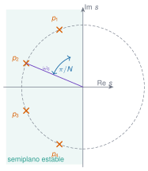
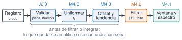

## Objetivos

- Elegir una **ventana** y saber que reparte un error entre resolución y fuga
- Diseñar y leer **filtros** FIR e IIR: causal frente a fase cero
- **Preprocesar** sin inventar datos: offset, tendencia, remuestreo, huecos, picos
- **Integrar** aceleración sin que la deriva mande
- Dar un **SNR** con su banda y estimar $H_1$, $H_2$ y la coherencia
- Mirar **tiempo y frecuencia** a la vez

## Ruta (240 min)

| Tiempo | Bloque | Duración |
|---|---|---|
| 0:00 | Reto: ¿se desplaza un metro el puente? | 5 min |
| 0:05 | M4.1 Ventanas | 30 min |
| 0:35 | M4.2 Filtros FIR e IIR | 40 min |
| 1:15 | M4.3 Preprocesado | 25 min |
| 1:40 | Descanso | 15 min |
| 1:55 | M4.4 Integración | 25 min |
| 2:20 | M4.5 Ruido y SNR | 15 min |
| 2:35 | M4.6 FRF: $H_1$, $H_2$, coherencia | 40 min |
| 3:15 | M4.7 Tiempo-frecuencia | 20 min |
| 3:35 | Caso Palma del Río | 15 min |
| 3:50 | Test de salida | 10 min |

## Reto inicial

- Torroja, 22-06-2018, GS4 vertical, 300 s a 100 Hz: RMS de 0,02 m/s²
- Se integra dos veces con el trapecio, restando la media
- Resultado: **1,17 m** de desplazamiento
- ¿Es verosímil? ¿Qué ha pasado? ¿Qué harías antes de integrar?

**Respuesta al final de M4.4**

## M4.1 Una ventana reparte un error

- La DFT supone un registro **periódico**: la fuga nace del salto en la unión
- Una ventana suaviza los extremos: **menos fuga, picos más anchos**
- Cifras de mérito: lóbulo lateral, ancho a −3 dB, **ENBW**, pérdida por escalonamiento

| Ventana | Lóbulo lat. | Ancho −3 dB | A medio bin |
|---|---:|---:|---:|
| Rectangular | −13,3 dB | 0,89 bins | 0,64 |
| Hann | −31,5 dB | 1,44 bins | 0,85 |
| Hamming | −42,7 dB | 1,30 bins | 0,82 |
| Flat-top | −92,8 dB | 3,73 bins | 0,999 |

## Qué se normaliza

- **Amplitud de un tono** → dividir por $\sum w$
- **PSD** → dividir por $\sum w^2$
- Pico de PSD de un tono: $\dfrac{a^2/2}{\mathrm{ENBW}\cdot\Delta f}$ (exacto, tono centrado)

## Rango dinámico frente a resolución

- Tono débil (−50 dB) a 6 bins de uno fuerte
- Se ve con **Hann, Blackman y flat-top**; **no** con la rectangular ni con Hamming
- A 4 bins la flat-top **deja de verlo**: su lóbulo ancho lo tapa
- Hamming: primer lóbulo bajo, pero los lejanos **no decaen**

## Welch: ventana, solape, varianza

- Varianza relativa de un solo periodograma: 1; con $K$ segmentos independientes, $1/K$
- Con solape se correlacionan: Hann al 50 % → 26,5 % de desviación (frente al 35,4 % sin solape)
- Con rectangular el solape casi no sirve; de 75 a 87,5 % **no mejora**
- Trueque: segmento largo → resolución; segmento corto → menos varianza

## Martillo: dos ventanas distintas

- **Ventana de fuerza**: vale 1 sobre el golpe y 0 fuera; quita el ruido de fondo
- **Ventana exponencial**: solo sobre la **respuesta** de un impacto; suma a cada modo un amortiguamiento $\sigma_0=-\ln w(T)/T$
- Un modo de 10 Hz, $\zeta=0{,}5\ \%$, medido 2 s:

| Registro y ventana | $\zeta$ leído | $\zeta$ corregido |
|---|---:|---:|
| 16 s, rectangular | 0,50 % | 0,50 % |
| 2 s, rectangular | 2,24 % | — |
| 2 s, exponencial hasta 0,10 | 2,82 % | 0,99 % |
| 2 s, exponencial hasta 0,01 | 4,20 % | 0,53 % |

**Alarga el registro** antes de acudir a una ventana: la resta de dos números grandes es el punto débil

## M4.2 Filtros

- FIR: siempre estable, fase lineal posible, muchos coeficientes
- IIR (Butterworth): pocos coeficientes, fase no lineal
- $f_{\mathrm c}$: −3 dB, **no** una frontera
- Butterworth: polos equiespaciados $\pi/n$ en un semicírculo + bilineal con *prewarping*

{width="45%" fig-alt="Cuatro polos de un Butterworth de orden 4 sobre un semicírculo en el semiplano izquierdo"}

## Causal y fase cero

- `filtrar`: una pasada, retrasa y deforma la fase; vale en tiempo real
- `filtrar_fase_cero`: ida y vuelta, respuesta $|H|^2$: fase nula, **dB × 2**
- En $f_{\mathrm c}$: **−6 dB**; el −3 dB baja a $(\sqrt2-1)^{1/2n}f_{\mathrm c}$ (0,896 $f_{\mathrm c}$, $n=4$)
- Solo análisis diferido; los extremos dependen del relleno

## Comprobado contra DSP.jl

- 640 diseños Butterworth: diferencia máxima $1{,}5\cdot10^{-12}$
- `filt` y `filtfilt`: $10^{-14}$ y $7\cdot10^{-9}$
- FIR por ventana idénticos; DSP.jl **invierte la polaridad** del pasaaltos si el retardo $(n-1)/2$ es impar (SciPy no)

## M4.3 Preprocesado

{width="95%" fig-alt="Cadena: registro crudo, validar, uniformar, offset y tendencia, filtrar, ventana y espectro"}

- Un **pico espurio** eleva el suelo de **todo** el espectro: $2A^2/(f_{\mathrm s}N)$
- Una **deriva** eleva las bajas frecuencias; Welch resta la media, no la tendencia
- Un hueco: **no rellenar**; excluir los segmentos que lo tocan

## Remuestreo

- `diezmar`: FIR antialiasing de fase cero **antes** de quedarse con una de cada $q$
- Sin filtro, un tono de 40 Hz a 100 Hz de muestreo se pliega a 10 Hz con toda su potencia
- Interpolación lineal a medio camino: amplitud × $\cos(\pi f/f_{\mathrm s})$ (29 % menos a $f_{\mathrm s}/4$)

## M4.4 Integrar amplifica lo lento

- $1/\omega$ al integrar una vez, $1/\omega^2$ dos
- Tres fuentes de deriva: **offset**, **condiciones iniciales**, **componentes lentas**
- Offset de 0,002 m/s² durante 60 s: **3,6 m**
- Integral en frecuencia con **corte**: se descarta lo que hay por debajo

## Vuelta al reto

| Método | Desplazamiento máx. |
|---|---:|
| Trapecio, media | 1,17 m |
| Trapecio, recta y parábola | 122 mm |
| En frecuencia, corte 0,5 Hz | **0,068 mm** |

- Estable de 0,5 a 2 Hz
- El movimiento **cuasi-estático** no se recupera con un acelerómetro

## M4.5 SNR y ruido del sensor

- SNR = 10 log(potencia señal / potencia ruido), de **un registro y una banda**
- Ruido blanco: $\sigma=\text{densidad}\cdot\sqrt{f_b-f_a}$
- 100 µg/√Hz: 707 µg en 50 Hz, 141 µg en 2 Hz
- Con $P/N=1+S/N$, el SNR bajo se sobrestima: restar antes

## M4.6 FRF con ruido

$$H_1=\frac{G_{xy}}{G_{xx}},\quad H_2=\frac{G_{yy}}{G_{yx}},\quad\gamma^2=\frac{|G_{xy}|^2}{G_{xx}G_{yy}},\quad\frac{H_1}{H_2}=\gamma^2$$

- Ruido en la **salida**: $H_1$ insesgada, $H_2$ sobrestima
- Ruido en la **entrada**: $H_2$ insesgada, $H_1\cdot\frac{G_{xx}}{G_{xx}+G_{mm}}$
- Un solo segmento: $\gamma^2=1$ siempre

## Coherencia baja sin ruido

- Edificio de tres plantas, sin ningún ruido
- Segmentos de 1024 (bins 0,098 Hz, pico 0,022 Hz): $\gamma^2$ = 0,22 / 0,45 / 0,78
- Segmentos de 16 384 (0,006 Hz): $\gamma^2$ = 0,94 / 0,99 / 1,00
- **Sesgo de resolución**: $\Delta f\lesssim$ ancho del pico / 4

## M4.7 Tiempo-frecuencia

- Espectrograma: $\Delta t\cdot\Delta f=1$; el solape no mejora la resolución
- Torroja: las ráfagas de 137 y 179 s tienen **~800 veces** la potencia mediana, pico en **11,5 Hz** (fondo: 3,3 Hz)
- *Wavelets*: resolución relativa constante, no más información

## Caso Palma del Río

- `set1` (tráfico): cresta 13,4; curtosis 23; **eventos, no muestras espurias**
- 92 % de la potencia por debajo de 32 Hz → diezmar a 64 Hz
- Corte 0,5 Hz: velocidad RMS **7,1 mm/s**; desplazamiento RMS **0,68 mm** (±10 % con el corte)
- Picos de la PSD: no son modos

## Cierre

- Una ventana **reparte** un error
- Un filtro **transforma** la señal
- Integrar **amplifica lo lento**
- Una coherencia baja puede ser **resolución**, no ruido
- Todo lo hecho al registro **se declara**
