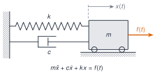
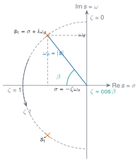
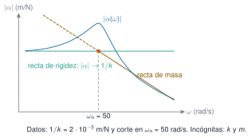

```{ojs}
//| echo: false
import {sdofParametros, sdofLibre, sdofForzada, sdofImpulsional, receptancia, movilidad, inertancia, receptanciaHisteretica, factorAmplificacion, faseForzada, cabs, carg, faseGrados, muestrea, muestreaLog} from "../../recursos/js/vibraciones.js"
```

## Objetivos y prerrequisitos

**Objetivos.** Al terminar la unidad sabrás:

- plantear la ecuación del movimiento de un sistema de 1 grado de libertad (GDL) y reconocer qué hipótesis exige;
- obtener y interpretar la respuesta libre sin amortiguamiento y con amortiguamiento viscoso, en los tres regímenes (subcrítico, crítico y supercrítico), y leer en los polos la frecuencia y el decaimiento;
- distinguir el modelo de amortiguamiento viscoso del histerético y saber cuándo se usa cada uno;
- calcular la respuesta a una excitación armónica (transitorio, régimen estacionario, amplitud, fase y factor de amplificación) y distinguir $\omega_n$, $\omega_d$ y la frecuencia del máximo de respuesta;
- definir la función de respuesta en frecuencia (FRF) y sus tres versiones (receptancia, movilidad e inertancia), y dibujarla en Bode y Nyquist con sus asíntotas;
- relacionar función de transferencia, respuesta impulsional y convolución.

**Prerrequisitos.** [J3.6 · Ecuaciones diferenciales ordinarias](../../julia/j3-computacion/j3-6-edos/index.qmd). Hace falta soltura con números complejos, la ecuación diferencial lineal de segundo orden y la transformada de Laplace.

**Temas de la unidad**

- **M5.1** Sistema de 1 GDL: ecuación del movimiento
- **M5.2** Vibración libre amortiguada y no amortiguada; decremento logarítmico
- **M5.3** Modelos de amortiguamiento: viscoso, histerético y estructural
- **M5.4** Vibración forzada armónica, resonancia y factor de amplificación
- **M5.5** FRF: receptancia, movilidad e inertancia; diagramas de Bode y Nyquist
- **M5.6** Excitación por la base, aislamiento, respuesta impulsional e integral de Duhamel

::: {.callout-note title="Notación y convenciones (comunes a M5, M6 y M7)"}
| Símbolo | Significado | Unidad |
|---|---|---|
| $m$, $c$, $k$ | masa, coeficiente de amortiguamiento viscoso y rigidez (1 GDL) | kg, N·s/m, N/m |
| $h$ | coeficiente de amortiguamiento histerético (1 GDL) | N/m |
| $x(t)$, $f(t)$ | desplazamiento y fuerza | m, N |
| $\omega_n=\sqrt{k/m}$ | frecuencia natural **no amortiguada** | rad/s |
| $\zeta=c/c_c$, $c_c=2m\omega_n$ | razón de amortiguamiento y amortiguamiento crítico | –, N·s/m |
| $\omega_d=\omega_n\sqrt{1-\zeta^2}$ | frecuencia natural **amortiguada** | rad/s |
| $s=\sigma+i\omega$ | variable de Laplace; $\sigma$ = parte real | 1/s |
| $\beta=\omega/\omega_n$ | relación de frecuencias | – |
| $f=\omega/2\pi$ | frecuencia en hercios (el eje de una FRF suele ir en rad/s o en Hz: indica siempre cuál) | Hz |
| $\mathbf{M},\mathbf{C},\mathbf{K}$ | matrices de masa, amortiguamiento y rigidez (varios GDL, desde M6) | – |

**Unidad imaginaria y tiempo complejo.** Usamos $i$ y la convención $e^{+i\omega t}$: una fuerza armónica es $f(t)=\mathrm{Re}\{F e^{i\omega t}\}$ y la respuesta estacionaria va retrasada respecto de ella, de modo que la **fase de la receptancia va de $0^\circ$ a $-180^\circ$**. Si ves $e^{-i\omega t}$ (convención de la física) los signos de las fases se invierten. Los apuntes escriben $j$ o $i$, y $\Omega$, $\omega$ o $\omega_n$ para la frecuencia natural: aquí se unifican.
:::

::: {.callout-note collapse="true" title="Fuentes, correcciones y qué queda pendiente"}
**Fuentes.** Apuntes manuscritos del Máster Agrela, curso 2024-2025 (carpeta *Teoría de vibraciones*). Citados como *PDF, p. n* (página del PDF, no la numeración manuscrita). Esta unidad es un texto autónomo escrito a partir de ellos.

| Contenido | Origen |
|---|---|
| M5.1 ecuación del movimiento, hipótesis | *SDOF sin amortiguamiento*, p. 1–2; *Intro*, p. 1–3 |
| M5.2 libre sin amortiguamiento, condiciones iniciales | *SDOF sin amortiguamiento*, p. 1, 4 |
| M5.2 libre amortiguada, regímenes, polos | *SDOF con amortiguamiento*, p. 1–5; *SDOF sin amortiguamiento*, p. 2–3, 5–6 |
| M5.3 modelo histerético (SDOF) | *Diagrama de Nyquist*, p. 1; (MDOF) *MDOF*, p. 8–11 |
| M5.4 forzada armónica, Q, fase | *SDOF forzada*, p. 1–2 |
| M5.5 FRF, receptancia/movilidad/inertancia, Bode, Nyquist, asíntotas | *FRF*, p. 4, 6–11; *SDOF forzada*, p. 3; *Diagrama de Nyquist*, p. 1 |
| M5.6 $H(s)$, polos y residuos, $h(t)$, convolución | *FRF*, p. 1–5 |

**Correcciones y precisiones a los apuntes** (comprobadas numéricamente en Julia y, para el código JavaScript de las figuras, contra esa referencia):

1. *SDOF sin amortiguamiento*, p. 5: «undamped system ($\zeta<1$)» debe ser *underdamped* (subcrítico); un sistema sin amortiguamiento tiene $\zeta=0$.
2. *SDOF forzada*, p. 1 (precisión): en la solución total, las constantes del transitorio se fijan con las condiciones iniciales de la solución **total**, no de la homogénea; y con la fuerza real $F\cos\omega t$ solo se toma la parte real de la solución compleja.
3. *SDOF forzada*, p. 2: «con $\zeta=0$ y $\beta=1$ el régimen estacionario tiene amplitud infinita» es impreciso: **no existe** régimen estacionario; la respuesta crece de forma lineal con el tiempo (§ M5.4). Además, el dibujo de $Q(\beta)$ es cualitativo: para $\zeta=0{,}05$ el máximo es $Q\approx10$ y para $\zeta=0{,}3$ es $\approx1{,}75$, valores distintos de los marcados en la gráfica.
4. *SDOF forzada*, p. 2: «el amortiguamiento solo es eficaz cerca de la resonancia» es válido para la **amplitud**; la **fase** cambia en una banda mucho más ancha, y el transitorio decae siempre con $e^{-\zeta\omega_n t}$.
5. *FRF*, p. 5: «amplitud inicial → residuo $A$». El residuo $A=1/(2im\omega_d)$ es imaginario puro, de modo que $h(0)=0$; lo que fija el residuo es la **velocidad inicial** de la respuesta impulsional, $\dot h(0^+)=1/m$.
6. *FRF*, p. 6–7: en el esquema de $\mathrm{Im}\,\alpha(\omega)$ el nivel lejos de la resonancia parece quedar por encima de cero; para el modelo viscoso debe tender a $0$ ($\mathrm{Im}\,\alpha\le0$).
7. *FRF*, p. 10: «el amortiguamiento no afecta a la frecuencia de resonancia» es válido para $\omega_n$ (la no amortiguada), pero $\omega_d$ y el máximo de la receptancia sí se desplazan con $\zeta$ (§ M5.4).
8. *SDOF sin amortiguamiento*, p. 4: $\varphi=\arctan(x_0\omega/v_0)$ solo cubre dos cuadrantes; usa `atan2`.
9. *Diagrama de Nyquist*, p. 1: los pasos intermedios del círculo están desordenados; el resultado final (centro y radio) es correcto y aquí se rehace paso a paso.

**Ampliaciones externas a los apuntes** (derivaciones propias, no copiadas): energía disipada por ciclo y equivalente viscoso (§ M5.3); expresiones de $\omega_{\text{pico}}$ para receptancia, movilidad e inertancia (§ M5.4); la movilidad viscosa como círculo exacto (§ M5.5); crecimiento lineal en resonancia sin amortiguamiento (§ M5.4). Lecturas para ampliar: [@inman2017; @silva1999; @avitabile2018; @ewins2000; @crandall1970].

**Pendiente (no cubierto por estos apuntes).** Decremento logarítmico (M5.2); amortiguamiento «estructural» como concepto distinto del histerético y amortiguamiento de Coulomb (M5.3); excitación por la base y aislamiento de vibraciones (M5.6); forma explícita de la integral de Duhamel y su uso (M5.6; aquí solo se establece la convolución con $h(t)$).
:::

## Teoría breve

### M5.1 Sistema de 1 GDL: ecuación del movimiento {#m5-1}

::: {#def-gdl}
**Grados de libertad** (*degrees of freedom*, GDL). Número mínimo de coordenadas necesarias para fijar la configuración de un sistema.
:::

Un punto material tiene 3 (traslaciones); un sólido rígido, 6 (tres traslaciones y tres giros); un sólido deformable, infinitos. De hecho, cualquier estructura real tiene infinitos GDL, pero en la práctica trabajamos con un número finito $N$ de ellos (en los apuntes, del orden de 1 a 50), limitado por el rango de frecuencias de interés, por la amplitud medible y por la dificultad de medir giros. Un sistema de $N$ GDL tiene $N$ modos de vibración (M6).

El **sistema de 1 GDL** (*single degree of freedom*, SDOF) es el modelo más simple y el bloque de construcción de todo lo demás: más adelante veremos que un sistema de $N$ GDL se comporta como una suma de $N$ osciladores de 1 GDL (M6.3). Consta de una masa $m$ que solo se mueve según una coordenada $x(t)$, unida a un apoyo fijo mediante un muelle de rigidez $k$ y un amortiguador viscoso de constante $c$, y sometida a una fuerza $f(t)$.

{#fig-sdof fig-alt="Esquema de una masa sobre un carro unida a una pared por un muelle y un amortiguador en paralelo, con una fuerza horizontal aplicada a la masa y la coordenada x(t) indicada con una flecha" width="85%"}

Aplicando la segunda ley de Newton a la masa (muelle y amortiguador se oponen al movimiento):

$$
m\ddot{x}(t)+c\,\dot{x}(t)+k\,x(t)=f(t).
$$ {#eq-sdof}

::: {.callout-tip .idea-clave title="Idea clave"}
Un oscilador de 1 GDL queda fijado por **tres parámetros** ($m$, $c$, $k$), que se resumen en tres números con sentido físico: $\omega_n$ (a qué frecuencia oscila), $\zeta$ (cuánta energía disipa) y $1/k$ (cuánto se deforma bajo una carga estática).
:::

::: {.callout-warning title="Dos puntos que suelen confundir"}
- Si el muelle es vertical (como en los dibujos de los apuntes), $x(t)$ se mide **desde la posición de equilibrio estático**; por eso el peso no aparece en la ecuación.
- La ecuación es una **ecuación diferencial lineal, de segundo orden, con coeficientes constantes**. Esa linealidad es una hipótesis del modelo, no una propiedad de la estructura: exige que $m$, $c$ y $k$ no dependan de $x$ (linealidad) ni de $t$ (invarianza temporal); véase M7.1.
:::

**Pon a prueba lo anterior.** Los ejercicios se corrigen en tu navegador y no envían nada a ningún sitio.

::: {.ejercicio tipo="opcion" id="m5-1-gdl" respuesta="b"}
¿Cuántos grados de libertad tiene un sólido rígido libre en el espacio?

::: {.opciones}
- 3
- 6
- 9
- Infinitos
:::

::: {.solucion}
Seis: tres traslaciones $(x,y,z)$ y tres giros $(\theta_x,\theta_y,\theta_z)$. El punto material tiene 3 y el sólido deformable, infinitos.
:::
:::

::: {.ejercicio tipo="vf" id="m5-1-lineal" respuesta="falso"}
La ecuación $m\ddot{x}+c\dot{x}+kx=f(t)$ puede aplicarse tal cual a un sistema cuya rigidez aumenta con la amplitud de la vibración.

::: {.pista}
Piensa en qué hipótesis hay detrás de que $m$, $c$ y $k$ sean constantes.
:::

::: {.solucion}
**Falso.** Si $k$ depende de $x$, la ecuación deja de ser lineal: se viola la hipótesis de **linealidad** (M7.1), y las soluciones de M5 ya no valen.
:::
:::

### M5.2 Vibración libre amortiguada y no amortiguada; decremento logarítmico {#m5-2}

**Sin amortiguamiento.** Con $c=0$ y $f=0$, $m\ddot{x}+kx=0$, es decir, $\ddot{x}+\omega_n^2x=0$ con $\omega_n=\sqrt{k/m}$. Probando $x=Ae^{st}$ resulta $s^2=-\omega_n^2$, $s=\pm i\omega_n$, y con la fórmula de Euler

$$
x(t)=A\cos\omega_n t+B\sin\omega_n t.
$$

Las **condiciones iniciales** $x(0)=x_0$, $\dot{x}(0)=v_0$ dan $A=x_0$, $B=v_0/\omega_n$:

$$
x(t)=x_0\cos\omega_n t+\frac{v_0}{\omega_n}\sin\omega_n t = X\sin(\omega_n t+\varphi),\qquad
X=\sqrt{x_0^2+\left(\frac{v_0}{\omega_n}\right)^2},\quad \varphi=\operatorname{atan2}(\omega_n x_0,\,v_0).
$$

Es un movimiento armónico simple de periodo $T=2\pi/\omega_n$ y amplitud constante. La frecuencia natural **solo depende de $m$ y $k$**, no de las condiciones iniciales.

**Con amortiguamiento viscoso.** Con $f=0$, probamos $x=Xe^{st}$ y obtenemos la **ecuación característica** $ms^2+cs+k=0$, cuyas raíces son los **polos** del sistema:

$$
s_{1,2}=-\frac{c}{2m}\pm\sqrt{\left(\frac{c}{2m}\right)^2-\frac{k}{m}} .
$$

El radicando cambia de signo cuando $c=c_c=2m\omega_n=2\sqrt{km}$ .

::: {#def-zeta}
**Amortiguamiento crítico y razón de amortiguamiento.** $c_c=2m\omega_n=2\sqrt{km}$ es el valor de $c$ que anula el radicando; $\zeta=c/c_c$ es la **razón de amortiguamiento** (adimensional).
:::

Con ella,

$$
s_{1,2}=\left(-\zeta\pm\sqrt{\zeta^2-1}\right)\omega_n .
$$

Según el valor de $\zeta$ hay tres regímenes. La respuesta con condiciones iniciales $x_0$, $v_0$ es:

| Régimen | Polos | $x(t)$ |
|---|---|---|
| **Subcrítico** $\zeta<1$ | par complejo conjugado | $e^{-\zeta\omega_n t}\Big[x_0\cos\omega_d t+\dfrac{v_0+\zeta\omega_n x_0}{\omega_d}\sin\omega_d t\Big]$ |
| **Crítico** $\zeta=1$ | raíz real doble $s=-\omega_n$ | $\big[(1+\omega_n t)\,x_0+v_0\,t\big]e^{-\omega_n t}$ |
| **Supercrítico** $\zeta>1$ | dos raíces reales negativas | $e^{-\zeta\omega_n t}\Big[x_0\cosh\omega^* t+\dfrac{v_0+\zeta\omega_n x_0}{\omega^*}\sinh\omega^* t\Big]$, $\ \omega^*=\omega_n\sqrt{\zeta^2-1}$ |

con $\omega_d=\omega_n\sqrt{1-\zeta^2}$ la **frecuencia natural amortiguada** (rad/s). Solo el caso subcrítico oscila; el crítico y el supercrítico vuelven al equilibrio sin oscilar, y el crítico lo hace más deprisa (el polo lento del supercrítico, $\omega_n(\zeta-\sqrt{\zeta^2-1})$, es más lento que $\omega_n$).

{#fig-polos fig-alt="Plano complejo con ejes real e imaginario; dos polos conjugados en el semiplano izquierdo sobre una semicircunferencia de radio omega n, con el ángulo beta, la parte real sigma y la parte imaginaria omega d marcadas" width="70%"}

**Interpretación de los polos** (@fig-polos). En el caso subcrítico, $s=\sigma\pm i\omega_d$ con $\sigma=-\zeta\omega_n$. Entonces

- la **parte imaginaria** es la frecuencia de oscilación $\omega_d$ y la **parte real** fija el decaimiento $e^{\sigma t}$;
- el módulo del polo es la frecuencia natural no amortiguada, $|s|=\sqrt{\sigma^2+\omega_d^2}=\omega_n$, y $\zeta=-\sigma/|s|=\cos\beta$, siendo $\beta$ el ángulo entre el polo y el eje real negativo;
- los polos se mueven por una **semicircunferencia de radio $\omega_n$**: parten del eje imaginario con $\zeta=0$, bajan hacia el eje real y se juntan en $-\omega_n$ cuando $\zeta=1$; después se separan sobre el eje real.

La envolvente de la oscilación es $Xe^{-\zeta\omega_n t}$ y el periodo amortiguado $T_d=2\pi/\omega_d$ es mayor que $2\pi/\omega_n$. En estructuras reales $\zeta$ es pequeño (en los apuntes, menor del 10 %, salvo que haya sistemas de amortiguamiento activo), así que $\omega_d\approx\omega_n$; pero conviene no confundirlas: la diferencia crece con $\zeta$, y para $\zeta\ge1$ la frecuencia amortiguada no existe.

**Simulación 1. Respuesta libre.** Cambia los parámetros y observa los tres regímenes y la posición de los polos.

```{ojs}
//| echo: false
viewof L_m = Inputs.range([0.2, 5], {value: 1, step: 0.1, label: "m (kg)"})
```
```{ojs}
//| echo: false
viewof L_k = Inputs.range([20, 500], {value: 100, step: 5, label: "k (N/m)"})
```
```{ojs}
//| echo: false
viewof L_c = Inputs.range([0, 60], {value: 3, step: 0.5, label: "c (N·s/m)"})
```
```{ojs}
//| echo: false
viewof L_x0 = Inputs.range([-50, 50], {value: 20, step: 1, label: "x₀ (mm)"})
```
```{ojs}
//| echo: false
viewof L_v0 = Inputs.range([-1, 1], {value: 0, step: 0.05, label: "v₀ (m/s)"})
```
```{ojs}
//| echo: false
L_p = sdofParametros(L_m, L_k, L_c)
L_T = {
  const P = 2 * Math.PI / L_p.wn;
  if (L_c === 0) return 8 * P;
  const lento = L_p.zeta < 1 ? L_p.zeta * L_p.wn : L_p.wn * (L_p.zeta - Math.sqrt(L_p.zeta ** 2 - 1));
  return Math.min(Math.max(4 / lento, 3 * P), 25 * P);
}
L_datos = muestrea(t => 1000 * sdofLibre(L_m, L_k, L_c, L_x0 / 1000, L_v0, t), 0, L_T, 700).map(d => ({t: d.x, x: d.y}))
L_env = {
  if (L_p.zeta >= 1 || L_c === 0) return [];
  const X = 1000 * Math.hypot(L_x0 / 1000, (L_v0 + L_p.zeta * L_p.wn * L_x0 / 1000) / L_p.wd);
  const e = muestrea(t => X * Math.exp(-L_p.zeta * L_p.wn * t), 0, L_T, 200);
  return [
    Plot.line(e.map(d => ({t: d.x, x: d.y})), {x: "t", y: "x", stroke: "#d95f02", strokeDasharray: "5 4"}),
    Plot.line(e.map(d => ({t: d.x, x: -d.y})), {x: "t", y: "x", stroke: "#d95f02", strokeDasharray: "5 4"})
  ];
}
```
```{ojs}
//| echo: false
L_fig1 = Plot.plot({
  width: 560, height: 300, marginLeft: 55,
  x: {label: "t (s)"}, y: {label: "x (mm)", grid: true},
  marks: [Plot.ruleY([0]), ...L_env, Plot.line(L_datos, {x: "t", y: "x", stroke: "#1b6ca8", strokeWidth: 2})]
})
L_arco = Array.from({length: 361}, (_, i) => { const a = 2 * Math.PI * i / 360; return {re: L_p.wn * Math.cos(a), im: L_p.wn * Math.sin(a)}; })
L_fig2 = Plot.plot({
  width: 300, height: 300, aspectRatio: 1, marginLeft: 55,
  x: {label: "Re(s) (1/s)", domain: [-1.4 * L_p.wn, 0.4 * L_p.wn]},
  y: {label: "Im(s) (rad/s)", domain: [-1.4 * L_p.wn, 1.4 * L_p.wn]},
  marks: [
    Plot.ruleX([0]), Plot.ruleY([0]),
    Plot.line(L_arco, {x: "re", y: "im", stroke: "#999", strokeDasharray: "3 3"}),
    Plot.text(L_p.polos, {x: d => d.re, y: d => d.im, text: () => "×", fontSize: 26, fill: "#d95f02"})
  ]
})
html`<div style="display:flex; gap:1rem; flex-wrap:wrap; align-items:flex-start">${L_fig1}${L_fig2}</div>`
```
```{ojs}
//| echo: false
md`Régimen **${L_p.regimen}** · ω<sub>n</sub> = ${L_p.wn.toFixed(2)} rad/s (${(L_p.wn / (2 * Math.PI)).toFixed(2)} Hz) · ζ = ${(100 * L_p.zeta).toFixed(1)} % · c<sub>c</sub> = ${L_p.cc.toFixed(2)} N·s/m · ${L_p.zeta < 1 ? "ω<sub>d</sub> = " + L_p.wd.toFixed(2) + " rad/s" : "sin frecuencia amortiguada"}`
```

::: {.callout-warning title="Errores frecuentes"}
- Confundir $\omega_n$ (rad/s) con $f_n=\omega_n/2\pi$ (Hz).
- Usar $\omega_n$ en lugar de $\omega_d$ dentro del seno y del coseno de la respuesta amortiguada.
- Pensar que «más amortiguamiento» es siempre «más rápido»: pasado el valor crítico, el sistema vuelve **más lento** al equilibrio.
:::

::: {.callout-important title="Pendiente en esta sección"}
**Decremento logarítmico**: no figura en los apuntes de partida y no se desarrolla aquí. Se completará a partir de una fuente verificable.
:::

**Pon a prueba lo anterior.**

::: {.ejercicio tipo="numerico" id="m5-2-zeta" respuesta="0.2" tol="1%"}
Un oscilador tiene $m=2$ kg, $k=800$ N/m y $c=16$ N·s/m. Calcula su razón de amortiguamiento $\zeta$.

::: {.pista}
$c_c=2\sqrt{km}$ y $\zeta=c/c_c$.
:::

::: {.solucion}
$c_c=2\sqrt{800\cdot2}=80$ N·s/m, luego $\zeta=16/80=0{,}2$.
:::
:::

::: {.ejercicio tipo="numerico" id="m5-2-wd" respuesta="19.596" tol="0.5%" unidad="rad/s"}
Para el mismo oscilador, calcula la frecuencia natural **amortiguada** $\omega_d$.

::: {.pista}
Primero $\omega_n=\sqrt{k/m}$; después $\omega_d=\omega_n\sqrt{1-\zeta^2}$.
:::

::: {.solucion}
$\omega_n=\sqrt{800/2}=20$ rad/s y $\omega_d=20\sqrt{1-0{,}2^2}=19{,}596$ rad/s ($3{,}119$ Hz). Distingue siempre rad/s de Hz.
:::
:::

::: {.ejercicio tipo="vf" id="m5-2-supercritico" respuesta="falso"}
Con $\zeta=2$ el sistema vuelve al equilibrio **antes** que con $\zeta=1$.

::: {.solucion}
**Falso.** El amortiguamiento crítico es el que vuelve más deprisa sin oscilar. Con $\zeta>1$ uno de los polos reales, $\omega_n(\zeta-\sqrt{\zeta^2-1})$, es más lento que $\omega_n$, así que el regreso es más lento.
:::
:::

::: {.ejercicio tipo="programacion" id="m5-2-prog" respuesta="-0.021933" tol="0.5%" unidad="m"}
Con $m=1$ kg, $k=100$ N/m, $c=0{,}6$ N·s/m, $x_0=0{,}01$ m y $v_0=0{,}3$ m/s, calcula en Julia $x(0{,}37)$ de dos formas y comprueba que coinciden: con la fórmula cerrada subcrítica y con la exponencial matricial del espacio de estados. Escribe aquí el valor (en m).

```julia
using LinearAlgebra
m, k, c = 1.0, 100.0, 0.6
x0, v0, t = 0.01, 0.3, 0.37
# 1) fórmula cerrada: ωn, ζ, ωd …
# 2) A = [0 1; -k/m -c/m];  x = (exp(A*t) * [x0, v0])[1]
```

::: {.solucion}
```julia
ωn = sqrt(k / m);  ζ = c / (2sqrt(k * m));  ωd = ωn * sqrt(1 - ζ^2)
x_cerrada = exp(-ζ*ωn*t) * (x0*cos(ωd*t) + (v0 + ζ*ωn*x0)/ωd * sin(ωd*t))
A = [0 1; -k/m -c/m]
x_matriz = (exp(A*t) * [x0, v0])[1]
@show x_cerrada x_matriz   # ambos ≈ -0.021933
```
Coinciden hasta la precisión de la máquina. Si no te sale, comprueba que usas $\omega_d$ y no $\omega_n$ dentro del seno y del coseno.
:::
:::

### M5.3 Modelos de amortiguamiento: viscoso, histerético y estructural {#m5-3}

Los apuntes usan dos modelos de amortiguamiento, que se comportan de forma muy distinta.

**Viscoso.** La fuerza disipativa es proporcional a la **velocidad**, $f_d=-c\dot{x}$. Es el modelo de la ecuación @eq-sdof y el natural en amortiguadores y en fluidos. Es una ecuación diferencial real en el tiempo, válida para cualquier excitación (libre, armónica, transitoria).

**Histerético.** Se propone una fuerza disipativa proporcional al **desplazamiento** pero en cuadratura con él (adelantada $90^\circ$), de modo que con movimiento armónico $e^{i\omega t}$ la ecuación es

$$
m\ddot{x}+k\,x+i\,h\,x=f(t),\qquad
\alpha(\omega)=\frac{1}{k-m\omega^2+i\,h},
$$

donde $h$ (N/m) es el coeficiente histerético; el cociente $\eta=h/k$ se llama **factor de pérdidas**. En los apuntes se usa para la receptancia en el diagrama de Nyquist (SDOF) y en la ecuación del movimiento con matriz $[D]$ (MDOF, § M6.3).

**Energía disipada por ciclo.** Con $x=X\cos(\omega t+\theta)$, la energía disipada por ciclo por el amortiguador viscoso es $W_v=\oint c\dot{x}\,\mathrm{d}x=\pi c\,\omega X^2$, que crece con la frecuencia. Para el modelo histerético, la fuerza disipativa $h\,x$ en cuadratura equivale a un amortiguador de constante $c_{\mathrm{eq}}=h/\omega$ a esa frecuencia, y

$$
W_h=\pi\,h\,X^2 ,
$$

**independiente de la frecuencia**. Igualando ambos, a la frecuencia $\omega$ el modelo histerético equivale a un viscoso con $c_{\mathrm{eq}}=h/\omega$, y en resonancia ($\omega=\omega_n$) a una razón de amortiguamiento $\zeta_{\mathrm{eq}}=\eta/2$.

::: {.callout-note .demostracion collapse="true" title="Demostración de $W_v$, $W_h$ y $\zeta_{\mathrm{eq}}$"}
Con $x=X\cos(\omega t+\theta)$ resulta $\dot{x}=-\omega X\sin(\omega t+\theta)$. En un ciclo, la energía que disipa el amortiguador viscoso es $W_v=\int_0^{T}c\,\dot{x}^2\,\mathrm{d}t=c\,\omega^2X^2\cdot\tfrac{T}{2}=\pi c\,\omega X^2$, porque la media de $\sin^2$ en un periodo es $1/2$ y $T=2\pi/\omega$. La fuerza histerética $h\,x$ en cuadratura equivale a $h\,\dot{x}/\omega$, es decir, a un amortiguador $c_{\mathrm{eq}}=h/\omega$, de modo que $W_h=\pi c_{\mathrm{eq}}\omega X^2=\pi hX^2$. En resonancia, $c_{\mathrm{eq}}=h/\omega_n=2\zeta_{\mathrm{eq}}m\omega_n$ da $\zeta_{\mathrm{eq}}=h/(2m\omega_n^2)=h/(2k)=\eta/2$.
:::

| | Viscoso | Histerético |
|---|---|---|
| Fuerza disipativa | $c\,\dot{x}$ | $i\,h\,x$ (en cuadratura con $x$) |
| Energía por ciclo | $\pi c\omega X^2$ (crece con $\omega$) | $\pi h X^2$ (no depende de $\omega$) |
| Validez | cualquier excitación, en el tiempo y en frecuencia | **solo régimen armónico** (dominio de la frecuencia) |
| Pico de $\lvert\alpha\rvert$ | cerca de $\omega_n\sqrt{1-2\zeta^2}$ | exactamente en $\omega_n$ |
| Lugar de Nyquist de la receptancia | casi un círculo si $\zeta$ es pequeño | círculo **exacto** (§ M5.5) |
| Uso típico | amortiguadores; respuesta transitoria; integración temporal | ajuste de FRF medidas en materiales y estructuras |

El «$i$» de la ecuación histerética hace que, escrita en el tiempo, la ecuación no sea una ecuación diferencial real: el modelo se define para movimiento armónico y no sirve tal cual para simular una respuesta transitoria. Para ampliar sobre este punto, véase [@crandall1970].

::: {.callout-important title="Pendiente en esta sección"}
En los apuntes «estructural» aparece solo como etiqueta junto a «viscoso», «Coulomb» e «histerético»; en parte de la bibliografía se usa como sinónimo del histerético. No se desarrolla aquí como modelo distinto. Tampoco se trata el amortiguamiento de Coulomb (fricción seca).
:::

**Pon a prueba lo anterior.**

::: {.ejercicio tipo="opcion" id="m5-3-histeretico" respuesta="b"}
¿Cuál de estas afirmaciones sobre el amortiguamiento **histerético** es correcta?

::: {.opciones}
- Es válido para cualquier excitación, también para una respuesta transitoria.
- La energía que disipa por ciclo no depende de la frecuencia.
- Disipa más energía por ciclo cuanto mayor es la frecuencia.
- Equivale siempre a un amortiguador viscoso de constante fija.
:::

::: {.solucion}
La **b**. $W_h=\pi hX^2$ no depende de $\omega$. Es un modelo de régimen armónico (a), y equivale a un viscoso solo a una frecuencia dada, $c_{\mathrm{eq}}=h/\omega$ (d). Lo que crece con la frecuencia es la energía del modelo viscoso (c).
:::
:::

::: {.ejercicio tipo="encuesta" id="m5-3-experiencia"}
**Reflexión (no evaluada).** ¿Con qué modelo de amortiguamiento has trabajado antes?

::: {.opciones}
- Viscoso
- Histerético
- Ambos
- Con ninguno, o no lo recuerdo
:::
:::

### M5.4 Vibración forzada armónica, resonancia y factor de amplificación {#m5-4}

Sea $f(t)=\mathrm{Re}\{Fe^{i\omega t}\}=F\cos\omega t$. La solución es suma de la **homogénea** (*transitoria*, de M5.2, que decae como $e^{-\zeta\omega_n t}$ si $\zeta>0$) y de una **particular** (*estacionaria*), que sigue a la fuerza: la que queda cuando el transitorio se ha extinguido. Para el régimen estacionario ensayamos $x_p=\mathrm{Re}\{\bar{X}e^{i\omega t}\}$ con $\bar{X}=Xe^{i\theta}$ complejo; sustituyendo, $(-m\omega^2+ic\omega+k)\bar{X}=F$, por tanto

$$
\bar{X}=\frac{F}{k-m\omega^2+i\,c\omega},\qquad
X=\frac{F}{\sqrt{(k-m\omega^2)^2+(c\omega)^2}},\qquad
\theta=-\operatorname{atan2}(c\omega,\;k-m\omega^2)\in(-\pi,0].
$$

Con $\theta<0$ la respuesta **se retrasa** respecto de la fuerza. La respuesta completa es $x(t)=x_h(t)+X\cos(\omega t+\theta)$, y las constantes de $x_h$ se determinan con las condiciones iniciales de la solución **total**.

**Factor de amplificación.** Dividiendo por el desplazamiento estático $X_s=F/k$ y con $\beta=\omega/\omega_n$:

$$
Q(\beta)=\frac{X}{X_s}=\frac{1}{\sqrt{(1-\beta^2)^2+(2\zeta\beta)^2}},\qquad
\theta(\beta)=-\operatorname{atan2}\big(2\zeta\beta,\;1-\beta^2\big).
$$

Tres zonas:

- **$\beta\ll1$** (por debajo de la resonancia): $Q\to1$ y $\theta\to0$. La estructura responde de forma casi estática, controlada por la **rigidez**.
- **$\beta=1$** (resonancia): $Q=1/(2\zeta)$ y $\theta=-90^\circ$ para cualquier $\zeta$. Está controlada por el **amortiguamiento**.
- **$\beta\gg1$**: $Q\approx1/\beta^2$ y $\theta\to-180^\circ$. Domina la **masa** (la respuesta es muy pequeña y en oposición de fase).

**Resonancia y las tres frecuencias.** «Frecuencia de resonancia» se usa con varios sentidos. Con amortiguamiento viscoso son distintas:

| Frecuencia | Valor | Qué es |
|---|---|---|
| $\omega_n=\sqrt{k/m}$ | – | natural no amortiguada; módulo de los polos |
| $\omega_d=\omega_n\sqrt{1-\zeta^2}$ | – | frecuencia de la oscilación libre amortiguada |
| $\omega_{\text{pico}}^{\alpha}=\omega_n\sqrt{1-2\zeta^2}$ | existe si $\zeta<1/\sqrt2$ | máximo de $\lvert\alpha\rvert$; ahí $Q_{\max}=1/(2\zeta\sqrt{1-\zeta^2})$ |
| movilidad | $\omega_n$ | máximo de $\lvert Y\rvert$ |
| inertancia | $\omega_n/\sqrt{1-2\zeta^2}$ | máximo de $\lvert A\rvert$ |

Para $\zeta=0{,}03$ (con $\omega_n=10$ rad/s) los tres valores son $10{,}000$, $9{,}9955$ y $9{,}9910$ rad/s: casi iguales, pero no la misma cosa. Para $\zeta=0{,}3$ son $10$, $9{,}54$ y $9{,}06$ rad/s. Para estructuras con amortiguamientos bajos se suele hablar sin distinguir; en una identificación precisa conviene saber a cuál te refieres (M7).

::: {#prp-pico}
**Frecuencias de pico.** Con amortiguamiento viscoso, el módulo de la receptancia $\lvert\alpha\rvert$ alcanza su máximo en $\omega=\omega_n\sqrt{1-2\zeta^2}$ (si $\zeta<1/\sqrt2$), con $Q_{\max}=1/\big(2\zeta\sqrt{1-\zeta^2}\big)$; el de la movilidad $\lvert Y\rvert$, en $\omega_n$; el de la inertancia $\lvert A\rvert$, en $\omega_n/\sqrt{1-2\zeta^2}$.
:::

::: {.callout-note .demostracion collapse="true" title="Demostración"}
**Receptancia.** $\lvert\alpha\rvert\propto Q(\beta)$ es máximo cuando $g(\beta)=(1-\beta^2)^2+4\zeta^2\beta^2$ es mínimo. Como $g'(\beta)=-4\beta(1-\beta^2)+8\zeta^2\beta=4\beta\,(2\zeta^2-1+\beta^2)$, el mínimo está en $\beta^2=1-2\zeta^2$ y vale $g=4\zeta^2(1-\zeta^2)$, de donde $Q_{\max}=1/(2\zeta\sqrt{1-\zeta^2})$.

**Movilidad.** $\lvert Y\rvert=\omega\lvert\alpha\rvert$ y $\beta^2/g(\beta)=1/\big((1/\beta-\beta)^2+4\zeta^2\big)$, que es máximo si $1/\beta-\beta=0$, es decir, en $\beta=1$.

**Inertancia.** $\lvert A\rvert=\omega^2\lvert\alpha\rvert$ y, con $u=1/\beta^2$, $\beta^4/g=1/\big((u-1)^2+4\zeta^2u\big)$, que es máximo cuando $(u-1)^2+4\zeta^2u$ es mínimo: $u=1-2\zeta^2$, es decir, $\beta^2=1/(1-2\zeta^2)$.
:::

::: {#exm-forzada}
**Ejemplo resuelto.** Sea $m=1$ kg, $k=100$ N/m, $c=0{,}6$ N·s/m, $F=1$ N y $\omega=9{,}5$ rad/s. Entonces $\omega_n=10$ rad/s, $\zeta=0{,}03$ y $\beta=0{,}95$. Resulta $Q=1/\sqrt{(1-0{,}9025)^2+(2\cdot0{,}03\cdot0{,}95)^2}=8{,}854$, la amplitud estacionaria $X=QF/k=0{,}0885$ m y la fase $\theta=-\operatorname{atan2}(0{,}057;\,0{,}0975)=-30{,}3^\circ$ (la respuesta se retrasa respecto de la fuerza).
:::

**Sin amortiguamiento.** Con $c=0$ y $\omega=\omega_n$ no existe régimen estacionario: la solución particular crece sin límite, $x(t)=\dfrac{F}{2m\omega_n}\,t\sin\omega_n t$ (con condiciones iniciales nulas). Es cierto que la amplitud «tiende a infinito», pero lo hace linealmente con el tiempo, y en un sistema real $\zeta>0$ acota el máximo en $Q=1/(2\zeta)$ una vez agotado el transitorio.

**Simulación 2. Respuesta forzada.** Excita el sistema con $f(t)=F\cos\omega t$ desde reposo y observa cómo el transitorio da paso al régimen estacionario, y cómo cambian $Q$ y la fase con la frecuencia relativa.

```{ojs}
//| echo: false
viewof F_m = Inputs.range([0.2, 5], {value: 1, step: 0.1, label: "m (kg)"})
```
```{ojs}
//| echo: false
viewof F_k = Inputs.range([20, 500], {value: 100, step: 5, label: "k (N/m)"})
```
```{ojs}
//| echo: false
viewof F_c = Inputs.range([0.2, 30], {value: 3, step: 0.1, label: "c (N·s/m)"})
```
```{ojs}
//| echo: false
viewof F_beta = Inputs.range([0.2, 2], {value: 0.9, step: 0.01, label: "β = ω/ωₙ"})
```
```{ojs}
//| echo: false
F_p = sdofParametros(F_m, F_k, F_c)
F_w = F_beta * F_p.wn
F_T = Math.min(Math.max(6 / (F_p.zeta * F_p.wn), 8 * 2 * Math.PI / Math.min(F_w, F_p.wn)), 60 * 2 * Math.PI / F_p.wn)
F_datos = {
  const n = 1200, out = [];
  for (let i = 0; i < n; i++) {
    const t = F_T * i / (n - 1);
    const r = sdofForzada(F_m, F_k, F_c, 1, F_w, 0, 0, t);
    out.push({t, total: 1000 * r.total, estacionaria: 1000 * r.estacionaria});
  }
  return out;
}
F_Q = muestrea(b => factorAmplificacion(b, F_p.zeta), 0.01, 2.5, 400).map(d => ({b: d.x, Q: d.y}))
F_fase = muestrea(b => faseForzada(b, F_p.zeta) * 180 / Math.PI, 0.01, 2.5, 400).map(d => ({b: d.x, fase: d.y}))
```
```{ojs}
//| echo: false
F_fig1 = Plot.plot({
  width: 700, height: 260, marginLeft: 55,
  x: {label: "t (s)"}, y: {label: "x (mm) para F = 1 N", grid: true},
  marks: [
    Plot.ruleY([0]),
    Plot.line(F_datos, {x: "t", y: "estacionaria", stroke: "#d95f02", strokeDasharray: "5 4"}),
    Plot.line(F_datos, {x: "t", y: "total", stroke: "#1b6ca8", strokeWidth: 1.6})
  ]
})
F_fig2 = Plot.plot({
  width: 340, height: 240, marginLeft: 50,
  x: {label: "β = ω/ωₙ"}, y: {label: "Q = X/Xₛ", grid: true, domain: [0, Math.max(3, Math.min(25, 1.15 * Math.max(...F_Q.map(d => d.Q))))]},
  marks: [
    Plot.line(F_Q, {x: "b", y: "Q", stroke: "#1b6ca8", strokeWidth: 2}),
    Plot.ruleX([F_beta], {stroke: "#d95f02"}),
    Plot.dot([{b: F_beta, Q: factorAmplificacion(F_beta, F_p.zeta)}], {x: "b", y: "Q", fill: "#d95f02", r: 5})
  ]
})
F_fig3 = Plot.plot({
  width: 340, height: 240, marginLeft: 50,
  x: {label: "β = ω/ωₙ"}, y: {label: "θ (°)", grid: true, domain: [-185, 5]},
  marks: [
    Plot.ruleY([-90], {stroke: "#999", strokeDasharray: "3 3"}),
    Plot.line(F_fase, {x: "b", y: "fase", stroke: "#1b6ca8", strokeWidth: 2}),
    Plot.ruleX([F_beta], {stroke: "#d95f02"}),
    Plot.dot([{b: F_beta, f: faseForzada(F_beta, F_p.zeta) * 180 / Math.PI}], {x: "b", y: "f", fill: "#d95f02", r: 5})
  ]
})
html`<div>${F_fig1}</div><div style="display:flex; gap:1rem; flex-wrap:wrap">${F_fig2}${F_fig3}</div>`
```
```{ojs}
//| echo: false
md`En azul, la respuesta total (transitorio + estacionaria); en naranja discontinuo, solo la estacionaria. ω<sub>n</sub> = ${F_p.wn.toFixed(2)} rad/s · ζ = ${(100 * F_p.zeta).toFixed(1)} % · ω = ${F_w.toFixed(2)} rad/s (${(F_w / (2 * Math.PI)).toFixed(2)} Hz) · Q = ${factorAmplificacion(F_beta, F_p.zeta).toFixed(2)} · θ = ${(faseForzada(F_beta, F_p.zeta) * 180 / Math.PI).toFixed(1)}°`
```

**Pon a prueba lo anterior.**

::: {.ejercicio tipo="numerico" id="m5-4-q" respuesta="2.457" tol="1%"}
Con $\zeta=0{,}2$ y $\beta=\omega/\omega_n=0{,}9$, calcula el factor de amplificación $Q$.

::: {.pista}
$Q=1/\sqrt{(1-\beta^2)^2+(2\zeta\beta)^2}$.
:::

::: {.solucion}
$(1-0{,}81)^2+(2\cdot0{,}2\cdot0{,}9)^2=0{,}0361+0{,}1296=0{,}1657$, luego $Q=1/\sqrt{0{,}1657}=2{,}457$.
:::
:::

::: {.ejercicio tipo="vf" id="m5-4-resonancia" respuesta="falso"}
Con $\zeta=0$ y $\omega=\omega_n$, la respuesta alcanza un régimen estacionario de amplitud infinita.

::: {.solucion}
**Falso.** No existe régimen estacionario: la solución particular crece **linealmente** con el tiempo, $x=\dfrac{F}{2m\omega_n}\,t\sin\omega_n t$. Con cualquier $\zeta>0$, el máximo queda acotado en $Q=1/(2\zeta)$ cuando se extingue el transitorio.
:::
:::

::: {.ejercicio tipo="abierta" id="m5-4-por-que"}
Explica con tus palabras por qué, en la resonancia, la amplitud queda controlada por el **amortiguamiento** y no por la masa ni por la rigidez.

::: {.rubrica}
- Menciono que en $\omega=\omega_n$ se cumple $k-m\omega^2=0$: la fuerza elástica y la de inercia se compensan.
- Concluyo que solo queda la fuerza de amortiguamiento para equilibrar la fuerza aplicada: $X=F/(c\omega_n)$.
- Doy el resultado $Q=1/(2\zeta)$ y la fase $-90^\circ$.
:::

::: {.solucion}
En $\omega=\omega_n$ la rigidez y la masa «se cancelan» en la ecuación, $(k-m\omega_n^2)\bar{X}+ic\omega_n\bar{X}=F$, de modo que $\bar{X}=F/(ic\omega_n)$: la amplitud la fija solo $c$ y la respuesta va retrasada $90^\circ$. Por eso $Q=1/(2\zeta)$.
:::
:::

### M5.5 FRF: receptancia, movilidad e inertancia; diagramas de Bode y Nyquist {#m5-5}

La **función de respuesta en frecuencia** (FRF, *frequency response function*) es la función de transferencia evaluada sobre el eje imaginario, $H(i\omega)=H(s)|_{s=i\omega}$ (véase M5.6 para la diferencia entre $H(s)$ y $H(i\omega)$). Para el sistema viscoso de 1 GDL, relaciona la amplitud compleja del movimiento y la de la fuerza armónica de frecuencia $\omega$ en régimen estacionario:

$$
\alpha(\omega)=\frac{\bar{X}}{F}=\frac{1}{k-m\omega^2+i\,c\omega}\quad\text{(receptancia, m/N).}
$$

Como en la práctica se mide aceleración o velocidad, hay otras dos versiones. Como $\dot{x}\to i\omega\bar{X}$ y $\ddot{x}\to-\omega^2\bar{X}$:

| FRF | Respuesta / fuerza | Expresión | Unidad | Fase respecto de $\alpha$ | Inversa |
|---|---|---|---|---|---|
| **Receptancia** $\alpha$ | desplazamiento | $\dfrac{1}{k-m\omega^2+ic\omega}$ | m/N | – | rigidez dinámica |
| **Movilidad** $Y$ | velocidad | $i\omega\,\alpha$ | m/(s·N) | $+90^\circ$ | impedancia mecánica |
| **Inertancia** (acelerancia) $A$ | aceleración | $-\omega^2\alpha$ | m/(s²·N) | $+180^\circ$ | masa aparente |

**Representaciones.** Una FRF compleja puede mostrarse de varias formas:

- **Parte real y parte imaginaria frente a $\omega$.** Para la receptancia viscosa, $\mathrm{Re}\,\alpha$ es positiva por debajo de $\omega_n$, cambia de signo en $\omega_n$ y es negativa por encima; $\mathrm{Im}\,\alpha\le0$ y tiene su valor extremo cerca de $\omega_n$.
- **Diagrama de Bode.** Módulo y fase frente a $\omega$. Con escalas logarítmicas no se pierde detalle en los niveles bajos. El módulo se expresa también en decibelios, $20\log_{10}(|\alpha|/\alpha_{\mathrm{ref}})$, con $\alpha_{\mathrm{ref}}=1$ si no se indica otra referencia.
- **Diagrama de Nyquist.** $\mathrm{Im}\,H$ frente a $\mathrm{Re}\,H$ con $\omega$ como parámetro.

**Asíntotas en el Bode logarítmico.** En escala log–log, el módulo de la receptancia se aproxima por dos rectas:

- **Baja frecuencia ($\omega\ll\omega_n$), recta de rigidez o de flexibilidad:** $|\alpha|\to1/k$, horizontal.
- **Alta frecuencia ($\omega\gg\omega_n$), recta de masa:** $|\alpha|\to1/(m\omega^2)$, pendiente $-2$ (en $\log|\alpha|=-\log m-2\log\omega$).

Se cortan exactamente en $\omega_n$ ($k=m\omega_n^2$). Para movilidad e inertancia las pendientes se desplazan $+1$ y $+2$: rigidez $|Y|\to\omega/k$, masa $|Y|\to1/(m\omega)$; rigidez $|A|\to\omega^2/k$, masa $|A|\to1/m$.

**Efecto de cambiar la masa, la rigidez o el amortiguamiento.**

- **Rigidez $k$:** desplaza la frecuencia de resonancia y cambia el nivel a baja frecuencia.
- **Masa $m$:** desplaza la frecuencia de resonancia y cambia el comportamiento a alta frecuencia.
- **Amortiguamiento $c$:** no cambia las rectas de masa y rigidez ni $\omega_n$; modifica sobre todo la altura y la anchura del pico (y, ligeramente, $\omega_d$ y la posición exacta del máximo).

**Simulación 3. FRF en Bode con asíntotas.** Cambia $m$, $k$ y $c$ y compara el módulo con las rectas de masa y de rigidez.

```{ojs}
//| echo: false
viewof R_m = Inputs.range([0.2, 10], {value: 1, step: 0.1, label: "m (kg)"})
```
```{ojs}
//| echo: false
viewof R_k = Inputs.range([20, 2000], {value: 100, step: 10, label: "k (N/m)"})
```
```{ojs}
//| echo: false
viewof R_c = Inputs.range([0.05, 40], {value: 0.6, step: 0.05, label: "c (N·s/m)"})
```
```{ojs}
//| echo: false
viewof R_tipo = Inputs.radio(["Receptancia", "Movilidad", "Inertancia"], {value: "Receptancia", label: "FRF"})
```
```{ojs}
//| echo: false
R_p = sdofParametros(R_m, R_k, R_c)
R_f = R_tipo === "Receptancia" ? receptancia : R_tipo === "Movilidad" ? movilidad : inertancia
R_pot = R_tipo === "Receptancia" ? 0 : R_tipo === "Movilidad" ? 1 : 2
R_mod = muestreaLog(w => cabs(R_f(R_m, R_k, R_c, w)), 0.1, 1000, 500).map(d => ({w: d.x, y: d.y}))
R_fase = muestreaLog(w => faseGrados(R_f(R_m, R_k, R_c, w)), 0.1, 1000, 500).map(d => ({w: d.x, y: d.y}))
R_asi_k = muestreaLog(w => (w ** R_pot) / R_k, 0.1, 1000, 100).map(d => ({w: d.x, y: d.y}))
R_asi_m = muestreaLog(w => (w ** (R_pot - 2)) / R_m, 0.1, 1000, 100).map(d => ({w: d.x, y: d.y}))
```
```{ojs}
//| echo: false
R_fig1 = Plot.plot({
  width: 700, height: 320, marginLeft: 65,
  x: {type: "log", label: "ω (rad/s)", domain: [0.1, 1000], grid: true},
  y: {type: "log", label: "|" + R_tipo + "|", grid: true},
  marks: [
    Plot.line(R_asi_k, {x: "w", y: "y", stroke: "#2a9d8f", strokeDasharray: "6 4", strokeWidth: 1.5}),
    Plot.line(R_asi_m, {x: "w", y: "y", stroke: "#8a5a00", strokeDasharray: "2 3", strokeWidth: 1.5}),
    Plot.line(R_mod, {x: "w", y: "y", stroke: "#1b6ca8", strokeWidth: 2.2}),
    Plot.ruleX([R_p.wn], {stroke: "#d95f02", strokeDasharray: "2 3"})
  ]
})
R_fig2 = Plot.plot({
  width: 700, height: 200, marginLeft: 65,
  x: {type: "log", label: "ω (rad/s)", domain: [0.1, 1000], grid: true},
  y: {label: "fase (°)", grid: true, domain: [R_pot === 0 ? -190 : R_pot === 1 ? -100 : -10, R_pot === 0 ? 10 : R_pot === 1 ? 100 : 190]},
  marks: [Plot.line(R_fase, {x: "w", y: "y", stroke: "#1b6ca8", strokeWidth: 2.2}), Plot.ruleX([R_p.wn], {stroke: "#d95f02", strokeDasharray: "2 3"})]
})
html`<div>${R_fig1}</div><div>${R_fig2}</div>`
```
```{ojs}
//| echo: false
md`Trazo azul: ${R_tipo.toLowerCase()}. Verde a trazos: recta de rigidez. Marrón punteada: recta de masa. Naranja: ω<sub>n</sub> = ${R_p.wn.toFixed(2)} rad/s (${(R_p.wn / (2 * Math.PI)).toFixed(2)} Hz), ζ = ${(100 * R_p.zeta).toFixed(2)} %.`
```

**Nyquist: qué círculo es cuál.**

::: {#prp-circulo}
**Círculo de la receptancia histerética.** Con $\alpha(\omega)=1/(k-m\omega^2+ih)$, el lugar de Nyquist es un **círculo exacto**, de centro $(0,-1/(2h))$ y radio $1/(2h)$, que pasa por el origen. La resonancia $\omega=\omega_n$ es su punto inferior, $\alpha=-i/h$.
:::

::: {.callout-note .demostracion collapse="true" title="Demostración"}
Con $a=\mathrm{Re}\,\alpha=(k-m\omega^2)/D$, $b=\mathrm{Im}\,\alpha=-h/D$ y $D=(k-m\omega^2)^2+h^2$, se cumple $a^2+b^2=1/D=-b/h$, es decir $a^2+b^2+b/h=0$. Completando cuadrados, $a^2+\big(b+\tfrac{1}{2h}\big)^2=\big(\tfrac{1}{2h}\big)^2$. En $\omega=\omega_n$, $k-m\omega_n^2=0$ y $\alpha=1/(ih)=-i/h$.
:::

Los **puntos de potencia mitad** $\omega_{1,2}=\omega_n\sqrt{1\mp\eta}$ están sobre la horizontal que pasa por el centro, donde $|\alpha|=(1/h)/\sqrt2$; el ángulo entre ellos y el diámetro vertical es $90^\circ$. Este razonamiento geométrico es la base del ajuste circular que verás en [M7.2](../m07-identificacion/index.qmd#m7-2).

**No** hay que extender esa deducción al amortiguamiento viscoso: para la **receptancia viscosa** el lugar de Nyquist solo se parece a un círculo cuando $\zeta$ es pequeño. Sí se cumple, y puede comprobarse, que la **movilidad viscosa** $Y(\omega)=1/\big(c+i(m\omega-k/\omega)\big)$ describe un círculo exacto de centro $1/(2c)$ y diámetro $1/c$ (la expresión $1/(c+iX)$ con $X$ real recorre una circunferencia).

**Simulación 4. Nyquist.**

```{ojs}
//| echo: false
viewof N_tipo = Inputs.radio(["Receptancia histerética (círculo exacto)", "Receptancia viscosa", "Movilidad viscosa (círculo exacto)"], {value: "Receptancia histerética (círculo exacto)", label: "FRF"})
```
```{ojs}
//| echo: false
viewof N_zeta = Inputs.range([0.01, 0.5], {value: 0.05, step: 0.01, label: "ζ (viscoso) o η/2 (histerético)"})
```
```{ojs}
//| echo: false
N_m = 1
N_k = 100
N_wn = Math.sqrt(N_k / N_m)
N_c = 2 * N_zeta * N_m * N_wn
N_h = 2 * N_zeta * N_k
N_f = w => N_tipo.startsWith("Receptancia hist") ? receptanciaHisteretica(N_m, N_k, N_h, w) : N_tipo.startsWith("Receptancia vis") ? receptancia(N_m, N_k, N_c, w) : movilidad(N_m, N_k, N_c, w)
N_datos = Array.from({length: 1200}, (_, i) => { const w = 0.05 * N_wn + (3 * N_wn) * i / 1199; const z = N_f(w); return {re: z.re, im: z.im, w}; })
N_pico = N_f(N_wn)
```
```{ojs}
//| echo: false
Plot.plot({
  width: 520, height: 420, aspectRatio: 1, marginLeft: 70,
  x: {label: "Re (" + (N_tipo.startsWith("Mov") ? "m/(s·N)" : "m/N") + ")", grid: true},
  y: {label: "Im", grid: true},
  marks: [
    Plot.ruleX([0]), Plot.ruleY([0]),
    Plot.line(N_datos, {x: "re", y: "im", stroke: "#1b6ca8", strokeWidth: 2.2}),
    Plot.dot([{re: N_pico.re, im: N_pico.im}], {x: "re", y: "im", fill: "#d95f02", r: 6}),
    Plot.text([{re: N_pico.re, im: N_pico.im}], {x: "re", y: "im", text: () => "ω = ωₙ", dy: 14, dx: 40, fill: "#d95f02"})
  ]
})
```
```{ojs}
//| echo: false
md`Con ω<sub>n</sub> = ${N_wn} rad/s, m = ${N_m} kg y k = ${N_k} N/m. Punto naranja: ω = ω<sub>n</sub>. El sentido de recorrido es el de ω creciente (horario en la receptancia).`
```

**Pon a prueba lo anterior.**

::: {.ejercicio tipo="opcion" id="m5-5-asintota" respuesta="c"}
En el Bode log–log de la **receptancia**, ¿qué pendiente tiene la asíntota de alta frecuencia (la recta de masa)?

::: {.opciones}
- $0$
- $-1$
- $-2$
- $+2$
:::

::: {.solucion}
$-2$: a alta frecuencia $\lvert\alpha\rvert\to1/(m\omega^2)$, es decir $\log\lvert\alpha\rvert=-\log m-2\log\omega$. La recta de rigidez ($1/k$) es horizontal.
:::
:::

::: {.ejercicio tipo="numerico" id="m5-5-movilidad" respuesta="0.0625" tol="1%" unidad="m/(s·N)"}
Para el oscilador $m=2$ kg, $k=800$ N/m y $c=16$ N·s/m, calcula el módulo de la movilidad en $\omega_n$.

::: {.solucion}
En $\omega_n$ se anula la parte reactiva y $Y(\omega_n)=1/c=1/16=0{,}0625$ m/(s·N).
:::
:::

### M5.6 Excitación por la base, aislamiento, respuesta impulsional e integral de Duhamel {#m5-6}

**Función de transferencia.** Transformamos por Laplace la ecuación @eq-sdof. Para derivadas, $\mathcal{L}[\dot{x}]=sX(s)-x(0)$ y $\mathcal{L}[\ddot{x}]=s^2X(s)-sx(0)-\dot{x}(0)$, de donde

$$
(ms^2+cs+k)\,X(s)-(ms+c)\,x(0)-m\,\dot{x}(0)=F(s).
$$

Con **condiciones iniciales nulas** queda $X(s)=H(s)F(s)$, con la **función de transferencia**

$$
H(s)=\frac{X(s)}{F(s)}=\frac{1}{ms^2+cs+k}=\frac{1/m}{(s-s_1)(s-s_1^*)}
$$

cuyos polos $s_1,s_1^*=\sigma\pm i\omega_d$ son los de M5.2. La función de transferencia es una función de la variable compleja $s$; la **FRF** de M5.5 es **su valor sobre el eje imaginario**, $H(i\omega)$, y solo describe el régimen estacionario ante una excitación armónica (un sistema estable con condiciones iniciales nulas).

![La misma relación entrada–salida en la frecuencia, $X(s)=H(s)F(s)$, y en el tiempo, $x=f*h$. Ambas descripciones son equivalentes: $h=\mathcal{L}^{-1}[H]$.](fig/bloques.svg){#fig-bloques fig-alt="Dos diagramas de bloques: arriba F(s) entra en H(s) y sale X(s); abajo f(t) entra en h(t) y sale x(t) por convolución" width="85%"}

**Polos y residuos.** Descomponiendo en fracciones simples,

$$
H(s)=\frac{A}{s-s_1}+\frac{A^*}{s-s_1^*},\qquad A=\frac{1}{m(s_1-s_1^*)}=\frac{1}{2i\,m\,\omega_d}=-\frac{i}{2m\omega_d}.
$$

$A$ y $A^*$ son los **residuos**. Para 1 GDL, el residuo es imaginario puro (para varios GDL será complejo en general, M6). Cerca de un polo, $H(i\omega)\approx A/(i\omega-s_1)$; en $\omega=\omega_d$ resulta $H\approx-A/\sigma$, que explica por qué el pico de la FRF es alto cuando $|\sigma|$ es pequeño.

**Respuesta impulsional.** Si la fuerza es un impulso unitario, $F(s)=1$, la respuesta es $h(t)=\mathcal{L}^{-1}[H(s)]$. Antitransformando las fracciones simples,

$$
h(t)=Ae^{s_1t}+A^*e^{s_1^*t}=\frac{1}{m\omega_d}\,e^{-\zeta\omega_n t}\sin\omega_d t,\qquad t\ge0 .
$$

Lo que importa de ella: la frecuencia de oscilación es la parte imaginaria del polo ($\omega_d$); la tasa de decaimiento es la parte real, $|\sigma|=\zeta\omega_n$; y la **magnitud** del residuo fija la amplitud, de modo que $h(0)=0$ y $\dot{h}(0^+)=1/m$: el impulso comunica a la masa una velocidad inicial $1/m$.

**Convolución.** Como el sistema es lineal e invariante, la respuesta a una fuerza cualquiera se obtiene sumando las respuestas a impulsos elementales:

$$
x(t)=(f*h)(t)=\int_0^t h(t-\tau)\,f(\tau)\,\mathrm{d}\tau,\qquad\text{equivalente a }X(s)=H(s)F(s).
$$

En la frecuencia, la convolución se convierte en un producto: $X(\omega)=H(i\omega)F(\omega)$ con $H(i\omega)$ la transformada de Fourier de $h(t)$.

**Simulación 5. Del impulso a la convolución.** Una fuerza rectangular de duración $\Delta$ e impulso fijo de $1\,\mathrm{N\cdot s}$ ($F=1/\Delta$): cuando $\Delta\to0$ la respuesta tiende a $h(t)$.

```{ojs}
//| echo: false
viewof I_m = Inputs.range([0.2, 5], {value: 1, step: 0.1, label: "m (kg)"})
```
```{ojs}
//| echo: false
viewof I_k = Inputs.range([20, 500], {value: 100, step: 5, label: "k (N/m)"})
```
```{ojs}
//| echo: false
viewof I_c = Inputs.range([0.2, 30], {value: 2, step: 0.1, label: "c (N·s/m)"})
```
```{ojs}
//| echo: false
viewof I_D = Inputs.range([0.005, 0.5], {value: 0.2, step: 0.005, label: "Δ (s), duración del pulso"})
```
```{ojs}
//| echo: false
I_p = sdofParametros(I_m, I_k, I_c)
I_T = Math.min(Math.max(5 / (I_p.zeta * I_p.wn), 3 * 2 * Math.PI / I_p.wn), 25 * 2 * Math.PI / I_p.wn)
I_h = muestrea(t => 1000 * sdofImpulsional(I_m, I_k, I_c, t), 0, I_T, 600).map(d => ({t: d.x, y: d.y}))
I_x = muestrea(t => {
  const n = 300, tope = Math.min(t, I_D), dt = tope / n;
  let s = 0;
  for (let i = 0; i < n; i++) s += sdofImpulsional(I_m, I_k, I_c, t - (i + 0.5) * dt) * (1 / I_D) * dt;
  return 1000 * s;
}, 0, I_T, 600).map(d => ({t: d.x, y: d.y}))
```
```{ojs}
//| echo: false
Plot.plot({
  width: 700, height: 300, marginLeft: 60,
  x: {label: "t (s)"}, y: {label: "mm por N·s", grid: true},
  marks: [
    Plot.ruleY([0]),
    Plot.line(I_h, {x: "t", y: "y", stroke: "#d95f02", strokeDasharray: "5 4", strokeWidth: 1.8}),
    Plot.line(I_x, {x: "t", y: "y", stroke: "#1b6ca8", strokeWidth: 2})
  ]
})
```
```{ojs}
//| echo: false
md`Naranja a trazos: h(t) (impulso ideal). Azul: respuesta a un pulso rectangular de duración Δ = ${I_D.toFixed(3)} s, calculada por convolución numérica. ω<sub>d</sub> = ${I_p.wd.toFixed(2)} rad/s, ζ = ${(100 * I_p.zeta).toFixed(1)} %.`
```

::: {.callout-important title="Pendiente en esta sección"}
Los apuntes de partida no desarrollan **la excitación por la base** (movimiento del apoyo), el **aislamiento de vibraciones** ni la **integral de Duhamel** como herramienta de cálculo (la convolución anterior es la forma general de la que esta es un caso particular, pero su desarrollo y aplicaciones quedan pendientes de una fuente verificable).
:::

**Pon a prueba lo anterior.**

::: {.ejercicio tipo="numerico" id="m5-6-impulso" respuesta="0.25" tol="1%" unidad="m/s"}
Una fuerza impulsiva de $0{,}5$ N·s actúa sobre una masa $m=2$ kg en reposo. ¿Qué velocidad adquiere justo después?

::: {.solucion}
$v(0^+)=I/m=0{,}5/2=0{,}25$ m/s: es la propiedad $\dot{h}(0^+)=1/m$ de la respuesta impulsional.
:::
:::

::: {.ejercicio tipo="investigacion" id="m5-6-casos"}
**Un caso real: ¿fue resonancia?** Elige **uno** de estos dos casos: la oscilación lateral de la pasarela del Milenio de Londres tras su apertura (2000) o el colapso del puente de Tacoma Narrows (1940). Averigua qué mecanismo se propuso en la literatura técnica y si el término «resonancia» lo describe bien.

::: {.criterios}
- Localizo al menos **dos fuentes fiables** (informe de ingeniería, artículo técnico o libro) y las anoto con autor, año y enlace.
- Identifico el mecanismo propuesto: excitación periódica externa, autoexcitación o realimentación entre la estructura y quien la excita.
- Anoto la frecuencia natural y el amortiguamiento si constan, con su fuente.
- Explico si «resonancia» (excitación armónica a $\omega\approx\omega_n$, como en M5.4) describe bien el caso y por qué.
- Compruebo cada dato en **dos fuentes** y descarto lo que no puedo localizar (C0.2).
:::

::: {.pista}
Busca términos como *lateral synchronous excitation*, *Millennium Bridge*, *Tacoma Narrows*, *aeroelastic flutter* o *self-excited oscillation*, y desconfía de las explicaciones de libros de texto sin referencias.
:::

::: {.solucion}
No hay una única respuesta, y por eso es una investigación. Lo que cabe esperar que encuentres, **y debes comprobar en tus fuentes**, es que en ambos casos los autores distinguen entre una resonancia forzada sencilla y mecanismos de **autoexcitación** (en la pasarela, la sincronización lateral de peatones con el movimiento; en el puente, un fenómeno aeroelástico), y que la palabra «resonancia» se usa a menudo de forma coloquial. Anota qué fuente respalda cada afirmación.
:::
:::

## Práctica guiada

**Del modelo a la FRF de un oscilador.** Sea el sistema de los apuntes: $m=1$ kg, $k=100$ N/m, $c=0{,}6$ N·s/m.

1. Calcula $\omega_n$, $f_n$, $c_c$, $\zeta$, $\omega_d$ y los polos.
2. Calcula la respuesta libre con $x_0=0{,}01$ m y $v_0=0{,}3$ m/s en $t=0{,}37$ s y $t=1{,}9$ s.
3. Calcula el módulo y la fase de la receptancia en $\omega=9$, $9{,}5$, $10$, $10{,}5$ y $11$ rad/s. Obtén también la movilidad y la inertancia y comprueba que sus módulos son $\omega|\alpha|$ y $\omega^2|\alpha|$.
4. Comprueba que $|\alpha(\omega_n)|=1/(c\,\omega_n)$ y que la recta de masa y la de rigidez se cortan en $\omega_n$.

Código Julia (solo la biblioteca estándar; se ejecuta en local con `julia --project=. practica_m5.jl`):

```julia
using LinearAlgebra

m, k, c = 1.0, 100.0, 0.6
ωn = sqrt(k / m);  cc = 2sqrt(k * m);  ζ = c / cc;  ωd = ωn * sqrt(1 - ζ^2)
println("ωn = $ωn rad/s ($(round(ωn/2π; digits=4)) Hz), cc = $cc, ζ = $ζ, ωd = $(round(ωd; digits=4))")

# Respuesta libre: forma cerrada frente a la exponencial matricial del espacio de estados
x_libre(t, x0, v0) = exp(-ζ*ωn*t) * (x0*cos(ωd*t) + (v0 + ζ*ωn*x0)/ωd * sin(ωd*t))
A = [0 1; -k/m -c/m]
for t in (0.37, 1.9)
    exacta = (exp(A * t) * [0.01, 0.3])[1]
    println("t = $t s:  x = $(round(x_libre(t, 0.01, 0.3); digits=6)) m   (exp(At): $(round(exacta; digits=6)))")
end

# FRF (convención e^{+iωt})
α(ω) = 1 / (k - m*ω^2 + im*ω*c)
for ω in (9.0, 9.5, 10.0, 10.5, 11.0)
    H = α(ω)
    println("ω = $ω:  |α| = $(round(abs(H); digits=5)) m/N,  fase = $(round(rad2deg(angle(H)); digits=2))°,  ",
            "|Y| = $(round(ω*abs(H); digits=4)),  |A| = $(round(ω^2*abs(H); digits=4))")
end
```

**Resultados verificados** (ejecutando el código anterior y, de forma independiente, la integración numérica RK4 con paso $10^{-4}$ s):

| Magnitud | Valor |
|---|---|
| $\omega_n$, $f_n$ | $10$ rad/s, $1{,}5915$ Hz |
| $c_c$, $\zeta$ | $20$ N·s/m, $0{,}03$ |
| $\omega_d$ | $9{,}9955$ rad/s |
| polos | $-0{,}3\pm9{,}9955\,i$ |
| $x(0{,}37)$, $x(1{,}9)$ | $-0{,}021933$ m, $0{,}008023$ m |
| $\lvert\alpha(\omega_n)\rvert$ | $0{,}16667$ m/N $=1/(c\omega_n)$ |

| $\omega$ (rad/s) | $\beta$ | $\lvert\alpha\rvert$ (m/N) | Fase | $Q$ |
|---|---|---|---|---|
| 9,0 | 0,900 | 0,05063 | $-15{,}87^\circ$ | 5,06 |
| 9,5 | 0,950 | 0,08854 | $-30{,}31^\circ$ | 8,85 |
| 10,0 | 1,000 | 0,16667 | $-90{,}00^\circ$ | 16,67 |
| 10,5 | 1,050 | 0,08312 | $-148{,}42^\circ$ | 8,31 |
| 11,0 | 1,100 | 0,04543 | $-162{,}55^\circ$ | 4,54 |

Observa: $\omega_{\text{pico}}^{\alpha}=9{,}9910$ rad/s es muy cercana a $\omega_n$ para un amortiguamiento tan bajo; y a $\omega=\omega_n$ la fase vale exactamente $-90^\circ$.

**Siguientes pasos en el repositorio.** Esta misma comparación con integración numérica puede automatizarse con las herramientas de [J3.6](../../julia/j3-computacion/j3-6-edos/index.qmd), y la medición real de FRF con martillo o excitador se trabajará en [L3 · Ensayo modal experimental](../../labs/l3-ema/index.qmd). El concepto de identificación se desarrolla en [M7](../m07-identificacion/index.qmd).

## «Pídeselo a Claude»

::: {.callout-tip title="Prompt"}
Tengo un oscilador de 1 GDL con $m=2$ kg, $k=800$ N/m y $c=16$ N·s/m. Escribe un script de Julia que use solo la biblioteca estándar y que: (1) calcule $\omega_n$, $\zeta$ y $\omega_d$; (2) calcule el módulo y la fase de la receptancia, la movilidad y la inertancia entre 1 y 100 rad/s con la convención $e^{+i\omega t}$ y las compare con las asíntotas de masa y de rigidez; (3) compruebe numéricamente la respuesta libre frente a la exponencial matricial del espacio de estados. Indica las unidades de cada magnitud y dime qué has comprobado y qué no.

**Verifica.**

- $\omega_n=20$ rad/s, $\zeta=0{,}2$ y $\omega_d\approx19{,}596$ rad/s. Si da otros valores, rehaz el cálculo a mano.
- La fase de la receptancia va de $0^\circ$ a $-180^\circ$ y vale $-90^\circ$ en $\omega_n$. Si sale al revés, la convención temporal es la contraria.
- Los módulos de movilidad e inertancia son $\omega|\alpha|$ y $\omega^2|\alpha|$; las asíntotas se cortan en $\omega_n$.
- No aparecen paquetes ni funciones que no existan (C0.2).
:::

## Ejercicios

1. **Parámetros.** Un oscilador tiene $m=2$ kg, $k=800$ N/m y $c=16$ N·s/m. Calcula $\omega_n$ (rad/s y Hz), $c_c$, $\zeta$, $\omega_d$ e indica el régimen.

   ::: {.callout-note collapse="true" title="Solución"}
   $\omega_n=20$ rad/s ($3{,}183$ Hz); $c_c=2\sqrt{km}=80$ N·s/m; $\zeta=0{,}2$; $\omega_d=20\sqrt{0{,}96}=19{,}596$ rad/s. Subcrítico.
   :::

2. **Polos.** Un polo medido es $s=-3+40\,i$ (rad/s). Calcula $\omega_n$, $\omega_d$ y $\zeta$.

   ::: {.callout-note collapse="true" title="Solución"}
   $\omega_d=40$ rad/s; $\omega_n=|s|=\sqrt{3^2+40^2}=40{,}11$ rad/s; $\zeta=-\sigma/|s|=3/40{,}11=0{,}0748$.
   :::

3. **Respuesta forzada.** El sistema del ejercicio 1 se excita con $f=10\cos18t$ N. Calcula $\beta$, $Q$, la amplitud estacionaria y la fase.

   ::: {.callout-note collapse="true" title="Solución"}
   $\beta=0{,}9$; $Q=1/\sqrt{(1-0{,}81)^2+(2\cdot0{,}2\cdot0{,}9)^2}=2{,}457$; $X=QF/k=0{,}0307$ m $=30{,}7$ mm; $\theta=-\operatorname{atan2}(0{,}36;0{,}19)=-62{,}2^\circ$.
   :::

4. **Asíntotas.** En el Bode log–log de una receptancia, la recta de rigidez está a $2\cdot10^{-5}$ m/N y corta a la recta de masa en $\omega=50$ rad/s. Calcula $k$ y $m$.

   {#fig-ej-asintotas fig-alt="Esquema logarítmico del módulo de la receptancia con una recta horizontal de rigidez, una recta descendente de masa y la curva de la receptancia con un pico en la frecuencia natural" width="75%"}

   ::: {.callout-note collapse="true" title="Solución"}
   $k=1/(2\cdot10^{-5})=5\cdot10^4$ N/m; $m=k/\omega_n^2=5\cdot10^4/2500=20$ kg.
   :::

5. **Círculo histerético.** El lugar de Nyquist de una receptancia histerética es un círculo de diámetro $4\cdot10^{-4}$ m/N y $k=5\cdot10^4$ N/m. Calcula $h$, el factor de pérdidas $\eta$ y la razón de amortiguamiento viscosa equivalente en resonancia.

   ::: {.callout-note collapse="true" title="Solución"}
   Diámetro $=1/h\Rightarrow h=2500$ N/m; $\eta=h/k=0{,}05$; $\zeta_{\mathrm{eq}}=\eta/2=0{,}025$.
   :::

6. **Movilidad.** Con el sistema del ejercicio 1, ¿cuánto vale $|Y(\omega_n)|$ y por qué?

   ::: {.callout-note collapse="true" title="Solución"}
   En $\omega_n$ la parte reactiva se anula, $k-m\omega_n^2=0$, y queda $Y=i\omega_n/(ic\omega_n)=1/c=0{,}0625$ m/(s·N).
   :::

7. **Impulso.** Una fuerza impulsiva de $0{,}5$ N·s actúa sobre el sistema del ejercicio 1 en reposo. Calcula la velocidad inicial y el máximo de desplazamiento.

   ::: {.callout-note collapse="true" title="Solución"}
   $v(0^+)=I/m=0{,}25$ m/s. El máximo de $x=I\,h(t)$ ocurre en $t=\arctan(\omega_d/\zeta\omega_n)/\omega_d=0{,}0699$ s y vale $9{,}45$ mm.
   :::

8. **Fase y rigidez/masa.** Sin calcular, indica la fase de la receptancia en $\omega\ll\omega_n$, en $\omega_n$ y en $\omega\gg\omega_n$, y justifica qué parámetro domina en cada zona.

   ::: {.callout-note collapse="true" title="Solución"}
   $0^\circ$ (rigidez), $-90^\circ$ (amortiguamiento), $-180^\circ$ (masa).
   :::

## La doy por superada si…

- Planteo $m\ddot{x}+c\dot{x}+kx=f$ y explico qué hipótesis exige.
- Calculo $\omega_n$, $\zeta$, $\omega_d$ y los polos, y distingo rad/s de Hz.
- Escribo la respuesta libre en los tres regímenes y la ajusto a unas condiciones iniciales.
- Lleno de significado la parte real y la imaginaria de un polo.
- Explico la diferencia entre el modelo viscoso y el histerético y cuándo usar cada uno.
- Calculo amplitud, fase y $Q$ de la respuesta estacionaria, y distingo $\omega_n$, $\omega_d$ y el máximo de la receptancia.
- Dibujo la receptancia en Bode con sus asíntotas y explico qué cambia al variar $m$, $k$ y $c$.
- Identifico que el círculo de Nyquist de este tema es el de la receptancia **histerética** y por qué no se extiende sin más al caso viscoso.
- Distingo $H(s)$ de $H(i\omega)$ y relaciono $H(s)$, $h(t)$ y la convolución.
- Sé qué temas (decremento logarítmico, excitación por la base, aislamiento, Duhamel) quedan pendientes.

::: {.callout-note appearance="simple" icon=false}
Las referencias citadas aparecen **en el margen**, junto al texto (y en una tarjeta al pasar el ratón por la cita). La bibliografía completa de Resonancia, con el estado de verificación de cada ficha y las unidades donde se cita, está en [R5 · Bibliografía](../../recursos/r5-bibliografia/index.qmd).
:::
