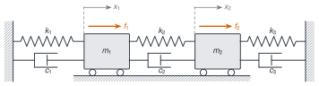

```{ojs}
//| echo: false
import {C, cadd, csub, cmul, cdiv, cabs, carg, faseGrados, cadena2, modosNoAmortiguados, polosYModos, receptanciaMatriz, receptanciaModal, esProporcional, muestreaLog} from "../../recursos/js/vibraciones.js"
```

## Objetivos y prerrequisitos

**Objetivos.** Al terminar la unidad sabrás:

- plantear las ecuaciones de un sistema de varios GDL y construir las matrices $\mathbf{M}$, $\mathbf{C}$ y $\mathbf{K}$, con sus propiedades de simetría y definición;
- resolver el problema generalizado de autovalores para obtener frecuencias y formas modales, y normalizar las formas modales respecto de la masa;
- demostrar la ortogonalidad, explicar bajo qué hipótesis se desacoplan las ecuaciones y reconstruir la respuesta por superposición modal, incluida la matriz de FRF;
- distinguir amortiguamiento proporcional (Rayleigh) y no proporcional, y saber qué cambia (modos complejos);
- resolver numéricamente y comparar un sistema de dos masas sin amortiguamiento, con amortiguamiento proporcional y con amortiguamiento no proporcional.

**Prerrequisitos.** [J1.5 · Arrays y álgebra lineal](../../julia/j1-esencial/j1-5-arrays/index.qmd), [J3.3 · Álgebra lineal numérica](../../julia/j3-computacion/j3-3-algebra-numerica/index.qmd), [J3.7 · Optimización](../../julia/j3-computacion/j3-7-optimizacion/index.qmd). Esta unidad continúa [M5](../m05-vibraciones-i/index.qmd), de donde se toman las definiciones de $\omega_n$, $\omega_d$, $\zeta$, FRF y la convención $e^{+i\omega t}$ (no se repiten aquí).

**Temas de la unidad**

- **M6.1** Sistemas de n GDL: matrices de masa, rigidez y amortiguamiento
- **M6.2** Frecuencias naturales, formas modales y normalización
- **M6.3** Ortogonalidad, desacoplamiento y superposición modal
- **M6.4** Amortiguamiento de Rayleigh y modos complejos
- **M6.5** Sistemas continuos: vibración de vigas
- **M6.6** Elementos finitos: elemento viga, ensamblaje y condiciones de contorno
- **M6.7** Actualización de modelos (model updating): parámetros, función objetivo, MAC y sensibilidades

::: {.callout-note title="Notación en esta unidad"}
$n$ = número de GDL; $\mathbf{x}(t)$, $\mathbf{f}(t)$ = vectores de desplazamientos (m) y fuerzas (N); $\omega_r$ = frecuencia natural **no amortiguada** del modo $r$ (rad/s); $\boldsymbol{\psi}_r$ = forma modal con escala arbitraria; $\boldsymbol{\phi}_r$ = forma modal **normalizada a la masa** ($\boldsymbol{\phi}_r^\top\mathbf{M}\boldsymbol{\phi}_r=1$); $\boldsymbol{\Phi}=[\boldsymbol{\phi}_1\cdots\boldsymbol{\phi}_n]$; $\mathbf{q}(t)$ = coordenadas modales; $\zeta_r$ = razón de amortiguamiento modal; $\eta_r$ = factor de pérdidas modal (histerético); $s_r$ = polo; $\boldsymbol{\alpha}(\omega)$ = matriz de receptancia. Todas las FRF usan $e^{+i\omega t}$; $\mathbf{A}^\top$ es la transpuesta y $\mathbf{A}^{H}$ la transpuesta conjugada. Los apuntes usan $\varepsilon,\nu$ para los coeficientes de Rayleigh y $\alpha,\beta$ en otro lugar: aquí se unifican como $\alpha$ (masa) y $\beta$ (rigidez).
:::

::: {.callout-note collapse="true" title="Fuentes, correcciones y qué queda pendiente"}
**Fuentes.** Apuntes manuscritos del Máster Agrela, curso 2024-2025 (carpeta *Teoría de vibraciones*): *MDOF.pdf* y *MDOF Ejemplo.pdf*. *PDF, p. n* = página del PDF.

| Contenido | Origen |
|---|---|
| M6.1 cadena de dos masas, ecuaciones, matrices | *MDOF*, p. 14–15; *MDOF Ejemplo*, p. 1 |
| M6.1 acoplamiento estático y dinámico | *MDOF*, p. 20 |
| M6.2 problema de autovalores, formas, normalización | *MDOF*, p. 1–2, 15–16, 18–19; *MDOF Ejemplo*, p. 1–3 |
| M6.3 ortogonalidad, coordenadas modales | *MDOF*, p. 2–3, 18–20 |
| M6.3 respuesta forzada y receptancia modal (histerético) | *MDOF*, p. 9–11 |
| M6.4 Rayleigh | *MDOF*, p. 3, 21 |
| M6.4 espacio de estados, modos complejos, receptancia viscosa general | *MDOF*, p. 4–7, 12–13 |
| Práctica guiada (dos masas, tres casos de amortiguamiento) | *MDOF Ejemplo*, p. 1–9 |

**Verificación numérica de los resultados de los apuntes** (Julia; la propia práctica incluye el código). Se confirman: las matrices; $\omega_1=\sqrt{0{,}4}$, $\omega_2=1$; las formas $[1,1]$ y $[1,-\tfrac12]$; la normalización $1/\sqrt{15}$ y $\sqrt{2/15}$; $\boldsymbol{\Phi}^\top\mathbf{K}\boldsymbol{\Phi}=\mathrm{diag}(0{,}4;1)$; $\boldsymbol{\Phi}^\top\mathbf{C}\boldsymbol{\Phi}=\mathrm{diag}(1/5;1/2)$ para $\mathbf{C}=\mathbf{K}/2$; los polinomios del denominador de $\mathbf{H}(s)$ (proporcional: $50s^4+35s^3+75s^2+20s+20$; no proporcional: $50s^4+85s^3+84s^2+40s+20$); los polos ($-0{,}1\pm0{,}6245i$ y $-0{,}25\pm0{,}9682i$; $-0{,}095\pm0{,}629i$ y $-0{,}75\pm0{,}646i$); los residuos de ambos casos; $\zeta_1=15{,}81\,\%$ y $14{,}97\,\%$.

**Correcciones y precisiones a los apuntes.**

1. *MDOF*, p. 2: $(\omega_r^2-\omega_s^2)\{\psi_s\}^\top[M]\{\psi_r\}=\{0\}$ se escribe con un vector, pero el resultado es un **escalar** ($=0$).
2. *MDOF*, p. 7: las relaciones $c_r/m_r=2\omega_r\zeta_r$ y $k_r/m_r=\omega_r^2$ para modos complejos **no son condiciones de ortogonalidad**: son relaciones que cumple cada modo complejo (cociente de Rayleigh con $\boldsymbol{\psi}^{H}$), y se deducen del hecho de que $s_r$ es raíz de un polinomio de segundo grado de coeficientes reales (§ M6.4). Los pasos tachados de la página no son fiables y se sustituyen.
3. *MDOF*, p. 11: «principio de reciprocidad ⇒ matriz de receptancia simétrica» es una consecuencia de que $\mathbf{M}$, $\mathbf{C}$ (o $\mathbf{D}$) y $\mathbf{K}$ sean simétricas; no es una propiedad que toda estructura tenga (§ M6.3).
4. *MDOF*, p. 11 («conociendo una fila o columna se obtiene la matriz entera»): solo si se incluyen **todos** los modos del modelo; con modos truncados, la reconstrucción es aproximada.
5. *MDOF Ejemplo*, p. 1: el valor de $\alpha_2$ se lee de forma ambigua (parece «$-7$»); es $-1$, como confirma la página siguiente ($\alpha^2+1{,}4\alpha+0{,}4=0\Rightarrow\alpha=-0{,}4$ y $-1$).
6. *MDOF Ejemplo*, p. 6–7: pequeñas inconsistencias de transcripción, no de método (p. ej., el segundo componente del primer modo no proporcional dice $-j0{,}05$ y los residuos dan $-j0{,}0588$; el residuo de $H_{21}$ en $\lambda_2$ aparece como $j0{,}04$ y $-j0{,}045$ y vale $j0{,}0453$). Aquí se usan los valores recalculados.
7. *MDOF Ejemplo*, p. 7 y 9: el polo del caso proporcional aparece escrito como $\tfrac1{10}+j\tfrac{\sqrt{39}}{10}$ y «$C_1=2\sigma_1M_1$»; falta el signo: $\sigma_1=-1/10<0$ y $c_1=-2\sigma_1m_1=1/5$.
8. *MDOF Ejemplo*, p. 8: la conclusión ① («la frecuencia natural no amortiguada no se ve afectada, siempre») es cierta para amortiguamiento **proporcional** ($|s_r|=\omega_r$: 0,6325 en ambos casos) y **falsa en general**: con el amortiguamiento no proporcional del ejemplo, $|s_1|=0{,}6367$ y $|s_2|=0{,}9934$ (en lugar de 0,6325 y 1). La conclusión ② está en blanco.

**Ampliaciones externas a los apuntes** (derivaciones propias): receptancia viscosa por superposición modal con modos reales (§ M6.3), cálculo de $\alpha$ y $\beta$ de Rayleigh a partir de dos razones de amortiguamiento (§ M6.4) y reducción simétrica del problema generalizado por Cholesky (§ M6.2). Lecturas para ampliar: [@inman2017; @silva1999; @ewins2000].

**Pendiente (no cubierto por estos apuntes).** Vibración de vigas (M6.5), elementos finitos: elemento viga, ensamblaje y condiciones de contorno (M6.6), actualización de modelos: parámetros, función objetivo, MAC y sensibilidades (M6.7). Tampoco se desarrollan aquí el amortiguamiento de Coulomb ni la integración temporal.
:::

## Teoría breve

### M6.1 Sistemas de n GDL: matrices de masa, rigidez y amortiguamiento {#m6-1}

Un sistema de $n$ GDL se describe con $n$ coordenadas $\mathbf{x}(t)=[x_1,\dots,x_n]^\top$ y la ecuación

$$
\mathbf{M}\ddot{\mathbf{x}}(t)+\mathbf{C}\dot{\mathbf{x}}(t)+\mathbf{K}\mathbf{x}(t)=\mathbf{f}(t),
$$ {#eq-mdof}

con $\mathbf{M}$, $\mathbf{C}$, $\mathbf{K}$ de dimensión $n\times n$. Es el modelo **espacial** del sistema: sus parámetros físicos. Es lineal, de segundo orden e invariante en el tiempo (como en M5), y es una ecuación **acoplada**: la respuesta en una coordenada depende del movimiento de las demás.

{#fig-cadena2 fig-alt="Dos masas sobre un carro unidas entre sí y a dos paredes por tres muelles con amortiguadores en paralelo, con fuerzas f1 y f2 y coordenadas x1 y x2" width="95%"}

**Un ejemplo: dos masas.** Sea la cadena de la @fig-cadena2: pared–$k_1$–$m_1$–$k_2$–$m_2$–$k_3$–pared, con amortiguadores $c_1$, $c_2$, $c_3$ en paralelo a cada muelle y fuerzas $f_1$, $f_2$ sobre las masas (desplazamientos $x_1$, $x_2$ hacia la derecha). Para la masa 1 aparecen las fuerzas $-k_1x_1$ y $-c_1\dot{x}_1$ del primer tramo, y las del segundo tramo, que dependen de la **deformación relativa** $x_1-x_2$: $-k_2(x_1-x_2)$ y $-c_2(\dot{x}_1-\dot{x}_2)$. Newton da

$$
\begin{aligned}
m_1\ddot{x}_1+(c_1+c_2)\dot{x}_1-c_2\dot{x}_2+(k_1+k_2)x_1-k_2x_2&=f_1,\\
m_2\ddot{x}_2+(c_2+c_3)\dot{x}_2-c_2\dot{x}_1+(k_2+k_3)x_2-k_2x_1&=f_2,
\end{aligned}
$$

y en forma matricial

$$
\mathbf{M}=\begin{bmatrix}m_1&0\\0&m_2\end{bmatrix},\quad
\mathbf{C}=\begin{bmatrix}c_1+c_2&-c_2\\-c_2&c_2+c_3\end{bmatrix},\quad
\mathbf{K}=\begin{bmatrix}k_1+k_2&-k_2\\-k_2&k_2+k_3\end{bmatrix}.
$$

**Regla de ensamblaje.** Cada muelle de rigidez $k$ entre las coordenadas $i$ y $j$ suma $k\begin{bmatrix}1&-1\\-1&1\end{bmatrix}$ a las filas y columnas $i$, $j$ de $\mathbf{K}$ (si un extremo es la pared, solo suma $k$ en la diagonal); igual para $\mathbf{C}$. Es el germen del ensamblaje de elementos finitos (M6.6, pendiente).

**Propiedades.**

- $\mathbf{M}$, $\mathbf{C}$ y $\mathbf{K}$ son **simétricas** en los sistemas habituales; esta simetría es la que más adelante produce la reciprocidad de la FRF (M6.3).
- $\mathbf{M}$ es **definida positiva** (toda coordenada tiene inercia).
- $\mathbf{K}$ es **semidefinida positiva**; es definida positiva si el sistema está sujeto (como aquí). Si no lo está (libre–libre), $\mathbf{K}$ es singular y hay modos de sólido rígido con $\omega=0$.
- **Acoplamiento.** Un término no diagonal en $\mathbf{K}$ es **acoplamiento estático** (o elástico); en $\mathbf{M}$, **acoplamiento dinámico** (o inercial). Las matrices dependen de las coordenadas elegidas: un cambio de coordenadas puede eliminar el acoplamiento, y eso es justo lo que hace el análisis modal (M6.3).

### M6.2 Frecuencias naturales, formas modales y normalización {#m6-2}

Sin amortiguamiento ni fuerzas, $\mathbf{M}\ddot{\mathbf{x}}+\mathbf{K}\mathbf{x}=\mathbf{0}$. Buscamos movimientos **síncronos**, $\mathbf{x}(t)=\mathbf{X}e^{i\omega t}$, en los que todas las coordenadas oscilan a la misma frecuencia:

$$
(\mathbf{K}-\omega^2\mathbf{M})\,\mathbf{X}=\mathbf{0}.
$$ {#eq-eigen}

Es un **problema generalizado de autovalores**. El sistema homogéneo tiene solución no nula solo si

$$
\det(\mathbf{K}-\omega^2\mathbf{M})=0,
$$

un polinomio de grado $n$ en $\omega^2$ cuyas raíces son $\omega_1^2,\dots,\omega_n^2$ (las **frecuencias naturales**, reales y no negativas cuando $\mathbf{M}>0$ y $\mathbf{K}\ge0$ son simétricas). Para cada $\omega_r$, la ecuación @eq-eigen determina un vector $\boldsymbol{\psi}_r$: la **forma modal**, solo **hasta un factor de escala**, porque la ecuación es homogénea ($\mathbf{X}$ y $c\mathbf{X}$ son soluciones). Las frecuencias son propiedades únicas de la estructura; las formas solo están definidas en sus **proporciones relativas**. Hay $n$ modos para $n$ GDL. Si dos frecuencias coinciden (autovalor repetido), las formas correspondientes no están determinadas de forma única ni son ortogonales automáticamente (se pueden escoger ortogonales).

**Normalización.** Hay que fijar la escala por convención. La más habitual es la **normalización a la masa**,

$$
\boldsymbol{\phi}_r=\frac{\boldsymbol{\psi}_r}{\sqrt{m_r}},\quad m_r=\boldsymbol{\psi}_r^\top\mathbf{M}\boldsymbol{\psi}_r\ \Rightarrow\ \boldsymbol{\Phi}^\top\mathbf{M}\boldsymbol{\Phi}=\mathbf{I},\quad
\boldsymbol{\Phi}^\top\mathbf{K}\boldsymbol{\Phi}=\mathrm{diag}(\omega_r^2),
$$

donde $m_r$ es la **masa modal** (o generalizada) y $k_r=\boldsymbol{\psi}_r^\top\mathbf{K}\boldsymbol{\psi}_r$ la **rigidez modal**, con $\omega_r^2=k_r/m_r$. Cambiar la escala altera $m_r$ y $k_r$ (ambas arbitrarias) pero no su cociente. Otras normalizaciones (componente máxima unitaria, norma unitaria) son igualmente válidas; hay que indicar siempre cuál se usa. El signo global de cada forma también es arbitrario.

**Cálculo numérico.** Como $\mathbf{M}=\mathbf{L}\mathbf{L}^\top$ (Cholesky), $\mathbf{K}\boldsymbol{\psi}=\omega^2\mathbf{M}\boldsymbol{\psi}$ se transforma en el problema **simétrico estándar** $\tilde{\mathbf{K}}\mathbf{y}=\omega^2\mathbf{y}$ con $\tilde{\mathbf{K}}=\mathbf{L}^{-1}\mathbf{K}\mathbf{L}^{-\top}$ y $\boldsymbol{\psi}=\mathbf{L}^{-\top}\mathbf{y}$; ese camino produce directamente formas normalizadas a la masa. En Julia, `eigen(Symmetric(K), Symmetric(M))` lo resuelve (véase [J3.3](../../julia/j3-computacion/j3-3-algebra-numerica/index.qmd)).

**El ejemplo de dos masas** ($m_1=5$, $m_2=10$, $k_1=k_2=2$, $k_3=4$; valores en unidades coherentes, p. ej. kg y N/m): $\mathbf{M}=\mathrm{diag}(5,10)$ y $\mathbf{K}=\begin{bmatrix}4&-2\\-2&6\end{bmatrix}$. La ecuación característica $(4-5\lambda)(6-10\lambda)-4=0$ con $\lambda=\omega^2$ da $\lambda^2-1{,}4\lambda+0{,}4=0$, es decir $\omega_1^2=0{,}4$ y $\omega_2^2=1$:

| Modo | $\omega_r$ (rad/s) | $f_r$ (Hz) | Forma ($\psi_1=1$) | Forma normalizada a la masa |
|---|---|---|---|---|
| 1 | $0{,}6325$ | $0{,}1007$ | $[1,\ 1]$ | $[1/\sqrt{15},\ 1/\sqrt{15}]=[0{,}2582,\ 0{,}2582]$ |
| 2 | $1{,}0000$ | $0{,}1592$ | $[1,\ -1/2]$ | $[\sqrt{2/15},\ -\sqrt{2/15}/2]=[0{,}3651,\ -0{,}1826]$ |

El primer modo es el de las dos masas **en fase**; el segundo, el de las masas **en oposición de fase**, con un punto fijo entre ellas.

**Simulación 1. Dos masas.** Cambia masas, rigideces y amortiguamiento y mira cómo se mueven las frecuencias, las formas y las FRF.

```{ojs}
//| echo: false
viewof D_m1 = Inputs.range([1, 20], {value: 5, step: 0.5, label: "m₁ (kg)"})
```
```{ojs}
//| echo: false
viewof D_m2 = Inputs.range([1, 20], {value: 10, step: 0.5, label: "m₂ (kg)"})
```
```{ojs}
//| echo: false
viewof D_k1 = Inputs.range([0.5, 10], {value: 2, step: 0.5, label: "k₁ (N/m)"})
```
```{ojs}
//| echo: false
viewof D_k2 = Inputs.range([0.5, 10], {value: 2, step: 0.5, label: "k₂ (N/m)"})
```
```{ojs}
//| echo: false
viewof D_k3 = Inputs.range([0, 10], {value: 4, step: 0.5, label: "k₃ (N/m)"})
```
```{ojs}
//| echo: false
viewof D_tipo = Inputs.radio(["Sin amortiguamiento", "Proporcional (C = a·K)", "Libre (c₁, c₂, c₃)"], {value: "Proporcional (C = a·K)", label: "Amortiguamiento"})
```
```{ojs}
//| echo: false
viewof D_a = Inputs.range([0, 2], {value: 0.5, step: 0.05, label: "a (s) en C = a·K"})
```
```{ojs}
//| echo: false
viewof D_c1 = Inputs.range([0, 6], {value: 2, step: 0.1, label: "c₁ (N·s/m)"})
```
```{ojs}
//| echo: false
viewof D_c2 = Inputs.range([0, 6], {value: 4, step: 0.1, label: "c₂ (N·s/m)"})
```
```{ojs}
//| echo: false
viewof D_c3 = Inputs.range([0, 6], {value: 1, step: 0.1, label: "c₃ (N·s/m)"})
```
```{ojs}
//| echo: false
viewof D_contrib = Inputs.toggle({label: "Mostrar la contribución de cada modo a α₁₁", value: true})
```
```{ojs}
//| echo: false
D_sist = {
  const c = D_tipo.startsWith("Sin") ? [0, 0, 0] : D_tipo.startsWith("Prop") ? [D_a * D_k1, D_a * D_k2, D_a * D_k3] : [D_c1, D_c2, D_c3];
  return cadena2({m1: D_m1, m2: D_m2, k1: D_k1, k2: D_k2, k3: D_k3, c1: c[0], c2: c[1], c3: c[2]});
}
D_modos = modosNoAmortiguados(D_sist)
D_polos = polosYModos(D_sist)
D_pos = D_polos.filter(m => m.s.im > 1e-9)
D_prop = esProporcional(D_sist)
D_w0 = D_modos[0].w
D_w1 = D_modos[1].w
D_ws = muestreaLog(w => w, 0.25 * D_w0, 3 * D_w1, 700).map(d => d.x)
D_R = D_ws.map(w => ({w, R: receptanciaMatriz(D_sist, w)}))
D_curvas = D_R.flatMap(d => [
  {w: d.w, y: cabs(d.R[0][0]), k: "|α₁₁|"},
  {w: d.w, y: cabs(d.R[1][0]), k: "|α₂₁|"},
  {w: d.w, y: cabs(d.R[1][1]), k: "|α₂₂|"}
])
D_parcial = {
  if (!D_contrib || D_pos.length !== 2) return [];
  const out = [];
  D_pos.forEach((m, idx) => {
    const cj = D_polos.find(q => Math.abs(q.s.re - m.s.re) < 1e-9 && Math.abs(q.s.im + m.s.im) < 1e-9);
    if (!cj) return;
    D_ws.forEach(w => {
      const t1 = cdiv(cmul(m.phi[0], m.phi[0]), csub(C(0, w), m.s));
      const t2 = cdiv(cmul(cj.phi[0], cj.phi[0]), csub(C(0, w), cj.s));
      out.push({w, y: cabs(cadd(t1, t2)), k: "modo " + (idx + 1)});
    });
  });
  return out;
}
```
```{ojs}
//| echo: false
D_figFRF = Plot.plot({
  width: 700, height: 340, marginLeft: 65,
  x: {type: "log", label: "ω (rad/s)", grid: true},
  y: {type: "log", label: "|α| (m/N)", grid: true},
  color: {legend: true, domain: ["|α₁₁|", "|α₂₁|", "|α₂₂|", "modo 1", "modo 2"], range: ["#1b6ca8", "#d95f02", "#2a9d8f", "#888", "#aaa"]},
  marks: [
    Plot.line(D_curvas, {x: "w", y: "y", stroke: "k", strokeWidth: 2}),
    Plot.line(D_parcial, {x: "w", y: "y", stroke: "k", strokeDasharray: "4 3", strokeWidth: 1.4}),
    Plot.ruleX(D_modos.map(m => m.w), {stroke: "#bbb", strokeDasharray: "2 3"})
  ]
})
D_forma = i => {
  const f = D_modos[i].phi;
  return [{x: 0, y: 0}, {x: 1, y: f[0]}, {x: 2, y: f[1]}, {x: 3, y: 0}];
}
D_figModo = i => Plot.plot({
  width: 330, height: 200, marginLeft: 50,
  x: {label: "posición", domain: [-0.2, 3.2], ticks: [0, 1, 2, 3], tickFormat: d => d === 0 || d === 3 ? "pared" : "m" + d},
  y: {label: "φ", grid: true, domain: [-0.9, 0.9]},
  marks: [Plot.ruleY([0]), Plot.line(D_forma(i), {x: "x", y: "y", stroke: "#1b6ca8", strokeWidth: 2}), Plot.dot(D_forma(i).slice(1, 3), {x: "x", y: "y", fill: "#d95f02", r: 6})]
})
html`<div>${D_figFRF}</div><div style="display:flex; gap:1rem; flex-wrap:wrap">${D_figModo(0)}${D_figModo(1)}</div>`
```
```{ojs}
//| echo: false
md`**Modos sin amortiguamiento** (normalizados a la masa): ω₁ = ${D_modos[0].w.toFixed(4)} rad/s (${(D_modos[0].w / (2 * Math.PI)).toFixed(4)} Hz), φ₁ = [${D_modos[0].phi.map(v => v.toFixed(4)).join(", ")}] · ω₂ = ${D_modos[1].w.toFixed(4)} rad/s (${(D_modos[1].w / (2 * Math.PI)).toFixed(4)} Hz), φ₂ = [${D_modos[1].phi.map(v => v.toFixed(4)).join(", ")}]. Amortiguamiento **${D_prop ? "proporcional (modos reales)" : "no proporcional (modos complejos)"}**.`
```
```{ojs}
//| echo: false
Inputs.table(D_pos.map(m => ({"polo s": `${m.s.re.toFixed(4)} ${m.s.im >= 0 ? "+" : "−"} ${Math.abs(m.s.im).toFixed(4)}i`, "Ωₙ = |s| (rad/s)": m.omega.toFixed(4), "ζ (%)": (100 * m.zeta).toFixed(2), "ω_d (rad/s)": m.wd.toFixed(4)})), {width: {"polo s": 180}})
```

### M6.3 Ortogonalidad, desacoplamiento y superposición modal {#m6-3}

::: {#thm-ortogonalidad}
**Ortogonalidad de las formas modales.** Sean $\mathbf{M}$ y $\mathbf{K}$ simétricas (con $\mathbf{M}$ definida positiva) y dos modos con $\omega_r\neq\omega_s$. Entonces

$$
\boldsymbol{\psi}_s^\top\mathbf{M}\boldsymbol{\psi}_r=0,\qquad \boldsymbol{\psi}_s^\top\mathbf{K}\boldsymbol{\psi}_r=0 .
$$
:::

::: {.callout-note .demostracion collapse="true" title="Demostración"}
Partimos de $\mathbf{K}\boldsymbol{\psi}_r=\omega_r^2\mathbf{M}\boldsymbol{\psi}_r$ y $\mathbf{K}\boldsymbol{\psi}_s=\omega_s^2\mathbf{M}\boldsymbol{\psi}_s$. Premultiplicamos la primera por $\boldsymbol{\psi}_s^\top$ y la segunda por $\boldsymbol{\psi}_r^\top$. Como $\mathbf{M}$ y $\mathbf{K}$ son **simétricas**, $\boldsymbol{\psi}_s^\top\mathbf{K}\boldsymbol{\psi}_r=\boldsymbol{\psi}_r^\top\mathbf{K}\boldsymbol{\psi}_s$ y lo mismo con $\mathbf{M}$. Al restar resulta $(\omega_r^2-\omega_s^2)\,\boldsymbol{\psi}_s^\top\mathbf{M}\boldsymbol{\psi}_r=0$ (un **escalar**); como $\omega_r\neq\omega_s$, $\boldsymbol{\psi}_s^\top\mathbf{M}\boldsymbol{\psi}_r=0$. Sustituyendo en $\boldsymbol{\psi}_s^\top\mathbf{K}\boldsymbol{\psi}_r=\omega_r^2\,\boldsymbol{\psi}_s^\top\mathbf{M}\boldsymbol{\psi}_r$ se obtiene también $\boldsymbol{\psi}_s^\top\mathbf{K}\boldsymbol{\psi}_r=0$.
:::

Es una ortogonalidad **ponderada** por $\mathbf{M}$ y por $\mathbf{K}$. **Hipótesis necesarias:** $\mathbf{M}$ y $\mathbf{K}$ simétricas (y $\mathbf{M}$ definida positiva para que existan modos reales y la masa modal sea positiva); autovalores **distintos**, o formas elegidas ortogonales si hay repetidos. No se exige nada de $\mathbf{C}$ en este paso.

Como consecuencia, las $n$ formas son linealmente independientes y **forman una base** de $\mathbb{R}^n$: cualquier vector de desplazamientos puede escribirse como combinación de formas modales.

**Coordenadas modales y desacoplamiento.** Hacemos el cambio de coordenadas $\mathbf{x}(t)=\boldsymbol{\Phi}\mathbf{q}(t)$, con $\mathbf{q}$ las **coordenadas modales** (o principales). Sustituyendo en @eq-mdof y premultiplicando por $\boldsymbol{\Phi}^\top$:

$$
\underbrace{\boldsymbol{\Phi}^\top\mathbf{M}\boldsymbol{\Phi}}_{\mathbf{I}}\ddot{\mathbf{q}}+\boldsymbol{\Phi}^\top\mathbf{C}\boldsymbol{\Phi}\,\dot{\mathbf{q}}+\underbrace{\boldsymbol{\Phi}^\top\mathbf{K}\boldsymbol{\Phi}}_{\mathrm{diag}(\omega_r^2)}\mathbf{q}=\boldsymbol{\Phi}^\top\mathbf{f}.
$$

Sin amortiguamiento ($\mathbf{C}=\mathbf{0}$), o con amortiguamiento **proporcional** (de modo que $\boldsymbol{\Phi}^\top\mathbf{C}\boldsymbol{\Phi}=\mathrm{diag}(2\zeta_r\omega_r)$, § M6.4), las $n$ ecuaciones quedan **desacopladas**: cada una es un oscilador de 1 GDL de M5,

$$
\ddot{q}_r+2\zeta_r\omega_r\dot{q}_r+\omega_r^2q_r=\boldsymbol{\phi}_r^\top\mathbf{f}(t),\qquad r=1,\dots,n.
$$

La respuesta física es la **superposición modal** $\mathbf{x}(t)=\sum_{r=1}^{n}\boldsymbol{\phi}_r\,q_r(t)$. Importante: con amortiguamiento **no** proporcional, $\boldsymbol{\Phi}^\top\mathbf{C}\boldsymbol{\Phi}$ **no es diagonal** y estas coordenadas **no** desacoplan el sistema (§ M6.4).

**Respuesta forzada armónica y matriz de FRF.** Con $\mathbf{f}=\mathbf{F}e^{i\omega t}$, el régimen estacionario es $\mathbf{x}=\bar{\mathbf{X}}e^{i\omega t}$ y

$$
\bar{\mathbf{X}}=\boldsymbol{\alpha}(\omega)\mathbf{F},\qquad
\boldsymbol{\alpha}(\omega)=\big(\mathbf{K}-\omega^2\mathbf{M}+i\omega\mathbf{C}\big)^{-1}\quad(\text{viscoso}),
$$

la **matriz de receptancia** $n\times n$, que contiene toda la información dinámica del sistema. El elemento $\alpha_{jk}$ es la FRF entre la respuesta en la coordenada $j$ y una fuerza única aplicada en la $k$. Para amortiguamiento viscoso **proporcional**, resolviendo cada ecuación modal con $q_r=\boldsymbol{\phi}_r^\top\mathbf{F}/(\omega_r^2-\omega^2+2i\zeta_r\omega_r\omega)$, se llega a

$$
\alpha_{jk}(\omega)=\sum_{r=1}^{n}\frac{\phi_{jr}\,\phi_{kr}}{\omega_r^2-\omega^2+2i\,\zeta_r\,\omega_r\,\omega}.
$$ {#eq-recmodal}

Con el modelo **histerético** proporcional (apuntes, p. 10–11), la misma estructura con $\omega_r^2-\omega^2+i\,\eta_r\omega_r^2$ en el denominador, siendo $\lambda_r^2=\omega_r^2(1+i\eta_r)$ los autovalores del problema complejo. Si las formas son **complejas** (amortiguamiento no proporcional), el numerador es complejo.

Lo que dice @eq-recmodal en términos físicos: la respuesta total es la **suma de las contribuciones de $n$ osciladores de 1 GDL**, cada uno ponderado por el producto de las componentes de la forma en los puntos de respuesta $j$ y de excitación $k$. Dos conclusiones:

1. **Reciprocidad.** $\alpha_{jk}=\alpha_{kj}$, es decir, $\boldsymbol{\alpha}$ es **simétrica**: la respuesta en $j$ por una fuerza en $k$ iguala a la respuesta en $k$ por la misma fuerza en $j$ (dos puntos de un mismo sistema). Es **consecuencia** de que $\mathbf{M}$, $\mathbf{C}$ y $\mathbf{K}$ sean simétricas; sistemas con efectos no recíprocos (p. ej., giroscópicos) no la cumplen.
2. **Constantes modales.** El numerador $_rA_{jk}=\phi_{jr}\phi_{kr}$ de cada modo tiene rango uno: $_rA_{jk}\,{}_rA_{lm}={}_rA_{jm}\,{}_rA_{lk}$. Por ello, conociendo **una columna completa** de $\boldsymbol{\alpha}$ (con todos los modos del modelo) se determinan las formas y toda la matriz; y los puntos de excitación y respuesta se pueden intercambiar. Con un número finito de modos (truncamiento) esto vale solo de forma aproximada.

Esta es la base de la identificación modal de M7.3.

**Comprobación numérica con el ejemplo de dos masas.** Con $\mathbf{C}=\mathbf{K}/2$ (proporcional), la suma modal real @eq-recmodal coincide con la inversión directa de $\mathbf{K}-\omega^2\mathbf{M}+i\omega\mathbf{C}$: por ejemplo, $\alpha_{11}(0{,}5)=0{,}46769-0{,}25846\,i$, $\alpha_{21}(0{,}5)=0{,}22769-0{,}17846\,i$ y $\alpha_{22}(0{,}5)=0{,}34769-0{,}21846\,i$ (m/N), con diferencias del orden de $10^{-15}$.

::: {.callout-warning title="Errores frecuentes"}
- Aplicar la ortogonalidad con $\mathbf{M}$ y $\mathbf{K}$ **no simétricas** (p. ej., por una mala construcción de las matrices).
- Olvidar que las formas son **relativas**: sus valores absolutos dependen de la normalización; solo son comparables dentro de una misma convención.
- Usar la suma modal real @eq-recmodal con amortiguamiento no proporcional.
:::

### M6.4 Amortiguamiento de Rayleigh y modos complejos {#m6-4}

#### Núcleo docente: amortiguamiento proporcional (Rayleigh)

El amortiguamiento es proporcional si $\mathbf{C}$ es combinación lineal de $\mathbf{M}$ y $\mathbf{K}$,

$$
\mathbf{C}=\alpha\,\mathbf{M}+\beta\,\mathbf{K}\qquad(\alpha\ \text{en s}^{-1},\ \beta\ \text{en s}).
$$

::: {#prp-rayleigh}
**Razones de amortiguamiento de Rayleigh.** Con $\mathbf{C}=\alpha\mathbf{M}+\beta\mathbf{K}$, las ecuaciones modales siguen **desacopladas** y

$$
\zeta_r=\frac{\alpha}{2\omega_r}+\frac{\beta\,\omega_r}{2}.
$$ {#eq-rayleigh}
:::

::: {.callout-note .demostracion collapse="true" title="Demostración"}
Con formas normalizadas a la masa, $\boldsymbol{\Phi}^\top\mathbf{C}\boldsymbol{\Phi}=\alpha\boldsymbol{\Phi}^\top\mathbf{M}\boldsymbol{\Phi}+\beta\boldsymbol{\Phi}^\top\mathbf{K}\boldsymbol{\Phi}=\alpha\mathbf{I}+\beta\,\mathrm{diag}(\omega_r^2)$, que es **diagonal**. La ecuación modal $r$ es entonces $\ddot{q}_r+(\alpha+\beta\omega_r^2)\dot{q}_r+\omega_r^2q_r=\boldsymbol{\phi}_r^\top\mathbf{f}$ y, al identificarla con $\ddot{q}_r+2\zeta_r\omega_r\dot{q}_r+\omega_r^2q_r$, $2\zeta_r\omega_r=\alpha+\beta\omega_r^2$, de donde sale la expresión.
:::

El término en $\alpha$ (proporcional a la masa) domina a baja frecuencia y decrece con $\omega_r$; el de $\beta$ (proporcional a la rigidez) crece con $\omega_r$ y domina a alta frecuencia. Los **modos son reales y los mismos que los no amortiguados**; solo cambian los polos. A partir de dos razones de amortiguamiento deseadas $\zeta_1,\zeta_2$ en dos frecuencias $\omega_1,\omega_2$, se pueden fijar las constantes resolviendo el sistema lineal @eq-rayleigh:

$$
\beta=\frac{2(\omega_2\zeta_2-\omega_1\zeta_1)}{\omega_2^2-\omega_1^2},\qquad
\alpha=\frac{2\omega_1\omega_2(\omega_2\zeta_1-\omega_1\zeta_2)}{\omega_2^2-\omega_1^2}.
$$

Rayleigh es un **modelo de conveniencia**: no tiene por qué describir la disipación física de la estructura (los modos intermedios quedan determinados por la curva @eq-rayleigh y los de frecuencia mucho mayor resultan muy amortiguados). Hay familias más generales de amortiguamiento proporcional, que no se tratan aquí.

**Ejemplo.** En el sistema de dos masas, $c_1=c_2=1$, $c_3=2$ da $\mathbf{C}=\begin{bmatrix}2&-1\\-1&3\end{bmatrix}=\tfrac12\mathbf{K}$, es decir $\alpha=0$, $\beta=1/2$: $\zeta_1=\beta\omega_1/2=0{,}1581$ y $\zeta_2=\beta\omega_2/2=0{,}25$; los polos son $-0{,}1\pm0{,}6245\,i$ y $-0{,}25\pm0{,}9682\,i$.

**Simulación 2. Curva de Rayleigh.** Elige $\alpha$ y $\beta$ y observa $\zeta(\omega)$ en las dos frecuencias del ejemplo.

```{ojs}
//| echo: false
viewof Y_a = Inputs.range([0, 0.5], {value: 0.0, step: 0.005, label: "α (1/s)"})
```
```{ojs}
//| echo: false
viewof Y_b = Inputs.range([0, 1], {value: 0.5, step: 0.005, label: "β (s)"})
```
```{ojs}
//| echo: false
Y_w = [Math.sqrt(0.4), 1]
Y_curva = muestreaLog(w => 100 * (Y_a / (2 * w) + Y_b * w / 2), 0.1, 10, 300).map(d => ({w: d.x, z: d.y}))
Y_modos = Y_w.map(w => ({w, z: 100 * (Y_a / (2 * w) + Y_b * w / 2)}))
Y_fig = Plot.plot({
  width: 600, height: 300, marginLeft: 60,
  x: {type: "log", label: "ω (rad/s)", grid: true},
  y: {label: "ζ (%)", grid: true, domain: [0, 100]},
  marks: [
    Plot.line(Y_curva, {x: "w", y: "z", stroke: "#1b6ca8", strokeWidth: 2}),
    Plot.dot(Y_modos, {x: "w", y: "z", fill: "#d95f02", r: 6}),
    Plot.text(Y_modos, {x: "w", y: "z", text: d => d.z.toFixed(2) + " %", dy: -12, fill: "#d95f02"})
  ]
})
Y_fig
```

#### Ampliación avanzada: amortiguamiento no proporcional y modos complejos

En general $\mathbf{C}$ **no** es proporcional. Si $\boldsymbol{\Phi}^\top\mathbf{C}\boldsymbol{\Phi}$ no es diagonal (con amortiguamiento pequeño se puede a veces despreciar el término cruzado; si es grande, no), el problema deja de desacoplarse con las formas reales. Se resuelve en el **espacio de estados**.

**Espacio de estados.** Con el vector de estado $\mathbf{u}=[\mathbf{x};\dot{\mathbf{x}}]$ de dimensión $2n$, la ecuación homogénea $\mathbf{M}\ddot{\mathbf{x}}+\mathbf{C}\dot{\mathbf{x}}+\mathbf{K}\mathbf{x}=\mathbf{0}$ se escribe

$$
\mathbf{A}\dot{\mathbf{u}}+\mathbf{B}\mathbf{u}=\mathbf{0},\qquad
\mathbf{A}=\begin{bmatrix}\mathbf{C}&\mathbf{M}\\\mathbf{M}&\mathbf{0}\end{bmatrix},\quad
\mathbf{B}=\begin{bmatrix}\mathbf{K}&\mathbf{0}\\\mathbf{0}&-\mathbf{M}\end{bmatrix},
$$

con $\mathbf{A}$ y $\mathbf{B}$ reales y simétricas de dimensión $2n\times2n$. Buscando $\mathbf{u}=\mathbf{U}e^{st}$ queda el problema generalizado $(s\mathbf{A}+\mathbf{B})\mathbf{U}=\mathbf{0}$, con $2n$ autovalores $s_r$ **reales o en pares complejos conjugados**; si el sistema es subamortiguado, todos son pares complejos. Los autovectores tienen la forma $[\boldsymbol{\psi}_r;\,s_r\boldsymbol{\psi}_r]$ y son, en general, **complejos**: las componentes de $\boldsymbol{\psi}_r$ tienen **fases distintas de $0^\circ$ y $180^\circ$**, de modo que los puntos de la estructura no alcanzan sus máximos a la vez (un «modo animado» es una secuencia de configuraciones a distintos instantes, y no una forma que se limita a escalar).

**Parámetros modales de un modo complejo.** De $s_r^2\mathbf{M}\boldsymbol{\psi}_r+s_r\mathbf{C}\boldsymbol{\psi}_r+\mathbf{K}\boldsymbol{\psi}_r=\mathbf{0}$, premultiplicando por $\boldsymbol{\psi}_r^{H}$ resulta $a\,s_r^2+b\,s_r+c=0$ con $a=\boldsymbol{\psi}_r^{H}\mathbf{M}\boldsymbol{\psi}_r$, $b=\boldsymbol{\psi}_r^{H}\mathbf{C}\boldsymbol{\psi}_r$ y $c=\boldsymbol{\psi}_r^{H}\mathbf{K}\boldsymbol{\psi}_r$, **reales** (formas hermíticas de matrices reales simétricas). Como $s_r$ es raíz de un polinomio de segundo grado real, valen $|s_r|^2=c/a$ y $-2\,\mathrm{Re}\,s_r=b/a$. Por tanto, para cada modo complejo se definen

$$
\omega_r=|s_r|,\qquad \zeta_r=-\frac{\mathrm{Re}\,s_r}{|s_r|},\qquad s_r=\big(-\zeta_r+i\sqrt{1-\zeta_r^2}\big)\omega_r,
$$

con $\omega_r$ **no** coincidente, en general, con la frecuencia del problema no amortiguado.

**Receptancia viscosa general.** Normalizando $\boldsymbol{\phi}_r=\boldsymbol{\psi}_r/\sqrt{a_r}$ con $a_r=\boldsymbol{\psi}_r^\top(2s_r\mathbf{M}+\mathbf{C})\boldsymbol{\psi}_r$ (transpuesta **sin conjugar**), la receptancia queda

$$
\boldsymbol{\alpha}(\omega)=\sum_{r=1}^{n}\left[\frac{\boldsymbol{\phi}_r\boldsymbol{\phi}_r^\top}{i\omega-s_r}+\frac{\boldsymbol{\phi}_r^*\boldsymbol{\phi}_r^{*\top}}{i\omega-s_r^*}\right],
$$ {#eq-recgen}

una suma de $2n$ términos de polo único. Los **residuos** $\boldsymbol{\phi}_r\boldsymbol{\phi}_r^\top$ son **complejos** en general; con amortiguamiento proporcional y formas reales normalizadas a la masa, $a_r=2i\omega_{d,r}$ y el residuo es $-i\,\phi_{jr}\phi_{kr}/(2\omega_{d,r})$, imaginario puro (resultado de M5.6, generalizado). En el caso no proporcional **no existe** una normalización que haga reales las formas y la «masa modal» $a_r$ es compleja.

**Comparación con M5.6.** @eq-recgen es la generalización de la descomposición en fracciones simples de $H(s)$: allí un par de polos y un residuo; aquí $n$ pares y una matriz de residuos de rango uno por polo.

::: {.callout-important title="Pendiente en esta sección"}
Los apuntes no desarrollan **medidas de complejidad modal**, la **aproximación de amortiguamiento pequeño** más allá de lo dicho, ni el amortiguamiento de **Caughey** (familia más general de amortiguamiento proporcional).
:::

### M6.5 Sistemas continuos: vibración de vigas {#m6-5}

::: {.callout-important title="Pendiente"}
**Sin contenido en estos apuntes.** Se desarrollará a partir de una fuente verificable (p. ej., [@inman2017]). Se conserva el apartado.
:::

### M6.6 Elementos finitos: elemento viga, ensamblaje y condiciones de contorno {#m6-6}

::: {.callout-important title="Pendiente"}
**Sin contenido en estos apuntes.** Solo se ha adelantado la regla de ensamblaje de muelles de M6.1. El elemento viga, el ensamblaje general y las condiciones de contorno se desarrollarán a partir de una fuente verificable. Se conserva el apartado.
:::

### M6.7 Actualización de modelos (model updating): parámetros, función objetivo, MAC y sensibilidades {#m6-7}

::: {.callout-important title="Pendiente"}
**Sin contenido en estos apuntes.** Se conserva el apartado y se completará a partir de una fuente verificable.
:::

## Práctica guiada

**Dos masas: matrices, modos y tres casos de amortiguamiento.** Sistema de la figura de M6.1 con $m_1=5$, $m_2=10$, $k_1=k_2=2$, $k_3=4$ (unidades coherentes, p. ej. kg y N/m).

1. Construye $\mathbf{M}$ y $\mathbf{K}$ y calcula $\omega_r$ y las formas normalizadas a la masa; comprueba $\boldsymbol{\Phi}^\top\mathbf{M}\boldsymbol{\Phi}=\mathbf{I}$ y $\boldsymbol{\Phi}^\top\mathbf{K}\boldsymbol{\Phi}=\mathrm{diag}(\omega_r^2)$.
2. **Amortiguamiento proporcional:** $c_1=c_2=1$, $c_3=2$. Comprueba que $\boldsymbol{\Phi}^\top\mathbf{C}\boldsymbol{\Phi}$ es diagonal y calcula $\zeta_r$ y los polos.
3. **Amortiguamiento no proporcional:** $c_1=2$, $c_2=4$, $c_3=1$. Comprueba que $\boldsymbol{\Phi}^\top\mathbf{C}\boldsymbol{\Phi}$ **no** es diagonal y calcula los polos.
4. Compara los tres casos y responde: ¿qué ocurre con $|s_r|$ y con $\zeta_r$ al pasar de proporcional a no proporcional?

Código Julia (solo biblioteca estándar; se ejecuta en local con `julia --project=. practica_m6.jl`):

```julia
using LinearAlgebra

m1, m2 = 5.0, 10.0
k1, k2, k3 = 2.0, 2.0, 4.0
M = [m1 0; 0 m2]
K = [k1+k2 -k2; -k2 k2+k3]

# Modos no amortiguados normalizados a la masa: K φ = ω² M φ, Φ'MΦ = I
F = eigen(Symmetric(K), Symmetric(M))
ω = sqrt.(F.values);  Φ = F.vectors
println("ω = ", round.(ω; digits=5), " rad/s;  f = ", round.(ω ./ 2π; digits=5), " Hz")
println("‖Φ'MΦ − I‖ = ", norm(Φ' * M * Φ - I) < 1e-12 ? "≈ 0" : norm(Φ' * M * Φ - I))
println("Φ'KΦ = ", round.(Φ' * K * Φ; digits=10))

# Polos a partir del espacio de estados (un polo de cada pareja conjugada)
function polos(M, C, K)
    n = size(M, 1)
    A = [zeros(n, n) I; -(M \ K) -(M \ C)]
    s = eigvals(A);  s = s[imag.(s) .> 0]
    return s[sortperm(abs.(s))]
end

casos = [("proporcional", (1.0, 1.0, 2.0)), ("no proporcional", (2.0, 4.0, 1.0))]   # (c1, c2, c3)
for (nombre, (c1, c2, c3)) in casos
    C = [c1+c2 -c2; -c2 c2+c3]
    diag_ = isapprox(Φ' * C * Φ, Diagonal(diag(Φ' * C * Φ)); atol=1e-12)
    println("\n", nombre, ":  C = ", C, "   ¿Φ'CΦ diagonal? ", diag_)
    for s in polos(M, C, K)
        println("  polo = ", round(real(s); digits=4), " + ", round(imag(s); digits=4),
                "i   Ωn = |s| = ", round(abs(s); digits=4), "   ζ = ", round(-100 * real(s) / abs(s); digits=2), " %")
    end
end
```

**Resultados** (salida del código anterior):

| Caso | $\Phi^\top C\Phi$ | Polo 1 | $\lvert s_1\rvert$, $\zeta_1$ | Polo 2 | $\lvert s_2\rvert$, $\zeta_2$ |
|---|---|---|---|---|---|
| Sin amortiguamiento | – | $\pm0{,}6325\,i$ | $0{,}6325$; $0$ | $\pm1\,i$ | $1$; $0$ |
| Proporcional | diagonal $(0{,}2;\,0{,}5)$ | $-0{,}1+0{,}6245\,i$ | $0{,}6325$; $15{,}81\,\%$ | $-0{,}25+0{,}9682\,i$ | $1{,}0000$; $25{,}00\,\%$ |
| No proporcional | **no** diagonal | $-0{,}0954+0{,}6295\,i$ | $0{,}6367$; $14{,}98\,\%$ | $-0{,}7546+0{,}6460\,i$ | $0{,}9934$; $75{,}97\,\%$ |

**Residuos de la receptancia** (comprobados contra la suma @eq-recgen y la inversión directa, error $<10^{-14}$):

| Caso | Polo | $A_{11}$ | $A_{21}$ | $A_{22}$ |
|---|---|---|---|---|
| Proporcional | $\lambda_1$ | $-0{,}0534\,i$ | $-0{,}0534\,i$ | $-0{,}0534\,i$ |
| Proporcional | $\lambda_2$ | $-0{,}0689\,i$ | $+0{,}0344\,i$ | $-0{,}0172\,i$ |
| No proporcional | $\lambda_1$ | $-0{,}0086-0{,}0420\,i$ | $-0{,}0035-0{,}0501\,i$ | $+0{,}0037-0{,}0588\,i$ |
| No proporcional | $\lambda_2$ | $+0{,}0086-0{,}1227\,i$ | $+0{,}0035+0{,}0453\,i$ | $-0{,}0037-0{,}0164\,i$ |

Observa que en el caso proporcional los residuos son **imaginarios puros** (formas reales) y en el no proporcional son **complejos** (formas complejas), con módulo y fase propios para cada componente. En el caso proporcional, los residuos coinciden con $-i\phi_{jr}\phi_{kr}/(2\omega_{d,r})$: por ejemplo, $A_{11}(\lambda_1)=-i\,(1/15)/(2\cdot0{,}6245)=-0{,}0534\,i$.

**Respuestas.** (4) Con amortiguamiento proporcional, $|s_r|$ coincide con $\omega_r$ (los polos se mueven sobre la semicircunferencia de radio $\omega_r$ de M5.2); con el no proporcional, **no**: cambian ligeramente $|s_r|$ ($0{,}6325\to0{,}6367$ y $1\to0{,}9934$) y $\zeta_r$ ya no se deduce de la diagonal de $\boldsymbol{\Phi}^\top\mathbf{C}\boldsymbol{\Phi}$. En este ejemplo, el segundo modo tiene un amortiguamiento muy grande ($\zeta_2\approx76\,\%$): es un caso didáctico, no representativo de una estructura real.

## «Pídeselo a Claude»

::: {.callout-tip title="Prompt"}
Para el sistema de dos masas con $m_1=2$ kg, $m_2=1$ kg, $k_1=2$ N/m, $k_2=1$ N/m y $k_3=0$ (extremo derecho libre), escribe un script de Julia que use solo la biblioteca estándar y que: (1) construya $\mathbf{M}$ y $\mathbf{K}$; (2) calcule frecuencias y formas modales normalizadas a la masa; (3) compruebe la ortogonalidad; (4) calcule los coeficientes de Rayleigh $\alpha$ y $\beta$ para $\zeta_1=\zeta_2=2\,\%$; (5) compare la matriz de receptancia calculada por inversión directa con la suma modal en $\omega=1$ rad/s. Indica qué hipótesis usa cada paso y qué ha comprobado.

**Verifica.**

- $\omega_1=0{,}7071$ y $\omega_2=1{,}4142$ rad/s; formas $\propto[1,2]$ y $[1,-1]$; $\boldsymbol{\Phi}^\top\mathbf{M}\boldsymbol{\Phi}=\mathbf{I}$.
- $\alpha=\beta\approx0{,}01886$ (con $\zeta_1=\zeta_2$ salen iguales).
- La inversión directa y la suma modal real coinciden (diferencia del orden de $10^{-16}$).
- No usa `Symmetric` sobre una matriz que no lo es, ni paquetes inexistentes (C0.2).
:::

## Ejercicios

1. **Modos.** Un sistema de dos masas tiene $\mathbf{M}=\mathrm{diag}(2,1)$ kg y $\mathbf{K}=\begin{bmatrix}3&-1\\-1&1\end{bmatrix}$ N/m (es decir, $k_1=2$, $k_2=1$, $k_3=0$). Calcula $\omega_r$ y las formas, y normalízalas a la masa.

   ::: {.callout-note collapse="true" title="Solución"}
   $\det(\mathbf{K}-\lambda\mathbf{M})=2\lambda^2-5\lambda+2=0\Rightarrow\lambda=0{,}5$ y $2$; $\omega_1=0{,}7071$, $\omega_2=1{,}4142$ rad/s. Formas: $\boldsymbol{\psi}_1\propto[1,2]$, $\boldsymbol{\psi}_2\propto[1,-1]$. Masas modales $6$ y $3$: $\boldsymbol{\phi}_1=[1,2]/\sqrt6=[0{,}4082;0{,}8165]$, $\boldsymbol{\phi}_2=[1,-1]/\sqrt3=[0{,}5774;-0{,}5774]$.
   :::

2. **Ortogonalidad.** Comprueba $\boldsymbol{\psi}_1^\top\mathbf{M}\boldsymbol{\psi}_2=0$ y $\boldsymbol{\psi}_1^\top\mathbf{K}\boldsymbol{\psi}_2=0$ con las formas del ejercicio 1.

   ::: {.callout-note collapse="true" title="Solución"}
   $\boldsymbol{\psi}_1^\top\mathbf{M}\boldsymbol{\psi}_2=2\cdot1\cdot1+1\cdot2\cdot(-1)=0$; $\mathbf{K}\boldsymbol{\psi}_2=[4,-2]^\top$ y $\boldsymbol{\psi}_1^\top[4,-2]^\top=4-4=0$.
   :::

3. **Límite estático.** Comprueba que $\sum_r\boldsymbol{\phi}_r\boldsymbol{\phi}_r^\top/\omega_r^2=\mathbf{K}^{-1}$ (la receptancia en $\omega=0$) para el ejercicio 1.

   ::: {.callout-note collapse="true" title="Solución"}
   $\mathbf{K}^{-1}=\begin{bmatrix}0{,}5&0{,}5\\0{,}5&1{,}5\end{bmatrix}$; la suma modal, por ejemplo en $(1,1)$: $\tfrac{1/6}{0{,}5}+\tfrac{1/3}{2}=0{,}3333+0{,}1667=0{,}5$.
   :::

4. **Rayleigh.** Calcula $\alpha$ y $\beta$ para que $\zeta_1=\zeta_2=0{,}02$ en el sistema del ejercicio 1.

   ::: {.callout-note collapse="true" title="Solución"}
   Con $\zeta_1=\zeta_2=\zeta$: $\beta=2\zeta/(\omega_1+\omega_2)=0{,}018856$ s y $\alpha=2\zeta\omega_1\omega_2/(\omega_1+\omega_2)=0{,}018856$ s$^{-1}$. Comprobación: $\boldsymbol{\Phi}^\top\mathbf{C}\boldsymbol{\Phi}=\mathrm{diag}(0{,}02828;\,0{,}05657)=\mathrm{diag}(2\zeta_r\omega_r)$.
   :::

5. **¿Proporcional o no?** Para el sistema del ejercicio 1 se instala un único amortiguador de $c=0{,}3$ N·s/m en la primera masa ($\mathbf{C}=\mathrm{diag}(0{,}3;0)$). ¿Se desacopla con las formas reales? ¿Qué dice la diagonal de $\boldsymbol{\Phi}^\top\mathbf{C}\boldsymbol{\Phi}$?

   ::: {.callout-note collapse="true" title="Solución"}
   $\boldsymbol{\Phi}^\top\mathbf{C}\boldsymbol{\Phi}=\begin{bmatrix}0{,}05&0{,}0707\\0{,}0707&0{,}1\end{bmatrix}$, **no** diagonal, así que **no** desacopla. Los polos exactos son $-0{,}0251\pm0{,}7079\,i$ y $-0{,}0499\pm1{,}4110\,i$ ($|s|=0{,}7083$ y $1{,}4119$, ligeramente distintos de $0{,}7071$ y $1{,}4142$). Para amortiguamiento pequeño, la aproximación diagonal ($\zeta_r\approx\boldsymbol{\phi}_r^\top\mathbf{C}\boldsymbol{\phi}_r/(2\omega_r)=0{,}0354$ y $0{,}0354$) es aceptable; para grande, no.
   :::

6. **Verdadero o falso.** (a) La frecuencia natural de una forma modal depende de su normalización. (b) La receptancia $\alpha_{12}$ es siempre igual que $\alpha_{21}$. (c) Con modos complejos, todas las coordenadas alcanzan su máximo a la vez. (d) Con amortiguamiento proporcional, los polos tienen el mismo módulo que $\omega_r$.

   ::: {.callout-note collapse="true" title="Solución"}
   (a) Falso: depende solo de $\mathbf{M}$ y $\mathbf{K}$. (b) Falso en general: verdadero si $\mathbf{M}$, $\mathbf{C}$ y $\mathbf{K}$ son simétricas. (c) Falso: las fases no son $0^\circ$ ni $180^\circ$. (d) Verdadero.
   :::

## La doy por superada si…

- Construyo $\mathbf{M}$, $\mathbf{C}$ y $\mathbf{K}$ de un sistema de varios GDL y justifico su simetría y definición.
- Planteo y resuelvo el problema generalizado de autovalores y normalizo a la masa.
- Demuestro la ortogonalidad y enumero las hipótesis necesarias.
- Obtengo las ecuaciones modales desacopladas y reconstruyo la respuesta por superposición modal.
- Escribo la matriz de receptancia como suma de osciladores de 1 GDL y explico reciprocidad y constantes modales.
- Distingo amortiguamiento proporcional (Rayleigh) del no proporcional y sé cuándo los modos son reales o complejos.
- Reconozco que el módulo del polo coincide con $\omega_r$ solo en el caso proporcional.
- Sé qué temas de la unidad (vigas, elementos finitos, actualización de modelos) quedan pendientes.
