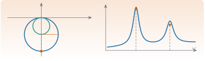
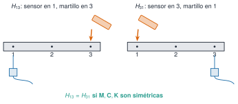
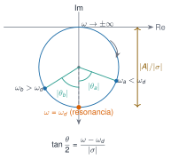

{.portada fig-alt="Ilustración de dos círculos modales en el plano de Nyquist y de una función de respuesta en frecuencia con dos picos"}

```{ojs}
//| echo: false
import {C, cadd, csub, cmul, cdiv, cscale, cconj, cabs, carg} from "../../recursos/js/vibraciones.js"
```

```{julia}
#| include: false
using Resonancia, Random, Printf, LinearAlgebra, Statistics
import DSP: digitalfilter, Lowpass, Butterworth, filtfilt   # solo para diezmar con filtro antialiasing (M7.8)
include("../../recursos/r1-datos/_tema.jl")
const G0 = 9.80665   # gravedad estándar: 1 g = 9,80665 m/s² (hipótesis declarada para convertir los datos de Torroja)
TORROJA = "../../datos/reales-publicables/torroja-puente/2018-06-22-vibracion-ambiental/"
```

## Objetivos y prerrequisitos

**Objetivos.** Esta unidad, de la que por ahora se desarrolla el arranque (M7.1 a M7.3), el decremento aleatorio (M7.4) y cinco ampliaciones basadas en artículos (OMA en varios ensayos, ajuste en el dominio $z$ con PolyMAX, diagrama de estabilización y validación, y FDD/EFDD y SSI-COV con datos reales de Torroja), prepara el terreno de la identificación modal. Al terminar esta parte sabrás:

- situar el análisis modal **experimental** frente al **teórico** y describir sus tres modelos (espacial, modal y de respuesta);
- enunciar y comprobar las hipótesis de las que depende la teoría modal: linealidad, invariancia temporal, observabilidad y reciprocidad;
- leer en una FRF los **polos** (frecuencia y amortiguamiento) y los **residuos** (amplitud) y explicar por qué cerca de una resonancia aislada la FRF dibuja un **círculo**;
- relacionar los residuos de la matriz de FRF con las **formas modales** y recuperar una forma modal a partir de una fila o columna de residuos.

**Prerrequisitos.** La teoría de [M5](../m05-vibraciones-i/index.qmd) y [M6](../m06-vibraciones-ii/index.qmd) (definiciones, convención $e^{+i\omega t}$ y notación, que aquí **no** se repiten).

**Temas de la unidad**

- **M7.1** Análisis modal experimental (EMA) frente a operacional (OMA)
- **M7.2** Métodos de 1 GDL en frecuencia: peak-picking, circle-fit y FRF inversa
- **M7.3** Ajuste de FRF por mínimos cuadrados en sistemas de varios GDL
- **M7.4** Decremento aleatorio
- **M7.5** Métodos en el dominio del tiempo: Ibrahim (ITD) y ERA
- **M7.6** Modelos ARMA
- **M7.7** Descomposición en el dominio de la frecuencia: FDD y EFDD
- **M7.8** Identificación estocástica por subespacios: SSI-Cov y SSI-Data
- **M7.9** Diagramas de estabilización y validación: MAC, MPC y amortiguamiento

::: {.callout-warning title="Alcance de esta versión"}
Los apuntes de partida (ocho PDF de teoría de vibraciones) **no** son una explicación de los algoritmos de identificación. Aquí solo se desarrollan los **fundamentos** que sí aparecen en ellos: las hipótesis (M7.1), la relación entre FRF, polos, residuos y parámetros modales y la geometría que motiva el ajuste circular (M7.2) y la expansión modal de la matriz de FRF (M7.3). Se añaden cinco **ampliaciones** a partir de artículos sobre PolyMAX y sobre ensayos en puentes (ficha bibliográfica con su estado de verificación): de las salidas a los semiespectros y OMA en varios ensayos (M7.1), el ajuste en el dominio $z$ con fracción matricial (M7.3), la descomposición en el dominio de la frecuencia con datos reales de Torroja (M7.7), SSI-COV (M7.8) y el diagrama de estabilización con MAC y síntesis de FRF (M7.9). Los **algoritmos** (peak-picking, circle-fit, FRF inversa, decremento aleatorio, ITD, ERA, ARMA, SSI-DATA) y la comparación **EMA–OMA** completa quedan **pendientes** de fuentes primarias verificables.
:::

::: {.callout-note collapse="true" title="Fuentes, correcciones y qué queda pendiente"}
**Fuentes.** Apuntes manuscritos del Máster Agrela, curso 2024-2025 (carpeta *Teoría de vibraciones*); *PDF, p. n* = página del PDF.

| Contenido | Origen |
|---|---|
| M7.1 enfoques teórico y experimental; GDL medibles | *Intro*, p. 1–2 |
| M7.1 hipótesis (linealidad, invariancia, observabilidad, reciprocidad) | *Intro*, p. 1 y 3 |
| M7.1 modelos espacial, modal y de respuesta | *MDOF*, p. 1 y 9 |
| M7.2 polos, residuos, modelos polinómico y de fracciones simples | *FRF*, p. 3–5; *SDOF sin amortiguamiento*, p. 5–6 |
| M7.2 círculo (receptancia histerética) | *Diagrama de Nyquist*, p. 1 |
| M7.3 expansión modal, constantes modales, reciprocidad | *MDOF*, p. 10–13 |
| M7.3 ejemplo (residuos y escalado de formas) | *MDOF Ejemplo*, p. 4–9 |

**Correcciones y precisiones a los apuntes.**

1. *Intro*, p. 1: «$N_i$ ⇒ number of responses (inputs)» debe ser número de **entradas** (fuerzas); $N_o$ son las salidas (respuestas). La relación escrita entre $N_o$, $N_i$ y $N$ (algo del tipo «$\gtrsim N$») **no es legible con seguridad** en el manuscrito y no se reconstruye aquí.
2. *Intro*, p. 3: «Maxwell's reciprocity ⇒ symmetric mass, stiffness, damping and FRF matrices» presenta la reciprocidad como hipótesis y la simetría como consecuencia; en realidad la simetría de las **matrices** es lo que implica la simetría de la FRF (M6.3). La igualdad $H_{pq}=H_{qp}$ exige además comparar la **misma clase** de magnitud (p. ej., fuerza → desplazamiento) en los mismos grados de libertad y direcciones.
3. *FRF*, p. 4: «muchos sistemas de 1 GDL se representan como $H(\omega)\simeq A_1/(i\omega-\lambda_1)$» es una aproximación **local**, válida cerca del polo, para modos bien separados y poco amortiguados (§ M7.2 cuantifica el error).
4. *FRF*, p. 4: en la expresión $H(\omega_1)=-A_1/\sigma_1+\dots$ se usa $\sigma_1<0$ como **parte real** del polo; en la § M7.2 se escribe con $|\sigma|$ para evitar el cambio de signo.
5. *MDOF Ejemplo*, p. 9: véanse las correcciones de signo de la unidad [M6](../m06-vibraciones-ii/index.qmd) (polo del caso proporcional y $c_r=-2\sigma_rm_r$).

**Ampliaciones externas a los apuntes** (derivaciones propias, comprobadas numéricamente en Julia): el círculo exacto del término de un solo polo y su diámetro $|A|/|\sigma|$; la propiedad del semiángulo $\tan(\theta/2)=(\omega-\omega_d)/|\sigma|$ y la estimación de $|\sigma|$ con dos puntos; el error relativo de la aproximación de un polo en función de $\zeta$; la recuperación de formas a partir de una columna de residuos. Lectura para ampliar: [@ewins2000; @silva1999; @avitabile2018].

**Ampliaciones a partir de artículos** (no están en los apuntes de partida). Las copias leídas, aportadas por el responsable, **no se incluyen en el repositorio**: se citan en `recursos/bibliografia.bib` con su estado de verificación. [@peeters2004polymax; @peeters2004procedure] para el método PolyMAX, [@chellini2008] (viaducto de Sesia), [@peeters2006guadiana] (puente de Guadiana) [@peeters2004z24] (puente Z24; **año y sede sin confirmar**) y el tutorial de OMA de [@magalhaes2011] (FDD/EFDD, M7.7, y SSI-COV, M7.8; el método de subespacios [@peeters1999] se cita a través de él y **no se ha leído**; el artículo de EFDD [@brincker2001damping] y el de FDD [@brincker2001] sí se han leído en copia escaneada). El texto, las fórmulas desarrolladas y el código son propios; el ejemplo numérico es sintético. Los autores de los artículos sobre PolyMAX pertenecen al fabricante del programa, de modo que sus comparaciones entre métodos se tratan como valoraciones propias; el tutorial de FDD y EFDD es independiente de ese fabricante. Hay hojas manuscritas del responsable (junio de 2011) sobre OMA y PolyMAX cuya notación se ha unificado.

**Pendiente.** EMA frente a OMA (los apuntes no tratan OMA); peak-picking; algoritmo de circle-fit; FRF inversa; la versión polirreferencia con $\ell>1$ y $m>1$ (el código es escalar), el MPC, el amortiguamiento de modos próximos con EFDD (sesgo comprobado en M7.7, sin corrección), SSI-DATA y los apartados M7.5 y M7.6.
:::

## Teoría breve

### M7.1 Análisis modal experimental (EMA) frente a operacional (OMA) {#m7-1}

El **análisis modal** busca tres cosas de una estructura: sus **frecuencias naturales**, sus **razones de amortiguamiento** y sus **formas modales**. Se puede abordar por dos caminos que se alimentan entre sí:

- **Teórico (analítico).** Parte de la **geometría**, las **condiciones de contorno** y las propiedades del **material** (masa, rigidez, amortiguamiento) y construye un modelo (típicamente, de elementos finitos, M6).
- **Experimental.** Parte de **medidas** de las fuerzas de entrada y de las respuestas de salida, y sigue cuatro pasos: montaje (*set-up*), adquisición de datos, **identificación del sistema** y validación. El análisis teórico aporta el *background*: sirve para planificar el ensayo y para interpretar los resultados.

**Tres modelos de un mismo sistema.** Un sistema lineal puede describirse de tres formas equivalentes (M6):

| Modelo | Contiene | Se obtiene de forma natural… |
|---|---|---|
| **Espacial** | $\mathbf{M}$, $\mathbf{C}$, $\mathbf{K}$ | …del análisis **teórico** (geometría, material) |
| **Modal** | $\omega_r$, $\zeta_r$, $\boldsymbol{\phi}_r$ | …del problema de autovalores del modelo espacial, **o** de la identificación |
| **De respuesta** | $\boldsymbol{\alpha}(\omega)$ (FRF) | …de las **medidas** y también de los otros dos modelos |

```{mermaid}
%%| fig-cap: "Camino teórico (flechas hacia la derecha) y camino experimental (flechas hacia la izquierda) entre los tres modelos."
flowchart LR
    E["Modelo espacial<br/>M, C, K"] -- "autovalores" --> Mo["Modelo modal<br/>ωr, ζr, φr"]
    Mo -- "superposición modal" --> R["Modelo de respuesta<br/>FRF α(ω)"]
    R -. "identificación" .-> Mo
    Mo -. "reconstrucción (si se desea)" .-> E
    Med["Medidas<br/>fuerzas y respuestas"] --> R
```

La **identificación** es el paso experimental de la respuesta (medida) al modelo modal: es lo que desarrollan las unidades M7.2 y siguientes.

**Grados de libertad medibles.** Un sistema continuo tiene infinitos GDL, pero un ensayo solo mide un número finito $N$ (los apuntes citan del orden de 1 a 50), limitado por: el rango de frecuencias de interés, las limitaciones de amplitud y que hay **pocos transductores de giro** (las rotaciones son difíciles de medir). Si se mide con $N_o$ salidas y $N_i$ entradas, esos números condicionan cuántos modos se pueden definir (la relación exacta escrita en los apuntes no se lee con certeza; véase la tabla de correcciones).

**Las hipótesis básicas.** La teoría modal usa de forma implícita cuatro hipótesis. Conviene saber qué dice cada una y cómo se vulnera:

| Hipótesis | Qué afirma | Cómo suele fallar |
|---|---|---|
| **Linealidad** | El sistema se rige por ecuaciones lineales, $\mathbf{M}\ddot{\mathbf{x}}+\mathbf{C}\dot{\mathbf{x}}+\mathbf{K}\mathbf{x}=\mathbf{f}$: la respuesta a una combinación de entradas es la misma combinación de las respuestas. | Rigidez o amortiguamiento que dependen de la amplitud (holguras, rozamiento, grietas que se abren y cierran). |
| **Invariancia temporal** | Las propiedades dinámicas **no cambian en el tiempo** ($\mathbf{M}$, $\mathbf{C}$, $\mathbf{K}$ constantes). | Cambios de temperatura, de masa añadida (tráfico, personas), de condiciones de apoyo durante la medida. |
| **Observabilidad** | Se pueden **medir** todos los datos necesarios para determinar las características dinámicas de interés. | Sensores insuficientes o mal ubicados (p. ej., en un nodo de un modo, que quedaría invisible). |
| **Reciprocidad** (de Maxwell) | La respuesta en $p$ por una fuerza en $q$ **iguala** la respuesta en $q$ por la misma fuerza en $p$: $H_{pq}=H_{qp}$. | Sistemas con efectos no recíprocos (p. ej., giroscópicos) o comparar magnitudes de distinta clase o dirección. |

La reciprocidad es la «hipótesis» que más se confunde con una propiedad automática: es una **consecuencia** de que $\mathbf{M}$, $\mathbf{C}$ y $\mathbf{K}$ sean simétricas (M6.3). En un ensayo, permite medir con el **martillo en un punto y el acelerómetro en otro**, o al revés, y obtener la misma FRF; el esquema de los apuntes (martillo en el punto 3 y sensor en el 1, frente a martillo en 1 y sensor en 3) ilustra justo eso.


{#fig-reciprocidad fig-alt="Dos esquemas de una viga con tres puntos: a la izquierda, sensor en el punto 1 y martillo en el 3; a la derecha, sensor en el 3 y martillo en el 1" width="100%"}

::: {.callout-tip title="Cómo comprobar las hipótesis en un ensayo (ampliación externa a los apuntes)"}
Linealidad: repite el ensayo con **dos niveles de excitación** y compara las FRF; si cambian, hay no linealidad. Invariancia: repite el ensayo en **momentos distintos** y compara. Reciprocidad: mide $H_{pq}$ y $H_{qp}$ y comprueba que coinciden. Observabilidad: comprueba que los puntos de medida no coinciden con nodos de los modos de interés (con un modelo previo, M6).
:::

::: {.callout-important title="Pendiente en esta sección"}
Los apuntes **no tratan** el **análisis modal operacional** (OMA: identificación con excitación desconocida, no medida). Por eso la comparación EMA–OMA del título del tema queda pendiente; se desarrollará con fuentes primarias (p. ej., [@silva1999; @ewins2000] para EMA y una referencia de OMA). Del lado de OMA solo se desarrolla, en la ampliación del final de este apartado, el paso de las salidas a los semiespectros y el tratamiento de varios ensayos.
:::

**Pon a prueba lo anterior.**

::: {.ejercicio tipo="opcion" id="m7-1-hipotesis" respuesta="c"}
El único sensor de un ensayo está en un **nodo** de un modo de interés. ¿Qué hipótesis de la teoría modal falla?

::: {.opciones}
- Linealidad.
- Invariancia temporal.
- Observabilidad.
- Reciprocidad.
:::

::: {.solucion}
Observabilidad: en un nodo el modo no se mueve, así que **no se puede medir**. Conviene comprobar con un modelo previo que los puntos de medida no coinciden con nodos.
:::
:::

::: {.ejercicio tipo="vf" id="m7-1-recip" respuesta="falso"}
La reciprocidad es una propiedad independiente de la simetría de las matrices $\mathbf{M}$, $\mathbf{C}$ y $\mathbf{K}$.

::: {.solucion}
**Falso.** Es una **consecuencia** de esa simetría. Sistemas con efectos no recíprocos (p. ej., giroscópicos) no la cumplen.
:::
:::

#### Ampliación: de las salidas a los semiespectros, y OMA en varios ensayos {#m7-1-oma}

::: {.callout-note title="De dónde sale esta ampliación"}
Está redactada con palabras propias a partir de dos artículos de aplicación en puentes [@chellini2008; @peeters2006guadiana]. Sus autores están ligados al fabricante del programa que implementa los métodos: las comparaciones entre métodos son las de **sus propios datos**, y aquí se citan como tales, no como una evaluación independiente. Las fórmulas son las habituales; la derivación del efecto de la ventana exponencial es propia y se comprueba numéricamente en [M7.9](#m7-9).
:::

**De las salidas a los datos del método.** En OMA solo se miden respuestas $\mathbf y_k\in\mathbb R^{\ell}$ en $\ell$ puntos. Muchos métodos no usan la serie temporal, sino sus **correlaciones** y **espectros cruzados** respecto de $m\le\ell$ salidas elegidas como *referencias*. La correlación a retardo $i$ (en muestras) es

$$
\mathbf R_i=\frac1N\sum_{k=0}^{N-1}\mathbf y_{k+i}\,\mathbf y_k^{\top}\in\mathbb R^{\ell\times\ell},
$$

y con $m$ referencias basta con las $m$ columnas correspondientes ($\ell\times m$). Si la excitación se parece a un ruido blanco, estas correlaciones se parecen a respuestas impulsionales: es lo que justifica los métodos de subespacios por correlaciones (M7.8).

**Correlograma ponderado y semiespectro.** Con una ventana $w_k$ de $2L+1$ retardos, el espectro es la DFT de la correlación ponderada, y como $\mathbf R_{-k}=\mathbf R_k^\top$ los retardos negativos no añaden información: se usa solo la mitad positiva, el **semiespectro**

$$
\mathbf S^{+}(\omega)=\frac{w_0\,\mathbf R_0}{2}+\sum_{k=1}^{L}w_k\,\mathbf R_k\,e^{-j\omega k\Delta t}.
$$

A diferencia de un espectro de potencia, hasta sus autoespectros son complejos (fase no nula). $L$ se toma mucho menor que $N$ para limitar la varianza de los retardos altos. Es el estimador del correlograma (Blackman–Tukey, véase la historia de [M3.6](../m03-senales-i/index.qmd#m3-6)), no el de Welch: ambos estiman el mismo objeto con compromisos distintos entre resolución y varianza.

**Ventana exponencial.** Los artículos aplican a las correlaciones una ventana exponencial $e^{-k\Delta t/\tau}$ en lugar de una ventana de Hann sobre el registro. Dicen que reduce la fuga y el peso de los retardos grandes, que es compatible con el modelo modal y que una Hann introduce un sesgo en el amortiguamiento. Un cálculo sencillo explica la compatibilidad: si la correlación es una suma de términos $e^{\lambda t}$, multiplicarla por $e^{-t/\tau}$ cambia cada polo a $\lambda-1/\tau$, es decir, **suma un amortiguamiento conocido** que luego se resta: $\zeta_i^{\mathrm{corr}}\simeq\zeta_i^{\mathrm{est}}-1/(\tau\,\omega_i)$ (comprobado con un oscilador sintético en [M7.9](#m7-9)).

**Varios ensayos (multi-run).** Rara vez hay tantos sensores como puntos de medida: en el viaducto de Sesia había 103 posiciones y 33 acelerómetros [@chellini2008]. Se mide en varias pasadas moviendo parte de los sensores y se dejan **sensores de referencia** fijos en todas. El problema es que la excitación ambiental es desconocida **y cambia entre pasadas**. En el puente de Guadiana las 28 pasadas de 21 min se repartieron en dos días, con viento medio de unos 2, 9 y 14 m/s en tres días consecutivos y tráfico distinto: cambió el nivel de la excitación y también su «color», de modo que unos modos se excitan en unas pasadas y no en otras (un modo global cercano a 0,8 Hz se identifica en las primeras pasadas y desaparece después, cuando el viento más fuerte excita más modos de los cables, que además pueden dificultar la identificación de los globales) [@peeters2006guadiana]. La escala de cada forma modal es entonces arbitraria en cada pasada, y las referencias sirven para fijarla. Hay dos caminos:

1. **Analizar cada pasada por separado**, emparejar los modos entre pasadas (nada garantiza que se identifiquen los mismos) y reescalar cada modo en cada pasada por mínimos cuadrados con los componentes de las referencias.
2. **Apilar los espectros** (o, en subespacios, las correlaciones) de todas las pasadas en una matriz alta, hacer **un solo análisis** y reescalar después. Supone que el cambio de excitación solo afecta a la escala de las formas (los factores de referencia operacionales no cambian) y que los parámetros modales **no cambian** entre pasadas.

Las ventajas del segundo son la rapidez y que no hace falta emparejar modos; su límite, que **no vale con pasadas inconsistentes**: sensores pesados frente a la estructura, que cambian la masa, o una temperatura que mueva las frecuencias [@peeters2006guadiana]. En el viaducto de Sesia los autores prefirieron el segundo porque las formas salieron más suaves [@chellini2008].

::: {.ejercicio tipo="numerico" id="m7-1-multirun" respuesta="45" tol="abs:0.001"}
Se mide un puente en 6 pasadas. En cada una se registran 10 señales, 3 de ellas de sensores de referencia que no se mueven. Se apilan las 6 pasadas (60 salidas). Tras reescalar, la redundancia de las referencias se elimina: ¿cuántos componentes distintos tiene la forma modal?

::: {.solucion}
Las 3 referencias se miden 6 veces, pero son los mismos 3 puntos: $60-6\cdot3+3=45$ componentes (42 puntos móviles y 3 de referencia). Con el mismo razonamiento, el ensayo de Guadiana, con 28 pasadas y 8 señales por pasada (4 de referencia), da $224-112+4=116$ [@peeters2006guadiana].
:::
:::

### M7.2 Métodos de 1 GDL en frecuencia: peak-picking, circle-fit y FRF inversa {#m7-2}

Aquí no se desarrollan los métodos, sino la **relación entre la FRF y los parámetros modales** y la **geometría** en la que se apoya el ajuste circular.

**Polos y residuos de un oscilador de 1 GDL.** De M5.6, con $s_1=\sigma+i\omega_d$ ($\sigma=-\zeta\omega_n<0$) y condiciones iniciales nulas,

$$
H(s)=\frac{A}{s-s_1}+\frac{A^*}{s-s_1^*},\qquad A=\frac{1}{2i\,m\,\omega_d}.
$$

La FRF es la misma función sobre el eje imaginario, $H(i\omega)=A/(i\omega-s_1)+A^*/(i\omega-s_1^*)$. Los apuntes presentan dos representaciones equivalentes:

- **Polinómica:** $H=\beta_0/(a_2s^2+a_1s+a_0)$, con los **coeficientes** como incógnitas.
- **De fracciones simples:** polos y residuos como incógnitas.

La segunda es la que da **sentido físico**: cada polo contiene dos parámetros modales y cada residuo, la amplitud.

| Qué se lee | Dónde está |
|---|---|
| Frecuencia amortiguada $\omega_d$ | parte **imaginaria** del polo |
| Decaimiento $\lvert\sigma\rvert=\zeta\omega_n$ | parte **real** del polo |
| Frecuencia natural no amortiguada $\omega_n$ | **módulo** del polo, $\lvert s_1\rvert=\sqrt{\sigma^2+\omega_d^2}$ |
| Razón de amortiguamiento $\zeta$ | $-\sigma/\lvert s_1\rvert$ |
| Amplitud | **residuo** $A$ (y, con él, la masa) |

**Aproximación de un solo polo.** Cerca de la resonancia, el denominador $i\omega-s_1$ se hace pequeño, de modo que el primer sumando domina y

$$
H(i\omega)\approx H_1(i\omega)=\frac{A}{i\omega-s_1}=\frac{A}{\lvert\sigma\rvert+i\,(\omega-\omega_d)} .
$$ {#eq-unpolo}

El segundo sumando, $A^*/(i\omega-s_1^*)$, queda en $\omega\approx\omega_d$ con módulo $\lvert A\rvert/\lvert 2i\omega_d-\sigma\rvert\approx\lvert A\rvert/(2\omega_d)$: es, respecto del primero ($\lvert A\rvert/\lvert\sigma\rvert$), un factor $\approx\zeta/2$ más pequeño y varía lentamente. Eso es lo que hace útil @eq-unpolo para modos **poco amortiguados y bien separados**.

**La geometría: un círculo exacto.**

::: {#prp-unpolo}
**Círculo de un solo polo.** Sea $\Delta=\omega-\omega_d$. El término de un solo polo $A/(\lvert\sigma\rvert+i\Delta)$ recorre, al variar $\omega$, **exactamente** un círculo de

$$
\text{centro}=\frac{A}{2\lvert\sigma\rvert},\qquad\text{diámetro}=\frac{\lvert A\rvert}{\lvert\sigma\rvert},
$$

que pasa por el origen.
:::

::: {.callout-note .demostracion collapse="true" title="Demostración"}
Con $a=\lvert\sigma\rvert>0$ fijo y $\Delta$ real, $\dfrac{1}{a+i\Delta}-\dfrac{1}{2a}=\dfrac{a-i\Delta}{2a\,(a+i\Delta)}$, que tiene módulo $\dfrac{1}{2a}$ para todo $\Delta$: es la circunferencia de centro $1/(2a)$ y radio $1/(2a)$, que pasa por el origen. Multiplicar por el residuo $A$ **escala** (por $\lvert A\rvert$) y **gira** (por $\arg A$) esa circunferencia: centro $A/(2a)$ y diámetro $\lvert A\rvert/a$.
:::

Observa tres cosas:

1. El punto de **resonancia** $\omega=\omega_d$ es el más alejado del origen: $H_1(i\omega_d)=A/\lvert\sigma\rvert$, y su módulo es el diámetro.
2. La **fase del residuo** orienta el círculo. Con residuo imaginario puro (1 GDL o amortiguamiento proporcional), el círculo queda apoyado sobre el eje real con el diámetro en el eje imaginario negativo (para la receptancia, $A=-i/(2m\omega_d)$). Un residuo **complejo** (modos complejos, M6.4) **gira** el círculo.
3. **Propiedad del semiángulo.** El ángulo $\theta$ que barre el radio desde el punto de resonancia hasta el punto de frecuencia $\omega$ cumple

$$
\tan\frac{\theta(\omega)}{2}=\frac{\omega-\omega_d}{\lvert\sigma\rvert}.
$$ {#eq-semiangulo}

   De ahí que los puntos con $\omega=\omega_d\pm\lvert\sigma\rvert$ estén a $\theta=\pm90^\circ$, y que **dos puntos** $\omega_a<\omega_d<\omega_b$ de ángulos $\theta_a,\theta_b$ den $\lvert\sigma\rvert=\dfrac{\omega_b-\omega_a}{\tan(\theta_a/2)+\tan(\theta_b/2)}$ sin conocer antes $\omega_d$.

{#fig-circulo fig-alt="Círculo en el plano complejo que pasa por el origen; el punto inferior es la resonancia y dos radios señalan puntos de frecuencia menor y mayor con sus ángulos theta a y theta b" width="60%"}

**Qué es y qué no es un círculo.** Conviene separar tres casos, porque se confunden:

| FRF | ¿Es un círculo exacto? |
|---|---|
| Receptancia con amortiguamiento **histerético** | **Sí**, para $h$ constante (M5.5). Es la deducción del PDF *Diagrama de Nyquist*. |
| Término de **un solo polo** de la FRF viscosa, @eq-unpolo | **Sí** (lo anterior). |
| Receptancia **viscosa** completa (suma de los dos términos) | **No**: es **aproximadamente** circular cerca de una resonancia aislada, tanto más cuanto menor sea $\zeta$. (La **movilidad** viscosa de 1 GDL sí es un círculo exacto, M5.5.) |

El error de aproximar la FRF viscosa completa por el círculo de un solo polo, medido como la mayor desviación del módulo respecto del radio dentro de la banda $|\omega-\omega_d|\le3\lvert\sigma\rvert$ (con $m=1$ kg, $k=100$ N/m; cálculo en Julia):

| $\zeta$ | 0,01 | 0,05 | 0,2 | 0,6 |
|---|---|---|---|---|
| Desviación relativa al radio | $1\,\%$ | $5\,\%$ | $23\,\%$ | $>100\,\%$ |

Con amortiguamientos pequeños (habituales en estructuras) el ajuste circular es razonable; con amortiguamientos grandes, no. Esto no se «extiende» al caso viscoso por decreto: es una **aproximación con error acotado que depende de $\zeta$**.

**Simulación 1. Un modo en el plano de Nyquist.** Compara la FRF modal completa (azul) con el término de un solo polo (naranja) y con el círculo ajustado (gris). Gira la fase del residuo para ver el efecto de un modo complejo.

```{ojs}
//| echo: false
viewof Z_zeta = Inputs.range([0.01, 0.5], {value: 0.05, step: 0.005, label: "ζ"})
```
```{ojs}
//| echo: false
viewof Z_fase = Inputs.range([-180, 0], {value: -90, step: 5, label: "fase del residuo (°)"})
```
```{ojs}
//| echo: false
viewof Z_mostrar = Inputs.checkbox(["término de un solo polo", "círculo ajustado"], {value: ["término de un solo polo", "círculo ajustado"], label: "Mostrar"})
```
```{ojs}
//| echo: false
Z_wn = 10
Z_sigma = Z_zeta * Z_wn
Z_wd = Z_wn * Math.sqrt(1 - Z_zeta ** 2)
Z_s = C(-Z_sigma, Z_wd)
Z_A = {
  const mag = 1 / (2 * Z_wd), f = Z_fase * Math.PI / 180;
  return C(mag * Math.cos(f), mag * Math.sin(f));
}
Z_H1 = w => cdiv(Z_A, csub(C(0, w), Z_s))
Z_H = w => cadd(Z_H1(w), cdiv(cconj(Z_A), csub(C(0, w), cconj(Z_s))))
Z_ws = Array.from({length: 1500}, (_, i) => Math.max(Z_wd - 8 * Z_sigma, 0.2) + (16 * Z_sigma) * i / 1499)
Z_centro = cscale(Z_A, 1 / (2 * Z_sigma))
Z_radio = cabs(Z_A) / (2 * Z_sigma)
Z_circ = Array.from({length: 361}, (_, i) => { const a = 2 * Math.PI * i / 360; return {re: Z_centro.re + Z_radio * Math.cos(a), im: Z_centro.im + Z_radio * Math.sin(a)}; })
Z_dev = {
  let m = 0;
  for (let i = 0; i <= 600; i++) {
    const w = Z_wd - 3 * Z_sigma + 6 * Z_sigma * i / 600;
    const z = Z_H(w);
    m = Math.max(m, Math.abs(Math.hypot(z.re - Z_centro.re, z.im - Z_centro.im) - Z_radio));
  }
  return m / Z_radio;
}
```
```{ojs}
//| echo: false
Plot.plot({
  width: 520, height: 420, aspectRatio: 1, marginLeft: 70,
  x: {label: "Re (m/N)", grid: true},
  y: {label: "Im (m/N)", grid: true},
  marks: [
    Plot.ruleX([0]), Plot.ruleY([0]),
    Z_mostrar.includes("círculo ajustado") ? Plot.line(Z_circ, {x: "re", y: "im", stroke: "#999", strokeDasharray: "4 3"}) : null,
    Z_mostrar.includes("término de un solo polo") ? Plot.line(Z_ws.map(w => ({...Z_H1(w)})), {x: "re", y: "im", stroke: "#d95f02", strokeWidth: 1.8}) : null,
    Plot.line(Z_ws.map(w => ({...Z_H(w)})), {x: "re", y: "im", stroke: "#1b6ca8", strokeWidth: 2.2}),
    Plot.dot([Z_H1(Z_wd)], {x: "re", y: "im", fill: "#d95f02", r: 5})
  ].filter(Boolean)
})
```
```{ojs}
//| echo: false
md`ω<sub>n</sub> = ${Z_wn} rad/s · |σ| = ${Z_sigma.toFixed(2)} 1/s · ω<sub>d</sub> = ${Z_wd.toFixed(3)} rad/s · diámetro = |A|/|σ| = ${(2 * Z_radio).toFixed(4)} · desviación de la FRF completa respecto del círculo, en |ω − ω<sub>d</sub>| ≤ 3|σ|: **${(100 * Z_dev).toFixed(1)} %** del radio. Punto naranja: resonancia ω = ω<sub>d</sub>.`
```

::: {.callout-warning title="Errores frecuentes"}
- Decir que la receptancia **viscosa** «es un círculo»: lo es solo de forma aproximada y cerca de un modo aislado; el círculo exacto es el del **término de un polo** o el de la receptancia **histerética**.
- Confundir el punto de **máximo módulo** con $\omega_n$ o con $\omega_d$: en el término de un polo está en $\omega_d$ (M5.4 distingue las tres frecuencias).
- Aplicar el ajuste circular a modos **muy próximos**: el segundo modo deja de ser «una pequeña perturbación».
:::

::: {.callout-important title="Pendiente en esta sección"}
**Algoritmos.** El **peak-picking**, el **algoritmo de circle-fit** (estimación del círculo por mínimos cuadrados, selección de puntos, ajuste del término residual de los otros modos) y la **FRF inversa** no figuran en los apuntes. Se desarrollarán con fuentes primarias verificables.
:::

::: {.callout-note .historia icon=false title="Un poco de historia: los gráficos vectoriales de Kennedy y Pancu"}
En 1947, Kennedy y Pancu propusieron representar la respuesta en frecuencia como un **gráfico vectorial** en el plano complejo, en lugar de limitarse a medir la altura del pico [@kennedy1947]. Estudios posteriores recogieron que el método del pico es poco fiable con amortiguamientos grandes o frecuencias muy próximas, casos en los que sí conviene el diagrama vectorial. Esa tradición está detrás de las técnicas de ajuste circular que se desarrollan a partir de aquí.

<span class="fuentes-caja">Sobre su recepción: Bishop y Gladwell (1963) la citaron como alternativa teóricamente más atractiva al método del pico. Fuentes secundarias consultadas el 21-10-2026; no he accedido al artículo original.</span>
:::

**Pon a prueba lo anterior.**

::: {.ejercicio tipo="numerico" id="m7-2-diametro" respuesta="0.1001" tol="1%" unidad="m/N"}
Para $m=1$ kg, $k=100$ N/m y $c=1$ N·s/m, calcula el diámetro del círculo del término de un solo polo de la receptancia.

::: {.pista}
$\omega_d=\omega_n\sqrt{1-\zeta^2}$, $\lvert A\rvert=1/(2m\omega_d)$ y $\lvert\sigma\rvert=\zeta\omega_n$.
:::

::: {.solucion}
$\zeta=0{,}05$, $\omega_d=9{,}987$ rad/s, $\lvert\sigma\rvert=0{,}5$ s$^{-1}$ y $\lvert A\rvert=0{,}05006$. Diámetro $=\lvert A\rvert/\lvert\sigma\rvert=0{,}1001$ m/N.
:::
:::

::: {.ejercicio tipo="numerico" id="m7-2-sigma" respuesta="0.5" tol="2%" unidad="1/s"}
De un círculo de un polo se leen dos puntos: $\omega_a=9{,}287$ rad/s con $\theta_a=108{,}9^\circ$ y $\omega_b=10{,}387$ rad/s con $\theta_b=77{,}3^\circ$. Estima $\lvert\sigma\rvert$.

::: {.solucion}
$\lvert\sigma\rvert=(\omega_b-\omega_a)/\big(\tan(\theta_a/2)+\tan(\theta_b/2)\big)=1{,}1/(1{,}40+0{,}80)=0{,}50$ s$^{-1}$.
:::
:::

::: {.ejercicio tipo="vf" id="m7-2-viscoso" respuesta="falso"}
La receptancia **viscosa** completa de un oscilador de 1 GDL describe un círculo exacto en el plano de Nyquist.

::: {.solucion}
**Falso.** Solo es **aproximadamente** circular cerca de un modo aislado y poco amortiguado. Son círculos exactos el término de **un solo polo**, la receptancia **histerética** y la **movilidad** viscosa.
:::
:::

::: {.ejercicio tipo="investigacion" id="m7-2-oma"}
**Una aplicación real.** Busca un artículo en el que se identifiquen las propiedades modales de una estructura real (puente, edificio, aerogenerador) y anota qué se midió y qué se obtuvo.

::: {.criterios}
- Localizo el artículo y anoto autores, año, revista y enlace (DOI si existe).
- Indico qué sensores se usaron y cuántos puntos de medida hubo.
- Anoto las frecuencias y los amortiguamientos identificados, con las unidades.
- Compruebo que el artículo existe y que los datos que apunto están en él (C0.5).
:::

::: {.solucion}
Un punto de partida de la bibliografía de la asignatura es el artículo sobre aerogeneradores citado en M0 [@carne2010]. Lo importante es que cada cifra que anotes se pueda **localizar** en la fuente.
:::
:::

### M7.3 Ajuste de FRF por mínimos cuadrados en sistemas de varios GDL {#m7-3}

Aquí tampoco se desarrolla el ajuste por mínimos cuadrados, sino la **estructura de la FRF** que dicho ajuste explota: la **expansión modal** de la matriz de FRF y la relación entre **residuos** y **formas modales**.

**Expansión modal.** De M6.3 y M6.4, para un sistema lineal con $n$ modos y amortiguamiento viscoso,

$$
\boldsymbol{\alpha}(\omega)=\sum_{r=1}^{n}\left[\frac{\boldsymbol{\phi}_r\boldsymbol{\phi}_r^\top}{i\omega-s_r}+\frac{\boldsymbol{\phi}_r^*\boldsymbol{\phi}_r^{*\top}}{i\omega-s_r^*}\right],\qquad
\alpha_{jk}(\omega)=\sum_{r=1}^{n}\left[\frac{{}_rA_{jk}}{i\omega-s_r}+\frac{{}_rA_{jk}^*}{i\omega-s_r^*}\right],
$$

con ${}_rA_{jk}=\phi_{jr}\phi_{kr}$ la **constante modal** (o residuo) del modo $r$ entre los puntos de respuesta $j$ y excitación $k$. Cada modo aporta a la FRF lo mismo que un oscilador de 1 GDL (M7.2) y la FRF total es la **suma de $n$ contribuciones**: cada término tiene un par de polos $s_r,s_r^*$ y un residuo. En el plano de Nyquist, cada modo **bien separado** aporta su propio «lazo» circular.

Con amortiguamiento proporcional (modos reales normalizados a la masa, $\mathbf{\Phi}^\top\mathbf{M}\mathbf{\Phi}=\mathbf{I}$), la misma estructura se escribe con $\omega_r^2-\omega^2+2i\zeta_r\omega_r\omega$ en el denominador y numerador real $\phi_{jr}\phi_{kr}$ (M6.3). **Con amortiguamiento no proporcional** el numerador es **complejo**: los residuos tienen fase y las formas son complejas.

**Los residuos contienen las formas modales.** Para cada modo, la matriz de residuos $\boldsymbol{\phi}_r\boldsymbol{\phi}_r^\top$ tiene **rango uno**: ${}_rA_{jk}\,{}_rA_{lm}={}_rA_{jm}\,{}_rA_{lk}$. Consecuencias:

1. **Una columna basta.** Si se conoce la columna $k$ de la matriz de residuos del modo $r$ (la FRF entre **todas** las respuestas $j$ y una **única** excitación $k$), se obtiene la forma completa: el **punto de excitación** da el residuo $A_{kk}=\phi_{kr}^2$ y, de él, $\phi_{kr}=\sqrt{A_{kk}}$ (el **signo** —o la fase global en el caso complejo— queda indeterminado: la forma se conoce salvo un factor de escala). El resto sale de $\phi_{jr}=A_{jk}/\phi_{kr}$. El cociente $\phi_{jr}/\phi_{kr}=A_{jk}/A_{kk}$ **no depende de la escala**.
2. **Intercambiar entrada y salida.** Como $A_{jk}=A_{kj}$, medir una **fila** equivale a medir una columna (reciprocidad, M6.3). En la práctica: o un punto fijo de excitación y muchos de respuesta (martillo fijo, sensor móvil) o al revés (sensor fijo, martillo móvil).
3. **Truncamiento.** Con **todos** los modos del modelo, una columna determina toda la matriz; con modos truncados (p. ej., solo los de la banda medida), la reconstrucción es aproximada.

**La escala de la forma.** El residuo **mezcla forma y escala**; no se puede separar una de otra sin información adicional (la masa, o una fuerza conocida):

- Con modos **reales** y amortiguamiento proporcional, si las formas están normalizadas a la masa, el residuo de la receptancia es $A_{jk}=\dfrac{\phi_{jr}\phi_{kr}}{2i\,\omega_{d,r}}$ (M6.4, normalizando por $a_r=2i\omega_d$), de modo que $\phi_{kr}^2=2i\,\omega_{d,r}A_{kk}$.
- Con modos **complejos** la «masa modal» $a_r=\boldsymbol{\psi}_r^\top(2s_r\mathbf{M}+\mathbf{C})\boldsymbol{\psi}_r$ es compleja y la normalización a masa unidad ya no hace reales las formas. En identificación, la forma se suele presentar relativa a un punto de referencia o normalizada por su componente mayor; hay que indicar siempre la convención.

**Parámetros modales sin conocer $\mathbf{M}$, $\mathbf{C}$, $\mathbf{K}$.** Los apuntes subrayan que **la masa, el amortiguamiento y la rigidez no hacen falta** para llegar al modelo modal: de los polos salen $\omega_r$ y $\zeta_r$ y de los residuos las formas (con su escala). Fijada la **masa modal unidad**, se obtienen directamente la **amortiguación modal** $c_r=-2\sigma_rm_r$ y la **rigidez modal** $k_r=(\sigma_r^2+\omega_{d,r}^2)\,m_r$. Esto es lo que usa una identificación: parte de la FRF (modelo de respuesta) y llega al modelo modal sin tocar el espacial.

**Un ejemplo completo: dos masas.** Con las matrices de M6 ($\mathbf{M}=\mathrm{diag}(5,10)$, $\mathbf{K}=\begin{bmatrix}4&-2\\-2&6\end{bmatrix}$) y los dos casos de amortiguamiento ya vistos, los residuos de la FRF (calculados) y las formas recuperadas con $\phi_{2r}/\phi_{1r}=A_{21}/A_{11}$ son:

| Caso | Modo | Polo | $A_{11}$ | $A_{21}$ | $\phi_2/\phi_1=A_{21}/A_{11}$ |
|---|---|---|---|---|---|
| Proporcional | 1 | $-0{,}1+0{,}6245\,i$ | $-0{,}0534\,i$ | $-0{,}0534\,i$ | $1{,}000\angle0^\circ$ |
| Proporcional | 2 | $-0{,}25+0{,}9682\,i$ | $-0{,}0689\,i$ | $+0{,}0344\,i$ | $0{,}500\angle180^\circ=-0{,}5$ |
| No proporcional | 1 | $-0{,}0954+0{,}6295\,i$ | $-0{,}0086-0{,}0420\,i$ | $-0{,}0035-0{,}0501\,i$ | $1{,}172\angle7{,}6^\circ$ |
| No proporcional | 2 | $-0{,}7546+0{,}6460\,i$ | $+0{,}0086-0{,}1227\,i$ | $+0{,}0035+0{,}0453\,i$ | $0{,}369\angle171{,}6^\circ$ |

En el caso proporcional salen las formas reales de M6 (en fase $[1,1]$ y en oposición $[1,-\tfrac12]$) y, con $\phi_1^2=2i\omega_dA_{11}$, la forma normalizada a la masa: $\phi_1^2=2\cdot0{,}6245\cdot0{,}0534=0{,}0667=1/15$ y $\phi_1=0{,}2582$. En el no proporcional el cociente es **complejo**, con fases $7{,}6^\circ$ y $171{,}6^\circ$ (en lugar de $0^\circ$ y $180^\circ$): las componentes **no pasan por cero a la vez**. Comprobado: el cociente $A_{21}/A_{11}$ coincide con el de las formas calculadas de los autovectores del espacio de estados.

::: {.callout-warning title="Errores frecuentes"}
- Olvidar que $\sqrt{A_{kk}}$ está definida **salvo signo** (o fase global): dos formas que difieren en el signo son la misma forma.
- Comparar formas de dos ensayos sin fijar la **misma normalización**.
- Pensar que los residuos de un modo complejo son «ruido»: tienen su fase y llevan información real (sin ella, no se recupera la forma).
:::

::: {.callout-important title="Pendiente en esta sección"}
**El ajuste por mínimos cuadrados** de las FRF de varios GDL no está en los apuntes de partida. La ampliación de más abajo desarrolla una formulación concreta (fracción matricial en el dominio $z$, tipo PolyMAX) a partir de artículos, con el caso escalar comprobado en Julia; el mal condicionamiento con datos reales, la elección del orden fuera del diagrama de estabilización y la medición de **complejidad modal** siguen pendientes. El **MAC** se define en [M7.9](#m7-9). Se completará con fuentes primarias verificables.
:::

::: {.callout-tip .idea-clave title="Idea clave"}
Una **columna** de la matriz de residuos (una excitación y todas las respuestas) basta para recuperar la forma modal relativa. El residuo mezcla forma y escala: hay que fijar una convención.
:::

**Pon a prueba lo anterior.**

::: {.ejercicio tipo="numerico" id="m7-3-razon" respuesta="-0.5" tol="1%"}
En el caso proporcional, para el segundo modo los residuos son $A_{11}=-0{,}06885\,i$ y $A_{21}=+0{,}03443\,i$. Calcula el cociente $\phi_2/\phi_1=A_{21}/A_{11}$.

::: {.solucion}
$A_{21}/A_{11}=0{,}03443/(-0{,}06885)=-0{,}5$: la forma es $[1,\ -\tfrac12]$, es decir, las dos masas se mueven en **oposición**.
:::
:::

::: {.ejercicio tipo="vf" id="m7-3-signo" respuesta="verdadero"}
La raíz $\sqrt{A_{kk}}$ de un residuo de punto de excitación solo está definida salvo signo (o fase global).

::: {.solucion}
**Verdadero.** Dos formas que difieren en el signo son la misma forma: por eso se habla de forma modal «relativa» y hay que fijar una convención.
:::
:::

::: {.ejercicio tipo="programacion" id="m7-3-rango" respuesta="0" tol="abs:1e-9"}
Construye en Julia la matriz de residuos $\mathbf{A}=\boldsymbol{\phi}\boldsymbol{\phi}^\top$ (transpuesta **sin conjugar**) con $\boldsymbol{\phi}=[1+2i,\ 3-i]$ y calcula $\lvert A_{11}A_{22}-A_{12}A_{21}\rvert$. Escribe el resultado.

```julia
φ = [1 + 2im, 3 - 1im]
# A = φ * transpose(φ)
# abs(A[1,1]*A[2,2] - A[1,2]*A[2,1])
```

::: {.solucion}
```julia
A = φ * transpose(φ)
abs(A[1,1]*A[2,2] - A[1,2]*A[2,1])   # 0.0
```
Una matriz de rango uno tiene determinante nulo: es la propiedad que permite recuperar la forma desde una columna.
:::
:::

::: {.ejercicio tipo="abierta" id="m7-3-columna"}
Explica por qué basta con medir **una columna** de la matriz de FRF para conocer las formas modales, y qué se pierde si se truncan modos.

::: {.rubrica}
- Digo que la matriz de residuos de cada modo tiene rango uno, $\boldsymbol{\phi}_r\boldsymbol{\phi}_r^\top$.
- Explico que el residuo del punto de excitación da $\phi_{kr}=\sqrt{A_{kk}}$ y el resto sale de $A_{jk}/\phi_{kr}$.
- Señalo que la forma queda definida salvo escala.
- Advierto que con modos truncados la reconstrucción de toda la matriz es solo aproximada.
:::

::: {.solucion}
Cada modo aporta $\boldsymbol{\phi}_r\boldsymbol{\phi}_r^\top$, de rango uno: la columna $k$ es $\phi_{kr}\boldsymbol{\phi}_r$, proporcional a la forma. Conocer una columna da la forma (salvo escala) y, con todos los modos, toda la matriz; con modos truncados, solo de forma aproximada.
:::
:::

#### Ampliación: ajuste en el dominio $z$ con fracción matricial (LSCF y PolyMAX) {#m7-3-polymax}

::: {.callout-note title="De dónde sale esta ampliación"}
Resume con palabras propias los artículos sobre PolyMAX [@peeters2004polymax; @peeters2004procedure] y una hoja manuscrita de los apuntes del responsable (cuya notación se unifica aquí). La derivación del sistema reducido y su comprobación numérica son propias. Los autores de los artículos pertenecen al fabricante del programa: lo que dicen sobre las ventajas del método es **su valoración**, y se distingue de lo que se comprueba aquí con un ejemplo sintético.
:::

**La idea.** El modelo de polos y residuos de este apartado es no lineal en los polos. Si se ajusta en cambio un **cociente de polinomios**, basta multiplicar por el denominador para que el error sea **lineal** en los coeficientes. Con $\ell$ salidas y $m$ referencias (columnas de la matriz de FRF medidas con $m$ excitaciones, o $m$ salidas de referencia en OMA), el modelo es una **fracción matricial por la derecha**

$$
\mathbf H(\omega)=\mathbf B(\omega)\,\mathbf A(\omega)^{-1},\qquad
\mathbf B=\sum_{r=0}^{p}z^{r}\boldsymbol\beta_r\in\mathbb C^{\ell\times m},\quad
\mathbf A=\sum_{r=0}^{p}z^{r}\boldsymbol\alpha_r\in\mathbb C^{m\times m},\quad z=e^{j\omega\Delta t},
$$

con coeficientes **reales** $\boldsymbol\beta_r\in\mathbb R^{\ell\times m}$, $\boldsymbol\alpha_r\in\mathbb R^{m\times m}$. Es *polirreferencia* porque el mismo denominador $\mathbf A$ (de $m\times m$) sirve a todas las salidas.

**Banda y base.** Se toma $\omega=2\pi(f-f_0)$ y $\Delta t=1/\big(2(f_{\max}-f_0)\big)$: la banda $[f_0,f_{\max}]$ queda sobre **media circunferencia unidad**, y las potencias de $z$ son giros en el plano complejo. Según los autores, así no aparece el mal condicionamiento de las bases de potencias de $\omega$ de los métodos en el dominio de Laplace. En el ejemplo de más abajo funciona hasta $p=20$; no se ha comprobado con datos reales.

**Error de ecuación.** Para la salida $o$ y la frecuencia $\omega_k$, con un peso $w_o(\omega_k)$ que refleja la calidad de cada canal, el error no lineal sería $w_o(\mathbf B_o\mathbf A^{-1}-\hat{\mathbf H}_o)$; se linealiza multiplicando por $\mathbf A$ (es una aproximación subóptima, pero lineal):

$$
\boldsymbol\varepsilon_o(\omega_k)=w_o(\omega_k)\Big[\mathbf B_o(\omega_k)-\hat{\mathbf H}_o(\omega_k)\,\mathbf A(\omega_k)\Big],
$$

donde $\hat{\mathbf H}$ son las FRF medidas. Apilando las frecuencias, $\mathbf E_o=\begin{bmatrix}\mathbf X_o&\mathbf Y_o\end{bmatrix}\begin{bmatrix}\boldsymbol\beta_o\\\boldsymbol\alpha\end{bmatrix}$, con $\mathbf X_o$ las potencias de $z$ ponderadas e $\mathbf Y_o=-w_o\,(\text{potencias de }z)\otimes\hat{\mathbf H}_o$ ($\otimes$, producto de Kronecker). Como los coeficientes son reales, el coste $\sum_o\operatorname{tr}(\mathbf E_o^{H}\mathbf E_o)$ solo depende de las partes reales de los productos:

$$
\mathbf R_o=\operatorname{Re}(\mathbf X_o^{H}\mathbf X_o),\qquad
\mathbf S_o=\operatorname{Re}(\mathbf X_o^{H}\mathbf Y_o),\qquad
\mathbf T_o=\operatorname{Re}(\mathbf Y_o^{H}\mathbf Y_o).
$$

Las **ecuaciones normales** son $\mathbf R_o\boldsymbol\beta_o+\mathbf S_o\boldsymbol\alpha=\mathbf 0$ para cada salida y $\sum_o(\mathbf S_o^{\top}\boldsymbol\beta_o+\mathbf T_o\boldsymbol\alpha)=\mathbf 0$. Despejando $\boldsymbol\beta_o=-\mathbf R_o^{-1}\mathbf S_o\boldsymbol\alpha$ queda el **sistema reducido**

$$
\mathbf M\,\boldsymbol\alpha=\mathbf 0,\qquad \mathbf M=\sum_{o=1}^{\ell}\big(\mathbf T_o-\mathbf S_o^{\top}\mathbf R_o^{-1}\mathbf S_o\big)\in\mathbb R^{m(p+1)\times m(p+1)}.
$$

El tamaño de $\mathbf M$ depende de $m$ y de $p$, **no del número de salidas** $\ell$: las salidas solo se acumulan en una suma. Para evitar la solución trivial $\boldsymbol\alpha=\mathbf 0$ y la redundancia del modelo (multiplicar $\mathbf B$ y $\mathbf A$ por la misma matriz no cambia $\mathbf H$) hace falta una **restricción**. La hoja de apuntes fija $\boldsymbol\alpha_0=\mathbf I$; la función de `Resonancia` que se usa abajo fija el coeficiente de mayor grado ($\alpha_p=1$, en el caso escalar). Es una decisión de implementación y conviene declararla.

**Polos y factores de participación.** Los polos son los valores propios de la **matriz compañera** de los $\boldsymbol\alpha_r$: un modelo de orden $p$ da $p\,m$ polos $z_i=e^{\lambda_i\Delta t}$ (con la banda desplazada, $\lambda_i+j2\pi f_0$ es el polo físico), con $\lambda_i,\lambda_i^{*}=-\zeta_i\omega_i\pm j\omega_i\sqrt{1-\zeta_i^{2}}$. Los factores de participación modal salen de las últimas $m$ filas de los vectores propios.

**Formas modales (segunda etapa).** Con los polos y los factores ya fijados, las formas $\mathbf v_i\in\mathbb C^{\ell}$ y los residuos de fuera de banda se obtienen por mínimos cuadrados lineales sobre el modelo de polos y residuos,

$$
\mathbf H(\omega)=\sum_{i=1}^{n}\left[\frac{\mathbf v_i\,\mathbf l_i^{\top}}{j\omega-\lambda_i}+\frac{\mathbf v_i^{*}\,\mathbf l_i^{H}}{j\omega-\lambda_i^{*}}\right]-\frac{\mathbf{LR}}{\omega^{2}}+\mathbf{UR},
$$

donde $\mathbf{LR}$ y $\mathbf{UR}$ modelan la influencia de los modos de fuera de la banda. Cada término es de **rango uno** por construcción. Esa es la diferencia con el LSCF de denominador común: sus residuos salen de rango completo y hay que reducirlos a rango uno con una SVD, lo que empeora el ajuste. En el ejemplo del coche del artículo, la correlación media entre FRF medidas y sintetizadas fue del 93 % con la versión polirreferencia, del 89 % con denominador común y residuos completos y del 72 % tras reducirlos a rango uno [@peeters2004polymax].

**Versión operacional.** En OMA, $\hat{\mathbf H}$ se sustituye por el semiespectro $\mathbf S^{+}$ de la ampliación de [M7.1](#m7-1-oma), con $m$ salidas de referencia; los factores de participación pasan a llamarse **factores de referencia operacionales** $\mathbf g_i$ y el modelo añade términos $\mathbf{LR}/(j\omega)+j\omega\,\mathbf{UR}$ [@chellini2008].

**Una convención que cambia entre fuentes.** Los artículos no coinciden en la base: unos escriben $z=e^{j\omega\Delta t}$ y otros $z=e^{-j\omega\Delta t}$. Con coeficientes reales los dos son equivalentes salvo en qué lado del círculo unidad caen los polos físicos. Aquí se usa $z=e^{j\omega\Delta t}$, de modo que un polo estable ($\operatorname{Re}\lambda<0$) cae **dentro** del círculo ($|z|<1$) y uno con $|z|>1$ sale con amortiguamiento negativo.

**Comprobación en Julia (caso escalar).** `lscf_coeficientes`, `lscf_polos` y `polos_estables` de `Resonancia` implementan este sistema reducido para $\ell=m=1$ (una salida, una referencia). Sirven para **comprobar la teoría**, no sustituyen a una implementación polirreferencia. Se ajusta una FRF sintética de tres modos, con un 1 % de ruido por línea y semilla fija, y se compara el polo más cercano a cada modo verdadero para varios órdenes.

```{julia}
#| code-fold: false
pm_modos = [(3.2, 0.020, 0.8 - 0.3im), (5.1, 0.015, -0.5 + 0.6im), (7.4, 0.010, 0.4 + 0.2im)]   # (f_n en Hz, ζ, residuo)
pm_lam(fn, z) = 2π * fn * (-z + im * sqrt(1 - z^2))
pm_f = collect(range(0.5, 12.0; length=400)); pm_f0 = 0.5
pm_H = [sum(r / (2π * im * fk - pm_lam(fn, z)) + conj(r) / (2π * im * fk - conj(pm_lam(fn, z))) for (fn, z, r) in pm_modos) for fk in pm_f]
pm_rng = MersenneTwister(7)
pm_Hr = pm_H .* (1 .+ 0.01 .* (randn(pm_rng, length(pm_f)) .+ im .* randn(pm_rng, length(pm_f))))
function pm_polos(p)
    a, _, dt = lscf_coeficientes(pm_f, pm_Hr, p; f0=pm_f0)
    lscf_polos(a, dt; f0=pm_f0)
end
for p in (6, 8, 10, 12)
    fp, zp = pm_polos(p)
    cerca = [argmin(abs.(fp .- fn)) for (fn, _, _) in pm_modos]
    println("p = ", lpad(p, 2), "   error en f (%): ", [round(100 * (fp[j] / m[1] - 1); digits=3) for (j, m) in zip(cerca, pm_modos)],
            "   error en ζ (%): ", [round(100 * (zp[j] / m[2] - 1); digits=1) for (j, m) in zip(cerca, pm_modos)])
end
```

**Lo que dicen los números.** Con $p=2n=6$ (dos polos por modo) el ajuste **no** es exacto: las frecuencias fallan hasta un 2,2 % y los amortiguamientos se duplican. Con $p=8$ el error en frecuencia baja del 0,1 % y el de amortiguamiento, del 7 %; con $p=10$ es del orden de 0,01 % y 0,1 %. La razón es que la FRF física es racional en $s=j\omega$, mientras que el modelo es racional en $z=e^{j\omega\Delta t}$, una función trascendente de $\omega$: el modelo en $z$ **aproxima** la FRF y necesita más orden que $2n$. Solo si la FRF procediera de un sistema de tiempo discreto, $p=2n$ sería exacto (en las pruebas del paquete se recupera hasta el error de máquina). Por eso **sobreespecificar el orden es parte del método**, no un defecto, y por eso aparece el diagrama de estabilización de [M7.9](#m7-9), que separa los polos físicos de los que solo sirven para ajustar.

### M7.4 Decremento aleatorio {#m7-4}

::: {.callout-note title="De dónde sale este apartado"}
Los apuntes de partida no lo tratan. Está redactado con palabras propias a partir de la lección sobre procesado de señales en OMA de un curso de Brincker [@brincker2010cism3, pp. 6–11] y, para el decremento logarítmico, de la fuente de EFDD [@brincker2001damping, p. 2]. Los trabajos de Cole (1971) y de Brincker, Krenk y Jensen (1991), a quienes esos apuntes atribuyen la técnica, **no se han leído**: se citan como «citado en». La expresión de la firma se ha rederivado y comprobado con un oscilador, y sale con un signo distinto en el término de la derivada del que figura en los apuntes (se explica abajo). Los apuntes son notas de un curso, no un artículo revisado por pares.
:::

**La idea.** En OMA solo se mide la respuesta $x(t)$, sin conocer la excitación. Si esta se parece a un ruido blanco, la correlación de la respuesta se comporta como una caída libre del sistema ([M7.1](#m7-1-oma)), y de una caída libre se leen la frecuencia y el amortiguamiento. El **decremento aleatorio** (*random decrement*, RD) obtiene esa caída **sin calcular la correlación ni ninguna FFT**: se escoge una condición sobre una señal $y$ (que puede ser la propia $x$), se anotan los instantes $t_n$ en que se cumple y se **promedian** los trozos de $x$ que empiezan en cada uno,

$$\hat D(\tau)=\frac1N\sum_{n=1}^{N}x(t_n+\tau).$$

Tras cada disparo, $x$ continúa con una parte determinista (la caída libre desde las condiciones que fija el disparo) más una parte aleatoria (la excitación posterior). Al promediar muchos trozos, la parte aleatoria tiende a cero y queda la caída libre [@brincker2010cism3, pp. 9–10]. La técnica se atribuye a Cole, a finales de los sesenta y principios de los setenta [@brincker2010cism3, p. 9].

**Qué se obtiene.** Para procesos gaussianos de media cero, con $R(\tau)=\mathrm E[x(t+\tau)\,y(t)]$, la esperanza de $x(t+\tau)$ dado que $y(t)=a$ y que su velocidad vale $\dot y(t)=v$ es la suma de dos proyecciones, porque en un proceso estacionario $y$ e $\dot y$ no están correlacionadas:

$$D(\tau)=\frac{R(\tau)}{\sigma_y^2}\,a\;-\;\frac{\dot R(\tau)}{\sigma_{\dot y}^2}\,v.$$ {#eq-rd}

El signo del segundo término sale de derivar la correlación respecto del instante de $y$: $\operatorname{Cov}(x(t+\tau),\dot y(t))=-\dot R(\tau)$. Se ve con $x=y$ y $\tau$ pequeño: $x(t+\tau)\approx x(t)+\tau\,\dot x(t)$, luego la covarianza con $\dot x(t)$ vale $+\tau\sigma_{\dot x}^2$, mientras que $\dot R(\tau)\approx R''(0)\,\tau=-\sigma_{\dot x}^2\,\tau$. Los apuntes escriben el término con signo $+$; aquí se usa el signo comprobado numéricamente (@tbl-rd-condiciones).

De la @eq-rd se sigue qué se estima con cada condición de disparo. Si solo se fija el nivel ($y=a$, la velocidad queda libre), el término de la velocidad se anula al promediar y la firma es proporcional a la **correlación**; si solo se fija la velocidad, es proporcional a **menos su derivada**.

```{julia}
#| include: false
# Registro de ejemplo: aceleración de un modo de 3 Hz (ζ = 2 %) excitado por ruido blanco, 5000 s a 50 Hz
RD_fs, RD_nlag = 50.0, 100
RD_x = vec(respuesta_modal(ones(1, 1), [3.0], [0.02], randn(MersenneTwister(11), 250_000, 1), RD_fs))
RD_σ, RD_σv = std(RD_x), std(diff(RD_x) .* RD_fs)
RD_r = autocorrelacion(RD_x, RD_nlag + 1)
RD_dr = [(RD_r[j+2] - RD_r[j]) * RD_fs / 2 for j in 1:RD_nlag]       # Ṙ(τ) en τ = 1/fs, …, nlag/fs (diferencia central)
```

```{julia}
#| label: fig-rd
#| fig-cap: "Firmas de decremento aleatorio de un registro de 5000 s (modo de 3 Hz, ζ = 2 %), normalizadas para que su máximo valga 1. Izquierda: disparar por cruce de nivel o por punto por encima de un nivel da la correlación (línea gris). Derecha: disparar por velocidad positiva da menos la derivada de la correlación (línea gris)."
#| fig-alt: "Dos gráficas de curvas oscilantes que decaen entre 0 y 2 segundos. A la izquierda, la correlación en gris, una oscilación de 3 hercios que decae despacio, y encima, casi superpuestas, las firmas disparadas por cruce de nivel (azul) y por punto positivo (naranja discontinua). A la derecha, la derivada de la correlación con signo cambiado en gris, desfasada un cuarto de periodo respecto de la izquierda, y encima la firma disparada por velocidad positiva en azul."
let
    t = (0:RD_nlag) ./ RD_fs
    n1 = decremento_aleatorio(RD_x, RD_x, RD_nlag; condicion=:nivel, a=RD_σ, fs=RD_fs).d
    n2 = decremento_aleatorio(RD_x, RD_x, RD_nlag; condicion=:punto_positivo, a=RD_σ, fs=RD_fs).d
    n3 = decremento_aleatorio(RD_x, RD_x, RD_nlag; condicion=:velocidad_positiva, v=RD_σv, fs=RD_fs).d
    fig = Figure(size=(880, 320))
    ax1 = Axis(fig[1, 1]; xlabel="retardo τ (s)", ylabel="firma normalizada", title="Disparo por nivel")
    lines!(ax1, t, RD_r[1:RD_nlag+1] ./ maximum(abs, RD_r[1:RD_nlag+1]); color=GRIS, linewidth=3.5, label="correlación R(τ)")
    lines!(ax1, t, n1 ./ maximum(abs, n1); color=AZUL, linewidth=1.6, label="cruce de nivel")
    lines!(ax1, t, n2 ./ maximum(abs, n2); color=NARANJA, linewidth=1.6, linestyle=:dash, label="punto por encima del nivel")
    axislegend(ax1; position=:rt, framevisible=false, labelsize=11)
    ax2 = Axis(fig[1, 2]; xlabel="retardo τ (s)", title="Disparo por velocidad")
    menos_dr = -RD_dr
    lines!(ax2, t[2:end], menos_dr ./ maximum(abs, menos_dr); color=GRIS, linewidth=3.5, label="−Ṙ(τ)")
    lines!(ax2, t[2:end], n3[2:end] ./ maximum(abs, n3[2:end]); color=AZUL, linewidth=1.6, label="velocidad positiva")
    ylims!(ax1, -1.1, 1.9); ylims!(ax2, -1.1, 1.9)
    axislegend(ax2; position=:rt, framevisible=false, labelsize=11)
    fig
end
```

```{julia}
#| label: tbl-rd-condiciones
#| tbl-cap: "Las cuatro condiciones de disparo con el registro de la @fig-rd (nivel $a=\\sigma$ y velocidad $v=\\sigma_{\\dot x}$). «Correlación» es el coeficiente de correlación entre la firma y la teoría (R o −Ṙ)."
#| output: asis
condiciones_rd = [(:nivel, "cruza el nivel", "R(τ)"), (:punto_positivo, "está por encima del nivel", "R(τ)"),
                  (:velocidad, "su velocidad cruza un valor", "−Ṙ(τ)"), (:velocidad_positiva, "su velocidad supera un valor", "−Ṙ(τ)")]
println("| Condición | Se dispara cuando la señal… | Firma ∝ | Segmentos | Correlación con la teoría |")
println("|:--|:--|:--|--:|--:|")
for (c, cuando, teoria) in condiciones_rd
    rd = decremento_aleatorio(RD_x, RD_x, RD_nlag; condicion=c, a=RD_σ, v=RD_σv, fs=RD_fs)
    ref = teoria == "R(τ)" ? RD_r[1:RD_nlag+1] : -RD_dr
    d = teoria == "R(τ)" ? rd.d : rd.d[2:end]
    println("| `", c, "` | ", cuando, " | ", teoria, " | ", rd.disparos, " | ", coma(cor(d, ref); d=3), " |")
end
```

La tabla confirma la @eq-rd con un oscilador: con el nivel o la velocidad fijados, la firma sigue a $R$ o a $-\dot R$ con coeficientes de correlación del 0,93 al 1,00. Hay un detalle que importa: con $a=0$ **no hay señal**, porque $D(\tau)\propto a$ (en esta simulación, la firma disparada con $a=0$ no pasa del `{julia} coma(100 * maximum(abs, decremento_aleatorio(RD_x, RD_x, RD_nlag; condicion=:nivel, a=0.0, fs=RD_fs).d) / RD_σ; d=1)` % de $\sigma$); lo mismo con $v=0$ en las condiciones de velocidad.

**Cuántos segmentos hacen falta.** La firma es una media de $N$ trozos, así que su ruido baja como $1/\sqrt N$. Conviene medir la duración del registro en **tiempos de memoria** del sistema, $T_{\mathrm{mem}}=1/B$ con $B=2\zeta f_n$ el ancho de banda de media potencia del modo [@brincker2010cism3, p. 8]: aquí, $T_{\mathrm{mem}}=1/(2\cdot0{,}02\cdot3)\approx8{,}3$ s. La @tbl-rd-duracion repite la estimación de $\zeta$ con 15 registros distintos (semilla fija) para cada duración, leyendo $\zeta$ con el decremento logarítmico (`decremento_logaritmico`), y compara tres formas de obtener la caída libre.

```{julia}
#| label: tbl-rd-duracion
#| tbl-cap: "Razón de amortiguamiento (valor verdadero 2 %) leída de la caída libre de un modo de 3 Hz excitado por ruido blanco, según la duración del registro. Media ± desviación típica de 15 registros. Duración/memoria: duración dividida por $T_{\\mathrm{mem}}\\approx8{,}3$ s."
#| output: asis
function rd_realizacion(semilla, T)
    x = vec(respuesta_modal(ones(1, 1), [3.0], [0.02], randn(MersenneTwister(semilla), round(Int, T * RD_fs), 1), RD_fs))
    rd = decremento_aleatorio(x, x, 300; condicion=:punto_positivo, a=0.0, fs=RD_fs)
    return (rd.disparos, decremento_logaritmico(rd.d, RD_fs).zeta,
            decremento_logaritmico(autocorrelacion(x, 300), RD_fs).zeta,
            decremento_logaritmico(correlacion_insesgada(x, 300), RD_fs).zeta)
end
pm(v) = string(coma(100mean(v); d=2), " ± ", coma(100std(v); d=2))
println("| Duración (s) | Duración/memoria | Segmentos (RD) | ζ por RD (%) | ζ por correlación sesgada (%) | ζ por correlación insesgada (%) |")
println("|--:|--:|--:|:--|:--|:--|")
for T in (30.0, 200.0, 1000.0, 5000.0)
    R = [rd_realizacion(1000 * round(Int, T) + s, T) for s in 1:15]
    println("| ", Int(T), " | ", coma(T / 8.33; d=T < 100 ? 1 : 0), " | ", round(Int, mean(first.(R))), " | ", pm(getindex.(R, 2)), " | ", pm(getindex.(R, 3)), " | ", pm(getindex.(R, 4)), " |")
end
```

Se lee así.

- **El ruido baja con la duración, aproximadamente como $1/\sqrt T$**: de ±1,5 puntos con 30 s (3,6 memorias) a ±0,12 con 5000 s. Incluso con 200 s (24 memorias) la desviación es de ±0,7 puntos sobre un valor de 2 %: un registro suelto puede dar 1,1 % o 2,5 %.
- **El decremento aleatorio no es más preciso que la correlación**: con los mismos datos da una dispersión igual o algo mayor. Su interés es otro: obtiene la caída libre con una suma, sin FFT, y las condiciones de disparo permiten aislar partes de la señal.
- **La correlación sesgada y la insesgada apenas se distinguen** con registros largos frente al retardo máximo (300 muestras, 6 s). La sesgada es la insesgada multiplicada por $(T-\tau)/T$, una ventana triangular que acorta artificialmente la caída; la insesgada corrige ese factor, pero en los retardos grandes promedia pocos productos y es más ruidosa, por lo que se suele descartar la mitad exterior [@brincker2010cism3, pp. 6–9]. En el paquete, `autocorrelacion` es la sesgada (mantiene semidefinida positiva la matriz de Toeplitz que usan los métodos de subespacios) y `correlacion_insesgada`, la otra.

**Leer la frecuencia y el amortiguamiento de la firma.** Una caída libre es $a\,e^{-\sigma t}\cos(\omega_d t)$. Sus extremos, picos y valles, decaen como $e^{-\sigma t}$: el **decremento logarítmico** por periodo es $\delta=\frac{2}{k}\ln\frac{r_0}{\lvert r_k\rvert}$, con $r_0$ el primer extremo y $r_k$ el $k$-ésimo (dos extremos por periodo), y la razón de amortiguamiento sale de

$$\zeta=\frac{\delta}{\sqrt{\delta^2+4\pi^2}},\qquad f_n=\frac{f_d}{\sqrt{1-\zeta^2}}.$$ {#eq-decremento}

[@brincker2001damping, p. 2]. En la práctica no se usan solo dos extremos, sino una regresión lineal de $\ln\lvert r_k\rvert$ frente al tiempo con todos los extremos hasta que el ruido domina, y la frecuencia amortiguada $f_d$ sale de los **cruces por cero** (cada dos cruces consecutivos distan medio periodo), también por regresión. Esa es la caída libre que M7.7 obtiene, en EFDD, pasando al dominio del tiempo el espectro de un modo aislado. `decremento_logaritmico` hace estos pasos y, como en la fuente, puede localizar cada extremo con la parábola que pasa por la muestra y sus dos vecinas: con un muestreo grueso (ocho muestras por periodo) baja el error del 0,19 % al 0,02 %; con un muestreo fino casi no importa.

::: {.callout-warning title="Errores frecuentes"}
- **Disparar con nivel cero** (o con velocidad cero): la firma es proporcional al nivel (o a la velocidad) y sale nula.
- **Promediar pocos segmentos**: la firma conserva el ruido del propio registro. Cuente los segmentos y compruebe la duración en tiempos de memoria.
- **Aplicar la @eq-rd a señales que no son gaussianas ni estacionarias**: se dedujo para procesos gaussianos y estacionarios. Con una máquina rotatoria o una carga que cambia, la firma incluye esa parte y no es una caída libre.
- **Creer que RD mejora la correlación.** Es otra manera de estimarla (la @tbl-rd-duracion), útil por su sencillez, no por su precisión.
:::

::: {.ejercicio tipo="vf" id="m7-4-nivel-cero" respuesta="falso"}
**Ejercicio breve.** Si el decremento aleatorio se dispara cuando la señal cruza el nivel $a=0$, la firma que se obtiene es proporcional a la correlación.

::: {.solucion}
Falso. Según la @eq-rd la firma es proporcional al nivel de disparo, $D(\tau)=R(\tau)\,a/\sigma_y^2$ cuando solo se fija el nivel; con $a=0$ queda nula (salvo ruido). Hay que disparar con un nivel distinto de cero, por ejemplo una fracción de la desviación típica.
:::
:::

::: {.ejercicio tipo="numerico" id="m7-4-decremento" respuesta="3.17" tol="1%" unidad="%"}
**Ejercicio breve.** En la firma de un modo, el primer extremo vale 1 y el sexto ($k=6$) vale 0,55 en módulo. ¿Qué razón de amortiguamiento, en %, se obtiene con el decremento logarítmico por dos extremos?

::: {.pista}
Calcula $\delta=\frac2k\ln\frac{r_0}{\lvert r_k\rvert}$ y aplica la @eq-decremento.
:::

::: {.solucion}
$\delta=\tfrac26\ln(1/0{,}55)=0{,}1993$ y $\zeta=\delta/\sqrt{\delta^2+4\pi^2}=0{,}1993/6{,}286=0{,}0317$, es decir, **3,17 %**. Cálculo comprobado en Julia.
:::
:::

### M7.5 Métodos en el dominio del tiempo: Ibrahim (ITD) y ERA {#m7-5}

::: {.callout-important title="Pendiente"}
Sin contenido en los apuntes de partida. Se conserva el apartado.
:::

### M7.6 Modelos ARMA {#m7-6}

::: {.callout-important title="Pendiente"}
Sin contenido en los apuntes de partida. Se conserva el apartado.
:::

### M7.7 Descomposición en el dominio de la frecuencia: FDD y EFDD {#m7-7}

::: {.callout-note title="De dónde sale este apartado"}
Está redactado con palabras propias a partir del tutorial de Magalhães y Cunha [@magalhaes2011], de unas hojas manuscritas del responsable (junio de 2011) sobre ese mismo artículo y de la ficha de FDD de [@brincker2001]. El artículo de EFDD [@brincker2001damping] se ha leído en copia escaneada y describe los mismos pasos que el tutorial (banda por MAC, paso al dominio del tiempo, decremento logarítmico); lo que aquí se dice de EFDD sigue el tutorial, más una implementación propia. El código (`matriz_espectral`, `fdd`, `efdd_modo`, `mac_complejo` y `respuesta_modal` de `Resonancia`) y los dos ejemplos son propios y se prueban con modos conocidos.
:::

**La idea.** En OMA solo se miden respuestas. Si la excitación se parece a un ruido blanco, el espectro de las salidas es la FRF pasada por la matriz de correlación de las entradas, $\mathbf S_{yy}(\omega)=\mathbf H(\omega)\,\mathbf R_{uu}\,\mathbf H^{H}(\omega)$, y con la descomposición modal de $\mathbf H$ resulta una suma de contribuciones de cada modo. FDD (*frequency domain decomposition*) añade tres hipótesis para poder escribir esa suma como

$$
\mathbf S_{yy}(\omega)\simeq\mathbf V\,\mathbf C(\omega)\,\mathbf V^{H},
$$

con $\mathbf V$ la matriz de formas modales (en los canales medidos) y $\mathbf C(\omega)$ **diagonal**, de modo que cada entrada depende de la frecuencia y del amortiguamiento de **un solo** modo [@magalhaes2011]:

1. **Entradas no correlacionadas** (o, al menos, entradas modales no correlacionadas), con una excitación de banda ancha que cubra los modos de interés.
2. **Formas modales ortogonales**, como mínimo entre los modos de frecuencias próximas.
3. **Poco amortiguamiento**: cerca de una resonancia domina un solo modo (si hay varios próximos, la ortogonalidad del punto anterior es la que permite separarlos).

Cualquiera de las tres puede fallar con excitaciones reales (viento dominante, tráfico que carga siempre los mismos puntos): el método sigue produciendo números, pero ya no son una forma modal. El tutorial advierte además de que, si la excitación no es blanca, lo identificado incluye el sistema ficticio que la generó, y que en estructuras civiles poco amortiguadas se suele poder separar de la estructura.

**El método.** Como la matriz $\mathbf S_{yy}(\omega)$ de la fórmula anterior es hermítica semidefinida positiva, su descomposición en valores singulares tiene la forma de la factorización modal:

$$
\hat{\mathbf S}_{yy}(\omega_j)=\mathbf U_j\,\boldsymbol\Sigma_j\,\mathbf U_j^{H},\qquad \boldsymbol\Sigma_j=\operatorname{diag}(\sigma_1\ge\sigma_2\ge\dots\ge0).
$$

Comparando ambas, **los vectores singulares se identifican con las formas modales** y **los valores singulares, con las ordenadas de espectros de osciladores de 1 GDL**. El número de valores singulares no nulos a una frecuencia es el número de modos que contribuyen de forma apreciable a esa frecuencia (el rango de la matriz espectral). El procedimiento es:

1. Estimar $\hat{\mathbf S}_{yy}$ con el método de Welch ([M3.6](../m03-senales-i/index.qmd#m3-6)); el tutorial usa segmentos de 4096 muestras, ventana de Hann y solape del 50 %.
2. Calcular la SVD en **cada** frecuencia y representar las curvas $\sigma_i(f)$.
3. Elegir los picos de $\sigma_1(f)$ (cada pico es una frecuencia candidata a modo) y leer en $\mathbf U_1$, en esa frecuencia, la forma (se suelen tomar las partes reales, tras girar la fase global; si las partes imaginarias no son pequeñas, la forma no es real y conviene sospechar).

*Una precisión sobre el tutorial.* Dice que la SVD entrega los valores singulares «en orden ascendente» y a continuación usa el primero como el mayor. La SVD estándar (y `svd` de Julia) los da en orden **decreciente**, que es lo que se usa aquí.

**EFDD (*enhanced FDD*).** FDD da frecuencias y formas, pero no amortiguamiento. La versión mejorada [@brincker2001damping, tal como la cuenta @magalhaes2011] lo obtiene así:

1. **Banda del modo.** Alrededor de cada pico se amplía la banda mientras el **MAC** entre el vector singular de cada frecuencia vecina y el del pico no baje de un umbral (0,8 en el tutorial; es una elección, no una constante). Con vectores complejos se usa la forma hermítica,
$$\mathrm{MAC}(\boldsymbol\phi_a,\boldsymbol\phi_b)=\frac{\lvert\boldsymbol\phi_a^{H}\boldsymbol\phi_b\rvert^{2}}{(\boldsymbol\phi_a^{H}\boldsymbol\phi_a)(\boldsymbol\phi_b^{H}\boldsymbol\phi_b)}\in[0,1].$$
2. **Oscilador equivalente.** La parte de $\sigma_1$ dentro de la banda se trata como el espectro de un oscilador de 1 GDL y se pasa al dominio del tiempo: es una **autocorrelación** con la contribución de un solo modo. Como la correlación de la salida de un sistema excitado por ruido blanco es proporcional a su respuesta impulsional, se comporta como una caída libre $a\,e^{-\zeta\omega_n t}\sin(\omega_d t)$.
3. **Frecuencia y amortiguamiento.** La frecuencia amortiguada sale de los **cruces por cero** (cada dos cruces consecutivos distan medio periodo, $f_d=1/(2\,\overline{\Delta t_{\text{cruce}}})$). La tasa de decaimiento $\sigma$ (en s$^{-1}$) sale de una regresión de $\ln\lvert r\rvert$ en los extremos frente al tiempo, y de ahí
$$\zeta=\frac{\sigma}{\sqrt{\sigma^{2}+\omega_d^{2}}},\qquad f_n=\frac{f_d}{\sqrt{1-\zeta^{2}}}.$$

`efdd_modo` hace estos pasos con la correlación calculada hasta un retardo de $0{,}5/\Delta f$ y usando los extremos con $\lvert r\rvert\ge0{,}1\,r_0$ (ambas son elecciones de esta implementación).

**Qué se espera y qué no.** El método es sencillo y separa modos próximos **si sus formas son distintas** (la separación se hace en el espacio de formas, no solo en frecuencia). No es una estimación estadísticamente óptima, y el amortiguamiento es su parte más frágil. Los dos ejemplos siguientes lo comprueban.

**Ejemplo 1: un sistema con modos conocidos.** Una viga apoyada medida en 6 puntos, con 4 modos de formas $\sin(i\pi x/L)$: 3,26, 3,68, 3,80 y 5,16 Hz, con $\zeta$ entre el 1 % y el 1,5 %. Los modos 2 y 3 son tan próximos como los de Torroja en R1. La respuesta (aceleración) a ruido blanco independiente en cada punto se genera con `respuesta_modal` (integración exacta de cada modo), con 30 min a 50 Hz, un 5 % de ruido de medida y semilla fija. Se aplica FDD con segmentos de 4096 muestras (unos 42 promedios) y EFDD a cada pico.

```{julia}
#| output: asis
function fd_sintetico(fn, ζ; fs=50.0, T=1800.0, semilla=11, ruido=0.05, nseg=4096)
    x = (1:6) ./ 7
    Phi = hcat([sin.(i * π .* x) for i in 1:length(fn)]...)
    rng = MersenneTwister(semilla)
    Y = respuesta_modal(Phi, fn, ζ, randn(rng, Int(T * fs), 6), fs)
    Y .+= ruido * std(Y) .* randn(rng, size(Y))
    f, s, U = fdd(Y, fs; nseg=nseg)
    (; Y, Phi, f, s, U, fs, fn, ζ)
end
fd_picos(s, fila) = [i for i in 2:size(s, 2)-1 if s[fila, i] > s[fila, i-1] && s[fila, i] > s[fila, i+1]]
fd_fn = [3.26, 3.68, 3.80, 5.16]; fd_ζ = [0.010, 0.012, 0.012, 0.015]
fd = fd_sintetico(fd_fn, fd_ζ)
fd_filas = String[]
fd_efdd_s = Dict{Int,Any}()      # resultados de EFDD, para compararlos con SSI-COV en M7.8
for (m, fm) in enumerate(fd_fn)
    c = [i for i in fd_picos(fd.s, 1) if abs(fd.f[i] - fm) <= 0.04]
    k = c[argmin(abs.(fd.f[c] .- fm))]
    e = efdd_modo(fd.f, fd.s, fd.U, k)
    fd_efdd_s[m] = e
    push!(fd_filas, "| $m | $(coma(fm)) | $(coma(e.f_n; d=3)) | $(coma(100 * (e.f_n / fm - 1); d=2)) % | $(coma(100 * fd_ζ[m]; d=2)) | $(coma(100 * e.zeta; d=2)) | $(coma(100 * (e.zeta / fd_ζ[m] - 1); d=0)) % | $(coma(mac_complejo(fd.Phi[:, m], real.(e.forma)); d=3)) |")
end
println("| Modo | \$f_n\$ verdadera (Hz) | \$f_n\$ EFDD (Hz) | Error | \$\\zeta\$ verdadero (%) | \$\\zeta\$ EFDD (%) | Error | MAC con la forma verdadera |\n|---|---|---|---|---|---|---|---|\n" * join(fd_filas, "\n"))
```

: FDD y EFDD sobre la respuesta sintética de la viga (6 canales, 30 min, 5 % de ruido, 42 promedios de Welch). {#tbl-fdd-sintetico}

```{julia}
#| label: fig-fdd-sintetico
#| fig-cap: "Ejemplo 1 (sintético). Izquierda: PSD del canal 1 (gris) y las dos primeras curvas singulares de la matriz espectral (azul y naranja) alrededor de los modos 2 y 3 (3,68 y 3,80 Hz, líneas discontinuas). Derecha: MAC de la primera forma singular en cada frecuencia con la que hay en el pico de 3,687 Hz."
#| fig-alt: "Dos gráficas. A la izquierda, tres curvas en escala logarítmica entre 3,3 y 4,2 hercios, con dos líneas verticales discontinuas en 3,68 y 3,80: la densidad del canal 1, en gris, y las dos primeras curvas singulares. A la derecha, el MAC frente a la frecuencia, que vale casi 1 cerca de 3,68 hercios y cae a casi 0 hacia 3,80 hercios."
_, fd_P1 = psd_welch(fd.Y[:, 1], fd.fs; nseg=4096)
fd_sel = findall(3.3 .<= fd.f .<= 4.2)
fd_k2 = argmin(abs.(fd.f .- 3.687))
fig = Figure(size=(900, 360))
ax = Axis(fig[1, 1]; xlabel="frecuencia (Hz)", ylabel="((m/s²)²/Hz)", yscale=log10, title="curvas espectrales")
vlines!(ax, [3.68, 3.80]; color=GRIS, linestyle=:dash, linewidth=0.8)
lines!(ax, fd.f[fd_sel], fd_P1[fd_sel]; color=(GRIS, 0.8), label="PSD, canal 1")
lines!(ax, fd.f[fd_sel], fd.s[1, fd_sel]; color=AZUL, label="σ₁")
lines!(ax, fd.f[fd_sel], fd.s[2, fd_sel]; color=NARANJA, label="σ₂")
axislegend(ax; position=:rt)
ax2 = Axis(fig[1, 2]; xlabel="frecuencia (Hz)", ylabel="MAC con U₁(3,687 Hz)", title="forma singular dominante")
vlines!(ax2, [3.68, 3.80]; color=GRIS, linestyle=:dash, linewidth=0.8)
lines!(ax2, fd.f[fd_sel], [mac_complejo(fd.U[:, 1, i], fd.U[:, 1, fd_k2]) for i in fd_sel]; color=AZUL)
ylims!(ax2, -0.02, 1.05); fig
```

Lo que se ve: las **formas** salen muy bien (MAC con la verdadera de 0,997 o más en los cuatro modos, también en los dos próximos) y las **frecuencias** salen dentro del 0,5 %. Pero el amortiguamiento de los dos modos próximos sale **un 23–26 % más bajo** que el verdadero, mientras que en los aislados el error es menor (−7 % y +6 %, que con 42 promedios es del orden de la dispersión esperable). En la figura, la PSD de un solo canal muestra a la vez los dos modos mezclados con otros picos del ruido, mientras que el MAC de la primera forma singular pasa de casi 1 a casi 0 al saltar de un modo a otro: **el cambio de forma es lo que delata que son dos modos**, y es lo que EFDD usa para recortar la banda de cada uno.

::: {.callout-warning title="Cuando los modos están más cerca que su ancho de banda"}
Repitiendo el ejemplo con el modo 3 a 3,73 Hz (separación de 0,05 Hz, menor que el ancho de media potencia, $2\zeta f\approx0{,}09$ Hz) las **formas** aún se separan (MAC 0,999 y 0,943) y las frecuencias salen dentro del 0,2 %, pero el amortiguamiento sale en torno a un **70 % más bajo**. FDD sirve para frecuencias y formas de modos próximos; el amortiguamiento de modos solapados hay que tomarlo con muchas reservas y contrastarlo con otro método (M7.8, M7.9). Esta prueba se hizo con una sola realización de ruido, así que la cifra es indicativa.
:::

**Ejemplo 2: datos reales de Torroja.** Con los **cinco canales verticales** de la medida 1 (R1, extracto de 300 s a 100 Hz), se aplica FDD con segmentos de 2048 muestras (Δf = 0,049 Hz, 28 promedios con solape del 50 %) y EFDD a cada pico de $\sigma_1$ cercano a uno de los ocho modos que los autores del ensayo identificaron con EFDD [@pachon2018] (tabla de [R1](../../recursos/r1-datos/torroja/index.qmd)). Tres advertencias antes de leer los resultados:

- Cinco canales dan una forma de **cinco componentes** por modo, con la que no se puede describir la forma de un puente en la malla de 37 puntos de la campaña (para eso se movieron los sensores, como en la ampliación de [M7.1](#m7-1-oma)).
- La ficha dice que las marcas de tiempo coinciden, pero **no cómo se sincronizaron los relojes**. FDD usa los espectros **cruzados** entre canales, y un desfase de reloj los giraría en fase. Se puede comprobar de forma indirecta: en un modo real, las fases cruzadas deben ser $0^\circ$ o $180^\circ$. Es una condición necesaria, no una prueba.
- Los autores obtuvieron sus modos con otros registros, otro procesado y probablemente otra longitud: coincidir con ellos es una **verificación cruzada**, no una verdad de referencia.

```{julia}
#| output: asis
fd_ext = [parse.(Float64, split(l, ',')) for l in readlines(TORROJA * "extractos/m01_z_300s_mg.csv")[2:end]]
fd_t = [r[1] for r in fd_ext]
fd_Y = [fd_ext[i][j] * 1e-3 * G0 for i in eachindex(fd_ext), j in 2:6]     # m/s²
fd_fs = 1 / (fd_t[2] - fd_t[1])
fd_f, fd_s, fd_U = fdd(fd_Y, fd_fs; nseg=2048)
fd_r1 = [3.26, 3.68, 3.80, 5.16, 5.61, 5.72, 7.73, 7.98]   # R1 · Torroja, modos EFDD de 2018-06-22
fd_pk = [i for i in fd_picos(fd_s, 1) if 2.5 < fd_f[i] < 9]
fd_dev(v) = (j = argmax(abs.(v)); w = v .* conj(v[j]) / abs(v[j]); maximum(min(abs(angle(z)), π - abs(angle(z))) for z in w) * 180 / π)
fd_usados = Int[]
fd_filas = String[]
fd_efdd_t = Dict{Int,Any}()     # resultados de EFDD en Torroja, para compararlos con SSI-COV en M7.8
for (m, fm) in enumerate(fd_r1)
    c = [i for i in fd_pk if abs(fd_f[i] - fm) <= 0.15]
    k = isempty(c) ? 0 : c[argmin(abs.(fd_f[c] .- fm))]
    if k == 0 || k in fd_usados
        push!(fd_filas, "| $m | $(coma(fm)) | $(k == 0 ? "—" : coma(fd_f[k]; d=3)) | — | — | — | — | — | sin pico propio de \$\\sigma_1\$ |")
        continue
    end
    push!(fd_usados, k)
    e = efdd_modo(fd_f, fd_s, fd_U, k)
    fd_efdd_t[m] = e
    ancho = fd_f[e.banda[2]] - fd_f[e.banda[1]]; dev = fd_dev(fd_U[:, 1, k])
    nota = ancho > 1.0 ? "banda demasiado ancha: no fiable" : dev > 30 ? "frecuencia sí; forma poco real" : ""
    push!(fd_filas, "| $m | $(coma(fm)) | $(coma(fd_f[k]; d=3)) | $(coma(e.f_n; d=3)) | $(coma(100 * (e.f_n / fm - 1); d=1)) % | $(coma(100 * e.zeta; d=2)) | $(coma(ancho; d=2)) | $(coma(dev; d=0))° | $nota |")
end
println("| Modo | R1 (Hz) | Pico de \$\\sigma_1\$ (Hz) | EFDD propio (Hz) | Diferencia | \$\\zeta\$ (%) | Ancho de banda (Hz) | Fase máx. fuera del eje real | Lectura |\n|---|---|---|---|---|---|---|---|---|\n" * join(fd_filas, "\n"))
```

: FDD y EFDD sobre los cinco canales verticales de Torroja (medida 1, 300 s, Welch con L = 2048, Hann y solape del 50 %) frente a los modos EFDD de R1. {#tbl-fdd-torroja}

```{julia}
#| label: fig-fdd-torroja
#| fig-cap: "Ejemplo 2 (dato real). Primeras dos curvas singulares de la matriz espectral de los cinco canales verticales de Torroja (medida 1, 300 s a 100 Hz, Welch con L = 2048, Hann y solape del 50 %), en (m/s²)²/Hz. Líneas discontinuas: los ocho modos EFDD de R1, numerados. Datos: @torroja2018datos."
#| fig-alt: "Dos curvas en escala logarítmica entre 2,5 y 9 hercios, la primera singular en azul con picos marcados cerca de 3,2, 3,7, 5,2 y 7,6 a 8 hercios y la segunda en naranja unas cien veces más baja, con ocho líneas verticales discontinuas numeradas del 1 al 8 en las frecuencias de los modos de referencia."
fd_sel = findall(2.5 .<= fd_f .<= 9)
fig = Figure(size=(900, 380)); ax = Axis(fig[1, 1]; xlabel="frecuencia (Hz)", ylabel="valores singulares ((m/s²)²/Hz)", yscale=log10)
vlines!(ax, fd_r1; color=GRIS, linestyle=:dash, linewidth=1)
lines!(ax, fd_f[fd_sel], fd_s[1, fd_sel]; color=AZUL, label="σ₁")
lines!(ax, fd_f[fd_sel], fd_s[2, fd_sel]; color=NARANJA, label="σ₂")
text!(ax, fd_r1, fill(maximum(fd_s[1, fd_sel]) * 2, 8); text=string.(1:8), align=(:center, :bottom), fontsize=12, color=GRIS)
axislegend(ax; position=:rt); fig
```

Lectura de la @tbl-fdd-torroja y de la @fig-fdd-torroja:

- **Modos 1, 2, 4, 5, 7 y 8**: EFDD da frecuencias dentro de aproximadamente el 0,5 % de las de R1, con cinco sensores, 5 minutos y una sola medida. Los amortiguamientos salen entre el 0,5 % y el 2 %, valores típicos de puentes, pero con 28 promedios y **sin ninguna referencia independiente** en este ejemplo: se citan como lo que dan el método y estos datos, no como medidas del puente.
- **Modo 3 (3,80 Hz)**: **no aparece**. La primera forma singular a esa frecuencia es la del modo 2 (MAC en torno a 0,998) y $\sigma_2/\sigma_1$ vale solo 0,011: en esta medida no hay una segunda componente por encima del ruido. Es coherente con que R1 note que ese modo no se ve como pico propio en una estación, y recuerda que FDD **no crea información**: si el registro no contiene el modo (duración, sensores o excitación), el método no puede encontrarlo.
- **Modo 6 (5,72 Hz)**: EFDD **falla**, y la propia tabla lo delata: la banda se extiende a más de 1 Hz y la frecuencia sale un 17 % por encima. El MAC no cortó la banda donde debía porque, entre 5,7 y 6,8 Hz, la forma singular dominante apenas cambia (no hay otro modo que la desplace). Con segmentos de 4096 el modo 6 sí sale (+0,75 %), pero con solo 13 promedios.
- **Formas**: las componentes de los modos 1 y 2 tienen fases a unos 5° del eje real, y las de los modos 4 y 5, a unos 14°–16°, como corresponde a una forma casi real. En los modos 6, 7 y 8 las fases se alejan del eje real (de 50° a 66°) y **no se interpretan como formas modales**, aunque la frecuencia del 7 y del 8 sí coincida con R1. Las fases cruzadas de los cinco canales respecto de GS1 a 3,26 Hz valen $0^\circ$ o $180^\circ$ (en GS2, que se mueve en oposición): coherente con una forma real y con relojes alineados, sin demostrarlo.

::: {.callout-note .caso-real icon=false title="Un caso publicado: el puente Infante D. Henrique (Oporto)"}
El tutorial [@magalhaes2011] aplica FDD, SSI-COV y p-LSCF a un puente en arco de hormigón de 280 m de luz, con 30 min de aceleración vertical a 50 Hz y cuatro secciones instrumentadas (cada señal es la media de los dos acelerómetros verticales de una sección). Los cuatro primeros modos de flexión vertical salen en torno a 0,82, 1,15, 1,42 y 2,01 Hz. Para el segundo modo, EFDD da un amortiguamiento del 0,50 %, y SSI-COV y p-LSCF, un 0,37 %: **los tres métodos coinciden en frecuencias y formas, y el amortiguamiento difiere en torno a una cuarta parte**, que es lo que se ve en los ejemplos de arriba. Los autores atribuyen la diferencia con un ensayo de vibración ambiental anterior en las frecuencias (no perfecta) a la temperatura, porque el ensayo antiguo fue en verano y estos datos son de octubre; en el mismo puente, más de dos años de registro continuo muestran un ciclo anual claro en las frecuencias naturales. Es una de las razones de la **normalización por temperatura** en monitorización (M9–M12).
:::

**Qué pasa con Palma del Río.** Cada fichero `set` de la campaña de Palma del Río es de **un solo canal**: su matriz espectral es de $1\times1$, FDD se reduce a la PSD de Welch y no hay formas que separar. El ejemplo de Torroja es el que tiene varios canales simultáneos entre los datos del curso.

::: {.ejercicio tipo="numerico" id="m7-7-promedios" respuesta="28" tol="abs:0.001"}
Un registro de 300 s a 100 Hz (30 000 muestras) se analiza con Welch con segmentos de 2048 muestras y solape del 50 % (paso de 1024). ¿Cuántos segmentos (promedios) se obtienen?

::: {.solucion}
Los inicios son $1,1025,\dots$ mientras $\text{inicio}+2048-1\le30\,000$: $\lfloor(30\,000-2048)/1024\rfloor+1=27+1=28$. Con $\Delta f=100/2048=0{,}049$ Hz. Más promedios (segmentos más cortos) bajan la varianza, pero ensanchan los bins y pueden fundir picos próximos.
:::
:::

::: {.ejercicio tipo="numerico" id="m7-7-zeta" respuesta="1.297" tol="1%" unidad="%"}
En la correlación de un oscilador equivalente, los extremos decaen con una tasa $\sigma=0{,}30$ s$^{-1}$ y los cruces por cero dan $f_d=3{,}68$ Hz. ¿Cuál es el amortiguamiento $\zeta$, en %?

::: {.pista}
$\zeta=\sigma/\sqrt{\sigma^2+\omega_d^2}$, con $\omega_d=2\pi f_d$.
:::

::: {.solucion}
$\omega_d=23{,}12$ rad/s y $\zeta=0{,}30/\sqrt{0{,}09+534{,}7}=0{,}01297=1{,}297\ \%$. La aproximación $\zeta\approx\sigma/\omega_d$ da el mismo resultado hasta la cuarta cifra: con $\zeta$ pequeño, $\omega_n\approx\omega_d$.
:::
:::

::: {.ejercicio tipo="opcion" id="m7-7-rango" respuesta="c"}
En una frecuencia de la matriz espectral medida con 6 canales, $\sigma_1$ es 100 veces mayor que $\sigma_2$ y los demás valores singulares son aún menores. ¿Qué se concluye?

::: {.opciones}
- Hay 6 modos contribuyendo por igual.
- No hay ningún modo: todo es ruido.
- Casi toda la respuesta a esa frecuencia viene de **un** modo, y el primer vector singular se parece a su forma.
- La excitación está correlada y el método no se puede aplicar.
:::

::: {.retro}
- Si contribuyeran 6 modos por igual, los 6 valores singulares serían del mismo orden.
- El ruido de medida da valores singulares pequeños e **iguales** entre canales, no un $\sigma_1$ dominante.
- Correcto: el número de valores singulares apreciables es el rango, es decir, el número de modos que contribuyen a esa frecuencia (con las hipótesis de FDD).
- Una excitación correlada puede dar formas mezcladas, pero un $\sigma_1$ dominante no lo indica.
:::

::: {.solucion}
La **c**. Es el caso de un modo aislado: $\sigma_1$ aporta la curva de un oscilador y $\mathbf U_1$, su forma.
:::
:::

::: {.ejercicio tipo="abierta" id="m7-7-modo3"}
Con 5 sensores y 5 minutos, a la frecuencia de un modo que esperabas (3,80 Hz) obtienes que la primera forma singular coincide con la de un modo vecino (MAC de 0,998) y que $\sigma_2/\sigma_1=0{,}011$. ¿Qué concluyes y qué harías antes de dar el modo por ausente?

::: {.rubrica}
- Concluyo que, en este registro, no hay evidencia de un segundo modo a esa frecuencia: ni cambia la forma ni aparece una segunda curva singular apreciable.
- Distingo «no aparece» de «no existe»: puede deberse a la duración, a la excitación o a la posición de los sensores (nodo, observabilidad).
- Propongo alargar el registro, aumentar o recolocar sensores, o probar con otra medida, y contrastar con otro método (por ejemplo, ajuste en el dominio $z$ de M7.3).
- No fuerzo el resultado con una banda más ancha ni un MAC más bajo para «encontrarlo».
:::

::: {.solucion}
Que no hay evidencia suficiente en **este** registro. Es el caso del modo 3 de R1 en la medida 1 de Torroja: FDD no puede mostrar lo que el registro no contiene, y cambiar el umbral del MAC solo conseguiría fabricar un resultado.
:::
:::

### M7.8 Identificación estocástica por subespacios: SSI-Cov y SSI-Data {#m7-8}

::: {.callout-note title="De dónde sale este apartado"}
Redactado con palabras propias a partir del tutorial de Magalhães y Cunha [@magalhaes2011] (modelo de estado estocástico y SSI-COV), de las hojas manuscritas del responsable sobre ese artículo y de otras sobre espacio de estados y proyecciones (junio de 2011 y posteriores). El artículo original del método [@peeters1999] solo se conoce a través del tutorial y **no se ha leído** (su ficha está cotejada en Crossref, no su contenido). Aquí se desarrolla **SSI-COV**. SSI-DATA, que las hojas del responsable empiezan a plantear con proyecciones, se menciona pero **no se desarrolla**. El código (`correlaciones_salidas`, `toeplitz_bloques`, `ssi_cov_preparar`, `ssi_cov_orden` y `modos_estables` de `Resonancia`) y los dos ejemplos son propios y se prueban con correlaciones teóricas y con modos conocidos.
:::

**De la ecuación de movimiento al modelo de estado.** La ecuación de equilibrio $\mathbf M\ddot{\mathbf q}+\mathbf C_1\dot{\mathbf q}+\mathbf K\mathbf q=\mathbf B_2\mathbf u$ es de segundo orden. Con el vector de estado $\mathbf x=\begin{bmatrix}\mathbf q\\\dot{\mathbf q}\end{bmatrix}$ ($n=2n_2$ componentes) se escribe en primer orden, junto con la ecuación de observación de los $n_o$ canales medidos:

$$
\dot{\mathbf x}=\mathbf A_c\mathbf x+\mathbf B_c\mathbf u,\qquad \mathbf y=\mathbf C_c\mathbf x+\mathbf D_c\mathbf u .
$$

Los **parámetros modales** salen de $\mathbf A_c=\boldsymbol\Psi\boldsymbol\Lambda_c\boldsymbol\Psi^{-1}$: sus valores propios son los polos $\lambda_k,\lambda_k^{*}=-\zeta_k\omega_k\pm i\omega_k\sqrt{1-\zeta_k^{2}}$ y, como $\mathbf y$ solo recoge algunos grados de libertad, las formas observables son $\boldsymbol\Phi=\mathbf C_c\boldsymbol\Psi$. Un modelo de estado de dimensión $n$ describe $n/2$ modos.

Los registros están **muestreados**, así que se pasa a tiempo discreto con retención de orden cero (la entrada es constante entre muestras): $\mathbf A=e^{\mathbf A_c\Delta t}$. Tiene los mismos vectores propios que $\mathbf A_c$, y sus valores propios $\mu_k$ se relacionan con los polos continuos por

$$
\mu_k=e^{\lambda_k\Delta t}\quad\Longleftrightarrow\quad\lambda_k=\frac{\ln\mu_k}{\Delta t}.
$$

**Modelo estocástico.** En OMA no se conoce la entrada. La ecuación se escribe con dos señales aleatorias de media cero, $\mathbf w_k$ (ruido de proceso: la excitación desconocida, las perturbaciones y los errores de modelado) y $\mathbf v_k$ (ruido de medida):

$$
\mathbf x_{k+1}=\mathbf A\mathbf x_k+\mathbf w_k,\qquad \mathbf y_k=\mathbf C\mathbf x_k+\mathbf v_k,
$$

con covarianzas $\mathbf Q$, $\mathbf R$ y $\mathbf S$ entre $\mathbf w$ y $\mathbf v$, y **sin correlación en el tiempo** (ruido blanco), lo que equivale a suponer que la excitación es blanca. Si, además, el proceso es estacionario y $\mathbf w_k,\mathbf v_k$ no dependen del estado, las matrices $\boldsymbol\Sigma=E[\mathbf x_k\mathbf x_k^{\top}]$, $\mathbf R_0=E[\mathbf y_k\mathbf y_k^{\top}]$ y $\mathbf G=E[\mathbf x_{k+1}\mathbf y_k^{\top}]$ ("covarianza estado siguiente–salida") cumplen

$$
\boldsymbol\Sigma=\mathbf A\boldsymbol\Sigma\mathbf A^{\top}+\mathbf Q,\qquad
\mathbf R_0=\mathbf C\boldsymbol\Sigma\mathbf C^{\top}+\mathbf R,\qquad
\mathbf G=\mathbf A\boldsymbol\Sigma\mathbf C^{\top}+\mathbf S .
$$

**La propiedad clave.** La matriz de correlación de las salidas a un retardo de $i$ muestras es $\mathbf R_i=E[\mathbf y_{k+i}\mathbf y_k^{\top}]$ y, para $i\ge1$,

$$
\boxed{\ \mathbf R_i=\mathbf C\,\mathbf A^{\,i-1}\,\mathbf G\ }
$$

Se justifica en una línea: $\mathbf x_{k+i}=\mathbf A^{i-1}\mathbf x_{k+1}+\sum_{l=1}^{i-1}\mathbf A^{i-1-l}\mathbf w_{k+l}$, y ni esos ruidos posteriores ni $\mathbf v_{k+i}$ están correlacionados con $\mathbf y_k$, de modo que solo queda $\mathbf C\mathbf A^{i-1}E[\mathbf x_{k+1}\mathbf y_k^{\top}]$. Las correlaciones de las salidas tienen así la misma estructura que una respuesta impulsional con las matrices $(\mathbf A,\mathbf C,\mathbf G)$: la relación entre lo medido y el modelo ya no necesita la entrada. En el análisis con entrada medida (EMA) se identifican $(\mathbf A,\mathbf B,\mathbf C,\mathbf D)$ con **respuestas impulsionales**; con solo salidas, $(\mathbf A,\mathbf G,\mathbf C,\mathbf R_0)$ con **covarianzas**.

**El método SSI-COV.** Con $n_o$ salidas se escogen $r\le n_o$ **referencias** (canales con los que se correlaciona todo lo demás) y se calculan $\mathbf R_1,\dots,\mathbf R_{2j_b-1}$ (de tamaño $n_o\times r$). Se organizan en una matriz de Toeplitz por bloques de $n_oj_b\times rj_b$,

$$
\mathbf T_{1|j_b}=\begin{bmatrix}\mathbf R_{j_b}&\mathbf R_{j_b-1}&\cdots&\mathbf R_{1}\\\mathbf R_{j_b+1}&\mathbf R_{j_b}&\cdots&\mathbf R_{2}\\\vdots&&&\vdots\\\mathbf R_{2j_b-1}&\mathbf R_{2j_b-2}&\cdots&\mathbf R_{j_b}\end{bmatrix}
=\underbrace{\begin{bmatrix}\mathbf C\\\mathbf{CA}\\\vdots\\\mathbf{CA}^{j_b-1}\end{bmatrix}}_{\mathbf O}\underbrace{\begin{bmatrix}\mathbf A^{j_b-1}\mathbf G&\cdots&\mathbf{AG}&\mathbf G\end{bmatrix}}_{\boldsymbol\Gamma},
$$

donde $\mathbf O$ es la **matriz de observabilidad extendida** y $\boldsymbol\Gamma$, la **de controlabilidad estocástica** (invertida). Como $\mathbf O$ tiene $n$ columnas y $\boldsymbol\Gamma$ tiene $n$ filas, el rango de $\mathbf T_{1|j_b}$ es $n$ si $n<\min(n_oj_b,\,rj_b)$. Los pasos son:

1. **SVD:** $\mathbf T_{1|j_b}=\mathbf U\mathbf S\mathbf V^{\top}=\mathbf U_1\mathbf S_1\mathbf V_1^{\top}$, con los $n$ valores singulares no nulos.
2. **Factorización:** $\mathbf O=\mathbf U_1\mathbf S_1^{1/2}$ y $\boldsymbol\Gamma=\mathbf S_1^{1/2}\mathbf V_1^{\top}$. Es una de las infinitas bases de estado posibles (cualquier cambio de base invertible da el mismo modelo en sus polos). Hay variantes que ponderan $\mathbf T$ por matrices antes de la SVD; aquí no se usan.
3. **$\mathbf C$ y $\mathbf A$:** $\mathbf C$ son las primeras $n_o$ filas de $\mathbf O$. Para $\mathbf A$ se usa la propiedad de **desplazamiento**: quitando el primer bloque de $\mathbf O$ se obtiene $\mathbf O$ multiplicada por $\mathbf A$, es decir, $\mathbf O_{\text{sup}}\mathbf A=\mathbf O_{\text{inf}}$, que se resuelve por mínimos cuadrados con la pseudoinversa de Moore–Penrose: $\mathbf A=\mathbf O_{\text{sup}}^{+}\mathbf O_{\text{inf}}$.
4. **Parámetros modales:** los valores propios de $\mathbf A$ dan $\lambda=\ln\mu/\Delta t$ y, para los de parte imaginaria positiva,
$$f_k=\frac{\lvert\lambda_k\rvert}{2\pi},\qquad\zeta_k=-\frac{\operatorname{Re}\lambda_k}{\lvert\lambda_k\rvert},$$
y las formas observables son $\mathbf C\boldsymbol\Psi$ ($\boldsymbol\Psi$: vectores propios de $\mathbf A$), una por modo. Se descartan los polos conjugados (con parte imaginaria negativa), que no añaden información.

**El orden del modelo.** En teoría, los valores singulares no nulos son exactamente $n$, y bastaría contarlos. En la práctica las correlaciones salen de un **número finito de muestras**, la estructura no es perfectamente lineal y los registros llevan ruido, de modo que los valores singulares que *deberían* ser cero no lo son. El tutorial señala que con datos de grandes estructuras ni siquiera se aprecia un salto entre valores consecutivos que sugiera el orden [@magalhaes2011]. Lo que se hace es:

1. fijar un **orden máximo** $n_{\max}$ **muy superior** al doble de los modos físicos de la banda de interés;
2. estimar modelos de órdenes $n=2,4,\dots,n_{\max}$ truncando la **misma** SVD (se hace una vez, que es lo caro);
3. dibujar los polos de todos los órdenes en un **diagrama de estabilización** (como en [M7.9](#m7-9)): los polos físicos se repiten de un orden al siguiente con la misma frecuencia, el mismo amortiguamiento y la misma forma; los **modos espurios o numéricos**, que modelan el ruido, no.

`modos_estables` aplica ese criterio (por defecto, 1 % en frecuencia, 5 % en amortiguamiento y MAC ≥ 0,95; son valores de este ejemplo, no un estándar).

**Decisiones prácticas.** $j_b$ debe abarcar varios periodos del modo **más lento**, porque las correlaciones tienen que mostrar su decaimiento. Si el registro está muy sobremuestreado respecto de los modos de interés, buena parte del orden del modelo se gasta en modelar ruido de alta frecuencia: se **diezma** antes, **con filtro antialiasing** (si no, se pliega ruido sobre la banda, como en [M3.4](../m03-senales-i/index.qmd#m3-4)). El tutorial redujo la frecuencia de muestreo de 12,5 a 6,25 Hz para reducir el coste.

**Ejemplo 1: el sistema con modos conocidos.** Se aplica SSI-COV al mismo sistema sintético de FDD (viga de 6 canales, 4 modos, los dos centrales separados 0,12 Hz, 30 min a 50 Hz y 5 % de ruido) con $j_b=60$ y orden 12, con las seis salidas como referencias y con solo dos (canales 1 y 4). Se compara con el EFDD del Ejemplo 1 de [M7.7](#m7-7).

```{julia}
#| output: asis
ss_mod6 = ssi_cov_preparar(fd.Y, fd.fs; jb=60)
ss_mod2 = ssi_cov_preparar(fd.Y, fd.fs; jb=60, refs=[1, 4])
ss_f6, ss_z6, ss_P6 = ssi_cov_orden(ss_mod6, 12)
ss_f2, ss_z2, ss_P2 = ssi_cov_orden(ss_mod2, 12)
ss_filas = String[]
for (m, fm) in enumerate(fd_fn)
    j6 = argmin(abs.(ss_f6 .- fm)); j2 = argmin(abs.(ss_f2 .- fm))
    push!(ss_filas, "| $m | $(coma(fm)) | $(coma(100 * (ss_f6[j6] / fm - 1); d=2)) % | $(coma(100 * (ss_z6[j6] / fd_ζ[m] - 1); d=0)) % | $(coma(100 * (ss_f2[j2] / fm - 1); d=2)) % | $(coma(100 * (ss_z2[j2] / fd_ζ[m] - 1); d=0)) % | $(coma(mac_complejo(fd.Phi[:, m], real.(ss_P2[:, j2])); d=3)) | $(coma(100 * (fd_efdd_s[m].zeta / fd_ζ[m] - 1); d=0)) % |")
end
println("| Modo | \$f_n\$ (Hz) | Error de \$f\$, 6 ref. | Error de \$\\zeta\$, 6 ref. | Error de \$f\$, 2 ref. | Error de \$\\zeta\$, 2 ref. | MAC con la forma verdadera (2 ref.) | Error de \$\\zeta\$ en EFDD (M7.7) |\n|---|---|---|---|---|---|---|---|\n" * join(ss_filas, "\n"))
```

: SSI-COV de orden 12 ($j_b=60$) sobre la respuesta sintética de la viga, con seis y con dos canales de referencia, y error de amortiguamiento de EFDD (M7.7) para comparar. {#tbl-ssi-sintetico}

Con un 5 % de ruido y 30 min de datos, SSI-COV recupera las frecuencias dentro del 0,2 % y las formas con MAC ≥ 0,997, **incluso con dos referencias**; y el amortiguamiento de los **dos modos próximos** sale dentro del 6 %, frente al 23–26 % por debajo que daba EFDD con los mismos datos. Es el tipo de caso en que un método paramétrico (que ajusta un modelo de varios modos a la vez) gana a uno no paramétrico (que aísla cada pico). El coste es el criterio de orden, y la comparación es **con un modelo que cumple las hipótesis del método** (ruido blanco, sistema lineal e invariante): sobre datos reales, la ventaja puede ser menor.

**Ejemplo 2: datos reales de Torroja.** Con los mismos cinco canales verticales de la medida 1 de R1 (300 s a 100 Hz), se **diezma por 4** a 25 Hz con un filtro Butterworth de orden 8 y fase cero (`filtfilt` de `DSP.jl`, corte a 10 Hz), se toman $j_b=25$ bloques (1 s, unos 3 periodos del modo de 3,26 Hz) y órdenes $n=6,8,\dots,40$. Un modo se da por **estable** en un orden si coincide con uno del orden anterior en frecuencia (1 %), amortiguamiento (5 %) y forma (MAC ≥ 0,95), y se asigna al modo de R1 más cercano si dista menos de 0,12 Hz.

```{julia}
#| output: asis
function ss_diezmar(Y, fs, q)
    filtro = digitalfilter(Lowpass(0.4 * fs / q), Butterworth(8); fs=fs)
    Yf = reduce(hcat, [filtfilt(filtro, Y[:, c]) for c in 1:size(Y, 2)])
    Yf[1:q:end, :], fs / q
end
ss_Y, ss_fs = ss_diezmar(fd_Y, fd_fs, 4)
ss_mod = ssi_cov_preparar(ss_Y, ss_fs; jb=25)
ss_ordenes = 6:2:40
ss_hist = []
let previo = nothing
    for n in ss_ordenes
        act = ssi_cov_orden(ss_mod, n)
        est = previo === nothing ? falses(length(act[1])) : modos_estables(previo, act)
        push!(ss_hist, (n=n, f=act[1], z=act[2], est=est))
        previo = act
    end
end
ss_asig(f) = (j = argmin(abs.(fd_r1 .- f)); abs(fd_r1[j] - f) <= 0.12 ? j : 0)
ss_extra = join(coma.(sort(unique(round.([h.f[i] for h in ss_hist for i in eachindex(h.f) if h.est[i] && 2 < h.f[i] < 12 && ss_asig(h.f[i]) == 0]; digits=1))); d=1), ", ")
ss_filas = String[]
for (m, fm) in enumerate(fd_r1)
    c = [(h.n, h.f[i], h.z[i]) for h in ss_hist for i in eachindex(h.f) if h.est[i] && ss_asig(h.f[i]) == m]
    nord = length(unique(x[1] for x in c))
    ze = haskey(fd_efdd_t, m) ? coma(100 * fd_efdd_t[m].zeta; d=2) : "—"
    if nord == 0
        push!(ss_filas, "| $m | $(coma(fm)) | 0 | — | — | — | $ze | sin polos estables |")
    else
        fmed = median(x[2] for x in c); zmed = median(x[3] for x in c)
        nota = nord < 4 ? "pocos órdenes: no fiable" : ""
        push!(ss_filas, "| $m | $(coma(fm)) | $nord | $(coma(fmed; d=3)) | $(coma(100 * (fmed / fm - 1); d=1)) % | $(coma(100 * zmed; d=2)) | $ze | $nota |")
    end
end
println("| Modo | R1 (Hz) | Órdenes con polo estable (de $(length(ss_ordenes))) | \$f\$ SSI-COV, mediana (Hz) | Diferencia | \$\\zeta\$ SSI-COV, mediana (%) | \$\\zeta\$ EFDD, M7.7 (%) | Lectura |\n|---|---|---|---|---|---|---|---|\n" * join(ss_filas, "\n"))
```

: SSI-COV sobre los cinco canales verticales de Torroja (medida 1, 300 s, diezmado a 25 Hz, $j_b=25$) frente a los modos EFDD de R1 y al EFDD propio de M7.7. {#tbl-ssi-torroja}

```{julia}
#| label: fig-ssi-torroja
#| fig-cap: "Ejemplo 2 (dato real). Diagrama de estabilización de SSI-COV sobre los cinco canales verticales de Torroja (medida 1, diezmada a 25 Hz, jb = 25). Cada fila es un orden n. Círculos rellenos: modos estables; huecos: no estables; aspas: amortiguamiento negativo. Líneas discontinuas: los ocho modos EFDD de R1, numerados. Datos: @torroja2018datos."
#| fig-alt: "Gráfica de orden del modelo, de 6 a 40, frente a frecuencia, de 0 a 12,5 hercios. Hay columnas de círculos azules rellenos sobre las líneas discontinuas de los modos 1, 2, 4, 7 y 8, y muchos círculos huecos grises dispersos, sobre todo por encima de 8 hercios, cerca del corte del filtro."
ss_pts = [(h.n, h.f[i], h.z[i] <= 0 ? :negativo : h.est[i] ? :estable : :inestable) for h in ss_hist for i in eachindex(h.f)]
fig = Figure(size=(900, 440)); ax = Axis(fig[1, 1]; xlabel="frecuencia (Hz)", ylabel="orden del modelo n")
vlines!(ax, fd_r1; color=GRIS, linestyle=:dash, linewidth=1)
for (e, mk, col, lab) in ((:inestable, :circle, :transparent, "no estable"), (:negativo, :xcross, NARANJA, "ζ < 0"), (:estable, :circle, AZUL, "estable"))
    s = [p for p in ss_pts if p[3] == e]
    e == :inestable ? scatter!(ax, [p[2] for p in s], [p[1] for p in s]; marker=mk, color=col, strokecolor=GRIS, strokewidth=1, markersize=8, label=lab) :
        scatter!(ax, [p[2] for p in s], [p[1] for p in s]; marker=mk, color=col, markersize=9, label=lab)
end
text!(ax, fd_r1, fill(42.5, 8); text=string.(1:8), align=(:center, :bottom), fontsize=12, color=GRIS)
xlims!(ax, 0, ss_fs / 2); ylims!(ax, 4, 45); axislegend(ax; position=:rb); fig
```

```{julia}
#| label: fig-ssi-valores
#| fig-cap: "Valores singulares de la matriz de Toeplitz, normalizados por el primero. Izquierda: sistema sintético del Ejemplo 1 (6 canales, jb = 60): hay un salto claro tras el 8.º valor (cuatro modos, dos valores por modo). Derecha: Torroja (cinco canales, jb = 25): decaen de forma gradual y no se ve un salto que indique el orden."
#| fig-alt: "Dos gráficas con los primeros valores singulares normalizados en escala logarítmica. En la de la izquierda, ocho valores cercanos a 1 y una caída de más de dos órdenes de magnitud a partir del noveno. En la de la derecha, los valores bajan poco a poco a lo largo de las primeras cuarenta posiciones, sin saltos."
fig = Figure(size=(900, 330))
ax1 = Axis(fig[1, 1]; xlabel="posición i", ylabel="σᵢ / σ₁", yscale=log10, title="sintético")
scatter!(ax1, 1:24, ss_mod6.S[1:24] ./ ss_mod6.S[1]; color=AZUL, markersize=8)
vlines!(ax1, [8.5]; color=GRIS, linestyle=:dash)
ax2 = Axis(fig[1, 2]; xlabel="posición i", ylabel="σᵢ / σ₁", yscale=log10, title="Torroja")
scatter!(ax2, 1:40, ss_mod.S[1:40] ./ ss_mod.S[1]; color=NARANJA, markersize=8)
fig
```

::: {.callout-note .caso-real icon=false title="Un caso publicado: SSI-COV en el puente Infante D. Henrique"}
El tutorial [@magalhaes2011] aplica SSI-COV a los mismos cuatro canales (media de los dos acelerómetros verticales de cada sección) tras **diezmar de 12,5 a 6,25 Hz**, con retardos de 1 a 29 muestras y $j_b=15$ (una matriz de Toeplitz de $60\times60$). Con los 12 primeros valores singulares se obtienen 6 modos y con los 20 primeros, 10, y en el diagrama de estabilización se alinean **cuatro columnas** de modos estables con los cuatro modos de flexión vertical. Los amortiguamientos de ese método (0,99, 0,37, 0,37 y 0,52 %) y los de p-LSCF (0,69, 0,37, 0,39 y 0,49 %) coinciden en tres de los cuatro modos y **difieren en el primero**, y el de EFDD para el segundo (0,50 %) es un tercio mayor que los dos anteriores. La conclusión del tutorial sobre el amortiguamiento es que sigue siendo la parte más incierta de la OMA, y remite a trabajos sobre intervalos de confianza para las estimaciones por subespacios y a otros que lo estudian.
:::

Qué se ve en los datos de Torroja (@tbl-ssi-torroja, @fig-ssi-torroja y @fig-ssi-valores):

- **Valores singulares**: en el sintético hay un salto claro tras el 8.º; en los datos reales **no hay salto**. Es el comportamiento que anuncia el tutorial: el orden no se lee de la SVD.
- **Modos 1, 2, 7 y 8**: aparecen como polos estables en 12, 15, 7 y 12 órdenes (de 18), con frecuencias dentro de aproximadamente el 0,6 % de las de R1. El modo 7 es el menos repetido.
- **Modo 4**: su frecuencia (5,17 Hz) coincide con R1, pero solo es estable en **2** órdenes. Con el criterio fijado (1 %, 5 %, MAC ≥ 0,95) no se da por identificado, aunque EFDD sí lo encontraba (M7.7): un mismo modo puede ser claro para un método y marginal para otro.
- **Modo 3**: no aparece, como en FDD. Los polos estables de 3,68 Hz se asignan al modo 2. Con cinco canales y 300 s no hay información suficiente para separarlo.
- **Modos 5 y 6**: sin polo estable (modo 5) y con 2 órdenes (modo 6), de modo que no se dan por identificados.
- **Amortiguamientos**: son el resultado más delicado. SSI-COV y EFDD (M7.7) coinciden en el orden de magnitud, pero **difieren entre un factor 1,7 y 2,5**, y no siempre en el mismo sentido: SSI-COV da valores menores en los modos 1 y 2 (el modo 2, 0,58 % frente a 1,27 %) y mayores en los modos 7 y 8. Con los datos de este ejemplo no hay forma de decir cuál se acerca más al puente: sin un valor de referencia independiente ni intervalos de confianza, solo se puede decir que **la incertidumbre del amortiguamiento es mayor que la de la frecuencia**, lo mismo que en el puente de Oporto.
- **Polos estables fuera de los modos de R1** (en Hz, redondeados a 0,1): `{julia} ss_extra`. Los de 8,5 a 9,4 Hz están cerca del corte del filtro de diezmado (10 Hz) y el de 2,5 Hz, en el extremo bajo de la banda, pero los de 6,2 a 7,6 Hz no tienen una explicación evidente. No se interpretan como modos: son polos estables que el diagrama no basta para descartar (alguno podría ser un modo real que R1 no lista, pero con estos datos no hay forma de saberlo).
- **Lo que depende de la decisión de diezmado**: con una frecuencia de corte más baja (diezmando por 8, corte a 5 Hz) los modos 7 y 8 quedan fuera de la banda y no se pueden identificar; el diezmado limita lo que se ve.

**SSI-DATA.** La variante dirigida por datos no calcula correlaciones, sino que proyecta directamente las series temporales (matrices de Hankel de pasado y futuro) y obtiene la secuencia de estados por proyección; el tutorial dice que SSI-COV es más rápido y se apoya en principios más sencillos, mientras que SSI-DATA permite más información en el postproceso, como descomponer la respuesta en contribuciones modales [@magalhaes2011]. No se desarrolla aquí.

::: {.ejercicio tipo="numerico" id="m7-8-orden-max" respuesta="75" tol="abs:0.001"}
Se miden 5 canales y se usan 3 como referencias, con $j_b=25$ bloques. ¿Cuál es el máximo orden $n$ que puede tener un modelo estimado con la matriz de Toeplitz?

::: {.pista}
$\mathbf T$ tiene $n_oj_b$ filas y $rj_b$ columnas, y $n$ no puede superar su rango.
:::

::: {.solucion}
$\mathbf T$ es de $5\cdot25=125$ filas y $3\cdot25=75$ columnas, así que su rango es como mucho $\min(125,75)=75$. En la práctica el orden útil es mucho menor (los modos de la banda por dos más unos pocos): hace falta elegirlo con el diagrama de estabilización.
:::
:::

::: {.ejercicio tipo="numerico" id="m7-8-polos" respuesta="0.902" tol="1%" unidad="%"}
Con $\Delta t=0{,}04$ s, un valor propio de $\mathbf A$ es $\mu=0{,}9955\,e^{\,i\,0{,}5}$. ¿Cuál es el amortiguamiento $\zeta$ del modo, en %?

::: {.pista}
$\lambda=\ln\mu/\Delta t$ y $\zeta=-\operatorname{Re}\lambda/\lvert\lambda\rvert$.
:::

::: {.solucion}
$\ln\mu=\ln0{,}9955+0{,}5\,i=-0{,}004510+0{,}5\,i$, así que $\lambda=(-0{,}004510+0{,}5\,i)/0{,}04=-0{,}1127+12{,}5\,i$ s$^{-1}$. Entonces $\lvert\lambda\rvert=12{,}50$ rad/s ($f=1{,}990$ Hz) y $\zeta=0{,}1127/12{,}50=0{,}00902=0{,}902\ \%$.
:::
:::

::: {.ejercicio tipo="opcion" id="m7-8-svd" respuesta="b"}
Con datos reales, los valores singulares de la matriz de Toeplitz decaen poco a poco, sin ningún salto. ¿Qué haces para elegir el orden?

::: {.opciones}
- Tomo el orden donde el valor singular cae por debajo de la mitad del primero.
- Estimo modelos de órdenes crecientes con la misma SVD y me quedo con los polos que se repiten (frecuencia, amortiguamiento y forma) en un diagrama de estabilización.
- Tomo el orden más alto posible, porque cuanto mayor es, mejor se ajusta.
- Tomo el doble del número de picos que veo en la PSD.
:::

::: {.retro}
- Ese umbral es arbitrario: con valores singulares que decaen sin salto, cualquier umbral da un orden distinto.
- Correcto. Un polo físico se repite de orden en orden; uno numérico (que solo modela ruido) cambia.
- Un orden muy alto introduce muchos modos espurios que solo modelan el ruido, y no mejora los físicos.
- Los picos de la PSD no son un recuento fiable de modos: puede haber modos próximos que se funden o picos que no son modos.
:::

::: {.solucion}
La **b**: el orden se barre y los polos físicos se reconocen por repetirse; el máximo se elige muy por encima del doble de los modos de la banda.
:::
:::

::: {.ejercicio tipo="abierta" id="m7-8-comparar"}
Para el mismo modo de Torroja, SSI-COV da $\zeta=0{,}58\ \%$ y EFDD, $\zeta=1{,}27\ \%$, con frecuencias que coinciden dentro del 0,1 %. ¿Qué conclusiones sacas y qué harías para decidir?

::: {.rubrica}
- Digo que las frecuencias coinciden y que el amortiguamiento difiere más del doble: no son compatibles sin más.
- Señalo posibles causas: sesgo de EFDD con modos próximos, pocos promedios o poca duración, sensibilidad de SSI-COV a $j_b$ y al diezmado, y las hipótesis (ruido blanco).
- Propongo contrastarlo: variar $j_b$, el diezmado, la duración y la medida (la medida 7 del mismo ensayo), y comparar con p-LSCF o con intervalos de confianza.
- No presento ninguno de los dos números como el amortiguamiento del puente.
:::

::: {.solucion}
Que **la frecuencia está bien determinada y el amortiguamiento no**. Con una sola medida de 5 minutos hay que dar el amortiguamiento como un rango y, si importa, repetirlo con más datos (otras medidas, más duración) y con otro método. Es lo que ocurre también en el puente de Oporto del tutorial.
:::
:::

### M7.9 Diagramas de estabilización y validación: MAC, MPC y amortiguamiento {#m7-9}

::: {.callout-important title="Alcance"}
Los apuntes de partida no cubren este apartado. Se desarrolla solo lo que aparece en los artículos de PolyMAX y de aplicación en puentes [@peeters2004polymax; @chellini2008; @peeters2004z24]: el diagrama de estabilización, el MAC y la comprobación por síntesis de FRF. El **MPC** (colinealidad de fase de un modo) se menciona sin desarrollar. Se añaden la comprobación numérica de la ventana exponencial y una **comparación de EFDD, SSI-COV y p-LSCF escalar sobre los mismos datos de Torroja**; no es una evaluación independiente de los métodos (un solo registro, cinco canales, sin valor de referencia), y la comparación sistemática entre métodos con varios ensayos queda pendiente de fuentes independientes.
:::

**Diagrama de estabilización.** Como el orden verdadero se desconoce y conviene sobreespecificarlo, se ajusta el modelo con órdenes $p$ crecientes y se compara cada polo con los del orden anterior. Un polo es **estable** si hay otro del orden $p-1$ cuya frecuencia y cuyo amortiguamiento difieren menos que una tolerancia, y además tiene amortiguamiento positivo. Los polos físicos se repiten de orden en orden; los matemáticos, que solo sirven para ajustar, «vagan». En este ejemplo las tolerancias son del 1 % en frecuencia y del 5 % en amortiguamiento (valores del ejemplo, no un estándar); los artículos añaden un criterio sobre los factores de participación, que el caso escalar no tiene.

```{julia}
#| label: fig-pm-estab
#| fig-cap: "Diagrama de estabilización del ajuste en el dominio z de la FRF sintética de tres modos (1 % de ruido por línea, semilla fija; banda 0,5–12 Hz). Cada fila es un orden p. Círculos rellenos: polos estables; círculos huecos: polos no estables; aspas: polos con amortiguamiento negativo. Las líneas discontinuas marcan las frecuencias verdaderas."
#| fig-alt: "Gráfica de orden del modelo frente a frecuencia entre 0 y 12 hercios. Hay tres columnas de círculos rellenos azules sobre las líneas discontinuas de 3,2, 5,1 y 7,4 hercios a partir del orden 8 al 10. Círculos huecos grises dispersos, sobre todo cerca de 0,5 y de 12 hercios, y unas pocas aspas naranjas en esas mismas zonas."
function pm_diagrama(orden)
    pts = NamedTuple{(:p, :f, :estado), Tuple{Int, Float64, Symbol}}[]
    previo = (Float64[], Float64[])
    for p in orden
        fp, zp = pm_polos(p)
        est = isempty(previo[1]) ? falses(length(fp)) : polos_estables(previo[1], previo[2], fp, zp)
        for i in eachindex(fp)
            push!(pts, (p=p, f=fp[i], estado = zp[i] <= 0 ? :negativo : est[i] ? :estable : :inestable))
        end
        previo = (fp, zp)
    end
    pts
end
pts = pm_diagrama(4:20)
fig = Figure(size=(860, 420)); ax = Axis(fig[1, 1]; xlabel="frecuencia (Hz)", ylabel="orden del modelo p")
vlines!(ax, [m[1] for m in pm_modos]; color=GRIS, linestyle=:dash, linewidth=0.8)
sel(e) = [q for q in pts if q.estado == e]
s = sel(:inestable); scatter!(ax, [q.f for q in s], [q.p for q in s]; marker=:circle, color=:transparent, strokecolor=GRIS, strokewidth=1, markersize=9, label="no estable")
s = sel(:negativo); scatter!(ax, [q.f for q in s], [q.p for q in s]; marker=:xcross, color=NARANJA, markersize=10, label="ζ < 0")
s = sel(:estable); scatter!(ax, [q.f for q in s], [q.p for q in s]; marker=:circle, color=AZUL, markersize=9, label="estable")
xlims!(ax, 0, 13); axislegend(ax; position=:rb); fig
```

Con este ejemplo, a partir de $p=10$ los tres modos verdaderos aparecen como polos estables en todos los órdenes (en $p=8$ solo se estabiliza uno, y dos en $p=9$). Pero el diagrama **no es infalible**: en los órdenes 11, 15 y 17 un polo espurio sale «estable» por casualidad, y los polos espurios se acumulan cerca de los bordes de la banda (0,5 y 12 Hz). Los autores afirman que PolyMAX estima los polos no físicos con amortiguamiento negativo, de modo que se excluyen con facilidad. En este caso escalar y sintético eso ocurre **solo con parte** de ellos: no se ha comprobado con varias referencias ni con datos reales. Por eso la selección de polos sigue necesitando criterio, y no sustituye a comprobar que las formas y los amortiguamientos son razonables.

**MAC.** El criterio de aseguramiento modal compara dos formas $\mathbf v_i$ y $\mathbf v_j$ (de dos métodos, dos ensayos o un ensayo y un modelo):

$$
\mathrm{MAC}_{ij}=\frac{\lvert\mathbf v_i^{H}\mathbf v_j\rvert^{2}}{\big(\mathbf v_i^{H}\mathbf v_i\big)\big(\mathbf v_j^{H}\mathbf v_j\big)}\in[0,1].
$$

Vale 1 si una forma es múltiplo (real o complejo) de la otra, y 0 si son ortogonales; no depende de la escala ni de la fase global. Su valor no dice nada sobre las **frecuencias** ni sobre los **amortiguamientos**: hay que mirar las tres cosas. En el viaducto ferroviario de Sesia se compararon PolyMAX y subespacios (SSI) sobre doce modos [@chellini2008]. Según la tabla del artículo, las frecuencias coinciden dentro del 1,5 % (mediana 0,24 %), mientras que los amortiguamientos difieren hasta un punto porcentual (de 1,4 % a 2,5 % en el modo 7); los autores señalan buena concordancia de formas salvo en el modo 12. La lectura prudente es que **las frecuencias se identifican mucho mejor que los amortiguamientos**.

**Síntesis de FRF.** Otra validación consiste en reconstruir las FRF a partir del modelo y compararlas con las medidas, con una correlación $C$ y un error normalizado $E$ por par entrada–salida:

$$
C=\frac{\Big\lvert\sum_k\hat H(\omega_k)\,H^{*}(\omega_k)\Big\rvert^{2}}{\Big(\sum_k\lvert\hat H(\omega_k)\rvert^{2}\Big)\Big(\sum_k\lvert H(\omega_k)\rvert^{2}\Big)},\qquad
E=\frac{\sum_k\lvert\hat H(\omega_k)-H(\omega_k)\rvert^{2}}{\sum_k\lvert\hat H(\omega_k)\rvert^{2}},
$$

con $\hat H$ medida y $H$ sintetizada. En el ejemplo de Julia, el modelo en $z$ de orden 6 da $C\approx0{,}80$ y $E\approx0{,}22$, y el de orden 10, $C\approx0{,}9997$ y $E\approx0{,}0003$ (valores calculados con el mismo código de arriba). Un buen ajuste de las FRF **no prueba** que los polos sean físicos, solo que el modelo reproduce los datos: hay que mirar también la estabilidad y las formas.

```{julia}
#| code-fold: false
function pm_sintesis(p)
    a, b, dt = lscf_coeficientes(pm_f, pm_Hr, p; f0=pm_f0)
    zz = cis.(2π .* (pm_f .- pm_f0) .* dt)
    Hs = [sum(b[r+1] * z^r for r in 0:p) / sum(a[r+1] * z^r for r in 0:p) for z in zz]
    C = abs2(sum(pm_Hr .* conj.(Hs))) / (sum(abs2, pm_Hr) * sum(abs2, Hs))
    E = sum(abs2, pm_Hr .- Hs) / sum(abs2, pm_Hr)
    (p=p, correlacion=round(C; digits=4), error_normalizado=round(E; digits=4))
end
[pm_sintesis(p) for p in (6, 10)]
```

**Comprobación de la ventana exponencial (pendiente de M7.1).** En [M7.1](#m7-1-oma) se dijo que multiplicar la correlación por $e^{-t/\tau}$ suma al amortiguamiento estimado un término conocido, $1/(\tau\omega_n)$, que se puede restar. Se comprueba con un oscilador sintético ($f_n=3{,}7$ Hz, $\zeta=1{,}2\ \%$, 30 min a 50 Hz, ruido blanco, semilla fija): `semiespectro` con distintas constantes $\tau$ y ajuste en el dominio $z$ de orden 8 (M7.3).

```{julia}
#| output: asis
cm_rng = MersenneTwister(5)
cm_y = vec(respuesta_modal(ones(1, 1), [3.7], [0.012], randn(cm_rng, 90000, 1), 50.0))
cm_f = collect(range(2.7, 4.7; length=300))
cm_filas = String[]
for tau in (Inf, 20.0, 8.0, 4.0)
    S = semiespectro(cm_y, 50.0, cm_f; L=1500, tau=tau)
    a, _, dt = lscf_coeficientes(cm_f, S, 8; f0=cm_f[1])
    fp, zp = lscf_polos(a, dt; f0=cm_f[1])
    j = argmin(abs.(fp .- 3.7))
    esperado = 0.012 + (isinf(tau) ? 0.0 : 1 / (tau * 2π * 3.7))
    corr = isinf(tau) ? zp[j] : corregir_amortiguamiento_exponencial(zp[j], fp[j], tau)
    push!(cm_filas, "| $(isinf(tau) ? "sin ventana" : coma(tau; d=0)) | $(coma(100 * zp[j]; d=2)) | $(coma(100 * esperado; d=2)) | $(coma(100 * corr; d=2)) |")
end
println("| \$\\tau\$ (s) | \$\\zeta\$ estimada (%) | \$\\zeta+1/(\\tau\\omega_n)\$ esperada (%) | \$\\zeta\$ corregida (%) |\n|---|---|---|---|\n" * join(cm_filas, "\n"))
```

: Efecto de la ventana exponencial sobre el amortiguamiento estimado de un oscilador sintético con $\zeta=1{,}20\ \%$ verdadero. {#tbl-ventana-exp}

**Comparar métodos con los mismos datos.** Con los cinco canales verticales de Torroja y el mismo diezmado de [M7.8](#m7-8), se ponen lado a lado las tres identificaciones: EFDD (M7.7), SSI-COV (M7.8) y un **p-LSCF escalar** (una salida y una referencia: `lscf_coeficientes` sobre el semiespectro de un solo canal, GS1, con ventana exponencial de $\tau=5$ s, 250 retardos y órdenes pares de 6 a 30; el amortiguamiento está corregido por la ventana). El ajuste escalar **no es** PolyMAX polirreferencia, que usa varias referencias y da las formas; sirve aquí como tercera estimación independiente de frecuencias y amortiguamientos.

```{julia}
#| output: asis
function cm_lscf(canal; L, tau, ordenes=6:2:30, f=collect(range(2.5, 9.0; length=400)))
    S = semiespectro(ss_Y[:, canal], ss_fs, f; L=L, tau=tau)
    hist = []; previo = nothing
    for p in ordenes
        a, _, dt = lscf_coeficientes(f, S, p; f0=f[1]); fp, zp = lscf_polos(a, dt; f0=f[1])
        est = previo === nothing ? falses(length(fp)) : polos_estables(previo[1], previo[2], fp, zp)
        push!(hist, (f=fp, z=zp, est=est)); previo = (fp, zp)
    end
    hist
end
function cm_modo_lscf(hist, tau, m)
    c = [(h.f[i], corregir_amortiguamiento_exponencial(h.z[i], h.f[i], tau)) for h in hist for i in eachindex(h.f) if h.est[i] && ss_asig(h.f[i]) == m]
    isempty(c) ? nothing : (length(c), median(first.(c)), median(last.(c)))
end
cm_ssi(m) = (c = [(h.f[i], h.z[i]) for h in ss_hist for i in eachindex(h.f) if h.est[i] && ss_asig(h.f[i]) == m]; isempty(c) ? nothing : (length(c), median(first.(c)), median(last.(c))))
cm_t(x, d) = x === nothing ? "—" : coma(x; d=d)
cm_h = cm_lscf(1; L=250, tau=5.0)
cm_filas = String[]
for m in (1, 2, 4, 7, 8)
    ls = cm_modo_lscf(cm_h, 5.0, m); ss = cm_ssi(m)
    push!(cm_filas, "| $m | $(coma(fd_r1[m])) | $(coma(fd_efdd_t[m].f_n; d=3)) | $(cm_t(ss === nothing ? nothing : ss[2], 3)) | $(cm_t(ls === nothing ? nothing : ls[2], 3)) | $(coma(100 * fd_efdd_t[m].zeta; d=2)) | $(cm_t(ss === nothing ? nothing : 100 * ss[3], 2)) | $(cm_t(ls === nothing ? nothing : 100 * ls[3], 2)) |")
end
println("| Modo | R1 (Hz) | \$f\$ EFDD | \$f\$ SSI-COV | \$f\$ p-LSCF | \$\\zeta\$ EFDD (%) | \$\\zeta\$ SSI-COV (%) | \$\\zeta\$ p-LSCF (%) |\n|---|---|---|---|---|---|---|---|\n" * join(cm_filas, "\n"))
```

: Tres identificaciones sobre los mismos datos de Torroja (medida 1): EFDD (5 canales, M7.7), SSI-COV (5 canales, M7.8) y p-LSCF escalar (canal GS1). Frecuencias en Hz, amortiguamientos en %. {#tbl-comparar-metodos}

Esa tercera columna depende de las decisiones del ajuste. Se repite el p-LSCF escalar con otros canales y otras ventanas y se mira cuántos de los 8 modos de R1 aparecen como polos estables y qué sale para el modo 2:

```{julia}
#| output: asis
cm_filas = String[]
for canal in (1, 4), (L, tau) in ((250, 5.0), (250, 10.0), (500, 10.0))
    h = cm_lscf(canal; L=L, tau=tau)
    r = [cm_modo_lscf(h, tau, m) for m in 1:8]
    push!(cm_filas, "| GS$canal | $L | $(coma(tau; d=0)) | $(count(!isnothing, r)) | $(cm_t(r[2] === nothing ? nothing : r[2][2], 3)) | $(cm_t(r[2] === nothing ? nothing : 100 * r[2][3], 2)) |")
end
println("| Canal | Retardos \$L\$ | \$\\tau\$ (s) | Modos con polo estable (de 8) | \$f\$ del modo 2 (Hz) | \$\\zeta\$ del modo 2 (%) |\n|---|---|---|---|---|---|\n" * join(cm_filas, "\n"))
```

: Sensibilidad del p-LSCF escalar al canal y a los parámetros de la ventana (Torroja, medida 1). {#tbl-sens-lscf}

Por último, las **formas**: se comparan por MAC las de FDD (primer vector singular en el pico, con los datos a 100 Hz de M7.7) y las de SSI-COV (orden 40, polo más cercano al modo de R1) para los mismos cinco canales.

```{julia}
#| output: asis
cm_P = ssi_cov_orden(ss_mod, 40)
cm_filas = String[]
for m in (1, 2, 4, 7, 8)
    j = argmin(abs.(cm_P[1] .- fd_r1[m]))
    c = [i for i in fd_pk if abs(fd_f[i] - fd_r1[m]) <= 0.15]
    k = c[argmin(abs.(fd_f[c] .- fd_r1[m]))]
    push!(cm_filas, "| $m | $(coma(fd_f[k]; d=3)) | $(coma(cm_P[1][j]; d=3)) | $(coma(mac_complejo(fd_U[:, 1, k], cm_P[3][:, j]); d=3)) | $(coma(fd_dev(fd_U[:, 1, k]); d=0))° |")
end
println("| Modo | Pico de \$\\sigma_1\$ en FDD (Hz) | Polo de SSI-COV, \$n=40\$ (Hz) | MAC FDD–SSI-COV | Fase máx. fuera del eje real (FDD) |\n|---|---|---|---|---|\n" * join(cm_filas, "\n"))
```

: MAC entre las formas de FDD y de SSI-COV con los mismos cinco canales de Torroja. {#tbl-mac-metodos}

**Qué dicen las tablas.**

- **Ventana exponencial (@tbl-ventana-exp).** El amortiguamiento estimado sigue a $\zeta+1/(\tau\omega_n)$ con diferencias de hasta 0,01 puntos porcentuales (1,41 frente a 1,42 %; 2,29 frente a 2,28 %), y la corrección devuelve entre 1,19 y 1,22 % frente al 1,20 % verdadero. Con una sola realización de ruido y un solo oscilador es una comprobación del cálculo, no una caracterización estadística. Con $\tau$ pequeño la corrección es **del tamaño del propio amortiguamiento** (1,1 puntos con $\tau=4$ s): el resultado es entonces la diferencia de dos números parecidos, y cualquier error de la estimación pesa mucho más.
- **Frecuencias (@tbl-comparar-metodos).** Los tres métodos coinciden dentro del 0,5 % en los modos 1, 2 y 4, y en torno al 1 % en los modos 7 y 8, y todos están cerca de los modos de R1. La frecuencia se determina bien.
- **Amortiguamientos.** El cociente entre la mayor y la menor estimación de cada modo va de **1,7 a 3,2**. No hay un método que dé siempre el valor más alto: EFDD es el mayor en los modos 1, 2 y 4 y el menor en el 7 y el 8. SSI-COV y p-LSCF (los dos paramétricos) se parecen más entre sí que con EFDD en los modos 1, 2, 4 y 7, pero no en el 8. Que dos métodos coincidan no los hace correctos: comparten registro, sensores y las hipótesis de ruido blanco.
- **Sensibilidad del p-LSCF escalar (@tbl-sens-lscf).** Con GS1, la frecuencia del modo 2 es la misma en las tres configuraciones (3,679 Hz) y el amortiguamiento queda entre 0,75 y 0,82 %, con 5 a 7 de los 8 modos. Con GS4, el mismo método encuentra solo 2 modos y el amortiguamiento del modo 2 sale **0,73 % o 2,29 %** según la ventana. No se ha investigado la causa; lo que se ve es que un método paramétrico aplicado a **un solo canal** depende mucho de qué canal se elige.
- **Formas (@tbl-mac-metodos).** En los modos 1, 2 y 4, FDD y SSI-COV dan formas casi idénticas (MAC de 0,999, 1,000 y 0,994). En los modos 7 y 8 el MAC baja a 0,47 y 0,88, justo donde las componentes singulares de FDD estaban lejos del eje real (66° y 50°, M7.7): coherente con que esas formas **no son fiables**, y un ejemplo de cómo el MAC entre dos métodos detecta una forma dudosa.

**Qué se puede afirmar con estos datos.** Las **frecuencias** de los modos 1, 2, 4, 7 y 8 están determinadas con una dispersión entre métodos de alrededor del 1 % o menos y las **formas** de los modos 1, 2 y 4 son consistentes entre métodos; los **amortiguamientos** solo se pueden dar como un **rango** (por ejemplo, el modo 2, entre 0,6 y 1,3 %) citando el método, y **no** se promedian los de varios métodos para fabricar un valor único. Los modos 3, 5 y 6 no se identifican con estos datos.

::: {.callout-note .caso-real icon=false title="Casos publicados que usan estas ideas"}
- **Puente de la autopista Z24 (Suiza), con vibradores.** Dos vibradores con ruido de banda limitada (3–30 Hz) y el ajuste de 3 a 45 Hz con un modelo de orden 64; antes de identificar se comprobó la calidad de los datos con las coherencias, con las FRF de punto de excitación (a cada resonancia le sigue una antirresonancia y las fases tienen el mismo signo) y con la reciprocidad entre pares de FRF [@peeters2004z24].
- **Viaducto de Sesia (alta velocidad, Italia), OMA.** Excitación ambiental y paso de trenes, con cuatro pasadas apiladas y comparación con subespacios [@chellini2008]. Se midió con 24 bits y ±10 V: un rango pensado para no saturar con el tren y unos bits suficientes para no perder la respuesta ambiental (véase [M3.3](../m03-senales-i/index.qmd#m3-3)). Mezclar sensores capacitivos y piezoeléctricos produjo un retardo de fase entre ellos (unos 10° a 3,6 Hz) que complicó las formas modales.
- **Puente atirantado de Guadiana (Portugal-España), multi-run.** 28 pasadas con sensores de referencia, comparación entre el análisis por pasada y el apilado, y entre PolyMAX y subespacios [@peeters2006guadiana].
:::

::: {.ejercicio tipo="numerico" id="m7-9-corr" respuesta="1.402" tol="1%" unidad="%"}
Un modo de 4,0 Hz se estima con una ventana exponencial de $\tau=10$ s y sale $\zeta=1{,}80\ \%$. ¿Cuál es el amortiguamiento corregido, en %?

::: {.pista}
$\zeta_{\text{corr}}\simeq\zeta_{\text{est}}-1/(\tau\,\omega_n)$, con $\omega_n=2\pi f$.
:::

::: {.solucion}
$1/(\tau\omega_n)=1/(10\cdot2\pi\cdot4{,}0)=0{,}00398=0{,}398\ \%$, así que $\zeta_{\text{corr}}=1{,}80-0{,}40=1{,}402\ \%$. La corrección es casi un cuarto del valor estimado: con $\tau$ más pequeño sería aún mayor, y el resultado sería muy sensible al error de la estimación.
:::
:::

::: {.ejercicio tipo="opcion" id="m7-9-mac" respuesta="c"}
Con los mismos cinco canales, FDD y SSI-COV dan para un modo la misma frecuencia (dentro del 0,3 %), pero el MAC entre sus formas es 0,47. ¿Qué es lo más razonable?

::: {.opciones}
- Que SSI-COV es mejor, porque es paramétrico, y se descarta la de FDD.
- Que las formas son distintas y el puente tiene dos modos a esa frecuencia.
- Que hay una forma poco fiable en al menos uno de los métodos: antes de usarla se miran las fases (¿son reales?), el diagrama de estabilización y otras medidas.
- Que el MAC no sirve, porque solo compara frecuencias.
:::

::: {.retro}
- Ningún método es mejor por definición: sus hipótesis se cumplen o no según los datos.
- Dos modos próximos darían formas distintas y también frecuencias algo distintas; aquí la frecuencia coincide y lo que cambia es la forma, así que hay que sospechar primero de la estimación.
- Correcto. Es el caso de los modos 7 y 8 de Torroja: FDD tenía las componentes lejos del eje real, y el MAC entre métodos lo confirma.
- El MAC compara **formas**, no frecuencias; justo por eso detecta la discrepancia.
:::

::: {.solucion}
La **c**. Un MAC bajo entre dos métodos con la misma frecuencia señala una forma dudosa; no decide cuál de las dos es la buena.
:::
:::

::: {.ejercicio tipo="abierta" id="m7-9-informe"}
Para el mismo modo de un puente, tres métodos dan $\zeta=1{,}3\ \%$, $0{,}6\ \%$ y $0{,}75\ \%$, y la misma frecuencia dentro del 0,3 %. Redacta cómo lo darías en un informe y qué harías para reducir la duda.

::: {.rubrica}
- Doy la frecuencia con su dispersión y el amortiguamiento como un rango (0,6–1,3 %), citando los métodos y los parámetros de cada uno.
- No promedio los tres valores para presentarlo como «el» amortiguamiento.
- Señalo que coincidir no prueba que sean correctos: comparten registro, sensores e hipótesis (ruido blanco, linealidad).
- Propongo más datos (más medidas y más duración), variar los parámetros (bloque, diezmado, ventana) y, si importa, intervalos de confianza.
:::

::: {.solucion}
«La frecuencia del modo es $f$ Hz (dispersión entre métodos del 0,3 %). El amortiguamiento está en el intervalo 0,6–1,3 % según EFDD, SSI-COV y p-LSCF con los parámetros indicados; no se da un valor único porque la incertidumbre de los tres es del orden de la diferencia entre ellos.»
:::
:::

## Práctica guiada

**De los residuos a las formas modales.** Con el sistema de dos masas de M6 ($m_1=5$, $m_2=10$, $k_1=k_2=2$, $k_3=4$) y los casos proporcional ($c_1=c_2=1$, $c_3=2$) y no proporcional ($c_1=2$, $c_2=4$, $c_3=1$):

1. Calcula los polos y los residuos $A_{11}$, $A_{21}$, $A_{22}$ de cada modo.
2. Comprueba que la matriz de residuos tiene rango uno ($A_{11}A_{22}-A_{21}^2=0$).
3. Recupera la forma con $\phi_1=\sqrt{A_{11}}$ y $\phi_2=A_{21}/\phi_1$, y comprueba que coincide (salvo signo) con la forma calculada.
4. En el caso proporcional, obtén la forma normalizada a la masa con $\phi_1^2=2i\omega_dA_{11}$.
5. Comprueba que la FRF reconstruida con los residuos coincide con la inversión directa de $\mathbf{K}-\omega^2\mathbf{M}+i\omega\mathbf{C}$.

Código Julia (solo biblioteca estándar; se ejecuta en local con `julia --project=. practica_m7.jl`):

```julia
using LinearAlgebra

M = [5.0 0; 0 10.0];  K = [4.0 -2; -2 6.0]
casos = [("proporcional", [2.0 -1; -1 3]), ("no proporcional", [6.0 -4; -4 5])]

# Polos y formas del problema cuadrático, por el espacio de estados
function modos(M, C, K)
    A = [zeros(2, 2) I; -(M \ K) -(M \ C)]
    e = eigen(A);  s = e.values;  V = e.vectors
    idx = findall(imag.(s) .> 0);  idx = idx[sortperm(abs.(s[idx]))]
    return [(s[r], V[1:2, r]) for r in idx]
end

for (nombre, C) in casos
    println("\n== ", nombre, " ==")
    res = Matrix{ComplexF64}[]
    for (s, ψ) in modos(M, C, K)
        a = transpose(ψ) * (2s * M + C) * ψ           # ψᵀ(2sM + C)ψ (sin conjugar)
        φ = ψ / sqrt(a)                               # forma con residuo = φφᵀ
        A = φ * transpose(φ)                          # matriz de residuos del modo
        push!(res, A)
        # recuperación de la forma desde la columna 1 de residuos
        φ1 = sqrt(A[1, 1]);  φ2 = A[2, 1] / φ1
        println("polo ", round(s; digits=4), ":  A11 = ", round(A[1, 1]; digits=4),
                ",  A21 = ", round(A[2, 1]; digits=4),
                ",  |A11 A22 − A21²| = ", round(abs(A[1, 1] * A[2, 2] - A[2, 1]^2); sigdigits=2))
        println("   φ2/φ1 = ", round(abs(φ2 / φ1); digits=4), " ∠ ", round(rad2deg(angle(φ2 / φ1)); digits=2),
                "°   ¿igual a la forma calculada? ",
                isapprox(abs(φ2 / φ1), abs(ψ[2] / ψ[1]); atol=1e-9))
        if nombre == "proporcional"
            ωd = imag(s)
            println("   φ1² normalizado a la masa = 2iωd·A11 = ", round(real(2im * ωd * A[1, 1]); digits=5))
        end
    end
    # FRF por residuos frente a inversión directa (receptancia, ω = 0,5)
    ω = 0.5
    s_modos = modos(M, C, K)
    H = sum(res[r] / (im * ω - s_modos[r][1]) + conj(res[r]) / (im * ω - conj(s_modos[r][1])) for r in 1:2)
    println("‖H_residuos − H_directa‖ = ", round(norm(H - inv(K - ω^2 * M + im * ω * C)); sigdigits=2))
end
```

**Resultados** (salida del código anterior):

| Caso | Modo | $\lvert A_{11}A_{22}-A_{21}^2\rvert$ | $\lvert\phi_2/\phi_1\rvert$ | Fase de $\phi_2/\phi_1$ | $\phi_1^2$ normalizado a la masa |
|---|---|---|---|---|---|
| Proporcional | 1 | $<10^{-18}$ | $1{,}0000$ | $0^\circ$ | $0{,}06667=1/15$ |
| Proporcional | 2 | $<10^{-18}$ | $0{,}5000$ | $180^\circ$ | $0{,}13333=2/15$ |
| No proporcional | 1 | $<10^{-18}$ | $1{,}1725$ | $7{,}57^\circ$ | – |
| No proporcional | 2 | $<10^{-18}$ | $0{,}3693$ | $171{,}62^\circ$ | – |

La FRF reconstruida con los residuos coincide con la inversión directa (diferencia $\lesssim10^{-15}$).

## «Pídeselo a Claude»

::: {.callout-tip title="Prompt"}
Tengo una FRF teórica de un sistema de 2 GDL con residuos $A_{11}$, $A_{21}$ y $A_{22}$ para cada modo. Escribe un script de Julia (solo biblioteca estándar) que: (1) compruebe que la matriz de residuos de cada modo tiene rango uno; (2) recupere la forma modal relativa con $\phi_2/\phi_1=A_{21}/A_{11}$; (3) reconstruya la FRF con residuos y polos y la compare con la inversión directa. Explica qué hipótesis exige cada paso (linealidad, simetría de las matrices, todos los modos presentes) y qué quedaría fuera si se truncaran modos.

**Verifica.**

- El cociente $A_{21}/A_{11}$ coincide con el de los autovectores (no con la raíz cuadrada de $A_{22}/A_{11}$ sin cuidar el signo).
- El código usa la transpuesta **sin conjugar** en $\boldsymbol{\psi}^\top(2s\mathbf{M}+\mathbf{C})\boldsymbol{\psi}$; si conjuga, la normalización sale distinta.
- No se afirma que el ajuste de la FRF sea «un círculo» salvo con las condiciones de M7.2.
- No hay paquetes ni funciones inexistentes (C0.5).
:::

## Ejercicios

1. **Hipótesis.** Indica qué hipótesis (linealidad, invariancia temporal, observabilidad, reciprocidad) se vulnera en cada caso: (a) la rigidez de una unión aumenta con la amplitud; (b) la temperatura cambia durante la medida y con ella la rigidez; (c) el único sensor está en un nodo de un modo; (d) se compara la FRF fuerza–desplazamiento en el punto 1 con la FRF fuerza–giro en el punto 2.

   ::: {.callout-note collapse="true" title="Solución"}
   (a) Linealidad. (b) Invariancia temporal. (c) Observabilidad. (d) Reciprocidad: no se comparan magnitudes de la misma clase en los mismos GDL.
   :::

2. **Círculo de un polo.** Para $m=1$ kg, $k=100$ N/m y $c=1$ N·s/m, calcula el diámetro del círculo del término de un solo polo de la receptancia y la posición de su centro.

   ::: {.callout-note collapse="true" title="Solución"}
   $\zeta=0{,}05$, $\omega_d=9{,}987$ rad/s, $\lvert\sigma\rvert=0{,}5$ s$^{-1}$, $\lvert A\rvert=1/(2m\omega_d)=0{,}05006$ m/(N·s). Diámetro $=\lvert A\rvert/\lvert\sigma\rvert=0{,}1001$ m/N. Centro $=A/(2\lvert\sigma\rvert)=-0{,}05006\,i$ m/N (sobre el eje imaginario negativo).
   :::

3. **Estimación de $\sigma$ con dos puntos.** De un círculo de un polo se leen dos puntos: $\omega_a=9{,}287$ rad/s con $\theta_a=108{,}9^\circ$ y $\omega_b=10{,}387$ rad/s con $\theta_b=77{,}3^\circ$ (ángulos medidos desde el punto de resonancia). Estima $\lvert\sigma\rvert$ y $\zeta$ si, además, $\omega_d=9{,}987$ rad/s.

   ::: {.callout-note collapse="true" title="Solución"}
   $\tan(54{,}5^\circ)=1{,}40$ y $\tan(38{,}7^\circ)=0{,}80$, así que $\lvert\sigma\rvert=(10{,}387-9{,}287)/(1{,}40+0{,}80)=0{,}50$ s$^{-1}$. Luego $\omega_n=\sqrt{\sigma^2+\omega_d^2}=10{,}0$ rad/s y $\zeta=0{,}50/10{,}0=0{,}05$.
   :::

4. **De los residuos a la forma.** En el caso proporcional, para el segundo modo ($\omega_d=0{,}9682$ rad/s) los residuos son $A_{11}=-0{,}06885\,i$ y $A_{21}=+0{,}03443\,i$. Calcula $\phi_2/\phi_1$ y la forma normalizada a la masa.

   ::: {.callout-note collapse="true" title="Solución"}
   $\phi_2/\phi_1=A_{21}/A_{11}=-0{,}5$. $\phi_1^2=2i\omega_dA_{11}=2\cdot0{,}9682\cdot0{,}06885=0{,}1333$, es decir $\phi_1=0{,}3651=\sqrt{2/15}$ y $\phi_2=-0{,}1826$.
   :::

5. **Parámetros modales.** Un modo tiene polo $s=-0{,}1+0{,}6245\,i$ y masa modal unidad. Calcula $c_r$ y $k_r$.

   ::: {.callout-note collapse="true" title="Solución"}
   $c_r=-2\sigma m_r=0{,}2$ N·s/m y $k_r=(\sigma^2+\omega_d^2)m_r=0{,}01+0{,}39=0{,}40$ N/m (valores coherentes con $\boldsymbol{\Phi}^\top\mathbf{C}\boldsymbol{\Phi}=\mathrm{diag}(0{,}2;0{,}5)$ y $\boldsymbol{\Phi}^\top\mathbf{K}\boldsymbol{\Phi}=\mathrm{diag}(0{,}4;1)$ del caso proporcional).
   :::

6. **Verdadero o falso.** (a) La receptancia viscosa de 1 GDL describe un círculo exacto en Nyquist. (b) La receptancia histerética sí. (c) El residuo de un modo complejo es siempre imaginario puro. (d) Con modos truncados, una columna de la FRF determina exactamente toda la matriz.

   ::: {.callout-note collapse="true" title="Solución"}
   (a) Falso: solo aproximadamente, si $\zeta$ es pequeño; sí lo es la movilidad. (b) Verdadero. (c) Falso: tiene fase en general. (d) Falso: solo con todos los modos.
   :::

## La doy por superada si…

- Describo los tres modelos (espacial, modal y de respuesta) y los caminos teórico y experimental entre ellos.
- Enuncio las cuatro hipótesis y sé cómo se vulnera cada una en un ensayo.
- Leo en una FRF $\omega_d$, $\lvert\sigma\rvert$, $\zeta$ y la amplitud a partir del polo y del residuo.
- Explico por qué el término de un polo dibuja un círculo exacto, y que la FRF viscosa completa solo es aproximadamente circular y con un error que depende de $\zeta$.
- Distingo ese círculo del de la receptancia histerética y del de la movilidad.
- Recupero una forma modal (relativa) a partir de una columna de residuos y sé qué queda indeterminado.
- Aplico FDD con los pasos del método (matriz espectral con Welch, SVD en cada frecuencia, picos de $\sigma_1$) y sé qué dice cada vector y cada valor singular, y que el número de valores singulares apreciables es el rango.
- Explico cómo EFDD obtiene frecuencia y amortiguamiento (banda por MAC, correlación del oscilador equivalente, cruces por cero y decremento logarítmico) y por qué el amortiguamiento de modos próximos es poco fiable.
- Leo un resultado de FDD o EFDD sobre datos reales sin forzarlo: reconozco un modo que no aparece, una banda demasiado ancha y una forma que no es real.
- Explico SSI-COV: la relación $\mathbf R_i=\mathbf{CA}^{i-1}\mathbf G$, la matriz de Toeplitz por bloques, la SVD, la obtención de $\mathbf A$ y $\mathbf C$ y de los parámetros modales, y por qué el orden se elige con un diagrama de estabilización y no con los valores singulares.
- Comparo métodos sobre los mismos datos: frecuencias, amortiguamientos y formas (MAC entre métodos), y sé corregir el efecto de una ventana exponencial y decir cuándo esa corrección pesa demasiado.
- Doy el amortiguamiento de un modo como un rango con su método cuando los métodos no coinciden, sin promediarlos.
- Sé que los algoritmos de identificación (M7.2 a M7.9, salvo lo desarrollado en las ampliaciones) y la comparación EMA–OMA completa quedan pendientes y por qué.
