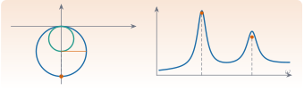

{.portada fig-alt="Ilustración de dos círculos modales en el plano de Nyquist y de una función de respuesta en frecuencia con dos picos"}

```{ojs}
//| echo: false
import {C, cadd, csub, cmul, cdiv, cscale, cconj, cabs, carg} from "../../recursos/js/vibraciones.js"
```

## Objetivos y prerrequisitos

**Objetivos.** Esta unidad, de la que por ahora solo se desarrolla el arranque (M7.1 a M7.3), prepara el terreno de la identificación modal. Al terminar esta parte sabrás:

- situar el análisis modal **experimental** frente al **teórico** y describir sus tres modelos (espacial, modal y de respuesta);
- enunciar y comprobar las hipótesis de las que depende la teoría modal: linealidad, invariancia temporal, observabilidad y reciprocidad;
- leer en una FRF los **polos** (frecuencia y amortiguamiento) y los **residuos** (amplitud) y explicar por qué cerca de una resonancia aislada la FRF dibuja un **círculo**;
- relacionar los residuos de la matriz de FRF con las **formas modales** y recuperar una forma modal a partir de una fila o columna de residuos.

**Prerrequisitos.** [J3.3 · Álgebra lineal numérica](../../julia/j3-computacion/j3-3-algebra-numerica/index.qmd), [J3.7 · Optimización](../../julia/j3-computacion/j3-7-optimizacion/index.qmd), y la teoría de [M5](../m05-vibraciones-i/index.qmd) y [M6](../m06-vibraciones-ii/index.qmd) (definiciones, convención $e^{+i\omega t}$ y notación, que aquí **no** se repiten).

**Temas de la unidad**

- **M7.1** Análisis modal experimental (EMA) frente a operacional (OMA)
- **M7.2** Métodos de 1 GDL en frecuencia: peak-picking, circle-fit y FRF inversa
- **M7.3** Ajuste de FRF por mínimos cuadrados en sistemas de varios GDL
- **M7.4** Decremento aleatorio
- **M7.5** Métodos en el dominio del tiempo: Ibrahim (ITD) y ERA
- **M7.6** Modelos ARMA
- **M7.7** Descomposición en el dominio de la frecuencia: FDD y EFDD
- **M7.8** Identificación estocástica por subespacios: SSI-Cov y SSI-Data
- **M7.9** Diagramas de estabilización y validación: MAC, MPC y amortiguamiento

::: {.callout-warning title="Alcance de esta versión"}
Los apuntes de partida (ocho PDF de teoría de vibraciones) **no** son una explicación de los algoritmos de identificación. Aquí solo se desarrollan los **fundamentos** que sí aparecen en ellos: las hipótesis (M7.1), la relación entre FRF, polos, residuos y parámetros modales y la geometría que motiva el ajuste circular (M7.2) y la expansión modal de la matriz de FRF (M7.3). Los **algoritmos** (peak-picking, circle-fit, FRF inversa, mínimos cuadrados, decremento aleatorio, ITD, ERA, ARMA, FDD/EFDD, SSI, diagramas de estabilización) y la comparación **EMA–OMA** quedan **pendientes** de fuentes primarias verificables.
:::

::: {.callout-note collapse="true" title="Fuentes, correcciones y qué queda pendiente"}
**Fuentes.** Apuntes manuscritos del Máster Agrela, curso 2024-2025 (carpeta *Teoría de vibraciones*); *PDF, p. n* = página del PDF.

| Contenido | Origen |
|---|---|
| M7.1 enfoques teórico y experimental; GDL medibles | *Intro*, p. 1–2 |
| M7.1 hipótesis (linealidad, invariancia, observabilidad, reciprocidad) | *Intro*, p. 1 y 3 |
| M7.1 modelos espacial, modal y de respuesta | *MDOF*, p. 1 y 9 |
| M7.2 polos, residuos, modelos polinómico y de fracciones simples | *FRF*, p. 3–5; *SDOF sin amortiguamiento*, p. 5–6 |
| M7.2 círculo (receptancia histerética) | *Diagrama de Nyquist*, p. 1 |
| M7.3 expansión modal, constantes modales, reciprocidad | *MDOF*, p. 10–13 |
| M7.3 ejemplo (residuos y escalado de formas) | *MDOF Ejemplo*, p. 4–9 |

**Correcciones y precisiones a los apuntes.**

1. *Intro*, p. 1: «$N_i$ ⇒ number of responses (inputs)» debe ser número de **entradas** (fuerzas); $N_o$ son las salidas (respuestas). La relación escrita entre $N_o$, $N_i$ y $N$ (algo del tipo «$\gtrsim N$») **no es legible con seguridad** en el manuscrito y no se reconstruye aquí.
2. *Intro*, p. 3: «Maxwell's reciprocity ⇒ symmetric mass, stiffness, damping and FRF matrices» presenta la reciprocidad como hipótesis y la simetría como consecuencia; en realidad la simetría de las **matrices** es lo que implica la simetría de la FRF (M6.3). La igualdad $H_{pq}=H_{qp}$ exige además comparar la **misma clase** de magnitud (p. ej., fuerza → desplazamiento) en los mismos grados de libertad y direcciones.
3. *FRF*, p. 4: «muchos sistemas de 1 GDL se representan como $H(\omega)\simeq A_1/(i\omega-\lambda_1)$» es una aproximación **local**, válida cerca del polo, para modos bien separados y poco amortiguados (§ M7.2 cuantifica el error).
4. *FRF*, p. 4: en la expresión $H(\omega_1)=-A_1/\sigma_1+\dots$ se usa $\sigma_1<0$ como **parte real** del polo; en la § M7.2 se escribe con $|\sigma|$ para evitar el cambio de signo.
5. *MDOF Ejemplo*, p. 9: véanse las correcciones de signo de la unidad [M6](../m06-vibraciones-ii/index.qmd) (polo del caso proporcional y $c_r=-2\sigma_rm_r$).

**Ampliaciones externas a los apuntes** (derivaciones propias, comprobadas numéricamente en Julia): el círculo exacto del término de un solo polo y su diámetro $|A|/|\sigma|$; la propiedad del semiángulo $\tan(\theta/2)=(\omega-\omega_d)/|\sigma|$ y la estimación de $|\sigma|$ con dos puntos; el error relativo de la aproximación de un polo en función de $\zeta$; la recuperación de formas a partir de una columna de residuos. Lectura para ampliar: [@ewins2000; @silva1999; @avitabile2018].

**Pendiente.** EMA frente a OMA (los apuntes no tratan OMA); peak-picking; algoritmo de circle-fit; FRF inversa; ajuste por mínimos cuadrados; M7.4 a M7.9.
:::

## Teoría breve

### M7.1 Análisis modal experimental (EMA) frente a operacional (OMA) {#m7-1}

El **análisis modal** busca tres cosas de una estructura: sus **frecuencias naturales**, sus **razones de amortiguamiento** y sus **formas modales**. Se puede abordar por dos caminos que se alimentan entre sí:

- **Teórico (analítico).** Parte de la **geometría**, las **condiciones de contorno** y las propiedades del **material** (masa, rigidez, amortiguamiento) y construye un modelo (típicamente, de elementos finitos, M6).
- **Experimental.** Parte de **medidas** de las fuerzas de entrada y de las respuestas de salida, y sigue cuatro pasos: montaje (*set-up*), adquisición de datos, **identificación del sistema** y validación. El análisis teórico aporta el *background*: sirve para planificar el ensayo y para interpretar los resultados.

**Tres modelos de un mismo sistema.** Un sistema lineal puede describirse de tres formas equivalentes (M6):

| Modelo | Contiene | Se obtiene de forma natural… |
|---|---|---|
| **Espacial** | $\mathbf{M}$, $\mathbf{C}$, $\mathbf{K}$ | …del análisis **teórico** (geometría, material) |
| **Modal** | $\omega_r$, $\zeta_r$, $\boldsymbol{\phi}_r$ | …del problema de autovalores del modelo espacial, **o** de la identificación |
| **De respuesta** | $\boldsymbol{\alpha}(\omega)$ (FRF) | …de las **medidas** y también de los otros dos modelos |

```{mermaid}
%%| fig-cap: "Camino teórico (flechas hacia la derecha) y camino experimental (flechas hacia la izquierda) entre los tres modelos."
flowchart LR
    E["Modelo espacial<br/>M, C, K"] -- "autovalores" --> Mo["Modelo modal<br/>ωr, ζr, φr"]
    Mo -- "superposición modal" --> R["Modelo de respuesta<br/>FRF α(ω)"]
    R -. "identificación" .-> Mo
    Mo -. "reconstrucción (si se desea)" .-> E
    Med["Medidas<br/>fuerzas y respuestas"] --> R
```

La **identificación** es el paso experimental de la respuesta (medida) al modelo modal: es lo que desarrollan las unidades M7.2 y siguientes.

**Grados de libertad medibles.** Un sistema continuo tiene infinitos GDL, pero un ensayo solo mide un número finito $N$ (los apuntes citan del orden de 1 a 50), limitado por: el rango de frecuencias de interés, las limitaciones de amplitud y que hay **pocos transductores de giro** (las rotaciones son difíciles de medir). Si se mide con $N_o$ salidas y $N_i$ entradas, esos números condicionan cuántos modos se pueden definir (la relación exacta escrita en los apuntes no se lee con certeza; véase la tabla de correcciones).

**Las hipótesis básicas.** La teoría modal usa de forma implícita cuatro hipótesis. Conviene saber qué dice cada una y cómo se vulnera:

| Hipótesis | Qué afirma | Cómo suele fallar |
|---|---|---|
| **Linealidad** | El sistema se rige por ecuaciones lineales, $\mathbf{M}\ddot{\mathbf{x}}+\mathbf{C}\dot{\mathbf{x}}+\mathbf{K}\mathbf{x}=\mathbf{f}$: la respuesta a una combinación de entradas es la misma combinación de las respuestas. | Rigidez o amortiguamiento que dependen de la amplitud (holguras, rozamiento, grietas que se abren y cierran). |
| **Invariancia temporal** | Las propiedades dinámicas **no cambian en el tiempo** ($\mathbf{M}$, $\mathbf{C}$, $\mathbf{K}$ constantes). | Cambios de temperatura, de masa añadida (tráfico, personas), de condiciones de apoyo durante la medida. |
| **Observabilidad** | Se pueden **medir** todos los datos necesarios para determinar las características dinámicas de interés. | Sensores insuficientes o mal ubicados (p. ej., en un nodo de un modo, que quedaría invisible). |
| **Reciprocidad** (de Maxwell) | La respuesta en $p$ por una fuerza en $q$ **iguala** la respuesta en $q$ por la misma fuerza en $p$: $H_{pq}=H_{qp}$. | Sistemas con efectos no recíprocos (p. ej., giroscópicos) o comparar magnitudes de distinta clase o dirección. |

La reciprocidad es la «hipótesis» que más se confunde con una propiedad automática: es una **consecuencia** de que $\mathbf{M}$, $\mathbf{C}$ y $\mathbf{K}$ sean simétricas (M6.3). En un ensayo, permite medir con el **martillo en un punto y el acelerómetro en otro**, o al revés, y obtener la misma FRF; el esquema de los apuntes (martillo en el punto 3 y sensor en el 1, frente a martillo en 1 y sensor en 3) ilustra justo eso.


{#fig-reciprocidad fig-alt="Dos esquemas de una viga con tres puntos: a la izquierda, sensor en el punto 1 y martillo en el 3; a la derecha, sensor en el 3 y martillo en el 1" width="100%"}

::: {.callout-tip title="Cómo comprobar las hipótesis en un ensayo (ampliación externa a los apuntes)"}
Linealidad: repite el ensayo con **dos niveles de excitación** y compara las FRF; si cambian, hay no linealidad. Invariancia: repite el ensayo en **momentos distintos** y compara. Reciprocidad: mide $H_{pq}$ y $H_{qp}$ y comprueba que coinciden. Observabilidad: comprueba que los puntos de medida no coinciden con nodos de los modos de interés (con un modelo previo, M6).
:::

::: {.callout-important title="Pendiente en esta sección"}
Los apuntes **no tratan** el **análisis modal operacional** (OMA: identificación con excitación desconocida, no medida). Por eso la comparación EMA–OMA del título del tema queda pendiente; se desarrollará con fuentes primarias (p. ej., [@silva1999; @ewins2000] para EMA y una referencia de OMA).
:::

**Pon a prueba lo anterior.**

::: {.ejercicio tipo="opcion" id="m7-1-hipotesis" respuesta="c"}
El único sensor de un ensayo está en un **nodo** de un modo de interés. ¿Qué hipótesis de la teoría modal falla?

::: {.opciones}
- Linealidad.
- Invariancia temporal.
- Observabilidad.
- Reciprocidad.
:::

::: {.solucion}
Observabilidad: en un nodo el modo no se mueve, así que **no se puede medir**. Conviene comprobar con un modelo previo que los puntos de medida no coinciden con nodos.
:::
:::

::: {.ejercicio tipo="vf" id="m7-1-recip" respuesta="falso"}
La reciprocidad es una propiedad independiente de la simetría de las matrices $\mathbf{M}$, $\mathbf{C}$ y $\mathbf{K}$.

::: {.solucion}
**Falso.** Es una **consecuencia** de esa simetría. Sistemas con efectos no recíprocos (p. ej., giroscópicos) no la cumplen.
:::
:::

### M7.2 Métodos de 1 GDL en frecuencia: peak-picking, circle-fit y FRF inversa {#m7-2}

Aquí no se desarrollan los métodos, sino la **relación entre la FRF y los parámetros modales** y la **geometría** en la que se apoya el ajuste circular.

**Polos y residuos de un oscilador de 1 GDL.** De M5.6, con $s_1=\sigma+i\omega_d$ ($\sigma=-\zeta\omega_n<0$) y condiciones iniciales nulas,

$$
H(s)=\frac{A}{s-s_1}+\frac{A^*}{s-s_1^*},\qquad A=\frac{1}{2i\,m\,\omega_d}.
$$

La FRF es la misma función sobre el eje imaginario, $H(i\omega)=A/(i\omega-s_1)+A^*/(i\omega-s_1^*)$. Los apuntes presentan dos representaciones equivalentes:

- **Polinómica:** $H=\beta_0/(a_2s^2+a_1s+a_0)$, con los **coeficientes** como incógnitas.
- **De fracciones simples:** polos y residuos como incógnitas.

La segunda es la que da **sentido físico**: cada polo contiene dos parámetros modales y cada residuo, la amplitud.

| Qué se lee | Dónde está |
|---|---|
| Frecuencia amortiguada $\omega_d$ | parte **imaginaria** del polo |
| Decaimiento $\lvert\sigma\rvert=\zeta\omega_n$ | parte **real** del polo |
| Frecuencia natural no amortiguada $\omega_n$ | **módulo** del polo, $\lvert s_1\rvert=\sqrt{\sigma^2+\omega_d^2}$ |
| Razón de amortiguamiento $\zeta$ | $-\sigma/\lvert s_1\rvert$ |
| Amplitud | **residuo** $A$ (y, con él, la masa) |

**Aproximación de un solo polo.** Cerca de la resonancia, el denominador $i\omega-s_1$ se hace pequeño, de modo que el primer sumando domina y

$$
H(i\omega)\approx H_1(i\omega)=\frac{A}{i\omega-s_1}=\frac{A}{\lvert\sigma\rvert+i\,(\omega-\omega_d)} .
$$ {#eq-unpolo}

El segundo sumando, $A^*/(i\omega-s_1^*)$, queda en $\omega\approx\omega_d$ con módulo $\lvert A\rvert/\lvert 2i\omega_d-\sigma\rvert\approx\lvert A\rvert/(2\omega_d)$: es, respecto del primero ($\lvert A\rvert/\lvert\sigma\rvert$), un factor $\approx\zeta/2$ más pequeño y varía lentamente. Eso es lo que hace útil @eq-unpolo para modos **poco amortiguados y bien separados**.

**La geometría: un círculo exacto.**

::: {#prp-unpolo}
**Círculo de un solo polo.** Sea $\Delta=\omega-\omega_d$. El término de un solo polo $A/(\lvert\sigma\rvert+i\Delta)$ recorre, al variar $\omega$, **exactamente** un círculo de

$$
\text{centro}=\frac{A}{2\lvert\sigma\rvert},\qquad\text{diámetro}=\frac{\lvert A\rvert}{\lvert\sigma\rvert},
$$

que pasa por el origen.
:::

::: {.callout-note .demostracion collapse="true" title="Demostración"}
Con $a=\lvert\sigma\rvert>0$ fijo y $\Delta$ real, $\dfrac{1}{a+i\Delta}-\dfrac{1}{2a}=\dfrac{a-i\Delta}{2a\,(a+i\Delta)}$, que tiene módulo $\dfrac{1}{2a}$ para todo $\Delta$: es la circunferencia de centro $1/(2a)$ y radio $1/(2a)$, que pasa por el origen. Multiplicar por el residuo $A$ **escala** (por $\lvert A\rvert$) y **gira** (por $\arg A$) esa circunferencia: centro $A/(2a)$ y diámetro $\lvert A\rvert/a$.
:::

Observa tres cosas:

1. El punto de **resonancia** $\omega=\omega_d$ es el más alejado del origen: $H_1(i\omega_d)=A/\lvert\sigma\rvert$, y su módulo es el diámetro.
2. La **fase del residuo** orienta el círculo. Con residuo imaginario puro (1 GDL o amortiguamiento proporcional), el círculo queda apoyado sobre el eje real con el diámetro en el eje imaginario negativo (para la receptancia, $A=-i/(2m\omega_d)$). Un residuo **complejo** (modos complejos, M6.4) **gira** el círculo.
3. **Propiedad del semiángulo.** El ángulo $\theta$ que barre el radio desde el punto de resonancia hasta el punto de frecuencia $\omega$ cumple

$$
\tan\frac{\theta(\omega)}{2}=\frac{\omega-\omega_d}{\lvert\sigma\rvert}.
$$ {#eq-semiangulo}

   De ahí que los puntos con $\omega=\omega_d\pm\lvert\sigma\rvert$ estén a $\theta=\pm90^\circ$, y que **dos puntos** $\omega_a<\omega_d<\omega_b$ de ángulos $\theta_a,\theta_b$ den $\lvert\sigma\rvert=\dfrac{\omega_b-\omega_a}{\tan(\theta_a/2)+\tan(\theta_b/2)}$ sin conocer antes $\omega_d$.

{#fig-circulo fig-alt="Círculo en el plano complejo que pasa por el origen; el punto inferior es la resonancia y dos radios señalan puntos de frecuencia menor y mayor con sus ángulos theta a y theta b" width="60%"}

**Qué es y qué no es un círculo.** Conviene separar tres casos, porque se confunden:

| FRF | ¿Es un círculo exacto? |
|---|---|
| Receptancia con amortiguamiento **histerético** | **Sí**, para $h$ constante (M5.5). Es la deducción del PDF *Diagrama de Nyquist*. |
| Término de **un solo polo** de la FRF viscosa, @eq-unpolo | **Sí** (lo anterior). |
| Receptancia **viscosa** completa (suma de los dos términos) | **No**: es **aproximadamente** circular cerca de una resonancia aislada, tanto más cuanto menor sea $\zeta$. (La **movilidad** viscosa de 1 GDL sí es un círculo exacto, M5.5.) |

El error de aproximar la FRF viscosa completa por el círculo de un solo polo, medido como la mayor desviación del módulo respecto del radio dentro de la banda $|\omega-\omega_d|\le3\lvert\sigma\rvert$ (con $m=1$ kg, $k=100$ N/m; cálculo en Julia):

| $\zeta$ | 0,01 | 0,05 | 0,2 | 0,6 |
|---|---|---|---|---|
| Desviación relativa al radio | $1\,\%$ | $5\,\%$ | $23\,\%$ | $>100\,\%$ |

Con amortiguamientos pequeños (habituales en estructuras) el ajuste circular es razonable; con amortiguamientos grandes, no. Esto no se «extiende» al caso viscoso por decreto: es una **aproximación con error acotado que depende de $\zeta$**.

**Simulación 1. Un modo en el plano de Nyquist.** Compara la FRF modal completa (azul) con el término de un solo polo (naranja) y con el círculo ajustado (gris). Gira la fase del residuo para ver el efecto de un modo complejo.

```{ojs}
//| echo: false
viewof Z_zeta = Inputs.range([0.01, 0.5], {value: 0.05, step: 0.005, label: "ζ"})
```
```{ojs}
//| echo: false
viewof Z_fase = Inputs.range([-180, 0], {value: -90, step: 5, label: "fase del residuo (°)"})
```
```{ojs}
//| echo: false
viewof Z_mostrar = Inputs.checkbox(["término de un solo polo", "círculo ajustado"], {value: ["término de un solo polo", "círculo ajustado"], label: "Mostrar"})
```
```{ojs}
//| echo: false
Z_wn = 10
Z_sigma = Z_zeta * Z_wn
Z_wd = Z_wn * Math.sqrt(1 - Z_zeta ** 2)
Z_s = C(-Z_sigma, Z_wd)
Z_A = {
  const mag = 1 / (2 * Z_wd), f = Z_fase * Math.PI / 180;
  return C(mag * Math.cos(f), mag * Math.sin(f));
}
Z_H1 = w => cdiv(Z_A, csub(C(0, w), Z_s))
Z_H = w => cadd(Z_H1(w), cdiv(cconj(Z_A), csub(C(0, w), cconj(Z_s))))
Z_ws = Array.from({length: 1500}, (_, i) => Math.max(Z_wd - 8 * Z_sigma, 0.2) + (16 * Z_sigma) * i / 1499)
Z_centro = cscale(Z_A, 1 / (2 * Z_sigma))
Z_radio = cabs(Z_A) / (2 * Z_sigma)
Z_circ = Array.from({length: 361}, (_, i) => { const a = 2 * Math.PI * i / 360; return {re: Z_centro.re + Z_radio * Math.cos(a), im: Z_centro.im + Z_radio * Math.sin(a)}; })
Z_dev = {
  let m = 0;
  for (let i = 0; i <= 600; i++) {
    const w = Z_wd - 3 * Z_sigma + 6 * Z_sigma * i / 600;
    const z = Z_H(w);
    m = Math.max(m, Math.abs(Math.hypot(z.re - Z_centro.re, z.im - Z_centro.im) - Z_radio));
  }
  return m / Z_radio;
}
```
```{ojs}
//| echo: false
Plot.plot({
  width: 520, height: 420, aspectRatio: 1, marginLeft: 70,
  x: {label: "Re (m/N)", grid: true},
  y: {label: "Im (m/N)", grid: true},
  marks: [
    Plot.ruleX([0]), Plot.ruleY([0]),
    Z_mostrar.includes("círculo ajustado") ? Plot.line(Z_circ, {x: "re", y: "im", stroke: "#999", strokeDasharray: "4 3"}) : null,
    Z_mostrar.includes("término de un solo polo") ? Plot.line(Z_ws.map(w => ({...Z_H1(w)})), {x: "re", y: "im", stroke: "#d95f02", strokeWidth: 1.8}) : null,
    Plot.line(Z_ws.map(w => ({...Z_H(w)})), {x: "re", y: "im", stroke: "#1b6ca8", strokeWidth: 2.2}),
    Plot.dot([Z_H1(Z_wd)], {x: "re", y: "im", fill: "#d95f02", r: 5})
  ].filter(Boolean)
})
```
```{ojs}
//| echo: false
md`ω<sub>n</sub> = ${Z_wn} rad/s · |σ| = ${Z_sigma.toFixed(2)} 1/s · ω<sub>d</sub> = ${Z_wd.toFixed(3)} rad/s · diámetro = |A|/|σ| = ${(2 * Z_radio).toFixed(4)} · desviación de la FRF completa respecto del círculo, en |ω − ω<sub>d</sub>| ≤ 3|σ|: **${(100 * Z_dev).toFixed(1)} %** del radio. Punto naranja: resonancia ω = ω<sub>d</sub>.`
```

::: {.callout-warning title="Errores frecuentes"}
- Decir que la receptancia **viscosa** «es un círculo»: lo es solo de forma aproximada y cerca de un modo aislado; el círculo exacto es el del **término de un polo** o el de la receptancia **histerética**.
- Confundir el punto de **máximo módulo** con $\omega_n$ o con $\omega_d$: en el término de un polo está en $\omega_d$ (M5.4 distingue las tres frecuencias).
- Aplicar el ajuste circular a modos **muy próximos**: el segundo modo deja de ser «una pequeña perturbación».
:::

::: {.callout-important title="Pendiente en esta sección"}
**Algoritmos.** El **peak-picking**, el **algoritmo de circle-fit** (estimación del círculo por mínimos cuadrados, selección de puntos, ajuste del término residual de los otros modos) y la **FRF inversa** no figuran en los apuntes. Se desarrollarán con fuentes primarias verificables.
:::

::: {.callout-note .historia icon=false title="Un poco de historia: los gráficos vectoriales de Kennedy y Pancu"}
En 1947, Kennedy y Pancu propusieron representar la respuesta en frecuencia como un **gráfico vectorial** en el plano complejo, en lugar de limitarse a medir la altura del pico [@kennedy1947]. Estudios posteriores recogieron que el método del pico es poco fiable con amortiguamientos grandes o frecuencias muy próximas, casos en los que sí conviene el diagrama vectorial. Esa tradición está detrás de las técnicas de ajuste circular que se desarrollan a partir de aquí.

<span class="fuentes-caja">Sobre su recepción: Bishop y Gladwell (1963) la citaron como alternativa teóricamente más atractiva al método del pico. Fuentes secundarias consultadas el 21-10-2026; no he accedido al artículo original.</span>
:::

**Pon a prueba lo anterior.**

::: {.ejercicio tipo="numerico" id="m7-2-diametro" respuesta="0.1001" tol="1%" unidad="m/N"}
Para $m=1$ kg, $k=100$ N/m y $c=1$ N·s/m, calcula el diámetro del círculo del término de un solo polo de la receptancia.

::: {.pista}
$\omega_d=\omega_n\sqrt{1-\zeta^2}$, $\lvert A\rvert=1/(2m\omega_d)$ y $\lvert\sigma\rvert=\zeta\omega_n$.
:::

::: {.solucion}
$\zeta=0{,}05$, $\omega_d=9{,}987$ rad/s, $\lvert\sigma\rvert=0{,}5$ s$^{-1}$ y $\lvert A\rvert=0{,}05006$. Diámetro $=\lvert A\rvert/\lvert\sigma\rvert=0{,}1001$ m/N.
:::
:::

::: {.ejercicio tipo="numerico" id="m7-2-sigma" respuesta="0.5" tol="2%" unidad="1/s"}
De un círculo de un polo se leen dos puntos: $\omega_a=9{,}287$ rad/s con $\theta_a=108{,}9^\circ$ y $\omega_b=10{,}387$ rad/s con $\theta_b=77{,}3^\circ$. Estima $\lvert\sigma\rvert$.

::: {.solucion}
$\lvert\sigma\rvert=(\omega_b-\omega_a)/\big(\tan(\theta_a/2)+\tan(\theta_b/2)\big)=1{,}1/(1{,}40+0{,}80)=0{,}50$ s$^{-1}$.
:::
:::

::: {.ejercicio tipo="vf" id="m7-2-viscoso" respuesta="falso"}
La receptancia **viscosa** completa de un oscilador de 1 GDL describe un círculo exacto en el plano de Nyquist.

::: {.solucion}
**Falso.** Solo es **aproximadamente** circular cerca de un modo aislado y poco amortiguado. Son círculos exactos el término de **un solo polo**, la receptancia **histerética** y la **movilidad** viscosa.
:::
:::

::: {.ejercicio tipo="investigacion" id="m7-2-oma"}
**Una aplicación real.** Busca un artículo en el que se identifiquen las propiedades modales de una estructura real (puente, edificio, aerogenerador) y anota qué se midió y qué se obtuvo.

::: {.criterios}
- Localizo el artículo y anoto autores, año, revista y enlace (DOI si existe).
- Indico qué sensores se usaron y cuántos puntos de medida hubo.
- Anoto las frecuencias y los amortiguamientos identificados, con las unidades.
- Compruebo que el artículo existe y que los datos que apunto están en él (C0.5).
:::

::: {.solucion}
Un punto de partida de la bibliografía de la asignatura es el artículo sobre aerogeneradores citado en M0 [@carne2010]. Lo importante es que cada cifra que anotes se pueda **localizar** en la fuente.
:::
:::

### M7.3 Ajuste de FRF por mínimos cuadrados en sistemas de varios GDL {#m7-3}

Aquí tampoco se desarrolla el ajuste por mínimos cuadrados, sino la **estructura de la FRF** que dicho ajuste explota: la **expansión modal** de la matriz de FRF y la relación entre **residuos** y **formas modales**.

**Expansión modal.** De M6.3 y M6.4, para un sistema lineal con $n$ modos y amortiguamiento viscoso,

$$
\boldsymbol{\alpha}(\omega)=\sum_{r=1}^{n}\left[\frac{\boldsymbol{\phi}_r\boldsymbol{\phi}_r^\top}{i\omega-s_r}+\frac{\boldsymbol{\phi}_r^*\boldsymbol{\phi}_r^{*\top}}{i\omega-s_r^*}\right],\qquad
\alpha_{jk}(\omega)=\sum_{r=1}^{n}\left[\frac{{}_rA_{jk}}{i\omega-s_r}+\frac{{}_rA_{jk}^*}{i\omega-s_r^*}\right],
$$

con ${}_rA_{jk}=\phi_{jr}\phi_{kr}$ la **constante modal** (o residuo) del modo $r$ entre los puntos de respuesta $j$ y excitación $k$. Cada modo aporta a la FRF lo mismo que un oscilador de 1 GDL (M7.2) y la FRF total es la **suma de $n$ contribuciones**: cada término tiene un par de polos $s_r,s_r^*$ y un residuo. En el plano de Nyquist, cada modo **bien separado** aporta su propio «lazo» circular.

Con amortiguamiento proporcional (modos reales normalizados a la masa, $\mathbf{\Phi}^\top\mathbf{M}\mathbf{\Phi}=\mathbf{I}$), la misma estructura se escribe con $\omega_r^2-\omega^2+2i\zeta_r\omega_r\omega$ en el denominador y numerador real $\phi_{jr}\phi_{kr}$ (M6.3). **Con amortiguamiento no proporcional** el numerador es **complejo**: los residuos tienen fase y las formas son complejas.

**Los residuos contienen las formas modales.** Para cada modo, la matriz de residuos $\boldsymbol{\phi}_r\boldsymbol{\phi}_r^\top$ tiene **rango uno**: ${}_rA_{jk}\,{}_rA_{lm}={}_rA_{jm}\,{}_rA_{lk}$. Consecuencias:

1. **Una columna basta.** Si se conoce la columna $k$ de la matriz de residuos del modo $r$ (la FRF entre **todas** las respuestas $j$ y una **única** excitación $k$), se obtiene la forma completa: el **punto de excitación** da el residuo $A_{kk}=\phi_{kr}^2$ y, de él, $\phi_{kr}=\sqrt{A_{kk}}$ (el **signo** —o la fase global en el caso complejo— queda indeterminado: la forma se conoce salvo un factor de escala). El resto sale de $\phi_{jr}=A_{jk}/\phi_{kr}$. El cociente $\phi_{jr}/\phi_{kr}=A_{jk}/A_{kk}$ **no depende de la escala**.
2. **Intercambiar entrada y salida.** Como $A_{jk}=A_{kj}$, medir una **fila** equivale a medir una columna (reciprocidad, M6.3). En la práctica: o un punto fijo de excitación y muchos de respuesta (martillo fijo, sensor móvil) o al revés (sensor fijo, martillo móvil).
3. **Truncamiento.** Con **todos** los modos del modelo, una columna determina toda la matriz; con modos truncados (p. ej., solo los de la banda medida), la reconstrucción es aproximada.

**La escala de la forma.** El residuo **mezcla forma y escala**; no se puede separar una de otra sin información adicional (la masa, o una fuerza conocida):

- Con modos **reales** y amortiguamiento proporcional, si las formas están normalizadas a la masa, el residuo de la receptancia es $A_{jk}=\dfrac{\phi_{jr}\phi_{kr}}{2i\,\omega_{d,r}}$ (M6.4, normalizando por $a_r=2i\omega_d$), de modo que $\phi_{kr}^2=2i\,\omega_{d,r}A_{kk}$.
- Con modos **complejos** la «masa modal» $a_r=\boldsymbol{\psi}_r^\top(2s_r\mathbf{M}+\mathbf{C})\boldsymbol{\psi}_r$ es compleja y la normalización a masa unidad ya no hace reales las formas. En identificación, la forma se suele presentar relativa a un punto de referencia o normalizada por su componente mayor; hay que indicar siempre la convención.

**Parámetros modales sin conocer $\mathbf{M}$, $\mathbf{C}$, $\mathbf{K}$.** Los apuntes subrayan que **la masa, el amortiguamiento y la rigidez no hacen falta** para llegar al modelo modal: de los polos salen $\omega_r$ y $\zeta_r$ y de los residuos las formas (con su escala). Fijada la **masa modal unidad**, se obtienen directamente la **amortiguación modal** $c_r=-2\sigma_rm_r$ y la **rigidez modal** $k_r=(\sigma_r^2+\omega_{d,r}^2)\,m_r$. Esto es lo que usa una identificación: parte de la FRF (modelo de respuesta) y llega al modelo modal sin tocar el espacial.

**Un ejemplo completo: dos masas.** Con las matrices de M6 ($\mathbf{M}=\mathrm{diag}(5,10)$, $\mathbf{K}=\begin{bmatrix}4&-2\\-2&6\end{bmatrix}$) y los dos casos de amortiguamiento ya vistos, los residuos de la FRF (calculados) y las formas recuperadas con $\phi_{2r}/\phi_{1r}=A_{21}/A_{11}$ son:

| Caso | Modo | Polo | $A_{11}$ | $A_{21}$ | $\phi_2/\phi_1=A_{21}/A_{11}$ |
|---|---|---|---|---|---|
| Proporcional | 1 | $-0{,}1+0{,}6245\,i$ | $-0{,}0534\,i$ | $-0{,}0534\,i$ | $1{,}000\angle0^\circ$ |
| Proporcional | 2 | $-0{,}25+0{,}9682\,i$ | $-0{,}0689\,i$ | $+0{,}0344\,i$ | $0{,}500\angle180^\circ=-0{,}5$ |
| No proporcional | 1 | $-0{,}0954+0{,}6295\,i$ | $-0{,}0086-0{,}0420\,i$ | $-0{,}0035-0{,}0501\,i$ | $1{,}172\angle7{,}6^\circ$ |
| No proporcional | 2 | $-0{,}7546+0{,}6460\,i$ | $+0{,}0086-0{,}1227\,i$ | $+0{,}0035+0{,}0453\,i$ | $0{,}369\angle171{,}6^\circ$ |

En el caso proporcional salen las formas reales de M6 (en fase $[1,1]$ y en oposición $[1,-\tfrac12]$) y, con $\phi_1^2=2i\omega_dA_{11}$, la forma normalizada a la masa: $\phi_1^2=2\cdot0{,}6245\cdot0{,}0534=0{,}0667=1/15$ y $\phi_1=0{,}2582$. En el no proporcional el cociente es **complejo**, con fases $7{,}6^\circ$ y $171{,}6^\circ$ (en lugar de $0^\circ$ y $180^\circ$): las componentes **no pasan por cero a la vez**. Comprobado: el cociente $A_{21}/A_{11}$ coincide con el de las formas calculadas de los autovectores del espacio de estados.

::: {.callout-warning title="Errores frecuentes"}
- Olvidar que $\sqrt{A_{kk}}$ está definida **salvo signo** (o fase global): dos formas que difieren en el signo son la misma forma.
- Comparar formas de dos ensayos sin fijar la **misma normalización**.
- Pensar que los residuos de un modo complejo son «ruido»: tienen su fase y llevan información real (sin ella, no se recupera la forma).
:::

::: {.callout-important title="Pendiente en esta sección"}
**El ajuste por mínimos cuadrados** de las FRF de varios GDL (formulación de las ecuaciones, resolución, mal condicionamiento, elección del orden) no está en los apuntes. Tampoco la medición de **complejidad modal** o el **MAC**. Se desarrollarán con fuentes primarias verificables.
:::

::: {.callout-tip .idea-clave title="Idea clave"}
Una **columna** de la matriz de residuos (una excitación y todas las respuestas) basta para recuperar la forma modal relativa. El residuo mezcla forma y escala: hay que fijar una convención.
:::

**Pon a prueba lo anterior.**

::: {.ejercicio tipo="numerico" id="m7-3-razon" respuesta="-0.5" tol="1%"}
En el caso proporcional, para el segundo modo los residuos son $A_{11}=-0{,}06885\,i$ y $A_{21}=+0{,}03443\,i$. Calcula el cociente $\phi_2/\phi_1=A_{21}/A_{11}$.

::: {.solucion}
$A_{21}/A_{11}=0{,}03443/(-0{,}06885)=-0{,}5$: la forma es $[1,\ -\tfrac12]$, es decir, las dos masas se mueven en **oposición**.
:::
:::

::: {.ejercicio tipo="vf" id="m7-3-signo" respuesta="verdadero"}
La raíz $\sqrt{A_{kk}}$ de un residuo de punto de excitación solo está definida salvo signo (o fase global).

::: {.solucion}
**Verdadero.** Dos formas que difieren en el signo son la misma forma: por eso se habla de forma modal «relativa» y hay que fijar una convención.
:::
:::

::: {.ejercicio tipo="programacion" id="m7-3-rango" respuesta="0" tol="abs:1e-9"}
Construye en Julia la matriz de residuos $\mathbf{A}=\boldsymbol{\phi}\boldsymbol{\phi}^\top$ (transpuesta **sin conjugar**) con $\boldsymbol{\phi}=[1+2i,\ 3-i]$ y calcula $\lvert A_{11}A_{22}-A_{12}A_{21}\rvert$. Escribe el resultado.

```julia
φ = [1 + 2im, 3 - 1im]
# A = φ * transpose(φ)
# abs(A[1,1]*A[2,2] - A[1,2]*A[2,1])
```

::: {.solucion}
```julia
A = φ * transpose(φ)
abs(A[1,1]*A[2,2] - A[1,2]*A[2,1])   # 0.0
```
Una matriz de rango uno tiene determinante nulo: es la propiedad que permite recuperar la forma desde una columna.
:::
:::

::: {.ejercicio tipo="abierta" id="m7-3-columna"}
Explica por qué basta con medir **una columna** de la matriz de FRF para conocer las formas modales, y qué se pierde si se truncan modos.

::: {.rubrica}
- Digo que la matriz de residuos de cada modo tiene rango uno, $\boldsymbol{\phi}_r\boldsymbol{\phi}_r^\top$.
- Explico que el residuo del punto de excitación da $\phi_{kr}=\sqrt{A_{kk}}$ y el resto sale de $A_{jk}/\phi_{kr}$.
- Señalo que la forma queda definida salvo escala.
- Advierto que con modos truncados la reconstrucción de toda la matriz es solo aproximada.
:::

::: {.solucion}
Cada modo aporta $\boldsymbol{\phi}_r\boldsymbol{\phi}_r^\top$, de rango uno: la columna $k$ es $\phi_{kr}\boldsymbol{\phi}_r$, proporcional a la forma. Conocer una columna da la forma (salvo escala) y, con todos los modos, toda la matriz; con modos truncados, solo de forma aproximada.
:::
:::

### M7.4 Decremento aleatorio {#m7-4}

::: {.callout-important title="Pendiente"}
Sin contenido en los apuntes de partida. Se conserva el apartado.
:::

### M7.5 Métodos en el dominio del tiempo: Ibrahim (ITD) y ERA {#m7-5}

::: {.callout-important title="Pendiente"}
Sin contenido en los apuntes de partida. Se conserva el apartado.
:::

### M7.6 Modelos ARMA {#m7-6}

::: {.callout-important title="Pendiente"}
Sin contenido en los apuntes de partida. Se conserva el apartado.
:::

### M7.7 Descomposición en el dominio de la frecuencia: FDD y EFDD {#m7-7}

::: {.callout-important title="Pendiente"}
Sin contenido en los apuntes de partida. Se conserva el apartado.
:::

### M7.8 Identificación estocástica por subespacios: SSI-Cov y SSI-Data {#m7-8}

::: {.callout-important title="Pendiente"}
Sin contenido en los apuntes de partida. Se conserva el apartado.
:::

### M7.9 Diagramas de estabilización y validación: MAC, MPC y amortiguamiento {#m7-9}

::: {.callout-important title="Pendiente"}
Sin contenido en los apuntes de partida. Se conserva el apartado.
:::

## Práctica guiada

**De los residuos a las formas modales.** Con el sistema de dos masas de M6 ($m_1=5$, $m_2=10$, $k_1=k_2=2$, $k_3=4$) y los casos proporcional ($c_1=c_2=1$, $c_3=2$) y no proporcional ($c_1=2$, $c_2=4$, $c_3=1$):

1. Calcula los polos y los residuos $A_{11}$, $A_{21}$, $A_{22}$ de cada modo.
2. Comprueba que la matriz de residuos tiene rango uno ($A_{11}A_{22}-A_{21}^2=0$).
3. Recupera la forma con $\phi_1=\sqrt{A_{11}}$ y $\phi_2=A_{21}/\phi_1$, y comprueba que coincide (salvo signo) con la forma calculada.
4. En el caso proporcional, obtén la forma normalizada a la masa con $\phi_1^2=2i\omega_dA_{11}$.
5. Comprueba que la FRF reconstruida con los residuos coincide con la inversión directa de $\mathbf{K}-\omega^2\mathbf{M}+i\omega\mathbf{C}$.

Código Julia (solo biblioteca estándar; se ejecuta en local con `julia --project=. practica_m7.jl`):

```julia
using LinearAlgebra

M = [5.0 0; 0 10.0];  K = [4.0 -2; -2 6.0]
casos = [("proporcional", [2.0 -1; -1 3]), ("no proporcional", [6.0 -4; -4 5])]

# Polos y formas del problema cuadrático, por el espacio de estados
function modos(M, C, K)
    A = [zeros(2, 2) I; -(M \ K) -(M \ C)]
    e = eigen(A);  s = e.values;  V = e.vectors
    idx = findall(imag.(s) .> 0);  idx = idx[sortperm(abs.(s[idx]))]
    return [(s[r], V[1:2, r]) for r in idx]
end

for (nombre, C) in casos
    println("\n== ", nombre, " ==")
    res = Matrix{ComplexF64}[]
    for (s, ψ) in modos(M, C, K)
        a = transpose(ψ) * (2s * M + C) * ψ           # ψᵀ(2sM + C)ψ (sin conjugar)
        φ = ψ / sqrt(a)                               # forma con residuo = φφᵀ
        A = φ * transpose(φ)                          # matriz de residuos del modo
        push!(res, A)
        # recuperación de la forma desde la columna 1 de residuos
        φ1 = sqrt(A[1, 1]);  φ2 = A[2, 1] / φ1
        println("polo ", round(s; digits=4), ":  A11 = ", round(A[1, 1]; digits=4),
                ",  A21 = ", round(A[2, 1]; digits=4),
                ",  |A11 A22 − A21²| = ", round(abs(A[1, 1] * A[2, 2] - A[2, 1]^2); sigdigits=2))
        println("   φ2/φ1 = ", round(abs(φ2 / φ1); digits=4), " ∠ ", round(rad2deg(angle(φ2 / φ1)); digits=2),
                "°   ¿igual a la forma calculada? ",
                isapprox(abs(φ2 / φ1), abs(ψ[2] / ψ[1]); atol=1e-9))
        if nombre == "proporcional"
            ωd = imag(s)
            println("   φ1² normalizado a la masa = 2iωd·A11 = ", round(real(2im * ωd * A[1, 1]); digits=5))
        end
    end
    # FRF por residuos frente a inversión directa (receptancia, ω = 0,5)
    ω = 0.5
    s_modos = modos(M, C, K)
    H = sum(res[r] / (im * ω - s_modos[r][1]) + conj(res[r]) / (im * ω - conj(s_modos[r][1])) for r in 1:2)
    println("‖H_residuos − H_directa‖ = ", round(norm(H - inv(K - ω^2 * M + im * ω * C)); sigdigits=2))
end
```

**Resultados** (salida del código anterior):

| Caso | Modo | $\lvert A_{11}A_{22}-A_{21}^2\rvert$ | $\lvert\phi_2/\phi_1\rvert$ | Fase de $\phi_2/\phi_1$ | $\phi_1^2$ normalizado a la masa |
|---|---|---|---|---|---|
| Proporcional | 1 | $<10^{-18}$ | $1{,}0000$ | $0^\circ$ | $0{,}06667=1/15$ |
| Proporcional | 2 | $<10^{-18}$ | $0{,}5000$ | $180^\circ$ | $0{,}13333=2/15$ |
| No proporcional | 1 | $<10^{-18}$ | $1{,}1725$ | $7{,}57^\circ$ | – |
| No proporcional | 2 | $<10^{-18}$ | $0{,}3693$ | $171{,}62^\circ$ | – |

La FRF reconstruida con los residuos coincide con la inversión directa (diferencia $\lesssim10^{-15}$).

## «Pídeselo a Claude»

::: {.callout-tip title="Prompt"}
Tengo una FRF teórica de un sistema de 2 GDL con residuos $A_{11}$, $A_{21}$ y $A_{22}$ para cada modo. Escribe un script de Julia (solo biblioteca estándar) que: (1) compruebe que la matriz de residuos de cada modo tiene rango uno; (2) recupere la forma modal relativa con $\phi_2/\phi_1=A_{21}/A_{11}$; (3) reconstruya la FRF con residuos y polos y la compare con la inversión directa. Explica qué hipótesis exige cada paso (linealidad, simetría de las matrices, todos los modos presentes) y qué quedaría fuera si se truncaran modos.

**Verifica.**

- El cociente $A_{21}/A_{11}$ coincide con el de los autovectores (no con la raíz cuadrada de $A_{22}/A_{11}$ sin cuidar el signo).
- El código usa la transpuesta **sin conjugar** en $\boldsymbol{\psi}^\top(2s\mathbf{M}+\mathbf{C})\boldsymbol{\psi}$; si conjuga, la normalización sale distinta.
- No se afirma que el ajuste de la FRF sea «un círculo» salvo con las condiciones de M7.2.
- No hay paquetes ni funciones inexistentes (C0.5).
:::

## Ejercicios

1. **Hipótesis.** Indica qué hipótesis (linealidad, invariancia temporal, observabilidad, reciprocidad) se vulnera en cada caso: (a) la rigidez de una unión aumenta con la amplitud; (b) la temperatura cambia durante la medida y con ella la rigidez; (c) el único sensor está en un nodo de un modo; (d) se compara la FRF fuerza–desplazamiento en el punto 1 con la FRF fuerza–giro en el punto 2.

   ::: {.callout-note collapse="true" title="Solución"}
   (a) Linealidad. (b) Invariancia temporal. (c) Observabilidad. (d) Reciprocidad: no se comparan magnitudes de la misma clase en los mismos GDL.
   :::

2. **Círculo de un polo.** Para $m=1$ kg, $k=100$ N/m y $c=1$ N·s/m, calcula el diámetro del círculo del término de un solo polo de la receptancia y la posición de su centro.

   ::: {.callout-note collapse="true" title="Solución"}
   $\zeta=0{,}05$, $\omega_d=9{,}987$ rad/s, $\lvert\sigma\rvert=0{,}5$ s$^{-1}$, $\lvert A\rvert=1/(2m\omega_d)=0{,}05006$ m/(N·s). Diámetro $=\lvert A\rvert/\lvert\sigma\rvert=0{,}1001$ m/N. Centro $=A/(2\lvert\sigma\rvert)=-0{,}05006\,i$ m/N (sobre el eje imaginario negativo).
   :::

3. **Estimación de $\sigma$ con dos puntos.** De un círculo de un polo se leen dos puntos: $\omega_a=9{,}287$ rad/s con $\theta_a=108{,}9^\circ$ y $\omega_b=10{,}387$ rad/s con $\theta_b=77{,}3^\circ$ (ángulos medidos desde el punto de resonancia). Estima $\lvert\sigma\rvert$ y $\zeta$ si, además, $\omega_d=9{,}987$ rad/s.

   ::: {.callout-note collapse="true" title="Solución"}
   $\tan(54{,}5^\circ)=1{,}40$ y $\tan(38{,}7^\circ)=0{,}80$, así que $\lvert\sigma\rvert=(10{,}387-9{,}287)/(1{,}40+0{,}80)=0{,}50$ s$^{-1}$. Luego $\omega_n=\sqrt{\sigma^2+\omega_d^2}=10{,}0$ rad/s y $\zeta=0{,}50/10{,}0=0{,}05$.
   :::

4. **De los residuos a la forma.** En el caso proporcional, para el segundo modo ($\omega_d=0{,}9682$ rad/s) los residuos son $A_{11}=-0{,}06885\,i$ y $A_{21}=+0{,}03443\,i$. Calcula $\phi_2/\phi_1$ y la forma normalizada a la masa.

   ::: {.callout-note collapse="true" title="Solución"}
   $\phi_2/\phi_1=A_{21}/A_{11}=-0{,}5$. $\phi_1^2=2i\omega_dA_{11}=2\cdot0{,}9682\cdot0{,}06885=0{,}1333$, es decir $\phi_1=0{,}3651=\sqrt{2/15}$ y $\phi_2=-0{,}1826$.
   :::

5. **Parámetros modales.** Un modo tiene polo $s=-0{,}1+0{,}6245\,i$ y masa modal unidad. Calcula $c_r$ y $k_r$.

   ::: {.callout-note collapse="true" title="Solución"}
   $c_r=-2\sigma m_r=0{,}2$ N·s/m y $k_r=(\sigma^2+\omega_d^2)m_r=0{,}01+0{,}39=0{,}40$ N/m (valores coherentes con $\boldsymbol{\Phi}^\top\mathbf{C}\boldsymbol{\Phi}=\mathrm{diag}(0{,}2;0{,}5)$ y $\boldsymbol{\Phi}^\top\mathbf{K}\boldsymbol{\Phi}=\mathrm{diag}(0{,}4;1)$ del caso proporcional).
   :::

6. **Verdadero o falso.** (a) La receptancia viscosa de 1 GDL describe un círculo exacto en Nyquist. (b) La receptancia histerética sí. (c) El residuo de un modo complejo es siempre imaginario puro. (d) Con modos truncados, una columna de la FRF determina exactamente toda la matriz.

   ::: {.callout-note collapse="true" title="Solución"}
   (a) Falso: solo aproximadamente, si $\zeta$ es pequeño; sí lo es la movilidad. (b) Verdadero. (c) Falso: tiene fase en general. (d) Falso: solo con todos los modos.
   :::

## La doy por superada si…

- Describo los tres modelos (espacial, modal y de respuesta) y los caminos teórico y experimental entre ellos.
- Enuncio las cuatro hipótesis y sé cómo se vulnera cada una en un ensayo.
- Leo en una FRF $\omega_d$, $\lvert\sigma\rvert$, $\zeta$ y la amplitud a partir del polo y del residuo.
- Explico por qué el término de un polo dibuja un círculo exacto, y que la FRF viscosa completa solo es aproximadamente circular y con un error que depende de $\zeta$.
- Distingo ese círculo del de la receptancia histerética y del de la movilidad.
- Recupero una forma modal (relativa) a partir de una columna de residuos y sé qué queda indeterminado.
- Sé que los algoritmos de identificación (M7.2 a M7.9) y la comparación EMA–OMA quedan pendientes y por qué.
