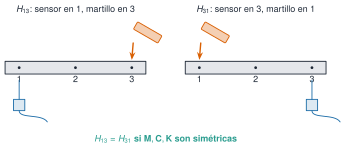
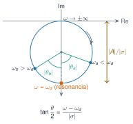

## Alcance de esta sesión

Solo los **fundamentos** respaldados por los apuntes:

- hipótesis de la teoría modal (M7.1)
- polos, residuos y la geometría del círculo (M7.2)
- expansión modal y residuos frente a formas (M7.3)

Los **algoritmos** (peak-picking, circle-fit, ITD, ERA, ARMA, FDD, SSI…) quedan pendientes de fuentes primarias.

## Tres modelos de un sistema {#m7-1}

| Modelo | Contiene |
|---|---|
| Espacial | $\mathbf{M}$, $\mathbf{C}$, $\mathbf{K}$ |
| Modal | $\omega_r$, $\zeta_r$, $\boldsymbol{\phi}_r$ |
| De respuesta | $\boldsymbol{\alpha}(\omega)$ (FRF) |

La **identificación** va de la respuesta medida al modelo modal.

## Las cuatro hipótesis

| Hipótesis | Falla cuando… |
|---|---|
| Linealidad | rigidez o amortiguamiento dependen de la amplitud |
| Invariancia temporal | cambian temperatura, masa o apoyos |
| Observabilidad | el sensor está en un nodo |
| Reciprocidad | matrices no simétricas |

## Reciprocidad

{width="90%" fig-alt="Martillo en 3 y sensor en 1 frente a martillo en 1 y sensor en 3"}

## Polos y residuos {#m7-2}

$$H(s)=\frac{A}{s-s_1}+\frac{A^*}{s-s_1^*},\qquad A=\frac{1}{2im\omega_d}$$

- $\omega_d=\mathrm{Im}\,s_1$ · $\lvert\sigma\rvert=\zeta\omega_n$ · $\omega_n=\lvert s_1\rvert$
- Residuo ⇒ amplitud

## Un polo dibuja un círculo

{width="52%" fig-alt="Círculo de un solo polo en el plano de Nyquist"}

Diámetro $\lvert A\rvert/\lvert\sigma\rvert$ · $\tan\dfrac{\theta}{2}=\dfrac{\omega-\omega_d}{\lvert\sigma\rvert}$

## ¿Qué es un círculo?

| FRF | ¿Círculo exacto? |
|---|---|
| Receptancia histerética | **Sí** |
| Término de **un polo** | **Sí** |
| Movilidad viscosa | **Sí** |
| Receptancia viscosa completa | Aproximado (error según $\zeta$) |

## Un poco de historia

**Kennedy y Pancu (1947)** propusieron los gráficos vectoriales de la respuesta frente a medir solo el pico: base de las técnicas de ajuste circular.

::: {.notes}
Fuente secundaria; no se ha accedido al artículo original. Consultado el 21-10-2026.
:::

## Expansión modal {#m7-3}

$$\alpha_{jk}(\omega)=\sum_{r=1}^{n}\left[\frac{{}_rA_{jk}}{i\omega-s_r}+\frac{{}_rA_{jk}^*}{i\omega-s_r^*}\right],\quad {}_rA_{jk}=\phi_{jr}\phi_{kr}$$

Residuo de cada modo: matriz de **rango uno**

## De los residuos a la forma

- Punto de excitación: $\phi_{kr}=\sqrt{A_{kk}}$ (salvo signo)
- Resto: $\phi_{jr}=A_{jk}/\phi_{kr}$
- Cociente $\phi_{jr}/\phi_{kr}=A_{jk}/A_{kk}$: **no depende de la escala**

## Dos masas: formas desde los residuos

| Caso | Modo | $\phi_2/\phi_1$ |
|---|---|---|
| Proporcional | 1 | $1{,}000\angle0^\circ$ |
| Proporcional | 2 | $0{,}500\angle180^\circ$ |
| No proporcional | 1 | $1{,}172\angle7{,}6^\circ$ |
| No proporcional | 2 | $0{,}369\angle171{,}6^\circ$ |

Fases distintas de $0^\circ$ y $180^\circ$: **modos complejos**

## Para llevarte

- Las hipótesis son lo primero que hay que comprobar
- El círculo exacto es el del **término de un polo**
- Una columna basta, **con todos los modos**
- Siguiente: los algoritmos de identificación
