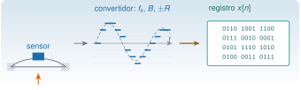
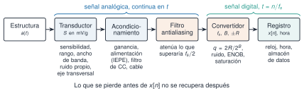
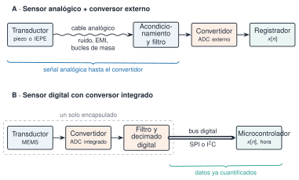
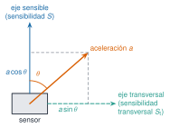

{.portada fig-alt="Un puente vibra con un sensor pegado en su centro; una flecha lleva a una sinusoide trazada con una escalera de niveles de cuantificación y otra flecha, a un cuadro con filas de bits que representa el registro"}

```{julia}
#| include: false
using Resonancia, Random, Statistics, Printf, LinearAlgebra
include("../../recursos/r1-datos/_tema.jl")

# ENOB medido por simulación: sinusoide casi de fondo de escala más ruido analógico de σ_n = k·q,
# cuantificada con `cuantizar`; el ruido se estima ajustando seno, coseno y continua (frecuencia coherente).
function enob_sim(B, k; R=2.0, N=2^14, kbin=1001, A=0.95, seed=8)
    rng = MersenneTwister(seed)
    q = 2R / 2.0^B
    n = 0:N-1
    f = kbin / N
    x = A * R .* sin.(2π * f .* n .+ 0.4) .+ k * q .* randn(rng, N)
    y, sat, _ = cuantizar(x; bits=B, rango=R)
    M = hcat(sin.(2π * f .* n), cos.(2π * f .* n), ones(N))
    c = M \ y
    r = y .- M * c
    amp = hypot(c[1], c[2])
    sinad = 10log10((amp^2 / 2) / mean(r .^ 2)) + 20log10(R / amp)   # referido a fondo de escala
    return (; enob=(sinad - 1.76) / 6.02, saturadas=count(sat))
end
enob_teo(B, k) = B - 0.5 * log2(1 + 12k^2)
```

## Objetivos y prerrequisitos

**Objetivos.** M3 enseña a *comprender la señal*; esta sesión enseña a *comprender la medición*: de dónde sale el registro que M3 analiza y qué le ha hecho cada eslabón de la cadena antes de que llegue al disco. Al terminar sabrás:

- **describir la cadena de medida** (estructura, transductor, acondicionamiento, filtro antialiasing físico, convertidor, registro) y decir qué error aporta cada eslabón y cuál de ellos ya no se puede corregir después;
- **comparar** una cadena analógica con convertidor externo y un sensor digital con convertidor integrado, y saber qué hay que mirar en la hoja de datos de cada una;
- distinguir los **bits nominales** de los **bits efectivos** (ENOB), calcular el rango dinámico instrumental de una cadena y no confundir los tres significados de «rango»;
- **leer la ficha de un acelerómetro**: sensibilidad, rango, ancho de banda, ruido y sensibilidad transversal, con sus unidades y sus trampas;
- explicar el principio de un acelerómetro **piezoeléctrico (con electrónica integrada, IEPE)** y de uno **MEMS capacitivo**, y qué consecuencias tiene en la banda baja, el ruido y la instalación;
- **reconocer el ruido eléctrico** (térmico, de disparo, $1/f$, de red, EMI, triboeléctrico, diafonía) y justificar con cálculo la elección de un sensor para monitorización estructural.

Del resto de temas (M8.2 y M8.4 a M8.8) esta versión solo fija objetivos: están marcados como **pendientes de redactar**.

**Prerrequisitos.** [M3 · Procesamiento de señales I](../m03-senales-i/index.qmd): muestreo, cuantificación como operación sobre la señal, aliasing, DFT y PSD. Esta sesión **no** repite esa teoría: la usa.

::: {.callout-note title="Qué recibe de M3"}
M3 explica **qué hace** el convertidor con la señal y deja aquí **cómo es y cómo se elige** el equipo.

- De [M3.3](../m03-senales-i/index.qmd#m3-3): el paso de cuantificación $q=2R/2^B$, el error uniforme de desviación típica $q/\sqrt{12}$, la SNR ideal $6{,}02\,B+1{,}76$ dB y la saturación como recorte de la señal.
- De [M3.4](../m03-senales-i/index.qmd#m3-4): el teorema de Nyquist–Shannon, el aliasing y la regla de que el filtro va **antes** de reducir $f_{\mathrm s}$.

Aquí se añade lo que no es de la señal sino del instrumento: el ruido propio, los bits efectivos, el rango dinámico de la cadena, los parámetros del sensor y su instalación.
:::

**Temas de la unidad**

- **M8.1** Cadena de medida: transductor, acondicionamiento, digitalización y almacenamiento (redactado)
- **M8.2** Transductores piezoeléctricos y acondicionamiento IEPE (pendiente)
- **M8.3** Parámetros de un acelerómetro: sensibilidad, rango, ancho de banda, ruido y sensibilidad transversal; piezoeléctricos frente a MEMS (redactado)
- **M8.4** Caso ADXL355: características y configuración (pendiente)
- **M8.5** Interfaz de comunicación SPI (pendiente)
- **M8.6** Calibración de los nodos de medida (pendiente)
- **M8.7** Otros sensores para SHM: galgas, inclinómetros, LVDT, temperatura (pendiente)
- **M8.8** Complemento: muestreo y FFT en sistemas embebidos (ESP32) (pendiente)

::: {.callout-note collapse="true" title="Fuentes, honestidad sobre las cifras y qué queda pendiente"}
**Fuentes consultadas.** Para el piezoeléctrico y el IEPE, dos notas técnicas de fabricantes que se han leído enteras [@lally2005tn17; @mayo-tp326] y un artículo revisado sobre sensores IEPE de bajo ruido en estructuras, del que se han leído las páginas iniciales [@bartels2024iepe]. Para los MEMS, dos artículos revisados de los que solo se ha leído un extracto [@li2024combmems; @occhipinti2025mems]. Para la calibración, solo la ficha del catálogo de la norma ISO 16063-1 [@iso16063-1]; la norma no se ha leído. Para la comparación entre sensor digital y convertidor externo, el texto de un distribuidor [@bagheri2026digital], que es una **fuente comercial**. Para la cadena, el rango y el convertidor, las columnas de Avitabile ya usadas en M3 [@avitabile2002adquisicion; @avitabile2004rango] y el caso de Sesia [@chellini2008].

**Cifras.** Toda cifra de esta página es de uno de estos tres tipos: *calculada aquí en Julia* (se indica), *tomada de una fuente consultada* (se cita) o *valor ilustrativo, no de un modelo concreto* (se declara). **No hay en la página sensibilidades, ruidos ni rangos de modelos reales** salvo los que cita una fuente. Las hojas de datos de modelos concretos (por ejemplo, la del ADXL355 de [M8.4](#m8-4)) están por consultar.

**Pendiente de fuente.** Las contramedidas contra el ruido eléctrico, los consejos de instalación y la descripción del sensor piezorresistivo son prácticas generales de instrumentación que esta versión **no** respalda todavía con una fuente concreta; están marcadas donde aparecen. El convenio de ENOB se toma de una enciclopedia, no de la norma ni del tutorial original de Analog Devices, que no se pudo abrir.

**Código.** Julia y `Resonancia` (`cuantizar`). Las figuras de datos son de CairoMakie; las de esquemas, de TikZ.
:::

## Teoría breve

### M8.1 Cadena de medida: transductor, acondicionamiento, digitalización y almacenamiento {#m8-1}

[esencial]{.ruta-esencial}

**Pregunta motivadora.** Un registro de aceleración llega a tu ordenador como una lista de números. Si el pico de 17 Hz que ves no existía en el puente, ¿en qué eslabón de la cadena pudo nacer, y se puede quitar ya?

**Objetivos observables.** Nombrar los eslabones de la cadena y el error que introduce cada uno; decidir si un fallo se puede corregir después o hay que evitarlo antes del convertidor; calcular los bits efectivos y el rango dinámico de una cadena; elegir entre una cadena analógica con convertidor externo y un sensor digital.

#### Los eslabones de la cadena {#m8-1-eslabones}

Entre la estructura y el fichero hay seis eslabones (@fig-cadena8). Los cuatro primeros trabajan con una señal **continua**; los dos últimos, con números.

{#fig-cadena8 fig-alt="Diagrama de bloques de izquierda a derecha: estructura, transductor, acondicionamiento, filtro antialiasing, convertidor y registro, unidos por flechas. Una llave sobre transductor, acondicionamiento y filtro dice señal analógica continua en t; otra sobre convertidor y registro dice señal digital, t igual a n entre fs. Bajo cada caja hay una lista de lo que conviene revisar en ese eslabón. Una frase final dice que lo que se pierde antes de x de n no se recupera después."}

1. **Transductor.** Convierte la aceleración en una señal eléctrica. Sus parámetros (sensibilidad, rango, ancho de banda, ruido, sensibilidad transversal) son el objeto de [M8.3](#m8-3).
2. **Acondicionamiento.** Prepara la señal para el convertidor: alimenta el sensor si hace falta (en los IEPE, con una corriente constante, [M8.2](#m8-2)), amplifica, elimina la componente continua y adapta impedancias. La **ganancia** decide cuánto de la señal llena el rango del convertidor: es la forma práctica de elegir $R$ [@avitabile2004rango].
3. **Filtro antialiasing físico.** Un paso bajo **analógico** antes del convertidor que atenúa lo que superaría $f_{\mathrm s}/2$. Es el único sitio donde se puede evitar el aliasing: una vez plegada, una componente es indistinguible de una real ([M3.4](../m03-senales-i/index.qmd#m3-4)). Los filtros digitales posteriores sirven para reducir $f_{\mathrm s}$ con orden (diseño en M4.2), no para deshacer un alias ya producido.
4. **Convertidor analógico-digital (ADC).** Muestrea y cuantifica: fija $f_{\mathrm s}$, $B$ y $\pm R$. Aquí aparecen el ruido de cuantificación, el ruido analógico propio del convertidor y la saturación.
5. **Registro.** Lo que se guarda no es solo $x[n]$: son también la **hora** de cada muestra (el reloj de muestreo, su deriva y su sincronización entre nodos se tratan en [M9.3](../m09-redes-sensores/index.qmd)), las unidades, la sensibilidad usada para pasar de voltios a g y la ficha del ensayo. Sin esos metadatos, un fichero de números no se puede interpretar.

::: {.callout-tip .idea-clave title="Idea clave"}
Lo que se pierde antes del convertidor (banda, ruido, aliasing) o en él (saturación, resolución) **no se recupera con software**. Por eso las decisiones de adquisición se toman antes de medir.
:::

::: {.ejercicio tipo="opcion" id="m8-1-eslabon" respuesta="c"}
Una componente de 130 Hz de origen mecánico llega al convertidor, que muestrea a 100 Hz. ¿Dónde se debe actuar para que no contamine el registro?

::: {.opciones}
- En el registro, filtrando el fichero con un paso bajo digital de 40 Hz.
- En el convertidor, aumentando el número de bits.
- Antes del convertidor, con un filtro paso bajo analógico (o subiendo $f_{\mathrm s}$ por encima del doble de 130 Hz).
- En el transductor, ya que cualquier sensor elimina lo que excede su rango.
:::

::: {.retro}
- Tras el muestreo, la componente de 130 Hz ya aparece como una de $\lvert130-100\rvert=30$ Hz, dentro de la banda útil: un filtro digital no distingue ese alias de una vibración real de 30 Hz.
- Los bits fijan la resolución en amplitud y no tienen nada que ver con las frecuencias.
- Correcto: la protección es analógica y previa, o hay que muestrear lo bastante deprisa para que la componente quede por debajo de $f_{\mathrm s}/2$ ([M3.4](../m03-senales-i/index.qmd#m3-4)).
- El rango del sensor se refiere a amplitudes, no a frecuencias; ningún sensor elimina por sí solo lo que está fuera de su banda.
:::
:::

#### Cadena analógica con convertidor externo o sensor digital {#m8-1-analogica-digital}

Hay dos arquitecturas habituales (@fig-analdig). En la **cadena analógica** el sensor entrega una tensión (o una carga) por un cable, y el acondicionamiento, el filtro y el convertidor están en un equipo aparte. En el **sensor digital**, el transductor, el convertidor y un filtro digital comparten encapsulado y al exterior sale un bus de datos ya cuantificados (en M8.5, SPI, y en general también I²C).

{#fig-analdig fig-alt="Dos filas de bloques. La fila A, sensor analógico con convertidor externo: transductor, un cable analógico dibujado ondulado con las notas ruido, EMI y bucles de masa, acondicionamiento y filtro, convertidor ADC externo y registrador. La fila B, sensor digital: dentro de un recuadro de trazos rotulado un solo encapsulado, transductor MEMS, convertidor integrado y filtro y decimado digital; después un bus digital SPI o I2C hasta un microcontrolador que guarda x de n y la hora."}

| Aspecto | A · Analógico + convertidor externo | B · Sensor digital con convertidor integrado |
|---|---|---|
| **Qué viaja por el cable** | Señal analógica: puede recoger ruido, interferencias y bucles de masa. | Datos digitales: el ruido del cable no se suma a la medida, aunque el bus tiene sus propias limitaciones de longitud. |
| **Filtro antialiasing** | Lo eliges y lo ajustas tú (o lo trae el equipo de adquisición). | Está dentro: la banda y la atenuación las fija el sensor (frecuencia de datos y filtro digital de su hoja de datos). **No desaparece: se vuelve una especificación.** |
| **Frecuencia de muestreo y banda** | La decide el equipo de adquisición, dentro de lo que admite el sensor. | Se elige entre valores discretos del sensor; la banda va ligada a ese ajuste. |
| **Respuesta en continua** | Los IEPE están acoplados en alterna: no miden aceleración constante ([M8.3](#m8-3)). | Muchos MEMS responden desde continua, y entonces miden la gravedad como un nivel fijo. |
| **Ruido y resolución** | Suman sensor, cable, acondicionamiento y convertidor; el conjunto se mide en el equipo real. | Se especifica el conjunto (en µg/√Hz y en bits), pero hay que comprobar a qué banda y a qué frecuencia de datos se refiere. |
| **Cableado y número de canales** | Un cable blindado por canal; el equipo de adquisición pone el límite. | Un bus con pocos hilos; escala bien a muchos puntos, con sincronización por resolver ([M9](../m09-redes-sensores/index.qmd)). |
| **Calibración** | Sensibilidad de cada sensor (certificado), más la ganancia y el convertidor del equipo. | Calibrado de fábrica en LSB/g; conviene verificar el offset en la instalación ([M8.6](#m8-6)). |

: Dos arquitecturas, aspecto por aspecto. Son tendencias generales; el comportamiento real depende del modelo. {#tbl-analdig}

Un distribuidor de sensores resume el mismo reparto así: los MEMS digitales ganan en instalación sencilla, menos electrónica externa y escalado a muchos puntos, y pierden en ruido a baja frecuencia; los IEPE con convertidor externo permiten un ruido menor y una comunicación independiente del sensor, a costa de cables blindados y más equipo [@bagheri2026digital] (fuente comercial, no contrastada con hojas de datos). Un estudio de laboratorio sobre MEMS para monitorización estructural llega a una conclusión parecida con otros términos: que un MEMS sirva depende de si su ruido propio queda por debajo del de la estructura y del ambiente [@occhipinti2025mems] (se detalla en [M8.3](#m8-3)).

::: {.ejercicio tipo="vf" id="m8-1-digital" respuesta="falso"}
Si el sensor es digital (con convertidor integrado) ya no hay que preocuparse del filtro antialiasing.

::: {.solucion}
Falso. El filtro sigue existiendo, pero está dentro del sensor y su corte y su atenuación vienen en la hoja de datos, ligados a la frecuencia de datos elegida. Hay que leerlos igual que se leería el filtro de un equipo externo: un sensor muestreado a 100 Hz sin atenuación suficiente por encima de 50 Hz pliega esa banda sobre la útil, aunque salga por SPI.
:::
:::

#### Resolución, ruido y bits efectivos (ENOB) {#m8-1-bits-efectivos}

[esencial]{.ruta-esencial}

[M3.3](../m03-senales-i/index.qmd#m3-3) trata un convertidor **ideal**: el único error es el redondeo, de desviación típica $q/\sqrt{12}$, y la SNR de una sinusoide de fondo de escala es $6{,}02\,B+1{,}76$ dB. Un convertidor real, además, tiene su propio **ruido analógico** de entrada, de referencia y de reloj, y cierta distorsión. Los $B$ bits **nominales** son el número de códigos; los **bits efectivos** (*effective number of bits*, ENOB) son los de un convertidor ideal que tendría el mismo cociente señal a ruido más distorsión (SINAD):

$$
\mathrm{ENOB}=\frac{\mathrm{SINAD}-1{,}76}{6{,}02},
$$

con la SINAD medida, en dB, con una sinusoide de fondo de escala (definición recogida en [Wikipedia, «Effective number of bits»](https://en.wikipedia.org/wiki/Effective_number_of_bits), fuente enciclopédica consultada el 01-11-2026, que a su vez remite a un tutorial de Analog Devices que no se ha podido abrir). Es una cifra que puede salir **fraccionaria** y que siempre es menor o igual que $B$. Los fabricantes la dan para unas condiciones concretas (frecuencia de entrada, amplitud, banda y frecuencia de muestreo): una cifra de ENOB sin esas condiciones no es comparable.

[profundización]{.ruta-profundizacion}

::: {.callout-note .demostracion collapse="true" title="Demostración: ENOB si solo hay ruido analógico y de cuantificación"}
Sea $\sigma_n$ el ruido analógico de entrada (valor eficaz, ya en las unidades de $x$, blanco y no correlado con la cuantificación) y $q=2R/2^B$. La potencia total de ruido es $q^2/12+\sigma_n^2$ y la sinusoide de fondo de escala tiene potencia $R^2/2=2^{2B-3}q^2$. Por tanto

$$
\mathrm{SINAD}=10\log_{10}\frac{2^{2B-3}q^2}{q^2/12+\sigma_n^2}
=6{,}02\,B+1{,}76-10\log_{10}\!\left[1+12\left(\tfrac{\sigma_n}{q}\right)^2\right].
$$

Sustituyendo en la definición de ENOB, y como $10\log_{10}y/6{,}02=\tfrac12\log_2 y$,

$$
\boxed{\ \mathrm{ENOB}=B-\tfrac12\log_2\!\left[1+12\left(\tfrac{\sigma_n}{q}\right)^2\right]\ }
$$

Con $\sigma_n=0$ se recupera $B$. Con $\sigma_n=q$ (ruido de un escalón), $\mathrm{ENOB}=B-\tfrac12\log_2 13=B-1{,}85$. Cada vez que $\sigma_n$ se duplica, se pierde **un bit** (para $\sigma_n\gg q$).
:::

La @fig-enob compara esta fórmula con una simulación (Julia, con `cuantizar`, semilla fija): la fórmula, que viene de una demostración, y los puntos, que vienen de medir el ruido con la sinusoide cuantificada, coinciden.

```{julia}
#| label: fig-enob
#| fig-cap: "ENOB de un convertidor de 12 y de 16 bits con ruido analógico de entrada de desviación típica $\\sigma_n=k\\,q$. Líneas: fórmula del recuadro. Puntos: simulación con una sinusoide de $0{,}95\\,R$ y $2^{14}$ muestras (semilla fija). Con $\\sigma_n=4q$, un convertidor de 16 bits rinde como uno de unos 12 bits."
#| fig-alt: "Gráfica con el eje horizontal en escala logarítmica, la razón entre el ruido analógico y el paso de cuantificación, de 0,25 a 16, y el eje vertical con los bits efectivos. Dos curvas decrecientes, una para 16 bits nominales que empieza cerca de 16 y otra para 12 bits que empieza cerca de 12, con puntos de simulación que caen sobre ellas. Cada vez que el ruido se duplica, ambas curvas bajan un bit, y líneas horizontales de puntos marcan los bits nominales."
ks = [0.25, 0.5, 1, 2, 4, 8, 16]
kk = 10 .^ range(log10(0.2), log10(20), length=100)
fig = Figure(size=(860, 360))
ax = Axis(fig[1, 1]; xscale=log10, xlabel="σn / q (ruido analógico, en pasos de cuantificación)", ylabel="bits efectivos (ENOB)", yticks=4:2:16, xticks=([0.25, 0.5, 1, 2, 4, 8, 16], ["0,25", "0,5", "1", "2", "4", "8", "16"]))
for (B, c, marca, estilo) in ((16, AZUL, :circle, :solid), (12, NARANJA, :rect, :dash))
    hlines!(ax, [B]; color=GRIS, linestyle=:dot, linewidth=1)
    lines!(ax, kk, enob_teo.(B, kk); color=c, linestyle=estilo, linewidth=2, label="B = $B (fórmula)")
    scatter!(ax, ks, [enob_sim(B, k).enob for k in ks]; color=c, marker=marca, markersize=11, label="B = $B (simulación)")
end
axislegend(ax; position=:rt, framevisible=false)
fig
```

**Del ruido a los bits.** Los bits que no aportan información son los que el ruido se come: con $\sigma_n=4q$, un convertidor de 16 bits rinde unos $12{,}2$ bits efectivos, y los cuatro bits bajos del código son, en la práctica, ruido. Lo mismo, visto desde el lado de la medida: la **resolución real** en unidades físicas no es $q$ sino la desviación típica total del ruido, $\sqrt{q^2/12+\sigma_n^2}$ (y, si hay más fuentes, la raíz de la suma de todos los cuadrados).

::: {.ejercicio tipo="numerico" id="m8-1-enob" respuesta="12.0" tol="1%" unidad="bits"}
Un convertidor de 16 bits nominales tiene, con una sinusoide de fondo de escala, una SINAD de 74 dB. ¿Cuántos bits efectivos tiene?

::: {.solucion}
$\mathrm{ENOB}=(74-1{,}76)/6{,}02=12{,}0$ bits (comprobado en Julia: $12{,}000$). Los 16 bits nominales prometían 98,1 dB; la SINAD real está 24 dB por debajo, que son 4 bits.
:::
:::

::: {.ejercicio tipo="numerico" id="m8-1-ruido-lsb" respuesta="12.2" tol="1%" unidad="bits"}
Un convertidor de 16 bits con ruido analógico de entrada de desviación típica igual a cuatro pasos de cuantificación ($\sigma_n=4q$), sin distorsión. ¿Cuál es su ENOB?

::: {.pista}
Usa $\mathrm{ENOB}=B-\tfrac12\log_2[1+12(\sigma_n/q)^2]$.
:::

::: {.solucion}
$1+12\cdot16=193$; $\tfrac12\log_2193=3{,}80$; $\mathrm{ENOB}=16-3{,}80=12{,}2$ bits (Julia: $12{,}2038$, y la simulación de la @fig-enob da $12{,}21$).
:::
:::

#### Rango, rango dinámico y saturación {#m8-1-rango}

La palabra «rango» se usa para tres cosas distintas en las hojas de datos (@tbl-rango). Mezclarlas es la fuente más frecuente de errores al comparar equipos.

| Término | Qué mide | Expresión | Para $\pm2$ g y 16 bits |
|---|---|---|---|
| **Rango de fondo de escala** | la mayor amplitud que no se recorta | $\pm R$ | $\pm2$ g |
| **Rango dinámico del convertidor** | cociente entre una sinusoide de fondo de escala y el ruido de cuantificación, en dB, ambos en valor eficaz | $\approx6{,}02\,B+1{,}76$ dB | $\approx98$ dB |
| **Rango dinámico instrumental (de la cadena)** | cociente entre la mayor señal (la misma sinusoide de fondo de escala) y el ruido propio de la cadena en la banda de interés, ambos en valor eficaz | $20\log_{10}\dfrac{R/\sqrt2}{\sigma_n}$ | depende del sensor y del acondicionamiento ([M8.3](#m8-3)) |

: Tres significados de «rango». En las dos últimas filas se compara la misma cosa (una sinusoide de fondo de escala en valor eficaz) con el ruido en valor eficaz; si se compara el *pico* $R$ con $\sigma_n$ sale una cifra 3 dB mayor, sin que la cadena haya cambiado. {#tbl-rango}

El rango dinámico de la cadena lo limita **el peor eslabón**: un convertidor de 24 bits no mejora un sensor cuyo ruido ya ocupa los bits bajos. Y el rango dinámico **utilizable** para una señal concreta es menor que el del instrumento, porque la señal no llena el rango: cada factor 10 que la amplitud queda por debajo de $R$ se pierden 20 dB. **Cuidado con las hojas de datos:** algunas llaman «rango dinámico» al rango de fondo de escala $\pm R$, otras a la relación entre el fondo de escala y el ruido; comprueba siempre cuál usan.

::: {#exm-cuantificacion}
**Ejemplo resuelto.** Rango $\pm2$ g y 16 bits: $q=4/65\,536$ g $=0{,}061$ mg, y $\sigma_e\approx0{,}061/\sqrt{12}=0{,}018$ mg. Según el ejemplo de [M3.3](../m03-senales-i/index.qmd#m3-3), el RMS vertical de las estaciones de Torroja en la medida 1 está entre 0,44 y 1,64 mg. La relación entre la señal y el error de cuantificación sería entonces de $20\log_{10}(0{,}44/0{,}018)\approx28$ dB a $20\log_{10}(1{,}64/0{,}018)\approx39$ dB, muy lejos de los 98 dB que da el convertidor para una señal de fondo de escala. **Conclusión:** para vibración ambiental conviene un rango más pequeño o más bits. Del convertidor real de Torroja la ficha no dice nada, así que esto es un cálculo de diseño, no una evaluación del ensayo.
:::

::: {.ejercicio tipo="numerico" id="m8-1-paso" respuesta="2.441" tol="1%" unidad="mg"}
**Ejercicio breve.** Un registrador de 12 bits con rango $\pm5$ g. ¿Cuál es su paso de cuantificación en mg?

::: {.solucion}
$q=2\cdot5/2^{12}=10/4096=2{,}44\cdot10^{-3}$ g $=2{,}44$ mg (Julia: $2{,}4414$): mayor que toda la vibración ambiental de Torroja. Ese equipo no sirve para ese ensayo.
:::
:::

::: {.ejercicio tipo="opcion" id="m8-1-rango-ambiente" respuesta="b"}
Un acelerómetro de rango $\pm2$ g mide en un puente una aceleración del orden de 1 mg. ¿Cuál es el problema principal?

::: {.opciones}
- Saturación.
- La señal ocupa una fracción mínima del rango y el error de cuantificación pesa mucho.
- Aliasing.
- Ninguno, si el convertidor tiene 12 bits.
:::

::: {.retro}
- Para saturar haría falta superar $\pm2$ g.
- Correcto: con 12 bits, $q\approx1$ mg, del orden de la propia señal; incluso con 16 bits, la relación entre la señal y el error se queda en unos 30 a 40 dB ([ejemplo anterior](#exm-cuantificacion)).
- El aliasing depende de $f_{\mathrm s}$ y del filtro, no del rango.
- Con 12 bits es justo el peor caso: el paso es de unos 0,98 mg (Julia: $0{,}977$ mg).
:::
:::

::: {.ejercicio tipo="numerico" id="m8-1-dinamico" respuesta="66.0" tol="1%" unidad="dB"}
**Rango dinámico de una cadena.** Un acelerómetro de $\pm2$ g tiene una densidad de ruido de $100\ \mu\mathrm g/\sqrt{\mathrm{Hz}}$ (valor ilustrativo, no de un modelo concreto) y se mide en la banda de 0 a 50 Hz. (a) ¿Qué ruido eficaz hay en la banda? (b) ¿Cuál es el rango dinámico instrumental, con la convención de la @tbl-rango? (c) ¿Cuántos bits efectivos tendría un convertidor ideal con la misma SINAD, y para qué sirven los bits que sobren?

::: {.solucion}
(a) $\sigma_n=100\sqrt{50}\ \mu\mathrm g=707\ \mu\mathrm g$ (ruido blanco: $\sigma_n=d\sqrt{\Delta f}$; Julia: $707{,}1$). (b) $20\log_{10}\dfrac{2/\sqrt2}{707\cdot10^{-6}}=66{,}0$ dB (con el pico $R$ en lugar del eficaz saldrían 69,0 dB: 3 dB más para la misma cadena). (c) $(66{,}0-1{,}76)/6{,}02=10{,}7$ bits. Un convertidor de 16 bits ($\approx98$ dB) estaría muy sobrado: la cadena queda limitada por el sensor, y más bits solo sirven para no añadir cuantificación apreciable.
:::
:::

**Saturación y offset.** Un convertidor ve la señal **con** su nivel de continua: lo que cuenta para no saturar es $\lvert\mu\rvert+A$, no $A$. Un MEMS acoplado en continua mide además la gravedad: si el eje sensible no está exactamente horizontal, aparece un offset de hasta $1\ \mathrm g\cdot\sin\theta$ (un grado de inclinación son 17,5 mg), que gasta rango aunque no sea vibración; de ahí que se compruebe el offset en la instalación ([M8.6](#m8-6)). Un IEPE, acoplado en alterna, no tiene ese offset, pero su propio nivel de continua del acondicionamiento (la «polarización» de unos voltios) sí limita su rango de salida ([M8.2](#m8-2)). La saturación como recorte de la señal, y por qué añade armónicos espurios, está en [M3.3](../m03-senales-i/index.qmd#m3-3).

::: {.ejercicio tipo="opcion" id="m8-1-saturacion" respuesta="d"}
Una señal sinusoidal de 0,3 g de amplitud con un offset de 0,25 g se digitaliza con $\pm0{,}5$ g y 12 bits. ¿Qué pasa?

::: {.opciones}
- Todo bien: la amplitud (0,3 g) es menor que el rango (0,5 g).
- Satura, pero se arregla quitando la media después.
- No satura, pero la resolución es pobre.
- Satura en los picos positivos ($0{,}25+0{,}3=0{,}55$ g supera 0,5 g), y quitar la media después no recupera lo recortado.
:::

::: {.retro}
- El convertidor ve la señal **con** su offset: lo que cuenta es $\lvert\mu\rvert+A=0{,}55$ g, no $A$.
- Restar la media desplaza la señal ya recortada, pero no reconstruye los picos perdidos.
- Con 12 bits y $\pm0{,}5$ g, $q=0{,}244$ mg: la resolución es buena. El problema es otro.
- Correcto. El offset gasta rango; por eso hay que conocerlo antes de elegir $R$.
:::

::: {.solucion}
La **d**. Comprobado en Julia con una sinusoide de 5 Hz muestreada a 1 kHz durante 0,4 s: saturan 76 de 400 muestras, el 19,0 %; con offset de 0,2 g, con el que el pico de 0,5 g solo *toca* el límite, saturan 4 de 400 (el 1,0 %), casi nada. Es el efecto del muestreo discreto y de que el último nivel positivo es $0{,}5-q$. Pruébalo en la [práctica guiada](#sec-practica).
:::
:::

::: {.callout-note .caso-real icon=false title="Caso real: el viaducto de Sesia, rango para el tren y bits para el ambiente"}
En el viaducto de Sesia, un puente ferroviario mixto de alta velocidad, el equipo de Chellini [@chellini2008] eligió un rango de ±10 V para no saturar con el paso del tren y un convertidor de 24 bits para no perder el ambiente. Con esos datos, $q=20\ \mathrm V/2^{24}=1{,}19$ µV, frente a 305 µV con 16 bits: un paso 256 veces menor, 48 dB (Julia: $1{,}1921$ µV, $305{,}18$ µV, $48{,}2$ dB). El artículo emula 16 bits redondeando los de 24, para ver qué se pierde. **No consta la sensibilidad del sensor**, así que esa resolución no se puede convertir a g: el cálculo vale para el convertidor, no para la aceleración. Y, por lo visto arriba, 24 bits *nominales* no son 24 efectivos: el límite real lo pondría el ruido del sensor y de la electrónica. El rango lo manda el suceso más grande y la resolución, el más pequeño.
:::

::: {.ejercicio tipo="numerico" id="m8-1-cuantificacion" respuesta="0.0176" tol="2%" unidad="mg"}
**Paso de cuantificación y saturación.** Un acelerómetro de $\pm2$ g con un convertidor de 16 bits. (a) Calcula $q$ y el RMS del error de cuantificación en mg. (b) Un golpe produce un pico de 2,5 g: ¿qué pasa y qué ves en el espectro?

::: {.solucion}
(a) $q=4/2^{16}$ g $=0{,}061$ mg y $\sigma_e\approx q/\sqrt{12}=0{,}0176$ mg (Julia: $0{,}0610$ y $0{,}0176$). (b) Satura: los valores por encima de $2-q/2$ g se recortan. La forma recortada añade armónicos espurios y el pico real queda desconocido. El RMS apenas cambia si el golpe es breve, así que hay que buscar las muestras en el valor extremo.
:::
:::

::: {.callout-warning title="Errores frecuentes"}
- Elegir «el rango más grande, por si acaso»: la señal ambiental queda en unos pocos niveles.
- Dar por buenos los bits nominales: sin ENOB y sin ruido del sensor, «24 bits» no dice cuánta resolución hay.
- Atribuir al convertidor todo el ruido de fondo: con muchos bits, el límite suele estar en el sensor y la electrónica.
- Fiarse de «rango dinámico» sin mirar qué definición usa la hoja de datos (rango de fondo de escala, relación con el ruido, pico o eficaz).
- Pensar que un sensor digital no necesita antialiasing, o que se puede quitar un alias con un filtro digital.
:::

::: {.callout-tip .idea-clave title="Idea clave (conclusión verificable)"}
La cadena es una suma de eslabones y su **peor eslabón** manda. La resolución útil es el ENOB y el ruido total de la cadena, no el número de bits del convertidor; el rango debe contener la señal **con su offset**; y el aliasing se evita antes del convertidor. Con $\sigma_n=4q$, 16 bits nominales son unos 12 efectivos.
:::

### M8.2 Transductores piezoeléctricos y acondicionamiento IEPE {#m8-2}

::: {.callout-note title="Pendiente de redactar"}
**Objetivos.** Explicar cómo funciona un transductor piezoeléctrico de carga y uno con electrónica integrada (IEPE): alimentación por corriente constante, tensión de compensación (*bias*) y tensión de cumplimiento (*compliance*), el filtro paso alto del acondicionamiento que fija el límite inferior de frecuencia, y el efecto de la longitud y la capacidad del cable. Calcular el ancho de banda alto en función de la corriente disponible y comprobar la compatibilidad entre sensor y acondicionador.

**Estado.** Sin redactar. Ya consultadas, para cuando se redacte: [@lally2005tn17; @mayo-tp326; @bartels2024iepe]. En M8.3 se usa solo lo mínimo.
:::

### M8.3 Parámetros de un acelerómetro: sensibilidad, rango, ancho de banda, ruido y sensibilidad transversal; piezoeléctricos frente a MEMS {#m8-3}

[esencial]{.ruta-esencial}

**Pregunta motivadora.** Dos hojas de datos dicen «ruido: 25 µg/√Hz» y «ruido: 150 µg RMS». ¿Cuál es mejor? ¿Y cuál sirve para medir 1 mg de vibración ambiental en un puente?

**Objetivos observables.** Leer sensibilidad, rango, ancho de banda, ruido y sensibilidad transversal con sus unidades y condiciones; pasar de una densidad de ruido a un ruido eficaz en una banda; explicar por qué un IEPE no mide continua y un MEMS sí; reconocer el ruido eléctrico por su espectro; decidir un sensor con un criterio numérico, y listar los errores de medición con su efecto.

#### Qué mide un acelerómetro {#m8-3-modelo}

Casi todos los acelerómetros usados en estructuras son, por dentro, un sistema de **una masa sísmica sobre un resorte** fijado a la base que se mueve con la estructura (se verá en [M5](../m05-vibraciones-i/index.qmd) como excitación de la base). Si $z$ es el desplazamiento de la masa respecto de la base, $\ddot z+2\zeta\omega_n\dot z+\omega_n^2z=-a(t)$, y por debajo de la frecuencia de resonancia ($\omega\ll\omega_n$)

$$
\left|\frac{Z(\omega)}{A(\omega)}\right|=\frac{1}{\sqrt{(\omega_n^2-\omega^2)^2+(2\zeta\omega_n\omega)^2}}\approx\frac{1}{\omega_n^2}.
$$

El desplazamiento relativo es proporcional a la aceleración: el transductor (cristal, capacidad, resistencia…) solo tiene que medir ese desplazamiento o la fuerza de la masa. Dos consecuencias que organizan todo lo que sigue:

- **La sensibilidad y la banda compiten.** La sensibilidad en desplazamiento es $\approx1/\omega_n^2$: subir la resonancia al doble (más banda) la divide por cuatro. Una nota de un fabricante lo dice así para los piezoeléctricos: tamaño, sensibilidad y respuesta en frecuencia están ligados [@lally2005tn17].
- **La banda útil acaba antes de la resonancia.** Con $r=\omega/\omega_n$ y poco amortiguamiento, la respuesta se desvía un $1/(1-r^2)-1$ del valor estático: un 1,0 % a $r=0{,}1$; un 4,2 % a $r=0{,}2$; un 9,9 % a $r=0{,}3$ (Julia). Por eso se da el ancho de banda **con una tolerancia** ($\pm5\,\%$, $\pm1$ dB, $\pm3$ dB) y casi siempre se queda en una fracción de la resonancia.

::: {.ejercicio tipo="vf" id="m8-3-sensibilidad-ancho" respuesta="falso"}
Entre dos acelerómetros del mismo tipo, el que tiene la frecuencia de resonancia más alta es siempre el mejor para monitorizar un puente.

::: {.solucion}
Falso. Una resonancia más alta da más ancho de banda, pero a igualdad de diseño reduce la sensibilidad (como $1/\omega_n^2$ en el modelo de arriba) y suele empeorar el ruido referido a la entrada. Un puente tiene su banda de interés en unos pocos hercios (Bartels et al. citan 2 a 5 Hz para el primer modo de puentes de carretera y 0,2 a 1 Hz en torres eólicas [@bartels2024iepe]): ahí interesa más ruido bajo y buena respuesta a baja frecuencia que una resonancia de decenas de kilohercios.
:::
:::

::: {.ejercicio tipo="numerico" id="m8-3-resonancia" respuesta="4.17" tol="2%" unidad="%"}
Un acelerómetro con muy poco amortiguamiento se usa a una frecuencia igual a la quinta parte de su resonancia ($r=0{,}2$). ¿Cuánto se amplifica la señal respecto de su valor a baja frecuencia, en porcentaje?

::: {.solucion}
$\dfrac{1}{1-r^2}-1=\dfrac{1}{0{,}96}-1=0{,}0417$: un 4,17 % de más (Julia: $4{,}17$ % con $\zeta=0$ y $4{,}14$ % con $\zeta=0{,}05$). Por eso se suele usar el sensor muy por debajo de su resonancia, o se corrige la respuesta.
:::
:::

#### Piezoeléctricos, IEPE y MEMS {#m8-3-tipos}

Los dos principios más usados (@fig-principios) miden el movimiento de la masa de modos muy distintos.

{#fig-principios fig-alt="Dos esquemas. A la izquierda, un acelerómetro piezoeléctrico: sobre una base rayada hay una cerámica, encima una masa sísmica y encima una caja de amplificador integrado con una salida de tensión; una flecha vertical indica la aceleración a de la base y otra, la fuerza m por a sobre la cerámica. A la derecha, un MEMS capacitivo: una masa móvil unida por dos muelles a paredes fijas, con dedos móviles intercalados entre dedos fijos que forman los condensadores C1 y C2, y una flecha de desplazamiento x."}

**Piezoeléctrico.** Un material piezoeléctrico (una cerámica de titanato zirconato de plomo, por ejemplo, o un cristal de cuarzo) se carga eléctricamente al deformarse; el efecto solo existe en materiales no conductores sin centro de simetría. En el diseño de **cortadura** más usado en estructuras, la cerámica trabaja entre la base y una masa sísmica, y la fuerza $F=m\,a$ de la masa genera la carga [@bartels2024iepe]. La salida es una carga de alta impedancia, que se puede llevar así (sensor de *carga*) a un amplificador de carga por un cable especial de bajo ruido, o convertir dentro del propio sensor (**IEPE**, también llamado ICP, Isotron, Delta-Tron o Piezotron según el fabricante) [@lally2005tn17]. El IEPE se alimenta con una **corriente constante** por el mismo cable que lleva la señal; el resultado es una tensión de aceleración montada sobre un nivel de continua [@mayo-tp326; @lally2005tn17], que el acondicionamiento quita con un filtro paso alto.

- **Banda baja.** Ese filtro es un condensador y una resistencia: su frecuencia de corte inferior vale $f_u=1/(2\pi R_{\mathrm c}C_{\mathrm c})$ [@bartels2024iepe]. Un IEPE **no mide aceleración constante**, y a baja frecuencia la ganancia cae. Con $f_u=0{,}5$ Hz (valor ilustrativo), la amplitud a 1 Hz baja un 10,6 % ($-0{,}97$ dB) y adelanta la fase $26{,}6^\circ$; a 2 Hz, un 3,0 % y $14^\circ$ (Julia). Para un modo de 2 Hz, esa corrección importa en amplitud y, sobre todo, en fase.
- **Ruido y rango dinámico.** Según una nota de fabricante, la mayoría de los IEPE tienen un rango dinámico superior a 100 dB (cociente 100 000 a 1), con la ventaja de que la resolución y el rango son especificaciones de la hoja de datos y no dependen del cable [@lally2005tn17]. Es cifra de esa nota, de 2005 y de un fabricante: no se aplica a un modelo concreto sin mirar su hoja de datos.
- **Cable y temperatura.** El IEPE funciona con cable coaxial normal y sin amplificador de carga [@lally2005tn17]; en cambio, el ruido de la fuente de alimentación de corriente constante se acopla directamente a la salida [@mayo-tp326], y su rango de temperatura de uso general es más limitado que el de los de carga (la nota da de $-65$ a $+250$ °F, unos $-54$ a $+121$ °C). En un estudio con sensores IEPE de bajo ruido, la transmisión a baja frecuencia variaba de forma no lineal con la temperatura, mientras que la humedad apenas influía; sin compensar, la energía de la vibración se subestimaba con frío y se sobrestimaba con calor [@bartels2024iepe] (válido para los sensores ensayados).
- **Carga.** Los sensores de carga se pueden usar a temperaturas mayores y con mucha flexibilidad de ajuste, pero exigen cables de bajo ruido y manejo cuidadoso de la alta impedancia; el ruido crece con la longitud del cable [@lally2005tn17].

**MEMS capacitivo.** La masa y sus muelles se graban en silicio. La masa lleva dedos móviles intercalados entre dedos fijos: cada pareja es un condensador, y con la aceleración uno sube y el otro baja, de modo que la electrónica mide la **diferencia** y reduce las perturbaciones comunes a ambos [@li2024combmems]. Como el desplazamiento se mide también para aceleraciones constantes, estos sensores **responden desde continua** y miden la gravedad como un nivel fijo [@bartels2024iepe]. El ruido tiene una parte mecánica (térmica, ligada a la masa y al amortiguamiento del gas entre los dedos) y otra electrónica. En un diseño de laboratorio, estrechar los huecos aumentaba la sensibilidad pero también el amortiguamiento y, con él, el ruido térmico mecánico; la sensibilidad transversal se reducía haciendo los muelles mucho más blandos a lo largo del eje sensible que en los demás [@li2024combmems]. En la introducción de su estudio, Bartels y colaboradores señalan que los MEMS acoplados en continua se han usado mucho a baja frecuencia, pero con una relación señal-ruido baja, mientras que los IEPE de bajo ruido son mayores y de coste mayor [@bartels2024iepe]. **Piezorresistivos.** Una variante usa el cambio de resistencia de una viga que se flexiona; esta unidad aún no la respalda con una fuente consultada y queda pendiente de redactar.

| Aspecto | Piezoeléctrico (IEPE) | MEMS capacitivo |
|---|---|---|
| Respuesta en continua | No (acoplado en alterna; $f_u$ del acondicionamiento) [@bartels2024iepe] | Sí; mide la gravedad [@bartels2024iepe] |
| Ruido típico | Hay modelos de bajo ruido [@bartels2024iepe]; en el ensayo de MEMS citado, un piezoeléctrico dio resultados fiables con mucha excitación [@occhipinti2025mems] | Depende mucho del modelo: de 0,2 a unos 25 µg/√Hz entre los ensayados en un artículo [@occhipinti2025mems] |
| Salida | Tensión, con polarización de continua; cable coaxial normal [@lally2005tn17] | Analógica o digital, según el modelo |
| Temperatura | Respuesta a baja frecuencia dependiente de la temperatura [@bartels2024iepe] | No consultado en este tema |
| Coste y tamaño | Mayores (en la comparación de [@bartels2024iepe]) | Menores; escalan a muchos puntos [@bagheri2026digital] |

: Contraste cualitativo. Tendencias de fuentes citadas, **no valores de un fabricante**; cualquier decisión se toma con la hoja de datos del modelo. {#tbl-tipos}

::: {.ejercicio tipo="vf" id="m8-3-iepe-bias" respuesta="falso"}
La salida de un acelerómetro IEPE es directamente la aceleración, centrada en 0 V.

::: {.solucion}
Falso. Con la alimentación por corriente constante, la salida es la señal de aceleración montada sobre un nivel de continua de varios voltios; el acondicionamiento lo separa con un condensador y una resistencia, que forman un paso alto y fijan el límite inferior de frecuencia [@bartels2024iepe; @mayo-tp326]. Por eso un IEPE no mide aceleración constante.
:::
:::

#### Los cinco parámetros de la ficha {#m8-3-parametros}

**Sensibilidad.** Cuánta señal de salida hay por unidad de aceleración: mV/g o mV/(m/s²) (IEPE y MEMS analógicos), pC/g (carga) o g/LSB o LSB/g (digitales). Es la constante que convierte voltios o cuentas en g, y por eso, como se ve en el registro, **hay que guardarla** junto a los datos. Depende de la frecuencia y de la temperatura, y se calibra: la norma ISO 16063 describe los métodos de calibración de transductores de vibración y choque, con un método primario preferido y métodos de comparación [@iso16063-1].

**Rango.** La mayor aceleración dentro de la especificación, en g. Distinto del rango dinámico ([M8.1](#m8-1-rango)). En un IEPE también lo limita la tensión de cumplimiento de la fuente: si no es suficiente, el sensor no llega a su fondo de escala y la señal sale distorsionada [@mayo-tp326].

**Ancho de banda.** Entre una frecuencia inferior (IEPE: el filtro de continua; MEMS: continua) y una superior (la resonancia montada y el filtro del conjunto), **con su tolerancia** (@fig-respuesta). En un IEPE, la banda alta también depende de la longitud y la capacidad del cable y de la corriente que da la fuente [@mayo-tp326] (se detalla en M8.2).

```{julia}
#| label: fig-respuesta
#| fig-cap: "Respuesta en amplitud de un acelerómetro ilustrativo (no de un modelo concreto): sensor de un grado de libertad con resonancia a 10 kHz y ζ = 0,05, seguido de un filtro paso alto de primer orden con corte a 0,5 Hz (el acondicionamiento de un IEPE). La zona sombreada es la banda con desviación menor que ±1 dB. Fuera de la banda, de aproximadamente 1 Hz a 3,3 kHz, la ganancia se desvía más de 1 dB."
#| fig-alt: "Gráfica en ejes logarítmicos de frecuencia, de 0,03 Hz a 30 kHz, y de ganancia en dB. La curva sube desde muy abajo a baja frecuencia, se aplana en 0 dB en una amplia zona central sombreada que va de aproximadamente 1 Hz a 3,3 kHz y presenta un pico de unos 20 dB en la resonancia de 10 kHz, para caer después. Dos líneas verticales de puntos marcan la frecuencia de corte inferior y la resonancia."
fu, fr, ζ = 0.5, 10_000.0, 0.05
H(f) = 1 / sqrt(1 + (fu / f)^2) / sqrt((1 - (f / fr)^2)^2 + (2ζ * f / fr)^2)
f = 10 .^ range(log10(0.03), log10(30_000), length=800)
dBs = 20 .* log10.(H.(f))
iba = findfirst(x -> abs(x) <= 1, dBs)                       # primer punto dentro de ±1 dB
ial = findfirst(i -> dBs[i] > 1, iba:length(f)) + iba - 1    # primer punto con exceso > 1 dB (resonancia)
fig = Figure(size=(860, 340))
ax = Axis(fig[1, 1]; xscale=log10, xlabel="frecuencia (Hz)", ylabel="ganancia relativa (dB)", limits=(nothing, nothing, -30, 25), xticks=([0.1, 1, 10, 100, 1000, 10000], ["0,1", "1", "10", "100", "1 000", "10 000"]))
band!(ax, f[iba:ial-1], fill(-30.0, ial - iba), fill(25.0, ial - iba); color=(VERDE, 0.15))
lines!(ax, f, dBs; color=AZUL, linewidth=2)
vlines!(ax, [fu, fr]; color=GRIS, linestyle=:dot)
text!(ax, fu, 20; text="corte inferior\nde 0,5 Hz", align=(:left, :top), offset=(5, 0), fontsize=12)
text!(ax, fr, -25; text="resonancia\n10 kHz", align=(:right, :bottom), offset=(-5, 0), fontsize=12)
@printf("Banda de ±1 dB: de %.2f Hz a %.0f Hz\n", f[iba], f[ial-1])
fig
```

**Ruido.** Casi siempre es una **densidad espectral de aceleración**, $d$ en µg/√Hz (con $1\ \mu\mathrm g\approx9{,}8\cdot10^{-6}\ \mathrm{m/s^2}$). Si es blanca en la banda $\Delta f$, el valor eficaz es

$$
\sigma_n=d\,\sqrt{\Delta f},
$$

y varias fuentes independientes se suman **en potencia**, $\sigma^2=\sum\sigma_i^2$. Un mismo sensor puede dar valores distintos a frecuencias distintas: en el artículo de MEMS citado, algunos sensores traen un valor único y otros uno por frecuencia (un modelo piezoeléctrico de la lista se da con 15, 3,8 y 1,1 µg/√Hz a 1, 10 y 100 Hz) [@occhipinti2025mems]. Por eso la pregunta motivadora no se contesta sin la banda: **25 µg/√Hz en 20 Hz son 112 µg RMS, y 150 µg RMS equivalen a menos de 25 µg/√Hz solo si se midieron en una banda de más de 36 Hz** (porque $150^2/25^2=36$).

::: {.ejercicio tipo="numerico" id="m8-3-ruido-banda" respuesta="89.4" tol="1%" unidad="µg"}
Un acelerómetro tiene una densidad de ruido blanca de $20\ \mu\mathrm g/\sqrt{\mathrm{Hz}}$ (valor ilustrativo, no de un modelo concreto). (a) ¿Qué ruido eficaz se obtiene en una banda de 20 Hz? (b) Si la vibración ambiental tiene 1 mg RMS en esa banda, ¿cuál es la relación señal-ruido en dB?

::: {.solucion}
(a) $\sigma_n=20\sqrt{20}=89{,}4\ \mu\mathrm g$ (Julia: $89{,}44$). (b) $20\log_{10}(1000/89{,}44)=21{,}0$ dB. Con 25 dB o 30 dB la señal «se vería» mejor: para ganarlos hay que bajar la densidad o la banda de interés ([criterios de selección](#m8-3-criterios)).
:::
:::

::: {.ejercicio tipo="numerico" id="m8-3-paso-alto" respuesta="0.969" tol="1%" unidad="dB"}
El acondicionamiento de un IEPE se comporta como un filtro paso alto de primer orden con $f_u=0{,}5$ Hz (valor ilustrativo). ¿Cuántos dB de atenuación introduce a 1 Hz?

::: {.pista}
Ganancia de un paso alto de primer orden: $1/\sqrt{1+(f_u/f)^2}$.
:::

::: {.solucion}
$1/\sqrt{1+0{,}25}=0{,}8944$, o sea $-0{,}969$ dB: se pierde un 10,6 % de amplitud a 1 Hz (Julia: $-0{,}9691$ dB). Y adelanta la fase $\arctan(0{,}5)=26{,}6^\circ$.
:::
:::

**Sensibilidad transversal.** La sensibilidad al movimiento **perpendicular** al eje sensible, expresada como porcentaje de la sensibilidad principal (@fig-transversal). Si el sensor está inclinado un ángulo $\theta$ respecto de la dirección que se quiere medir, la señal se reduce en $\cos\theta$ y la perpendicular se cuela en proporción a $\sin\theta$ más la sensibilidad transversal propia. Un sensor con 5 % de sensibilidad transversal (valor ilustrativo) y una vibración horizontal de 20 mg convierte esa vibración en **1 mg** de lectura vertical falsa: tanto como la propia señal ambiental vertical de un puente.

{#fig-transversal fig-alt="Un sensor dibujado como un rectángulo gris con dos ejes: el eje sensible, vertical y azul, y el eje transversal, horizontal y a trazos verdes. Una flecha naranja inclinada un ángulo theta respecto del eje vertical representa la aceleración; dos líneas de puntos la proyectan, con las componentes a coseno de theta sobre el eje sensible y a seno de theta sobre el transversal."}

::: {.ejercicio tipo="numerico" id="m8-3-transversal" respuesta="1.0" tol="1%" unidad="mg"}
Un acelerómetro vertical tiene una sensibilidad transversal del 5 % (valor ilustrativo). El puente vibra en horizontal con 20 mg de amplitud, y verticalmente con 1 mg. ¿Qué lectura vertical falsa produce la vibración horizontal? ¿Qué proporción de la señal vertical real supone?

::: {.solucion}
$20\ \mathrm{mg}\times0{,}05=1{,}0$ mg: **el 100 %** de la señal vertical real. Un sensor así mide en vertical una mezcla de la vertical y de la horizontal; en un puente esbelto, con vibración horizontal grande, se pueden interpretar como modos verticales modos que son horizontales. Hay que conocer la sensibilidad transversal antes de interpretar un pico.
:::
:::

#### Analógicos y digitales {#m8-3-ad}

La diferencia entre sensor analógico y digital, ya vista en [M8.1](#m8-1-analogica-digital), añade tres cosas a la ficha del sensor: en el digital se especifican **la frecuencia de datos y el filtro** (que fijan la banda y la protección antialiasing), **los bits y la sensibilidad en LSB/g** (y su ENOB o ruido en el modo elegido), y la interfaz (SPI o I²C, [M8.5](#m8-5)). La hoja de datos de un digital describe el conjunto del sensor y del convertidor; la de un analógico, solo el sensor, y el resto lo pone tu equipo.

#### Ruido eléctrico: qué es y cómo se reconoce {#m8-3-ruido}

[esencial]{.ruta-esencial}

Es toda tensión o corriente que no procede de la magnitud medida y aparece en la cadena eléctrica. Distinguirlo del ruido mecánico y ambiental ([M3.1](../m03-senales-i/index.qmd#m3-1-ruido)) es el primer paso para no atribuir a la estructura lo que es del equipo.

| Mecanismo | Espectro | Dónde aparece | Qué lo reduce |
|---|---|---|---|
| **Térmico** (Johnson–Nyquist) | blanco | en cualquier resistencia | menos resistencia, menos banda, menos temperatura |
| **De disparo** (*shot*) | blanco | uniones semiconductoras, corriente continua | menos corriente |
| **De parpadeo** ($1/f$) | rosa: sube hacia las bajas frecuencias | componentes activos | elegir componentes de bajo ruido; es el que más importa en puentes y edificios |
| **Interferencia de red** | líneas estrechas y estables a 50 Hz y múltiplos | cables, por acoplo eléctrico o magnético | apantallar y evitar bucles de masa (práctica general) |
| **Interferencia electromagnética** | banda ancha o líneas de radiofrecuencia | convertidores conmutados, variadores | apantallar y filtrar (práctica general) |
| **Triboeléctrico** | impulsos y baja frecuencia | cable de un sensor de carga en movimiento | cable de bajo ruido, sujeción; el IEPE lo reduce porque convierte dentro del sensor [@lally2005tn17] |
| **Diafonía** (*crosstalk*) | copia atenuada de otro canal | cables o canales vecinos del mismo equipo | separación y apantallamiento |
| **Fuente de alimentación** | el ruido de la fuente, tal cual | en un IEPE, la fuente de corriente constante [@mayo-tp326] | una fuente limpia |

: Ruido eléctrico: mecanismos, espectro y contramedidas. Las contramedidas de red, EMI y diafonía son prácticas generales de instrumentación **sin fuente concreta consultada** en esta versión. {#tbl-ruido}

**Térmico.** Una resistencia $R$ a temperatura $T$ produce una tensión aleatoria de valor cuadrático medio $\overline{v^2}=4k_{\mathrm B}TR\,\Delta f$, prácticamente blanca. Por ejemplo, $R=1$ MΩ a $T=300$ K en una banda de 1 kHz da $v_{\mathrm{RMS}}=\sqrt{4\cdot1{,}380649\cdot10^{-23}\cdot300\cdot10^{6}\cdot10^{3}}\approx4{,}07$ µV (Julia). No se puede eliminar, solo reducir. **De disparo.** La corriente está hecha de cargas discretas y su llegada aleatoria da un ruido blanco de valor cuadrático medio $2qI\,\Delta f$ [@schottky1918].

**Cómo se reconoce en un espectro.** Las líneas estrechas y estables a 50 Hz y sus múltiplos suelen ser de la red. Un suelo plano en todo el espectro es ruido blanco (térmico o de cuantificación). Una subida a muy baja frecuencia es ruido $1/f$ o deriva. El ruido eléctrico de un registro se estima con la PSD ([M3.6](../m03-senales-i/index.qmd#m3-6)): hay que mirarlo en una banda sin vibración o con el sensor en reposo.

::: {.ejercicio tipo="numerico" id="m8-3-termico" respuesta="1.287" tol="1%" unidad="µV"}
**Ejercicio breve.** Calcula el ruido térmico (valor eficaz) de una resistencia de 10 kΩ a 300 K en una banda de 10 kHz ($k_{\mathrm B}=1{,}380649\cdot10^{-23}$ J/K).

::: {.solucion}
$\sqrt{4\cdot1{,}380649\cdot10^{-23}\cdot300\cdot10^{4}\cdot10^{4}}=1{,}29\cdot10^{-6}$ V $=1{,}29$ µV (Julia: $1{,}2872$). Con la banda dividida por 100, el ruido se divide por 10 ($0{,}129$ µV): limitar la banda es la defensa más barata contra el ruido blanco.
:::
:::

::: {.callout-note .historia icon=false title="Un poco de historia: Johnson, Nyquist y el ruido de las resistencias"}
En 1927, John B. Johnson, en los laboratorios Bell, midió un ruido en los sistemas de comunicación que procedía de la agitación térmica de los electrones en los conductores, y lo describió en función de la frecuencia. Harry Nyquist, en el mismo laboratorio, lo explicó con la termodinámica y la mecánica estadística. Los dos artículos se publicaron seguidos en el mismo número de *Physical Review*, en julio de 1928 [@johnson1928; @nyquist1928termico]. Es el mismo Nyquist cuyo trabajo sobre telegrafía da nombre a la frecuencia de [M3.4](../m03-senales-i/index.qmd#m3-4). Según la misma fuente, también en 1927 Frits Zernike había atribuido a un origen térmico las desviaciones aleatorias de los galvanómetros sensibles.

<span class="fuentes-caja">Fuentes: [Wikipedia, «Johnson–Nyquist noise», sección «History»](https://en.wikipedia.org/wiki/Johnson%E2%80%93Nyquist_noise), fuente enciclopédica, consultada el 31-10-2026 (consulta recogida de M3; no repetida aquí). Los datos de los dos artículos (revista, volumen, páginas y fecha) están cotejados en Crossref el 31-10-2026; los artículos no se han leído.</span>
:::

::: {.ejercicio tipo="opcion" id="m8-3-ruido-tipo" respuesta="c"}
En la PSD de un registro aparecen líneas estrechas y muy estables a 50, 100 y 150 Hz que no varían con el tráfico. ¿Cuál es la explicación más probable?

::: {.opciones}
- Ruido térmico del sensor.
- Ruido de parpadeo ($1/f$) del amplificador.
- Interferencia de la red eléctrica, acoplada a los cables.
- Tres modos de vibración con frecuencias en relación 1:2:3.
:::

::: {.retro}
- El ruido térmico es blanco: da un suelo plano, no líneas.
- El ruido $1/f$ sube hacia las bajas frecuencias, no son líneas estrechas.
- Correcto: líneas estables a la frecuencia de la red y a sus armónicos, que no cambian con el tráfico, apuntan a la red. Antes de interpretarlas hay que descartar también aliasing y maquinaria cercana; en estructuras reales, la relación 1:2:3 exacta es sospechosa, no una señal de modos.
- Los modos de una estructura no suelen estar en proporción exacta 1:2:3, y sus picos tienen la anchura que les da el amortiguamiento, no la de una línea estrecha.
:::
:::

#### Instalación y orientación {#m8-3-instalacion}

Estas pautas son **prácticas generales de instrumentación**; esta versión no las respalda con una fuente concreta (cotejar con la guía de instalación del fabricante).

- **Fijación.** Cuanto más rígida y limpia sea la unión con la superficie, más cerca de su resonancia propia se comporta el sensor; una fijación blanda crea una resonancia propia más baja que recorta la banda útil.
- **Orientación.** Alinear el eje sensible con la dirección que se quiere medir (vertical, transversal o longitudinal del tablero) y anotar el sentido positivo. Cada grado de error en un eje con gravedad (MEMS en continua) mete $1\ \mathrm g\cdot\sin\theta$ de offset: **17,5 mg por grado** (Julia). El error de proyección del eje principal, $1-\cos\theta$, es de solo $0{,}38\ \%$ a $5^\circ$.
- **Cable.** Sujetar el cable para que no se mueva (triboeléctrico, [@lally2005tn17]) y no tenderlo junto a cables de potencia; un único punto de tierra para evitar bucles de masa.
- **Entorno.** Con IEPE, tener en cuenta la temperatura en la banda baja [@bartels2024iepe].
- **Registro.** Anotar el modelo, el número de serie, la sensibilidad usada, la fecha de calibración, la posición y la orientación. Algunos IEPE llevan una memoria electrónica (TEDS) que guarda esos datos [@lally2005tn17].

::: {.ejercicio tipo="numerico" id="m8-3-inclinacion" respuesta="17.45" tol="1%" unidad="mg"}
Un MEMS acoplado en continua se instala con el eje horizontal inclinado $1^\circ$ respecto de la horizontal. ¿Qué lectura continua ve en ese eje, en mg?

::: {.solucion}
$1\ \mathrm g\cdot\sin1^\circ=0{,}01745$ g $=17{,}45$ mg (Julia: $17{,}452$). Es un offset de un orden de magnitud mayor que la vibración ambiental de un puente: o se resta, o se verifica el nivel antes de medir ([M8.6](#m8-6)).
:::
:::

#### Cómo elegir un sensor para SHM {#m8-3-criterios}

[esencial]{.ruta-esencial}

No hay un «mejor» sensor, sino uno **adecuado a la estructura y a la pregunta**. Un orden de decisión razonable:

1. **Banda de interés.** La de los primeros modos (Bartels et al. citan 2 a 5 Hz para el primer modo de puentes de carretera y 0,2 a 1 Hz para torres eólicas [@bartels2024iepe]); decide la respuesta a baja frecuencia necesaria (IEPE: $f_u$; MEMS: continua).
2. **Amplitud.** Valor eficaz esperado de la vibración ambiental y suceso máximo (tren, golpe); fija el rango y los bits ([M8.1](#m8-1-rango)). Para vibración ambiental, ver el ejemplo de Torroja en M8.1.
3. **Ruido.** Calcula $\sigma_n=d\sqrt{\Delta f}$ en la banda y compáralo con el RMS de la señal: una relación de al menos 20 dB es un criterio de diseño razonable para identificación modal (criterio propio de esta unidad, no de una norma). En un estudio de laboratorio con modelo de mampostería, los autores concluyen que, para identificación modal operacional de una estructura rígida y de baja excitación, el ruido propio de los MEMS debería ser menor de 1 µg/√Hz, preferiblemente menor de 0,5; solo el sensor de 0,2 µg/√Hz dio resultados fiables sin excitación adicional, y con mucha excitación (bombas hidráulicas en marcha) lo dieron este y uno piezoeléctrico. Añaden que sensores de más ruido pueden bastar en ambientes ruidosos, como puentes con tráfico denso o viento fuerte, que es un comentario de los autores y no lo ensayaron [@occhipinti2025mems].
4. **Entorno y estabilidad.** Temperatura (IEPE, [@bartels2024iepe]), humedad, cable y EMI.
5. **Sistema.** Número de puntos, coste, consumo, cableado e interfaz: es aquí donde el sensor digital gana (M8.1, M9).

**Ejemplo resuelto.** Una pasarela de baja excitación con 1 mg RMS en 0,5 a 20 Hz. Con un sensor de $20\ \mu\mathrm g/\sqrt{\mathrm{Hz}}$ (ilustrativo), $\sigma_n=20\sqrt{19{,}5}=88$ µg: SNR $=21$ dB; con uno de $150\ \mu\mathrm g/\sqrt{\mathrm{Hz}}$, $\sigma_n=0{,}66$ mg: SNR $=3{,}6$ dB, y los picos modales quedan enterrados. Con una excitación diez veces mayor, ambos valdrían.

::: {.ejercicio tipo="abierta" id="m8-3-seleccion"}
Vas a instrumentar dos estructuras: (A) un puente de carretera de unos 30 m con tráfico denso, primer modo hacia 4 Hz; (B) un forjado de un edificio histórico, muy rígido, casi sin excitación. Para cada una, propone qué tipo de sensor (piezoeléctrico IEPE o MEMS), con qué parámetros críticos de la ficha, y qué comprobarías antes de comprar.

::: {.rubrica}
- Calculo o estimo el ruido en la banda, $\sigma_n=d\sqrt{\Delta f}$, y lo comparo con la amplitud esperada de cada estructura.
- Distingo que (B) exige un ruido propio mucho menor que (A), y que en (A) un MEMS de ruido moderado puede bastar si el tráfico excita bastante (según [@occhipinti2025mems], afirmación de los autores, no ensayada en un puente).
- Considero la respuesta a baja frecuencia (IEPE: $f_u$ y temperatura; MEMS: continua y offset por inclinación).
- Menciono la sensibilidad transversal, el rango (suceso máximo) y la instalación.
- Declaro lo que no sé: sin hoja de datos del modelo no hay cifras.
:::
:::

#### Errores de medición {#m8-3-errores}

| Error | Efecto en el registro | Cómo se limita o se detecta |
|---|---|---|
| **Sensibilidad mal calibrada** | error de escala en todas las amplitudes | calibración trazable (ISO 16063 [@iso16063-1]), verificación periódica ([M8.6](#m8-6)) |
| **Ruido propio** | suelo de ruido que enmascara lo débil | elegir por $d\sqrt{\Delta f}$; reducir la banda |
| **Offset y deriva** | nivel continuo que gasta rango | comprobar en reposo; restar; vigilar con la temperatura |
| **Linealidad y saturación** | armónicos espurios; picos recortados | rango suficiente ([M8.1](#m8-1-rango)), mirar la señal en el tiempo |
| **Sensibilidad transversal** | modos horizontales leídos como verticales | conocerla, alinear el sensor |
| **Montaje y resonancia** | ganancia de más cerca de la resonancia propia | fijación rígida; usar solo la banda útil |
| **Temperatura** | cambio de ganancia y de fase a baja frecuencia (IEPE) | compensar [@bartels2024iepe] |
| **Cable, EMI y red** | líneas de 50 Hz y ruido de banda ancha | apantallado, un solo punto de tierra ([tabla](#tbl-ruido)) |
| **Reloj y sincronización** | error de fase entre canales o nodos, jitter | pendiente de M9.3 |
| **Aliasing y cuantificación** | componentes plegadas; resolución insuficiente | [M3.4](../m03-senales-i/index.qmd#m3-4) y [M8.1](#m8-1) |

: Errores de medición, su efecto y cómo se limitan. {#tbl-errores}

Los errores **aleatorios** e independientes se suman en potencia (raíz de la suma de cuadrados); los **sistemáticos** (sensibilidad, offset, orientación) se suman en amplitud y no se promedian aunque se alargue el registro. Por eso la calibración y la instalación importan tanto como el ruido.

::: {.callout-warning title="Errores frecuentes"}
- Comparar densidades de ruido (µg/√Hz) con valores eficaces (µg) sin multiplicar por $\sqrt{\Delta f}$.
- Asumir que un IEPE mide continua o que un MEMS no mide gravedad.
- Dar por buenos modos horizontales y verticales sin comprobar la sensibilidad transversal y la orientación.
- Atribuir a la estructura una línea de 50 Hz.
- Elegir por la hoja de datos de *otro* modelo o por el modelo del vecino: las cifras de esta unidad son ilustrativas.
:::

::: {.callout-tip .idea-clave title="Idea clave (conclusión verificable)"}
Un acelerómetro es una masa y un resorte con un transductor: la sensibilidad compite con la banda, y la banda útil acaba antes de la resonancia. El ruido se compara **en una banda** ($d\sqrt{\Delta f}$) con la señal esperada; el IEPE no mide continua y el MEMS sí (y mide la gravedad); y la instalación y la sensibilidad transversal pueden producir errores del tamaño de la propia señal.
:::

### M8.4 Caso ADXL355: características y configuración {#m8-4}

::: {.callout-note title="Pendiente de redactar"}
**Objetivos.** Leer la hoja de datos de un acelerómetro MEMS digital triaxial real y obtener sus parámetros (rango seleccionable, sensibilidad en LSB/g, densidad de ruido, frecuencia de datos y filtro, offset y su deriva con la temperatura); configurar el rango y la frecuencia de datos para una estructura dada y comprobar por cálculo que la ficha y la configuración son coherentes.

**Estado.** Sin redactar y **sin consultar la hoja de datos**. Un artículo de laboratorio lista este sensor entre los ensayados, pero con cifras de ruido que no coinciden entre su tabla y su texto; hay que cotejar siempre con la hoja del fabricante [@occhipinti2025mems].
:::

### M8.5 Interfaz de comunicación SPI {#m8-5}

::: {.callout-note title="Pendiente de redactar"}
**Objetivos.** Entender cómo un microcontrolador lee un sensor digital: el bus **SPI** (reloj, datos, selección de dispositivo) y su comparación con **I²C**; cómo se leen los registros de datos y de estado, qué frecuencia de reloj y qué latencia implican, y cómo se detectan lecturas perdidas o duplicadas y se asignan marcas de tiempo (sincronización y registro).

**Estado.** Sin redactar. Conecta con la sincronización temporal de [M9.3](../m09-redes-sensores/index.qmd) y con las comunicaciones de nodos de M9.
:::

### M8.6 Calibración de los nodos de medida {#m8-6}

::: {.callout-note title="Pendiente de redactar"}
**Objetivos.** Calibrar un nodo de medida: verificar sensibilidad y offset (por ejemplo, con las orientaciones de $\pm1$ g respecto de la gravedad en un MEMS), estimar la sensibilidad transversal y el alineamiento, y documentar la incertidumbre. Distinguir calibración absoluta (laboratorio acreditado, ISO 16063) de verificación en campo.

**Estado.** Sin redactar. Solo se ha consultado la ficha del catálogo de la norma [@iso16063-1], no su contenido.
:::

### M8.7 Otros sensores para SHM: galgas, inclinómetros, LVDT, temperatura {#m8-7}

::: {.callout-note title="Pendiente de redactar"}
**Objetivos.** Conocer el principio, la magnitud que miden, el acondicionamiento y el uso en SHM de las galgas extensométricas, los inclinómetros, los LVDT y los sensores de temperatura, y por qué la temperatura es una variable de compensación para cualquier otra medida.

**Estado.** Sin redactar y sin fuentes consultadas.
:::

### M8.8 Complemento: muestreo y FFT en sistemas embebidos (ESP32) {#m8-8}

::: {.callout-note title="Pendiente de redactar"}
**Objetivos.** Adquirir y analizar una señal en un microcontrolador: temporización del muestreo (interrupciones o DMA), jitter, memoria y coste de una FFT de $N$ puntos con aritmética de precisión limitada, y qué sale del nodo (datos crudos o espectro).

**Estado.** Sin redactar y sin fuentes consultadas. Es el complemento embebido de [M3.5](../m03-senales-i/index.qmd#m3-5).
:::

## Práctica guiada {#sec-practica}

[laboratorio]{.ruta-laboratorio}

Cuatro tareas en Julia con `Resonancia` (`cuantizar`). Todo es **sintético** y con semilla fija: sirven para comprobar las cifras de la teoría, no para evaluar un equipo real.

**Tarea 1. Saturación con offset.** Una sinusoide de 0,3 g y 5 Hz, a 1 kHz durante 0,4 s, digitalizada con 12 bits y $\pm0{,}5$ g. Prueba offsets de 0,2, 0,25, 0,3 y 0,4 g. Predice antes: ¿cuántas muestras satura con 0,2 g? ¿Y con 0,25 g?

```{julia}
fs = 1000; t = (0:399) ./ fs
for off in (0.2, 0.25, 0.3, 0.4)
    x = 0.3 .* sin.(2π * 5 .* t .+ 0.3) .+ off
    y, sat, q = cuantizar(x; bits=12, rango=0.5)
    @printf("offset %.2f g: pico %.2f g, q = %.4f mg, saturadas %d de %d (%.1f %%)\n",
        off, maximum(x), 1000q, count(sat), length(sat), 100count(sat) / length(sat))
end
```

**Tarea 2. ENOB medido.** Con un convertidor de 16 bits y $\pm2$ g, añade ruido analógico de $\sigma_n=k\,q$ y mide el ENOB con la sinusoide cuantificada. Compara con la fórmula de M8.1.

```{julia}
for k in (0, 1, 4, 16)
    r = enob_sim(16, k)
    @printf("σₙ = %2d·q: ENOB medido %.2f, fórmula %.2f, muestras saturadas %d\n", k, r.enob, enob_teo(16, k), r.saturadas)
end
```

**Tarea 3. Presupuesto de ruido.** Suma el ruido de tres eslabones (todos ilustrativos, no de un modelo concreto): un sensor de $100\ \mu\mathrm g/\sqrt{\mathrm{Hz}}$, un acondicionamiento de $30\ \mu\mathrm g/\sqrt{\mathrm{Hz}}$ referido a la entrada y un convertidor de 16 bits con $\pm2$ g y $f_{\mathrm s}=100$ Hz (el ruido de cuantificación queda dentro de la banda). ¿Qué eslabón domina y cuál es el rango dinámico?

```{julia}
Δf = 50.0                                   # banda 0–50 Hz (fs = 100 Hz)
σ_sensor = 100e-6 * sqrt(Δf)                # g
σ_acond  = 30e-6 * sqrt(Δf)                 # g
σ_cuant  = (2 * 2.0 / 2^16) / sqrt(12)      # g, q/√12
σ_tot = sqrt(σ_sensor^2 + σ_acond^2 + σ_cuant^2)
for (nombre, s) in (("sensor", σ_sensor), ("acondicionamiento", σ_acond), ("cuantificación", σ_cuant), ("total", σ_tot))
    @printf("%-18s %8.1f µg  (%4.1f %% de la potencia total)\n", nombre, 1e6s, 100 * s^2 / σ_tot^2)
end
DR = 20log10((2.0 / sqrt(2)) / σ_tot)
@printf("Rango dinámico instrumental: %.1f dB (%.1f bits efectivos); el convertidor ideal daría %.1f dB\n", DR, (DR - 1.76) / 6.02, 6.02 * 16 + 1.76)
```

**Tarea 4. Comprobación de las cifras de los ejercicios.** Las respuestas numéricas de la unidad se han calculado así.

```{julia}
kB = 1.380649e-23
@printf("m8-1-paso:          q(12 bits, ±5 g) = %.4f mg\n", 1000 * 10 / 2^12)
@printf("m8-1-cuantificacion: q = %.4f mg, q/√12 = %.4f mg\n", 1000 * 4 / 2^16, 1000 * 4 / 2^16 / sqrt(12))
@printf("m8-1-rango-ambiente: q(12 bits, ±2 g) = %.3f mg\n", 1000 * 4 / 2^12)
@printf("m8-1-enob:          %.3f bits\n", (74 - 1.76) / 6.02)
@printf("m8-1-ruido-lsb:     %.4f bits\n", enob_teo(16, 4))
σn = 100e-6 * sqrt(50)
@printf("m8-1-dinamico:      σn = %.1f µg; DR = %.2f dB (con pico: %.2f dB); bits = %.2f\n", 1e6σn, 20log10(2 / sqrt(2) / σn), 20log10(2 / σn), (20log10(2 / sqrt(2) / σn) - 1.76) / 6.02)
@printf("Sesia:              q24 = %.4f µV, q16 = %.3f µV, cociente %.0f = %.2f dB\n", 20 / 2^24 * 1e6, 20 / 2^16 * 1e6, 2^8, 20log10(2^8))
@printf("m8-3-resonancia:    %.2f %% (ζ=0); %.2f %% (ζ=0,05)\n", 100 * (1 / (1 - 0.2^2) - 1), 100 * (1 / sqrt((1 - 0.2^2)^2 + (2 * 0.05 * 0.2)^2) - 1))
@printf("m8-3-ruido-banda:   σn = %.2f µg; SNR = %.2f dB\n", 20 * sqrt(20), 20log10(1000 / (20 * sqrt(20))))
@printf("m8-3-paso-alto:     %.4f dB; fase %.2f°\n", 20log10(1 / sqrt(1 + 0.5^2)), atand(0.5))
@printf("m8-3-transversal:   %.2f mg\n", 20 * 0.05)
@printf("m8-3-termico:       %.4f µV (10 kΩ, 10 kHz); %.4f µV (1 MΩ, 1 kHz)\n", 1e6 * sqrt(4kB * 300 * 1e4 * 1e4), 1e6 * sqrt(4kB * 300 * 1e6 * 1e3))
@printf("m8-3-inclinacion:   %.3f mg; error de proyección a 5°: %.3f %%\n", 1000 * sind(1), 100 * (1 - cosd(5)))
@printf("ejemplo de selección: 20 µg/√Hz → %.0f µg, SNR %.1f dB; 150 µg/√Hz → %.2f mg, SNR %.1f dB\n", 20 * sqrt(19.5), 20log10(1000 / (20 * sqrt(19.5))), 150 * sqrt(19.5) / 1000, 20log10(1000 / (150 * sqrt(19.5))))
```

## «Pídeselo a Claude»

::: {.callout-tip title="Prompt"}
«Estoy en la sesión S8 del proyecto Resonancia. Te pego a continuación los datos de la hoja de datos de un acelerómetro que me interesa (modelo, rango, sensibilidad, densidad de ruido con la banda a la que se refiere, ancho de banda con su tolerancia, sensibilidad transversal y, si es digital, bits y frecuencia de datos). **Usa solo los valores que te pego: si falta alguno, dímelo en lugar de suponerlo.** Con Julia y el paquete `Resonancia` (usa `cuantizar` si lo necesitas), calcula para una banda de 0,5 a 20 Hz: (a) el ruido eficaz $\sigma_n=d\sqrt{\Delta f}$; (b) el paso $q$ del convertidor, si procede; (c) el rango dinámico instrumental con la convención de M8.1 (sinusoide de fondo de escala en valor eficaz frente a $\sigma_n$ total) y los bits efectivos; (d) la relación señal-ruido para una vibración de 1 mg RMS; (e) el error de amplitud de la banda baja si el sensor es IEPE con una frecuencia de corte dada. Muestra cada fórmula con sus unidades y di qué condiciones de la hoja de datos hay que comprobar.»

**Verifica.**

- (a) Que usa **solo** las cifras que le diste y que, si le faltó un dato (por ejemplo, la banda de la densidad de ruido), lo ha dicho en lugar de inventarlo.
- (b) Que $\sigma_n=d\sqrt{\Delta f}$ lleva las unidades correctas (µg si $d$ está en µg/√Hz y $\Delta f$ en Hz) y que no confunde densidad con valor eficaz.
- (c) Que el rango dinámico usa $R/\sqrt2$ frente a $\sigma_n$ eficaz (o dice qué convención usa) y que suma los ruidos en potencia, no en amplitud.
- (d) Que recalculas a mano al menos una cifra, como en la Tarea 4, antes de fiarte.
- (e) Que no atribuye a la hoja de datos un valor que no figura en ella, y que no ha leído ni mencionado nada de `datos/privados/`.
:::

## Ejercicios

Los ejercicios de autoevaluación están intercalados tras cada apartado de teoría (M8.1 y M8.3). Para repasar la unidad en una pasada: el eslabón y el filtro ([`m8-1-eslabon`](#m8-1-eslabones)), los bits efectivos ([`m8-1-enob`](#m8-1-bits-efectivos)), el rango ([`m8-1-paso`](#m8-1-rango), [`m8-1-saturacion`](#m8-1-rango)), el ruido en una banda ([`m8-3-ruido-banda`](#m8-3-parametros)), la selección ([`m8-3-seleccion`](#m8-3-criterios)) y la instalación ([`m8-3-inclinacion`](#m8-3-instalacion)).

## La doy por superada si… {#superada}

- [ ] Dibujo la cadena de medida con sus seis eslabones y, para cada uno, digo qué error aporta y si se puede corregir después.
- [ ] Decido si un fallo (aliasing, saturación, ruido) se evita antes del convertidor, y explico por qué un filtro digital posterior no deshace un alias.
- [ ] Comparo una cadena analógica con convertidor externo y un sensor digital y sé qué especificar y qué comprobar en cada una.
- [ ] Calculo los bits efectivos a partir de la SINAD y del ruido ($\mathrm{ENOB}=B-\tfrac12\log_2[1+12(\sigma_n/q)^2]$), y no tomo los bits nominales por resolución real.
- [ ] Distingo los tres significados de «rango» y calculo el rango dinámico instrumental con una convención declarada.
- [ ] Compruebo que una señal cabe en el rango **con su offset**, y justifico cuántas muestras saturan.
- [ ] Leo la ficha de un acelerómetro (sensibilidad, rango, ancho de banda con tolerancia, ruido, sensibilidad transversal) y paso una densidad de ruido a un valor eficaz en una banda.
- [ ] Explico por qué un IEPE no mide continua y un MEMS sí, y qué efecto tiene la inclinación en un MEMS.
- [ ] Reconozco una línea de red en un espectro y no la atribuyo a la estructura.
- [ ] Elijo un sensor para una estructura con un criterio numérico, declaro lo que no sé de él y no sustituyo la hoja de datos por una cifra de memoria.
