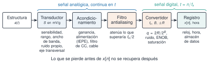
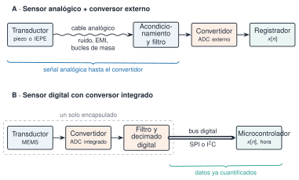

## Objetivos

- Describir la **cadena de medida** y el error de cada eslabón
- Comparar **cadena analógica + convertidor externo** con **sensor digital**
- Distinguir bits nominales de bits efectivos (**ENOB**) y los tres «rangos»
- Leer la ficha de un acelerómetro: sensibilidad, rango, banda, ruido, transversal
- Piezoeléctrico (IEPE) frente a MEMS, y cómo elegir para SHM

*M3 = comprender la señal; M8 = comprender la medición.*

## M8.1 La cadena de medida

{width="100%" fig-alt="Cadena de medida: estructura, transductor, acondicionamiento, filtro antialiasing, convertidor y registro, con lo que conviene revisar en cada eslabón"}

**Lo que se pierde antes de $x[n]$ no se recupera después.**

## Analógico o digital

{width="85%" fig-alt="Dos arquitecturas: sensor analógico con convertidor externo y cable analógico, y sensor digital con convertidor integrado y bus digital SPI o I2C"}

- El sensor digital **no elimina** el antialiasing: lo convierte en una especificación.

## Bits nominales y efectivos

$$
\mathrm{ENOB}=\frac{\mathrm{SINAD}-1{,}76}{6{,}02}
\qquad
\mathrm{ENOB}=B-\tfrac12\log_2\!\left[1+12\left(\tfrac{\sigma_n}{q}\right)^2\right]
$$

- $\sigma_n=q$: se pierden $1{,}85$ bits
- $\sigma_n=4q$: 16 bits nominales son unos **12,2** efectivos
- Cada vez que el ruido se duplica, se pierde un bit

## Tres significados de «rango»

| Término | Expresión |
|---|---|
| Fondo de escala | $\pm R$ |
| Rango dinámico del convertidor | $\approx6{,}02\,B+1{,}76$ dB |
| Rango dinámico de la cadena | $20\log_{10}\dfrac{R/\sqrt2}{\sigma_n}$ |

- Manda el **peor eslabón**
- La señal debe caber **con su offset**: $\lvert\mu\rvert+A\le R$

## M8.3 Qué mide un acelerómetro

- Masa sísmica sobre un resorte: $\lvert Z/A\rvert\approx1/\omega_n^2$ bajo la resonancia
- **Sensibilidad y banda compiten**
- Banda útil: una fracción de la resonancia, con tolerancia
- IEPE: acoplado en alterna (**no mide continua**); MEMS: responde desde continua (**mide la gravedad**)

## Ruido: de la densidad al valor eficaz

$$
\sigma_n=d\,\sqrt{\Delta f}
$$

- $20\ \mu\mathrm g/\sqrt{\mathrm{Hz}}$ en 20 Hz: $89{,}4\ \mu\mathrm g$ (valor ilustrativo)
- Las fuentes independientes se suman **en potencia**
- Ruido eléctrico: térmico, disparo, $1/f$, red, EMI, triboeléctrico, diafonía

## Instalación y selección

- Eje alineado; cada grado de inclinación en un MEMS son **17,5 mg** de offset
- La sensibilidad transversal puede igualar a la señal
- Elegir comparando $d\sqrt{\Delta f}$ con el RMS esperado
- Sin hoja de datos del modelo, no hay cifras

## Pendiente de redactar

M8.2 IEPE · M8.4 ADXL355 · M8.5 SPI e I²C · M8.6 calibración · M8.7 otros sensores · M8.8 ESP32
