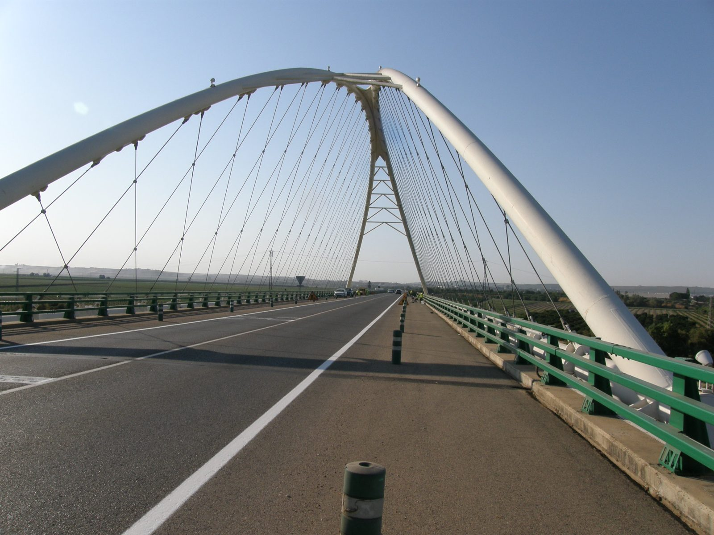
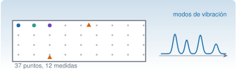
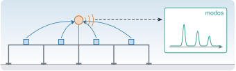
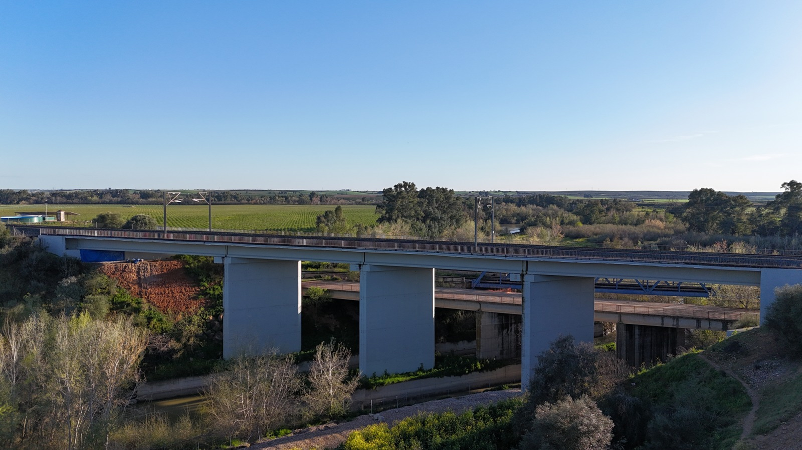

Los datos del curso son de dos tipos: **reales**, medidos en puentes por el autor y su grupo, y **sintéticos**, generados con semilla fija para las prácticas. Cada conjunto lleva una ficha `.meta.toml` con su origen, sensor, frecuencia de muestreo, unidades y licencia. Cada puente con datos reales tiene su propia unidad de recursos, de R1 a R4.

## Datos reales

Mediciones de aceleración en dos puentes, con licencia CC BY 4.0. **Al usarlas hay que citar el artículo** en que se publicaron. En el [repositorio](https://github.com/me1catrr/resonancia/tree/main/datos/reales-publicables) están los extractos; las grabaciones completas, en Zenodo. Un tercer puente, el viaducto Guadiato, tendrá datos cuando el proyecto SMART-BRIDGES autorice publicarlos.

::: {layout-ncol=2}
[{fig-alt="Calzada del puente con el arco blanco y los tirantes al fondo"}](r1-palma-del-rio/index.qmd)

[{fig-alt="Planta de un tablero con una malla de 37 puntos y un espectro con cuatro picos"}](r2-torroja/index.qmd)

[{fig-alt="Puente de cuatro vanos con nodos sensores que envían sus datos a un nodo cabecera y, de ahí, a un centro remoto con un espectro"}](r3-smart-bridges/index.qmd)

[{fig-alt="Alzado lateral de un viaducto de hormigón visto desde el aire: un tablero horizontal sobre tres pilas de sección rectangular"}](r4-guadiato/index.qmd)
:::

### R1 · [Puente de Palma del Río](r1-palma-del-rio/index.qmd)

Vibración operacional, julio y octubre de 2020. Acelerómetro a 512 y 2048 Hz. El efecto del tráfico sobre la señal y su espectro. Cita: @infantes2022. Datos completos: en preparación.

Solo se publica el canal de aceleración del tablero; el resto de canales del ensayo de Palma del Río no se comparte.

### R2 · [Puente de Torroja](r2-torroja/index.qmd)

Vibración ambiental, 22-06-2018. Cinco estaciones triaxiales a 100 Hz sobre una malla de 37 puntos. Espectros, modos y variabilidad entre campañas. Cita: @pachon2018. Datos completos: [Zenodo](https://doi.org/10.5281/zenodo.23639137).

### R3 · [SMART-BRIDGES](r3-smart-bridges/index.qmd)

Proyecto de monitorización continua de puentes ferroviarios de alta velocidad con sensores inalámbricos: equipos, los ocho puentes demostradores, el sistema previsto, qué datos genera y cómo se accede a ellos. **Datos en preparación.**

### R4 · [Viaducto Guadiato (LAV Madrid–Sevilla)](r4-guadiato/index.qmd)

Caso piloto de SMART-BRIDGES, entre Posadas y Almodóvar del Río, con fotos propias (CC BY 4.0) y su línea: recorrido, cifras contrastadas entre fuentes y otros viaductos. **Aún no hay registros de aceleración**: se incorporarán cuando el proyecto autorice publicarlos.

## Datos sintéticos

Los casos sintéticos A–E de los ejercicios del curso están en [`datos/sinteticos/curso-claude/`](https://github.com/me1catrr/resonancia/tree/main/datos/sinteticos/curso-claude) y se generan con `scripts/datos/generar_casos.jl` (semilla 20261023). Cada fichero declara en su ficha los defectos que se le han puesto a propósito.

## Cómo se organizan

```text
datos/reales-publicables/<estructura>/<AAAA-MM-DD>-<campaña>/
├── crudos/ · extractos/ · docs/ · modos/ · fotos/
└── campana.meta.toml
```

Las normas de publicación (tamaño máximo, fotos sin metadatos, nombres sin espacios) las comprueba `scripts/comprobar_datos.jl`. Las funciones para leer y analizar estos registros están en el paquete `Resonancia`, que se describe [al final de esta página](#referencia-resonancia).

## Referencia de Resonancia.jl {#referencia-resonancia}

`Resonancia.jl` es el paquete local del curso: contiene las funciones reutilizables, cada una con su docstring y su prueba. Está incorporado al entorno del proyecto con `Pkg.develop`, así que `using Resonancia` funciona en cualquier página con `engine: julia`. Las pruebas se ejecutan con `julia --project=Resonancia.jl -e 'using Pkg; Pkg.test()'`.

Esta referencia recoge las funciones que usan las páginas de datos reales; no tienen dependencias externas (la FFT es propia y está comprobada frente a la DFT directa). El resto de funciones, con su descripción, están en los docstrings del paquete (`?nombre` en el REPL de Julia).

### Análisis espectral

| Función | Qué hace |
|---|---|
| `fft_radix2(x)` | Transformada de Fourier de una señal de longitud potencia de 2 (Cooley–Tukey). |
| `psd_welch(x, fs; nseg, solape)` | Densidad espectral de potencia unilateral por el método de Welch (ventana de Hann). Devuelve `(f, P)`. |
| `buscar_picos(f, P; fmin, fmax, n, separacion)` | Índices de los `n` máximos locales más altos de un espectro. |
| `rms_por_ventana(x, fs, ventana_s)` | Valor eficaz en ventanas consecutivas. Devuelve `(t, r)`. |

### Lectura de registros

| Función | Qué hace |
|---|---|
| `leer_torroja(ruta)` | Lee un fichero de estación del puente de Torroja. Devuelve `(t, a, fs, estación, inicio)`. |
| `leer_aceleracion_csv(ruta; hasta)` | Lee un CSV `tiempo_s;aceleracion_g` de Palma del Río. Devuelve `(t, a, fs)`. |

Ejemplo, con los datos de [Torroja](r2-torroja/index.qmd):

```julia
using Resonancia
t, a, fs, estacion, inicio = leer_torroja("s1_medida01.txt")
f, P = psd_welch(a[:, 3], fs; nseg=4096)      # PSD del eje vertical
picos = f[buscar_picos(f, P; fmin=2, fmax=10, n=8, separacion=0.15)]
```
