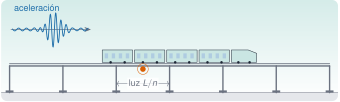
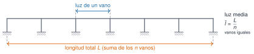
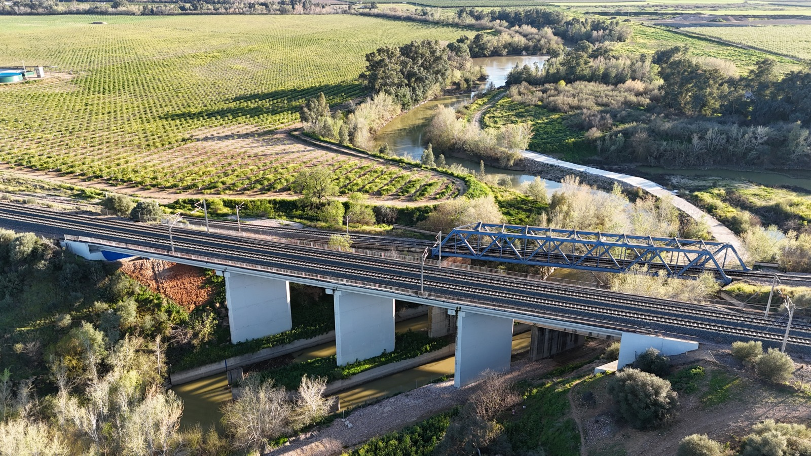
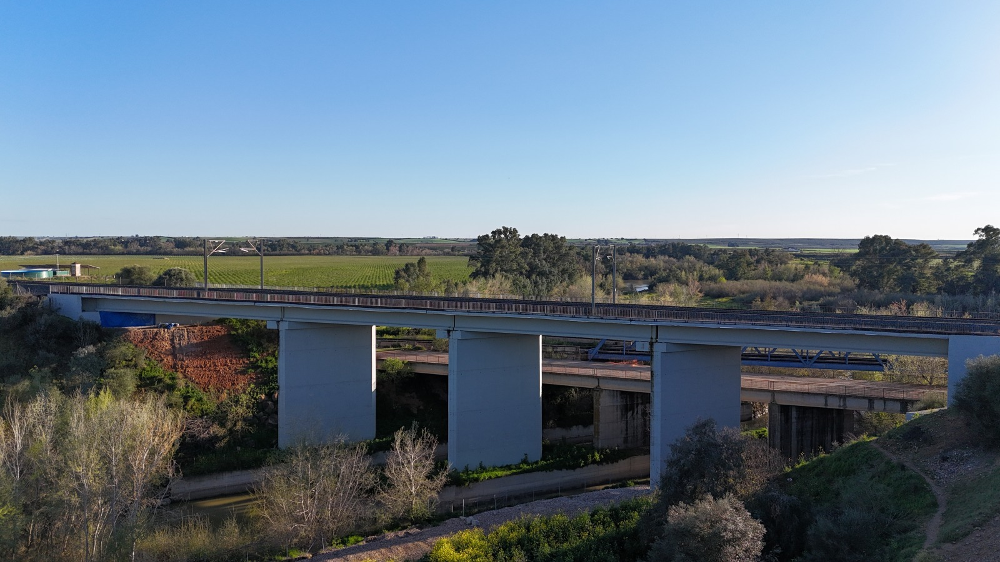
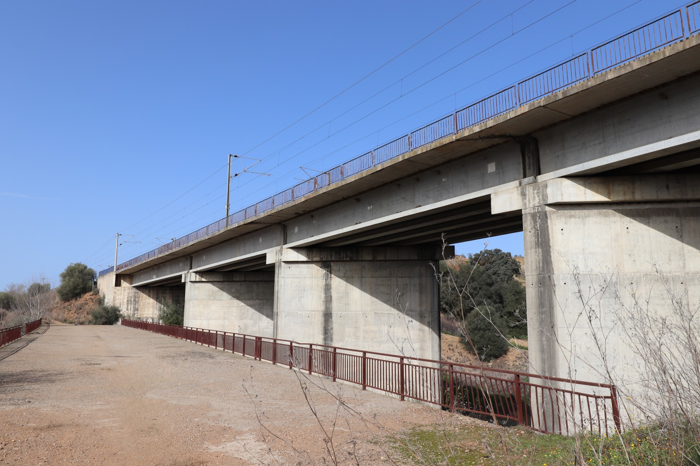
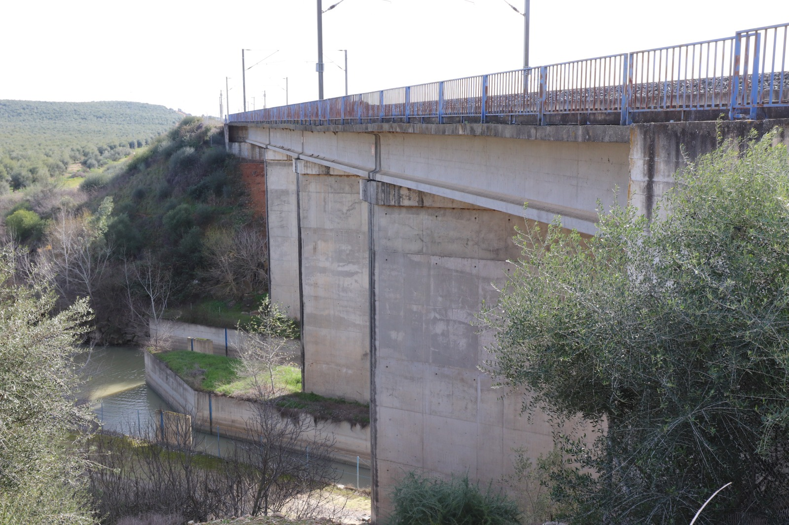

{.portada fig-alt="Viaducto de seis vanos iguales con un tren sobre el tablero, un acelerómetro bajo el tablero en el centro de un vano y un registro de aceleración con una ráfaga"}

La línea de alta velocidad (LAV, *high-speed line*) Madrid–Sevilla se inauguró en 1992 y tiene unos 472 km con decenas de **viaductos** y varios túneles [@wikipedia-lav-madrid-sevilla]. Esta página hace tres cosas: sitúa la línea (de dónde viene, por dónde pasa y qué cifras se manejan), reúne un **catálogo de sus puentes** con lo que las fuentes dicen de ellos y presenta el proyecto **SMART-BRIDGES**, cuyos datos de un puente de la línea, el **puente Guadiato**, entre **Posadas y Almodóvar del Río**, se incorporarán aquí.

Cada dato lleva su fuente. Donde dos fuentes no coinciden, se dice. Las cifras que no se han podido cotejar con la página original están marcadas.

```{julia}
#| include: false
using Statistics
include("../_tema.jl")
```

## Ficha

| | |
|---|---|
| **Línea** | LAV Madrid–Sevilla, de Madrid Puerta de Atocha a Sevilla Santa Justa |
| **Longitud** | 471,8 km [@wikipedia-lav-madrid-sevilla] |
| **Ancho de vía** | 1435 mm (UIC, el ancho internacional) [@wikipedia-lav-madrid-sevilla] |
| **Electrificación** | 25 kV, corriente alterna monofásica a 50 Hz [@wikipedia-lav-madrid-sevilla] |
| **Velocidad máxima** | 300 km/h, con tramos a 290 km/h [@wikipedia-lav-madrid-sevilla] |
| **Puesta en servicio** | Inauguración el 14-04-1992 y servicio comercial desde el 21-04-1992 [@wikipedia-lav-madrid-sevilla] |
| **Provincias** | Madrid, Toledo, Ciudad Real, Córdoba y Sevilla (deducidas de las estaciones: la fuente no las enumera) |
| **Puente con datos** | Viaducto Guadiato: 110,54 m y 4 vanos, de vigas en I con losa continua [@smartbridges-memoria]. Está entre Posadas y Almodóvar del Río (ubicación indicada por el responsable del curso). Datos pendientes de incorporar |
| **Proyecto** | SMART-BRIDGES, referencia PLEC2021-007798, coordinado por la Universidad de Córdoba [@smartbridges-ugr; @smartbridges-memoria] |
| **Acceso a los datos** | Plataforma del proyecto, con clave: [smartbridgesdata.live](https://smartbridgesdata.live/access/login) |
| **Fotos del puente** | De junio de 2020 y febrero de 2024 (autoría: Rafael Castro Triguero), en el repositorio con licencia CC BY 4.0 |
| **Licencia de los datos del puente** | Pendiente de confirmar |

::: {.callout-note}
## Cómo citar
Para la información de la línea, cita las fuentes de cada dato (en la columna de la derecha y en las «Referencias» de esta página). Para los datos del puente entre Posadas y Almodóvar del Río se indicará aquí la referencia cuando se publiquen.
:::

## De Despeñaperros a la Expo del 92

::: {.callout-note .historia icon=false title="Un poco de historia: una línea nueva en ancho internacional"}
- **1988.** Empiezan las obras, en el tramo Getafe–Villaseca. El **9 de diciembre de 1988** se decide usar el ancho internacional, y el **2 de octubre de 1989** se coloca el primer tramo de carril [@wikipedia-lav-madrid-sevilla].
- **Por qué una línea nueva.** Según Adif, el paso de Despeñaperros era el cuello de botella de la comunicación con Andalucía; duplicar la vía existente se descartó por su dificultad técnica y por lo que habría perturbado la explotación, y la decisión del ancho europeo obligó a modificar el proyecto original hasta convertirlo en una línea nueva [@adifav-historia] (sin cotejar con la web original).
- **1992.** El **14 de abril** se inaugura la línea, coincidiendo con la Exposición Universal de Sevilla, y el **21 de abril** empieza el servicio comercial [@wikipedia-lav-madrid-sevilla].

Fuentes consultadas el 01-11-2026. La página de Wikipedia se editó por última vez el 29-10-2026 y las páginas de Adif no pudieron abrirse con comprobación de certificado desde el entorno de trabajo, por lo que sus datos proceden de un resumen de buscador y están por cotejar.
:::

## El recorrido

La línea une Madrid Puerta de Atocha con Sevilla Santa Justa. Entre ambas hay, además de varios puntos intermedios de la vía, estaciones en Ciudad Real, Puertollano, Villanueva de Córdoba–Los Pedroches y Córdoba [@wikipedia-lav-madrid-sevilla].

![Esquema de la LAV Madrid–Sevilla. Las posiciones son aproximadas y los tramos entre puntos se dibujan rectos: **no es el trazado real**. Los puntos kilométricos (PK) son los de [@wikipedia-lav-madrid-sevilla]. El tramo naranja es el del puente Guadiato (SMART-BRIDGES), entre Posadas y Almodóvar del Río; su posición exacta no se conoce todavía.](fig/mapa.svg){#fig-mapa fig-alt="Esquema de la línea de Madrid, arriba a la derecha, a Sevilla, abajo a la izquierda. De norte a sur se marcan Madrid Puerta de Atocha, Ciudad Real, Puertollano, Villanueva de Córdoba-Los Pedroches y Córdoba Central, con sus puntos kilométricos, y a continuación Almodóvar del Río, Posadas y Sevilla Santa Justa. Una banda sombreada señala la zona orientativa de Sierra Morena y un tramo corto en naranja, junto a Almodóvar del Río y Posadas, marca el tramo del puente Guadiato (SMART-BRIDGES)."}

Con los puntos kilométricos se ve mejor la escala de la línea y dónde cae cada cosa:

{#fig-pk fig-alt="Eje horizontal graduado de 0 a 400 kilómetros con seis estaciones marcadas: Madrid Atocha en el 0, Ciudad Real en el 170,7, Puertollano en el 209,4, Villanueva de Córdoba-Los Pedroches en el 285,2, Córdoba en el 343,7 y Sevilla Santa Justa en el 470,5. Un cuadrado en el 363,0 marca Almodóvar del Río. Un corchete marrón bajo el eje, entre Puertollano y Córdoba, indica Sierra Morena."}

```{julia}
estaciones = [("Madrid Puerta de Atocha", 0.0), ("Ciudad Real", 170.749), ("Puertollano", 209.449),
              ("Villanueva de Córdoba-Los Pedroches", 285.193), ("Córdoba Central", 343.667),
              ("Sevilla Santa Justa", 470.493)]
pk = Dict(estaciones)
L_linea = 471.8                                 # longitud total (km)
pk_almodovar = 362.958                          # punto de referencia de Almodóvar del Río
tramos = [("Madrid – Ciudad Real", pk["Madrid Puerta de Atocha"], pk["Ciudad Real"]),
          ("Ciudad Real – Córdoba", pk["Ciudad Real"], pk["Córdoba Central"]),
          ("Córdoba – Sevilla", pk["Córdoba Central"], pk["Sevilla Santa Justa"])]
d_cor_alm = pk_almodovar - pk["Córdoba Central"]
nothing
```

```{julia}
#| output: asis
println("| Tramo | Longitud (km) | Parte de la línea |\n|---|---|---|\n" *
    join(["| $nom | $(coma(b - a; d=1)) | $(coma(100 * (b - a) / L_linea; d=0)) % |" for (nom, a, b) in tramos], "\n"))
```

: Tramos de la línea entre estaciones principales, calculados con los puntos kilométricos de [@wikipedia-lav-madrid-sevilla]. {#tbl-tramos}

El punto de referencia de Almodóvar del Río está a `{julia} coma(d_cor_alm; d=1)` km de Córdoba Central, en dirección a Sevilla.

::: {.ejercicio tipo="numerico" id="r1-lav-km-cordoba-almodovar" respuesta="19.3" tol="1%" unidad="km"}
Con los puntos kilométricos de la @fig-pk (Córdoba Central, 343,667; punto de referencia de Almodóvar del Río, 362,958), ¿a cuántos kilómetros está Almodóvar del Río de Córdoba?

::: {.solucion}
$362{,}958-343{,}667 = 19{,}291\ \mathrm{km}\approx 19{,}3\ \mathrm{km}$. Es una distancia medida **a lo largo de la vía**, no en línea recta.
:::
:::

## Las cifras de la línea (y dónde no coinciden)

La línea tiene muchos viaductos y túneles, pero las fuentes no dan las mismas cifras de los viaductos:

```{julia}
#| output: asis
viaductos_wiki = (31, 9845)    # número y longitud total (m)
viaductos_adif = (32, 8355)
tuneles = (17, 16030)
pct(m) = 100 * m / (1000 * L_linea)
miles(n) = replace(string(n), r"(?<=\d)(?=(\d{3})+$)" => ".")   # 9845 -> 9.845
println("| Obra | Wikipedia | Adif AV (sin cotejar) | Parte de la longitud de la línea |\n|---|---|---|---|\n" *
    "| Viaductos | $(viaductos_wiki[1]) · $(miles(viaductos_wiki[2])) m | $(viaductos_adif[1]) · $(miles(viaductos_adif[2])) m | entre el $(coma(pct(viaductos_adif[2]); d=1)) % y el $(coma(pct(viaductos_wiki[2]); d=1)) % |\n" *
    "| Túneles | $(tuneles[1]) · $(miles(tuneles[2])) m | $(tuneles[1]) · $(miles(tuneles[2])) m | el $(coma(pct(tuneles[2]); d=1)) % |")
```

: Número y longitud total de viaductos y túneles según dos fuentes [@wikipedia-lav-madrid-sevilla; @adifav-lav-madrid-sevilla]. La última columna es un cálculo propio sobre 471,8 km. {#tbl-cifras}

::: {.callout-warning}
## Las fuentes no coinciden en los viaductos
Una da 31 viaductos y 9.845 m; la otra, 32 y 8.355 m. Los túneles, en cambio, coinciden. Hasta cotejarlo con la web de Adif, **no uses una cifra de viaductos como dato firme**. Ambas fuentes coinciden en que la mayoría de túneles y viaductos se concentra en Sierra Morena [@wikipedia-lav-madrid-sevilla; @adifav-lav-madrid-sevilla].
:::

::: {.ejercicio tipo="vf" id="r1-lav-viaductos-fuentes" respuesta="falso"}
Wikipedia y Adif dan el mismo número de viaductos de la línea.

::: {.solucion}
Falso. Wikipedia da 31 viaductos con 9.845 m en total y Adif, 32 con 8.355 m (cifra sin cotejar). Cuando dos fuentes difieren, se cita cada una y se avisa; no se elige una en silencio.
:::
:::

## Catálogo de puentes del recorrido

### Cinco viaductos

Un libro de puentes ferroviarios [@puentesferroviarios] cataloga unas treinta y cuatro obras de la línea, todas de 1992. Se resumen cinco con **valores aproximados** (longitud redondeada a 10 m): el número de vanos y el esquema son los del libro; la **luz media** es un cálculo propio, longitud entre vanos, y **supone vanos iguales**. Las fuentes consultadas no dan su punto kilométrico, así que no se pueden situar en el mapa.

```{julia}
obras = [("Guadalmez", 800, 30, "isostático"),
         ("Tajo", 690, 17, "isostático"),
         ("Ciudad Real", 930, 33, "isostático"),
         ("Guadiana", 290, 6, "hiperestático"),
         ("Churreletes", 450, 11, "hiperestático")]
luz_media(L, n) = L / n          # luz media (m), con vanos iguales
luces = [luz_media(L, n) for (_, L, n, _) in obras]
nothing
```

```{julia}
#| output: asis
println("| Obra | Longitud aprox. (m) | Vanos | Esquema | Luz media aprox. (m) |\n|---|---|---|---|---|\n" *
    join(["| $nom | $L | $n | $esq | $(Int(round(luz_media(L, n)))) |" for (nom, L, n, esq) in obras], "\n"))
```

: Cinco viaductos de la línea. Número de vanos y esquema, de @puentesferroviarios (capítulo 13.1); longitud redondeada a 10 m; luz media, cálculo propio con vanos iguales. {#tbl-obras}

El viaducto de la variante de Ciudad Real es, según Adif, el más largo de la línea, con unos 930 m [@adifav-lav-madrid-sevilla], un dato compatible con el de la @tbl-obras (cifra de Adif sin cotejar).

{#fig-vanos fig-alt="Esquema de un tablero apoyado en siete pilas, que forman seis vanos iguales. Una cota azul marca la luz de un vano, una cota naranja marca la longitud total y a la derecha figura la fórmula de la luz media, L dividida entre n."}

Un esquema **isostático** es el de vanos que trabajan de forma independiente; en uno **hiperestático** los vanos son continuos y se condicionan entre sí. Es un dato de partida de cualquier modelo de la obra.

```{julia}
#| label: fig-luces
#| fig-cap: "Luz media aproximada de los vanos de las cinco obras. Azul, esquema isostático; naranja, hiperestático (también indicado en la etiqueta). Cálculo propio con longitudes redondeadas y vanos iguales."
#| fig-alt: "Gráfica de barras horizontales con la luz media aproximada de cinco viaductos, de menor a mayor: Guadalmez, unos 27 metros; Ciudad Real, unos 28; Tajo y Churreletes, unos 41; y Guadiana, unos 48 metros. Las etiquetas indican si el esquema es isostático o hiperestático."
orden = sortperm(luces)
etiquetas = ["$(obras[i][1]) ($(obras[i][4]))" for i in orden]
colores = [obras[i][4] == "isostático" ? AZUL : NARANJA for i in orden]
fig = Figure(size=(860, 360))
ax = Axis(fig[1, 1]; xlabel="luz media aproximada (m)", yticks=(1:5, etiquetas))
barplot!(ax, 1:5, luces[orden]; direction=:x, color=colores)
for (k, i) in enumerate(orden)
    text!(ax, luces[i], k; text=" " * string(Int(round(luces[i]))), align=(:left, :center), fontsize=13)
end
xlims!(ax, 0, 58)
fig
```

La [actividad de la LAV de M3](../../../mse/m03-senales-i/index.qmd#lav) parte de uno de estos vanos y usa un escenario **sintético** (no son medidas de la línea): allí se explica cómo elegir la adquisición y qué cambia en el espectro durante el paso de un tren.

### Los ocho puentes de SMART-BRIDGES

El proyecto eligió ocho puentes de alta velocidad de vano corto o medio, de dos tipologías, como demostradores. La memoria técnica de la solicitud [@smartbridges-memoria] los describe así:

- **Tipo 1** (4 puentes, línea Madrid–Sevilla, cerca de Córdoba): vigas en I (entre 5 y 8) con losa de continuidad hormigonada *in situ*, de 2 a 4 vanos de unos 30 m y con esviaje (los ejes de apoyo no son perpendiculares al eje del puente). Velocidad máxima de línea de 250 km/h. La memoria dice que es una tipología muy particular, poco usada en las líneas posteriores.
- **Tipo 2** (4 puentes, línea Córdoba–Málaga): dos vigas en U con losa hormigonada *in situ*, de 32 a 35 m de vano según el texto, con esviaje y 300 km/h de velocidad máxima. Es una tipología más extendida en la red, lo que facilitaría extrapolar los resultados.

```{julia}
puentes = [("Madrid–Sevilla", "Viaducto Guadiato", "Córdoba", 1, 110.54, 4, 31.41, 250),
           ("Madrid–Sevilla", "PTE S/A-431", "Córdoba", 1, 28.3, 1, 26.3, 250),
           ("Madrid–Sevilla", "Viaducto Bembézar", "Córdoba", 1, 53.0, 2, 26.5, 250),
           ("Madrid–Sevilla", "Puente Retortillo", "Córdoba", 1, 22.0, 1, 22.0, 250),
           ("Córdoba–Málaga", "Viaducto A-4", "Sevilla", 2, 85.0, 4, 23.5, 300),
           ("Córdoba–Málaga", "Viaducto A-92", "Málaga", 2, 73.0, 3, 33.0, 300),
           ("Córdoba–Málaga", "Puente sobre el ferrocarril Sevilla–Granada", "Málaga", 2, 74.0, 3, 34.0, 300),
           ("Córdoba–Málaga", "Viaducto Arroyo del Tajo", "Málaga", 2, 51.0, 2, 25.0, 300)]
luz_prom(L, n) = L / n
r1(x) = coma(round(x, RoundNearestTiesAway; digits=1); d=1)   # redondeo habitual, 21,25 -> 21,3
nothing
```

```{julia}
#| output: asis
println("| Línea | Puente | Provincia | Tipo | Longitud (m) | Vanos | Luz máxima (m) | Luz media (m) | Velocidad máx. (km/h) |\n|---|---|---|---|---|---|---|---|---|\n" *
    join(["| $lin | $nom | $prov | $tipo | $(coma(L; d=1)) | $n | $(coma(lmax; d=1)) | $(r1(luz_prom(L, n))) | $v |" for (lin, nom, prov, tipo, L, n, lmax, v) in puentes], "\n"))
```

: Puentes demostradores de SMART-BRIDGES. Longitud, vanos, luz máxima y velocidad, de la tabla 1 de la memoria técnica [@smartbridges-memoria]; la luz media es un cálculo propio (longitud entre vanos). {#tbl-proyecto}

**Cuidado con la luz media.** En el PTE S/A-431 y en el viaducto Arroyo del Tajo sale mayor que la luz máxima, lo que no puede ser con vanos que sumen la longitud total: esta incluye algo más que los vanos (quizá los extremos o el esviaje; la memoria no lo aclara). Por eso $L/n$ es solo una referencia aproximada, y más cuanto menos vanos tiene el puente.

```{julia}
#| label: fig-proyecto
#| fig-cap: "Luz media (longitud entre vanos) y luz máxima de los ocho puentes de SMART-BRIDGES. Cada puente indica su tipo (T1, T2). Datos de la memoria técnica; luz media, cálculo propio."
#| fig-alt: "Gráfica de barras horizontales con dos barras por puente, la luz media en azul y la luz máxima en naranja. Las luces medias van de unos 21 metros, en el viaducto A-4, a unos 28 metros, en el puente PTE S/A-431; las luces máximas van de 22 metros, en el puente Retortillo, a 34 metros, en el puente sobre el ferrocarril Sevilla-Granada. El viaducto Guadiato tiene una luz media de unos 27,6 metros y una luz máxima de 31,4."
nombres = ["T$(p[4]) · $(p[2])" for p in puentes]
prom = [luz_prom(p[5], p[6]) for p in puentes]
maxl = [p[7] for p in puentes]
np_ = length(puentes)
fig = Figure(size=(860, 460))
ax = Axis(fig[1, 1]; xlabel="luz (m)", yticks=(1:np_, nombres), yreversed=true)
barplot!(ax, repeat(1:np_, 2), vcat(prom, maxl); dodge=vcat(fill(1, np_), fill(2, np_)),
         color=vcat(fill(AZUL, np_), fill(NARANJA, np_)), direction=:x)
for k in 1:np_
    text!(ax, prom[k], k - 0.2; text=" " * r1(prom[k]), align=(:left, :center), fontsize=11)
    text!(ax, maxl[k], k + 0.2; text=" " * coma(maxl[k]; d=1), align=(:left, :center), fontsize=11)
end
xlims!(ax, 0, 42)
axislegend(ax, [PolyElement(color=AZUL), PolyElement(color=NARANJA)], ["luz media", "luz máxima"]; position=:rb, framevisible=false)
fig
```

::: {.ejercicio tipo="numerico" id="r1-lav-luz-guadiato" respuesta="27.6" tol="1%" unidad="m"}
El viaducto Guadiato mide 110,54 m y tiene 4 vanos. ¿Cuál es su luz media? Compárala con su luz máxima, de 31,41 m: ¿puede tener los cuatro vanos iguales?

::: {.solucion}
$110{,}54/4 = 27{,}635\ \mathrm{m}\approx 27{,}6\ \mathrm{m}$. Como la luz máxima (31,41 m) es mayor que la media, los vanos **no son iguales**: la luz media sirve de referencia, no de dato exacto (y la longitud total puede incluir algo más que los vanos).
:::
:::

Los rangos que da el texto de la memoria (vanos de unos 30 m para el tipo 1 y de 32 a 35 m para el tipo 2) son orientativos: la tabla da luces máximas de 22 a 31,4 m en el tipo 1 y de 23,5 a 34 m en el tipo 2.

### El viaducto Guadiato

El viaducto **Guadiato** es el «caso piloto n.º 1» de SMART-BRIDGES [@smartbridges-uco]. La memoria lo clasifica como tipo 1: **110,54 m de longitud, 4 vanos, una luz máxima de 31,41 m y 250 km/h** de velocidad máxima de línea, en la provincia de Córdoba [@smartbridges-memoria]. Está en la LAV Madrid–Sevilla, entre Posadas y Almodóvar del Río: esa ubicación concreta la indica el responsable del curso, porque ni la memoria ni las webs del proyecto consultadas la dan.

Las fotos del puente se tomaron desde el suelo y con un dron:

::: {#fig-guadiato layout-ncol=2}

{#fig-guadiato1 fig-alt="Vista aérea oblicua de un viaducto de hormigón con varias vías y catenaria, apoyado en pilas blancas de hormigón que se alzan sobre un canal con agua. Junto a él, un puente metálico de celosía pintado de azul soporta otra vía. Al fondo, un río con vegetación y campos de cultivo."}

{#fig-guadiato2 fig-alt="Alzado lateral del viaducto, visto desde el aire con el cielo despejado: un tablero horizontal sobre tres pilas de hormigón de sección rectangular. Bajo el tablero se ve otra estructura a menor cota, el canal y la vegetación de la ladera."}

{#fig-guadiato3 fig-alt="El viaducto visto desde abajo y de lado, con pilas de hormigón, vigas bajo el tablero y, arriba, la barandilla y la catenaria. En primer plano, una explanada de tierra con una valla de color rojizo."}

{#fig-guadiato4 fig-alt="Tres pilas de hormigón con sus cabezales sostienen las vigas del tablero, con barandilla azul y catenaria. A la izquierda, un canal de agua con muros de hormigón y, de fondo, una ladera de olivar."}

El puente Guadiato. Fotos: Rafael Castro Triguero.
:::

Las vistas aéreas muestran tres pilas, lo que concuerda con los 4 vanos de la memoria. Se ve, sin medir nada, un viaducto con vigas bajo el tablero, pilas de hormigón de sección rectangular, vías con catenaria y, junto a él, otras estructuras más bajas y un puente metálico de celosía; bajo el viaducto pasa un canal de agua.

Según la memoria, los modos de flexión y de torsión de la losa de estos puentes están, en los modelos numéricos, entre unos 5 y 10 Hz, un rango adecuado para el análisis modal operacional (OMA) y la monitorización; son resultados de modelo, no medidas [@smartbridges-memoria].

::: {.callout-note}
## Qué falta de este puente
Su punto kilométrico exacto y su posición. Hasta tenerlos no se puede situar en la escala de la @fig-pk ni en el mapa.
:::

### Otras fuentes para ampliar el catálogo

Quedan por revisar dos fuentes que no se han podido abrir desde el entorno de trabajo (error de acceso):

- la [página de viaductos de Adif](https://www.adif.es/viajeros/grandes-proyectos/viaductos), por si da las obras de la línea con sus datos;
- el [fondo documental de Docutren sobre la línea](https://archivo.docutren.com/index.php/linea-madrid-a-sevilla-alta-velocidad?genres=305787), un archivo de documentación ferroviaria.

## SMART-BRIDGES

SMART-BRIDGES es el proyecto «Monitorización inteligente del estado estructural de puentes ferroviarios de alta velocidad», con referencia **PLEC2021-007798**, de la convocatoria de Proyectos de I+D+i en Líneas Estratégicas de 2021 (BOE n.º 98, de 24-04-2021). Lo coordina la Universidad de Córdoba (coordinador: Rafael Castro Triguero) en un consorcio con la Universidad de Granada e Ineco, y lo financian el Ministerio de Ciencia e Innovación y la Agencia Estatal de Investigación con cargo al Plan de Recuperación, Transformación y Resiliencia, con fondos NextGenerationEU [@smartbridges-memoria; @smartbridges-ugr; @smartbridges-uco]. La ficha de la OTRI de la UGR nombra como investigador principal a Rafael Gallego Sevilla, de la UGR: en un proyecto coordinado cada equipo tiene el suyo.

### La idea y los equipos

La memoria parte de que la gestión de infraestructuras envejecidas es un reto de primer orden: cita unos 2.600 km de alta velocidad en España y 207 puentes críticos, parte de ellos con algún tipo de degradación, y una tasa de reposición muy baja. Su propuesta es **extender la vida útil** de los puentes ferroviarios de alta velocidad mediante una red de sensores inalámbricos con energía autónoma, monitorización estructural a largo plazo y decisiones basadas en datos [@smartbridges-memoria].

Cada equipo aporta lo suyo [@smartbridges-memoria]:

| Equipo | Papel |
|---|---|
| **Ineco** | Ingeniería de referencia de Adif para la inspección y monitorización de puentes y viaductos; caracteriza los puentes y define los requisitos de monitorización. |
| **UCO** | Comunicaciones, redes de sensores inalámbricos e internet de las cosas (IoT); sincronización y dispositivos de bajo consumo. |
| **UGR** | Monitorización de la salud estructural, análisis modal operacional, identificación de sistemas, captación de energía y pronóstico basado en datos. |

Sus seis objetivos específicos, resumidos [@smartbridges-memoria; @smartbridges-uco]:

1. caracterizar los puentes envejecidos, con sus patologías y tipologías más comunes, y crear modelos digitales de referencia;
2. diseñar una red de sensores (IoT) eficiente, fiable y sincronizada para monitorizar de forma continua;
3. desarrollar algoritmos de identificación para analizar el estado dinámico del puente con poco gasto de energía;
4. crear un sistema que recoja energía del entorno (vibraciones) para alimentar los sensores;
5. construir un gemelo digital que ayude a diagnosticar y a decidir el mantenimiento;
6. validar todo en un puente ferroviario envejecido de alta velocidad (el demostrador).

### El sistema de monitorización

Según la memoria, cada puente lleva un **nodo cabecera** (*head node*, HN) y varios **nodos sensores** (*sensor nodes*, SN). El nodo cabecera tiene un acelerómetro triaxial de precisión que dispara el muestreo de los nodos sensores, sensores ambientales (temperatura, humedad y anemómetro), los sincroniza y reduce los datos antes de enviarlos a los centros remotos. Cada nodo sensor lleva acelerómetros triaxiales y una galga extensométrica, guarda las muestras en una tarjeta SD y las envía al nodo cabecera al terminar [@smartbridges-memoria].

![Sistema de monitorización previsto en la memoria de SMART-BRIDGES: nodos sensores en el tablero, un nodo cabecera, un enlace de control en sub-GHz y de datos en GHz, y dos centros remotos. Esquema propio a partir de la descripción de la memoria [@smartbridges-memoria].](fig/sistema.svg){#fig-sistema fig-alt="Un tablero apoyado en cinco pilas con cuatro nodos sensores en cuadrados azules y un nodo cabecera naranja sobre un mástil. Flechas azules continuas van de los sensores al nodo cabecera, y flechas naranjas discontinuas van del nodo cabecera a los sensores. Desde el nodo cabecera, una flecha negra marcada WAN lleva al Centro de administración IoT, y de este otra flecha baja al Centro SHM."}

La memoria prevé instrumentar los 8 puentes con 86 nodos: 64 nodos sensores y 8 estaciones de control para los puentes, más material para laboratorio y de reserva; 6 nodos sensores y 1 estación por puente de tipo 1 y 10 nodos sensores y 1 estación por puente de tipo 2. Como resultado, esperaba la monitorización continua de los ocho puentes y unos 28.000 millones de muestras [@smartbridges-memoria]. Son **previsiones de la solicitud de 2021**, no cifras de lo ejecutado.

### Qué datos genera

Según la web del proyecto, los sensores registran la **aceleración en tres ejes (X, Y, Z), en g**, con una marca de tiempo de milisegundos; los registros se guardan por año, mes, día y sensor, y los que no valen se apartan en una carpeta `anomalias`. Cada día se genera un informe con una página por paso de tren (número de tren, hora de inicio y gráficas de aceleración y FFT por eje) y un resumen con estadísticas por segmento [@smartbridges-uco]:

```text
raw/<año>/<mes>/<día>/<sensor>/   registros de aceleración (X, Y, Z, en g)
raw/.../anomalias/                datos no válidos o irrelevantes
report/train_report_<fecha>.pdf   una página por paso de tren
summary.json                      estadísticas por segmento de cada día
```

Esta es la estructura que describe la web del proyecto; la de los datos que se incorporen aquí se fijará en su ficha.

::: {.callout-important}
## Dónde están los datos y cómo acceder
Los datos de SMART-BRIDGES están en la plataforma del proyecto, [smartbridgesdata.live](https://smartbridgesdata.live/access/login), y **hace falta clave para entrar**: el acceso se solicita al proyecto y lo aprueba un administrador [@smartbridges-uco]. Por eso no se copian aquí los registros completos; el repositorio del curso solo contendrá lo que el proyecto autorice publicar. La memoria prevé publicar los resultados con criterios FAIR en un repositorio como Zenodo, «tan abiertos como sea posible y tan cerrados como sea necesario» [@smartbridges-memoria].
:::

::: {.callout-warning}
## Datos pendientes
Los datos del viaducto Guadiato (entre Posadas y Almodóvar del Río) todavía no están en el repositorio. Cuando se incorporen, esta sección tendrá:

- la ficha de los datos (sensores, frecuencia de muestreo, unidades, número de registros y qué se publica);
- el análisis de los registros: el nivel de vibración, su espectro y el efecto del paso de los trenes;
- la referencia que hay que citar y la licencia.

Hasta entonces no se muestra ningún valor medido.
:::

## Imágenes y licencias

Las fotos del puente Guadiato son de Rafael Castro Triguero y están en el repositorio, reducidas y sin metadatos, con licencia CC BY 4.0 (`datos/reales-publicables/guadiato-puente/`). Esta página no incluye otras fotografías de la línea. Las imágenes de la web de Adif Alta Velocidad pueden descargarse en baja o media resolución solo para usos sin ánimo de lucro, con el crédito «Archivo Adif»; Adif se reserva el resto de derechos y pide solicitar permiso para la alta resolución (condiciones consultadas el 01-11-2026). Eso no es compatible con la licencia CC BY-SA 4.0 del curso, así que **no se copian al repositorio**: si necesitas verlas, están en la [web de Adif Alta Velocidad](https://www.adifaltavelocidad.es/). El mapa, la escala de puntos kilométricos, la portada y los esquemas son figuras propias.

## Reutilizar estos datos

- **De momento:** las tablas @tbl-tramos, @tbl-cifras y @tbl-obras, y las figuras @fig-mapa, @fig-pk y @fig-luces; el cálculo de la luz media es una línea de código (`L / n`). Las fotos del puente Guadiato, en el [repositorio](https://github.com/me1catrr/resonancia/tree/main/datos/reales-publicables/guadiato-puente).
- **Dónde se usa:** la actividad de la LAV en [M3](../../../mse/m03-senales-i/index.qmd#lav) y, cuando haya datos, el análisis de un puente ferroviario real.

## Qué no dicen estos datos

- El mapa no es el trazado real: es un esquema con posiciones aproximadas y tramos rectos.
- La extensión de Sierra Morena en el mapa y en la escala de PK es orientativa; las fuentes no dan sus puntos kilométricos.
- Las cifras de Adif no se han podido cotejar con su web; las de Wikipedia son de una página editable y no se han contrastado con una fuente primaria. En los viaductos difieren.
- Las cifras de las cinco obras son del catálogo citado, redondeadas, y no se han contrastado con otra fuente. La luz media supone vanos iguales; los vanos reales pueden diferir entre sí.
- No hay aquí ninguna medición de vibración de la línea: hasta que se incorporen los datos de SMART-BRIDGES, la página es un catálogo y una guía, no un conjunto de registros.
- Que el viaducto Guadiato esté entre Posadas y Almodóvar del Río es información del responsable del curso: ni la memoria ni las webs de SMART-BRIDGES consultadas la recogen.
- Los datos del proyecto (nodos, número de muestras, rangos de frecuencias) son los de la memoria de la solicitud de 2021: previsiones y resultados de modelo, no medidas.
