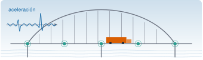
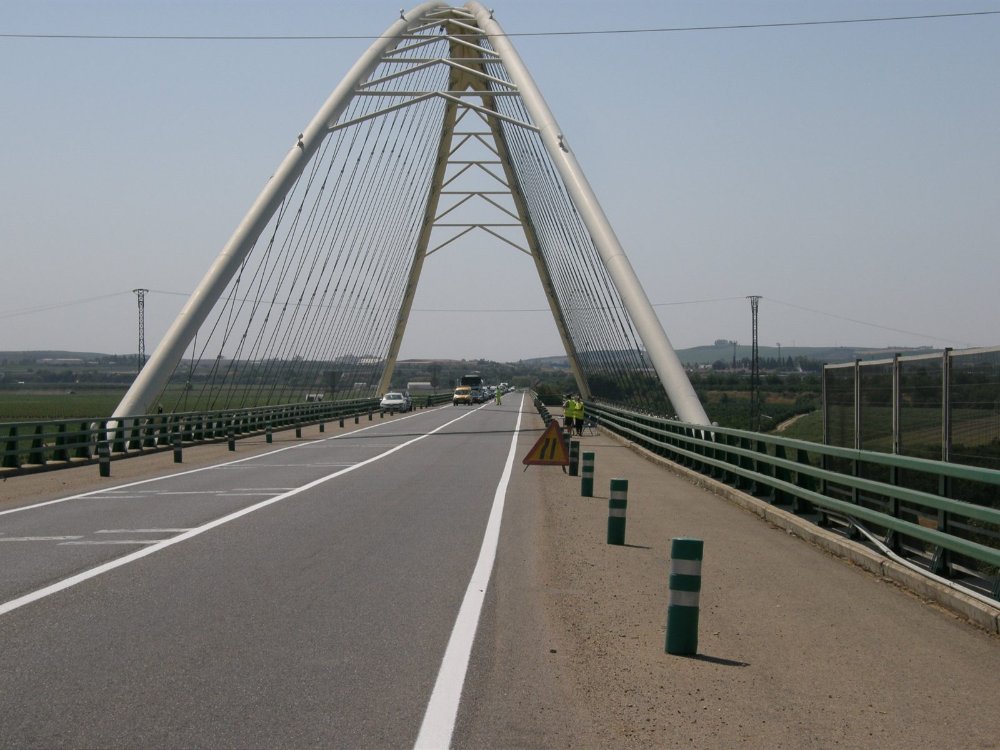
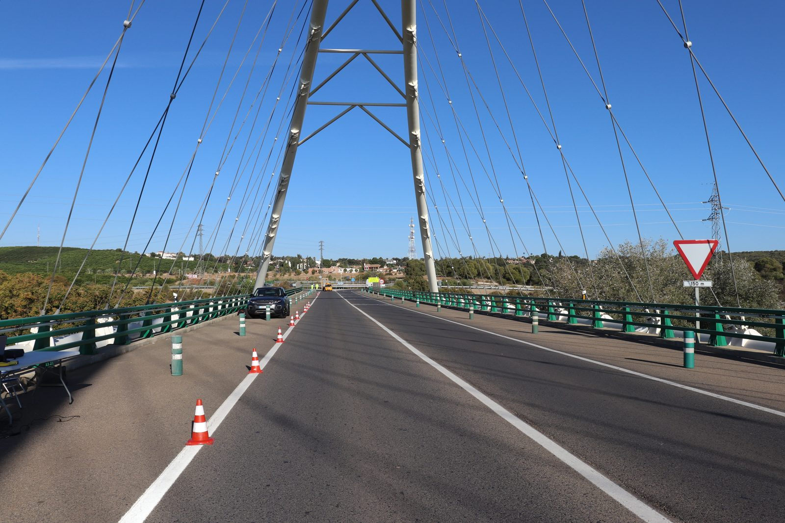
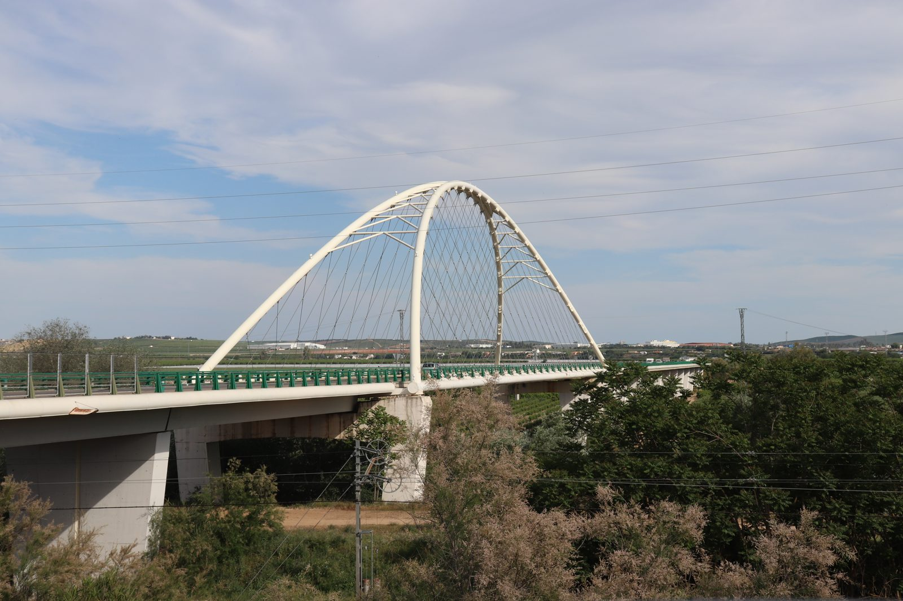
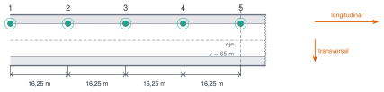

{.portada fig-alt="Puente en arco de tablero atirantado con cinco sensores en el tablero, un camión que lo cruza y un registro de aceleración con dos ráfagas"}

El puente de Palma del Río es un arco de tablero atirantado (*bowstring arch*) sobre un río. En 2020 se midió su vibración **operacional** (*operational vibration*): la que produce el tráfico real, sin cortar la carretera. El ensayo se hizo para estudiar la captación de energía de la vibración [@infantes2022]; aquí se usa solo el registro de **aceleración** del tablero, que sirve para ver una idea central de M0.3: **el tráfico domina la señal**, y cualquier indicador de salud estructural tiene que convivir con él.

```{julia}
#| include: false
using Resonancia, Statistics, Markdown
include("../_tema.jl")
RAIZ = "../../../datos/reales-publicables/palma-del-rio-puente/"
JULIO = RAIZ * "2020-07-17-vibracion-operacional/crudos/"
OCTUBRE = RAIZ * "2020-10-16-vibracion-operacional/"
```

## Ficha

| | |
|---|---|
| **Estructura** | Puente de arco de tablero atirantado en Palma del Río |
| **Campañas con datos** | 17-07-2020 (9 registros) y 16-10-2020 (3 registros) |
| **Sensor** | Acelerómetro sísmico, aceleración en g |
| **Muestreo** | 512 Hz (julio) y 2048 Hz (octubre) |
| **Qué hay en el repositorio** | Julio: los 9 registros de 5 min. Octubre: el registro 2 completo y los 10 primeros minutos de los registros 1 y 3 |
| **Grabaciones completas** | Depósito en Zenodo en preparación |
| **Fotos** | De la campaña de 2020 y de abril de 2021 (autoría: Rafael Castro Triguero) |
| **Licencia** | CC BY 4.0: citar @infantes2022 |

::: {.callout-note}
## Cómo citar
Si usas estos datos, cita el artículo [@infantes2022].
:::

## El puente y el ensayo

::: {#fig-fotos layout-ncol=2}

{#fig-foto1 fig-alt="Calzada del puente con el arco blanco y los tirantes al fondo, y la barandilla verde a la derecha"}

{#fig-foto2 fig-alt="Vista frontal del arco blanco del puente sobre la calzada"}

{#fig-foto3 fig-alt="Calzada del puente con conos de señalización y un vehículo, con el arco al fondo"}

{#fig-foto4 fig-alt="Vista lateral del puente en arco blanco sobre el río, con los pilares y el tablero"}

El puente de Palma del Río. Fotos: Rafael Castro Triguero.
:::

En julio se midió en cinco puntos del tablero, separados 16,25 m, con el acelerómetro situado en cada setup en el punto indicado en el cuaderno de campo:

{#fig-esquema fig-alt="Planta del tablero con cinco puntos de medida numerados del 1 al 5, separados 16,25 metros; el punto 5 está sobre el eje a 65 metros. Dos flechas indican las direcciones longitudinal y transversal."}

Cada registro de julio dura 5 min. La tabla recoge las condiciones del cuaderno de campo (temperatura de 29 °C a las 10:41 y de 35 °C a las 11:50):

| Registro | Punto | Dirección | Tráfico | Inicio | Fin |
|---|---|---|---|---|---|
| `set1` | 5 | transversal | no se marca como ausente | 9:12 | 9:17 |
| `set2` | 5 | transversal | **sin tráfico** | 9:24 | 9:29 |
| `set3` | 5 | longitudinal | no se marca como ausente | 9:36 | 9:41 |
| `set4` | 5 | longitudinal | no se marca como ausente | 10:52 | 10:57 |
| `set5` | 5 | longitudinal | no se marca como ausente | 11:18 | 11:23 |
| `set6` | 4 | longitudinal | no se marca como ausente | 11:30 | 11:35 |
| `set7` | 3 | longitudinal | no se marca como ausente | 11:38 | 11:43 |
| `set8` | 2 | longitudinal | no se marca como ausente | 11:48 | 11:53 |
| `set9` | 2 | longitudinal | **sin tráfico** | 11:59 | 12:04 |

: Registros de julio de 2020. «Dirección» es la que figura en el cuaderno de campo. {#tbl-julio}

En octubre se midió en un solo punto, a 64,8 m de Palma del Río, con tres registros:

| Registro | Duración | Tráfico | Temperatura | Viento |
|---|---|---|---|---|
| `palma_01` | 30 min | con tráfico | 11 °C | sin viento |
| `palma_02` | 292 s (menos de 5 min) | **sin tráfico** | 13 °C | suave |
| `palma_03` | 30 min | con tráfico | 15 °C | suave |

: Registros de octubre de 2020, a 2048 Hz. {#tbl-octubre}

## Leer los datos

Cada CSV tiene dos columnas, `tiempo_s` y `aceleracion_g`, separadas por `;`. `leer_aceleracion_csv` devuelve el tiempo, la aceleración y la frecuencia de muestreo.

```{julia}
set = Dict(k => leer_aceleracion_csv(JULIO * "set$k.csv") for k in 1:9)
t1, a1, fs1 = set[1]
nota = "$(length(a1)) muestras, $(Int(round(fs1))) Hz, $(Int(round(t1[end] + 1 / fs1))) s"
nothing
```

El registro `set1` tiene `{julia} nota`.

## El tráfico domina la señal

Para ver cómo cambia la intensidad de la vibración se calcula el valor eficaz (RMS) en ventanas de 1 s (M3.2).

```{julia}
#| label: fig-rms
#| fig-cap: "RMS por segundo de la aceleración en el punto 5: `set1` (con tráfico) y `set2` (sin tráfico). Cada ráfaga es un episodio de vibración intensa, compatible con el paso de un vehículo (el cuaderno no registra el tráfico)."
#| fig-alt: "Dos gráficas con el mismo eje vertical. La de arriba, con tráfico, muestra una señal de fondo baja con varias ráfagas altas de hasta unos cien miligravedades. La de abajo, sin tráfico, es casi plana y mucho más baja."
fig = Figure(size=(860, 480))
ax1 = Axis(fig[1, 1]; ylabel="RMS (mg)", title="set1 · con tráfico", titlealign=:left, titlesize=13, xticklabelsvisible=false)
ax2 = Axis(fig[2, 1]; ylabel="RMS (mg)", xlabel="tiempo (s)", title="set2 · sin tráfico", titlealign=:left, titlesize=13)
for (ax, k, c) in ((ax1, 1, NARANJA), (ax2, 2, VERDE))
    t, a, fs = set[k]
    tr, r = rms_por_ventana(a, fs, 1.0)
    lines!(ax, tr, r .* 1e3; color=c)
    xlims!(ax, 0, 300)
end
linkyaxes!(ax1, ax2)
fig
```

```{julia}
rms = Dict(k => std(set[k][2]) * 1e3 for k in 1:9)
maxabs = Dict(k => maximum(abs, set[k][2]) * 1e3 for k in 1:9)
cociente = rms[1] / rms[2]
nothing
```

El RMS de `set1` es `{julia} coma(rms[1]; d=1)` mg, frente a `{julia} coma(rms[2]; d=1)` mg de `set2`: **`{julia} coma(cociente; d=1)` veces más**. El pico máximo de `set1` llega a `{julia} Int(round(maxabs[1]))` mg.

::: {.ejercicio tipo="numerico" id="r1-palma-cociente" respuesta="5.0" tol="5%"}
Calcula cuántas veces mayor es el RMS de `set1` (con tráfico) que el de `set2` (sin tráfico), a partir de los valores del texto.

::: {.solucion}
$18{,}4/3{,}7 \approx 5{,}0$ (con los valores sin redondear, $18{,}44/3{,}68 = 5{,}01$). Para una señal de ruido, el RMS es la raíz cuadrada de la potencia: cinco veces más RMS son unas 25 veces más potencia.
:::
:::

```{julia}
#| label: fig-barras
#| fig-cap: "RMS de todos los registros. En verde, los marcados como «sin tráfico»; en naranja, el resto."
#| fig-alt: "Gráfica de barras con el RMS de los nueve registros de julio y los tres de octubre. Las barras de los registros sin tráfico (set2, set9 y palma_02) son varias veces más bajas que las demás."
rms_oct = Dict{String,Float64}()
for (nom, ruta) in (("palma_01", "extractos/palma_01_10min.csv"), ("palma_02", "crudos/palma_02.csv"), ("palma_03", "extractos/palma_03_10min.csv"))
    rms_oct[nom] = std(leer_aceleracion_csv(OCTUBRE * ruta)[2]) * 1e3
end
etiquetas = vcat(["set$k" for k in 1:9], ["palma_01", "palma_02", "palma_03"])
valores = vcat([rms[k] for k in 1:9], [rms_oct[n] for n in ("palma_01", "palma_02", "palma_03")])
sin_trafico = [l in ("set2", "set9", "palma_02") for l in etiquetas]
fig = Figure(size=(860, 400))
ax = Axis(fig[1, 1]; ylabel="RMS (mg)", xticks=(1:12, etiquetas), xticklabelrotation=π / 4)
barplot!(ax, 1:12, valores; color=[s ? VERDE : NARANJA for s in sin_trafico])
ylims!(ax, 0, nothing)
elementos = [PolyElement(color=VERDE), PolyElement(color=NARANJA)]
axislegend(ax, elementos, ["sin tráfico", "no marcado como sin tráfico"]; position=:lt, framevisible=false)
fig
```

Los tres registros sin tráfico (`set2`, `set9` y `palma_02`) tienen un RMS de entre `{julia} coma(minimum(valores[sin_trafico]); d=1)` y `{julia} coma(maximum(valores[sin_trafico]); d=1)` mg; los demás, entre `{julia} coma(minimum(valores[.!sin_trafico]); d=0)` y `{julia} coma(maximum(valores[.!sin_trafico]); d=0)` mg. Aun sin tráfico, el puente nunca está quieto: vibra por el viento y por pequeñas excitaciones del entorno.

## El espectro de la vibración

Con la PSD de Welch (M3.6) se ve a qué frecuencias vibra el puente. El informe del ensayo identificó 13 modos con FDD (M7.7) a partir de varios acelerómetros; la tabla da sus frecuencias y las de una campaña anterior.

| Modo | Tipo | Frecuencia (Hz) | Campaña anterior (Hz) |
|---|---|---|---|
| 1 | flexión vertical | 1,04 | 1,03 |
| 2 | torsión | 1,59 | 1,56 |
| 3 | torsión | 1,93 | 1,90 |
| 4 | flexión vertical | 2,37 | 2,38 |
| 5 | torsión | 2,79 | 2,80 |
| 6 | flexión vertical | 3,59 | 3,59 |
| 7 | torsión | 5,10 | 5,05 |
| 8 | torsión | 5,49 | 5,52 |
| 9 | torsión | 6,02 | 6,02 |
| 10 | torsión | 6,88 | 6,80 |
| 11 | torsión | 7,64 | 7,65 |
| 12 | torsión | 8,04 | 7,96 |
| 13 | torsión | 8,45 | 8,46 |

: Modos identificados con FDD (informe interno del ensayo de julio de 2020). {#tbl-fdd}

```{julia}
fdd = [1.04, 1.59, 1.93, 2.37, 2.79, 3.59, 5.10, 5.49, 6.02, 6.88, 7.64, 8.04, 8.45]
fdd_antes = [1.03, 1.56, 1.90, 2.38, 2.80, 3.59, 5.05, 5.52, 6.02, 6.80, 7.65, 7.96, 8.46]
dif_campanas = abs.(fdd .- fdd_antes) ./ fdd .* 100
nothing
```

Entre las dos campañas, la frecuencia de un mismo modo cambia como mucho un `{julia} coma(maximum(dif_campanas); d=1)` % (modo `{julia} argmax(dif_campanas)`): ese es el orden de la variabilidad con la que habría que comparar cualquier cambio.

```{julia}
#| label: fig-psd
#| fig-cap: "PSD de la aceleración en los registros con tráfico (`set1`, punto 5) y sin tráfico (`set2`, punto 5; `set9`, punto 2). Las líneas discontinuas son los 13 modos de la @tbl-fdd."
#| fig-alt: "Tres curvas de densidad espectral entre 0,7 y 9 hercios en escala logarítmica. La del registro con tráfico es la más alta. Las de los registros sin tráfico son más bajas y la del punto 2 muestra picos ordenados junto a las trece líneas de los modos."
function psd_set(k)
    t, a, fs = set[k]
    f, P = psd_welch(a, fs; nseg=16384)
    k = 0.7 .<= f .<= 9.0
    return f[k], P[k]
end
fig = Figure(size=(860, 460))
ax = Axis(fig[1, 1]; xlabel="frecuencia (Hz)", ylabel="PSD (g²/Hz)", yscale=log10)
vlines!(ax, fdd; color=GRIS, linestyle=:dash, linewidth=1)
for (k, etiqueta, c) in ((1, "set1 · punto 5 · con tráfico", NARANJA), (2, "set2 · punto 5 · sin tráfico", VERDE), (9, "set9 · punto 2 · sin tráfico", AZUL))
    f, P = psd_set(k)
    lines!(ax, f, P; label=etiqueta, color=c)
end
xlims!(ax, 0.7, 9)
axislegend(ax; position=:rt, framevisible=false)
fig
```

Los picos del registro `set9` (punto 2, sin tráfico) caen sobre las líneas de los modos; en `set1` y en `set2` (punto 5) hay picos en otras frecuencias. La tabla compara, para `set9`, cada modo con el pico más cercano:

```{julia}
#| output: asis
t, a, fs = set[9]
f, P = psd_welch(a, fs; nseg=16384)
picos = f[buscar_picos(f, P; fmin=0.7, fmax=9, n=40, separacion=0.08)]
cercano = [picos[argmin(abs.(picos .- f0))] for f0 in fdd]
dif = abs.(cercano .- fdd) ./ fdd .* 100
println("| Modo | FDD (Hz) | Pico más cercano de `set9` (Hz) | Diferencia |\n|---|---|---|---|\n" *
    join(["| $m | $(coma(fdd[m])) | $(coma(cercano[m])) | $(coma(dif[m]; d=1)) % |" for m in 1:13], "\n"))
```

: Modos FDD y pico más cercano en la PSD de `set9`. {#tbl-set9}

Todos los modos tienen un pico a menos de un `{julia} coma(ceil(maximum(dif); digits=0); d=0)` % de su frecuencia FDD (resolución de la PSD: `{julia} coma(fs / 16384; d=3)` Hz).

::: {.callout-warning}
## No es una identificación modal
Con 13 modos y decenas de picos en 0,7–9 Hz, siempre habrá un pico cerca de cada modo. La tabla solo comprueba que los datos son coherentes con el informe; identificar los modos exige varios sensores a la vez (FDD, M7.7). Además, la misma comparación con `set2` falla en los modos 1 y 3 (un 15 % o más): el punto de medida condiciona qué modos se ven.
:::

::: {.ejercicio tipo="opcion" id="r1-palma-conclusion" respuesta="a"}
Comparando `set1` (con tráfico) y `set2` (sin tráfico) en el mismo punto, ¿qué conclusión **está respaldada** por los datos?

::: {.opciones}
- El tráfico multiplica por unas cinco veces el RMS de la aceleración del tablero.
- El tráfico cambia las frecuencias de los modos del puente.
- El puente de `set1` está más dañado que el de `set2`.
- El puente solo vibra cuando pasa un vehículo.
:::

::: {.solucion}
Solo la **a**. La amplitud depende mucho del tráfico. Pero estos dos registros no permiten concluir nada sobre las frecuencias de los modos (b), no miden daño (c) y el RMS de `set2` no es nulo: sin tráfico el puente sigue vibrando por el entorno (d).
:::
:::

## Tres registros de octubre

En octubre se registró durante 30 min con tráfico (11 °C), unos 5 min sin tráfico (13 °C) y otra vez 30 min con tráfico (15 °C), siempre en el mismo punto (64,8 m).

```{julia}
#| label: fig-octubre
#| fig-cap: "PSD de los tres registros de octubre de 2020 (2048 Hz, mismo punto). Para `palma_01` y `palma_03` se usan los 10 primeros minutos."
#| fig-alt: "Tres curvas de densidad espectral entre 0,5 y 10 hercios en escala logarítmica. Las de los registros con tráfico, a 11 y a 15 grados, se parecen y están por encima de la del registro sin tráfico, que tiene el mismo aspecto general pero con mucha menos energía."
fig = Figure(size=(860, 460))
ax = Axis(fig[1, 1]; xlabel="frecuencia (Hz)", ylabel="PSD (g²/Hz)", yscale=log10)
for (ruta, etiqueta, c) in (("extractos/palma_01_10min.csv", "palma_01 · con tráfico · 11 °C", NARANJA),
                            ("crudos/palma_02.csv", "palma_02 · sin tráfico · 13 °C", VERDE),
                            ("extractos/palma_03_10min.csv", "palma_03 · con tráfico · 15 °C", VIOLETA))
    t, a, fs = leer_aceleracion_csv(OCTUBRE * ruta)
    f, P = psd_welch(a, fs; nseg=2^15)
    k = 0.5 .<= f .<= 10.0
    lines!(ax, f[k], P[k]; label=etiqueta, color=c)
end
xlims!(ax, 0.5, 10)
axislegend(ax; position=:rt, framevisible=false)
fig
```

Los dos registros con tráfico tienen espectros parecidos entre sí, aunque la temperatura difiere 4 °C; el registro sin tráfico tiene la misma forma general pero mucha menos energía. Con dos registros por condición no se puede separar el efecto de la temperatura del de otras diferencias (viento, tráfico concreto): harían falta semanas de datos, que es lo que M12.5 trata.

::: {.ejercicio tipo="abierta" id="r1-palma-linea-base"}
Quieres construir una línea base (M0.3) con estos datos para detectar cambios en la frecuencia del modo 4 (2,37 Hz). Describe qué harías con el tráfico y con la temperatura, y qué limitaciones tienen estos registros.

::: {.rubrica}
- Propongo usar registros de duración suficiente y separarlos por condición (con y sin tráfico) en lugar de mezclarlos.
- Explico que la amplitud depende del tráfico, pero que lo que se vigila es la frecuencia del modo, que debe ser estable.
- Indico que necesito datos de muchos días para ver el efecto de la temperatura (aquí solo hay unos grados de diferencia).
- Reconozco que con un único sensor no se identifica un modo con seguridad.
:::

::: {.solucion}
Calcularía la frecuencia del modo 4 con la PSD de cada registro, agrupada por condiciones (tráfico y no tráfico), y mediría su dispersión en la estructura sana para fijar un umbral. Con estos datos solo hay 12 registros de dos días: sirven para ver el orden de magnitud de la variabilidad, no para una línea base fiable.
:::
:::

## Reutilizar estos datos

- **Descargar:** extractos en el [repositorio](https://github.com/me1catrr/resonancia/tree/main/datos/reales-publicables/palma-del-rio-puente); las grabaciones completas irán a Zenodo.
- **Código:** `leer_aceleracion_csv`, `psd_welch` y `rms_por_ventana` están en el paquete `Resonancia` ([referencia](../../index.qmd#referencia-resonancia)).
- **Dónde se usa el análisis:** RMS y descriptores (M3.2), densidad espectral y Welch (M3.6), FDD (M7.7), datos reales (M12.1) y efectos ambientales (M12.5).

## Qué no dicen estos datos

- No hay un recuento de vehículos: «con tráfico» solo significa que no se marcó lo contrario en el cuaderno.
- Los puntos de medida y las direcciones son los del cuaderno de campo; no se ha comprobado la orientación del sensor.
- La temperatura es la anotada en el cuaderno (julio) y en las notas de campaña (octubre), no una serie medida.
- El ensayo también registró otros canales; no se comparten. Aquí solo se publica la aceleración del tablero.
- Las frecuencias FDD son del informe del ensayo; aquí no se han reproducido.
