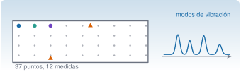
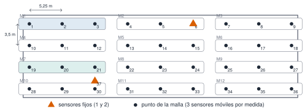

{.portada fig-alt="Planta de un tablero con una malla de 37 puntos, dos sensores fijos en naranja y tres móviles en color, junto a un espectro con cuatro picos"}

Cinco acelerómetros triaxiales midieron la **vibración ambiental** (*ambient vibration*) del puente de Torroja durante una mañana de junio de 2018. Con solo cinco sensores se cubrió una malla de 37 puntos moviendo tres de ellos entre medidas: la técnica y el diseño del ensayo están descritos en @pachon2018. Esta página presenta los datos, enseña cómo leerlos y comprueba que el espectro de un solo sensor ya deja ver los modos del puente.

```{julia}
#| include: false
using Resonancia, Statistics, Markdown
include("../_tema.jl")
RUTA = "../../../datos/reales-publicables/torroja-puente/2018-06-22-vibracion-ambiental/crudos/"
```

## Ficha

| | |
|---|---|
| **Estructura** | Puente de Eduardo Torroja |
| **Fecha** | 22-06-2018, de 07:40 a 10:18 (2 h 38 min en total) |
| **Sensores** | 5 estaciones triaxiales (GS1…GS5), aceleración en g, ejes X, Y y Z |
| **Muestreo** | 100 Hz |
| **Medidas** | 12 de 10 min, sobre una malla de 37 puntos |
| **Qué hay en el repositorio** | Las medidas 1 (07:40–07:50) y 7 (09:02–09:12), cinco sensores cada una |
| **Grabaciones completas** | [Zenodo, doi:10.5281/zenodo.23639137](https://doi.org/10.5281/zenodo.23639137) [@torroja2018datos] |
| **Licencia** | CC BY 4.0: citar @pachon2018 |

::: {.callout-note}
## Cómo citar
Si usas estos datos, cita el artículo [@pachon2018] y el depósito de Zenodo [@torroja2018datos].
:::

## El ensayo: 37 puntos con 5 sensores

El tablero se discretizó en una malla de 9 columnas (cada 5,25 m) y 4 filas (cada 3,5 m), más un punto auxiliar, el 37. Dos sensores quedaron **fijos** como referencia: el 1 en el punto 6 y el 2 en el punto 37. Los otros tres se movieron de a tres puntos consecutivos en cada una de las 12 medidas de 10 minutos. Con las referencias fijas se pueden empalmar los resultados de todas las medidas en una sola forma modal.

{#fig-malla fig-alt="Malla de 9 columnas por 4 filas con los puntos numerados del 1 al 36, agrupados de tres en tres en doce medidas. Dos triángulos naranjas marcan los sensores fijos, en el punto 6 y en el punto 37."}

Durante las medidas 4 a 6 se cortó un carril del puente y durante las 7 a 9, el otro, según las notas de campo; las medidas 1–3 y 10–12 se hicieron sin cortes. Las notas no registran la temperatura media del ensayo.

## Leer los datos

Cada fichero `.txt` es una estación y una medida: cuatro líneas de cabecera y después la hora y los tres ejes. `leer_torroja` (del paquete `Resonancia`) devuelve el tiempo, la matriz de aceleraciones, la frecuencia de muestreo, la estación y la hora de inicio.

```{julia}
est = Dict(n => leer_torroja(RUTA * "s$(n)_medida01.txt") for n in 1:5)
t, a, fs, codigo, inicio = est[1]
n_muestras = length(t)
duracion = t[end] + 1 / fs
nothing
```

La estación `{julia} codigo` empieza a las `{julia} inicio`, tiene `{julia} n_muestras` muestras por eje, muestreadas a `{julia} Int(fs)` Hz: dura `{julia} Int(round(duracion))` s, es decir, 10 min.

```{julia}
#| label: fig-senales
#| fig-cap: "Aceleración vertical (eje Z) de las cinco estaciones en los primeros 30 s de la medida 1. Los sensores 1 y 2 son las referencias fijas."
#| fig-alt: "Cinco gráficas apiladas con la aceleración vertical de cada estación durante 30 segundos. Las señales son ruido de pequeña amplitud, con diferencias de amplitud entre estaciones."
puntos = Dict(1 => "punto 6 (referencia)", 2 => "punto 37 (referencia)", 3 => "punto 1", 4 => "punto 2", 5 => "punto 3")
fig = Figure(size=(860, 620))
for (i, n) in enumerate(1:5)
    t, a, fs, cod, _ = est[n]
    k = t .< 30
    ax = Axis(fig[i, 1]; ylabel="mg", xticklabelsvisible=(i == 5),
        title="$cod · $(puntos[n])", titlealign=:left, titlesize=12)
    lines!(ax, t[k], a[k, 3] .* 1e3; color=i <= 2 ? NARANJA : AZUL, linewidth=0.8)
    xlims!(ax, 0, 30)
end
Label(fig[6, 1], "tiempo (s)"; tellwidth=false)
fig
```

Las amplitudes son de décimas de miligravedad (mg): un ruido muy pequeño que se mide bien porque los sensores son sensibles. El **valor eficaz** (RMS) de cada estación, en el eje Z, es:

```{julia}
rms_z = [std(est[n][2][:, 3]) * 1e3 for n in 1:5]
Markdown.parse("| " * join(["GS$n" for n in 1:5], " | ") * " |\n|" * "---|"^5 * "\n| " * join([coma(r; d=2) * " mg" for r in rms_z], " | ") * " |")
```

::: {.ejercicio tipo="numerico" id="r1-torroja-df" respuesta="0.0244" tol="1%" unidad="Hz"}
Para calcular espectros cortamos la señal en segmentos de 4096 muestras. Con `fs` = 100 Hz, ¿qué resolución en frecuencia $\Delta f = f_s/N$ se obtiene?

::: {.solucion}
$100/4096 = 0{,}0244$ Hz. Cada segmento dura $4096/100 = 40{,}96$ s: cuanto más largo el segmento, más fina la resolución, pero menos segmentos se promedian (M3.5, M3.6).
:::
:::

## El espectro de un sensor ya enseña los modos

La **densidad espectral de potencia** (*power spectral density*, PSD) reparte la energía de la señal por frecuencias. Aquí se estima con el método de Welch: segmentos de 4096 muestras (40,96 s), ventana de Hann y solape del 50 % (M3.6). Los picos de la PSD de un sensor marcan frecuencias donde la estructura vibra más ante una excitación ambiental de banda ancha.

Las líneas discontinuas son las frecuencias de los ocho primeros modos de esta campaña (22-06-2018) que obtuvieron los autores con el método de descomposición en el dominio de la frecuencia mejorada (*enhanced frequency domain decomposition*, EFDD), una técnica multicanal que usa los cinco sensores a la vez.

```{julia}
#| label: fig-psd
#| fig-cap: "PSD (eje Z) de las cinco estaciones en la medida 1. Las líneas discontinuas son los modos identificados por EFDD el 22-06-2018 (documento interno de los autores del ensayo)."
#| fig-alt: "Cinco curvas de densidad espectral de potencia entre 2 y 10 hercios en escala logarítmica, con picos cerca de 3,3; 3,7; 5,2; 7,7 y 8 hercios, y ocho líneas verticales discontinuas que marcan los modos identificados."
efdd_2018_06_22 = [3.26, 3.68, 3.80, 5.16, 5.61, 5.72, 7.73, 7.98]
psd = Dict(n => psd_welch(est[n][2][:, 3], est[n][3]; nseg=4096) for n in 1:5)
en_banda(f) = 2.0 .<= f .<= 10.0
ymax = maximum(maximum(P[en_banda(f)]) for (f, P) in values(psd))
fig = Figure(size=(860, 460))
ax = Axis(fig[1, 1]; xlabel="frecuencia (Hz)", ylabel="PSD (g²/Hz)", yscale=log10)
vlines!(ax, efdd_2018_06_22; color=GRIS, linestyle=:dash, linewidth=1)
for n in 1:5
    f, P = psd[n]
    lines!(ax, f[en_banda(f)], P[en_banda(f)]; label=est[n][4])
end
text!(ax, efdd_2018_06_22, fill(ymax * 3, 8); text=string.(1:8), align=(:center, :bottom), fontsize=12, color=GRIS)
ylims!(ax, nothing, ymax * 12)
xlims!(ax, 2, 10)
axislegend(ax; position=:rt, nbanks=5, orientation=:horizontal, framevisible=false, labelsize=12)
fig
```

Las estaciones GS1, GS2, GS4 y GS5 tienen picos sobre las líneas de los modos 1, 2, 4, 7 y 8; GS3 los muestra mucho más débiles, porque cada sensor ve un modo con la amplitud que tiene la forma modal en su punto. La tabla lo cuantifica para GS1: siete de los ocho modos tienen un pico a menos de un 1,5 % de su frecuencia EFDD, y el modo 3 es la excepción (2,8 %), porque está a solo 0,12 Hz del modo 2 y no aparece como un pico propio. Un sensor **solo** no basta para identificar modos con seguridad (un pico puede ser una componente de la excitación en lugar de un modo), pero sí sirve para comprobar que los datos son coherentes con la identificación multicanal: eso es lo que enseña esta figura.

```{julia}
#| output: asis
# frecuencia del pico más cercano a cada modo EFDD en la estación 1
t, a, fs, _, _ = est[1]
f, P = psd_welch(a[:, 3], fs; nseg=4096)
pic = f[buscar_picos(f, P; fmin=2, fmax=10, n=30, separacion=0.1)]
cercano = [pic[argmin(abs.(pic .- f0))] for f0 in efdd_2018_06_22]
desv = abs.(cercano .- efdd_2018_06_22) ./ efdd_2018_06_22 .* 100
tabla = "| Modo | EFDD (Hz) | Pico más cercano de GS1 (Hz) | Diferencia |\n|---|---|---|---|\n" *
    join(["| $m | $(coma(efdd_2018_06_22[m])) | $(coma(cercano[m])) | $(coma(desv[m]; d=1)) % |" for m in 1:8], "\n")
println(tabla)
```

: Comparación de los modos EFDD con el pico más cercano de la PSD de la estación 1 (medida 1). {#tbl-comparacion}

::: {.callout-warning}
## Cuidado con el «pico más cercano»
La tabla busca, para cada modo, el pico de la PSD más cercano: con muchos picos disponibles siempre habrá alguno próximo. La comparación solo es significativa porque las diferencias son pequeñas (la resolución es de 0,024 Hz) y porque los picos de las estaciones con buena señal coinciden entre sí.
:::

::: {.ejercicio tipo="vf" id="r1-torroja-un-sensor" respuesta="falso"}
Si el pico más alto de la PSD de un solo sensor coincide con una frecuencia, ya sabemos que esa frecuencia es un modo de vibración de la estructura.

::: {.solucion}
Falso. Un pico puede ser un modo, pero también una componente de la excitación (por ejemplo, el tráfico) o una interferencia. Para confirmarlo se usan varios sensores a la vez y se comprueba que las amplitudes forman una forma modal coherente (FDD, M7.7).
:::
:::

## Variabilidad entre campañas

Los autores identificaron los mismos ocho modos en tres campañas (29-05-2017, 15-06-2018 y 22-06-2018), con dos métodos: EFDD y la identificación estocástica por subespacios (SSI, M7.8). La tabla recoge las seis estimaciones de cada modo.

```{julia}
#| output: asis
efdd_ssi = [   # filas: modos 1…8; columnas: 2017 EFDD, 2017 SSI, 15-06-2018 EFDD, 15-06-2018 SSI, 22-06-2018 EFDD, 22-06-2018 SSI
    3.31 3.28 3.28 3.28 3.26 3.25
    3.72 3.68 3.67 3.69 3.68 3.68
    3.84 3.80 3.87 3.86 3.80 3.87
    5.16 5.14 5.16 5.16 5.16 5.17
    5.68 5.61 5.61 5.66 5.61 5.64
    5.69 5.64 5.74 5.69 5.72 5.79
    7.68 7.79 7.74 7.72 7.73 7.74
    8.07 8.02 8.04 8.04 7.98 7.98]
media_modo = vec(mean(efdd_ssi; dims=2))
rango_rel = vec((maximum(efdd_ssi; dims=2) .- minimum(efdd_ssi; dims=2))) ./ media_modo .* 100
cab = "| Modo | 29-05-2017 EFDD | SSI | 15-06-2018 EFDD | SSI | 22-06-2018 EFDD | SSI | Rango relativo |\n|---|---|---|---|---|---|---|---|\n"
println(cab * join(["| $m | " * join([coma(x) for x in efdd_ssi[m, :]], " | ") * " | $(coma(rango_rel[m]; d=1)) % |" for m in 1:8], "\n"))
```

: Frecuencias de los modos (Hz) en tres campañas y con dos métodos de identificación. Fuente: tabla interna de los autores del ensayo. El rango relativo es (máximo − mínimo) / media. {#tbl-campanas}

```{julia}
#| label: fig-variabilidad
#| fig-cap: "Desviación de cada estimación respecto de la media de su modo (en %). Los seis puntos de cada fila son las tres campañas con dos métodos."
#| fig-alt: "Ocho filas, una por modo, con seis puntos cada una repartidos a ambos lados del cero en un margen de aproximadamente más y menos un por ciento y medio; el modo 6 es el que más se dispersa."
desv_rel = (efdd_ssi .- media_modo) ./ media_modo .* 100
campana = repeat(1:3, inner=2)
metodo = repeat(1:2, 3)
fig = Figure(size=(860, 430))
ax = Axis(fig[1, 1]; xlabel="desviación respecto de la media del modo (%)", ylabel="modo",
    yticks=1:8, yreversed=true)
vlines!(ax, 0; color=GRIS, linewidth=1)
colores = [AZUL, NARANJA, VERDE]
for m in 1:8, j in 1:6
    scatter!(ax, desv_rel[m, j], m + (campana[j] - 2) * 0.12;
        color=colores[campana[j]], marker=metodo[j] == 1 ? :circle : :utriangle, markersize=10)
end
elementos = [MarkerElement(color=colores[1], marker=:circle), MarkerElement(color=colores[2], marker=:circle), MarkerElement(color=colores[3], marker=:circle),
    MarkerElement(color=GRIS, marker=:circle), MarkerElement(color=GRIS, marker=:utriangle)]
Legend(fig[1, 2], elementos, ["29-05-2017", "15-06-2018", "22-06-2018", "EFDD", "SSI"]; framevisible=false)
fig
```

Entre campañas y métodos, la frecuencia de un mismo modo varía como mucho un `{julia} coma(maximum(rango_rel); d=1)` % (modo `{julia} argmax(rango_rel)`). Esa es la **variabilidad** que M0.3 pide medir antes de fijar un umbral de alarma: una pérdida de rigidez del 5 % bajaría las frecuencias un 2,5 % aproximadamente ($f\propto\sqrt{k}$), un cambio del mismo orden que esta dispersión: con estos datos, una pérdida de rigidez así sería difícil de distinguir de la variabilidad normal y habría que explicarla con más medidas (temperatura, tráfico) antes de dar la alarma.

::: {.ejercicio tipo="numerico" id="r1-torroja-rango" respuesta="1.8" tol="5%" unidad="%"}
Calcula el rango relativo (máximo − mínimo, dividido entre la media) de las seis estimaciones del **modo 3** de la @tbl-campanas.

::: {.solucion}
Valores 3,84; 3,80; 3,87; 3,86; 3,80; 3,87. Máximo 3,87, mínimo 3,80, media 3,84. Rango $= 0{,}07/3{,}84 = 1{,}8\,\%$.
:::
:::

## Repetibilidad entre medidas

Las dos medidas del repositorio se hicieron con 80 minutos de diferencia. La estación 1 estuvo en el mismo punto (el 6) en ambas.

```{julia}
#| label: fig-repetibilidad
#| fig-cap: "PSD de la estación 1 (punto 6, referencia fija) en las medidas 1 (07:40) y 7 (09:02). Las líneas discontinuas son los modos EFDD del 22-06-2018."
#| fig-alt: "Dos curvas de densidad espectral entre 2 y 10 hercios con los mismos picos en las mismas frecuencias, pero con la curva de la medida 1 más alta que la de la medida 7."
fig = Figure(size=(860, 420))
ax = Axis(fig[1, 1]; xlabel="frecuencia (Hz)", ylabel="PSD (g²/Hz)", yscale=log10)
vlines!(ax, efdd_2018_06_22; color=GRIS, linestyle=:dash, linewidth=1)
rms_m = Float64[]
for (m, etiqueta, color) in (("01", "medida 1 · 07:40", AZUL), ("07", "medida 7 · 09:02", VERDE))
    t, a, fs, _, _ = leer_torroja(RUTA * "s1_medida$m.txt")
    push!(rms_m, std(a[:, 3]) * 1e3)
    f, P = psd_welch(a[:, 3], fs; nseg=4096)
    k = 2.0 .<= f .<= 10.0
    lines!(ax, f[k], P[k]; label=etiqueta, color=color)
end
xlims!(ax, 2, 10)
axislegend(ax; position=:rt, framevisible=false)
fig
```

Los picos están en las mismas frecuencias, pero la medida 1 tiene un RMS de `{julia} coma(rms_m[1]; d=2)` mg frente a `{julia} coma(rms_m[2]; d=2)` mg de la medida 7: `{julia} coma(rms_m[1] / rms_m[2]; d=1)` veces más. Los datos **no dicen por qué**: no hay registro del tráfico ni de la temperatura durante el ensayo.

::: {.ejercicio tipo="vf" id="r1-torroja-causa" respuesta="falso"}
Como la medida 1 tiene más vibración que la 7, podemos afirmar que se debe al tráfico.

::: {.solucion}
Falso. Hay una diferencia de amplitud, pero ninguna variable medida que la explique: el RMS cambia con la excitación (tráfico, viento, obras) y los datos no registran cuál actuó. Atribuirla al tráfico es una hipótesis razonable, no un resultado. En SHM esto se resuelve midiendo también las variables ambientales y operacionales (M0.3, M12.5).
:::
:::

## Las formas modales

Cada animación muestra una forma modal identificada, con su frecuencia, amortiguamiento y «complejidad» (una medida de cuánto se aleja el modo de uno real normal). Se han convertido a MP4 desde las originales del ensayo.

::: {.panel-tabset}

#### Modo 1

```{=html}
<video controls loop muted playsinline preload="metadata" width="100%" aria-label="Animación del modo 1 del puente de Torroja: 3,26 Hz"><source src="video/modo1.mp4" type="video/mp4"></video>
```

#### Modo 2

```{=html}
<video controls loop muted playsinline preload="none" width="100%" aria-label="Animación del modo 2 del puente de Torroja: 3,68 Hz"><source src="video/modo2.mp4" type="video/mp4"></video>
```

#### Modo 3

```{=html}
<video controls loop muted playsinline preload="none" width="100%" aria-label="Animación del modo 3 del puente de Torroja: 3,80 Hz"><source src="video/modo3.mp4" type="video/mp4"></video>
```

#### Modo 4

```{=html}
<video controls loop muted playsinline preload="none" width="100%" aria-label="Animación del modo 4 del puente de Torroja: 5,16 Hz"><source src="video/modo4.mp4" type="video/mp4"></video>
```

#### Modo 5

```{=html}
<video controls loop muted playsinline preload="none" width="100%" aria-label="Animación del modo 5 del puente de Torroja: 5,61 Hz"><source src="video/modo5.mp4" type="video/mp4"></video>
```

#### Modo 6

```{=html}
<video controls loop muted playsinline preload="none" width="100%" aria-label="Animación del modo 6 del puente de Torroja: 5,72 Hz"><source src="video/modo6.mp4" type="video/mp4"></video>
```

#### Modo 7

```{=html}
<video controls loop muted playsinline preload="none" width="100%" aria-label="Animación del modo 7 del puente de Torroja: 7,73 Hz"><source src="video/modo7.mp4" type="video/mp4"></video>
```

#### Modo 8

```{=html}
<video controls loop muted playsinline preload="none" width="100%" aria-label="Animación del modo 8 del puente de Torroja: 7,94 Hz"><source src="video/modo8.mp4" type="video/mp4"></video>
```

:::

: Valores que muestra cada animación (frecuencia y amortiguamiento). Las frecuencias pueden diferir de la @tbl-campanas en unas centésimas porque proceden de otro ajuste. {#tbl-animaciones}

| Modo | Frecuencia (Hz) | Amortiguamiento (%) |
|---|---|---|
| 1 | 3,26 | 1,11 |
| 2 | 3,677 | 0,919 |
| 3 | 3,801 | 0,661 |
| 4 | 5,162 | 0,567 |
| 5 | 5,615 | 0 |
| 6 | 5,721 | 0,227 |
| 7 | 7,728 | 0,887 |
| 8 | 7,939 | 0,454 |

::: {.callout-warning}
## El amortiguamiento 0 % del modo 5 no es físico
Una estructura real siempre disipa energía. Un valor de 0 % indica que el método no pudo estimar el amortiguamiento de ese modo, no que no exista. El amortiguamiento se estima con mucha más incertidumbre que la frecuencia, y por eso se usa menos como indicador de daño.
:::

## Reutilizar estos datos

- **Descargar:** extractos en el [repositorio](https://github.com/me1catrr/resonancia/tree/main/datos/reales-publicables/torroja-puente); grabaciones completas en [Zenodo](https://doi.org/10.5281/zenodo.23639137).
- **Código:** `leer_torroja` y `psd_welch` están en el paquete `Resonancia` ([referencia](../../index.qmd#referencia-resonancia)).
- **Dónde se usa el análisis:** densidad espectral y Welch (M3.6), FDD y SSI (M7.7, M7.8), campaña de datos reales (M12.1) y efectos ambientales (M12.5).

## Qué no dicen estos datos

- No hay temperaturas ni conteo de vehículos: no se puede separar el efecto ambiental del daño.
- No se conoce la sensibilidad exacta de los sensores ni su calibración; las amplitudes en mg son las del fichero.
- Las frecuencias de EFDD y SSI y los vídeos son resultados de los autores del ensayo. Aquí solo se comprueba su coherencia con la PSD; no se han reproducido.
- Solo se publican dos de las doce medidas; el resto está en Zenodo.
