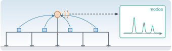

{.portada fig-alt="Puente de cuatro vanos con un nodo sensor en el centro de cada vano. Los cuatro nodos envían sus datos a un nodo cabecera situado sobre un mástil, que los transmite por radio a un centro remoto donde se ve un espectro con tres picos marcados como modos."}

SMART-BRIDGES es un proyecto de investigación para **monitorizar de forma continua puentes ferroviarios de alta velocidad** con una red de sensores inalámbricos con energía autónoma. Esta página resume el proyecto: quién lo hace y para qué, en qué puentes, con qué sistema, qué datos genera y cómo se accede a ellos. Su caso piloto, el [viaducto Guadiato](../r4-guadiato/index.qmd) de la LAV Madrid–Sevilla, tiene su propia página (R4).

```{julia}
#| include: false
using Statistics
include("../_tema.jl")
```

## Ficha

| | |
|---|---|
| **Título** | Monitorización inteligente del estado estructural de puentes ferroviarios de alta velocidad |
| **Referencia** | PLEC2021-007798, convocatoria de Proyectos de I+D+i en Líneas Estratégicas de 2021 [@smartbridges-memoria] |
| **Consorcio** | Universidad de Córdoba (coordinadora), Universidad de Granada e Ineco [@smartbridges-memoria; @smartbridges-ugr] |
| **Financiación** | Ministerio de Ciencia e Innovación y Agencia Estatal de Investigación, Plan de Recuperación, Transformación y Resiliencia (NextGenerationEU) [@smartbridges-uco] |
| **Puentes** | Ocho demostradores: cuatro en la LAV Madrid–Sevilla y cuatro en la Córdoba–Málaga [@smartbridges-memoria] |
| **Caso piloto** | [Viaducto Guadiato](../r4-guadiato/index.qmd) (R4) [@smartbridges-uco] |
| **Acceso a los datos** | Plataforma del proyecto, con clave: [smartbridgesdata.live](https://smartbridgesdata.live/access/login) |
| **Licencia de los datos** | Pendiente de confirmar |

::: {.callout-note}
## Cómo citar
Cita la memoria técnica [@smartbridges-memoria] para la descripción del proyecto y las webs de los equipos [@smartbridges-uco; @smartbridges-ugr] para lo que se publica en ellas. Para los datos se indicará aquí la referencia cuando se publiquen.
:::

## El proyecto

SMART-BRIDGES es el proyecto «Monitorización inteligente del estado estructural de puentes ferroviarios de alta velocidad», con referencia **PLEC2021-007798**, de la convocatoria de Proyectos de I+D+i en Líneas Estratégicas de 2021 (BOE n.º 98, de 24-04-2021). Lo coordina la Universidad de Córdoba (coordinador: Rafael Castro Triguero) en un consorcio con la Universidad de Granada e Ineco, y lo financian el Ministerio de Ciencia e Innovación y la Agencia Estatal de Investigación con cargo al Plan de Recuperación, Transformación y Resiliencia, con fondos NextGenerationEU [@smartbridges-memoria; @smartbridges-ugr; @smartbridges-uco]. La ficha de la OTRI de la UGR nombra como investigador principal a Rafael Gallego Sevilla, de la UGR: en un proyecto coordinado cada equipo tiene el suyo.

### La idea y los equipos

La memoria parte de que la gestión de infraestructuras envejecidas es un reto de primer orden: cita unos 2.600 km de alta velocidad en España y 207 puentes críticos, parte de ellos con algún tipo de degradación, y una tasa de reposición muy baja. Su propuesta es **extender la vida útil** de los puentes ferroviarios de alta velocidad mediante una red de sensores inalámbricos con energía autónoma, monitorización estructural a largo plazo y decisiones basadas en datos [@smartbridges-memoria].

Cada equipo aporta lo suyo [@smartbridges-memoria]:

| Equipo | Papel |
|---|---|
| **Ineco** | Ingeniería de referencia de Adif para la inspección y monitorización de puentes y viaductos; caracteriza los puentes y define los requisitos de monitorización. |
| **UCO** | Comunicaciones, redes de sensores inalámbricos e internet de las cosas (IoT); sincronización y dispositivos de bajo consumo. |
| **UGR** | Monitorización de la salud estructural, análisis modal operacional, identificación de sistemas, captación de energía y pronóstico basado en datos. |

Sus seis objetivos específicos, resumidos [@smartbridges-memoria; @smartbridges-uco]:

1. caracterizar los puentes envejecidos, con sus patologías y tipologías más comunes, y crear modelos digitales de referencia;
2. diseñar una red de sensores (IoT) eficiente, fiable y sincronizada para monitorizar de forma continua;
3. desarrollar algoritmos de identificación para analizar el estado dinámico del puente con poco gasto de energía;
4. crear un sistema que recoja energía del entorno (vibraciones) para alimentar los sensores;
5. construir un gemelo digital que ayude a diagnosticar y a decidir el mantenimiento;
6. validar todo en un puente ferroviario envejecido de alta velocidad (el demostrador).

## Los ocho puentes {#los-ocho-puentes}

El proyecto eligió ocho puentes de alta velocidad de vano corto o medio, de dos tipologías, como demostradores. La memoria técnica de la solicitud [@smartbridges-memoria] los describe así:

- **Tipo 1** (4 puentes, línea Madrid–Sevilla, cerca de Córdoba): vigas en I (entre 5 y 8) con losa de continuidad hormigonada *in situ*, de 2 a 4 vanos de unos 30 m y con esviaje (los ejes de apoyo no son perpendiculares al eje del puente). Velocidad máxima de línea de 250 km/h. La memoria dice que es una tipología muy particular, poco usada en las líneas posteriores.
- **Tipo 2** (4 puentes, línea Córdoba–Málaga): dos vigas en U con losa hormigonada *in situ*, de 32 a 35 m de vano según el texto, con esviaje y 300 km/h de velocidad máxima. Es una tipología más extendida en la red, lo que facilitaría extrapolar los resultados.

```{julia}
puentes = [("Madrid–Sevilla", "Viaducto Guadiato", "Córdoba", 1, 110.54, 4, 31.41, 250),
           ("Madrid–Sevilla", "PTE S/A-431", "Córdoba", 1, 28.3, 1, 26.3, 250),
           ("Madrid–Sevilla", "Viaducto Bembézar", "Córdoba", 1, 53.0, 2, 26.5, 250),
           ("Madrid–Sevilla", "Puente Retortillo", "Córdoba", 1, 22.0, 1, 22.0, 250),
           ("Córdoba–Málaga", "Viaducto A-4", "Sevilla", 2, 85.0, 4, 23.5, 300),
           ("Córdoba–Málaga", "Viaducto A-92", "Málaga", 2, 73.0, 3, 33.0, 300),
           ("Córdoba–Málaga", "Puente sobre el ferrocarril Sevilla–Granada", "Málaga", 2, 74.0, 3, 34.0, 300),
           ("Córdoba–Málaga", "Viaducto Arroyo del Tajo", "Málaga", 2, 51.0, 2, 25.0, 300)]
luz_prom(L, n) = L / n
r1(x) = coma(round(x, RoundNearestTiesAway; digits=1); d=1)   # redondeo habitual, 21,25 -> 21,3
nothing
```

```{julia}
#| output: asis
println("| Línea | Puente | Provincia | Tipo | Longitud (m) | Vanos | Luz máxima (m) | Luz media (m) | Velocidad máx. (km/h) |\n|---|---|---|---|---|---|---|---|---|\n" *
    join(["| $lin | $nom | $prov | $tipo | $(coma(L; d=1)) | $n | $(coma(lmax; d=1)) | $(r1(luz_prom(L, n))) | $v |" for (lin, nom, prov, tipo, L, n, lmax, v) in puentes], "\n"))
```

: Puentes demostradores de SMART-BRIDGES. Longitud, vanos, luz máxima y velocidad, de la tabla 1 de la memoria técnica [@smartbridges-memoria]; la luz media es un cálculo propio (longitud entre vanos). {#tbl-proyecto}

**Cuidado con la luz media.** En el PTE S/A-431 y en el viaducto Arroyo del Tajo sale mayor que la luz máxima, lo que no puede ser con vanos que sumen la longitud total: esta incluye algo más que los vanos (quizá los extremos o el esviaje; la memoria no lo aclara). Por eso $L/n$ es solo una referencia aproximada, y más cuanto menos vanos tiene el puente.

```{julia}
#| label: fig-proyecto
#| fig-cap: "Luz media (longitud entre vanos) y luz máxima de los ocho puentes de SMART-BRIDGES. Cada puente indica su tipo (T1, T2). Datos de la memoria técnica; luz media, cálculo propio."
#| fig-alt: "Gráfica de barras horizontales con dos barras por puente, la luz media en azul y la luz máxima en naranja. Las luces medias van de unos 21 metros, en el viaducto A-4, a unos 28 metros, en el puente PTE S/A-431; las luces máximas van de 22 metros, en el puente Retortillo, a 34 metros, en el puente sobre el ferrocarril Sevilla-Granada. El viaducto Guadiato tiene una luz media de unos 27,6 metros y una luz máxima de 31,4."
nombres = ["T$(p[4]) · $(p[2])" for p in puentes]
prom = [luz_prom(p[5], p[6]) for p in puentes]
maxl = [p[7] for p in puentes]
np_ = length(puentes)
fig = Figure(size=(860, 460))
ax = Axis(fig[1, 1]; xlabel="luz (m)", yticks=(1:np_, nombres), yreversed=true)
barplot!(ax, repeat(1:np_, 2), vcat(prom, maxl); dodge=vcat(fill(1, np_), fill(2, np_)),
         color=vcat(fill(AZUL, np_), fill(NARANJA, np_)), direction=:x)
for k in 1:np_
    text!(ax, prom[k], k - 0.2; text=" " * r1(prom[k]), align=(:left, :center), fontsize=11)
    text!(ax, maxl[k], k + 0.2; text=" " * coma(maxl[k]; d=1), align=(:left, :center), fontsize=11)
end
xlims!(ax, 0, 42)
axislegend(ax, [PolyElement(color=AZUL), PolyElement(color=NARANJA)], ["luz media", "luz máxima"]; position=:rb, framevisible=false)
fig
```

::: {.ejercicio tipo="numerico" id="r3-luz-media-a4" respuesta="21.3" tol="1%" unidad="m"}
El viaducto A-4 mide 85,0 m y tiene 4 vanos, con una luz máxima de 23,5 m. ¿Cuál es su luz media? ¿Es compatible con la luz máxima?

::: {.solucion}
$85{,}0/4 = 21{,}25\ \mathrm{m}\approx 21{,}3\ \mathrm{m}$. Es menor que la luz máxima (23,5 m), así que es compatible: los vanos no son todos iguales y el mayor mide 23,5 m.
:::
:::

Los rangos que da el texto de la memoria (vanos de unos 30 m para el tipo 1 y de 32 a 35 m para el tipo 2) son orientativos: la tabla da luces máximas de 22 a 31,4 m en el tipo 1 y de 23,5 a 34 m en el tipo 2.

Según la memoria, los modos de flexión y de torsión de la losa de estos puentes están, en los modelos numéricos, entre unos 5 y 10 Hz, un rango adecuado para el análisis modal operacional (OMA) y la monitorización; son resultados de modelo, no medidas [@smartbridges-memoria].

## El sistema de monitorización

Según la memoria, cada puente lleva un **nodo cabecera** (*head node*, HN) y varios **nodos sensores** (*sensor nodes*, SN). El nodo cabecera tiene un acelerómetro triaxial de precisión que dispara el muestreo de los nodos sensores, sensores ambientales (temperatura, humedad y anemómetro), los sincroniza y reduce los datos antes de enviarlos a los centros remotos. Cada nodo sensor lleva acelerómetros triaxiales y una galga extensométrica, guarda las muestras en una tarjeta SD y las envía al nodo cabecera al terminar [@smartbridges-memoria].

![Sistema de monitorización previsto en la memoria de SMART-BRIDGES: nodos sensores en el tablero, un nodo cabecera, un enlace de control en sub-GHz y de datos en GHz, y dos centros remotos. Esquema propio a partir de la descripción de la memoria [@smartbridges-memoria].](fig/sistema.svg){#fig-sistema fig-alt="Un tablero apoyado en cinco pilas con cuatro nodos sensores en cuadrados azules y un nodo cabecera naranja sobre un mástil. Flechas azules continuas van de los sensores al nodo cabecera, y flechas naranjas discontinuas van del nodo cabecera a los sensores. Desde el nodo cabecera, una flecha negra marcada WAN lleva al Centro de administración IoT, y de este otra flecha baja al Centro SHM."}

La memoria prevé instrumentar los 8 puentes con 86 nodos: 64 nodos sensores y 8 estaciones de control para los puentes, más material para laboratorio y de reserva; 6 nodos sensores y 1 estación por puente de tipo 1 y 10 nodos sensores y 1 estación por puente de tipo 2. Como resultado, esperaba la monitorización continua de los ocho puentes y unos 28.000 millones de muestras [@smartbridges-memoria]. Son **previsiones de la solicitud de 2021**, no cifras de lo ejecutado.

## Qué datos genera {#datos}

Según la web del proyecto, los sensores registran la **aceleración en tres ejes (X, Y, Z), en g**, con una marca de tiempo de milisegundos; los registros se guardan por año, mes, día y sensor, y los que no valen se apartan en una carpeta `anomalias`. Cada día se genera un informe con una página por paso de tren (número de tren, hora de inicio y gráficas de aceleración y FFT por eje) y un resumen con estadísticas por segmento [@smartbridges-uco]:

```text
raw/<año>/<mes>/<día>/<sensor>/   registros de aceleración (X, Y, Z, en g)
raw/.../anomalias/                datos no válidos o irrelevantes
report/train_report_<fecha>.pdf   una página por paso de tren
summary.json                      estadísticas por segmento de cada día
```

Esta es la estructura que describe la web del proyecto; la de los datos que se incorporen a este curso se fijará en su ficha.

::: {.callout-important}
## Dónde están los datos y cómo acceder
Los datos de SMART-BRIDGES están en la plataforma del proyecto, [smartbridgesdata.live](https://smartbridgesdata.live/access/login), y **hace falta clave para entrar**: el acceso se solicita al proyecto y lo aprueba un administrador [@smartbridges-uco]. Por eso no se copian aquí los registros completos; el repositorio del curso solo contendrá lo que el proyecto autorice publicar. La memoria prevé publicar los resultados con criterios FAIR en un repositorio como Zenodo, «tan abiertos como sea posible y tan cerrados como sea necesario» [@smartbridges-memoria].
:::

Los primeros datos que se incorporen serán los del caso piloto, el [viaducto Guadiato](../r4-guadiato/index.qmd).

## Imágenes y licencias

La portada y el esquema del sistema son figuras propias, dibujadas a partir de la descripción de la memoria. Esta página no reproduce figuras ni texto de la memoria ni de las webs del proyecto.

## Reutilizar esta información

- **De momento:** la @tbl-proyecto y la @fig-proyecto, con los ocho puentes, y el esquema del sistema (@fig-sistema).
- **Dónde se usa:** la ficha del [viaducto Guadiato](../r4-guadiato/index.qmd) (R4) y, cuando haya datos, el análisis de un puente ferroviario real.

## Qué no dice esta información

- Los datos del proyecto (nodos, número de muestras, rangos de frecuencias) son los de la memoria de la solicitud de 2021: previsiones y resultados de modelo, no medidas ni cifras de lo ejecutado.
- La luz media es un cálculo propio con vanos iguales; en dos puentes sale mayor que la luz máxima, así que la longitud total incluye algo más que los vanos.
- No hay aquí ninguna medición: los registros del proyecto están en su plataforma, con acceso restringido.
