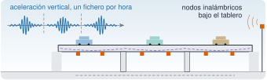

{.portada fig-alt="Esquema de un paso superior de carretera de tres vanos con coches sobre el tablero. Bajo el tablero hay seis nodos inalámbricos, marcados con cuadrados naranja, y a la derecha una antena emite ondas de radio. Arriba a la izquierda se ven tres ventanas de un registro de aceleración vertical, cada una con una ráfaga, separadas por líneas discontinuas."}

El puente de **Méndez Núñez** es un paso de la circunvalación de Granada, junto a la rotonda del mismo nombre, y el caso de estudio del proyecto de investigación **BRIDGEXT**. Entre junio y octubre de 2024 se registró su vibración de forma continua con ocho nodos inalámbricos instalados bajo el tablero, y los registros están publicados en abierto en Zenodo. Es el único caso del curso con **monitorización de larga duración** (*long-term monitoring*): no un ensayo de unas horas, sino meses de registros periódicos de un puente en servicio.

Esta página es la ficha de referencia del recurso: qué puente es, qué se instaló, qué registros hay y qué hay que tener en cuenta antes de usarlos. Los registros de Zenodo **se están reorganizando**; cuando estén agrupados se añadirán aquí sus DOI y los artículos que hay que citar.

## Ficha

| | |
|---|---|
| **Estructura** | Paso de la circunvalación de Granada en la rotonda de Méndez Núñez, con tablero de hormigón pretensado (información del proyecto) |
| **Ubicación** | 37°10'35,1" N, 3°36'50,5" O [@bridgext-zenodo-comunidad] |
| **Proyecto** | BRIDGEXT, referencia PID2020-116644RB-I00, Proyectos de I+D+i «Retos Investigación» de 2020 [@bridgext-zenodo-comunidad] |
| **Financiación** | Ministerio de Ciencia e Innovación y Agencia Estatal de Investigación; en Zenodo figura con el nombre actual del ministerio, de Ciencia, Innovación y Universidades [@bridgext-zenodo-comunidad] |
| **Centro** | Universidad de Granada, Departamento de Mecánica de Estructuras e Ingeniería Hidráulica |
| **Periodo del proyecto** | 01-09-2021 a 31-08-2024 (información del proyecto) |
| **Instrumentación** | 8 nodos inalámbricos MOVE con acelerómetro triaxial MEMS; acelerómetros piezoeléctricos cableados para comparar ambos sistemas |
| **Muestreo** | 80 Hz en los nodos inalámbricos; los registros piezoeléctricos publicados están remuestreados a 40 Hz |
| **Campañas** | Prueba de un nodo (15-03-2023) y monitorización continua del 16-06-2024 al 13-10-2024 |
| **Registros** | 243 registros en la comunidad de Zenodo `ugr_bridges`, unos 9,5 GB en total; **en reorganización** |
| **Licencia** | CC BY 4.0, la que declaran los registros publicados |
| **DOI y publicaciones** | Pendientes: se añadirán cuando los registros estén agrupados |

::: {.callout-note}
## Cómo citar
Mientras se reorganizan los registros, cita la comunidad de Zenodo que los reúne [@bridgext-zenodo-comunidad] e indica la referencia del proyecto, PID2020-116644RB-I00. Cuando haya un registro agrupado con su DOI y los artículos de referencia, se indicarán aquí; a partir de entonces, cita esos.
:::

## El proyecto BRIDGEXT

BRIDGEXT es el acrónimo de *Extensión de la vida útil de puentes obsolescentes: monitorización de la salud estructural sostenible a largo plazo* (en inglés, *Life-extension of ageing bridges: towards a long-term sustainable structural health monitoring*). Es un proyecto de la Universidad de Granada financiado por la Agencia Estatal de Investigación en la convocatoria «Retos Investigación» de 2020, con referencia PID2020-116644RB-I00 [@bridgext-zenodo-comunidad], y con Rafael Gallego Sevilla y Rafael Castro Triguero como investigadores principales.

Su punto de partida es el mismo que el de [SMART-BRIDGES](../r3-smart-bridges/index.qmd) (R3): muchos puentes en servicio están envejeciendo y sustituirlos no es viable, así que hay que vigilarlos para alargar su vida útil con seguridad. BRIDGEXT se centra en hacer que esa vigilancia sea **sostenible a largo plazo**. Para ello combina:

- análisis modal operacional (OMA, *operational modal analysis*): obtener frecuencias y modos con la vibración que produce el propio tráfico, sin excitar el puente;
- modelos numéricos de orden reducido, actualizados con las medidas;
- captadores de energía piezoeléctricos (*energy harvesters*), para alimentar sensores con la vibración del puente;
- pronóstico basado en datos, para anticipar la evolución del estado del puente.

El proyecto colaboró con grupos de la Universidad de Perugia y de la KU Leuven, con Ineco y con MOVE Solutions, la empresa fabricante de los nodos inalámbricos (información del proyecto). Los equipos de BRIDGEXT y SMART-BRIDGES coinciden en buena parte. Por eso la comunidad de Zenodo que reúne los registros lleva el nombre de ambos proyectos [@bridgext-zenodo-comunidad].

## El puente

El paso de Méndez Núñez salva la rotonda del mismo nombre en la circunvalación de Granada. Su tablero es de hormigón pretensado, una tipología que se repite en otros pasos de la misma circunvalación. Por eso se eligió como caso de estudio: lo que se aprenda en él se puede extrapolar a otros puentes equivalentes (información del proyecto).

Antes de instalar nada, el equipo hizo un **modelo de elementos finitos** del tablero a partir de los planos de construcción, con el hormigón modelado con elementos sólidos y los tendones de pretensado con elementos de barra unidos al hormigón. El análisis modal de ese modelo dio una primera estimación de las frecuencias propias y de los modos de vibración, y con ella se decidió dónde colocar los sensores (información del proyecto). Es el orden lógico de cualquier monitorización: el modelo indica qué se espera medir, y la instalación se diseña para medirlo.

::: {.callout-note}
## Qué falta de este puente
El número y la longitud de los vanos, el año de construcción y la planta de la instalación con la posición de cada nodo. La portada es un esquema, no el puente real: no la uses para situar los sensores.
:::

## La instalación y las campañas

El sistema **previsto** en el diseño tenía 10 acelerómetros para medir la vibración vertical del tablero y 4 sensores de temperatura en las caras norte y sur, para seguir el gradiente térmico, que es una de las principales causas de las variaciones lentas de las frecuencias propias (información del proyecto). Los permisos para trabajar bajo el tablero, de una carretera en servicio, retrasaron la campaña.

Lo que muestran los registros publicados es la instalación **realizada**:

- **Ocho nodos inalámbricos MOVE**, identificados por un código de cinco caracteres (89CAA, BBD22, BBD66, BBDF3, BBE27, BC9C4, BC56E y BCA6C). Cada nodo lleva un acelerómetro triaxial MEMS y muestrea a 80 Hz.
- **Acelerómetros piezoeléctricos cableados**, de mayor sensibilidad, para comparar con ellos los nodos inalámbricos. El informe final del proyecto indica que se instalaron sensores de los dos tipos para contrastar sus medidas.

La campaña tuvo tres fases:

| Fase | Fecha | Qué se registró |
|---|---|---|
| Prueba | 15-03-2023 | Un nodo (BBD66) durante un día |
| Monitorización continua | 16-06-2024 a 13-10-2024 | Los ocho nodos, un fichero por hora y nodo |
| Comparación | Sin fecha en los registros | Nodos MEMS frente a acelerómetros piezoeléctricos, para comparar los modos identificados con cada sistema |

: Fases de la campaña en el puente de Méndez Núñez, según las fechas y los títulos de los registros de la comunidad [@bridgext-zenodo-comunidad]. {#tbl-campanas}

::: {.callout-note}
## Fotos de la instalación
Esta sección tendrá las fotos de la instalación (nodos bajo el tablero, cableado y equipo de adquisición) en cuanto estén autorizadas para publicarse.
:::

Esta ficha describe **qué** se instaló. Cómo se elige y se configura un sistema de adquisición (rango, resolución, sincronización, alimentación) no se trata aquí: es materia de instrumentación.

::: {.ejercicio tipo="vf" id="r5-inalambricos-cableados" respuesta="falso"}
Si dos sensores están en el mismo punto del tablero, uno inalámbrico MEMS y otro piezoeléctrico cableado, sus registros se pueden comparar muestra a muestra sin más preparación.

::: {.solucion}
Falso. Cada sistema tiene su propio reloj, su sensibilidad, su ruido y su frecuencia de muestreo (aquí, 80 Hz frente a 40 Hz tras remuestrear). Antes de comparar hay que llevarlos a la misma frecuencia y alinearlos en el tiempo, o comparar magnitudes que no dependen de la alineación, como el espectro o los modos identificados. Por eso la comparación publicada se hace con los modos.
:::
:::

## Los registros

Cada registro de la monitorización continua corresponde a **un nodo y una ventana de cuatro días**, y contiene un fichero CSV por hora. El nombre del fichero indica el nodo y el instante de inicio, siempre a los 20 s de la hora en punto: `Event Accelerometer BC56E 01-08-2024 00-00-20.csv`. Un fichero de muestra tiene esta estructura:

```text
Device,X Acc (g),Y Acc (g),Z Acc (g)
BC56E,0,0,-0.00025
BC56E,0,0,0.000125
…
```

Se ve, sin analizar nada:

- tres columnas de aceleración en **g** (ejes X, Y y Z del nodo) y ninguna de tiempo. El instante de cada muestra se reconstruye con el inicio que da el nombre y la frecuencia de muestreo;
- **8192 muestras** por fichero, es decir, un fragmento corto de cada hora y no la hora entera;
- valores con media prácticamente nula y en múltiplos de 0,000125 g. La componente de la gravedad no aparece, y el escalón de 0,125 mg es el de la cuantización.

::: {.ejercicio tipo="numerico" id="r5-duracion-fichero" respuesta="102.4" tol="0.5%" unidad="s"}
Cada fichero tiene 8192 muestras tomadas a 80 Hz. ¿Cuántos segundos de señal contiene?

::: {.solucion}
$8192/80 = 102{,}4\ \mathrm{s}$, algo más de minuto y medio. $8192 = 2^{13}$: es una longitud cómoda para la FFT.
:::
:::

::: {.ejercicio tipo="numerico" id="r5-fraccion-hora" respuesta="2.84" tol="2%" unidad="%"}
Con un fichero de 102,4 s por hora, ¿qué porcentaje de cada hora queda registrado?

::: {.pista}
Divide la duración de un fichero entre los segundos de una hora.
:::

::: {.solucion}
$102{,}4/3600 \approx 0{,}0284$, un **2,8 %**. La monitorización es periódica, no continua en sentido estricto: sirve para seguir cómo cambian las frecuencias a lo largo de horas, días y estaciones, pero un suceso breve que ocurra entre dos ficheros no queda registrado.
:::
:::

### Lo que hay hoy en Zenodo

```text
Comunidad «ugr_bridges» (consultada el 09-11-2026): 243 registros, CC BY 4.0
├── Monitorización continua: 239 registros (8 nodos × ventanas de 4 días), ~21 500 ficheros, ~3,8 GB
├── Prueba de un nodo (15-03-2023): 1 registro, 14 ficheros
├── Comparación MEMS frente a piezoeléctrico: 2 registros (CSV de 8 canales MEMS; 6 ficheros TDMS)
└── Conjunto de entrenamiento VibroSC-DAE: 1 registro, un CSV de 5,4 GB
```

::: {.callout-warning}
## Registros en reorganización
Los registros se subieron uno a uno, conforme se descargaban de los nodos, y aún no están ordenados:

- cada nodo y ventana es un registro distinto, con su propio DOI;
- de 239 registros de monitorización continua, solo 94 tienen los 96 ficheros de una ventana completa (4 días × 24 h). Los demás tienen entre 34 y 97, y tres ventanas aparecen con fechas solapadas o con nodos de menos;
- las fechas de los títulos se escriben unas veces con barras y otras con guiones;
- los registros no indican la financiación, el puente, la posición de cada nodo ni los artículos relacionados;
- la descripción de los registros da una resolución de «0,125/4096», sin unidades, que no coincide con el escalón de 0,125 mg que se ve en los datos.

Se está tramitando agruparlos en registros ordenados, con metadatos completos. Hasta entonces esta página no enlaza registros sueltos ni da cifras medidas del puente. Cuando estén listos, aquí habrá la tabla de registros (nodo, periodo, DOI y tamaño) y los artículos que hay que citar.
:::

## Qué no dicen estos datos

- **Dónde está cada nodo.** Los registros identifican cada nodo por su código, pero no indican su posición en el tablero. Sin ella no se pueden obtener formas modales, solo frecuencias.
- **La temperatura.** El diseño preveía sensores de temperatura, pero en la comunidad no hay registros térmicos. Sin ellos no se puede separar el efecto de la temperatura del de un posible daño.
- **El tráfico.** No hay conteo de vehículos ni pesaje. La vibración refleja el tráfico, pero no se sabe qué vehículos la causan.
- **La señal continua.** Cada hora solo hay 102,4 s registrados (véase el ejercicio anterior).
- **Los datos del puente.** La tipología, el modelo de elementos finitos y el sistema previsto vienen de los informes del proyecto, no de una publicación revisada. Faltan los vanos, las luces y el año de construcción.

## Imágenes y licencias

La portada es una figura propia y esquemática: no representa la geometría del puente ni la posición real de los nodos. Las fotos de la instalación se añadirán cuando estén autorizadas, con su autoría y con licencia CC BY 4.0. Los registros de aceleración no se copian a este repositorio: se quedan en Zenodo, con su licencia CC BY 4.0 y su DOI.

## Reutilizar estos datos

- **Descargar:** desde la comunidad de Zenodo [@bridgext-zenodo-comunidad]. Mientras dure la reorganización, comprueba en cada registro el nodo, la ventana y el número de ficheros.
- **Leer:** cada fichero es un CSV con cabecera y separador coma, con aceleraciones en g. El vector de tiempo se construye con el inicio que da el nombre del fichero y $f_s = 80$ Hz.
- **Para qué sirve:** seguir la variación de las frecuencias propias a lo largo de meses, comparar nodos entre sí y comparar sensores MEMS con piezoeléctricos.
